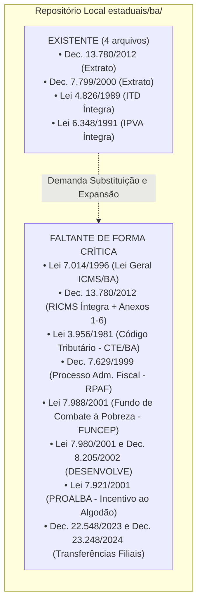
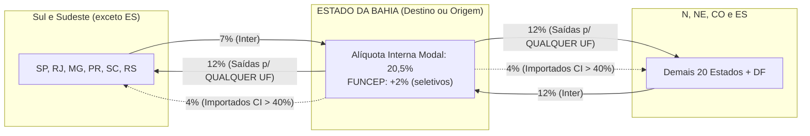
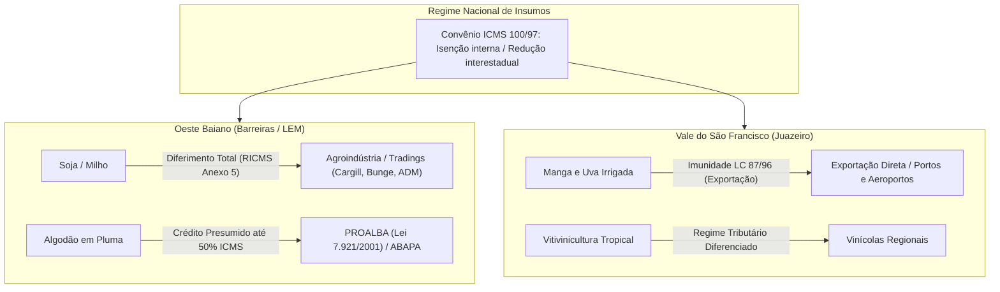
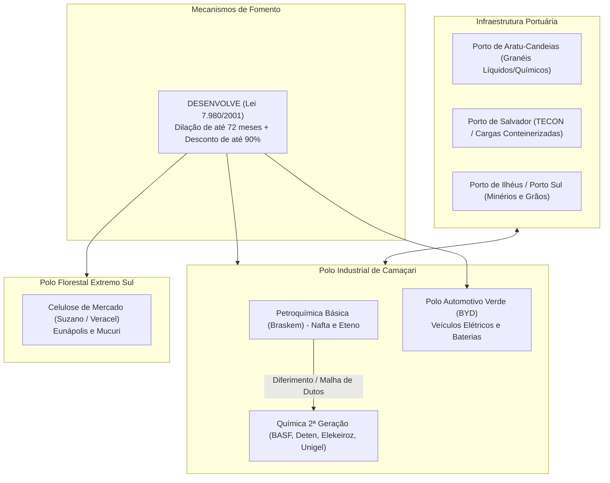
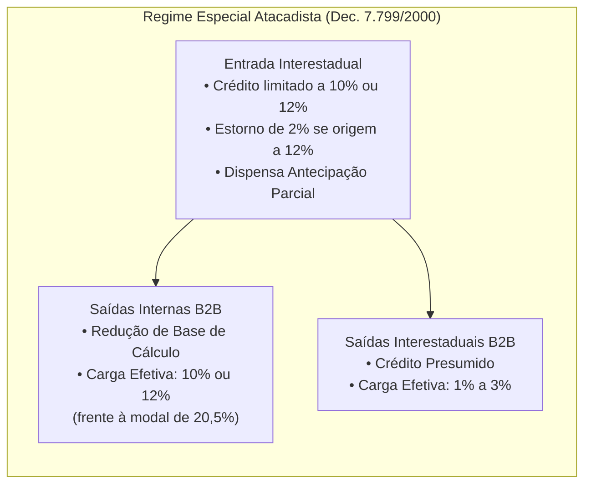
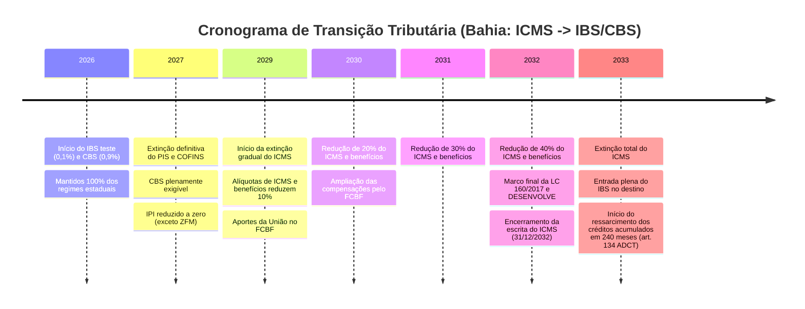

# Relatório de Auditoria Tributária: Estado da Bahia (BA)

**Data da Auditoria:** 31 de outubro de 2026  
**Auditor:** Agente Especialista no Ordenamento Tributário do Estado da Bahia  
**Arquivo de Referência:** `_auditoria/estados/auditoria_ba.md`  
**Escopo:** Auditoria do repositório normativo estadual (`estaduais/ba/`), mapeamento das relações tributárias federativas, análise detalhada dos mecanismos de dedução e tomada de crédito, regimes setoriais (agronegócio, polo petroquímico, polo automotivo, celulose e atacado/distribuição) e impactos da Reforma Tributária (IBS/CBS - EC nº 132/2023 e LC nº 214/2025).

---

## SUMÁRIO EXECUTIVO

O Estado da Bahia possui uma das estruturas tributárias mais complexas e sofisticadas do Sistema Tributário Nacional. Dotado de uma economia heterogênea — combinando o maior polo petroquímico integrado do Hemisfério Sul (Polo de Camaçari), um complexo automotivo elétrico e híbrido em consolidação (BYD), uma agroindústria de grãos e fibras de alta tecnologia no Oeste Baiano (Barreiras e Luís Eduardo Magalhães - MATOPIBA), a fruticultura tropical irrigada voltada à exportação no Vale do São Francisco (Juazeiro), além de um dinâmico setor atacadista e portuário (Salvador, Aratu e Ilhéus) —, o Fisco baiano estruturou seu ordenamento em torno de mecanismos singulares de antecipação tributária, diferimento e incentivos financeiro-fiscais (DESENVOLVE).

A presente auditoria identificou que a base normativa local presente no repositório (`estaduais/ba/`) encontra-se **altamente fragmentada e incompleta**. Embora contenha extratos sumários do RICMS/BA e dos incentivos ao atacado, bem como a íntegra das leis do ITD e IPVA, constata-se a **ausência crítica da íntegra consolidada da Lei nº 7.014/1996 (Lei Geral do ICMS baiano)**, do texto integral do **Decreto nº 13.780/2012 (RICMS/BA) e seus seis Anexos operacionais**, do **Código Tributário Estadual (Lei nº 3.956/1981)** e do arcabouço normativo pleno do **Programa DESENVOLVE (Lei nº 7.980/2001 e Decreto nº 8.205/2002)**.

Este relatório fornece a radiografia técnica integral da legislação tributária baiana, servindo como parecer de referência para conformidade fiscal, planejamento tributário interestadual e estruturação da transição constitucional para o IBS/CBS.

---

## 1. DIAGNÓSTICO DO REPOSITÓRIO LOCAL (`estaduais/ba/`) E GAP ANALYSIS

### 1.1 Normas Existentes no Repositório

O exame analítico dos arquivos alocados em `estaduais/ba/` revelou o seguinte quadro:

| Arquivo no Repositório | Identificação Formal | Cobertura / Conteúdo Real | Status e Diagnóstico Crítico |
| :--- | :--- | :--- | :--- |
| `ricms/decreto-13780-2012.md` | Decreto Estadual nº 13.780/2012 (RICMS/BA) | 89 linhas. Trata-se de um extrato didático resumido, abrangendo definições preliminares de incidência, alíquotas gerais (incluindo a elevação para 20,5% pela Lei 14.629/2023), DIFAL e Antecipação Parcial. | **INCOMPLETO**. Não contém os mais de 400 artigos do regulamento original, nem os Anexos 1 a 6 (tabelas de substituição tributária, reduções de base de cálculo, isenções, créditos outorgados, diferimento e suspensão). |
| `ricms/decreto-7799-2000-atacadista-desenvolve-ba.md` | Decreto Estadual nº 7.799/2000 e Lei nº 7.980/2001 | 85 linhas. Compilação esquemática do regime especial atacadista (redução de carga para 10%/12% e trava de crédito na entrada) e síntese dos pilares do DESENVOLVE (dilação de até 72 meses com desconto de até 90%). | **PARCIAL**. Fornece as diretrizes basilares das operações atacadistas e industriais, porém carece das minúcias dos Termos de Acordo (TAs), CNAEs beneficiados e regulamentação procedimental do Decreto 8.205/2002. |
| `leis/itcmd/lei-4826-1989.md` | Lei Estadual nº 4.826, de 27/01/1989 (ITD-BA) | 348 linhas. Texto integral e consolidado da legislação do Imposto sobre Transmissão Causa Mortis e Doação de Quaisquer Bens ou Direitos. | **CONFORME**. Apresenta redação atualizada com as Leis nº 14.802/2024 e nº 14.971/2025, disciplinando fatos geradores, alíquotas progressivas e procedimentos. |
| `leis/ipva/lei-6348-1991.md` | Lei Estadual nº 6.348, de 17/12/1991 (IPVA-BA) | 578 linhas. Texto integral e consolidado do Imposto sobre a Propriedade de Veículos Automotores. | **CONFORME**. Atualizado até a Lei nº 14.802/2024, contemplando inclusive a alteração da Lei nº 14.638/2023 que concedeu isenção a veículos elétricos de até R$ 300 mil e alíquota de 2,5% aos de maior valor. |

### 1.2 Gap Analysis: Inventário de Legislação Faltante

Para atingir autossuficiência e permitir auditoria contínua dos processos fiscais na Bahia, o repositório demanda a ingestão urgente dos seguintes diplomas:

1. **Lei Ordinária Estadual nº 7.014, de 04 de dezembro de 1996 (A Lei do ICMS da Bahia):**
   - *Importância:* É a norma primária que rege o ICMS no Estado. Contém os dispositivos fundamentais de incidência, não incidência, base de cálculo, responsabilidade solidária (inclusive de marketplaces e operadores logísticos), regime de antecipação com ou sem encerramento e penalidades.
   - *Alterações Críticas Não Consolidadas:*
     - **Lei nº 14.415/2021:** Adequou a legislação estadual à Lei Complementar Federal nº 190/2021 (DIFAL de consumidor final não contribuinte) e instituiu formalmente a **base dupla ("cálculo por dentro")** para apuração do DIFAL incidente sobre bens para uso, consumo e ativo imobilizado (Art. 17, XI e § 6º).
     - **Lei nº 14.629, de 08 de novembro de 2023:** Elevou a **alíquota geral modal do ICMS na Bahia de 19% para 20,5%**, com vigência a partir de 07 de fevereiro de 2024 (após o decurso do prazo nonagesimal do art. 150, III, "c" da CF/88), além de fixar 20,5% para energia elétrica e telecomunicações desde 01/01/2024.
     - **Artigo 12-A:** Mecanismo exclusivo da **Antecipação Parcial**, que impõe o pagamento na entrada interestadual da diferença entre a alíquota interna e a interestadual de mercadorias para revenda.

2. **Decreto Estadual nº 13.780, de 16 de março de 2012 (RICMS/BA Integral e Atualizado):**
   - *Importância:* O regulamento vigente do ICMS, que necessita ser armazenado com seus **seis anexos normativos**:
     - *Anexo 1:* Substituição Tributária (relação detalhada de mercadorias, MVAs originais e regras setoriais baseadas no Convênio ICMS 142/2018);
     - *Anexo 2:* Reduções de Base de Cálculo (cesta básica, insumos, bens industriais);
     - *Anexo 3:* Isenções (operações internas, agropecuárias, fármacos essenciais);
     - *Anexo 4:* Créditos Presumidos e Outorgados (indústria calçadista, fiação, reciclagem);
     - *Anexo 5:* Diferimento do Lançamento do Imposto (soja, milho, algodão, gado, café, cacau, insumos petroquímicos e energia);
     - *Anexo 6:* Suspensão da Exigibilidade do Tributo (remessas para conserto, industrialização por encomenda e feiras).

3. **Código Tributário do Estado da Bahia (Lei Estadual nº 3.956, de 05 de novembro de 1981 - CTE/BA):**
   - *Importância:* Estabelece os postulados de direito material e processual tributário no âmbito estadual, taxa de fiscalização e serviços diversos, dívida ativa, garantias do crédito tributário, regras gerais de sujeição passiva e domicílio fiscal eletrônico (DTE).

4. **Regulamento do Processo Administrativo Fiscal (Decreto Estadual nº 7.629, de 09 de julho de 1999 - RPAF/BA):**
   - *Importância:* Disciplina o rito de lavratura de Auto de Infração, notificação fiscal, defesas de 1ª Instância perante as Inspetorias Fazendárias e julgamentos colegiados de 2ª Instância perante o Conselho de Fazenda Estadual (**CONSEF**), regras de decadência, prescrição intercorrente e sustentação oral.

5. **Fundo Estadual de Combate e Erradicação da Pobreza (Lei Estadual nº 7.988, de 21 de dezembro de 2001 - FUNCEP/BA):**
   - *Importância:* Cria a incidência do adicional de **2% de ICMS** sobre produtos considerados supérfluos (bebidas alcoólicas, fumo e derivados, cosméticos, veículos náuticos, joias e aeronaves), detalhando sua mecânica de segregação contábil no SPED Fiscal e vedação à compensação com créditos normais.

6. **Incentivos Industriais e Regionais Convalidados (LC nº 160/2017 e Convênio ICMS nº 190/2017):**
   - *Lei Estadual nº 7.980, de 12 de dezembro de 2001 e Decreto nº 8.205/2002:* Programa de Desenvolvimento Industrial e de Integração Econômica do Estado da Bahia (**DESENVOLVE**).
   - *Lei Estadual nº 7.921, de 27 de setembro de 2001:* Programa de Incentivo à Cultura do Algodão da Bahia (**PROALBA**).
   - *Decreto Estadual nº 6.734, de 09 de setembro de 1997:* Regime de crédito presumido de até 90% a 100% para os setores têxtil, calçadista, móveis e componentes plásticos.

7. **Normas de Adequação à ADC 49 do STF e Lei Complementar Federal nº 204/2023:**
   - *Decretos Estaduais nº 22.548/2023, nº 22.804/2024 e nº 23.248/2024:* Introduziram formalmente no RICMS/BA a não incidência do imposto nas transferências entre estabelecimentos do mesmo titular (matriz e filial) e internalizaram as diretrizes dos Convênios ICMS nº 178/2023 e nº 109/2024 quanto à transferência facultativa/obrigatória de créditos fiscais.

---

## 2. RELACIONAMENTO TRIBUTÁRIO DO ICMS-BA COM OS DEMAIS 26 ESTADOS E DISTRITO FEDERAL

O relacionamento federativo da Bahia é moldado pela sua posição geopolítica como o principal mercado consumidor e centro industrial do Nordeste, fronteiriço com as regiões Sudeste (Minas Gerais e Espírito Santo), Centro-Oeste (Goiás e Tocantins) e estados nordestinos (Sergipe, Alagoas, Pernambuco e Piauí).

### 2.1 Alíquotas Interestaduais Aplicáveis

Com esteio nas Resoluções do Senado Federal nº 22/1989, nº 13/2012 e nº 95/1996, o fluxo tributário interestadual obedece às seguintes regras:

1. **Saídas Interestaduais Promovidas por Contribuintes Baianos:**
   - **Alíquota Unificada de 12%:** As saídas de mercadorias produzidas no país ou nacionalizadas destinadas a **qualquer outra Unidade da Federação** (seja no Sul, Sudeste, Norte, Nordeste ou Centro-Oeste) são tributadas à alíquota de **12%**. A Bahia não possui operações de saída interestaduais a 7% (esta última reservada constitucionalmente apenas aos estados do Sul e Sudeste, exceto ES, quando destinam ao N, NE, CO e ES).
2. **Entradas Interestaduais Destinadas à Bahia:**
   - **Alíquota de 7% (Origem Sul e Sudeste, exceto Espírito Santo):** Mercadorias oriundas de São Paulo, Rio de Janeiro, Minas Gerais, Paraná, Santa Catarina e Rio Grande do Sul ingressam na Bahia com débito destacado de 7% na nota de origem.
   - **Alíquota de 12% (Origem Norte, Nordeste, Centro-Oeste e Espírito Santo):** Mercadorias oriundas dos estados dessas regiões ingressam na Bahia tributadas a 12% na origem.
3. **Resolução do Senado Federal nº 13/2012 (Alíquota Interestadual de 4% para Importados):**
   - Aplica-se a alíquota unificada de **4%** nas saídas interestaduais promovidas pela Bahia (e nas entradas destinadas à Bahia) de bens e mercadorias importados do exterior que:
     - Não tenham sido submetidos a processo de industrialização; ou
     - Sendo submetidos a qualquer processo de transformação/beneficiamento, resultem em mercadoria com **Conteúdo de Importação superior a 40%** (apurado mediante Ficha de Conteúdo de Importação - FCI, regulada pelo Convênio ICMS nº 38/2013).
   - *Exceções à alíquota de 4%:* Bens sem similar nacional constantes da Lista CAMEX, mercadorias produzidas em conformidade com o Processo Produtivo Básico (PPB) e gás natural importado do exterior.
4. **Transporte Aéreo Interestadual:** Alíquota de **4%** (Resolução do Senado Federal nº 95/1996).

### 2.2 Alíquota Interna Modal e Evolução Recente

A Lei Estadual nº 14.629, de 08 de novembro de 2023, promoveu uma expressiva reformulação no art. 15 da Lei Estadual nº 7.014/1996:

* **Alíquota Geral Modal:** Fixada em **20,5%** (vigência a partir de **07/02/2024**).
* **Histórico Temporal:** 
  - Até 2022: 18%;
  - Em 2023: 19% (Lei nº 14.415/2021);
  - A partir de 07/02/2024: 20,5% (Lei nº 14.629/2023).
* **Alíquotas Internas Seletivas:**
  - *7%:* Alimentos componentes da cesta básica baiana (feijão, arroz, farinha de mandioca, fubá de milho, leite pasteurizado tipo popular);
  - *12%:* Produtos da indústria de transformação local (artigos de vestuário, calçados e móveis produzidos na BA);
  - *20,5%:* Energia elétrica e telecomunicações (ajustados após o julgamento do Tema 745/STF e da LC 194/2022, que vedaram alíquotas de supérfluos para serviços essenciais, balizando-as pela modal);
  - *27% a 29%:* Bebidas alcoólicas finas, fumo, charutos e cigarros (27% + 2% do FUNCEP).

### 2.3 Mecânica do Diferencial de Alíquotas (DIFAL)

O ordenamento baiano prevê regimes de apuração distintos a depender da qualidade jurídica do destinatário (contribuinte ou não contribuinte) e da destinação do bem:

#### A. DIFAL Consumo / Ativo Imobilizado (B2B - Adquirente Contribuinte)
Regulado pelo Art. 17, XI e § 6º da Lei Estadual nº 7.014/1996 (redação conferida pela Lei nº 14.415/2021) e pelo RICMS/BA, a Bahia adota o método de **Base Dupla (cálculo "por dentro")**:

O legislador baiano expurga o ICMS interestadual da base original e inclui a alíquota interna do Estado (20,5%), exigindo a aplicação da seguinte fórmula matemática:

$$\text{Base Dupla} = \frac{\text{Valor da Operação Interestadual} - \text{ICMS Interestadual}}{1 - \text{ALQ Intra}}$$

$$\text{DIFAL Devido} = (\text{Base Dupla} \times \text{ALQ Intra}) - (\text{Valor da Operação Interestadual} \times \text{ALQ Inter})$$

**Exemplo Prático Comparativo:**
Aquisição interestadual de um equipamento para o Ativo Imobilizado no valor de R$ 100.000,00 (frete e despesas inclusos):

1. **Cenário 1 — Remetente em São Paulo (Alíquota Interestadual de 7%):**
   - ICMS Interestadual destacado: $R\$ 100.000,00 \times 7\% = R\$ 7.000,00$;
   - Base de Cálculo sem ICMS origem: $R\$ 100.000,00 - R\$ 7.000,00 = R\$ 93.000,00$;
   - Base Dupla por dentro ($\text{ALQ Intra} = 20,5\%$): $\frac{R\$ 93.000,00}{1 - 0,205} = \frac{R\$ 93.000,00}{0,795} = R\$ 116.981,13$;
   - ICMS Total Interno: $R\$ 116.981,13 \times 20,5\% = R\$ 23.981,13$;
   - Crédito da Origem: $R\$ 7.000,00$;
   - **DIFAL a Recolher à Bahia:** $R\$ 23.981,13 - R\$ 7.000,00 = \mathbf{R\$ 16.981,13}$ (Carga Efetiva de DIFAL = 16,98% sobre a nota original).

2. **Cenário 2 — Remetente em Pernambuco (Alíquota Interestadual de 12%):**
   - ICMS Interestadual destacado: $R\$ 100.000,00 \times 12\% = R\$ 12.000,00$;
   - Base de Cálculo sem ICMS origem: $R\$ 100.000,00 - R\$ 12.000,00 = R\$ 88.000,00$;
   - Base Dupla por dentro: $\frac{R\$ 88.000,00}{0,795} = R\$ 110.691,82$;
   - ICMS Total Interno: $R\$ 110.691,82 \times 20,5\% = R\$ 22.691,82$;
   - Crédito da Origem: $R\$ 12.000,00$;
   - **DIFAL a Recolher à Bahia:** $R\$ 22.691,82 - R\$ 12.000,00 = \mathbf{R\$ 10.691,82}$ (Carga Efetiva de DIFAL = 10,69%).

#### B. DIFAL Não Contribuinte (B2C - EC nº 87/2015 e LC nº 190/2021)
Nas remessas interestaduais com destino à Bahia direcionadas a consumidor final não contribuinte do ICMS (comércio eletrônico, marketplaces e vendas telepresenciais - CFOP `6.107`/`6.108`):
* O remetente de outra UF é o responsável tributário pelo recolhimento do DIFAL integralmente em favor do Estado da Bahia (partilha 100% destino consolidada);
* Base de cálculo: Única, com aplicação da alíquota modal interna de **20,5%** (acrescida de 2% do FUNCEP caso a mercadoria esteja classificada na lista de supérfluos da Lei nº 7.988/2001, totalizando **22,5%**);
* Recolhimento: Por guia individual (GNRE código 10010-2 ou Documento de Arrecadação Estadual - DAE) antes do despacho aduaneiro/transporte, ou mensalmente até o 15º dia do mês subsequente caso o remetente possua Inscrição Estadual Especial na SEFAZ/BA como substituto tributário (Convênio ICMS nº 236/2021).

### 2.4 A Antecipação Parcial do ICMS (Art. 12-A da Lei nº 7.014/1996 e Art. 321 do RICMS/BA)

A **Antecipação Parcial** constitui uma das figuras mais singulares e arrecadatórias do Fisco baiano:

* **Hipótese de Incidência:** Exigida em **todas as entradas interestaduais de mercadorias destinadas à comercialização** (revenda), quando não submetidas ao regime de Substituição Tributária definitiva (ICMS-ST).
* **Fórmula de Apuração:**
  $$\text{Valor da Antecipação Parcial} = V_{\text{op}} \times (\text{ALQ Intra} - \text{ALQ Inter})$$
  *(onde $V_{\text{op}}$ compreende o valor da mercadoria acrescido de IPI, frete, seguro e demais despesas acessórias).*
* **Natureza Jurídica e Não Encerramento da Fase:** Diferentemente da Substituição Tributária, a Antecipação Parcial **não encerra a fase de tributação**. O valor recolhido sob esta rubrica constitui **crédito fiscal** na escrita do contribuinte sob regime de apuração normal (lucro real ou presumido), a ser apropriado no período de apuração em que ocorrer o recolhimento (ou a entrada), compensando-se com os débitos das saídas subsequentes.
* **Impacto Drástico sobre Optantes do Simples Nacional:** Nas aquisições interestaduais efetuadas por empresas do Simples Nacional, a Antecipação Parcial atua como verdadeiro custo tributário final (pois tais contribuintes não tomam créditos na conta corrente). O Estado da Bahia concede um coeficiente de redução de até 60% para microempresas e empresas de pequeno porte de menor porte cadastral, mitigando a carga, mas mantendo a barreira fiscal de entrada.

### 2.5 Transferências Interestaduais entre Filiais (ADC 49/STF, LC nº 204/2023, Convênios ICMS nº 178/2023 e nº 109/2024)

Em observância à decisão de mérito proferida pelo STF na Ação Declaratória de Constitucionalidade nº 49 e à superveniência da Lei Complementar nº 204/2023, a SEFAZ/BA adequou sua legislação (Decreto Estadual nº 13.780/2012, alterado pelos Decretos nº 22.548/2023, nº 22.804/2024 e nº 23.248/2024):

1. **Regra Geral de Não Incidência:** A saída física de mercadorias de um estabelecimento para outro de mesma titularidade (matriz e filiais) não constitui fato gerador do ICMS.
2. **Transferência Obrigatória do Crédito Fiscal (Convênio ICMS nº 178/2023):**
   - O estabelecimento remetente baiano deve transferir o crédito fiscal acumulado correspondente às entradas ao estabelecimento destinatário de outro Estado;
   - O teto da transferência é parametrizado pelo valor resultante da aplicação da alíquota interestadual (4% ou 12%) sobre:
     - O valor correspondente à entrada mais recente da mercadoria; ou
     - O custo da mercadoria produzida (matéria-prima, insumos e custos de fabricação).
3. **Faculdade de Equiparação a Operação Tributada (Convênio ICMS nº 109/2024):**
   - O contribuinte estabelecido na Bahia pode formalizar a **opção por equiparar as transferências a operações regularmente tributadas**, conforme assegurado pelo § 5º do art. 12 da LC nº 87/1996 e pela Cláusula sexta do Convênio ICMS 109/2024;
   - Essa sistemática é altamente vantajosa para indústrias beneficiárias de programas com diferimento na entrada (como o DESENVOLVE ou o Polo de Camaçari), evitando o acúmulo desproporcional de saldos credores ilíquidos na unidade fabril baiana;
   - A opção deve ser formalizada mediante lavratura de termo no Registro de Utilização de Documentos Fiscais e Termos de Ocorrências (RUDFTO) e vincula todos os estabelecimentos da pessoa jurídica no território nacional pelo ano-calendário correspondente.

### 2.6 Substituição Tributária (ICMS-ST) Interestadual e Convênio ICMS 142/2018

A Bahia é signatária de dezenas de Protocolos e Convênios ICMS de Substituição Tributária, constantes do Anexo 1 do RICMS/BA.

* **Fórmula da MVA Ajustada (Operações com Contribuintes Normais):**
  $$\text{MVA Ajustada} = \left[ \frac{(1 + \text{MVA Original}) \times (1 - \text{ALQ Inter})}{(1 - \text{ALQ Intra})} \right] - 1$$
  Com a majoração da alíquota interna da Bahia para **20,5%**, o denominador $(1 - 0,205 = 0,795)$ torna a MVA Ajustada extremamente gravosa para remetentes situados em São Paulo e Sul/Sudeste tributados a 7%:
  $$\text{Fator de Ajuste (Origem a 7\%)} = \frac{1 - 0,07}{1 - 0,205} = \frac{0,93}{0,795} \approx \mathbf{1,1698}$$
  Isso significa que a margem de valor agregado original sofre uma majoração de quase **17%** pelo simples fato de ingressar no território baiano oriunda do Sul/Sudeste.
* **Remetentes Optantes pelo Simples Nacional:** Por força do **Convênio ICMS nº 35/2011**, quando o estabelecimento industrial ou atacadista remetente de outra UF for optante pelo regime do Simples Nacional, **não se aplica o cálculo da MVA Ajustada**, devendo o imposto retido ser apurado aplicando-se exclusivamente a **MVA Original** fixada no Anexo 1 do RICMS/BA.

---

## 3. MECANISMOS DE DEDUÇÃO E TOMADA DE CRÉDITO DO ICMS/BA

A sistemática de créditos fiscais na Bahia é balizada pela estrita conformidade com a Lei Complementar nº 87/1996 (Lei Kandir) e pelos artigos 297 a 330 do Decreto nº 13.780/2012.

### 3.1 Não-Cumulatividade, Vedação e Estorno de Crédito

* **Princípio do Crédito Financeiro Condicionado:** O RICMS/BA assegura o abatimento do imposto incidente nas entradas de mercadorias que ingressem no estabelecimento para comercialização, industrialização (matérias-primas, produtos intermediários e embalagens) ou prestação de serviços tributados.
* **Hipóteses de Vedação Expressa (Art. 308 do RICMS/BA):**
  - Aquisições de mercadorias ou serviços destinados a operações subsequentes isentas ou não tributadas (ressalvada a manutenção para exportação);
  - Bens ou mercadorias cujas saídas ocorram com redução de base de cálculo (vedação proporcional à parcela desonerada);
  - Mercadorias destinadas a uso ou consumo do estabelecimento (conforme prorrogação da LC nº 87/1996);
  - Operações acobertadas por documentos fiscais inidôneos, emitidos por contribuintes descredenciados ou com inscrições canceladas no CAD-ICMS.
* **Obrigatoriedade de Estorno Fiscal (Art. 312 do RICMS/BA):**
  - Mercadorias que vierem a perecer, deteriorar-se, extraviar-se ou forem objeto de roubo/furto no estabelecimento;
  - Utilização em processo de industrialização cujo produto final resulte em mercadoria isenta ou não tributada;
  - Operações contempladas por regimes especiais com "trava de crédito" (vide Seção 6 sobre atacadistas).
* **Manutenção Integral de Crédito:** Expressamente resguardada nas remessas ao exterior (imunidade do art. 155, § 2º, X, "a" da CF/88 e art. 3º, II da LC 87/96), garantindo a formação de saldos credores exportadores.

### 3.2 Ativo Permanente e Controle de Crédito do CIAP (1/48 Avos)

A tomada de crédito sobre bens do Ativo Imobilizado segue o rito da Lei Complementar nº 102/2000:

* **Fracionamento:** O crédito é apropriado à razão de **1/48 (um quarenta e oito avos) por mês**, iniciando-se no mês em que ocorrer a entrada física do bem no estabelecimento;
* **Fator de Proporcionalidade Mensal:** A fração de 1/48 deve ser multiplicada pelo quociente entre as saídas/prestações tributadas (somadas às saídas desoneradas com direito a manutenção de crédito, como as exportações) e o total geral das saídas realizadas no mesmo período de apuração:
  $$\text{Fator Mensal} = \frac{\text{Saídas Tributadas} + \text{Exportações}}{\text{Total das Saídas}}$$
  $$\text{Crédito Efetivo CIAP Mensal} = \left( \frac{\text{ICMS Total Destacado}}{48} \right) \times \text{Fator Mensal}$$
* **Desincorporação ou Alienação Antecipada:** Se o bem do ativo for alienado antes do término do quadriênio (48 meses), cessa imediatamente a apropriação dos avos remanescentes, sendo vedada a apropriação do saldo residual;
* **Obrigações Acessórias:** Exige-se escrituração contínua do **Bloco G da Escrituração Fiscal Digital (EFD-ICMS/IPI)**, sob pena de glosa do crédito e aplicação de multa acessória de 5% do valor da operação.

### 3.3 Restrições Setoriais da Lei Complementar nº 87/1996

1. **Energia Elétrica (Art. 33, II da LC nº 87/1996 e Art. 301 do RICMS/BA):**
   - Somente dá direito a crédito a entrada de energia elétrica quando:
     - For consumida no processo de industrialização (mediante laudo técnico de perito que certifique o consumo específico nos centros de custo produtivos);
     - Seu consumo resultar em operação de saída ou prestação para o exterior (na proporção destas saídas);
     - O estabelecimento for empresa geradora ou distribuidora de energia.
2. **Serviços de Comunicação (Art. 33, III da LC nº 87/1996):**
   - Somente geram crédito para estabelecimentos que prestem serviços da mesma natureza ou quando utilizados na execução de serviços de exportação para o exterior. Estabelecimentos comerciais e industriais gerais não podem abater o ICMS incidente sobre contas telefônicas ou pacotes de dados.
3. **Bens de Uso e Consumo:** Postergação mantida pelo art. 33, I da LC 87/96 (com vigência transferida para a transição da Reforma Tributária).

### 3.4 Adicional do Fundo Estadual de Combate à Pobreza (FUNCEP - 2%)

* **Norma Regulamentadora:** Lei Estadual nº 7.988, de 21 de dezembro de 2001;
* **Mecânica de Apuração:** Alíquota adicional de **2%** vinculada a um rol específico de mercadorias e serviços supérfluos (como bebidas alcoólicas, cigarros, cosméticos, iates, veículos de alta potência);
* **Vedação à Compensação Financeira:** A parcela correspondente aos 2% do FUNCEP deve ser apurada e recolhida **em separado**, não podendo ser absorvida por saldos credores normais acumulados da conta corrente fiscal ordinária. A escrituração deve ser demonstrada no Registro `E110`/`E115` do SPED Fiscal como recolhimento extra-apuração.

---

## 4. SETOR AGRÍCOLA E RURAL BAIANO

A Bahia ostenta a agropecuária mais diversificada do país, com destaque internacional para a fronteira agrícola do Oeste Baiano (grãos e fibras) e o polo hidroagrícola do Vale do São Francisco (fruticultura e vitivinicultura).

### 4.1 O Agronegócio do Oeste Baiano (MATOPIBA)

Com polos em Luís Eduardo Magalhães (LEM), Barreiras, São Desidério, Formosa do Rio Preto e Correntina, a região é responsável por safras recordes de soja, algodão e milho:

1. **Complexo Soja e Milho (Diferimento no Anexo 5 do RICMS/BA):**
   - As saídas internas de soja e milho promovidas por produtores rurais com destino a indústrias esmagadoras ou armazéns gerais sediados na Bahia ocorrem com **diferimento total do ICMS** (o imposto fica postergado para o momento da saída subsequente do óleo, farelo ou grão);
   - Quando a saída subsequente for destinada à exportação para o exterior promovida pelas grandes tradings (Bunge, Cargill, ADM, Louis Dreyfus, Amaggi), opera-se a desoneração definitiva por imunidade (Lei Kandir), assegurando a manutenção integral dos créditos dos insumos agrícolas pelo produtor ou empresa exportadora.
2. **Cultura do Algodão e o Programa PROALBA (Lei Estadual nº 7.921/2001):**
   - A Bahia é o segundo maior produtor de algodão do Brasil, com fibra de alta tecnologia têxtil;
   - O **PROALBA (Programa de Incentivo à Cultura do Algodão da Bahia)** concede **crédito presumido de até 50% do valor do ICMS incidente** nas operações com algodão em pluma e caroço de algodão produzidos no Estado;
   - O benefício é condicionado à filiação do cotonicultor à Associação Baiana dos Produtores de Algodão (**ABAPA**), cumprimento de programas de combate a pragas (como o bicudo-do-algodoeiro) e investimentos em sustentabilidade ambiental e qualidade da fibra.

### 4.2 Fruticultura e Vitivinicultura do Vale do São Francisco (Juazeiro)

O polo de Juazeiro, Casa Nova e Sobradinho concentra a maior produção irrigada de frutas de mesa do Brasil:

* **Manga e Uva de Mesa para Exportação:** Mais de 90% das uvas de mesa sem semente e mangas (Tommy Atkins, Palmer e Keitt) exportadas pelo Brasil provêm do Vale do São Francisco. As operações de exportação direta ou indireta via *trading companies* são plenamente imunes de ICMS, gerando volumosos créditos de ICMS sobre fertilizantes, embalagens sofisticadas e insumos de colheita/frio;
* **Diferimento Interno:** As remessas internas entre pomares, cooperativas de produtores (como a Valexport) e *packing houses* ocorrem sob regime de diferimento do lançamento do imposto (Art. 286 e Anexo 5 do RICMS/BA);
* **Crédito Presumido da Indústria de Polpas e Sucos:** Empresas que transformam frutas locais em polpas, sucos concentrados ou vinhos tropicais usufruem de redução de base de cálculo e crédito outorgado que limitam a carga efetiva interna a patamares entre **1% e 3%**.

### 4.3 Insumos Agropecuários (Convênio ICMS 100/1997)

A Bahia aplica integralmente o Convênio ICMS nº 100/1997 e suas prorrogações/atualizações:

* **Operações Internas:** Isenção total do ICMS nas saídas internas de sementes certificadas, fertilizantes, adubos, defensivos agropecuários, rações balanceadas, calcário e gesso agrícola;
* **Operações Interestaduais:** Redução de base de cálculo de **30% ou 60%**, com tributação escalonada gradual sobre fertilizantes químicos (obedecendo ao cronograma de transição do Convênio ICMS nº 26/2021).

### 4.4 Cafeicultura, Pecuária e Cacau

* **Cafeicultura (Chapada Diamantina e Sudoeste):** Produção de cafés especiais em Piatã/Mucugê e café conilon no Extremo Sul. As saídas internas de café cru em grão operam com diferimento do imposto até a saída para torrefação ou exportação;
* **Pecuária de Corte e Frigoríficos:** Pautas fiscais periódicas fixam o valor mínimo do gado em pé para abate. Ocorre diferimento do ICMS nas saídas de bovinos de produtor rural para frigoríficos credenciados na Bahia com Inspeção Federal (SIF) ou Estadual (SIE), com crédito presumido concedido aos abatedouros na saída da carne resfriada;
* **Cacauicultura (Sul Baiano - Ilhéus/Itabuna):** Tradicional bacia cacaueira em verticalização para a indústria chocolateira "Bean-to-Bar". O diferimento é assegurado nas saídas internas da amêndoa de cacau cru do produtor rural para as moageiras internacionais (Barry Callebaut, Cargill e Olam em Ilhéus).

### 4.5 Nota Fiscal Eletrônica e Regime Simplificado do Produtor Rural

* **Obrigatoriedade da NFP-e (Modelo 55):** O produtor rural pessoa física na Bahia emite a Nota Fiscal Avulsa Eletrônica diretamente pelo portal da SEFAZ/BA ou via aplicativo mobile oficial, sem necessidade de constituir pessoa jurídica;
* **Inscrição no CAD-ICMS Rural:** Registro simplificado que dispensa o produtor primário de escrituração do SPED Fiscal (EFD), ficando sujeito apenas à guarda das notas de entrada de insumos e saída da produção;
* **Regime de Liquidação Simplificada:** Quando o produtor destina mercadorias a contribuinte inscrito no regime normal (indústria ou atacadista), a responsabilidade pelo recolhimento do imposto diferido ou pela emissão da nota de entrada é assumida pelo destinatário (emissão de NF-e de Entrada com CFOP `1.101`/`1.102` com destaque do diferimento).

---

## 5. SETOR INDUSTRIAL E PORTUÁRIO BAIANO

A Bahia é o motor industrial do Nordeste, estruturada em arranjos industriais altamente verticalizados e intensivos em capital.

### 5.1 O Polo Petroquímico de Camaçari

Inaugurado em 1978, é o maior complexo integrado do Hemisfério Sul, abrigando mais de 90 indústrias:

* **Primeira Geração (Petroquímica Básica):** A unidade de insumos básicos da **Braskem (UNIB)** recebe nafta petroquímica e gás natural para produzir petroquímicos de base (eteno, propeno, butadieno, benzeno, tolueno, xilenos).
  - *Tributação da Nafta:* A importação e a aquisição interna de nafta petroquímica gozam de **diferimento do ICMS** quando destinadas à central de matérias-primas de Camaçari.
  - *Suprimento Contínuo por Dutos:* A transferência física de eteno e propeno gasosos entre a Braskem e as indústrias de segunda geração é realizada por malha de dutos ininterruptos, operando com **suspensão ou diferimento do ICMS** até a saída dos produtos acabados ou intermediários.
* **Segunda e Terceira Geração:**
  - **BASF:** Maior complexo de acrílicos da América do Sul (ácido acrílico, acrilato de butila e polímeros superabsorventes - SAP);
  - **Deten Química:** Líder nacional em Linear Alquilbenzeno (LAB), insumo básico para detergentes biodegradáveis;
  - **Elekeiroz:** Produção de anidrido ftálico, plastificantes e oxo-álcoois;
  - **Unigel:** Fabricação de estireno, poliestireno e fertilizantes nitrogenados (ureia e amônia na planta de Camaçari).
* **Gás Natural Canalizado (Bahiagás):** O fornecimento de gás natural para o Polo é objeto de tratamento tributário específico, com diferimento nas operações destinadas à geração termelétrica ou matéria-prima de síntese química, além de alíquota interna diferenciada fixada no RICMS/BA.
* **Conexão com o REIQ (Regime Especial da Indústria Química - Lei Federal nº 11.196/2005):** Os incentivos estaduais de diferimento do ICMS operam em simbiose com as reduções de PIS/COFINS concedidas pela União sobre nafta, eteno e propeno.

### 5.2 O Novo Polo Automotivo de Camaçari (Complexo BYD)

Após a histórica desativação da fábrica da Ford Motor Company em 2021, o complexo industrial passou por uma transformação radical:

* **Instalação da BYD (Build Your Dreams):** Maior fabricante mundial de veículos eletrificados, com investimentos superiores a R$ 5,5 bilhões para estruturar três unidades fabris integradas:
  1. Produção de automóveis de passeio elétricos e híbridos leves/plug-in;
  2. Fabricação de chassis de ônibus e caminhões 100% elétricos;
  3. Planta de processamento de fosfato de ferro e lítio para baterias.
* **Mecanismos Fiscais Estaduais:**
  - **Isenção e Redução de IPVA (Lei Estadual nº 14.638, de 07/12/2023):** Acrescentou o inciso XIII ao art. 4º da Lei nº 6.348/1991, concedendo **isenção total (100%) de IPVA para veículos 100% elétricos** com valor venal de até **R$ 300.000,00**, e alíquota reduzida de **2,5%** para veículos elétricos acima desse limite;
  - **Enquadramento no Programa DESENVOLVE:** Concessão de dilação de pagamento com desconto do ICMS de até 90% para as operações industriais do complexo por 12 anos.
* **Regime Automotivo Regional Federal (Lei nº 9.440/1997 e EC nº 132/2023):**
  - O complexo da BYD foi formalmente contemplado pela extensão dos incentivos fiscais do Regime Automotivo do Nordeste, cuja vigência foi constitucionalizada pelo art. 19 da Emenda Constitucional nº 132/2023 (Reforma Tributária) até 31 de dezembro de 2032, concedendo crédito presumido de IPI/PIS/COFINS (e posterior transição no IBS/CBS) sobre os veículos produzidos em Camaçari.

### 5.3 Polo de Papel e Celulose do Extremo Sul (Suzano / Veracel)

Localizado nos municípios de Eunápolis, Mucuri e Teixeira de Freitas:

* **Suzano e Veracel Celulose:** Gigantes mundiais de celulose branqueada de eucalipto de fibra curta;
* **Cadeia Florestal e Silvicultura:** Operações com diferimento total do ICMS nas saídas internas de madeira em toras de produtores e parceiros florestais com destino às fábricas de celulose;
* **Perfil Quase Exclusivo de Exportação:** As remessas de celulose para o mercado externo através dos portos geram créditos acumulados gigantescos de ICMS na escrita fiscal das empresas, decorrentes da aquisição de máquinas pesadas, químicos alvejantes e serviços de transporte multimodal, demandando frequentes pedidos de homologação de crédito acumulado para transferência a fornecedores ou projetos de investimento aprovados pela SEFAZ/BA.

### 5.4 Programa DESENVOLVE (Lei Estadual nº 7.980/2001 e Decreto nº 8.205/2002)

O DESENVOLVE é a espinha dorsal da política de atração industrial do Estado da Bahia:

* **Objetivo:** Estimular investimentos industriais, agroindustriais e de infraestrutura com foco na descentralização geográfica e interiorização econômica;
* **Mecânica Operacional (Incentivo Financeiro-Fiscal):**
  1. *Diferimento de Entrada:* Diferimento do ICMS na importação e aquisição interna de bens de capital destinados ao ativo fixo, e no DIFAL de máquinas e equipamentos interestaduais;
  2. *Diferimento de Matérias-Primas:* Aplicação de diferimento nas aquisições de insumos utilizados na industrialização;
  3. *Dilação de Prazo com Desconto na Liquidação Antecipada:*
     - Concede-se dilação de prazo de até **72 (setenta e dois) meses** para o recolhimento de **70% a 90%** do saldo devedor mensal do ICMS gerado pelo empreendimento;
     - Para cada parcela dilatada que for quitada antecipadamente (no mês seguinte ao da apuração), concede-se um **desconto financeiro de 70% a 90%** sobre o valor da parcela.
* **Carga Efetiva Residual:** Na prática, uma indústria enquadrada na faixa máxima (90% de dilação com 90% de desconto) recolhe apenas **19% do saldo devedor ordinário de ICMS** (gerando um benefício econômico de 81% de renúncia fiscal), com contrapartida de depósito de 10% do incentivo ao Fundo de Desenvolvimento Social e Econômico (FUNDESE) ou agências correlatas;
* **Convalidação Jurídica:** Benefício devidamente registrado e depositado no CONFAZ em cumprimento à Lei Complementar Federal nº 160/2017 e ao Convênio ICMS nº 190/2017.

### 5.5 Portos Baianos e Regimes Aduaneiros Especiais

* **Porto de Salvador (TECON Salvador):** Principal terminal de contêineres e carga geral, movimentando partes automotivas, maquinários e eletrônicos;
* **Porto de Aratu-Candeias:** Terminal graneleiro de excelência da Baía de Todos os Santos, especializado no desembarque de fertilizantes para o Oeste e no escoamento de produtos químicos, nafta e derivados do Polo de Camaçari;
* **Porto de Ilhéus e Porto Sul (em integração com a FIOL - Ferrovia de Integração Oeste-Leste):** Plataforma logística vocacionada para o escoamento de grãos do Oeste e minério de ferro de Caetité (BAMIN);
* **Regime de Drawback (Convênio ICMS nº 27/1990):** Isenção ou suspensão integral do ICMS na importação de mercadorias para industrialização sob o regime aduaneiro especial de Drawback Suspensão ou Isenção, exigindo comprovação eletrônica da efetiva exportação do produto acabado.

---

## 6. SETOR DE PRODUTO ACABADO (ATACADO, VAREJO E DISTRIBUIÇÃO)

A Bahia atua estrategicamente como polo distribuidor de mercadorias para todo o Norte/Nordeste através de uma malha atacadista robusta e regimes fiscais altamente atrativos.

### 6.1 O Regime Especial do Comércio Atacadista Baiano (Decreto nº 7.799/2000)

O Decreto Estadual nº 7.799/2000 instituiu um dos tratamentos tributários mais competitivos do país para empresas do comércio atacadista e Centros de Distribuição (CDs):

1. **Operações Internas de Saída (B2B):**
   - Aplica-se uma **redução de base de cálculo** do ICMS de modo que a **carga tributária incidente na operação resulte em 10% (dez por cento) ou 12% (doze por cento)**, a depender do segmento econômico da mercadoria (produtos alimentícios, limpeza, papelaria, construção civil, autopeças);
   - Frente à alíquota interna padrão de **20,5%**, o atacadista obtém uma redução tributária nominal de praticamente metade do imposto;
   - *Condições:* Vendas exclusivas a pessoas jurídicas inscritas no CAD-ICMS para posterior comercialização ou industrialização.
2. **A "Trava de Crédito" nas Aquisições Interestaduais (Art. 6º do Decreto 7.799/2000):**
   - Para evitar distorções fiscais, o regulamento veda expressamente o aproveitamento de créditos fiscais de ICMS na entrada em montante superior à carga tributária de saída pactuada (10% ou 12%);
   - **Mecanismo de Estorno Obrigatório:** Caso o atacadista baiano adquira mercadorias oriundas de estados do Norte, Nordeste, Centro-Oeste ou Espírito Santo, cuja alíquota interestadual destacada na nota seja de **12%**, e realize a saída interna sob a carga de **10%**, é legalmente obrigado a **estornar a diferença de 2% (dois por cento)** do crédito na sua escrita fiscal;
   - **Aquisições do Sul/Sudeste a 7%:** O contribuinte apropria integralmente os 7% e fica dispensado do recolhimento da Antecipação Parcial (Art. 12-A da Lei 7.014/96).
3. **Saídas Interestaduais de Mercadorias (Competitividade Regional):**
   - Nas saídas de mercadorias destinadas a contribuintes de outros estados tributadas a 12% ou 4%, a legislação e os Termos de Acordo específicos asseguram a concessão de **crédito presumido** que reduz a **carga tributária efetiva final para a faixa de 1% a 3%**, permitindo aos atacadistas baianos concorrer diretamente com os incentivos dos estados de Pernambuco (PRODEPE), Ceará e Espírito Santo (COMPETE).

### 6.2 MVA / IVA-ST e Pautas Fiscais da SEFAZ/BA

* **MVA Ajustada Interestadual:** Disciplinada pelas regras gerais do Convênio ICMS nº 142/2018 e Anexo 1 do Decreto nº 13.780/2012, incidindo majorada nas entradas interestaduais em função da alíquota baiana de 20,5%;
* **Preço Médio Ponderado a Consumidor Final (PMPF):** A SEFAZ/BA adota pautas fiscais periódicas de PMPF para a apuração da base de cálculo do ICMS-ST em setores com alta dispersão varejista, notadamente cervejas, refrigerantes, água mineral, combustíveis automotivos e cimento;
* **Ressarcimento do ICMS-ST (Tema 201/STF):** O Estado da Bahia regulamentou o direito do contribuinte substituído de requerer o ressarcimento da diferença do ICMS-ST recolhido a maior quando a base de cálculo real da venda a consumidor final for inferior à base presumida originária, exigindo auditoria prévia das notas fiscais eletrônicas através da malha da SEFAZ.

### 6.3 E-commerce e Marketplaces (Responsabilidade Tributária)

* **Responsabilidade Solidária de Intermediadores:** A Lei Estadual nº 7.014/1996 e as normas procedimentais da SEFAZ/BA estabelecem a responsabilidade tributária solidária das plataformas digitais, *marketplaces* e operadores logísticos (*fulfillment*) pelo recolhimento do imposto e penalidades relativas a vendas efetuadas por vendedores que não emitam documento fiscal idôneo ou que operem sem regularidade no CAD-ICMS;
* **Centros de Distribuição para Vendas Não Presenciais:** Empresas de *e-commerce* que instalam centrais de distribuição em território baiano para atendimento de demandas regionais contam com regimes especiais que compatibilizam o DIFAL da EC 87/2015 com créditos presumidos operacionais.

---

## 7. TRANSIÇÃO PARA O NOVO SISTEMA TRIBUTÁRIO (IBS / CBS - REFORMA TRIBUTÁRIA)

A promulgação da **Emenda Constitucional nº 132/2023** e a regulamentação complementar introduzida pela **Lei Complementar nº 214/2025** redesenham integralmente a relação jurídica do Estado da Bahia com os seus contribuintes e os demais entes federativos.

### 7.1 A Extinção Gradual do ICMS e o Desmonte dos Incentivos Fiscais Locais

O sistema federativo de guerra fiscal que estruturou a industrialização baiana nas últimas cinco décadas cessará de modo irrevogável:

* **Cronograma de Redução Proporcional (2029 a 2032):**
  - **2029:** Redução de **10%** das alíquotas do ICMS;
  - **2030:** Redução de **20%**;
  - **2031:** Redução de **30%**;
  - **2032:** Redução de **40%**;
  - **2033:** Extinção integral do ICMS (100% de migração para o IBS).
* **Impacto Direto sobre o DESENVOLVE, PROALBA e Decreto nº 7.799/2000:**
  - Por imposição constitucional, os incentivos e benefícios fiscais vigentes serão reduzidos **na exata proporção da redução do ICMS**. Ou seja, uma empresa beneficiária do DESENVOLVE terá seu benefício reduzido a 90% em 2029, 80% em 2030, 70% em 2031 e 60% em 2032, sendo completamente extinto em 31/12/2032;
  - A perda de eficácia dos incentivos fiscais locais impactará severamente os custos operacionais da cadeia petroquímica de Camaçari, dos cotonicultores do Oeste e das centrais atacadistas baianas.

### 7.2 O Fundo de Compensação de Benefícios Fiscais (FCBF)

Para remediar as perdas sofridas pelos investimentos industriais instalados sob a égide dos incentivos estaduais convalidados, a Emenda Constitucional nº 132/2023 inseriu o **art. 159 no ADCT da CF/88**:

* **Recursos Globais Garantidos:** A União aportará recursos orçamentários a partir de 2029 até 2032 no Fundo de Compensação de Benefícios Fiscais (**FCBF**), atingindo montante de até R$ 160 bilhões;
* **Elegibilidade dos Contribuintes Baianos:** Terão direito à compensação financeira exclusivamente as empresas que:
  - Estiverem fruindo benefícios fiscais de ICMS (como o DESENVOLVE) legitimamente instituídos e convalidados nos termos da Lei Complementar nº 160/2017 e do Convênio ICMS nº 190/2017;
  - Tenham tido seus atos concessivos em vigor em **31 de maio de 2023**;
  - Comprovem o cumprimento regular das contrapartidas de investimento, geração de empregos e faturamento estipuladas nos contratos estaduais;
* **Cálculo da Compensação:** O valor da indenização corresponderá à diferença entre o montante do benefício que a empresa teria direito sob as regras do ICMS original e o montante que efetivamente auferiu com as alíquotas reduzidas entre 2029 e 2032, pago diretamente em moeda corrente pela União Federal às empresas habilitadas perante o Ministério da Fazenda.

### 7.3 Homologação do Saldo Credor Acumulado de ICMS (Art. 134 do ADCT / LC nº 214/2025)

A transição tributária exigirá a resolução de um dos maiores passivos dos exportadores e indústrias de base baianas: os saldos credores de ICMS acumulados:

* **O Cenário Baiano:** Em razão das fortes exportações de soja, algodão, celulose e frutas (desoneradas da incidência do imposto), combinadas com o diferimento de matérias-primas e ativos imobilizados no Polo de Camaçari e Suzano/Veracel, as indústrias e agroindústrias baianas acumulam bilhões de reais em créditos legítimos escriturados;
* **Regra Constitucional de Resgate (Art. 134 do ADCT):**
  1. *Marco Temporal de Corte:* Saldos credores de ICMS legalmente acumulados e escriturados até **31 de dezembro de 2032**;
  2. *Auditoria e Homologação Administrativa:* O contribuinte deve protocolar pedido formal de homologação perante a SEFAZ/BA. A Secretaria da Fazenda tem prazo decadencial improrrogável estabelecido na Lei Complementar para auditar e homologar os créditos; caso não se pronuncie no prazo legal, opera-se a **homologação tácita**;
  3. *Compensação com o IBS em 240 Meses (20 Anos):*
     - Uma vez homologados pelo Estado da Bahia, os créditos serão transferidos eletronicamente para o Comitê Gestor do IBS;
     - O Comitê Gestor compensará o saldo em **240 (duzentas e quarenta) parcelas mensais, iguais e sucessivas**, a partir de 1º de janeiro de 2033;
     - As parcelas serão integralmente **corrigidas monetariamente pelo Índice Nacional de Preços ao Consumidor Amplo (IPCA)** ou pelo índice substitutivo que corrigir as receitas do IBS;
  4. *Ressarcimento Financeiro e Transferência a Terceiros:* Caso o contribuinte não possua débitos mensais de IBS suficientes para absorver a parcela de 1/240 avos, o saldo credor poderá ser:
     - Transferido a outros contribuintes do IBS no território nacional; ou
     - Ressarcido financeiramente em dinheiro pelo Comitê Gestor do IBS, garantindo a liquidez dos ativos da empresa.

### 7.4 Mudança Estrutural: Princípio do Destino e o Fundo de Desenvolvimento Regional (FNDR)

* **Perda de Arrecadação na Origem:** A economia baiana é historicamente exportadora de bens primários e produtos industriais intermediários para o restante do país. Sob o ICMS, a Bahia retinha 12% nas saídas para qualquer UF. Com a migração plena para o IBS com **arrecadação 100% no local de destino do consumo**, a Bahia deixará de recolher imposto nas remessas industriais enviadas a São Paulo, Minas Gerais e outros grandes centros;
* **Fundo Nacional de Desenvolvimento Regional (FNDR):** Para mitigar essa drenagem de recursos e substituir a renúncia do ICMS na atração de novos investimentos a partir de 2033, o Estado da Bahia dependerá dos aportes da União no FNDR (previsto no art. 159-A da CF/88), cujos critérios de partilha privilegiam estados com menor renda per capita e maiores déficits de infraestrutura.

---

## 8. SÍNTESE COMPARATIVA E RECOMENDAÇÕES ESTRUTURAIS

### 8.1 Matriz de Riscos e Oportunidades Tributárias na Bahia

| Eixo Analítico | Regime Tributário Vigente (Bahia) | Ponto Crítico / Risco Operacional | Diretriz Estratégica de Mitigação |
| :--- | :--- | :--- | :--- |
| **Alíquota Geral** | 20,5% (Lei 14.629/2023) | Custo elevado em aquisições internas e elevação expressiva do DIFAL nas compras de fora | Otimizar tomada de créditos e avaliar regimes de redução de base setorial |
| **DIFAL Imobilizado** | Base Dupla ("Cálculo por dentro") | Carga efetiva de DIFAL de até 17% nas compras do Sul/Sudeste tributadas a 7% | Pleitear diferimento de DIFAL via Programa DESENVOLVE para bens sem similar |
| **Revenda / Atacado** | Antecipação Parcial (Art. 12-A Lei 7.014) e Dec. 7.799/2000 | Desembolso de caixa imediato na entrada interestadual; estorno de 2% de crédito na entrada a 12% | Aderir formalmente ao Regime Especial de Atacadista via Termo de Acordo na SEFAZ |
| **Transferências Filiais** | Não incidência (ADC 49) / Convênios 178/23 e 109/24 | Risco de glosa de créditos ou acúmulo desproporcional na unidade de produção | Formalizar a opção de equiparação a operação tributada no RUDFTO (Conv. 109/24) |
| **Agronegócio** | Diferimento amplo e PROALBA (Algodão) | Imposição de regularidade e cadastro prévio na ABAPA/SEFAZ; retenções indevidas | Utilização tempestiva da NFP-e e cumprimento rigoroso das metas sanitárias do PROALBA |
| **Transição IBS/CBS** | Desmonte gradual dos incentivos e acúmulo de créditos | Perda de atratividade fabril até 2032 e morosidade na homologação de saldos credores | Iniciar auditoria imediata de créditos para fins do art. 134 do ADCT e cadastro no FCBF |

### 8.2 Recomendações de Ação Imediata para o Repositório (`estaduais/ba/`)

1. **Prioridade Nível 1 (Urgente):**
   - Baixar e consolidar a íntegra da **Lei Estadual nº 7.014/1996**, anotando as vigências das Leis nº 14.415/2021 (DIFAL e base dupla), nº 14.629/2023 (alíquota de 20,5%) e nº 14.638/2023 (incentivos à mobilidade elétrica);
   - Substituir o extrato de 89 linhas de `estaduais/ba/ricms/decreto-13780-2012.md` pelo texto consolidado do regulamento, estruturando pastas dedicadas para os seus **seis Anexos operacionais** (com destaque para o Anexo 1 de Substituição Tributária e o Anexo 5 de Diferimento);
2. **Prioridade Nível 2 (Incentivos e Atacado):**
   - Expandir `estaduais/ba/ricms/decreto-7799-2000-atacadista-desenvolve-ba.md`, incorporando a legislação completa da **Lei Estadual nº 7.980/2001** e do **Decreto Estadual nº 8.205/2002 (DESENVOLVE)**;
   - Incluir a legislação setorial do agronegócio (**Lei nº 7.921/2001 - PROALBA**) e da indústria de calçados/têxtil (**Decreto nº 6.734/1997**);
3. **Prioridade Nível 3 (Normas Processuais e Tributos Gerais):**
   - Inserir a **Lei Estadual nº 3.956/1981 (Código Tributário da Bahia - CTE/BA)** e o **Decreto Estadual nº 7.629/1999 (Processo Administrativo Fiscal - RPAF/BA)**;
   - Inserir a **Lei Estadual nº 7.988/2001 (FUNCEP/BA)** com suas atualizações de alíquotas e classificação de produtos.

---
**Conclusão da Auditoria:** O ordenamento tributário da Bahia conjuga elevada carga tributária interna modal (20,5%) e rigorosas barreiras de antecipação e diferencial de alíquotas com amplos e generosos regimes especiais setoriais (DESENVOLVE, Atacado, PROALBA). A adequada operacionalização desses mecanismos e a preparação analítica para a transição do art. 134 do ADCT (compensação de saldos em 240 meses) e habilitação ao FCBF são imperativos estratégicos para a governança fiscal de qualquer contribuinte com operações no Estado.
