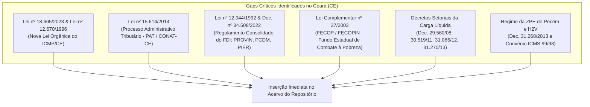
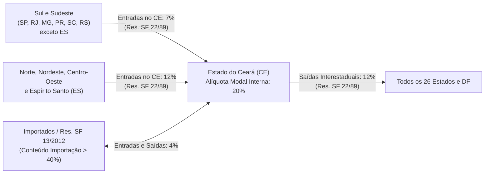
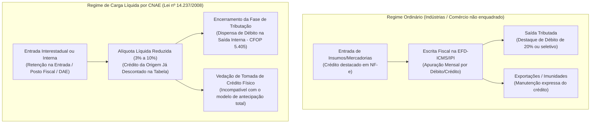
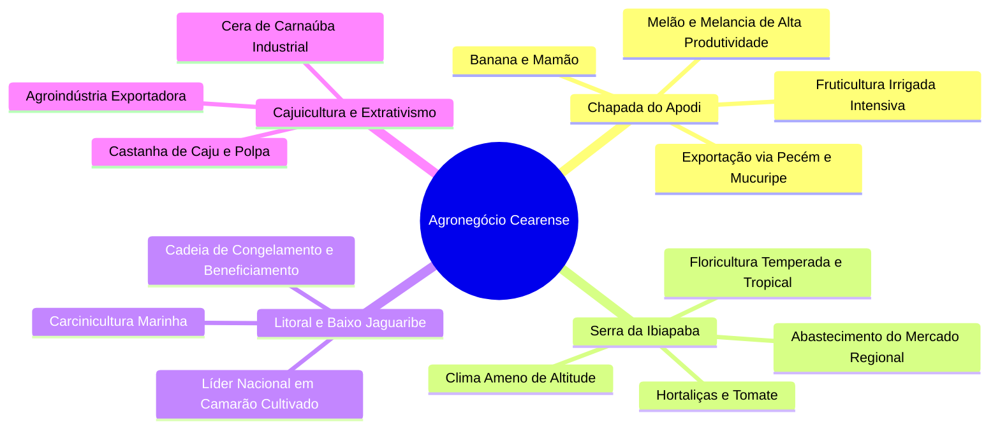
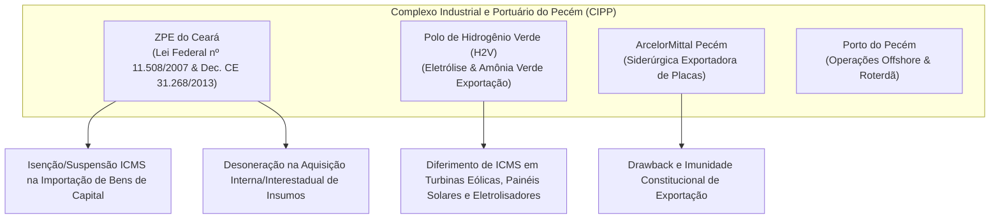
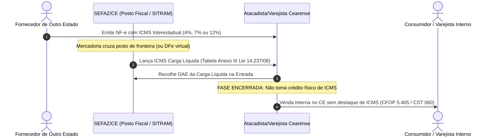
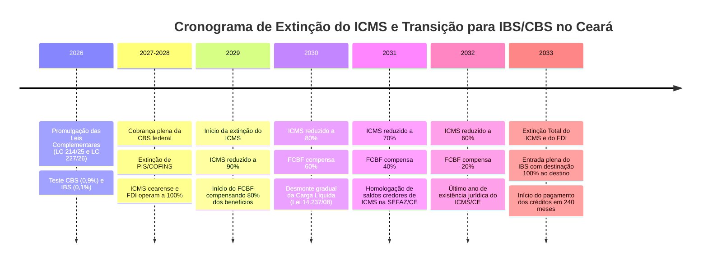

# Relatório Técnico de Auditoria Tributária: Estado do Ceará (CE)

**Data da Auditoria:** 31 de outubro de 2026  
**Auditor Especialista:** Agente Tributarista Estadual — Ceará (CE)  
**Escopo:** Mapeamento normativo do repositório, gaps legislativos, tributação interestadual, regimes setoriais (Carga Líquida, FDI, CIPP/ZPE, Agro) e transição para o IBS/CBS da Reforma Tributária.

---

## 1. Auditoria do Acervo Local (`estaduais/ce/`) e Mapeamento de Gaps Normativos

### 1.1. Diagnóstico do Acervo Existente no Repositório

O repositório do Estado do Ceará em [`estaduais/ce/`](file:///Users/brunoqualhato/Documents/meus/tributos/estaduais/ce) apresenta atualmente a seguinte estrutura física e documental:

| Arquivo / Norma | Ramo / Tema | Status no Repositório | Abrangência e Observações Técnicas |
| :--- | :--- | :--- | :--- |
| [`decreto-33327-2019.md`](file:///Users/brunoqualhato/Documents/meus/tributos/estaduais/ce/ricms/decreto-33327-2019.md) | Regulamento do ICMS (RICMS/CE) | **Presente** (Sintético - 89 linhas) | Sintetiza os princípios de incidência, a elevação da alíquota modal interna de 18% para **20%** (Lei nº 18.305/2023 mantida pela Lei nº 18.665/2023), FECOP de 2%, DIFAL por dentro e transferências de filiais. Requer detalhamento das seções de regimes especiais e apuração. |
| [`lei-14237-2008-carga-liquida-fdi-ce.md`](file:///Users/brunoqualhato/Documents/meus/tributos/estaduais/ce/ricms/lei-14237-2008-carga-liquida-fdi-ce.md) | Substituição Tributária por Carga Líquida por CNAE e FDI | **Presente** (85 linhas) | Documenta a espinha dorsal do regime pioneiro de Carga Líquida cearense por CNAE-Fiscal (Anexos I a III) e sumariza os subprogramas PROVIN e PCDM do Fundo de Desenvolvimento Industrial (FDI). |
| [`lei-12023-1992.md`](file:///Users/brunoqualhato/Documents/meus/tributos/estaduais/ce/leis/ipva/lei-12023-1992.md) | IPVA / Patrimônio Automotor | **Presente** (84 linhas) | Trata do fato gerador, base venal FIPE, alíquotas (1,0% a 3,5%), regras interestaduais de domicílio (Tema 708/STF) e adaptações da [EC nº 132/2023](file:///Users/brunoqualhato/Documents/meus/tributos/reforma-tributaria/emenda-constitucional-132-2023.md). |
| [`lei-15812-2015.md`](file:///Users/brunoqualhato/Documents/meus/tributos/estaduais/ce/leis/itcmd/lei-15812-2015.md) | ITCMD / Sucessões e Doações | **Presente** (84 linhas) | Trata do fato gerador, progressividade obrigatória de 2% a 8% escalonada em UFIRCE, competência interestadual com base no domicílio do *de cujus* (EC 132/2023 e [LC 227/2026](file:///Users/brunoqualhato/Documents/meus/tributos/reforma-tributaria/lei-complementar-227-2026.md)) e VGBL/PGBL (Tema 1214/STF). |

### 1.2. Mapeamento de Gaps Normativos Críticos (Normas Ausentes)

A auditoria identificou a ausência de diplomas fundamentais do ordenamento jurídico-tributário cearense no repositório, essenciais para uma cobertura de excelência:

1. **Lei Estadual nº 18.665, de 28 de dezembro de 2023 (Nova Lei Orgânica do ICMS/CE) e Lei nº 12.670/1996:**
   - *Natureza:* Norma primária fundamental do ICMS cearense. A Lei nº 18.665/2023 sucedeu e consolidou a histórica Lei nº 12.670/1996, adaptando integralmente a legislação estadual à [LC 87/1996](file:///Users/brunoqualhato/Documents/meus/tributos/federal/leis-complementares/kandir/lei-87-1996.md), [LC 190/2022](file:///Users/brunoqualhato/Documents/meus/tributos/federal/leis-complementares/kandir/lei-190-2022.md), [LC 192/2022](file:///Users/brunoqualhato/Documents/meus/tributos/federal/leis-complementares/combustiveis/lei-complementar-192-2022.md), [LC 194/2022](file:///Users/brunoqualhato/Documents/meus/tributos/federal/leis-complementares/kandir/lei-complementar-194-2022.md), [LC 204/2023](file:///Users/brunoqualhato/Documents/meus/tributos/federal/leis-complementares/kandir/lei-complementar-204-2023.md) e à Lei Estadual nº 18.305/2023 (que elevou a alíquota modal interna para 20%). Ausente em `estaduais/ce/leis/icms/`.
2. **Lei Estadual nº 15.614, de 29 de maio de 2014 (PAT e CONAT/CE):**
   - *Natureza:* Lei Geral do Processo Administrativo Tributário no Ceará e organização do Contencioso Administrativo Tributário (CONAT). Disciplina os prazos processuais (defesa e recurso ordinário em 30 dias), as Câmaras de Julgamento, a Câmara Superior, a instrução probatória com perícias fiscais e as Súmulas Vinculantes do CONAT. A ausência compromete a análise contenciosa e a segurança jurídica.
3. **Lei Estadual nº 12.044, de 10 de dezembro de 1992 e Decreto Estadual nº 34.508, de 25 de janeiro de 2022 (FDI Consolidado):**
   - *Natureza:* Marco normativo do Fundo de Desenvolvimento Industrial do Ceará (FDI). O Decreto nº 34.508/2022 revogou o Decreto nº 32.438/2017 e consolidou os regulamentos dos subprogramas PROVIN (indústria fabril), PCDM (centrais de distribuição), PIER (infraestrutura e energias renováveis) e PRODECO (cooperativas), regulamentando as contrapartidas, carências de 36 meses e taxas de retorno financeiro de 1% a 25%.
4. **Lei Complementar Estadual nº 37, de 26 de novembro de 2003 (FECOP / FECOPIN):**
   - *Natureza:* Institui o Fundo Estadual de Combate à Pobreza no Ceará com base no art. 82 do ADCT. Cria a alíquota adicional de 2% sobre bens e serviços supérfluos, impactando diretamente o cálculo do DIFAL e as alíquotas seletivas internas (bebidas, tabaco, armas, combustíveis de aviação, embarcações e cosméticos).
5. **Decretos Setoriais de Carga Líquida por CNAE (Decreto nº 29.560/2008 e Correlatos):**
   - *Natureza:* Regulamentos operacionais essenciais da [Lei nº 14.237/2008](file:///Users/brunoqualhato/Documents/meus/tributos/estaduais/ce/ricms/lei-14237-2008-carga-liquida-fdi-ce.md). Destacam-se: Decreto nº 29.560/2008 (alimentos, cosméticos e higiene); Decreto nº 30.519/2011 (têxteis, confecções e calçados); Decreto nº 31.066/2012 (material de construção e ferragens); Decreto nº 31.270/2013 (móveis, eletrodomésticos e colchões).
6. **Regime de Incentivo da ZPE de Pecém e Hidrogênio Verde:**
   - *Natureza:* Decreto Estadual nº 31.268/2013 e Convênio ICMS nº 99/1998, essenciais para disciplinar a isenção e suspensão aduaneira no Complexo do Pecém e no Polo de H2V.

---

## 2. Relacionamento Tributário do Ceará com os Demais 26 Estados e DF

### 2.1. Matriz de Alíquotas Interestaduais (Resoluções SF nº 22/1989, 13/2012 e 95/1996)

Por estar geograficamente integrado à **Região Nordeste**, o Estado do Ceará opera sob uma assimetria interestadual clássica estabelecida pela [Resolução do Senado Federal nº 22/1989](file:///Users/brunoqualhato/Documents/meus/tributos/federal/resolucoes-senado/icms/resolucao-22-1989.md):

1. **Saídas do Ceará para qualquer Unidade da Federação:**
   - Alíquota fixa de **12%** nas operações e prestações interestaduais destinadas a contribuintes ou a consumidores finais não contribuintes (para fins de cálculo do DIFAL), independentemente da localização do Estado destinatário (seja ele SP, AM, MT ou RS).
2. **Entradas no Ceará de Mercadorias Nacionais:**
   - Alíquota de **7%** se a mercadoria for originada nos Estados do Sul ou Sudeste (São Paulo, Rio de Janeiro, Minas Gerais, Paraná, Santa Catarina e Rio Grande do Sul), à exceção do Espírito Santo;
   - Alíquota de **12%** se originada nos Estados das Regiões Norte, Nordeste, Centro-Oeste ou do Estado do Espírito Santo.
3. **Bens e Mercadorias Importados (Resolução SF nº 13/2012 e Convênio ICMS 38/2013):**
   - Alíquota interestadual uniforme de **4%** nas operações interestaduais com bens e mercadorias importados do exterior que não tenham sido submetidos a processo de industrialização, ou, se industrializados no Brasil, possuam Conteúdo de Importação superior a 40% (FCI exigível), tanto nas saídas do Ceará quanto nas entradas oriundas de outras UFs.
4. **Transporte Aéreo Interestadual (Resolução SF nº 95/1996):**
   - Alíquota de **4%** para o serviço interestadual de transporte aéreo de passageiros, cargas e mala postal.

---

### 2.2. Diferencial de Alíquotas (DIFAL)

O ordenamento cearense adota regras distintas para o DIFAL dependendo da condição de contribuinte do destinatário:

#### A. DIFAL de Consumidor Final Não Contribuinte (EC nº 87/2015, LC nº 190/2021 e Lei CE nº 17.907/2022)
Nas operações interestaduais originadas em outra UF que destinem bens ou serviços a consumidor final não contribuinte no Ceará (vendas B2C no e-commerce ou presenciais):
- **Base de Cálculo Única:** A base de cálculo é única e corresponde ao valor da operação com o montante do próprio imposto integrado (ICMS *por dentro* da alíquota interna do Ceará), conforme mandamento do art. 2º da [LC 190/2021](file:///Users/brunoqualhato/Documents/meus/tributos/federal/leis-complementares/kandir/lei-190-2022.md) e [Tema 1093 do STF](file:///Users/brunoqualhato/Documents/meus/tributos/jurisprudencia/precedentes-vinculantes/stf/tema-1093-difal-nao-contribuinte-lc190.md);
- **Alíquota Aplicável:** Alíquota interna do Ceará (**20%** modal, ou seletiva acrescida de **2% do FECOP**) subtraída da alíquota interestadual (4%, 7% ou 12%):
  $$\text{DIFAL}_{\text{Não-Contr}} = \text{Base Única} \times \left( \text{ALQ}_{\text{Intra CE}} - \text{ALQ}_{\text{Inter}} \right)$$
- **Responsável:** O remetente de outra UF, mediante inscrição estadual de Substituto Tributário DIFAL no CGF ou emissão de GNRE/DAE por operação.

#### B. DIFAL de Contribuinte para Uso, Consumo ou Ativo Permanente (Base Dupla Cearense)
Quando um contribuinte cearense adquire mercadorias de outro Estado para uso, consumo ou ativo imobilizado, o Ceará adota expressamente o regime de **Base Dupla (Cálculo por Dentro Recomposto)**, disciplinado no art. 29 da Lei nº 18.665/2023 e no RICMS/CE:

$$\text{Base Dupla} = \frac{\text{Valor da Operação} - \text{ICMS Interestadual Destacado}}{1 - \text{ALQ}_{\text{Interna CE}}}$$

$$\text{DIFAL}_{\text{Devido}} = \left( \text{Base Dupla} \times \text{ALQ}_{\text{Interna CE}} \right) - \text{ICMS Interestadual Destacado}$$

*Impacto Financeiro:* Esse mecanismo expurga o ICMS interestadual de origem e embute a alíquota de 20% do Ceará no denominador, gerando uma carga financeira efetiva substancialmente superior à fórmula simples (diferença aritmética direta), o que eleva a arrecadação da SEFAZ/CE sobre bens de capital e consumo empresarial.

---

### 2.3. Transferências entre Filiais do Mesmo Titular

Com a consolidação da jurisprudência vinculante da [ADC 49 do STF](file:///Users/brunoqualhato/Documents/meus/tributos/jurisprudencia/precedentes-vinculantes/stf/adc-49-transferencia-interestadual-mesmo-titular.md), a promulgação da [Lei Complementar nº 204/2023](file:///Users/brunoqualhato/Documents/meus/tributos/federal/leis-complementares/kandir/lei-complementar-204-2023.md) e a edição dos [Convênios ICMS nº 178/2023 e nº 109/2024](file:///Users/brunoqualhato/Documents/meus/tributos/estaduais/ce/ricms/decreto-33327-2019.md#L42), o Ceará publicou o **Decreto Estadual nº 35.807, de 29 de dezembro de 2023**:

1. **Não Incidência Plena:** A remessa física de mercadorias entre matriz e filial ou entre filiais do mesmo titular (interna ou interestadual) não configura fato gerador de ICMS;
2. **Transferência de Créditos:** É assegurada a transferência dos créditos do ICMS acumulados nas etapas anteriores, aplicando-se sobre o valor da operação de custo (ou valor de entrada mais recente) as alíquotas interestaduais cabíveis (4%, 7% ou 12%);
3. **Opção pela Equiparação a Operação Tributada (Convênio ICMS 109/2024):**
   - O contribuinte cearense pode optar, de forma irretratável para todo o ano-calendário, pela equiparação das transferências a operações regularmente tributadas, com destaque do imposto na NF-e e apropriação integral pelo estabelecimento destinatário, mediante registro prévio no RUDFTO (Registro de Utilização de Documentos Fiscais e Termos de Ocorrências) da SEFAZ/CE.

---

### 2.4. ICMS-ST Interestadual e Protocolos CONFAZ (Convênio ICMS 142/2018)

O Ceará é signatário ativo dos principais convênios e protocolos de Substituição Tributária nacional:
- **Cálculo da MVA Ajustada:** Nas operações interestaduais destinadas a contribuintes normais cearenses, aplica-se a fórmula uniforme do Convênio ICMS 142/2018:
  $$\text{MVA Ajustada} = \left[ \frac{(1 + \text{MVA Original}) \times (1 - \text{ALQ Inter})}{(1 - \text{ALQ Intra CE})} \right] - 1$$
  Como a alíquota interna cearense é de **20%** (ou até 30% em supérfluos com FECOP), o multiplicador de ajuste eleva fortemente a MVA quando o produto vem do Sul/Sudeste a 7% ou do exterior a 4%.
- **Exceção do Simples Nacional (Convênio ICMS 35/2011):** Quando o remetente da mercadoria for optante pelo Simples Nacional, é **vedada** a aplicação da MVA Ajustada, exigindo-se estritamente a MVA Original.
- **Ressarcimento do ICMS-ST (Tema 201 do STF):** O Ceará assegura o ressarcimento da diferença de ICMS-ST recolhido a maior quando a base de cálculo real da venda a consumidor final for comprovadamente inferior à base presumida arbitrada, mediante procedimento no sistema SIGET da SEFAZ/CE.

---

## 3. Mecanismos de Dedução e Crédito no Ceará

### 3.1. Não-Cumulatividade versus Carga Líquida (Lei nº 14.237/2008)

O Estado do Ceará opera sob uma dicotomia tributária profunda entre o regime ordinário da Lei Kandir e o modelo excepcional de Carga Líquida por CNAE:

1. **Regime Ordinário:** O contribuinte escritura débitos e créditos na EFD-ICMS/IPI. Nas exportações para o exterior, é plenamente assegurada a manutenção do crédito das etapas anteriores (art. 155, § 2º, X, "a" da CF/88 e art. 3º, I do RICMS/CE);
2. **Excepcionalidade da Carga Líquida:** No comércio atacadista e varejista submetido à [Lei nº 14.237/2008](file:///Users/brunoqualhato/Documents/meus/tributos/estaduais/ce/ricms/lei-14237-2008-carga-liquida-fdi-ce.md), o crédito físico é legalmente bloqueado na entrada, porque as alíquotas constantes do Anexo III da lei já são fixadas em base líquida deduzida do crédito presumido da origem (4%, 7% ou 12%). A operação subsequente dentro do Estado ocorre sob o CFOP 5.405 / CST 060 (mercadoria já tributada por substituição tributária), exonerada de novo débito.

---

### 3.2. Ativo Permanente / Imobilizado e CIAP (LC nº 102/2000)

O creditamento do ICMS relativo aos bens destinados ao Ativo Imobilizado rege-se pelas normas nacionais da LC 87/1996 e do RICMS/CE:
- **Fracionamento em 1/48 Avos:** O crédito é apropriado à razão de 1/48 (um quarenta e oito avos) por mês civil, a partir do mês em que o bem entrar em efetiva operação fabril ou comercial;
- **Fator de Proporcionalidade:** A apropriação mensal de 1/48 é ajustada pelo quociente entre as saídas tributadas e operações de exportação e o total das saídas do estabelecimento no mesmo período:
  $$\text{Crédito Mensal} = \left( \frac{\text{ICMS Destacado no Bem}}{48} \right) \times \left( \frac{\text{Saídas Tributadas} + \text{Exportações}}{\text{Total das Saídas}} \right)$$
- **Alienação Antecipada:** Ocorrendo a venda ou baixa do bem antes de decorridos 4 anos (48 meses), cessa o direito à apropriação das parcelas remanescentes;
- **Controle EFD:** A escrituração é obrigatoriamente realizada no Bloco G da EFD-ICMS/IPI (demonstrativo CIAP modelo "D").

---

### 3.3. Restrições de Energia Elétrica e Serviços de Comunicação

O Estado do Ceará aplica com rigor as travas de apropriação de créditos dispostas no art. 33 da LC 87/1996:
1. **Energia Elétrica:** Somente confere direito a crédito do ICMS quando:
   - For consumida diretamente no processo de industrialização da mercadoria (exigindo laudo técnico comprobatório de consumo fabril emitido por perito credenciado);
   - For objeto de operação de comercialização ou saída física de energia;
   - As operações do estabelecimento resultarem em saídas destinadas ao exterior (proporcionalmente às exportações).
2. **Serviços de Comunicação:** Somente geram crédito para empresas que utilizem os serviços na prestação de serviços de comunicação a terceiros ou que executem operações de saída para o exterior;
3. **Uso e Consumo Geral:** Vedação integral ao aproveitamento de crédito de materiais de uso e consumo, postergado nacionalmente para 1º de janeiro de 2033 (data de extinção do ICMS).

---

### 3.4. Fundo Estadual de Combate à Pobreza (FECOP / FECOPIN)

Instituído pela Lei Complementar Estadual nº 37/2003 com base no art. 82 do ADCT:
- **Alíquota Adicional:** Adicional de **2%** incidente de forma segregada sobre bens e serviços considerados supérfluos;
- **Cesta de Incidência:** Cervejas, aguardentes e demais bebidas alcoólicas (alíquota sobe para 28% + 2% = 30%); cigarros, fumo e derivados (30%); armas e munições; cosméticos, perfumes e maquiagens seletivos; serviços de TV por assinatura; aeronaves, iates e embarcações recreativas;
- **Vedação de Compensação Ordinária:** O valor arrecadado a título de FECOP possui conta gráfica vinculada e código de receita específico (DAE avulso ou campo segregado na GNRE), não podendo ser neutralizado ou compensado por créditos fiscais normais de ICMS acumulados de outras operações comuns do contribuinte.

---

## 4. Setor Agrícola e Rural Cearense

### 4.1. Polos do Agronegócio Cearense

O agronegócio do Ceará apresenta características singulares no semiárido brasileiro, ancorado em quatro polos altamente competitivos:

1. **Chapada do Apodi (Limoeiro do Norte, Quixeré, Tabuleiro do Norte):** Maior polo de fruticultura tropical irrigada mecanizada do Ceará. Foco em melão (onde o Ceará é um dos maiores exportadores do país), melancia, banana e mamão, com logística direta voltada ao Complexo Portuário do Pecém;
2. **Serra da Ibiapaba (Tianguá, Ubajara, São Benedito, Viçosa do Ceará):** Polo de hortifrutícolas de clima úmido e altitude (tomate de mesa, pimentão, maracujá, folhosas) e floricultura de corte (rosas, gérberas, crisântemos e flores tropicais destinadas ao mercado nacional e exterior);
3. **Carcinicultura Marinha (Litoral Leste e Baixo Jaguaribe — Aracati, Acaraú, Camocim):** O Ceará disputa a liderança nacional na criação e processamento de camarão em cativeiro, com grande parque de agroindústrias de beneficiamento, evisceração e congelamento;
4. **Cajuicultura e Carnaúba:** Cultura tradicional sertaneja voltada ao aproveitamento da castanha de caju (indústria de torrefação e exportação de amêndoas), pedúnculo para sucos e doces, e o extrativismo industrial da cera de carnaúba (aplicação em polímeros, tintas e cosméticos globais).

---

### 4.2. Insumos Agropecuários (Convênio ICMS 100/1997 e Convênio ICMS 26/2021)

O Ceará internalizou as diretrizes do Convênio ICMS nº 100/1997 e a repactuação progressiva do Convênio ICMS nº 26/2021:
- **Isenções Internas:** Isenção do ICMS nas saídas internas de sementes certificadas e fiscalizadas, defensivos agrícolas, calcário e gesso agrícola, rações balanceadas, soro de leite e esterco animal destinados à agropecuária;
- **Reoneração Progressiva de Fertilizantes (Convênio ICMS 26/2021):** Aplicação de alíquotas interestaduais escalonadas nas saídas interestaduais de adubos e fertilizantes simples e compostos (1% em 2022, 2% em 2023, 3% em 2024 e convergência plena a 4% a partir de 2025);
- **Manutenção de Crédito:** As saídas amparadas pelo Convênio 100/97 mantêm expressamente o direito de aproveitamento e manutenção de crédito aos fabricantes e formuladores situados no Estado.

---

### 4.3. Diferimento do ICMS e Isenções na Produção Rural

O Regulamento do ICMS do Ceará (Decreto nº 33.327/2019, Anexos I e II) prevê mecanismos de proteção à cadeia agroalimentar:
1. **Diferimento nas Saídas do Produtor:** Diferimento do imposto nas saídas internas promovidas por produtores rurais de leite cru (*in natura*), pescados e camarões frescos, castanha de caju crua e frutas frescas destinadas a estabelecimentos cooperativos ou industriais que realizem o beneficiamento no Estado. O ICMS fica diferido para a saída subsequente do produto acabado;
2. **Isenção de Hortifrutigranjeiros (Convênio ICMS 44/1975):** Isenção plena nas operações internas e interestaduais com legumes, hortaliças e frutas frescas em estado natural (alho, cebola, tomate, verduras, frutas frescas embaladas), sem perda do crédito de insumos conexos;
3. **Agricultura Familiar:** Regime de dispensa total de tributação nas saídas de produtos primários comercializados diretamente ao Programa Nacional de Alimentação Escolar (PNAE) e Programa de Aquisição de Alimentos (PAA).

---

### 4.4. Obrigações Acessórias do Produtor Rural e NFP-e

- **Inscrição no CGF:** Os produtores rurais pessoas físicas inscrevem-se no Cadastro Geral da Fazenda (CGF) como "Produtor Agropecuário", com regime simplificado de cumprimento de obrigações;
- **Nota Fiscal de Produtor Eletrônica (NFP-e / NFA-e):** É facultada a emissão de Nota Fiscal Avulsa Eletrônica (NFA-e) gratuitamente por meio do portal eletrônico da SEFAZ/CE para produtores rurais de menor porte, ou a emissão direta de NFP-e (modelo 55) para médios e grandes produtores rurais e empresas agroindustriais;
- **Dispensa de EFD Completa:** O produtor pessoa física não equiparado a comerciante/industrial é dispensado da entrega da Escrituração Fiscal Digital (EFD-ICMS/IPI), prestando contas anualmente pelo livro caixa e registros simplificados da SEFAZ/CE.

---

## 5. Setor Industrial e Portuário Cearense

### 5.1. Complexo Industrial e Portuário do Pecém (CIPP) e ZPE do Ceará

O Ceará abriga o maior empreendimento logístico-industrial do Norte/Nordeste: o **Complexo do Pecém (CIPP)** e a primeira e mais exitosa **Zona de Processamento de Exportação (ZPE)** do Brasil, em parceria societária com o Porto de Roterdã:

1. **Marco Regulatório da ZPE (Lei Federal nº 11.508/2007, Lei nº 14.183/2021 e Convênio ICMS 99/1998):**
   - As empresas industriais instaladas na ZPE do Pecém operam sob regime aduaneiro e tributário especial;
   - **ICMS Importação:** Isenção total ou suspensão do ICMS no desembaraço aduaneiro de mercadorias, insumos, matérias-primas e bens do ativo imobilizado importados do exterior para incorporação ao processo produtivo de bens destinados à exportação;
   - **Mercado Interno (Lei nº 14.183/2021):** A modernização legislativa federal eliminou o antigo limite de 20% para vendas no mercado doméstico, permitindo que empresas da ZPE destinem até 100% da produção ao consumo nacional, hipótese em que o ICMS e os tributos federais suspensos são recolhidos de forma regular proporcionalmente às saídas internas;
2. **Polo de Hidrogênio Verde (H2V):**
   - O Estado do Ceará estabeleceu políticas fiscais pioneiras para atrair projetos multibilionários de energia limpa no Pecém. Os investimentos em usinas de dessalinização, plantas de eletrólise para fabricação de H2V e amônia verde contam com diferimento do ICMS na aquisição de geradores eólicos, sistemas fotovoltaicos e componentes industriais de tecnologia de ponta;
3. **ArcelorMittal Pecém (Siderúrgica do Pecém):**
   - Indústria âncora do complexo, opera com grandes volumes de exportação de placas de aço, com saldo credor estrutural decorrente da imunidade tributária e fruição dos incentivos de infraestrutura da ZPE.

---

### 5.2. Programa Fundo de Desenvolvimento Industrial (FDI - PROVIN e PCDM)

O Fundo de Desenvolvimento Industrial do Ceará, estruturado pela Lei nº 12.044/1992 e consolidado pelo [Decreto nº 34.508/2022](file:///Users/brunoqualhato/Documents/meus/tributos/estaduais/ce/ricms/lei-14237-2008-carga-liquida-fdi-ce.md#L61) (convalidado no CONFAZ pela [LC 160/2017](file:///Users/brunoqualhato/Documents/meus/tributos/federal/leis-complementares/lei-160-2017.md) e Convênio ICMS 190/2017), representa a principal alavanca industrial do Estado:

| Subprograma do FDI | Setores Abrangidos | Mecânica Operacional do Incentivo | Bonificação de Retorno Financeiro |
| :--- | :--- | :--- | :--- |
| **PROVIN** (Incentivo Industrial) | Indústrias Calçadistas (Grendene, Vulcabras, Dakota), Têxteis/Confecções (Vicunha, Santana, Guararapes), Metalmecânica e Alimentos | Diferimento/Financiamento mensal de **75% a 99%** do saldo devedor do ICMS gerado pelas saídas industriais de fabricação própria. Carência de 36 meses por parcela. | A empresa liquida a parcela no vencimento pagando apenas de **1% a 25%** do valor original corrigido. Resulta em desoneração efetiva líquida de **75% a 99%** do ICMS devido. |
| **PCDM** (Centrais de Distribuição) | Centrais de Distribuição e Importadores que operam via Portos de Pecém e Mucuripe | Redução de até **75%** do ICMS devido nas saídas interestaduais de mercadorias importadas ou adquiridas de terceiros. | Diferimento total do ICMS na importação portuária de mercadorias para o momento da saída subsequente do CD. |
| **PIER** (Energia Renovável e Infraestrutura) | Parques Eólicos, Centrais Solares e Cadeia do Hidrogênio Verde | Diferimento do ICMS na aquisição de bens de capital e equipamentos de transmissão e geração limpa. | Dispensa total ou amortização vinculada a indicadores de investimento físico e infraestrutura regional. |

- **Condicionantes do FDI:** Para usufruir da bonificação máxima (retorno de apenas 1%), as indústrias são pontuadas por comitê gestor (CEDE) com base em metas rigorosas de:
  1. Criação e manutenção de empregos diretos e formais;
  2. Localização geográfica em municípios do interior cearense (Sobral, Horizonte, Russas, Juazeiro do Norte, Iguatu), combatendo a hipertrofia da Grande Fortaleza;
  3. Adensamento da cadeia de suprimentos locais e sustentabilidade ambiental.

---

### 5.3. Regimes Aduaneiros Especiais e Drawback

- **Drawback Suspensão e Isenção (Convênio ICMS 27/1990):** Aplicação integral da desoneração do ICMS sobre mercadorias importadas sob o regime aduaneiro de Drawback, condicionada à efetiva comprovação da exportação dos produtos industrializados correspondentes no prazo estabelecido pelo ato concessório federal da SECEX;
- **Diferimento de Importação Portuária:** Empresas industriais e atacadistas credenciadas contam com diferimento do ICMS no desembaraço aduaneiro realizado nas instalações do Porto do Pecém e Porto do Mucuripe, vinculando o recolhimento ao momento da posterior comercialização interna ou interestadual.

---

## 6. Setor de Produto Acabado: Atacado, Varejo e Distribuição

### 6.1. O Sistema de Substituição Tributária por Carga Líquida por CNAE (Lei nº 14.237/2008)

O modelo tributário do comércio cearense é regido pela [Lei Estadual nº 14.237/2008](file:///Users/brunoqualhato/Documents/meus/tributos/estaduais/ce/ricms/lei-14237-2008-carga-liquida-fdi-ce.md) e pelos Decretos Setoriais nº 29.560/2008, 30.519/2011, 31.066/2012 e 31.270/2013:

#### Tabela de Referência da Carga Líquida do Anexo III da Lei nº 14.237/2008

A carga tributária percentual incidente sobre o valor total da entrada (acrescido da MVA setorial predeterminada de 20% a 40%) varia de acordo com a origem geográfica do produto e sua cesta fiscal no Ceará:

| Classificação do Produto no Ceará | Origem Interna (CE) | Origem N, NE, CO e ES (12%) | Origem Sul / Sudeste exceto ES (7%) | Importados / Conteúdo Importação (4%) |
| :--- | :--- | :--- | :--- | :--- |
| **Cesta Básica / Redução para 7%** | 1,50% a 2,25% | 2,50% a 3,50% | 4,20% a 5,20% | 5,50% a 6,80% |
| **Produtos com Alíquota de 12%** | 2,80% a 3,60% | 4,20% a 5,00% | 6,50% a 7,50% | 8,20% a 9,50% |
| **Alíquota Geral Modal (20%)** | 4,50% a 6,00% | 6,80% a 8,20% | **9,50% a 11,20%** | **12,00% a 13,80%** |
| **Produtos Supérfluos (25% a 30%)** | 8,00% a 10,00% | 11,50% a 13,50% | 14,80% a 17,00% | 18,00% a 20,50% |

- **Vantagens do Sistema para o Estado:** Antecipação radical do fluxo de caixa e blindagem contra fraudes no varejo;
- **Vantagens para o Contribuinte:** Simplificação escritural nas saídas internas (dispensa de complexas apurações de débitos por item de venda) e encerramento definitivo da obrigação tributária principal;
- **Tratamento das Saídas Interestaduais (Regime Especial de Tributação — RET):**
  - O atacadista que realiza vendas interestaduais para outras UFs firma Regime Especial de Tributação (RET) com a SEFAZ/CE;
  - Esse RET autoriza o atacadista a segregar o estoque ou creditar-se do ICMS recolhido a título de Carga Líquida na proporção das mercadorias vendidas para fora do Estado, permitindo o destaque regular de **12%** (ou **4%**) na NF-e interestadual destinada ao adquirente.

---

### 6.2. Pautas Fiscais e PMPF (Preço Médio Ponderado a Consumidor Final)

Para setores nos quais a concorrência exige controle rígido de preços de varejo, a SEFAZ/CE edita periodicamente Atos e Pautas de Valores Mínimos:
1. **Bebidas Frias (Cervejas, Refrigerantes e Energéticos):** Apuração do ICMS-ST por meio de PMPF apurado por pesquisa de mercado encomendada pela SEFAZ/CE ou acordada no âmbito do CONFAZ;
2. **Derivados de Trigo e Farinha de Trigo (Decreto nº 21.306/1991):** Regime específico e centralizado de cobrança do ICMS na entrada do trigo no moinho ou da farinha de fora do Estado, encerrando as fases até a panificação;
3. **Água Mineral e Gelo:** Pautas fiscais de valor de referência por volume (garrafões de 20 litros, garrafas descartáveis e copos).

---

### 6.3. E-commerce, Marketplaces e Responsabilidade Tributária

O Ceará instituiu normas severas para o comércio eletrônico na [Lei Estadual nº 17.907/2022](file:///Users/brunoqualhato/Documents/meus/tributos/estaduais/ce/ricms/decreto-33327-2019.md#L72):
- **Responsabilidade Solidária de Marketplaces:** As plataformas digitais de intermediação de vendas e os intermediadores de pagamento são solidariamente responsáveis pelo recolhimento do ICMS e das penalidades decorrentes de operações com mercadorias destinadas a consumidores cearenses quando o vendedor não emitir documento fiscal hábil ou utilizar inscrição estadual fraudulenta;
- **Obrigações de Repasse de Dados:** Obrigatoriedade de fornecimento mensal das informações de transações financeiras, PIX e cartões por meio da Declaração de Informações de Meios de Pagamento (DIMP), cruzadas em tempo real com os sistemas de malha fiscal da SEFAZ/CE.

---

## 7. Transição para o IBS / CBS da Reforma Tributária (EC nº 132/2023, LC nº 214/2025 e LC nº 227/2026)

### 7.1. O Impacto Estrutural no Modelo Econômico e Tributário Cearense

A migração federativa do ICMS para o Imposto sobre Bens e Serviços (IBS) e a Contribuição sobre Bens e Serviços (CBS) impõe o maior reordenamento de forças tributárias da história do Ceará:

1. **Fim da Competência Unilateral para Conceder Benefícios:**
   - Com o IBS partilhado nacionalmente e regido por comitê gestor único (CG-IBS), fica extinta a autonomia da SEFAZ/CE para outorgar diferimentos ou créditos presumidos do FDI (PROVIN e PCDM);
   - As indústrias calçadistas e têxteis do interior perderão o diferencial competitivo que as mantinha no Ceará (desoneração de 75% a 99% do ICMS), expondo-se à atração logística dos estados com maior mercado consumidor no Sul e Sudeste;
2. **Extinção da Substituição Tributária por Carga Líquida:**
   - O regime pioneiro da Lei nº 14.237/2008 desaparecerá, sendo substituído pelo princípio do crédito financeiro amplo e imediato do IBS/CBS, vedando a cobrança antecipada com encerramento de fase nos postos de fronteira estaduais;
   - Fim dos postos fiscais de divisa terrestre (como Penaforte e Tianguá), que serão desativados na transição.

---

### 7.2. Fundo de Compensação de Benefícios Fiscais (FCBF)

Para amenizar o impacto do fim dos incentivos fiscais sobre os investimentos já consolidados, a [Emenda Constitucional nº 132/2023](file:///Users/brunoqualhato/Documents/meus/tributos/reforma-tributaria/emenda-constitucional-132-2023.md) (art. 159-A da CF/88) e a [Lei Complementar nº 214/2025](file:///Users/brunoqualhato/Documents/meus/tributos/reforma-tributaria/lei-complementar-214-2025.md) criaram o Fundo de Compensação de Benefícios Fiscais:
- **Aporte da União:** Recursos federais anuais destinados a indenizar diretamente as empresas titulares de incentivos convalidos nos termos da [Lei Complementar nº 160/2017](file:///Users/brunoqualhato/Documents/meus/tributos/federal/leis-complementares/lei-160-2017.md) vigentes em 31 de maio de 2023;
- **Escalonamento Regressivo de Compensação:**
  - **2028:** 100% do benefício original assegurado pelo ICMS;
  - **2029:** 80% do valor do incentivo compensado financeiramente pelo FCBF;
  - **2030:** 60% do valor compensado;
  - **2031:** 40% do valor compensado;
  - **2032:** 20% do valor compensado;
  - **2033:** 0% (extinção total da indenização federal);
- **Desafio Estratégico:** As empresas cearenses beneficiárias do PROVIN/PCDM devem cadastrar seus atos concessórios no sistema unificado do FCBF com rigor documental absoluto para assegurar o recebimento da indenização nesse período crítico.

---

### 7.3. Homologação do Saldo Credor Acumulado de ICMS (Art. 134 do ADCT / LC nº 214/2025)

A transição cria um passivo administrativo vultoso para a SEFAZ/CE e os contribuintes:
1. **Regra de Aproveitamento em 240 Parcelas:**
   - Os saldos credores de ICMS decorrentes de exportações, benefícios fiscais e aquisição de bens do ativo imobilizado (CIAP) regularmente escriturados até 31 de dezembro de 2032 não serão confiscados;
   - Uma vez homologados pela SEFAZ/CE, esses créditos serão compensados em **240 (duzentas e quarenta) parcelas mensais, iguais e sucessivas**, corrigidas pelo índice oficial de inflação (IPCA), contra débitos futuros do IBS apurados perante o CG-IBS a partir de 2033, ou transferidos a terceiros;
2. **Processo Homologatório na SEFAZ/CE:**
   - O contribuinte deve protocolar pedido formal de homologação na SEFAZ/CE até os prazos regulamentares da LC 214/2025;
   - *Ponto de Atenção Crítico:* Ante a perda futura de arrecadação, a fiscalização cearense tende a intensificar auditorias de conformidade sobre os saldos credores postulados, glosando créditos desprovidos de lastro probatório físico ou decorrentes de insumos indiretos.

---

### 7.4. Adaptação do Complexo do Pecém e ZPE do Ceará ao Novo Paradigma

O Complexo Portuário do Pecém e o Polo de Hidrogênio Verde necessitam de adaptação jurídica para manter sua atratividade global:
- **Imunidade Plena nas Exportações (Art. 156-A, § 1º, V da CF/88):** A exportação no IBS/CBS é plenamente imune, com devolução tempestiva do saldo credor dos insumos acumulados;
- **Crédito Imediato no Ativo Imobilizado:** Fim definitivo do fracionamento de 1/48 avos do CIAP. No IBS e CBS, a compra de maquinário e bens de capital para plantas industriais e infraestrutura eólica/solar gera crédito integral e imediato, favorecendo a instalação de fábricas no CIPP;
- **Marco da ZPE no IBS/CBS:** A [LC nº 214/2025](file:///Users/brunoqualhato/Documents/meus/tributos/reforma-tributaria/lei-complementar-214-2025.md) prevê regime aduaneiro específico assegurando suspensão tributária na aquisição interna e importação de bens destinados à ZPE de Pecém, convertendo-se em alíquota zero por ocasião do embarque dos produtos ao exterior.

---

## 8. Tabela Consolidada de Recomendações e Próximos Passos

Para elevar a maturidade técnica do acervo tributário do Ceará no repositório a 100%, recomenda-se a execução das seguintes ações prioritárias:

| Ação Prioritária | Norma / Objeto | Diretório de Destino Sugerido | Justificativa Técnica |
| :---: | :--- | :--- | :--- |
| **1** | Inclusão da **Lei Estadual nº 18.665/2023** | `estaduais/ce/leis/icms/lei-18665-2023.md` | Nova Lei Orgânica do ICMS/CE que consolida a disciplina do tributo estadual. |
| **2** | Inclusão da **Lei Estadual nº 15.614/2014** | `estaduais/ce/leis/pat/lei-15614-2014.md` | Marco fundamental do Processo Administrativo Tributário (PAT/CONAT-CE). |
| **3** | Inclusão do **Decreto Estadual nº 34.508/2022** | `estaduais/ce/fdi/decreto-34508-2022.md` | Regulamento consolidado do Fundo de Desenvolvimento Industrial (PROVIN/PCDM). |
| **4** | Inclusão da **Lei Complementar nº 37/2003** | `estaduais/ce/leis/fecop/lei-complementar-37-2003.md` | Lei do FECOP (adicional de 2% sobre mercadorias seletivas e DIFAL). |
| **5** | Inclusão do **Decreto nº 29.560/2008** e correlatos | `estaduais/ce/ricms/decretos-carga-liquida/` | Regulamentos operacionais setoriais da Carga Líquida por CNAE. |
| **6** | Inclusão do **Decreto Estadual nº 31.268/2013** | `estaduais/ce/zpe/decreto-31268-2013.md` | Regime especial de ICMS da ZPE de Pecém e Complexo Industrial (CIPP). |

---

*Relatório técnico elaborado e auditado com estrita observância das normas tributárias estaduais, resoluções do Senado Federal, jurisprudência vinculante do STF/STJ e regras de transição da Emenda Constitucional nº 132/2023 e Leis Complementares federais.*
