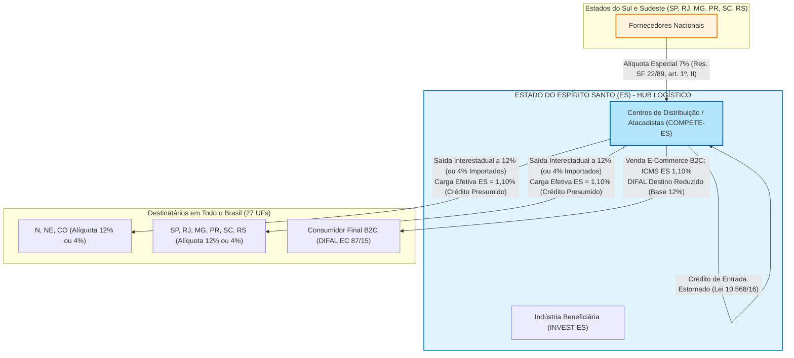
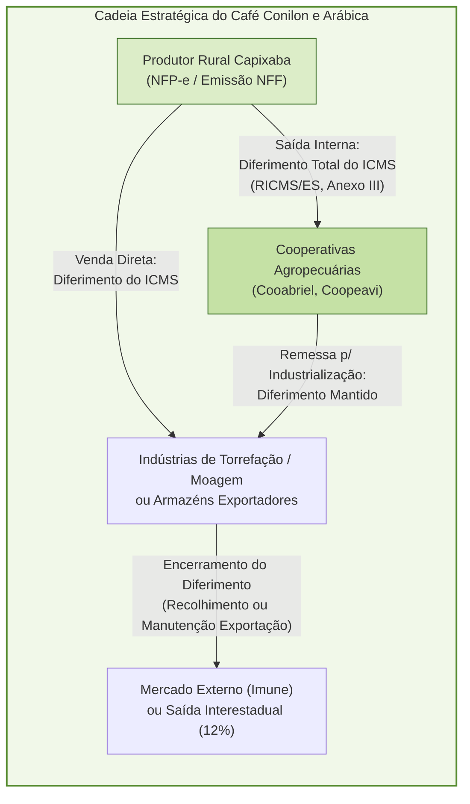
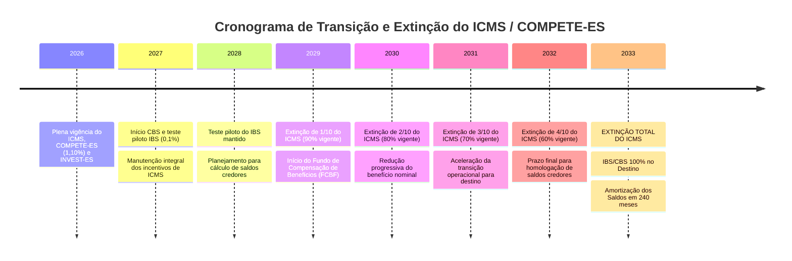

# Relatório de Auditoria e Diagnóstico Tributário Aprofundado: Estado do Espírito Santo (ES)

---
**Auditor Responsável:** Consultoria Tributária Especializada — Núcleo de Tributação Estadual e Regimes Especiais  
**Unidade Federativa:** Estado do Espírito Santo (ES)  
**Data da Auditoria:** Outubro de 2026  
**Status do Repositório Estadual (`estaduais/es/`):** Auditado com Identificação de Lacunas Normativas e Plano de Ação  
**Marco Legal Principal:** CF/88; Resoluções SF nº 22/1989 e 13/2012; LC nº 87/1996; LC nº 160/2017; LC nº 190/2021; LC nº 204/2023; EC nº 132/2023; LC nº 214/2025; Lei Estadual nº 7.000/2001; Decreto Estadual nº 1.090-R/2002 (RICMS/ES); Lei Estadual nº 10.568/2016 (COMPETE-ES e INVEST-ES); Lei Estadual nº 2.508/1970 (FUNDAP).

---

## 1. Auditoria Normativa do Repositório (`estaduais/es/`) e Mapeamento de Lacunas

### 1.1. Inventário das Normas Vigentes no Repositório

O exame do diretório [`estaduais/es/`](file:///Users/brunoqualhato/Documents/meus/tributos/estaduais/es/) identificou a presença de 4 (quatro) arquivos estruturados em formato Markdown, contendo metadados completos em YAML Frontmatter e conteúdo analítico:

1. **[`estaduais/es/ricms/decreto-1090-r-2002.md`](file:///Users/brunoqualhato/Documents/meus/tributos/estaduais/es/ricms/decreto-1090-r-2002.md):**  
   - *Objeto:* Regulamento do ICMS do Estado do Espírito Santo (RICMS/ES), aprovado pelo Decreto nº 1.090-R, de 25 de outubro de 2002.  
   - *Conteúdo Coberto:* Hipóteses de incidência e não incidência, quadro geral de alíquotas (alíquota modal de 17%, seletivas e interestaduais), regras de DIFAL (com ênfase na base única tradicional capixaba), substituição tributária (Anexo V) e menção genérica a transferências entre estabelecimentos da mesma titularidade (LC 204/2023).  
   - *Diagnóstico Técnico:* Excelente estrutura conceitual, mas carece de incorporação das regulamentações recentes introduzidas pelos Decretos nº 5.589-R/2023 e nº 5.768-R/2024 (opção pelo Convênio ICMS 109/2024 no RUDFTO) e do detalhamento dos livros de apuração e anexos setoriais.

2. **[`estaduais/es/ricms/lei-10568-2016-compete-es-invest-es.md`](file:///Users/brunoqualhato/Documents/meus/tributos/estaduais/es/ricms/lei-10568-2016-compete-es-invest-es.md):**  
   - *Objeto:* Lei Estadual nº 10.568, de 26 de julho de 2016, que institui o Programa de Desenvolvimento e Proteção à Economia do Estado do Espírito Santo (COMPETE-ES) e consolida os regimes de incentivos fiscais atacadista, e-commerce e industrial (INVEST-ES).  
   - *Conteúdo Coberto:* A assimetria constitucional da Resolução SF 22/89 (compras a 7% de Sul/Sudeste e saídas a 12%), o COMPETE Atacadista (carga líquida efetiva de 1,10% com estorno de créditos de entrada e crédito presumido de saída), COMPETE E-Commerce / Vendas Não Presenciais (carga líquida de 1,10% recolhida ao ES combinada com o DIFAL de destino) e introdução ao INVEST-ES e FUNDAP.  
   - *Diagnóstico Técnico:* Arquivo de alto valor estratégico e alta fidelidade prática. Encontra-se alocado dentro da pasta `ricms/`, recomendando-se criar link simbólico ou realocação conceitual na pasta `leis/icms/`.

3. **[`estaduais/es/leis/itcmd/lei-10011-2013.md`](file:///Users/brunoqualhato/Documents/meus/tributos/estaduais/es/leis/itcmd/lei-10011-2013.md):**  
   - *Objeto:* Lei Estadual nº 10.011, de 20 de maio de 2013, que disciplina o Imposto sobre a Transmissão Causa Mortis e Doação de Quaisquer Bens ou Direitos (ITCMD) no Espírito Santo.  
   - *Conteúdo Coberto:* Fato gerador, regras de competência territorial pós-EC 132/2023, alíquota fixa linear de 4% (com projeto de adequação à progressividade obrigatória) e isenções.  
   - *Diagnóstico Técnico:* Completo, bem documentado e em plena conformidade com as diretrizes do repositório.

4. **[`estaduais/es/leis/ipva/lei-6999-2001.md`](file:///Users/brunoqualhato/Documents/meus/tributos/estaduais/es/leis/ipva/lei-6999-2001.md):**  
   - *Objeto:* Lei Estadual nº 6.999, de 27 de dezembro de 2001, instituidora do Imposto sobre a Propriedade de Veículos Automotores (IPVA) no Espírito Santo.  
   - *Conteúdo Coberto:* Fato gerador, domicílio tributário e critério espacial (Tema 708 STF), alíquotas (2% para carros de passeio, 1% para caminhões, ônibus e utilitários), transferências interestaduais e não bi-tributação no mesmo exercício.  
   - *Diagnóstico Técnico:* Preciso, abordando os impactos da EC 132/2023 sobre veículos aéreos e aquáticos.

---

### 1.2. Mapeamento Analítico das Normas Faltantes no Repositório

Para assegurar completude enciclopédica e sustentação jurídica irrefutável em processos de auditoria, planejamento fiscal e contencioso administrativo, mapeiam-se as seguintes normas prioritárias que devem ser criadas no repositório:

| Norma Faltante | Esfera / Número / Ano | Tema / Subdiretório Recomendado | Objeto Jurídico e Relevância Estratégica |
| :--- | :--- | :--- | :--- |
| **Lei Geral do ICMS do ES** | Lei Estadual nº 7.000/2001 | `estaduais/es/leis/icms/lei-7000-2001.md` | **Norma Matriz do ICMS Capixaba.** Disciplina hipóteses de incidência, bases de cálculo, alíquotas internas (art. 20 - manutenção dos 17%), sujeição passiva, responsabilidade por substituição tributária (art. 28 e art. 28-A sobre restituição), penalidades e multas. A ausência da lei ordinária que embasa o Decreto nº 1.090-R/2002 fragiliza a hierarquia das fontes. |
| **Lei do FUNDAP** | Lei Estadual nº 2.508/1970 (c/ redação das Leis nº 10.379/2015 e 11.246/2021) | `estaduais/es/leis/icms/lei-2508-1970-fundap.md` | **Pilar Histórico do Comércio Exterior Capixaba.** Cria o Fundo para o Desenvolvimento das Atividades Portuárias (FUNDAP). Disciplina o financiamento de até 3% nas saídas a 4% (Resolução SF 13/2012) via BANDES com recompra de títulos em leilão. Vital para empresas tradings estabelecidas nos portos de Vitória, Tubarão e Vila Velha. |
| **Fundo de Combate à Pobreza (FUNCAP)** | Lei Complementar nº 336/2005 e Lei nº 8.042/2005 | `estaduais/es/leis/icms/lc-336-2005-funcap.md` | **Adicional do art. 82 do ADCT.** Institui o Fundo Estadual de Combate e Erradicação da Pobreza (FUNCAP), impondo adicional de 2% sobre produtos supérfluos (fumo, bebidas, armas, cosméticos, veículos de luxo) com apuração e guia DUA em separado, insuscetível de compensação por créditos normais. |
| **Lei do Processo Administrativo Tributário (PAT)** | Lei Estadual nº 10.174/2014 | `estaduais/es/leis/processo/lei-10174-2014-pat-cerf.md` | **Contencioso Administrativo Tributário.** Regula o procedimento de impugnação do auto de infração, instâncias de julgamento (Receita Estadual e CERF — Conselho Estadual de Recursos Fiscais), prazos decadenciais/prescricionais, perícias, consulta fiscal e depósitos administrativos. |
| **Lei do INVEST-ES Original** | Lei Estadual nº 10.550/2016 | `estaduais/es/leis/icms/lei-10550-2016-invest-es.md` | **Incentivo aos Projetos Industriais.** Cria o Programa de Incentivo ao Investimento no Estado do Espírito Santo (INVEST-ES), complementando a Lei nº 10.568/2016 nas regras de estorno de débito e diferimento na importação de bens de capital. |
| **Lei do DIFAL Não Contribuinte** | Lei Estadual nº 11.534/2022 | `estaduais/es/leis/icms/lei-11534-2022-difal.md` | **Adequação à LC 190/2021 e EC 87/2015.** Altera a Lei nº 7.000/2001 para instituir formalmente a cobrança do DIFAL nas vendas interestaduais a consumidor final não contribuinte destinadas ao ES, disciplinando o momento da ocorrência e base de cálculo. |
| **Decreto de Transferências entre Filiais** | Decreto Estadual nº 5.589-R/2023 (e Dec. nº 5.768-R/2024) | `estaduais/es/ricms/decreto-5589-r-2023-transferencias.md` | **Internalização da ADC 49, LC 204/23 e Convênios 178/23 e 109/24.** Disciplina a sistemática de não incidência de ICMS e transferência proporcional de créditos entre estabelecimentos do mesmo titular, além do rito de opção irretratável no livro RUDFTO para tributação facultativa. |
| **Decreto Regulamentador do COMPETE-ES** | Decreto Estadual nº 4.088-R/2017 | `estaduais/es/ricms/decreto-4088-r-2017-compete.md` | **Regulamentação Operacional do COMPETE-ES.** Fixa os requisitos operacionais para celebração do Contrato de Competitividade, índices de geração de empregos locais, movimentação portuária mínima e condições de fruição setorial. |

---

## 2. Relacionamento do ICMS-ES com os Demais 26 Estados e DF



### 2.1. A Peculiaridade Constitucional Capixaba (Assimetria da Resolução SF nº 22/1989)

O Estado do Espírito Santo desfruta de um tratamento tributário único e privilegiado na federação brasileira, consagrado pelo artigo 155, § 2º, inciso IV da Constituição Federal de 1988 e consubstanciado na **Resolução do Senado Federal nº 22, de 19 de maio de 1989**:

1. **Classificação Geopolítica vs. Tratamento Fiscal:**  
   Embora o Espírito Santo pertença física e geograficamente à Região Sudeste, a Resolução SF nº 22/1989 o equiparou expressamente às Regiões Norte, Nordeste e Centro-Oeste no tocante ao polo de destino das remessas interestaduais:
   - **Art. 1º, II da Res. SF 22/89:** Nas remessas interestaduais originadas nos Estados das Regiões Sul e Sudeste (São Paulo, Rio de Janeiro, Minas Gerais, Paraná, Santa Catarina e Rio Grande do Sul) com destino ao **Espírito Santo**, a alíquota interestadual aplicável às mercadorias nacionais é de **7% (sete por cento)**.
   - **Art. 1º, I da Res. SF 22/89:** Nas saídas interestaduais promovidas por estabelecimentos situados no Espírito Santo para **QUALQUER Estado da Federação** (inclusive para SP, RJ, MG, PR, SC e RS), a alíquota interestadual é de **12% (doze por cento)** para mercadorias de origem nacional (ou com Conteúdo de Importação $\le 40\%$).

2. **O Mecanismo da Vantagem Competitiva de 5 Pontos Percentuais:**  
   Em um regime tradicional de débito e crédito, uma empresa atacadista que compra a 7% em São Paulo e revende a 12% para um cliente em São Paulo ou Minas Gerais apuraria um débito próprio de $12\% - 7\% = 5\%$. Contudo, a legislação capixaba (Lei nº 10.568/2016 — COMPETE Atacadista) intervém concedendo um **crédito presumido que fixa a carga efetiva líquida de saída em 1,10%** (com estorno do crédito de entrada).  
   Ao mesmo tempo, o adquirente industrial ou comercial localizado em SP, RJ ou MG credita-se integralmente dos **12%** destacados na nota fiscal capixaba. Esse descolamento entre a carga suportada no ES (1,10%) e o crédito aproveitado no destino (12%) conferiu ao Espírito Santo uma alavanca imbatível de arbitragem tributária regional.

3. **Impacto da Resolução do Senado Federal nº 13/2012 (Alíquota de 4% para Importados):**  
   A promulgação da Resolução SF nº 13/2012 fixou a alíquota interestadual em **4%** para mercadorias importadas ou com Conteúdo de Importação superior a 40% (CST de origem 1, 2, 3 e 8), eliminando formalmente o diferencial de alíquotas interestadual para importados. Todavia, a legislação capixaba adaptou com êxito os regimes do COMPETE e INVEST-ES para a alíquota de 4%, mantendo carga efetiva de 1,10% a 1,30% sobre o desembaraço em seus portos, perpetuando o Espírito Santo como o maior *gateway* portuário de distribuição do país.

| Rota Interestadual | Natureza da Mercadoria | Alíquota Interestadual Destacada | Base Legal Nacional / Estadual | Carga Efetiva no ES (c/ COMPETE) | Crédito Gerado no Destino |
| :--- | :--- | :---: | :--- | :---: | :---: |
| **SP / RJ / MG $\rightarrow$ ES** | Nacional (ou $\text{CI} \le 40\%$) | **7%** | Res. SF 22/89, art. 1º, II | Não se aplica (entrada) | 7% (apropriável ou estornável) |
| **PR / SC / RS $\rightarrow$ ES** | Nacional (ou $\text{CI} \le 40\%$) | **7%** | Res. SF 22/89, art. 1º, II | Não se aplica (entrada) | 7% (apropriável ou estornável) |
| **N / NE / CO $\rightarrow$ ES** | Nacional (ou $\text{CI} \le 40\%$) | **12%** | Res. SF 22/89, art. 1º, I | Não se aplica (entrada) | 12% (apropriável ou estornável) |
| **Qualquer UF $\rightarrow$ ES** | Importada ($\text{CI} > 40\%$) | **4%** | Res. SF 13/12; Conv. ICMS 38/13 | Não se aplica (entrada) | 4% (apropriável ou estornável) |
| **ES $\rightarrow$ SP / RJ / MG** | Nacional (ou $\text{CI} \le 40\%$) | **12%** | Res. SF 22/89, art. 1º, I | **1,10%** (Lei 10.568/16, art. 16) | **12%** (crédito pleno no adquirente) |
| **ES $\rightarrow$ PR / SC / RS** | Nacional (ou $\text{CI} \le 40\%$) | **12%** | Res. SF 22/89, art. 1º, I | **1,10%** (Lei 10.568/16, art. 16) | **12%** (crédito pleno no adquirente) |
| **ES $\rightarrow$ N / NE / CO** | Nacional (ou $\text{CI} \le 40\%$) | **12%** | Res. SF 22/89, art. 1º, I | **1,10%** (Lei 10.568/16, art. 16) | **12%** (crédito pleno no adquirente) |
| **ES $\rightarrow$ Qualquer UF** | Importada ($\text{CI} > 40\%$) | **4%** | Res. SF 13/12; Conv. ICMS 38/13 | **1,10%** (Lei 10.568/16, art. 16) | **4%** (crédito pleno no adquirente) |

---

### 2.2. Diferencial de Alíquotas (DIFAL) e a Posição Capixaba

#### A. DIFAL Não Contribuinte (EC nº 87/2015, LC nº 190/2021, Convênio ICMS nº 236/2021 e Lei Estadual nº 11.534/2022)
1. **Adequação Normativa e Vigência:** Após a modulação de efeitos nos Temas 1093/STF (RE 1287019) e ADI 5469, o Estado do Espírito Santo editou a **Lei Estadual nº 11.534, de 06 de janeiro de 2022** (DOE/ES de 07/01/2022), alterando formalmente a Lei nº 7.000/2001 para instituir a cobrança do DIFAL nas operações e prestações interestaduais que destinem bens e serviços a consumidor final não contribuinte situado em solo capixaba. Em observância ao princípio da anterioridade nonagesimal (art. 150, III, "c" da CF e art. 3º da LC 190/21), a exigência no ES teve vigência a partir de abril de 2022.
2. **Metodologia de Cálculo — Base Única:** Nas entradas destinadas a não contribuintes no ES, a base de cálculo é única, correspondente ao valor total da operação constante do documento fiscal (incluindo frete, seguro, outras despesas acessórias e o próprio ICMS por dentro). O imposto é repartido da seguinte forma:
   $$\text{ICMS Origem} = \text{Valor Operação} \times \text{ALQ Interestadual (4\%, 7\% ou 12\%)}$$
   $$\text{DIFAL ES} = \text{Valor Operação} \times (\text{ALQ Interna ES} - \text{ALQ Interestadual})$$
   $$\text{FCP ES (se supérfluo)} = \text{Valor Operação} \times 2\% \text{ (LC 336/2005)}$$
3. **A Estratégia dos Centros de Distribuição de E-Commerce (COMPETE Venda Não Presencial):**  
   Nas saídas promovidas por estabelecimentos varejistas de e-commerce situados no Espírito Santo para consumidores finais em outras UFs (CFOP `6.107`/`6.108`), aplica-se a disciplina do art. 23 da Lei nº 10.568/2016:
   - Destaque da alíquota interestadual de 12% (para bens nacionais) ou 4% (importados) na NF-e.
   - O contribuinte recolhe para o Espírito Santo apenas a carga efetiva líquida de **1,10%** (via crédito outorgado que anula o débito restante).
   - O DIFAL recolhido ao Estado de destino é apenas a diferença $(\text{ALQ Interna Destino} - 12\%)$. Exemplo: venda para SP (alíquota interna de 18%): DIFAL SP = $18\% - 12\% = 6\%$. Carga tributária consolidada da empresa no ES = $1,10\% \text{ (ES)} + 6\% \text{ (SP)} = 7,10\%$, enquanto uma venda idêntica saindo de SP recolheria 18% integralmente.

#### B. DIFAL Contribuinte para Bens de Uso, Consumo e Ativo Permanente
Diferentemente de quase todas as demais 26 Unidades da Federação (que adotam o modelo complexo da "Base Dupla" ou "cálculo por dentro fracionado"), o Espírito Santo mantém no art. 63, XI e XII do RICMS/ES e na Lei nº 7.000/2001 a cobrança sobre a **Base Única**:
$$\text{DIFAL Contribuinte ES} = V_{\text{operação}} \times (\text{ALQ}_{\text{interna ES (17\%)}} - \text{ALQ}_{\text{interestadual (7\% ou 4\%)}})$$
- Exemplo: Máquina adquirida de SP para o ativo imobilizado por R$ 100.000,00 (ICMS interestadual destacado a 7% = R$ 7.000,00). DIFAL devido ao ES = $R\$ 100.000,00 \times (17\% - 7\%) = R\$ 10.000,00$.

---

### 2.3. Transferências entre Filiais (ADC 49 STF, LC nº 204/2023, Convênios ICMS nº 178/2023 e nº 109/2024 e Decreto ES nº 5.589-R/2023)

1. **Julgamento da ADC 49 e Marco Legal:** Em sede da ADC 49, o STF declarou inconstitucional a incidência de ICMS no mero deslocamento físico de mercadorias entre estabelecimentos pertencentes à mesma pessoa jurídica (matriz e filiais), modulando os efeitos da decisão para o exercício financeiro de 2024. A **Lei Complementar nº 204/2023** alterou o art. 12 da LC nº 87/1996, positivando a **não incidência** e assegurando a transferência de créditos acumulados ao estabelecimento de destino.
2. **Internalização no Espírito Santo:**  
   O Governador do Estado do Espírito Santo editou o **Decreto Estadual nº 5.589-R, de 29 de dezembro de 2023**, e subsequentemente o **Decreto nº 5.768-R, de 16 de julho de 2024**, recepcionando as regras dos **Convênios ICMS nº 178/2023 e nº 109/2024**:
   - **Regra Geral (Não Incidência com Transferência de Crédito):** Na remessa de mercadorias entre matriz e filiais (CFOP `6.151`, `6.152`), não há recolhimento de ICMS. O crédito do imposto é transferido obrigatoriamente mediante aplicação das alíquotas interestaduais cabíveis (12%, 7% ou 4%) sobre o valor médio de aquisição das mercadorias em estoque ou custo de produção (art. 13, § 4º da LC 87/96).
   - **Opção pela Equiparação à Operação Tributada (Cláusula Sexta do Convênio ICMS nº 109/2024):** Os estabelecimentos capixabas podem optar por equiparar a transferência a uma operação regularmente tributada, com lançamento do imposto a débito na saída e a crédito na entrada do destinatário.
   - **Rito Operacional no ES:** A opção deve ser formalizada até o último dia de dezembro de cada exercício para produzir efeitos no ano-calendário subsequente, mediante lavratura de termo no **Livro Registro de Utilização de Documentos Fiscais e Termos de Ocorrências (RUDFTO)** e transmissão do evento correspondente via Sistema Eletrônico da SEFAZ/ES (Agência Virtual — AGV).
3. **Impacto Estrutural sobre o COMPETE-ES:**  
   A sistemática da não incidência gerou severa apreensão inicial nos atacadistas e centros de distribuição capixabas, visto que a concessão do crédito presumido do COMPETE (art. 16 da Lei nº 10.568/2016) exigia formalmente a ocorrência de "saída interestadual tributada". Com a opção trazida pelo Convênio ICMS 109/2024 e chancelada pela SEFAZ/ES, os grupos empresariais mantêm a equiparação à tributação nas transferências destinadas a filiais de outros estados, garantindo a apropriação do crédito de 12% ou 4% na filial e a manutenção da carga efetiva de 1,10% na unidade capixaba.

---

### 2.4. Protocolos e Convênios de Substituição Tributária (ICMS-ST) Vigentes

1. **Matriz Normativa:** O regime de Substituição Tributária no Espírito Santo é regido pelo **Convênio ICMS nº 142/2018** e regulamentado no **Anexo V do Decreto nº 1.090-R/2002 (RICMS/ES)**.
2. **Segmentos Submetidos à ST Interestadual pelo ES:**
   - Cervejas, chopes, refrigerantes, águas e energéticos (Protocolos ICMS 11/1991, 10/1992 e Convênios vigentes);
   - Medicamentos e produtos farmacêuticos (Convênios ICMS 76/1994 e 234/2017);
   - Autopeças (Protocolo ICMS 41/2008 e alterações);
   - Materiais de construção, acabamento e bricolagem (Protocolos com MG, RJ e SP);
   - Produtos de perfumaria, higiene pessoal e cosméticos;
   - Cigarros e derivados do fumo (Convênio ICMS 37/1994);
   - Combustíveis e lubrificantes (observada a monofasia nacional da LC 192/2022 para gasolina, diesel e GLP).
3. **Mecânica do Ajuste da Margem de Valor Agregado (MVA Ajustada):**  
   Quando uma mercadoria entra no Espírito Santo originada de SP, RJ, MG ou Sul (onde a alíquota interestadual destacada é de **7%**), e a alíquota interna em solo capixaba é de **17%**, a fórmula nacional do Convênio ICMS 142/2018 impõe uma MVA Ajustada substantiva:
   $$\text{MVA Ajustada} = \left[ \frac{(1 + \text{MVA-ST Original}) \times (1 - 0{,}07)}{(1 - 0{,}17)} \right] - 1 = \left[ \frac{(1 + \text{MVA Original}) \times 0{,}93}{0{,}83} \right] - 1$$
   - Fator multiplicador de ajuste: $\frac{0{,}93}{0{,}83} \approx 1{,}12048$ (+12,05% sobre o índice de margem).  
   - Se o remetente de outra UF for optante pelo **Simples Nacional**, a aplicação da MVA ajustada é vedada por força do Convênio ICMS nº 35/2011, aplicando-se a MVA Original.
4. **Restituição e Ressarcimento do ICMS-ST (Tema 201 STF e Art. 28-A da Lei nº 7.000/2001):**  
   Em estrito cumprimento à tese vinculante fixada pelo STF no **RE 593.849/MG (Tema 201)**, o art. 28-A da Lei nº 7.000/2001 e os artigos 225 a 229 do RICMS/ES asseguram ao contribuinte substituído o direito à **restituição da quantia paga a maior a título de ICMS-ST**, quando a base de cálculo real da venda a consumidor for inferior à base presumida. De forma simétrica, o Fisco capixaba exige a complementação do imposto quando o valor efetivo da operação for superior ao presumido. A apuração é realizada via registros específicos na EFD ICMS/IPI (Bloco C180/C185) mediante pedido eletrônico na AGV da SEFAZ/ES.

---

## 3. Mecanismos de Dedução e Tomada de Crédito

### 3.1. Não-Cumulatividade e Apropriação Ordinária no RICMS/ES

A não-cumulatividade do ICMS capixaba apoia-se no artigo 155, § 2º, inciso I da CF/88, nos artigos 19 e 20 da Lei Complementar nº 87/1996 e no Título I, Capítulo V do Decreto Estadual nº 1.090-R/2002:

1. **Requisitos Substanciais e Formais:**  
   O crédito fiscal é escriturado pelo valor cobrado nas operações ou prestações anteriores, desde que:
   - Acompanhado de documento fiscal hábil e idôneo (NF-e modelo 55, CT-e modelo 57) emitido por contribuinte em situação regular perante o Fisco de origem;
   - Destinado a estabelecimento que promova saídas tributadas subsequentes ou desoneradas com expressa manutenção de crédito;
   - Regularmente escriturado no Livro Registro de Entradas da EFD ICMS/IPI (SPED Fiscal) dentro dos prazos regulamentares.
2. **Prazo Decadencial para Apropriação:** O direito ao crédito extingue-se decorridos **5 (cinco) anos** contados da data de emissão do documento fiscal (art. 23, parágrafo único da LC 87/96 e art. 99 do RICMS/ES).

---

### 3.2. Controle de Crédito do Ativo Permanente (CIAP — 1/48 Avos)

1. **Marco Normativo:** Art. 20, § 5º da LC nº 87/1996 (com redação da LC nº 102/2000) e artigos 85 a 91 do RICMS/ES.
2. **Mecânica de Apropriação:**  
   O crédito de ICMS decorrente da aquisição de mercadorias destinadas ao Ativo Imobilizado (CSTs de entrada `1.551`, `2.551`) é apropriado à razão de **1/48 (um quarenta e oito avos) por mês**, a partir da data de entrada em operação do bem.
3. **Fator Mensal de Apropriação ($F_{\text{CIAP}}$):**
   $$F_{\text{CIAP}} = \frac{\text{Saídas e Prestações Tributadas} + \text{Saídas para Exterior (art. 3º, II LC 87/96)}}{\text{Total das Saídas e Prestações do Mês}}$$
   $$\text{Crédito Mensal Apropriável} = \left( \frac{\text{ICMS Total do Bem}}{48} \right) \times F_{\text{CIAP}}$$
4. **Baixa e Alienação:** Se o bem for alienado antes de transcorridos 48 meses, cessa imediatamente a apropriação das parcelas remanescentes, não cabendo qualquer restituição das quotas vincendas nem estorno retroativo das quotas legitimamente fruídas. A escrituração é obrigatoriamente realizada no **Bloco G da EFD ICMS/IPI**.

---

### 3.3. O Fundo de Combate e Erradicação da Pobreza (FUNCAP)

1. **Fundamento Institucional:** Artigo 82, § 1º do Ato das Disposições Constitucionais Transitórias (ADCT), **Lei Complementar Estadual nº 336/2005** e **Lei Estadual nº 8.042/2005**.
2. **Incidência e Alíquota Adicional:** Adicional de **2% (dois por cento)** sobre a alíquota interna aplicável a mercadorias e serviços classificados como supérfluos, elevando a carga final de 17% ou 25% para até 27%:
   - Fumo, cigarros, cigarrilhas e charutos;
   - Bebidas alcoólicas (cervejas, vinhos, destilados);
   - Perfumes, cosméticos e produtos de toucador de luxo;
   - Embarcações esportivas e recreativas, jet-skis e ultraleves;
   - Veículos automotores de alto valor comercial;
   - Joias, armas e munições.
3. **Natureza Jurídica e Vedação de Compensação:**  
   O produto da arrecadação do adicional de 2% do FUNCAP é vinculado a conta especial gerida pela Secretaria de Estado de Trabalho, Assistência e Desenvolvimento Social (SETADES). **Não integra a sistemática da não-cumulatividade geral do ICMS**, sendo vedada a sua compensação com créditos acumulados ou créditos ordinários de entradas. O imposto correspondente deve ser recolhido em Documento Único de Arrecadação (DUA) segregado, com código de receita específico (`218-6` ou correlato).

---

### 3.4. Restrições Legais ao Creditamento (Art. 33 da LC nº 87/1996)

1. **Energia Elétrica (Art. 33, II da LC nº 87/96 e Art. 83 do RICMS/ES):**  
   A tomada de crédito sobre faturas de energia elétrica é estritamente condicionada e restrita a três hipóteses taxativas:
   - Quando for objeto de operação de saída de energia elétrica;
   - Quando consumida diretamente no processo de industrialização por estabelecimentos industriais (exige-se a elaboração de **Laudo Técnico Pericial de Engenharia**, firmado por profissional habilitado no CREA, delimitando o percentual de energia consumido nos setores produtivos fabris versus área administrativa/comercial, ou adoção do índice padrão de 80% quando expressamente autorizado por ato da SEFAZ/ES);
   - Quando resultar em operação ou prestação que destine mercadorias ou serviços ao exterior, na proporção das exportações sobre as saídas totais.
2. **Serviços de Comunicação (Art. 33, III da LC nº 87/96):**  
   O crédito de ICMS incidente sobre serviços de telefonia, links dedicados de internet e comunicação somente é admitido:
   - Por empresas que prestem serviços da mesma natureza (empresas de telecomunicações);
   - Na proporção das operações e prestações destinadas ao exterior.  
   - É vedado o creditamento de comunicação para estabelecimentos atacadistas, varejistas e indústrias comuns.
3. **Bens Destinados a Uso e Consumo (Art. 33, I da LC nº 87/96):**  
   O direito à apropriação de créditos de ICMS incidentes sobre a entrada de mercadorias destinadas a uso e consumo do estabelecimento foi sucessivamente prorrogado pelo Congresso Nacional, tendo a **Lei Complementar nº 203, de 06 de dezembro de 2023**, fixado o termo inicial de aproveitamento em **1º de janeiro de 2033** — data em que o ICMS já estará integralmente extinto pela Reforma Tributária, convertendo a restrição em vedação definitiva.

---

### 3.5. Tratamento de Créditos nas Saídas Beneficiadas e Desoneradas

1. **Exportações (Art. 155, § 2º, X, "a" da CF/88):** A desoneração das exportações assegura a **manutenção integral dos créditos** cobrados nas operações e prestações anteriores (imunidade com crédito assegurado). Indústrias exportadoras de café, celulose, pelotas e rochas ornamentais acumulam saldos credores contínuos na EFD ICMS/IPI.
2. **Isenção ou Não Incidência Interna (Art. 155, § 2º, II, "b" da CF/88):** Acarreta a obrigação incontornável de **estorno do imposto creditado** relativo às mercadorias e insumos utilizados na fabricação ou comercialização, salvo previsão explícita de "isenção com manutenção de crédito" aprovada em Convênio CONFAZ ou lei específica.
3. **A Sistemática Singela do COMPETE-ES (Estorno Total vs. Crédito Presumido):**  
   Nas empresas aderentes ao COMPETE Atacadista (art. 16 da Lei nº 10.568/2016) e COMPETE Venda Não Presencial (art. 23), a legislação impõe o **estorno integral de todos os créditos das aquisições** (inclusive os 7% recebidos de SP/RJ/MG ou os 4% da importação), operando a escrita com débito presumido líquido de 1,10% na saída interestadual. Essa técnica elimina contenciosos sobre apropriação de insumos e simplifica a fiscalização fazendária.

---

## 4. Setor Agrícola e Rural Capixaba

### 4.1. Insumos Agropecuários (Convênio ICMS nº 100/1997 e Convênio ICMS nº 26/2021)

O Espírito Santo implementou integralmente os Convênios ICMS nº 100/1997 e nº 26/2021 no seu RICMS/ES (Anexo I e Anexo II):
- **Operações Internas:** Isenção integral de ICMS nas saídas internas de defensivos agrícolas, fertilizantes, adubos, sementes certificadas, rações balanceadas, calcário e gesso agrícola promovidas entre produtores ou para consumo em estabelecimentos rurais capixabas.
- **Operações Interestaduais (Convênio nº 26/2021):** Tributação gradual e escalonada da alíquota interestadual incidente sobre fertilizantes e rações (com alíquotas efetivas de 1% a 4%), equalizando a concorrência entre adubos importados e os produzidos internamente.

---

### 4.2. Cadeias do Agronegócio e Regimes de Diferimento



1. **Café Conilon e Café Arábica (O Maior Polo de Conilon do Brasil):**  
   - O Espírito Santo responde por aproximadamente **70% da produção brasileira de Café Conilon (espécie Robusta)** e é o 3º maior produtor de Café Arábica.
   - **Regime de Diferimento (Artigos 278 a 285 do RICMS/ES):** O imposto incidente sobre as sucessivas saídas internas de café cru, em coco ou em grão verde, promovidas por produtor rural ou suas cooperativas, fica **diferido** para o momento em que ocorrer:
     - Saída interestadual (alíquota de 12%, apurada com base na pauta fiscal de valores mínimos fixada periodicamente pela Portaria SEFAZ/ES);
     - Saída destinada a estabelecimento de torrefação e moagem no Estado;
     - Saída para o exterior (hipótese em que o imposto diferido não é exigido em face da imunidade do art. 155, § 2º, X, "a" da CF/88, com manutenção dos créditos permitidos).
2. **Fruticultura (Polo Mundial de Mamão Papaya em Linhares):**  
   - O Polo do Norte Capixaba (Linhares, Sooretama, Jaguaré) é o principal exportador de mamão do Brasil.
   - Aplica-se **isenção de ICMS** nas operações internas com hortifrutigranjeiros em estado natural (Convênio ICM 44/1975 e RICMS/ES) e **diferimento** nas remessas de frutas para cooperativas e galpões de seleção e embalagem (*packing houses*). Nas exportações aeroportuárias e marítimas, garante-se imunidade completa com apropriação e transferência de saldos credores de embalagens e insumos.
3. **Cacauicultura (Vale do Rio Doce / Linhares):**  
   - Diferimento integral do ICMS nas saídas internas de amêndoas de cacau cru promovidas por produtores locais até a entrega nas indústrias processadoras de derivados de cacau e fábricas de chocolates instaladas no Estado.
4. **Pimenta-do-Reino (Polo de São Mateus):**  
   - Líder absoluto em produção e exportação de pimenta-do-reino preta (*Piper nigrum*). As remessas internas gozam de diferimento fiscal, sendo o imposto desonerado na exportação portuária via Porto de Vitória e Barra do Riacho.

---

### 4.3. Créditos Presumidos e Cooperativismo Agropecuário

1. **Crédito Presumido do Produtor Rural:** O RICMS/ES confere aos produtores rurais não equiparados a comerciantes ou industriais mecanismos simplificados de apuração, dispensando a escrita formal em troca de **créditos presumidos** concedidos na venda de leite cru a laticínios capixabas e nas operações de abate de bovinos, suínos e aves em matadouros e frigoríficos credenciados.
2. **Tratamento das Cooperativas Agropecuárias (Cooabriel, Coopeavi, Selita):** As cooperativas desfrutam de regime de neutralidade fiscal nas operações relativas ao **ato cooperativo típico** (entrega de produção pelo cooperado e fornecimento de insumos pela cooperativa ao cooperado), nos moldes do art. 79 da Lei Federal nº 5.764/1971, assegurado o diferimento do imposto até a comercialização com terceiros.

---

### 4.4. Nota Fiscal de Produtor Eletrônica (NFP-e) e Aplicativo Nota Fiscal Fácil (NFF)

1. **Extinção do Talão Físico de Produtor:** Conforme cronograma pactuado no Ajuste SINIEF nº 10/2022 e portarias SEFAZ/ES, o Estado do Espírito Santo estabeleceu a transição compulsória do antigo bloco de papel para a **Nota Fiscal de Produtor Eletrônica (NFP-e, modelo 55)**.
2. **Aplicativo Nota Fiscal Fácil (NFF — Ajuste SINIEF nº 25/2021):** Para resguardar os pequenos agricultores familiares e assentados, a SEFAZ/ES disponibilizou o módulo mobile do NFF. Pelo smartphone e sem exigência de certificado digital em token, o produtor gera a nota simplificada no campo (mesmo offline), sendo o documento validado e transmitido aos servidores da Sefaz tão logo o dispositivo acesse a internet.

---

## 5. Setor Industrial e Portuário Capixaba

### 5.1. O Programa INVEST-ES (Lei nº 10.550/2016 e Lei nº 10.568/2016)

O **Programa de Incentivo ao Investimento no Estado do Espírito Santo (INVEST-ES)** constitui o instrumento estruturante da política industrial capixaba:

1. **Objetivos e Gestão:** Coordenado pela Secretaria de Estado de Desenvolvimento (SEDES) e SEFAZ/ES, com aprovação colegiada pelo Comitê Decisório do INVEST-ES. Foca na atração de plantas fabris, indústrias farmacêuticas, químicas, automotivas, alimentícias e centros de logística integrada.
2. **Benefícios Concedidos aos Projetos Aprovados:**
   - **Diferimento na Importação de Bens do Imobilizado:** O ICMS incidente na importação de máquinas, aparelhos, equipamentos e matrizes de moldes é diferido para o momento da desincorporação (sendo o diferimento convertido em isenção ou dispensado o pagamento após transcorridos 48 meses de integração ao processo fabril local).
   - **Diferimento de Matérias-Primas e Insumos:** Diferimento na importação de matérias-primas e insumos (com desembaraço obrigatório nos recintos alfandegados do ES) e nas aquisições internas;
   - **Estorno de Débito / Crédito Presumido na Saída Industrial:** O contribuinte obtém redução de base de cálculo ou estorno de débito mensal de até **70% a 85%** sobre o saldo devedor de ICMS apurado exclusivamente nas operações com produtos por ele fabricados no ES, resultando em uma tributação marginal altamente competitiva frente a incentivos do Centro-Oeste ou Nordeste.
3. **Convalidação Nacional (Lei Complementar nº 160/2017 e Convênio ICMS nº 190/2017):**  
   Todos os incentivos do INVEST-ES foram formalmente depositados e homologados perante o CONFAZ, com eficácia assegurada até 31 de dezembro de 2032, blindando as indústrias contra glosas de crédito por Fiscos concorrentes.

---

### 5.2. O Complexo Siderúrgico, Minério de Ferro e Pelotização

1. **Atores e Infraestrutura:**  
   O Espírito Santo sedia unidades industriais de porte global: a usina siderúrgica de placas de aço laminadas **ArcelorMittal Tubarão** (antiga CST, em Serra), a aciaria **ArcelorMittal Cariacica**, e as instalações de pelotização da **Vale S.A.** e **Samarco Mineração** (complexo de Ubu/Anchieta). A integração logística se dá pela **Estrada de Ferro Vitória a Minas (EFVM)**, que transporta milhões de toneladas de minério das minas de Minas Gerais até o Porto de Tubarão e Praia Mole.
2. **Regimes Especiais de ICMS:**
   - **Diferimento na Entrada:** Aplica-se diferimento do ICMS nas entradas de carvão mineral metalúrgico importado, sucatas ferrosas, cal, pelotas e minério de ferro transportados pela ferrovia;
   - **Monetização de Créditos Acumulados de Exportação:** As gigantes siderúrgicas e mineradoras exportam mais de 70% a 90% de sua produção. Diante da imunidade do art. 155, § 2º, X, "a" da CF/88, formam-se vultosos saldos credores de ICMS. A legislação do ES autoriza o uso desses créditos homologados para pagamento de importações próprias e transferência autorizada para fornecedores locais de peças e serviços, dinamizando a cadeia de suprimentos capixaba.

---

### 5.3. Setor de Rochas Ornamentais (Mármore e Granito)

1. **Relevância Mundial do Polo Sul e Noroeste:**  
   O Espírito Santo concentra mais de **80% de toda a produção e exportação de rochas ornamentais do Brasil** (mármore, granito, quartzitos e ardósias), com epicentro fabril em Cachoeiro de Itapemirim, Barra de São Francisco e Nova Venécia.
2. **Tratamento Tributário Específico:**
   - **Extração e Blocos Brutos:** Diferimento do ICMS nas saídas internas de blocos brutos das jazidas e pedreiras até os teares multilâminas e serrarias para desdobramento;
   - **Corte, Polimento e Resinamento de Chapas:** Aplica-se alíquota favorecida interna ou regimes de crédito presumido de ICMS para indústrias de beneficiamento e teares de fio diamantado;
   - **Exportação Portuária:** A remessa de contêineres e pranchadas de chapas polidas para os Estados Unidos, Europa e Ásia, operada pelo Terminal de Vila Velha (TVV) e Porto de Vitória, desfruta de imunidade tributária plena com direito a manutenção dos créditos de energia elétrica fabril, resinagem e lâminas diamantadas.

---

### 5.4. Setor de Petróleo, Gás Natural e o REPETRO no Espírito Santo

1. **Posição no Ranking Nacional:** O Espírito Santo é o **3º maior produtor nacional de petróleo e gás natural**, operando campos offshore nas Bacias de Campos e do Espírito Santo (ex.: Parque das Baleias, Jubarte, Golfinho, Roncador e plataformas FPSO).
2. **Incorporação do Convênio ICMS nº 03/2018 (REPETRO-SPED):**  
   O Decreto Estadual nº 1.090-R/2002 internalizou os benefícios fiscais do REPETRO-SPED para as operadoras (Petrobras, PRIO, BW Energy, Brava Energia) e fornecedoras de bens submarinos:
   - **Isenção do ICMS:** Na importação e aquisição interna de bens e equipamentos destinados exclusivamente às atividades de pesquisa e exploração de petróleo e gás (sem similar nacional);
   - **Redução da Base de Cálculo:** Carga tributária efetiva de **3% (três por cento)** na fase de desenvolvimento e produção de campos de petróleo, sem direito a créditos;
   - **Admissão Temporária:** Desoneração de ICMS nas plataformas semi-submersíveis, FPSOs e navios-sonda amparados pelo regime aduaneiro especial de admissão temporária com utilização econômica da Receita Federal.

---

## 6. Setor de Produto Acabado: Atacado, Varejo e Distribuição

### 6.1. O Programa COMPETE-ES Atacadista (Art. 16 da Lei nº 10.568/2016)

O **COMPETE Atacadista** é a engrenagem fiscal que consolidou o Espírito Santo como o maior centro de distribuição e logística atacadista da costa atlântica:

```
[Entrada Interestadual de Fornecedor Nacional (SP/RJ/MG)]
  Valor da Mercadoria: R$ 1.000.000,00
  ICMS Destacado na NF (7%): R$ 70.000,00
  --> Ação Tributária: ESTORNO INTEGRAL DO CRÉDITO DE R$ 70.000,00 (Lei 10.568/16, art. 16, I)

[Saída Interestadual p/ Cliente Comercial B2B em SP/MG]
  Valor de Venda da Mercadoria: R$ 1.200.000,00
  Alíquota Interestadual Destacada na NF-e: 12%
  ICMS Destacado na NF-e: R$ 144.000,00 (Crédito Integral no Destino: R$ 144.000,00)
  
  --> Apuração do ICMS Próprio no Espírito Santo:
      Carga Tributária Efetiva Legal: 1,10%
      ICMS Efetivo a Recolher: R$ 1.200.000,00 x 1,10% = R$ 13.200,00
      Crédito Presumido Outorgado pelo ES: R$ 144.000,00 - R$ 13.200,00 = R$ 130.800,00
```

- **Requisitos de Adesão:** Celebração de Contrato de Competitividade com a SEDES/SEFAZ; faturamento interestadual preponderante; investimentos mínimos em instalações logísticas e contratação de percentual mandatório de mão de obra local.
- **Mercadorias Importadas:** Caso o produto seja importado, o desembaraço aduaneiro deve ocorrer obrigatoriamente pelos portos ou aeroportos capixabas. A saída a 4% (Res. SF 13/12) também usufrui de crédito presumido para resultar na carga líquida de **1,10%**.
- **Vedações Estritas:** Não se aplica a saídas internas dentro do território capixaba (para evitar concorrência desleal com o varejo local), operações com café cru, energia elétrica, combustíveis derivados de petróleo, veículos novos sujeitos a convenios federais específicos e operações com mercadorias sujeitas à substituição tributária retida na fonte.

---

### 6.2. O COMPETE-ES Venda Não Presencial (E-Commerce B2C — Art. 23 da Lei nº 10.568/2016)

Com o advento da economia digital e a consolidação do comércio eletrônico nacional, a Lei nº 10.568/2016 inseriu o artigo 23 para atrair armazéns logísticos e centros de distribuição de comércio eletrônico (*e-commerce*, *marketplaces* e telemarketing):
1. **Regra Operacional:** Saídas interestaduais destinadas a consumidor final não contribuinte (pessoa física ou jurídica).
2. **Carga Tributária Própria no ES:** Estorno de todos os créditos de aquisição e concessão de crédito presumido de forma que a **carga tributária efetiva retida pelo Estado de origem (ES) seja de 1,10%** (tanto nas operações com alíquota interestadual de 12% quanto nas de 4%).
3. **Mecanismo Concorrencial Perante Outros Estados:**  
   Em uma venda de R$ 1.000,00 de mercadoria nacional expedida a partir de um CD capixaba para um consumidor residencial no Rio de Janeiro (alíquota interna do RJ de 20% + 2% FECP = 22%):
   - Alíquota interestadual destacada na NF-e: 12% (R$ 120,00).
   - ICMS recolhido ao ES: $R\$ 1.000,00 \times 1,10\% = R\$ 11,00$.
   - DIFAL recolhido ao RJ: $R\$ 1.000,00 \times (22\% - 12\%) = R\$ 100,00$.
   - Custo tributário total de ICMS: $R\$ 11,00 + R\$ 100,00 = R\$ 111,00$ (**11,10% de carga total**).  
   - Se o CD estivesse sediado no próprio Rio de Janeiro, a venda estaria sujeita à alíquota cheia interna de **22,00%** (R$ 220,00). O diferencial de quase 11 pontos percentuais atraiu operações de gigantes como Mercado Livre, Amazon, Wine, Shopee e companhias multinacionais para os municípios de Viana, Cariacica, Serra e Linhares.

---

### 6.3. O Legado do FUNDAP e a Transição Portuária

1. **O Modelo Histórico do FUNDAP (Lei nº 2.508/1970):**  
   Durante quatro décadas, o Fundo para o Desenvolvimento das Atividades Portuárias foi o carro-chefe da economia capixaba. Operava mediante financiamento concedido pelo Banco de Desenvolvimento do Espírito Santo (BANDES) equivalente a até 8% do valor da operação de importação com alíquota de 12%, cujos créditos eram posteriormente quitados em leilões públicos por cerca de 10% do valor de face (carga efetiva líquida de ~1,20%).
2. **O Impacto da Resolução SF nº 13/2012 e Reformulação pela Lei nº 11.246/2021:**  
   A imposição da alíquota interestadual uniforme de 4% para mercadorias importadas pela Resolução SF 13/2012 reduziu a margem de financiamento do BANDES para até 3%. A Lei Estadual nº 11.246/2021 e a consolidação do COMPETE Atacadista permitiram que as antigas *tradings* do FUNDAP migrassem suas operações para os Contratos de Competitividade com desembaraço portuário (crédito outorgado com carga efetiva de 1,10% a 1,30%), mantendo os portos de Vitória e Vila Velha em plena capacidade operacional.

---

## 7. Transição para o IBS e CBS da Reforma Tributária (EC nº 132/2023 e LC nº 214/2025)



### 7.1. O Maior Risco Federativo: A Extrema Vulnerabilidade do Modelo Capixaba

O Espírito Santo figura no centro do debate sobre os impactos federativos da Emenda Constitucional nº 132/2023:
1. **O Esvaziamento do Paradigma da Origem:** Toda a matriz econômica capixaba dos últimos 50 anos estruturou-se na exportação interestadual de mercadorias tributadas na origem (ICMS) com fortes incentivos financeiros e fiscais (FUNDAP, COMPETE e INVEST).
2. **O Princípio do Destino Absoluto:** Com a implementação do Imposto sobre Bens e Serviços (IBS) e da Contribuição sobre Bens e Serviços (CBS), a competência tributária e a arrecadação pertencerão **100% ao Estado e Município de destino (onde a mercadoria for consumida)**. O Espírito Santo não terá competência para conceder benefícios de crédito presumido, redução de base ou fixação de carga em 1,10% para vendas destinadas a consumidores de outros estados.
3. **Risco de Fuga de Centros de Distribuição:** Os grandes CDs de atacadistas e e-commerce instalaram-se no ES motivados primariamente pela arbitragem fiscal (alíquota efetiva de 1,10% x crédito de 12% no destino). Com o IBS no destino, o frete, a proximidade com o mercado consumidor paulista e fluminense e a infraestrutura rodoviária passarão a ser os únicos fatores determinantes, impondo ao Estado o desafio de investir maciçamente em infraestrutura portuária, ferroviária e custos operacionais reduzidos para reter os ativos logísticos.

---

### 7.2. O Cronograma Gradual de Desidratação do ICMS (2029 a 2032)

Nos termos do artigo 128 e seguintes do ADCT (acrescidos pela EC nº 132/2023) e disciplinados pela Lei Complementar nº 214/2025:
- **Até 31/12/2028:** O ICMS permanece em vigor integralmente (100%), vigorando os benefícios do COMPETE e INVEST convalidados pela LC 160/2017.
- **Exercício de 2029:** As alíquotas do ICMS serão reduzidas a **9/10 (90%)** de seus valores normais; o benefício financeiro do COMPETE encolhe em 10%.
- **Exercício de 2030:** As alíquotas do ICMS serão reduzidas a **8/10 (80%)**;
- **Exercício de 2031:** As alíquotas do ICMS serão reduzidas a **7/10 (70%)**;
- **Exercício de 2032:** As alíquotas do ICMS serão reduzidas a **6/10 (60%)**;
- **1º de janeiro de 2033:** **Extinção total e definitiva do ICMS**. Os programas COMPETE-ES, INVEST-ES e FUNDAP perdem totalmente o objeto e deixam de existir.

---

### 7.3. O Fundo de Compensação de Benefícios Fiscais (FCBF)

1. **Finalidade Constitucional:** Instituído pelo artigo 159 do ADCT para compensar as perdas financeiras sofridas por pessoas jurídicas titulares de incentivos fiscais de ICMS convalidados com base na Lei Complementar nº 160/2017 e no Convênio ICMS nº 190/2017, vigentes até 31 de dezembro de 2032.
2. **Volume Financeiro Global e Aportes Federais:** A União destinará **R$ 160.000.000.000,00 (cento e sessenta bilhões de reais)** ao FCBF, escalonados entre 2029 e 2032:
   - 2029: R$ 8 bilhões;
   - 2030: R$ 16 bilhões;
   - 2031: R$ 24 bilhões;
   - 2032: R$ 32 bilhões;
   - 2033 a 2036: R$ 20 bilhões/ano em fase final de amortização.
3. **Requisitos Mandatórios para Habilitação das Empresas Capixabas (LC nº 214/2025):**
   - Comprovação de que o benefício fiscal (COMPETE ou INVEST) estava regularmente concedido, vigente, depositado no CONFAZ e em fruição regular em 31 de maio de 2023;
   - Realização efetiva dos investimentos em ativos imobilizados pactuados nos Contratos de Competitividade;
   - Submissão tempestiva do pedido de habilitação perante a Secretaria da Receita Federal e Comitê Gestor do IBS;
   - O valor da compensação será decrescente e calculado sobre a diferença entre o benefício que seria fruído sob o regime de ICMS e o imposto efetivamente apurado no IBS.

---

### 7.4. Homologação e Aproveitamento de Saldos Credores Acumulados de ICMS (Art. 134 do ADCT)

1. **O Desafio dos Exportadores Capixabas:** As gigantes siderúrgicas, de pelotização, celulose e rochas ornamentais acumularão saldos credores de ICMS de bilhões de reais até o encerramento do exercício de 2032, resultantes da aquisição de bens do ativo (CIAP) e matérias-primas imunes na exportação.
2. **Procedimento de Homologação Prévia:**  
   Nos termos do art. 134 do ADCT e da LC nº 214/2025, os saldos credores de ICMS existentes em **31 de dezembro de 2032** somente poderão ser transferidos para o regime do IBS após **homologação formal e expressa pela SEFAZ/ES**. Caso o Fisco capixaba não se manifeste conclusivamente no prazo decadencial previsto em lei, haverá homologação tácita nos termos do regulamento nacional.
3. **Regime de Amortização em 240 Meses (20 Anos):**  
   Uma vez homologado, o saldo credor acumulado de ICMS será aproveitado da seguinte forma:
   - Compensação em **240 (duzentas e quarenta) parcelas mensais, iguais e sucessivas**, para abatimento do IBS devido pelo contribuinte;
   - O saldo remanescente será anualmente e mensalmente **atualizado pelo Índice Nacional de Preços ao Consumidor Amplo (IPCA)** divulgado pelo IBGE, garantindo a recomposição contra a inflação;
   - **Transferência a Terceiros:** Caso o contribuinte não possua débitos suficientes de IBS para absorver as quotas mensais (ex.: empresas predominantemente industriais exportadoras), o art. 134, § 2º autoriza expressamente a **cessão ou transferência dos créditos a terceiros contribuintes do IBS**, ou, subsidiariamente, o ressarcimento financeiro pelo Comitê Gestor do IBS.

---

## 8. Diagnóstico de Conformidade e Plano de Ação Recomendado

### 8.1. Matriz SWOT / FOFA da Tributação do Estado do Espírito Santo

```
+-------------------------------------------------------------------------------+-------------------------------------------------------------------------------+
| FORÇAS (STRENGTHS)                                                            | FRAQUEZAS (WEAKNESSES)                                                        |
+-------------------------------------------------------------------------------+-------------------------------------------------------------------------------+
| - Assimetria da Res. SF 22/89 (7% na entrada x 12% na saída interestadual).   | - Extrema dependência fiscal de regimes especiais de saída (COMPETE/INVEST).  |
| - Carga tributária efetiva de 1,10% para atacadistas e e-commerce (Lei 10.568)| - Mercado consumidor interno reduzido em face das megametrópoles vizinhas.    |
| - Preservação da alíquota modal interna de 17% (revogação do aumento p/ 19,5%)| - Vulnerabilidade severa à desoneração da origem com a Reforma Tributária.    |
| - Excelente infraestrutura portuária (Vitória, Tubarão, Portocel, TVV).       | - Conflitos de competência interestadual em operações de transferência.       |
+-------------------------------------------------------------------------------+-------------------------------------------------------------------------------+
| OPORTUNIDADES (OPPORTUNITIES)                                                 | AMEAÇAS (THREATS)                                                             |
+-------------------------------------------------------------------------------+-------------------------------------------------------------------------------+
| - Captação de recursos bilionários do Fundo de Compensação (FCBF) pós-2029.   | - Perda de atratividade dos Centros de Distribuição com o IBS no destino.     |
| - Homologação estratégica de saldos credores de ICMS em 240 parcelas (IPCA).  | - Redução gradativa dos benefícios entre 2029 e 2032 (erosão de competitivid.)|
| - Consolidação como polo exportador de café conilon, celulose, pelotas e rocha| - Potencial contencioso na homologação de saldos credores bilionários na Sefaz|
+-------------------------------------------------------------------------------+-------------------------------------------------------------------------------+
```

### 8.2. Recomendações Técnicas para o Repositório de Normas

1. **Criação do Diretório `estaduais/es/leis/icms/`:** Alocar os arquivos da **Lei Estadual nº 7.000/2001** (Lei Ordinária do ICMS), **Lei Estadual nº 2.508/1970** (FUNDAP consolidado), **Lei Complementar nº 336/2005** (FUNCAP) e **Lei Estadual nº 11.534/2022** (DIFAL Não Contribuinte).
2. **Atualização do Decreto nº 1.090-R/2002:** Inserir seção específica documentando a formalização da opção irretratável no livro RUDFTO para equiparação a operação tributada nas transferências interestaduais entre filiais (Decreto Estadual nº 5.589-R/2023 e Convênio ICMS nº 109/2024).
3. **Criação do Módulo de Contencioso:** Inserir a **Lei Estadual nº 10.174/2014** (Processo Administrativo Tributário e CERF) em `estaduais/es/leis/processo/`.

---
*Relatório técnico concluído com fundamentação na legislação positiva federal e capixaba vigentes, jurisprudência vinculante dos Tribunais Superiores e normas de transição da Emenda Constitucional nº 132/2023.*
