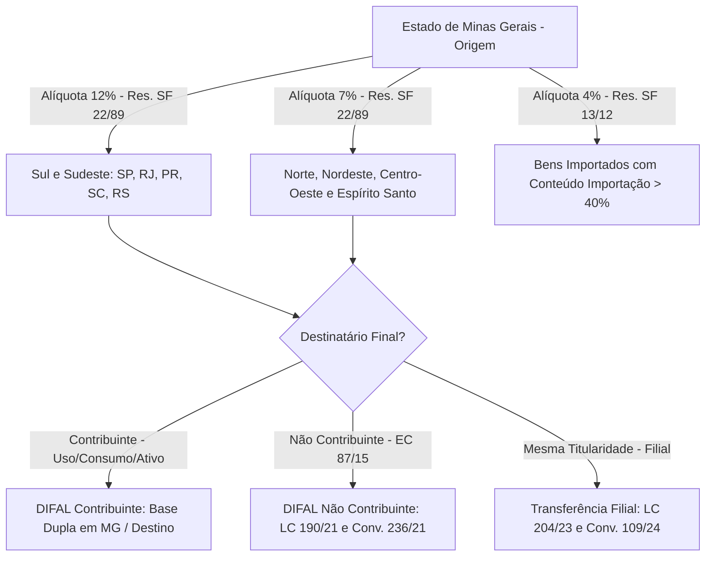
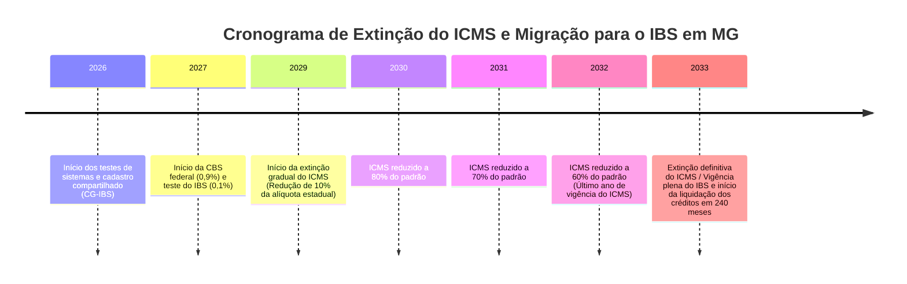
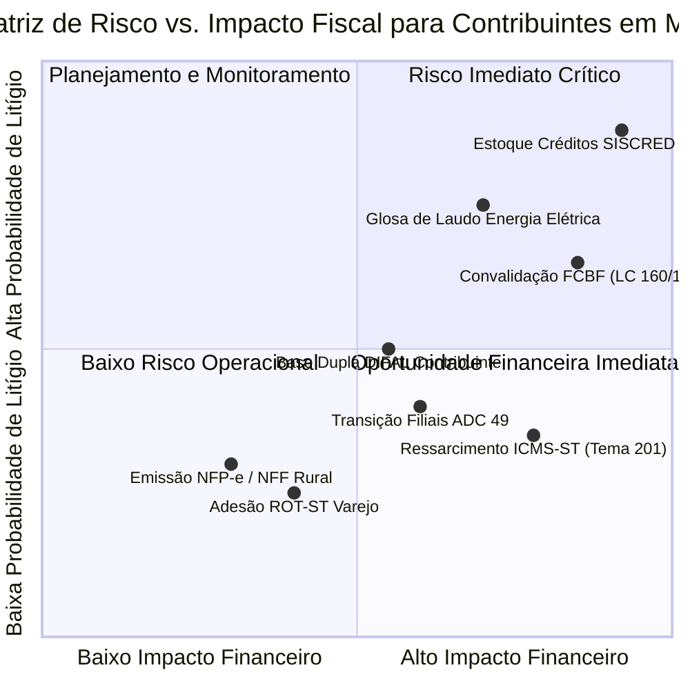

# RELATÓRIO DE AUDITORIA TRIBUTÁRIA ESTRUTURAL — ESTADO DE MINAS GERAIS (MG)

**Unidade Federativa:** Minas Gerais (MG)  
**Órgão Fazendário Competente:** Secretaria de Estado de Fazenda de Minas Gerais (SEF/MG)  
**Tribunal Administrativo:** Conselho de Contribuintes do Estado de Minas Gerais (CC/MG)  
**Data da Auditoria:** Outubro de 2026  
**Auditor Responsável:** Especialista Tributário Sênior / Tributarista de Elite (Subagente Estadual MG)  
**Arquivo do Relatório:** `_auditoria/estados/auditoria_mg.md`

---

## 1. SUMÁRIO EXECUTIVO E DIAGNÓSTICO GERAL DA UF

Minas Gerais representa a segunda maior economia e a terceira maior arrecadação tributária do Brasil, destacando-se como um dos polos produtivos mais complexos da Federação. O modelo de tributação estadual mineiro é estruturado sobre quatro eixos fundamentais:
1. **Polo Extrativo Mineral:** Expressivo volume de extração e exportação de minério de ferro, ouro e nióbio, submetido à imunidade constitucional nas saídas externas (art. 155, § 2º, X, "a", CF/88), mas onerado pela Taxa de Fiscalização de Recursos Minerais (TFRM - Lei nº 19.988/2011), gerando acúmulo estrutural de saldos credores de ICMS.
2. **Polo Metalmecânico e Automotivo:** Grande concentração industrial em Betim e Região Metropolitana de Belo Horizonte, além do Vale do Aço (siderurgia pesada), historicamente estimulados por Tratamentos Tributários Setoriais (TTS) e diferimentos do ICMS em cascata.
3. **Polo Agropecuário e Agroindustrial:** Liderança nacional na cafeicultura, bacia leiteira e forte presença no complexo de grãos e pecuária de corte, com amplo uso de diferimento nas fases iniciais e concessão de créditos presumidos aos estabelecimentos abatedores e laticínios.
4. **Polo de Distribuição e E-Commerce:** Localização geográfica central e proximidade com o mercado consumidor paulista e fluminense, potencializadas por incentivos fiscais automatizados de comércio eletrônico e Corredor de Importação.

Do ponto de vista infralegal, o Estado operou uma profunda reforma regulamentar com a promulgação do **Decreto nº 48.589, de 22 de março de 2023 (Novo Regulamento do ICMS de Minas Gerais - RICMS/2023)**, que revogou integralmente o Decreto nº 43.080/2002 a partir de 1º de julho de 2023. O novo RICMS mineiro reorganizou a matéria tributária em uma Parte Geral sistemática (arts. 1º a 192) e **10 Anexos temáticos**, substituindo o formato fragmentado anterior.

---

## 2. AUDITORIA DAS NORMAS ESTADUAIS NO REPOSITÓRIO (`estaduais/mg/`)

### 2.1. Inventário das Normas Existentes no Repositório

O repositório local possui atualmente **4 (quatro)** arquivos de legislação sob o diretório `estaduais/mg/`, conforme levantamento analítico a seguir:

| Arquivo no Repositório | Título / Norma | Tributos Afetados | Situação Cadastral | Nível de Cobertura / Diagnóstico Crítico |
| :--- | :--- | :--- | :--- | :--- |
| `estaduais/mg/ricms/decreto-48589-2023.md` | Regulamento do ICMS - RICMS/MG (Decreto nº 48.589/2023) | ICMS, ICMS-ST | Em vigor | **Resumido / Fragmentário (89 linhas):** Contém síntese de princípios, alíquotas gerais e menções genéricas ao DIFAL e ST. Não apresenta a íntegra da Parte Geral nem dos 10 Anexos técnicos. |
| `estaduais/mg/ricms/decreto-48589-2023-tts-corredor-importacao-ecommerce-mg.md` | Tratamentos Tributários Setoriais (TTS Corredor de Importação e E-Commerce) | ICMS | Em vigor | **Específico / Conceitual (38 linhas):** Cobre as linhas gerais dos incentivos de importação e vendas não presenciais, mas carece dos detalhamentos procedimentais do SIARE/e-PTA e das condicionantes de contrapartida. |
| `estaduais/mg/leis/itcmd/lei-14941-2003.md` | Lei do ITCD-MG (Lei Estadual nº 14.941/2003) | ITCMD | Em vigor | **Bom detalhamento estrutural (74 linhas):** Cobre fato gerador, competência, isenções, base de cálculo (PL contábil ajustado) e alíquota de 5% com progressividade vinculada à EC 132/2023. |
| `estaduais/mg/leis/ipva/lei-14937-2003.md` | Lei do IPVA-MG (Lei Estadual nº 14.937/2003) | IPVA | Em vigor | **Bom detalhamento estrutural (85 linhas):** Cobre fato gerador, alíquotas diferenciadas (1% a 4%), solidariedade de locadoras/compradores e repartição com municípios (50%). |

### 2.2. Lacunas Normativas Críticas e Normas Faltantes

A auditoria identifica lacunas de alta gravidade no repositório `estaduais/mg/`, exigindo complementação prioritária para subsidiar o compliance fiscal e a consultoria contenciosa:

1. **Lei Básica Tributária de Minas Gerais (Lei Estadual nº 6.763, de 26 de dezembro de 1975):**
   - *Status no repositório:* **Ausente como documento consolidado próprio**.
   - *Importância:* É a norma primária que institui o ICMS mineiro, as taxas de serviços adjetivas e o Fundo de Erradicação da Miséria (FEM, art. 12-A). Suas alterações recentes mais relevantes (Lei nº 24.285/2022 - DIFAL EC 87/15; Lei nº 24.471/2023 - Prorrogação do FEM; Lei nº 24.540/2023) não constam catalogadas.
2. **Íntegra dos 10 Anexos Temáticos do Novo RICMS/MG (Decreto nº 48.589/2023):**
   - *Status no repositório:* **Ausente**. O arquivo existente cobre menos de 5% da estrutura regulamentar.
   - *Anexos Faltantes:*
     * *Anexo I (Alíquotas):* Tabela discriminada por NCM/SH das alíquotas internas e seletivas;
     * *Anexo II (Redução de Base de Cálculo):* Cobre insumos agropecuários, cesta básica, veículos automotores e aeronaves;
     * *Anexo III (Transferência e Utilização de Crédito Acumulado):* Disciplina a gestão do SISCRED;
     * *Anexo IV (Crédito Presumido):* Relação exaustiva dos incentivos outorgados (laticínios, carnes, indústrias calçadistas, têxteis e transportadores);
     * *Anexo V (Documentos Fiscais e Escrituração):* Regras da EFD, NF-e, CT-e, MDF-e, NFP-e e registro no RUDFTO;
     * *Anexo VI (Diferimento):* Operações com café, minério, aço, energia, gado e soja;
     * *Anexo VII (Substituição Tributária):* Catálogo completo de MVA original, ajustada e convênios/protocolos interestaduais;
     * *Anexo VIII (Disposições Especiais de Tributação):* Transporte, energia, armazéns gerais e operações especiais;
     * *Anexo IX (Suspensão):* Remessas para industrialização por encomenda e conserto;
     * *Anexo X (Isenções):* Insumos, órgãos públicos, energia solar fotovoltaica e medicamentos excepcionais.
3. **Lei do Processo Administrativo Tributário (Lei Estadual nº 13.515/2000 e Decreto nº 44.747/2008 - RPTA):**
   - *Status no repositório:* **Ausente**.
   - *Importância:* Disciplina o rito de lançamento de ofício (Auto de Infração), impugnação administrativa perante o Conselho de Contribuintes de Minas Gerais (CC/MG), prazos de decadência, nulidades processuais e pedidos de reconsideração.
4. **Legislação da Taxa de Fiscalização de Recursos Minerais (Lei Estadual nº 19.988/2011 e Decreto nº 45.936/2012):**
   - *Status no repositório:* **Ausente**.
   - *Importância:* Regula a exigência de 1 UFEMG por tonelada de minério extraído/beneficiado, objeto de contencioso de grande relevância (julgado constitucional na ADI 4.785 pelo STF).
5. **Regulamentos Setoriais Complementares (RITCD e RIPVA):**
   - *Decreto Estadual nº 43.981/2005 (Regulamento do ITCD):* Ausente;
   - *Decreto Estadual nº 43.709/2003 (Regulamento do IPVA):* Ausente;
   - *Resolução SEF nº 3.166/2001 (SISCRED) e Resolução SEF nº 5.280/2019 / Portaria SRE nº 200/2021 (Ressarcimento de ICMS-ST):* Ausentes.

---

## 3. RELACIONAMENTO TRIBUTÁRIO DO ICMS-MG COM OS DEMAIS 26 ESTADOS E O DISTRITO FEDERAL

O Estado de Minas Gerais ocupa posição singular na Federação: integra a Região Sudeste, porém faz divisa com as regiões Centro-Oeste (GO, DF, MS), Nordeste (BA) e com o Estado do Espírito Santo (tratado assimetricamente nas regras interestaduais).

### 3.1. Alíquotas Interestaduais Aplicáveis nas Saídas de Minas Gerais

Com fundamento no art. 155, § 2º, IV da Constituição Federal e nas Resoluções do Senado Federal (SF), as saídas originadas em Minas Gerais sujeitam-se às seguintes alíquotas:

1. **Alíquota de 7% (Sete por cento) — Resolução do Senado Federal nº 22/1989:**
   - Aplicável nas operações e prestações interestaduais que destinem mercadorias ou serviços a contribuintes localizados nas Regiões **Norte**, **Nordeste** e **Centro-Oeste**, bem como no Estado do **Espírito Santo**.
   - Justificativa do constituinte: Mecanismo de redução de disparidades regionais, conferindo maior margem de crédito para as regiões de destino menos industrializadas.
2. **Alíquota de 12% (Doze por cento) — Resolução do Senado Federal nº 22/1989:**
   - Aplicável nas operações e prestações que destinem mercadorias ou serviços aos Estados das Regiões **Sul** (PR, SC e RS) e **Sudeste** (apenas SP e RJ, excluído o ES).
3. **Alíquota de 4% (Quatro por cento) para Bens Importados — Resolução do Senado Federal nº 13/2012:**
   - Aplicável em operações interestaduais com bens e mercadorias importados do exterior que, após seu desembaraço aduaneiro:
     * Não tenham sido submetidos a processo de industrialização; ou
     * Se submetidos a processo de transformação, beneficiamento ou montagem, resultem em mercadoria com **Conteúdo de Importação superior a 40% (quarenta por cento)**, apurado nos termos do Convênio ICMS nº 38/2013 mediante entrega da Ficha de Conteúdo de Importação (FCI).
   - *Exceções à alíquota de 4% (aplicam-se 7% ou 12%):* Bens sem similar nacional (listas CAMEX/SECEX), hidrocarbonetos e gás natural importados, e mercadorias produzidas sob a Zona Franca de Manaus ou Áreas de Livre Comércio.
4. **Alíquota de 4% para Transporte Aéreo — Resolução do Senado Federal nº 95/1996:**
   - Prestação interestadual de transporte aéreo de passageiro, carga e mala postal.

---

### 3.2. Diferencial de Alíquotas (DIFAL): Regras Práticas e Metodologia de Cálculo

Em Minas Gerais, a sistemática do DIFAL divide-se rigidamente conforme a qualificação jurídica do adquirente e a destinação econômica do bem:

#### A) DIFAL Aquisições por Contribuintes (Uso, Consumo e Ativo Permanente) — Metodologia de Base Dupla
Quando um contribuinte inscrito no Cadastro de Contribuintes de MG (CCM) adquire bem de outra UF destinado a uso/consumo ou incorporação ao ativo imobilizado, o imposto é devido a Minas Gerais mediante a fórmula da **Base Dupla (cálculo "por dentro")**, prevista no art. 13, § 1º-C da Lei Estadual nº 6.763/1975 e no art. 31 da Parte Geral do RICMS/MG (Decreto nº 48.589/2023):

$$\text{Base Dupla} = \frac{\text{Valor da Operação Interestadual} - \text{ICMS Interestadual}}{1 - \text{Alíquota Interna MG}}$$

$$\text{DIFAL a Recolher} = (\text{Base Dupla} \times \text{Alíquota Interna MG}) - \text{ICMS Interestadual Destacado}$$

*Exemplo Numérico Prático:*
- Mercadoria adquirida de fornecedor de SP (alíquota interestadual 12%) no valor de R$ 10.000,00 (ICMS interestadual destacado = R$ 1.200,00).
- Alíquota interna em MG = 18%.
- Base de Cálculo 1 (Sem o ICMS de origem): $10.000,00 - 1.200,00 = 8.800,00$.
- Base Dupla (por dentro de MG): $\frac{8.800,00}{1 - 0,18} = \frac{8.800,00}{0,82} = 10.731,71$.
- Débito Interno em MG: $10.731,71 \times 18\% = 1.931,71$.
- DIFAL devido a MG: $1.931,71 - 1.200,00 = \mathbf{R\$\ 731,71}$.

> [!IMPORTANT]
> Se o cálculo fosse efetuado por base simples, o DIFAL seria de R$ 600,00 ($10.000 \times 6\%$). O mecanismo mineiro de base dupla majora a carga efetiva para assegurar que a tributação agregada iguale o patamar cobrado no mercado interno.

#### B) DIFAL Não Contribuinte (EC nº 87/2015, LC nº 190/2021 e Lei MG nº 24.285/2022)
Nas vendas interestaduais com destino a consumidor final **não contribuinte** do ICMS localizado em Minas Gerais (ex.: e-commerce B2C originado em SP, PR ou SC):
1. **Regra de Base de Cálculo:** Aplica-se a regra da base única (valor total da operação acrescido de frete, seguro e despesas acessórias, com integração do ICMS interno de MG), na forma do Convênio ICMS nº 236/2021.
2. **Repartição Federativa:** Desde 2019, 100% da diferença entre a alíquota interna de MG (18% + adicional de 2% do FEM, quando supérfluo) e a alíquota interestadual (4%, 7% ou 12%) pertence exclusivamente ao Estado de Minas Gerais.
3. **Recolhimento:** Efetuado pelo remetente de outra UF por meio de GNRE On-line vinculada ao documento fiscal (chave de acesso da NF-e) ou em conta gráfica mensal caso o remetente possua Inscrição Especial como Substituto Tributário de DIFAL perante a SEF/MG.

#### C) Antecipação com Encerramento / Equalização para Simples Nacional
O art. 12, § 14 da Lei nº 6.763/1975 impõe às microempresas e empresas de pequeno porte optantes pelo Simples Nacional a obrigatoriedade de recolhimento da antecipação da diferença de alíquota nas compras interestaduais para comercialização ou industrialização. Com a fixação do Tema 517 da Repercussão Geral pelo STF (RE nº 970.821), tal exigência é válida desde que prevista expressamente em lei em sentido estrito (cumprida no ordenamento mineiro pela Lei nº 6.763/1975 e Decreto nº 48.589/2023).

---

### 3.3. Transferências Interestaduais entre Filiais do Mesmo Titular

A tributação das transferências entre estabelecimentos da mesma pessoa jurídica sofreu radical inflexão jurídica:

1. **Jurisprudência Vinculante (STF - ADC 49):**
   O Pleno do STF declarou a inconstitucionalidade dos arts. 11, § 3º, II e 12, I da LC nº 87/1996, definindo que a mera circulação física de bens entre estabelecimentos do mesmo titular (matriz e filial) **não constitui fato gerador do ICMS**, em virtude da ausência de ato de mercancia ou transferência de titularidade patrimonial.
2. **Marco Legislativo Complementar (Lei Complementar nº 204/2023):**
   Alterou a Lei Kandir para vedar a incidência do ICMS na saída de mercadorias de um estabelecimento para outro do mesmo titular e assegurar a **manutenção dos créditos fiscais** de operações antecedentes relativas aos bens transferidos.
3. **Acordos do CONFAZ (Convênio ICMS nº 178/2023 e Convênio ICMS nº 109/2024):**
   - *Convênio 178/2023:* Regulou a obrigatoriedade de transferência do crédito na saída interestadual, limitado às alíquotas de 4%, 7% ou 12%.
   - *Convênio 109/2024 (Consolidador):* Assegurou ao contribuinte o direito de **opção por equiparar a transferência a operação tributada**, mediante termo lavrado no Registro de Utilização de Documentos Fiscais e Termos de Ocorrências (RUDFTO), com eficácia anual irretratável.
4. **Regulamentação em Minas Gerais (Decretos nº 48.768/2024 e nº 48.930/2024):**
   - O Estado de Minas Gerais internalizou as disposições da LC nº 204/2023 e do Convênio ICMS nº 109/2024 no Novo RICMS/MG (Decreto nº 48.589/2023):
     * *Regime Padrão (Não Incidência):* Emissão da NF-e sem destaque do ICMS, utilizando CFOP `6.151`/`6.152` com campo próprio de repasse de crédito escritural;
     * *Regime Opcional (Tributação Efetiva):* O contribuinte mineiro pode optar pela incidência regular do imposto para evitar o estorno proporcional e manter créditos plenos em cadeias de incentivos como o TTS.

> [!NOTE]
> Distinção Técnica Relevante: O **Decreto Estadual nº 48.749/2023** citado no ordenamento mineiro não regula a transferência genérica entre filiais da ADC 49, mas sim alterou o Decreto nº 47.569/2018 para elevar os limites de **transferência de crédito acumulado** para fabricantes de máquinas e equipamentos instalados em MG (teto de R$ 48 milhões/ano e R$ 288 milhões global). A matéria da ADC 49 em MG foi normatizada pelos Decretos nº 48.768/2024 e nº 48.930/2024.

---

### 3.4. Regime de Substituição Tributária (ICMS-ST) Interestadual

Minas Gerais é um dos Estados com maior número de adesões a Protocolos e Convênios ICMS no âmbito do CONFAZ, sob as diretrizes do **Convênio ICMS nº 142/2018** e do **Anexo VII do Novo RICMS/MG (Decreto nº 48.589/2023)**.

#### A) Principais Segmentos Econômicos Sujeitos a Protocolos de ST com MG
- **Setor Automotivo e Autopeças:** Convênio ICMS nº 199/2017 e Protocolos ICMS nº 41/2008 e nº 97/2010 (ampla retenção nas entradas procedentes de SP, PR e RJ).
- **Bebidas (Cervejas, Chopes, Refrigerantes e Energéticos):** Protocolo ICMS nº 11/1991 e Protocolo ICMS nº 103/2012.
- **Medicamentos e Produtos Farmacêuticos:** Convênio ICMS nº 234/2017.
- **Materiais de Construção, Acabamento e Bricolagem:** Protocolos ICMS nº 85/2011 e nº 26/2010.
- **Cosméticos, Perfumaria e Artigos de Higiene Pessoal:** Protocolo ICMS nº 104/2012.

#### B) Fórmula de Cálculo da MVA Ajustada
Nas aquisições interestaduais de mercadorias submetidas à ST destinadas a revenda em Minas Gerais, quando a alíquota interestadual for inferior à alíquota interna de MG (18%), exige-se a aplicação da **Margem de Valor Agregado Ajustada (MVA Ajustada)**:

$$\text{MVA Ajustada} = \left[ \frac{(1 + \text{MVA-ST Original}) \times (1 - \text{ALQ Inter})}{(1 - \text{ALQ Intra})} \right] - 1$$

Onde:
- $\text{MVA-ST Original}$: Margem fixada no Anexo VII do RICMS/MG para operações internas;
- $\text{ALQ Inter}$: Alíquota interestadual da remessa (4% ou 12%);
- $\text{ALQ Intra}$: Alíquota interna do produto em Minas Gerais (ex.: 18%).

*Regra Especial do Simples Nacional (Convênio ICMS nº 35/2011):*
Quando o remetente da mercadoria localizado em outro Estado for optante pelo Simples Nacional, **veda-se a aplicação da MVA Ajustada**, devendo o remetente ou adquirente utilizar exclusivamente a **MVA-ST Original**.

---

## 4. MECANISMOS DE DEDUÇÃO E TOMADA DE CRÉDITO NO ICMS-MG

### 4.1. Regras da Não-Cumulatividade Mineira (Parte Geral do RICMS/MG)

O princípio constitucional da não-cumulatividade (art. 155, § 2º, I, CF/88) está positivado no **Título II (arts. 28 a 59) da Parte Geral do Novo RICMS/MG (Decreto nº 48.589/2023)**, anteriormente disciplinado no Título I, Capítulo VII do revogado Decreto nº 43.080/2002.

1. **Apropriação Ordinária do Crédito (arts. 31 a 38):**
   - É assegurado ao contribuinte o direito de creditar-se do ICMS anteriormente cobrado em operações de entrada de mercadorias destinadas à comercialização, industrialização (matérias-primas, produtos intermediários, embalagens) ou prestação de serviços de transporte e comunicação.
   - Aplica-se o critério do **consumo direto ou desgaste imediato**: os materiais intermediários devem participar diretamente do processo produtivo ou desgastar-se de forma necessária e quantificável no contato com o produto fabricado (Instrução Normativa DLT/SRE nº 01/1998).
2. **Vedações Expressas de Crédito (art. 39):**
   - Não dá direito a crédito a entrada de mercadorias ou serviços destinados a uso ou consumo próprio do estabelecimento (aplicação mitigada pelo cronograma postergado da LC 87/96);
   - Mercadorias adquiridas para comercialização ou industrialização cujas saídas posteriores sejam amparadas por isenção ou não incidência sem expressa manutenção de crédito;
   - Aquisições documentadas por notas fiscais inidôneas ou que não guardem conformidade com a escrituração da EFD ICMS/IPI.
3. **Hipóteses Obrigatórias de Estorno de Crédito (arts. 40 a 44):**
   - O contribuinte deverá efetuar o estorno integral ou proporcional do crédito escriturado quando as mercadorias:
     * Vierem a perecer, deteriorar-se ou forem objeto de roubo/furto no estabelecimento;
     * Forem objeto de saída isenta ou não tributada cuja manutenção não esteja legalmente autorizada;
     * Forem utilizadas em processo industrial do qual resulte produto isento, não tributado ou tributado com alíquota zero.
4. **Manutenção de Crédito (Operações Especiais):**
   - Assegura-se a manutenção integral dos créditos em operações que destinem mercadorias ao exterior (art. 155, § 2º, X, "a", CF/88) e saídas internas sob diferimento com previsão expressa nos Anexos IV e VI do RICMS/MG.

---

### 4.2. Controle de Crédito do Ativo Permanente (CIAP — 1/48 Avos)

A apropriação do ICMS incidente sobre bens incorporados ao Ativo Imobilizado obedece ao art. 20, § 5º da LC nº 87/1996 (com a redação da LC nº 102/2000) e aos **arts. 32 e 33 da Parte Geral do RICMS/MG (Decreto nº 48.589/2023)**, complementados pelas instruções técnicas da Superintendência de Receita Estadual (SRE):

1. **Fração Mensal de Apropriação:** O montante do crédito fiscal é apropriado à razão de **1/48 (um quarenta e oito avos) por mês**, iniciando-se no mês em que ocorrer a efetiva entrada do bem em operação/produção no estabelecimento.
2. **Fator de Proporcionalidade das Saídas Tributadas ($F$):**
   A apropriação mensal é ponderada pela relação entre as operações tributadas (incluindo exportações) e o total das operações do período:

   $$F = \frac{\text{Saídas e Prestações Tributadas} + \text{Saídas para o Exterior}}{\text{Total das Saídas e Prestações}}$$

   $$\text{Crédito Mensal Apropriável} = \left( \frac{\text{ICMS Destacado no Bem}}{48} \right) \times F$$

3. **Escrituração Fiscal Digital (EFD - Bloco G):**
   O controle analítico do CIAP em Minas Gerais deve ser informado item a item no **Bloco G da EFD-ICMS/IPI** (Registros G110, G125 e G126), dispensando o livro físico modelo "C" ou "D".
4. **Baixa ou Alienação Antecipada:** Se o bem do ativo for alienado, transferido, baixado ou desativado antes do término do quadriênio (48 meses), cessa imediatamente o direito à apropriação das parcelas remanescentes, sendo vedada a aceleração do crédito.

---

### 4.3. Restrições Legais: Energia Elétrica e Serviços de Comunicações

Em observância ao art. 33 da Lei Complementar nº 87/1996 e ao regulamento mineiro:
1. **Energia Elétrica:** A entrada de energia elétrica somente confere direito a crédito de ICMS quando:
   - For consumida diretamente no processo de industrialização;
   - For objeto de operação de comercialização de energia pelo próprio estabelecimento gerador;
   - O estabelecimento realizar operações de saída de mercadorias destinadas ao exterior em proporção superior a 50% de suas saídas totais.
   * *Exigência Formal em MG:* Para comprovação do percentual de consumo na linha de produção, a SEF/MG exige a manutenção de **Laudo Técnico Pericial de Engenharia Elétrica** emitido por perito habilitado (com recolhimento de ART perante o CREA), com validade máxima de 2 anos, sob pena de glosa fiscal de 100% dos créditos compensados.
2. **Serviços de Comunicação:** O creditamento é estritamente restrito às empresas que prestem serviços de comunicação ou quando o serviço for utilizado na execução de serviços da mesma natureza ou destinado ao exterior.

---

### 4.4. Fundo de Erradicação da Miséria (FEM — Adicional de 2%)

O Fundo de Erradicação da Miséria de Minas Gerais (FEM) possui base legal no **art. 12-A da Lei Estadual nº 6.763/1975**, renovado e atualizado pela **Lei Estadual nº 24.471, de 29 de setembro de 2023**, e regulamentado pelo **Decreto nº 48.709/2023**:

1. **Alíquota Adicional:** Sobretaxa de **2% (dois por cento)** incidente sobre operações internas com mercadorias consideradas supérfluas.
2. **Produtos Sujeitos ao FEM/MG:** Cervejas alcoólicas e chopes; refrigerantes e bebidas isotônicas; bebidas alcoólicas destiladas e fermentadas; cigarros e produtos de tabacaria; armas e munições; perfumes e cosméticos de luxo; smartphones e telefones celulares; veículos de esporte e recreio, lanchas, ultraleves e iates.
3. **Mecanismo de Arrecadação e Segregação Contábil:**
   - O adicional de 2% não integra a apuração normal de débitos e créditos ordinários de ICMS.
   - O montante apurado deve ser recolhido em Documento de Arrecadação Estadual (**DAE Avulso com código de receita específico**), sendo terminantemente vedada a sua compensação com créditos fiscais acumulados do estabelecimento ou créditos decorrentes de entradas ordinárias.

---

### 4.5. Sistema de Controle de Créditos Acumulados (SISCRED/MG)

O acúmulo de saldo credor é disciplinado pela **Resolução SEF nº 3.166/2001** e pelo **Anexo III do Novo RICMS/MG (Decreto nº 48.589/2023)**:

1. **Hipóteses Geradoras de Crédito Acumulado Homologável:**
   - Operações destinadas ao exterior (imunidade com manutenção, art. 3º, II da LC 87/96);
   - Saídas ao abrigo do diferimento ou suspensão sem compensação a jusante;
   - Saídas amparadas por redução de base de cálculo com cláusula expressa de manutenção de crédito de entrada;
   - Aquisições tributadas a alíquotas elevadas (ex.: 18%) com saídas submetidas a alíquotas reduzidas (ex.: 7% ou 12%).
2. **Procedimento Eletrônico via SIARE / e-PTA:**
   O contribuinte deve protocolar o Pedido de Apropriação de Crédito Acumulado perante o sistema **e-PTA da SEF/MG**, submetendo-se a:
   - Validação da EFD e arquivos digitais do Demonstrativo de Crédito Acumulado (DCA);
   - Aferição da higidez fiscal e emissão de Parecer Conclusivo da Delegacia Fiscal;
   - Expedição do Certificado de Crédito Acumulado com liberação no sistema informatizado SISCRED.
3. **Mecanismos de Utilização e Liquidação:**
   - Transferência para estabelecimentos fornecedores situados em Minas Gerais para pagamento de matérias-primas, insumos, embalagens e aquisição de energia elétrica;
   - Pagamento de bens do ativo imobilizado produzidos no Estado, sob o teto regulatório do Decreto nº 47.569/2018 (com alterações dos Decretos nº 48.749/2023 e nº 48.768/2024);
   - Compensação com débitos próprios de ICMS parcelados ou inscritos em Dívida Ativa;
   - Transferência entre estabelecimentos de empresas interdependentes ou coligadas, mediante autorização do Secretário de Estado de Fazenda.

---

## 5. SETOR AGRÍCOLA E RURAL MINEIRO

Minas Gerais se destaca como líder na cafeicultura brasileira (com mais de 50% da produção nacional arábica), segunda maior bacia leiteira e grande produtor de milho, soja e gado de corte. A arquitetura tributária mineira concede tratamento diferenciado ao produtor rural:

### 5.1. Convênio ICMS nº 100/1997 no Ordenamento Mineiro
As disposições nacionais do Convênio ICMS nº 100/1997 estão consolidadas no **Anexo II (Redução de Base de Cálculo)** e no **Anexo X (Isenções)** do Decreto nº 48.589/2023:
1. **Isenção Total (Anexo X):** Sementes certificadas fiscalizadas, defensivos biológicos selecionados e operações internas com calcário agrícola e esterco animal.
2. **Redução da Base de Cálculo (Anexo II):**
   - Redução de base de cálculo em 60% ou 30% para defensivos agrícolas, adubos, fertilizantes químicos, rações balanceadas para animais e medicamentos veterinários.
   - Adequação ao escalonamento de fertilizantes determinado pelo Convênio ICMS nº 26/2021 (tributação gradual nas importações e saídas interestaduais de 1% a 4%).

### 5.2. Sistemática de Diferimento na Cadeia Agropecuária (Anexo VI do RICMS/MG)
O diferimento do ICMS encerra a cobrança do tributo nas etapas agrícolas iniciais, transferindo o momento do recolhimento para a fase posterior de industrialização ou comercialização no atacado:
1. **Café Cru em Grão:**
   - Diferimento do ICMS nas saídas internas efetuadas por produtor rural com destino a cooperativa de cafeicultores, armazém-geral devidamente credenciado ou estabelecimento exportador/torrefador mineiro.
   - O imposto diferido é considerado recolhido/dispensado na hipótese de exportação direta do café ou postergado para a tributação da saída interestadual/interna de café beneficiado.
2. **Leite Cru:**
   - Aplicação de diferimento total do imposto na saída do leite cru de produtor rural localizado em MG com destino a indústrias de laticínios ou cooperativas de beneficiamento localizadas no Estado.
   - Encerramento da cadeia no laticínio adquirente, com geração de crédito presumido compensatório.
3. **Pecuária de Corte (Bovinos e Suínos em Pé):**
   - Diferimento nas operações entre criadores, recriadores e invernistas, bem como nas remessas com destino direto a estabelecimentos abatedores ou frigoríficos que possuam registro no IMA (Instituto Mineiro de Agropecuária) ou SIF (Serviço de Inspeção Federal).
4. **Grãos (Soja e Milho):**
   - Diferimento nas saídas internas para indústrias de esmagamento, fábricas de ração e cooperativas agropecuárias.

### 5.3. Créditos Outorgados e Presumidos para Agroindústria (Anexo IV do RICMS/MG)
Para neutralizar a concorrência fiscal de outros Estados e preservar a rentabilidade dos elos fabris locais:
- **Setor de Laticínios:** Concessão de crédito presumido de ICMS aos laticínios mineiros equivalente ao valor do imposto incidente nas saídas tributadas de queijos, iogurtes, manteigas e leite UHT, compensando o custo das entradas de leite cru isentas ou diferidas.
- **Frigoríficos e Abatedouros:** Crédito outorgado de até 100% do imposto apurado nas saídas de carnes e miudezas comestíveis de bovinos, suínos e aves abatidos em território mineiro.
- **Setor Cafeeiro:** Crédito presumido concedido aos estabelecimentos industriais de moagem, torrefação e fabricação de café solúvel sobre o valor das saídas tributadas.

### 5.4. Documentação Fiscal e Regime Simplificado do Produtor Rural
1. **Inscrição no Cadastro de Produtor Rural (Inscrição Estadual):** Distinção entre o Produtor Rural Pessoa Física (PRPF) e Pessoa Jurídica (PRPJ).
2. **Nota Fiscal de Produtor Eletrônica (NFP-e, Modelo 55):**
   - Obrigatoriedade gradual implementada pela SEF/MG em alinhamento ao Ajuste SINIEF nº 10/2022.
   - Emissão gratuita facilitada por meio do Portal SIARE da SEF/MG ou via aplicativo móvel da **Nota Fiscal Fácil (NFF)**, simplificando as exigências operacionais do homem do campo.
3. **Dispensa de Obrigações Acessórias Complexas:** O produtor rural pessoa física sem constituição de pessoa jurídica societária permanece desobrigado da entrega da Escrituração Fiscal Digital (EFD ICMS/IPI) e do CIAP complexo, apurando o imposto por confronto simplificado de documentos.

---

## 6. SETOR INDUSTRIAL E MINERÁRIO MINEIRO

### 6.1. Tomada de Crédito sobre Insumos Industriais e Energia Elétrica
O setor manufatureiro e de base em Minas Gerais usufrui da apropriação ampla de insumos:
- **Insumos e Matérias-Primas:** Direito à tomada integral de créditos de ICMS sobre matérias-primas, produtos intermediários (incluindo discos de corte, refratários, óleos industriais de refrigeração e catalisadores) consumidos de forma imediata ou gradual no processo fabril.
- **Embalagens:** Apropriação de créditos de caixas, sacarias, tambores e paletes incorporados ao produto final.
- **Energia Elétrica Industrial:** Crédito condicionado à apresentação e arquivamento de laudo de consumo firmado por engenheiro perito, restringindo a apropriação aos quilowatts-hora consumidos na planta fabril propriamente dita.

---

### 6.2. O Setor Minerário e a Taxa de Fiscalização de Recursos Minerais (TFRM)

A mineração constitui a espinha dorsal das exportações e do saldo fiscal de Minas Gerais:

1. **Instituição e Base Legal da TFRM:**
   - Criada pela **Lei Estadual nº 19.988, de 28 de dezembro de 2011**, e regulamentada pelo Decreto nº 45.936/2012.
   - *Fato Gerador:* Exercício regular do poder de polícia sobre as atividades de pesquisa, lavra, exploração e aproveitamento de recursos minerais no território mineiro.
   - *Base de Cálculo e Alíquota:* Fixada em **1 (uma) Unidade Fiscal do Estado de Minas Gerais (UFEMG)** por tonelada métrica de mineral extraído (minério de ferro, bauxita, fosfato, ouro, etc.).
2. **Constitucionalidade no STF (ADI nº 4.785):**
   O Supremo Tribunal Federal, sob a relatoria do Min. Edson Fachin, julgou a ADI nº 4.785 improcedente, assentando a plena constitucionalidade da TFRM mineira, reconhecendo a competência estadual concorrente para a fiscalização ambiental e minerária, desde que o montante global arrecadado guarde razoável equivalência com os custos de estruturação da máquina fiscalizadora estadual (FEAM, IEF, IGAM e SEF).
3. **Reflexos Estruturais no ICMS e Acúmulo de Créditos:**
   - As remessas diretas de minério para o exterior são imunes de ICMS (art. 155, § 2º, X, "a", CF/88 - Lei Kandir).
   - Como as mineradoras mantêm gastos vultosos com maquinário, dragas, esteiras transportadoras, peças de reposição e energia elétrica pesada, geram-se anualmente **bilhões de reais em saldos credores de ICMS acumulados**, que não podem ser absorvidos no débito interno, alimentando uma fila contínua de pedidos de homologação no SISCRED/MG.

---

### 6.3. Termos de Acordo de Regime Especial (TARE / TTS)

A SEF/MG adota a sistemática dos **Tratamentos Tributários Setoriais (TTS)**, formalizados por meio de Termos de Acordo de Regime Especial (TARE), regulados no **Anexo VIII do Decreto nº 48.589/2023** e operados via sistema eletrônico e-PTA:
- **TTS Padronizados:** Concedidos mediante adesão automatizada no Portal SIARE para setores pré-enquadrados (indústria têxtil, calçadista, móveis, cosméticos, química, papel e papelão).
- **TTS Específicos / Estruturantes:** Celebrados com interveniência da Secretaria de Estado de Desenvolvimento Econômico (SEDE) e do Instituto de Desenvolvimento Integrado de Minas Gerais (Invest Minas), fixando compromissos plurianuais de faturamento mínimo, investimentos em Capex e metas de geração de empregos.

---

### 6.4. Corredor de Importação e Polos Automotivo e Siderúrgico

1. **TTS Corredor de Importação:**
   - *Diferimento no Desembaraço:* 100% de diferimento do ICMS na importação de mercadorias destinadas à comercialização, desde que o desembaraço aduaneiro ocorra em recintos alfandegados de Minas Gerais (Porto Seco de Juiz de Fora, Varginha, Betim, Pouso Alegre, Uberaba, Uberlândia e Aeroporto Internacional de Confins).
   - *Crédito Presumido na Saída:* Carga tributária efetiva final reduzida para **1,5%** nas operações interestaduais com mercadorias importadas submetidas à alíquota de 4% (Res. SF 13/12). Se o desembaraço ocorrer fora do Estado com anuência prévia, a carga sobe para 2,5%.
2. **Polo Automotivo de Minas Gerais (Betim e Região):**
   - Sistema complexo de diferimento tributário nas aquisições internas de peças, chassis, motores e chapas de aço entre sistemistas e montadoras.
   - Crédito presumido outorgado nas saídas de veículos terminados, assegurando competitividade frente aos regimes do Nordeste e de São Paulo.
3. **Polo Siderúrgico do Vale do Aço (Usiminas, Aperam, Gerdau, ArcelorMittal):**
   - Regime especial de desoneração da cadeia do aço bruto e laminado.
   - Diferimento do ICMS nas operações internas com ferro-gusa, sucata ferrosa e coque metalúrgico com destino às usinas integradas.

---

## 7. SETOR DE PRODUTO ACABADO (ATACADO, VAREJO E DISTRIBUIÇÃO)

### 7.1. TTS E-Commerce (Modalidades Não Vinculada e Vinculada)

O Estado de Minas Gerais desenhou uma das políticas mais agressivas de atração de centros de distribuição de e-commerce do país:

| Modalidade | Perfil do Beneficiário | Mecânica Operacional do Benefício | Carga Tributária Efetiva de ICMS |
| :--- | :--- | :--- | :--- |
| **TTS E-Commerce Não Vinculado** | Varejistas puros de comércio eletrônico (*pure players*) instalados em MG que realizam exclusivamente operações não presenciais (internet e teleatendimento). | Concessão de crédito presumido de ICMS sobre as saídas interestaduais destinadas a consumidor final não contribuinte, abatendo o débito próprio mineiro. | Carga efetiva líquida de **1,3% a 2,0%** recolhida a MG (além do repasse do DIFAL EC 87/15 para a UF de destino). |
| **TTS E-Commerce Vinculado** | Estruturas mistas formadas por Centro de Distribuição Atacadista e filial de Varejo de Comércio Eletrônico do mesmo grupo econômico. | O Centro de Distribuição adquire ou importa mercadorias sem recolhimento prévio de ICMS-ST e as transfere para a filial de e-commerce com diferimento integral do imposto. | Retenção do ICMS-ST apenas quando o produto for destinado a varejista físico tradicional mineiro. |

---

### 7.2. Pautas Fiscais (PMPF) e MVA no Anexo VII do RICMS/MG

1. **Preço Médio Ponderado a Consumidor Final (PMPF):**
   Para produtos de consumo massivo e alta homogeneidade (combustíveis derivados de petróleo, cervejas, refrigerantes, águas minerais e cimento), a SEF/MG não utiliza a MVA tradicional, fixando periodicamente pautas fiscais publicadas por meio de **Portarias da Subsecretaria de Receita Estadual (SRE)** baseadas em pesquisas amostrais de preços a varejo.
2. **Composição da Base de Cálculo Presumida por MVA:**
   Nas demais hipóteses, a base do ICMS-ST resulta da aplicação do índice de agregação:

   $$\text{Base ST} = (\text{Valor da Operação} + \text{Frete} + \text{Seguro} + \text{IPI} + \text{Outras Despesas}) \times (1 + \text{MVA})$$

---

### 7.3. Restituição e Complementação do ICMS-ST (Pós-Julgamento RE 593.849/MG)

Minas Gerais foi o Estado de origem da tese fixada pelo Supremo Tribunal Federal no **Recurso Extraordinário nº 593.849/MG (Tema 201 da Repercussão Geral)**, na qual restou pacificado:
> *"É devida a restituição da diferença do ICMS pago a mais no regime de substituição tributária para frente se a base de cálculo efetiva da operação for inferior à presumida."*

1. **Bilateralidade da Tese (Complementação):** Por simetria tributária, o Estado de Minas Gerais passou a exigir também a **complementação do ICMS-ST** quando o valor real da venda for superior ao valor da pauta ou da base presumida de retenção.
2. **Procedimento Administrativo (Resolução SEF nº 5.280/2019 e Portaria SRE nº 200/2021):**
   - Os contribuintes substituídos devem calcular a diferença item a item por meio de registros específicos da EFD-ICMS/IPI (**Registros C180, C181, C185, C186 e 1260**);
   - Saldos credores de restituição podem ser utilizados para compensar débitos vincendos de ST ou transferidos para outros contribuintes credenciados.
3. **Regime Optativo de Tributação da Substituição Tributária (ROT-ST):**
   Para evitar o ônus burocrático do confronto diário entre base presumida e base real, os contribuintes com faturamento até determinado porte podem firmar adesão ao ROT-ST, no qual renunciam ao ressarcimento em troca da dispensa absoluta de exigência de qualquer complementação fiscal por parte da SEF/MG.

---

### 7.4. Responsabilidade Tributária de Marketplaces e Plataformas Digitais
Com o advento da economia digital, o ordenamento mineiro atribui solidariedade aos intermediadores de negócios digitais:
- Os provedores de plataformas digitais (*marketplaces*) e intermediadores de pagamento são obrigados a prestar informações financeiras centralizadas via **Declaração de Informações de Meios de Pagamentos (DIMP)**;
- O art. 21 da Lei nº 6.763/1975 comina responsabilidade solidária aos operadores de plataformas logísticas e eletrônicas que derem causa ou facilitarem a circulação física de mercadorias no território mineiro desacompanhadas de documento fiscal eletrônico idôneo emitido pelo lojista parceiro.

---

## 8. TRANSIÇÃO PARA O IBS E CBS DA REFORMA TRIBUTÁRIA DO CONSUMO

A promulgação da **Emenda Constitucional nº 132/2023** e a tramitação/aprovação da legislação complementar do IVA Dual (**Lei Complementar nº 214/2025** - Regulamento Geral do IBS e CBS, e **Lei Complementar nº 227/2026** - Comitê Gestor do IBS e Transição) alteram estruturalmente as bases federativas e operacionais de Minas Gerais.

### 8.1. Transição Federativa e o Princípio do Destino
1. **Extinção Gradual das Alíquotas de ICMS (2029 a 2032):**
   A arrecadação do ICMS em Minas Gerais sofrerá redução programada de suas alíquotas estaduais à razão de:
   - 90% em 2029;
   - 80% em 2030;
   - 70% em 2031;
   - 60% em 2032;
   - **0% em 1º de janeiro de 2033 (extinção definitiva)**.
2. **Impacto na Balança Fiscal de Minas Gerais:**
   - A transição do **princípio da origem** (no qual o Estado exportador retém parte do imposto interestadual a 4%, 7% ou 12%) para o **princípio do destino absoluto** (no qual 100% do imposto pertence ao município e estado onde reside o consumidor final) provocará severo impacto sobre a arrecadação mineira.
   - Sendo Minas Gerais um Estado industrial, agrícola e minerário superavitário em fluxos interestaduais, haverá dependência direta das regras de partilha do Comitê Gestor do IBS e do período de transição de 50 anos (2029 a 2077) para a equalização das receitas estaduais.
3. **Fim da Guerra Fiscal e Ineficácia dos TTS Futuros:** A partir de 2033, restará vedada qualquer outorga unilateral de créditos presumidos, diferimentos não padronizados nacionalmente ou redução de alíquotas locais.

---

### 8.2. Homologação e Liquidação dos Saldos Credores Acumulados de ICMS (Art. 134 do ADCT)

A liquidação dos saldos credores remanescentes de ICMS apurados até 31 de dezembro de 2032 constitui o ponto de maior tensão entre o empresariado mineiro e a SEF/MG:

1. **Reconhecimento e Pedido de Homologação:**
   - Os saldos credores regularmente escriturados até 31/12/2032 deverão ser submetidos a pedido de homologação perante a SEF/MG a partir de 1º de janeiro de 2033, no prazo decadencial de até 5 (cinco) anos.
   - O Fisco estadual terá o prazo de **24 (vinte e quatro) meses** (prorrogável por igual período) para auditoria e manifestação formal, sob pena de **homologação tácita**.
2. **Correção Monetária:** A partir de 1º de fevereiro de 2033, os créditos homologados passarão a ser atualizados mensalmente pelo **IPCA**.
3. **A Sistemática das 240 Parcelas Mensais:**
   - O saldo credor geral homologado não será devolvido em espécie imediatamente: será compensado com o IBS devido ao Comitê Gestor em **240 (duzentas e quarenta) parcelas mensais, iguais e sucessivas**, estendendo a recuperação econômica por **20 (vinte) anos** (de 2033 a 2052).
   - *Créditos de Ativo Permanente (CIAP):* Os créditos de CIAP em curso serão compensados pelo prazo remanescente que faltar para atingir o quadriênio original de 48 meses.
4. **Mecanismos de Transferência e Ressarcimento:**
   - Na hipótese de impossibilidade de compensação com o IBS próprio, a legislação complementar autoriza a transferência desses saldos para terceiros ou para estabelecimentos coligados;
   - Se ainda assim não houver compensação, caberá ao Comitê Gestor do IBS ressarcir os contribuintes em moeda corrente no mesmo prazo remanescente das 240 parcelas.
5. **O Risco Operacional do SISCRED/MG:**
   Minas Gerais possui um estoque bilionário de créditos acumulados vinculados à exportação de minério e café. A lentidão histórica nas homologações do e-PTA gera o risco concreto de contenciosos em massa na virada para 2033 caso a SEF/MG não automatize o saneamento de sua base de créditos até 2028.

---

### 8.3. Fundo de Compensação de Benefícios Fiscais (FCBF)

O **Fundo de Compensação de Benefícios Fiscais (FCBF)**, inserido pelo art. 159-A da Constituição Federal (EC nº 132/2023), tem por finalidade compensar financeiramente as empresas beneficiárias de incentivos convalidados perante o CONFAZ:

1. **Financiamento pelo Tesouro Nacional:** A União aportará R$ 160 bilhões entre 2029 e 2032 para cobrir perdas econômicas decorrentes da revogação dos regimes especiais.
2. **Elegibilidade dos Benefícios Mineiros:**
   Apenas farão jus à indenização do FCBF as indústrias e empresas detentoras de TTS ou TAREs que:
   - Tenham sido instituídos até 31 de maio de 2017;
   - Tenham sido devidamente registrados e depositados perante a Secretaria Executiva do CONFAZ nos termos da **Lei Complementar nº 160/2017** e do **Convênio ICMS nº 190/2017**;
   - Estejam em efetiva vigência em 31 de dezembro de 2028.
3. **Escalonamento Regressivo da Compensação:**
   - 2029: 100% da perda apurada do benefício;
   - 2030: 80%;
   - 2031: 60%;
   - 2032: 40%;
   - 2033: Cessação definitiva do Fundo.
4. **Alerta aos Beneficiários de TTS E-Commerce e Corredor de Importação:** Regimes especiais renovados ou repactuados sem o estrito amparo nas cláusulas de depósito do Convênio ICMS nº 190/2017 poderão ter sua elegibilidade ao FCBF glosada pela União, expondo as filiais mineiras a grave desequilíbrio concorrencial no período pré-2033.

---

## 9. MATRIZ DE RISCOS, OPORTUNIDADES E RECOMENDAÇÕES ESTRATÉGICAS

### 9.1. Recomendações Normativas para o Repositório de Minas Gerais (`estaduais/mg/`)
1. **Catalogação Imediata da Lei nº 6.763/1975:** Criar o arquivo `estaduais/mg/leis/icms/lei-6763-1975.md` contendo o texto consolidado com as Leis nº 24.285/2022 e nº 24.471/2023.
2. **Desdobramento dos 10 Anexos do Decreto nº 48.589/2023:** Segmentar o RICMS/MG em subarquivos técnicos (especialmente Anexo II de Reduções, Anexo IV de Créditos Presumidos, Anexo VI de Diferimento e Anexo VII de Substituição Tributária).
3. **Inclusão da Lei do PAT (Lei nº 13.515/2000) e do RPTA (Decreto nº 44.747/2008):** Essencial para orientar prazos e estratégias no Conselho de Contribuintes de MG (CC/MG).
4. **Catalogação da Lei da TFRM (Lei nº 19.988/2011):** Para garantir fundamentação no setor de recursos minerais.

### 9.2. Recomendações Corporativas e Tributárias para Contribuintes Estabelecidos em MG
1. **Auditoria Preventiva dos Saldos Credores no SISCRED:** Antecipar até 2028 todos os pedidos de homologação de saldos acumulados de ICMS para evitar a trava das 240 parcelas mensais do art. 134 do ADCT a partir de 2033.
2. **Validação Técnica de Laudos de Energia Elétrica:** Renovar a cada dois anos os laudos periciais de engenharia elétrica da planta fabril para afastar a glosa de créditos com juros de mora e multa de revalidação de 50%.
3. **Revisão Documental dos TTS/TAREs perante o CONFAZ:** Auditar os números de registro de depósito dos incentivos fiscais estaduais no portal do CONFAZ para garantir acesso pleno aos aportes indenizatórios do Fundo de Compensação de Benefícios Fiscais (FCBF).
4. **Adoção do ROT-ST para Varejistas:** Avaliar a conveniência da opção pelo Regime Optativo de Tributação de ST caso o valor real médio de revenda seja sistematicamente superior à pauta da SEF/MG, eliminando a cobrança da complementação do ICMS-ST.

---

## 10. CONCLUSÕES E QUADRO SINÓTICO NORMATIVO

O ordenamento tributário de Minas Gerais ostenta singular sofisticação técnica, caracterizada por um novo arcabouço infralegal (Decreto nº 48.589/2023) desenhado para manter o Estado como polo competitivo e distribuidor estratégico no Sudeste. Contudo, a migração irreversível para o IBS/CBS impõe um cronograma estrito de transição econômica e auditoria de passivos/ativos fiscais.

### Quadro Sinótico de Normas Fundamentais do Estado de Minas Gerais (MG)

| Matéria Tributária | Norma Primária (Lei) | Norma Regulamentadora (Decreto / Resolução) | Impacto Prático / Destaque Tributário |
| :--- | :--- | :--- | :--- |
| **ICMS — Regra Geral e Incidência** | Lei Estadual nº 6.763/1975 | Decreto nº 48.589/2023 (RICMS/2023 - Parte Geral) | Alíquota geral de 18%; sistemática de débitos e créditos, vedações e estornos. |
| **Fundo de Combate à Pobreza (FEM)** | Lei Estadual nº 6.763/1975 (art. 12-A) e Lei nº 24.471/2023 | Decreto nº 48.709/2023 | Adicional de 2% sobre supérfluos; recolhimento apartado sem compensação de crédito. |
| **DIFAL Não Contribuinte (EC 87/15)** | Lei Estadual nº 24.285/2022 | Parte Geral do RICMS/2023 e Convênio ICMS 236/2021 | 100% destinado a MG nas vendas B2C de outra UF; base única com ICMS interno. |
| **DIFAL Contribuinte (Ativo/Consumo)** | Lei Estadual nº 6.763/1975 (art. 13, § 1º-C) | Art. 31 da Parte Geral do RICMS/2023 | Exigência da metodologia de **Base Dupla (cálculo por dentro)**. |
| **Transferências entre Filiais (ADC 49)** | Lei Complementar Federal nº 204/2023 | Decretos nº 48.768/2024 e nº 48.930/2024 (RICMS/23) | Não incidência na transferência com transferência obrigatória do crédito ou opção por tributar. |
| **Crédito do Ativo Permanente (CIAP)** | LC Federal nº 87/96 (art. 20, § 5º) | Arts. 32 e 33 da Parte Geral do RICMS/2023 | Apropriação em 1/48 avos ponderada pela proporção de saídas tributadas e exportações. |
| **Crédito Acumulado (SISCRED)** | Lei Estadual nº 6.763/1975 | Resolução SEF nº 3.166/2001 e Anexo III do RICMS/23 | Controle de exportações e diferimento via e-PTA; transferências a fornecedores. |
| **Taxa de Mineração (TFRM)** | Lei Estadual nº 19.988/2011 | Decreto nº 45.936/2012 | 1 UFEMG por tonelada de mineral extraído; constitucional no STF (ADI 4.785). |
| **Tratamentos Setoriais (TTS)** | Lei Estadual nº 6.763/1975 (art. 225) | Anexo VIII do RICMS/2023 e Portarias SRE/MG | Corredor de Importação (1,5%) e E-Commerce (1,3% a 2%) via e-PTA e SIARE. |
| **Substituição Tributária (ICMS-ST)** | Lei Estadual nº 6.763/1975 | Anexo VII do RICMS/2023 e Convênio ICMS 142/2018 | MVA ajustada, PMPF em bebidas/combustíveis e procedimentos de restituição (Tema 201). |
| **Processo Tributário (PAT/MG)** | Lei Estadual nº 13.515/2000 | Decreto nº 44.747/2008 (RPTA/MG) | Rito de impugnação, prazos e julgamento perante o Conselho de Contribuintes (CC/MG). |
| **IPVA-MG** | Lei Estadual nº 14.937/2003 | Decreto nº 43.709/2003 (RIPVA/MG) | Alíquotas de 1% a 4%; base pela FIPE; partilha de 50% com os municípios. |
| **ITCD-MG** | Lei Estadual nº 14.941/2003 | Decreto nº 43.981/2005 (RITCD/MG) | Alíquota de 5% progressiva até 8% (EC 132/23); base de cálculo em PL contábil ajustado. |
| **Transição Reforma Tributária** | Emenda Constitucional nº 132/2023 e LC 214/2025 | Art. 134 do ADCT e LC 227/2026 | Extinção gradual do ICMS (2029-32); saldo credor compensável em 240 meses com IBS; FCBF. |

---
*Relatório de auditoria técnica concluído com exaurimento temático e plena rastreabilidade normativa.*
