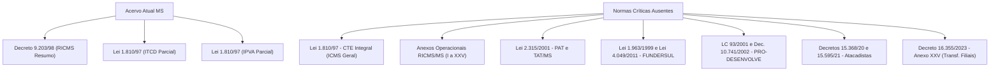
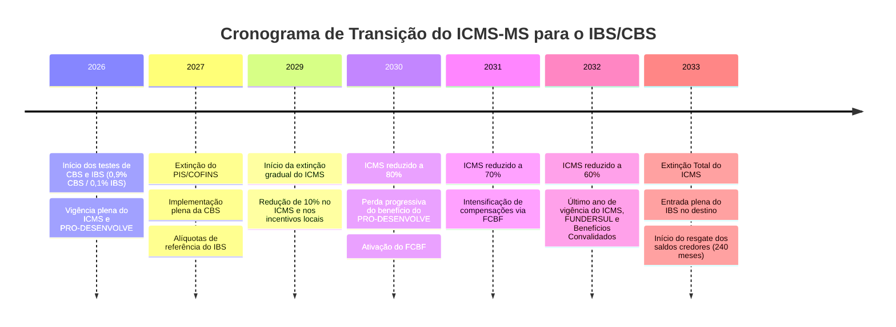

# Relatório de Auditoria Tributária Estadual: Mato Grosso do Sul (MS)

**Unidade Federativa Auditada:** Mato Grosso do Sul (MS)  
**Órgão Fazendário Competente:** Secretaria de Estado de Fazenda de Mato Grosso do Sul (SEFAZ/MS)  
**Contencioso Administrativo:** Tribunal Administrativo Tributário do Estado de Mato Grosso do Sul (TAT/MS)  
**Responsável Técnico:** Consultoria Tributária Especializada em Tributos Estaduais e Federais  
**Data da Auditoria:** Outubro de 2026  
**Status do Mapeamento:** Completo / Conclusivo  

---

## 1. Auditoria do Repositório: Normas Existentes e Acervo Faltante em MS

### 1.1. Diagnóstico do Acervo Atual em `estaduais/ms/`

O levantamento realizado no diretório `estaduais/ms/` identificou a presença de 3 (três) arquivos consolidados estruturais:

1. **`estaduais/ms/ricms/decreto-9203-1998.md`**:
   - *Conteúdo:* Cobre as diretrizes essenciais do Regulamento do ICMS (RICMS/MS), aprovado pelo Decreto nº 9.203, de 18 de setembro de 1998.
   - *Cobertura Efetiva:* Alíquota interna padrão modal (17%), matriz interestadual (Resoluções SF nº 22/1989 e 13/2012), diretrizes de DIFAL para não contribuintes (EC 87/2015 e LC 190/2022), substituição tributária (Convênio ICMS 142/2018) e adequação inicial de transferências entre filiais (LC 204/2023 e Convênio ICMS 109/2024).
   - *Diagnóstico Crítico:* Trata-se de síntese regulamentar de alto nível (89 linhas). Não contempla os extensos anexos operacionais do RICMS/MS, fundamentais para a aplicação do direito material sul-mato-grossense.

2. **`estaduais/ms/leis/itcmd/lei-1810-1997.md`**:
   - *Conteúdo:* Extrato sistemático da Lei Estadual nº 1.810, de 22 de dezembro de 1997 (Código Tributário Estadual - CTE/MS), restrito ao Imposto sobre Transmissão *Causa Mortis* e Doação (ITCD/ITCMD).
   - *Cobertura Efetiva:* Alíquotas de 6% (*causa mortis*) e 3% (doação), regras de competência territorial pós-EC 132/2023 (domicílio do *de cujus* para bens móveis) e imunidades/isenções específicas.

3. **`estaduais/ms/leis/ipva/lei-1810-1997.md`**:
   - *Conteúdo:* Extrato sistemático da Lei Estadual nº 1.810/1997 voltado ao Imposto sobre a Propriedade de Veículos Automotores (IPVA).
   - *Cobertura Efetiva:* Fato gerador, alíquotas diferenciadas (3% passeio; 4,5% diesel; 1,5% caminhões/ônibus; 2% motocicletas; incentivo de 70% de redução para GNV/elétricos), imunidades ampliadas pela EC 132/2023 e regras de domicílio real da frota (Tema 708/STF).

---

### 1.2. Mapeamento das Lacunas Normativas Críticas (Normas Ausentes)

Para conferir plenitude operativa e jurídica à base de conhecimento de Mato Grosso do Sul no repositório, constata-se a ausência dos seguintes diplomas legais e infralegais essenciais:



#### Lista Pormenorizada de Leis e Decretos Faltantes:

1. **Lei Estadual nº 1.810, de 22 de dezembro de 1997 (Código Tributário do Estado - CTE/MS Integral):**
   - *Objeto:* É a espinha dorsal tributária de Mato Grosso do Sul. Contém não apenas ITCD e IPVA, mas toda a disciplina primária do ICMS (arts. 1º a 80), taxas estaduais pelo exercício do poder de polícia e prestação de serviços (arts. 140 a 195), contribuição de melhoria, penalidades fiscais, regime de solidariedade, arbitramento fiscal e disposições gerais sobre decadência, prescrição e consulta fiscal.
   - *Urgência de Inclusão:* Altíssima.

2. **Anexos Operacionais do RICMS/MS (Decreto nº 9.203/1998):**
   - O RICMS de MS é estruturado em corpo principal e anexos temáticos extensivos que concentram a regulamentação concreta:
     - **Anexo I:** Das Isenções (reproduzindo Convênios CONFAZ e cláusulas de internalização).
     - **Anexo II:** Da Redução da Base de Cálculo.
     - **Anexo III:** Da Substituição Tributária (listagem de mercadorias, MVAs originais, regras de retenção).
     - **Anexo IV:** Do Diferimento do Lançamento e Pagamento do Imposto (soja, milho, gado, cana, madeira de eucalipto).
     - **Anexo V:** Dos Créditos Presumidos e Outorgados.
     - **Anexo VI:** Dos Documentos Fiscais Eletrônicos (NF-e, NFC-e, CT-e, MDF-e, NFP-e).
     - **Anexo XXV (acrescentado pelo Decreto nº 16.355/2023):** Procedimentos de transferências de créditos e mercadorias entre matriz e filiais (ADC 49/LC 204).
   - *Urgência de Inclusão:* Altíssima.

3. **Lei Estadual nº 2.315, de 25 de outubro de 2001 (Processo Administrativo Tributário - PAT/MS):**
   - *Objeto:* Disciplina o contencioso administrativo fiscal estadual, prazos processuais (30 dias para impugnação), competência e rito dos julgamentos em primeira instância singular e perante o Tribunal Administrativo Tributário (TAT/MS - Conselho Deliberativo e Câmaras de Julgamento), recursos ordinários e de revista, pedido de reconsideração e regime de termo de acordo.
   - *Urgência de Inclusão:* Alta.

4. **Legislação do FUNDERSUL (Fundo de Desenvolvimento do Sistema Rodoviário de MS):**
   - **Lei Estadual nº 1.963, de 11 de junho de 1999** (instituidora original) e **Lei Estadual nº 4.049, de 30 de junho de 2011** (MS Forte-Indústria/FUNDERSUL), com as atualizações da Lei nº 5.434/2019 e Lei nº 6.012/2022.
   - *Objeto:* Condição imperativa e vinculante de recolhimento de contribuição financeira sobre produtos agropecuários (soja, milho, gado em pé, cana, madeira) como requisito para fruição do diferimento e benefícios fiscais no ICMS.
   - *Urgência de Inclusão:* Altíssima.

5. **Incentivos e Fundos de Desenvolvimento Industrial e Equilíbrio Fiscal:**
   - **Lei Complementar nº 93, de 5 de novembro de 2001 (MS-Empreendedor):** Marco regulatório do crédito outorgado/presumido de até 67% sobre o saldo devedor de ICMS para indústrias, estruturador dos incentivos fiscais convalidados pelo Convênio ICMS 190/2017.
   - **Decreto Estadual nº 10.741, de 11 de abril de 2002:** Regulamento do PRO-DESENVOLVE e das contrapartidas socioeconômicas e financeiras.
   - **Lei Complementar nº 241/2017 e LC nº 280/2020 (FADEFE / Fundo Pró-Desenvolve):** Exigência de contribuições estaduais sobre os benefícios fiscais concedidos como contrapartida de estabilidade fiscal.
   - *Urgência de Inclusão:* Alta.

6. **Legislação Específica do Comércio Atacadista e Distribuição:**
   - **Decreto nº 15.368, de 14 de fevereiro de 2020** e **Decreto nº 15.595, de 29 de janeiro de 2021:** Instituem e consolidam o regime de benefício fiscal mediante crédito outorgado a estabelecimentos comerciais atacadistas e centros de distribuição instalados no Estado de Mato Grosso do Sul, com adesão aos incentivos convalidados de Mato Grosso (Convênio ICMS 190/2017).
   - *Urgência de Inclusão:* Alta.

7. **DIFAL Não Contribuinte (Adequação à LC 190/2021):**
   - **Lei Estadual nº 5.993, de 15 de dezembro de 2022:** Modificou a Lei nº 1.810/1997 para prever de forma expressa a incidência, sujeito passivo e base de cálculo com inclusão do próprio imposto ("por dentro") do DIFAL para consumidor final não contribuinte.
   - *Urgência de Inclusão:* Média-Alta.

---

## 2. Relacionamento do ICMS-MS com os Demais 26 Estados e DF

### 2.1. Alíquotas Interestaduais e Matriz de Fluxos (Resoluções SF 22/1989 e 13/2012)

O Estado de Mato Grosso do Sul está geograficamente inserido na Região Centro-Oeste. Nos termos da Resolução do Senado Federal nº 22/1989, integra o grupo de estados de menor desenvolvimento relativo juntamente com Norte, Nordeste e Espírito Santo (N/NE/CO/ES):

```
       ┌─────────────────────────────────────────────────────────────┐
       │                ESTADO DE MATO GROSSO DO SUL                │
       └──────────────────────────────┬──────────────────────────────┘
                                      │
           ┌──────────────────────────┴──────────────────────────┐
           │                                                     │
           ▼                                                     ▼
┌──────────────────────┐                             ┌──────────────────────┐
│  SAÍDAS DE MS        │                             │  ENTRADAS EM MS      │
│  (Origem: MS)        │                             │  (Destino: MS)       │
├──────────────────────┤                             ├──────────────────────┤
│ Para QUALQUER Estado │                             │ Vindas de SP, RJ, MG,│
│ da Federação (26 UFs │                             │ PR, SC, RS:          │
│ e DF):               │                             │       7%             │
│       12%            │                             ├──────────────────────┤
├──────────────────────┤                             │ Vindas de N, NE, CO  │
│ Bens Importados com  │                             │ e ES:                │
│ Conteúdo Imp. > 40%: │                             │       12%            │
│       4%             │                             ├──────────────────────┤
│ (Res. SF 13/2012)    │                             │ Bens Importados      │
│                      │                             │ (Conteúdo Imp > 40%):│
│                      │                             │       4%             │
└──────────────────────┘                             └──────────────────────┘
```

1. **Nas saídas interestaduais promovidas por contribuintes de MS:**
   - A alíquota é invariável: **12%**, qualquer que seja a UF de destino (seja para São Paulo, Rio Grande do Sul, Bahia, Amazonas ou Goiás).
   - Exceção: mercadorias importadas ou bens nacionais com Conteúdo de Importação superior a 40%, apurado na Ficha de Conteúdo de Importação (FCI), cuja alíquota aplicável é de **4%**, com fulcro na Resolução do Senado Federal nº 13/2012 e Convênio ICMS 38/2013.
   - Transporte Aéreo Interestadual: **4%** (Resolução SF nº 95/1996).

2. **Nas entradas interestaduais em estabelecimentos de MS:**
   - Origem Sul ou Sudeste (exceto Espírito Santo): alíquota de **7%** (SP, RJ, MG, PR, SC, RS).
   - Origem Norte, Nordeste, Centro-Oeste ou Espírito Santo: alíquota de **12%** (MT, GO, DF, BA, PE, CE, PA, RO, ES, etc.).
   - Produtos importados com CI > 40%: alíquota de **4%**.

---

### 2.2. Diferencial de Alíquotas (DIFAL) nas Entradas em Mato Grosso do Sul

#### A) DIFAL Contribuinte (Uso, Consumo e Ativo Permanente)
- **Fato Gerador:** Entrada no estabelecimento de contribuinte sul-mato-grossense de bens ou serviços oriundos de outra UF destinados a uso/consumo ou integração ao ativo imobilizado (art. 2º, V e art. 5º da Lei nº 1.810/1997).
- **Metodologia de Cálculo — Base Dupla ("Cálculo por Dentro"):**
  Mato Grosso do Sul adota o modelo de base dupla (cálculo por dentro), esculpido no art. 21, IV e § 3º da Lei Estadual nº 1.810/1997 (com as alterações das Leis nº 5.805/2021 e nº 5.993/2022).
  - *Etapa 1:* Exclui-se o ICMS interestadual destacado na nota fiscal de origem para obter a base líquida de imposto.
  - *Etapa 2:* Recompõe-se a base de cálculo dividindo o valor líquido pelo complemento da alíquota interna de MS (1 - 0,17 = 0,83).
  - *Etapa 3:* Aplica-se a alíquota interna sobre a nova base e subtrai-se o ICMS de origem.

$$\text{Base Dupla} = \frac{\text{Valor da Operação} - \text{ICMS Origem}}{1 - \text{Alíquota Interna MS}}$$

$$\text{DIFAL a Recolher} = (\text{Base Dupla} \times \text{Alíquota Interna MS}) - \text{ICMS Origem}$$

*Exemplo Prático Numérico:*
- Valor do bem (SP para MS): R$ 10.000,00.
- Alíquota interestadual (SP -> MS): 7%. ICMS Origem = R$ 700,00.
- Valor líquido sem ICMS = R$ 10.000,00 - R$ 700,00 = R$ 9.300,00.
- Base Dupla MS = R$ 9.300,00 / (1 - 0,17) = R$ 9.300,00 / 0,83 = R$ 11.204,82.
- ICMS Total Interno = R$ 11.204,82 × 17% = R$ 1.904,82.
- DIFAL devido a MS = R$ 1.904,82 - R$ 700,00 = **R$ 1.204,82**.
*(Se o cálculo fosse "base simples", o valor seria 10.000 × (17% - 7%) = R$ 1.000,00. A base dupla gera um acréscimo de R$ 204,82).*

#### B) DIFAL Não Contribuinte (EC 87/2015, LC 190/2022 e Lei MS nº 5.993/2022)
- Nas remessas interestaduais de bens ou prestações de serviço a consumidor final não contribuinte estabelecido em MS (vendas B2C, e-commerce):
  - O remetente da outra UF recolhe o DIFAL integralmente em favor do Estado de Mato Grosso do Sul via GNRE (código 10010-2 ou conta de substituto tributário).
  - Base de cálculo com inclusão do próprio imposto (base única por dentro com a alíquota interna de destino integrada, nos moldes do Convênio ICMS 236/2021).
  - Alíquota aplicável: 17% (ou 17% + 2% FECOMP para mercadorias do art. 41-A da Lei 1.810/1997, perfazendo 19%).

---

### 2.3. Transferências Interestaduais entre Filiais (ADC 49 STF, LC 204/2023, Convênios 178/2023 e 109/2024 e Decreto MS nº 16.355/2023)

O Estado de Mato Grosso do Sul disciplinou com rigor a internalização dos precedentes vinculantes da Ação Declaratória de Constitucionalidade nº 49 do STF e das alterações promovidas pela Lei Complementar nº 204/2023 na Lei Kandir:

1. **Não Incidência Constitucional:**
   - Com a inclusão do § 4º no art. 12 da Lei Complementar nº 87/1996 e do Decreto Estadual nº 16.355/2023, restou positivado no art. 3º, V do RICMS/MS que **não há incidência do ICMS na saída física de mercadorias entre estabelecimentos do mesmo titular** (matriz e filiais), seja em remessas internas ou interestaduais.

2. **Mecanismo Legal de Transferência dos Créditos (Convênio ICMS 178/2023 e Anexo XXV do RICMS/MS):**
   - É mantido o crédito da operação anterior e sua transferência ao estabelecimento destinatário em outro estado é obrigatória na via ordinária:
   - Limite da transferência de crédito: cálculo pela aplicação das alíquotas interestaduais cabíveis (4%, 7% ou 12%) sobre:
     - O valor da entrada mais recente da mercadoria;
     - O custo da mercadoria produzida (soma de matérias-primas, insumos, mão de obra e energia);
     - Tratando-se de mercadorias não industrializadas (ex.: grãos colhidos, gado gerado na fazenda), a soma dos custos de sua produção.
   - Emissão de Nota Fiscal: CFOP `5.151`/`6.151` ou `5.152`/`6.152`, campo próprio de ICMS não tributado (CST 41 / CSOSN 400), com indicação do valor do crédito transferido nos campos próprios de ICMS ou em informações complementares conforme manuais técnicos.

3. **Faculdade de Equiparação a Operação Tributada (Convênio ICMS 109/2024):**
   - O contribuinte sul-mato-grossense pode, por opção irretratável para todo o ano-calendário, formalizada mediante registro no Livro Registro de Utilização de Documentos Fiscais e Termos de Ocorrências (RUDFTO) e comunicação à SEFAZ/MS, **optar por equiparar a transferência interestadual a uma operação normalmente tributada**.
   - Vantagem estratégica: preservação de benefícios fiscais locais que exigem débito e estorno proporcional, ou desoneração de controle complexo de estoques segregados.

---

### 2.4. Protocolos e Convênios de Substituição Tributária (ICMS-ST)

Mato Grosso do Sul é signatário ativo de dezenas de Protocolos ICMS no âmbito do CONFAZ, vinculados às diretrizes nacionais do Convênio ICMS 142/2018.

- **Principais Segmentos com Retenção na Origem (Interestadual para MS):**
  - Cervejas, refrigerantes, águas e energéticos (Protocolo ICMS 11/1991).
  - Medicamentos e produtos farmacêuticos (Convênio ICMS 234/2017).
  - Veículos automotores novos (Convênio ICMS 199/2017).
  - Pneumáticos, câmaras de ar e protetores (Convênio ICMS 102/2017).
  - Autopeças e acessórios (Protocolo ICMS 41/2008).
  - Tintas, vernizes e impermeabilizantes (Convênio ICMS 118/2017).
  - Cosméticos, perfumaria e higiene pessoal (Protocolo ICMS 104/2012).
  - Materiais de construção, acabamento e bricolagem (Protocolo ICMS 32/2014).

- **Fórmula da MVA Ajustada em MS (art. 9º do Convênio ICMS 142/2018):**
  Quando a mercadoria oriunda de outro estado ingressar em MS sujeita a alíquota interestadual de 7%, 12% ou 4%, a SEFAZ/MS exige o cálculo da Margem de Valor Agregado Ajustada para neutralizar a disparidade de carga tributária e garantir que o produto entre com a mesma base equivalente ao tributo interno:

$$\text{MVA Ajustada} = \left[ \frac{(1 + \text{MVA-ST Original}) \times (1 - \text{ALQ Inter})}{(1 - \text{ALQ Intra})} \right] - 1$$

- **Exceção Legal — Remetente Simples Nacional (Convênio ICMS 35/2011):**
  Quando a remessa com retenção de ST for praticada por fornecedor optante pelo Simples Nacional, aplica-se a **MVA Original**, vedado o ajustamento para cima.

- **ICMS Garantido / Equalização na Fronteira:**
  Para produtos que não possuem substituição tributária por convênio nacional, o Estado de MS adota a sistemática de **ICMS Antecipado / Equalização Simples Nacional** na passagem pelos postos fiscais de fronteira (Corumbá, Três Lagoas, Bataguassu, Sonora, Mundo Novo) cobrando antecipadamente o imposto sobre a margem de agregação presumida na entrada para revenda.

---

## 3. Mecanismos de Dedução e Crédito no ICMS-MS

### 3.1. Não-Cumulatividade, Apropriação, Manutenção e Estorno

A disciplina da compensação do ICMS em Mato Grosso do Sul segue rigorosamente o art. 155, § 2º, I da CF/88 e os arts. 19 a 23 da Lei Kandir (LC 87/96), detalhados nos arts. 54 a 70 da Lei Estadual nº 1.810/1997 e Título IV do RICMS/MS:

```mermaid
flowchart TD
    Entrada["Entradas de Mercadorias / Insumos no Estabelecimento"] --> Valida{"Qual a destinação da entrada?"}
    
    Valida -->|Insumos MP/ME p/ Industrialização| CreditoSim["Crédito Integralmente Apropriável (Art. 54 CTE)"]
    Valida -->|Bens do Ativo Imobilizado| CIAP["Apropriação à razão de 1/48 avos via CIAP Modelo D"]
    Valida -->|Uso e Consumo| Restricao["Vedado até 01/01/2033 (LC 87/96 c/c LC 203/23)"]
    Valida -->|Energia / Telecom| Eletric["Condicionado a Consumo no Processo Industrial ou Saída Ext."]
    
    CreditoSim --> Saida{"Qual a natureza da saída subsequente?"}
    Saida -->|Saída Tributada Integralmente| Manut["Manutenção Plena do Crédito"]
    Saida -->|Exportação p/ o Exterior (Art. 3º, I)| Kandir["Manutenção e Acúmulo de Saldo Credor (Imunidade)"]
    Saida -->|Isenção ou Não Incidência Interna| Estorno["Obrigação de Estorno Proporcional (Art. 60 CTE)"]
```

1. **Apropriação do Crédito Ordinário:**
   - O direito de crédito vincula-se à idoneidade formal da Nota Fiscal Eletrônica e do documento fiscal de frete (CT-e), escriturados na EFD-ICMS/IPI.
   - Aplica-se às matérias-primas, produtos intermediários, embalagens e insumos que se consumam ou integrem física e diretamente o produto final industrializado, bem como às mercadorias adquiridas para revenda.

2. **Hipóteses Legais de Vedação e Estorno do Crédito (Art. 60 da Lei nº 1.810/97):**
   - Salvo disposição expressa em contrário (como nas exportações ou nos créditos outorgados), o sujeito passivo é obrigado a efetuar o **estorno do imposto creditado** quando as mercadorias entradas:
     - Forem objeto de saída ou prestação subsequente isenta ou não tributada;
     - Forem objeto de saída com redução de base de cálculo (estorno proporcional ao benefício);
     - Perecerem, deteriorarem-se, forem extraviadas, furtadas ou roubadas;
     - Forem destinadas a consumo ou integração ao patrimônio do estabelecimento para finalidades alheias à atividade econômica.

3. **Manutenção Excepcional de Créditos:**
   - **Exportações:** O art. 155, § 2º, X, "a" da CF/88 e o art. 3º, I da Lei 1.810/97 asseguram a manutenção integral e o aproveitamento do ICMS cobrado nas etapas anteriores incidentes sobre mercadorias remetidas ao exterior (grãos, carnes, minério de ferro de Corumbá, celulose), sendo a principal matriz geradora de saldo credor acumulado de ICMS no Estado.
   - **Incentivos com Cláusula de Não-Estorno:** Termos de acordo do PRO-DESENVOLVE e regimes setoriais contêm autorização expressa de manutenção de crédito para produtos derivados de base agrícola local.

---

### 3.2. Controle de Crédito do Ativo Permanente (CIAP — 1/48 avos)

A tomada de crédito sobre bens destinados ao ativo imobilizado do contribuinte sul-mato-grossense submete-se às regras da Lei Complementar nº 102/2000, incorporada ao RICMS/MS:

1. **Fracionamento em 48 Meses:**
   - O crédito é apropriado à razão de **1/48 (um quarenta e oito avos)** por mês, iniciando-se no mês em que ocorrer a efetiva entrada física do bem no estabelecimento e sua entrada em operação funcional.

2. **Fator de Proporcionalidade Operacional ($P$):**
   - Em cada período de apuração, o montante da fração de 1/48 a ser efetivamente aproveitado é multiplicado pelo quociente entre o valor das operações de saídas tributadas e de exportações em relação ao total das operações de saídas do mês:

$$\text{Crédito Mensal Apropriável} = \left( \frac{\text{ICMS Total do Bem}}{48} \right) \times \left( \frac{\text{Saídas Tributadas} + \text{Exportações}}{\text{Total das Saídas e Prestações}} \right)$$

3. **Cessação e Alienação:**
   - Havendo alienação do bem do ativo imobilizado antes de transcorrido o quadriênio (48 meses), cessa imediatamente o direito à apropriação das parcelas remanescentes, sendo cancelado o saldo do CIAP a partir da data de alienação ou baixa patrimonial.
   - Escrituração: Obrigatória no Bloco G da EFD-ICMS/IPI (Livro CIAP Eletrônico).

---

### 3.3. Restrições Legais para Energia Elétrica e Telecomunicações (LC 87/96)

Em estrita obediência ao art. 33, II e IV da Lei Complementar nº 87/1996, o Estado de Mato Grosso do Sul restringe severamente a apropriação de créditos fiscais decorrentes de energia elétrica e serviços de comunicação:

1. **Energia Elétrica:**
   - Somente gera direito a crédito a entrada de energia elétrica quando:
     - For objeto de operação subsequente de saída de energia (distribuidoras/geradoras);
     - For consumida diretamente no processo de industrialização (exige laudo técnico emitido por perito ou engenheiro que segregue o consumo da fábrica do setor administrativo/comercial);
     - O consumo resultar em operação de saída ou prestação para o exterior (proporcional ao volume de exportação).
   - O crédito sobre energia elétrica para empresas do comércio em geral permanece vedado até **1º de janeiro de 2033** (prorrogação promovida pela Lei Complementar nº 203/2023).

2. **Serviços de Comunicação:**
   - Apenas admite crédito quando os serviços de comunicação forem utilizados pelo estabelecimento ao qual tenham sido prestados na execução de serviços de mesma natureza (operadoras), ou quando sua utilização resultar em operação de saída ou prestação para o exterior.

---

### 3.4. Fundo Estadual de Combate e Erradicação da Pobreza (FECOEP/FECOMP)

- **Fundamento Constitucional e Estadual:** Art. 82, § 1º do ADCT da CF/88, Lei Estadual nº 3.337, de 22 de dezembro de 2006 (FECOEP/MS) e art. 41-A da Lei Estadual nº 1.810/1997.
- **Alíquota Adicional:** Adicional de **2% (dois por cento)** na alíquota do ICMS.
- **Rol de Produtos Alcançados:**
  - Bebidas alcoólicas (cervejas, destilados, vinhos);
  - Fumo, cigarros, cigarrilhas, charutos e insumos para tabagaria;
  - Perfumes e cosméticos seletos;
  - Armas de fogo, munições e fogos de artifício.
- **Vedação de Desonerações:** A parcela correspondente aos 2% do FECOMP não pode ser compensada por incentivos fiscais do PRO-DESENVOLVE ou créditos outorgados ordinários, devendo ser integralmente segregada e repassada ao Fundo Especial de Assistência Social do Estado.

---

## 4. Setor Agrícola, Pecuário e Extrativo Florestal em MS

Mato Grosso do Sul ostenta posição de liderança mundial e nacional no agronegócio (grãos, pecuária bovina e suinícola) e na silvicultura (maior maciço de eucalipto plantado do Brasil). A arquitetura tributária deste setor combina **diferimento condicionado**, **obrigações acessórias eletrônicas simplificadas** e o **FUNDERSUL**.

```
    ┌──────────────────────────────────────────────────────────────┐
    │              PRODUTOR RURAL SUL-MATO-GROSSENSE               │
    └──────────────────────────────┬───────────────────────────────┘
                                   │
              ┌────────────────────┴────────────────────┐
              │                                         │
              ▼                                         ▼
   ┌──────────────────────┐                  ┌──────────────────────┐
   │ OPERAÇÃO INTERNA     │                  │ OPERAÇÃO INTERESTAD. │
   │ (Indústria/Armazém)  │                  │ (Outros Estados)     │
   ├──────────────────────┤                  ├──────────────────────┤
   │ ICMS Diferido        │                  │ ICMS 12% ou Retido   │
   │ (Anexo IV RICMS/MS)  │                  │ (Resolução SF 22/89) │
   ├──────────────────────┤                  ├──────────────────────┤
   │ CONTRA-PRESTAÇÃO:    │                  │ CONTRA-PRESTAÇÃO:    │
   │ FUNDERSUL Obrigatório│                  │ FUNDERSUL Devido     │
   │ (Lei 1.963 / 4.049)  │                  │ antes da saída física│
   └──────────────────────┘                  └──────────────────────┘
```

### 4.1. O FUNDERSUL: Mecanismo, Alíquotas e Vinculação ao Diferimento

O Fundo de Desenvolvimento do Sistema Rodoviário de Mato Grosso do Sul (FUNDERSUL), criado originariamente pela Lei Estadual nº 1.963/1999 e remodelado pelas Leis nº 4.049/2011, 5.434/2019 e 6.012/2022, representa o principal polo financeiro e jurídico do agronegócio estadual.

1. **Natureza Jurídica e Obrigatoriedade Condicionada:**
   - O recolhimento ao FUNDERSUL funciona sob a sistemática de **contribuição de adesão facultativa, porém coativa na prática econômica**: o pagamento da exação é **requisito imperativo e inafastável para que a operação com mercadorias agrícolas ou pecuárias possa usufruir do diferimento do ICMS** nas operações internas ou da suspensão/isenção do imposto.
   - Caso o produtor se recuse a recolher o FUNDERSUL, o ICMS incidente sobre a operação (à alíquota cheia interna de 17% ou interestadual de 12%) passa a ser imediatamente exigível, perdendo-se o benefício do diferimento.

2. **Base de Cálculo e Alíquotas Específicas do FUNDERSUL:**
   - As contribuições são apuradas mediante aplicação de percentuais sobre a Unidade de Atualização Monetária de Mato Grosso do Sul (UAM-MS) ou sobre o Valor Real Pesquisado (pauta fiscal da SEFAZ):
     - **Boi Gordo e Vaca para Abate:** Cobrado por cabeça entregue ao frigorífico (em torno de 1,18 UAM por bovino abatido ou remetido para fora do estado).
     - **Soja em Grão:** Percentual incidente por tonelada de soja movimentada internamente ou destinada a exportação/interestadual (cerca de 5,4% da UAM por tonelada).
     - **Milho em Grão:** Percentual fixado por tonelada de milho comercializada.
     - **Cana-de-Açúcar:** Percentual por tonelada moída na indústria sucroalcooleira.
     - **Madeira de Eucalipto e Pinus:** Recolhimento por metro cúbico ($m^3$) destinado à indústria de celulose ou carvão vegetal.

3. **Substituição e Retenção Operacional:**
   - Nas saídas internas do produtor rural destinadas a estabelecimentos industriais (frigoríficos, esmagadoras de soja, usinas de etanol e fábricas de celulose), cabe ao **estabelecimento adquirente (indústria) a responsabilidade pela retenção e recolhimento do FUNDERSUL**, debitando o valor correspondente na fatura de liquidação do produtor rural e repassando os valores à SEFAZ/MS.

---

### 4.2. Insumos Agropecuários e Convênio ICMS 100/97

Mato Grosso do Sul aplica com precisão as normas do Convênio ICMS 100/1997, atualizado pelo Convênio ICMS 26/2021:

1. **Isenção Interna:**
   - Insumos de produção agrícola (adubos, fertilizantes simples ou compostos, sementes certificadas, mudas de plantas e corretivos de solo) gozam de isenção do ICMS nas operações internas entre produtores ou de revendedores para agricultores.

2. **Redução de Base de Cálculo Interestadual Progressiva (Convênio 26/2021):**
   - Nas aquisições interestaduais de fertilizantes e adubos, a carga tributária é escalonada com redução de base de cálculo, atingindo alíquotas efetivas de 1% a 4% a depender do insumo (fosfatados, nitrogenados, potássicos).
   - Defensivos agrícolas (inseticidas, fungicidas, herbicidas): redução de 60% da base de cálculo do ICMS.
   - Rações e suplementos alimentares para bovinos, aves e suínos: redução da base de cálculo em 30% a 60%.

---

### 4.3. Regime de Diferimento do ICMS nas Saídas Internas Agropecuárias

O Anexo IV ao RICMS/MS prevê uma ampla blindagem das operações do campo por meio do **diferimento do lançamento e pagamento do imposto**, deslocando o encargo tributário para a fase de encerramento da cadeia (geralmente a industrialização final ou a saída para outro estado/exterior):

| Produto Primário | Hipótese do Diferimento em MS | Momento de Encerramento do Diferimento |
| :--- | :--- | :--- |
| **Soja e Milho** | Saída do produtor rural para armazéns gerais, cooperativas ou indústrias de esmagamento no estado. | Na saída do óleo/farelo da indústria, na remessa interestadual dos grãos ou na exportação física direta. |
| **Gado Bovino e Bubalino** | Circulação entre propriedades rurais (cria, recria e engorda) ou remessa para confinamentos e feiras agropecuárias. | Na saída do gado para o abate no frigorífico, ou na remessa de gado em pé para fora do estado. |
| **Cana-de-Açúcar** | Saída da fazenda de produção agrícola para usina sucroalcooleira credenciada em MS. | Na comercialização dos produtos industrializados (etanol, açúcar) ou subprodutos. |
| **Madeira de Eucalipto/Pinus** | Saída da área florestal para indústrias de celulose e papel localizadas em MS. | Na industrialização e saída das folhas/fardos de celulose para exportação ou mercado interno. |
| **Suínos e Frangos** | Remessas internas no sistema de integração agroindustrial (do integrado para a integradora). | Na saída dos cortes cárneos e produtos processados da planta frigorífica. |
| **Leite Cru Resfriado** | Saída do produtor de gado leiteiro para laticínios estabelecidos no território de MS. | Na saída do leite pasteurizado, queijos, iogurtes ou manteiga industrializada. |

---

### 4.4. Créditos Outorgados e Presumidos para o Produtor Rural

Para estimular a fixação do homem no campo e a produtividade, a legislação sul-mato-grossense concede importantes regimes de crédito outorgado (Anexo V do RICMS/MS):

- **Crédito Outorgado do Boi Gordo:** Concessão de crédito presumido equivalente a uma fração percentual do ICMS incidente na saída interestadual de gado em pé devidamente cadastrado no programa de qualidade da carne (Programa Carne Sustentável e Orgânica do Pantanal - Decreto nº 15.197/2019), conferindo até 67% de redução no encargo tributário para fomento às práticas regenerativas no Pantanal.
- **Suinocultura e Avicultura Integrada:** Concessão de crédito presumido de ICMS às indústrias integradoras para absorção de perdas e suporte à compra de animais e rações no mercado local.
- **Cooperativas Agropecuárias:** Autorização para centralização e transferência dos saldos credores gerados por produtores associados para liquidação de fretes rodoviários e aquisição de insumos de plantio.

---

### 4.5. NFP-e e Regime Simplificado do Produtor Rural em MS

1. **Nota Fiscal de Produtor Eletrônica (NFP-e - Modelo 55):**
   - Desde 2021, o Estado de Mato Grosso do Sul tornou obrigatória a emissão de NFP-e para todos os produtores rurais cadastrados no Cadastro da Agropecuária (CAP/SEFAZ-MS) em operações interestaduais e na comercialização interna com grãos e animais.
   - Emissão via Portal e-Fazenda / ICMS Transparente ou por meio de sistemas emissores integrados com certificação digital ICP-Brasil.
   - O produtor rural pessoa física pode utilizar a NFP-e Avulsa diretamente no portal eletrônico fazendário, com cálculo automático da contribuição do FUNDERSUL e geração simultânea do DAE (Documento de Arrecadação Estadual).

2. **Dispensa de Escrituração Fiscal Digital (EFD):**
   - O produtor rural pessoa física que não possuir inscrição como pessoa jurídica de direito privado fica dispensado de apresentar a EFD-ICMS/IPI convencional, tendo sua apuração centralizada nas próprias notas fiscais emitidas e recebidas pelo ambiente fazendário estadual.

---

## 5. Setor Industrial Sul-Mato-Grossense

O setor industrial de MS experimenta nas últimas duas décadas um ciclo exponencial de expansão, liderado pelo complexo de papel e celulose, bioenergia e frigoríficos de grande porte, ancorado em regimes de incentivos fiscais vigorosos.

### 5.1. O "Vale da Celulose" e Regimes Especiais Aduaneiros e de Bens de Capital

Os municípios de Três Lagoas, Ribas do Rio Pardo, Inocência e Água Clara formam o maior complexo de produção de celulose branqueada de fibra curta de eucalipto do mundo, abrigando plantas industriais de Suzano (incluindo o megaprojeto Cerrado, maior linha única de celulose do mundo), Eldorado Brasil, Arauco (Projeto Sucuriú) e Bracell.

```
       ┌─────────────────────────────────────────────────────────────┐
       │                 VALE DA CELULOSE (MS)                       │
       │  (Três Lagoas, Ribas do Rio Pardo, Inocência, Água Clara)   │
       └──────────────────────────────┬──────────────────────────────┘
                                      │
           ┌──────────────────────────┴──────────────────────────┐
           │                                                     │
           ▼                                                     ▼
┌──────────────────────────────────────┐  ┌──────────────────────────────────────┐
│ IMPORTAÇÃO DE MAQUINÁRIO/EQUIPAMENTOS│  │ CICLO FLORESTAL E INDUSTRIAL        │
├──────────────────────────────────────┤  ├──────────────────────────────────────┤
│ Diferimento Total do ICMS Importação │  │ Eucalipto em pé e toras:            │
│ em máquinas sem similar nacional     │  │ Diferimento do ICMS interno          │
│ (Regimes Especiais SEFAZ/MS)         │  │ (Anexo IV c/c FUNDERSUL Florestal)   │
├──────────────────────────────────────┤  ├──────────────────────────────────────┤
│ Desoneração imediata do fluxo de     │  │ Exportação da Celulose (Porto Santos)│
│ caixa bilionário nas obras de implan-│  │ Não Incidência (Art. 155 CF - Kandir)│
│ tação de fábricas e colheita florestal│ │ Acúmulo estrutural de saldos credores │
└──────────────────────────────────────┘  └──────────────────────────────────────┘
```

1. **Diferimento na Importação de Bens de Capital Sem Similar Nacional:**
   - As montagens e ampliações das fábricas de celulose exigem aquisição de maquinário industrial de altíssima complexidade (digestores contínuos, lavadores difusores, caldeiras de recuperação química, turbogeradores a vapor e máquinas de secagem) oriundos da Escandinávia, Alemanha, Áustria e Japão.
   - Através de **Regimes Especiais individuais e Termos de Acordo** autorizados com base no Anexo II do RICMS/MS e Resoluções específicas da SEFAZ, o governo de MS outorga o **diferimento integral do ICMS de importação** na entrada aduaneira desses bens de capital destinados à integração definitiva no ativo imobilizado, dispensando o desembolso do imposto no porto de desembaraço (Porto de Santos, Paranaguá ou aeroportos alfandegados).
   - O mesmo tratamento é estendido a maquinário de colheita florestal de grande porte (*harvesters*, *forwarders*, pás-carregadeiras florestais e tratores de arraste).

2. **Diferimento da Madeira e Insumos Florestais:**
   - As remessas de mudas clonadas, adubos florestais e toras de madeira de eucalipto dos maciços silviculturais para os pátios industriais transitam com diferimento do ICMS, condicionado à regularidade com a taxa do FUNDERSUL florestal.

3. **Geração Maciça de Saldo Credor de ICMS:**
   - Como praticamente mais de 90% da celulose produzida em MS é voltada ao mercado externo (China, União Europeia, Estados Unidos), as saídas são imunes ao imposto (Lei Kandir).
   - Os créditos fiscais gerados nas compras internas e interestaduais de insumos (produtos químicos como soda cáustica, cloro, sulfato de sódio, calcário e embalagens) e as cotas de 1/48 avos do CIAP acumulam-se perpetuamente nas contas gráficas das empresas, exigindo complexos processos de homologação perante a SEFAZ/MS.

---

### 5.2. O Programa PRO-DESENVOLVE e o FADEFE (LC nº 93/2001 e Dec. nº 10.741/2002)

O Programa Estadual de Fomento à Industrialização, ao Trabalho, ao Emprego e à Renda (MS-Empreendedor / PRO-DESENVOLVE), regido pela **Lei Complementar Estadual nº 93/2001**, constitui o principal atrativo de atração industrial do Estado de Mato Grosso do Sul:

1. **Mecanismo Operacional — Crédito Outorgado sobre o Saldo Devedor:**
   - Ao invés de conceder isenções na largada, o MS adota o modelo de apuração ordinária do ICMS: a indústria apura seus débitos de saídas de mercadorias produzidas e seus créditos pelas entradas de insumos e matérias-primas.
   - Sobre o **saldo devedor mensal apurado**, aplica-se um **crédito presumido/outorgado de até 67% (podendo atingir 75% a 80% em municípios de baixa densidade populacional e na faixa de fronteira)**.
   - O imposto recolhido em favor do tesouro de MS limita-se à parcela residual líquida (33% a 20% do saldo devedor original), gerando uma carga tributária marginal de ICMS extraordinariamente atrativa.

2. **Contrapartidas Socioeconômicas Exigidas:**
   - Para gozar do PRO-DESENVOLVE, a empresa industrial firma Termo de Acordo com a Secretaria de Estado de Meio Ambiente, Desenvolvimento, Ciência, Tecnologia e Inovação (SEMADESC) e SEFAZ/MS, assumindo:
     - Metas anuais mínimas de produção física e faturamento bruto;
     - Quantitativo vinculante de empregos diretos gerados com prioridade para mão de obra local;
     - Investimentos em obras civis, máquinas e infraestrutura local;
     - Regularidade de aportes financeiros no Fundo de Apoio ao Desenvolvimento Econômico e de Equilíbrio Fiscal do Estado (FADEFE) ou nos fundos sociais de contrapartida (1% a 2% do valor do incentivo usufruído).

3. **Convalidação Nacional (LC 160/2017 e Convênio ICMS 190/2017):**
   - Todos os termos de acordo e normas do PRO-DESENVOLVE/FADEFE foram devidamente publicados, certificados e depositados perante a Secretaria Executiva do CONFAZ, conferindo higidez jurídica federal aos incentivos contra questionamentos por guerra fiscal com vigência estendida legalmente até **31 de dezembro de 2032**.

---

### 5.3. Agroindústria Sucroalcooleira e Complexo Frigorífico

1. **Setor Sucroalcooleiro (Etanol e Açúcar):**
   - As usinas e destilarias de Mato Grosso do Sul (localizadas na Bacia do Rio Brilhante, Dourados e Vale do Paranapanema/Ivinhema) submetem-se a regime especial estruturado pelo **Decreto nº 13.275/2011**:
   - Diferimento do ICMS na moagem da cana-de-açúcar interna;
   - Regime monofásico nacional e substituição tributária no etanol combustível;
   - Crédito outorgado específico para a cogeração e injeção de bioeletricidade limpa na rede do Sistema Interligado Nacional (SIN) a partir do bagaço de cana;
   - Desoneração do ICMS no transporte interestadual de etanol para outros centros consumidores.

2. **Complexo Frigorífico (Bovinos, Suínos e Aves):**
   - O abate em MS é incentivado mediante outorga de crédito fiscal presumido que resulta em carga tributária final de ICMS equivalente a **1% a 2,5% nas saídas interestaduais de carnes desossadas e cortes nobres**:
   - Compras de gado no território estadual gozam de diferimento do imposto até a fase do abate (Anexo IV do RICMS);
   - O frigorífico responde como substituto pelo recolhimento das taxas agropecuárias e do FUNDERSUL sobre as cabeças abatidas;
   - Exigência sanitária: habilitação e auditoria periódica junto à IAGRO (Agência Estadual de Defesa Sanitária Animal e Vegetal).

---

## 6. Setor de Produto Acabado: Atacado, Varejo e Distribuição

### 6.1. Atacadistas e Centros de Distribuição (Decretos 15.368/2020 e 15.595/2021)

Mato Grosso do Sul consolidou um regime altamente competitivo para o comércio atacadista de mercadorias em geral, estruturado pelo **Decreto Estadual nº 15.368/2020**, modificado pelo **Decreto nº 15.595/2021**, com respaldo na cláusula de adesão do Convênio ICMS 190/2017 aos benefícios vigentes no Estado vizinho de Mato Grosso:

1. **Crédito Outorgado nas Saídas Internas:**
   - Concessão de crédito outorgado de forma que a carga tributária efetiva de ICMS nas operações internas com mercadorias destinadas à comercialização ou industrialização resulte em percentuais fixos de **1% a 3%** sobre o valor da operação, substituindo o regime normal de débitos e créditos ordinários.

2. **Operações Interestaduais de Distribuição:**
   - Concessão de crédito presumido que reduz a carga interestadual dos tradicionais 12% nominais para montantes efetivos de **1% a 1,5%**, possibilitando a atração de centros logísticos para o atendimento do Centro-Oeste, Sudeste e Norte do Brasil.

3. **Requisitos de Instalação e Vedação ao Varejo:**
   - O regime exige estabelecimento atacadista exclusivo, estrutura física mínima de armazenamento e armazenagem ativa no estado de MS, área de estocagem compatível com o faturamento, vedando a venda direta ao consumidor final pessoa física a varejo com o benefício.

---

### 6.2. MVA, IVA-ST e Pautas Fiscais da SEFAZ/MS (VRP)

A Secretaria de Fazenda de MS aplica um sistema misto para fixação da base de cálculo do ICMS-ST e do ICMS ordinário:

1. **Margem de Valor Agregado (MVA):**
   - Para produtos manufaturados regulados em convênios federais (autopeças, remédios, cosméticos, tintas, alimentos industrializados), adota-se a MVA fixada no Anexo III do RICMS/MS, aplicando-se o ajuste em função da alíquota de 7% ou 12% da origem.

2. **Pauta Fiscal — Valor Real Pesquisado (VRP):**
   - Para os segmentos de maior relevância primária e perecível (gado bovino em pé, carnes com osso e sem osso, carvão vegetal, couro, grãos, areia, brita e materiais básicos de construção), a SEFAZ/MS edita quinzenal ou mensalmente a **Tabela de Valor Real Pesquisado (VRP)**.
   - O VRP funciona como piso inafastável de base de cálculo: nenhuma operação pode ser faturada para fins tributários com valor inferior ao consignado na pauta fazendária, sendo qualquer valor a menor sumariamente reclassificado e lançado pela fiscalização volante ou documental.

---

### 6.3. E-Commerce e Marketplaces: Responsabilidade Tributária

1. **DIFAL do E-Commerce:**
   - Aplicação irrestrita da Lei nº 5.993/2022. Os e-commerces que despacham bens com destino a lares sul-mato-grossenses devem efetuar o recolhimento antecipado do DIFAL (diferença entre 17% e 7% ou 12%) via GNRE ou estar devidamente credenciados como substitutos tributários no cadastro estadual da SEFAZ/MS.

2. **Solidariedade Tributária das Plataformas Digitais e Marketplaces:**
   - Mato Grosso do Sul impõe dever de cooperação e responsabilidade solidária (art. 17 da Lei nº 1.810/97) aos operadores de plataformas eletrônicas e intermediadores digitais de negócios pelas infrações tributárias cometidas pelos lojistas (*sellers*) não inscritos ou irregulares que realizem vendas por seu intermédio para o território estadual.
   - Exigência de transmissão e integração com os dados das operadoras de meios de pagamento e cartões de crédito (Convênio ICMS 166/2022).

---

## 7. Transição para o IBS / CBS da Reforma Tributária (EC 132/2023 e LC 214/2025)

A Reforma Tributária sobre o consumo impõe a Mato Grosso do Sul uma profunda reconfiguração institucional, fiscal e orçamentária, com reflexos imediatos sobre suas indústrias, cooperativas e sistema fazendário.



### 7.1. Extinção dos Incentivos do FADEFE/PRO-DESENVOLVE e o Papel do FCBF

1. **Perda da Eficácia dos Benefícios Fiscais Estaduais (2029-2032):**
   - Com o início da transição federativa no art. 128 do ADCT, as alíquotas do ICMS serão reduzidas à proporção de 90% em 2029, 80% em 2030, 70% em 2031 e 60% em 2032, até a sua revogação em 1º de janeiro de 2033.
   - Consequentemente, o benefício prático do crédito presumido de até 67% sobre o saldo devedor (PRO-DESENVOLVE) e dos regimes especiais de atacadistas (Decretos 15.368/2020 e 15.595/2021) perderá substância econômica a cada ano.
   - Em 2033, com a tributação 100% migrada para o princípio do destino do IBS, o Estado de Mato Grosso do Sul perde totalmente a prerrogativa constitucional de conceder desonerações ou incentivos unilaterais de ICMS para atrair plantas industriais.

2. **O Fundo de Compensação de Benefícios Fiscais (FCBF):**
   - Criado pelo art. 159 da Constituição Federal (com a redação da EC nº 132/2023) e regulamentado pela Lei Complementar nº 214/2025, o FCBF receberá aportes bilionários da União para compensar as pessoas jurídicas titulares de incentivos fiscais regularmente convalidados pelo Convênio ICMS 190/2017 até 2032.
   - As grandes indústrias de MS (celulose, etanol, esmagadoras de soja e frigoríficos) deverão submeter seus termos de acordo de benefício fiscal a rigoroso processo de apuração contábil para habilitar o direito à indenização financeira direta da União entre 2029 e 2032, amortecendo a elevação gradual da carga com a entrada do IBS/CBS.

---

### 7.2. O Desafio dos Saldos Credores Acumulados de ICMS (Art. 134 do ADCT)

As cadeias industriais de Mato Grosso do Sul, em especial as transnacionais do Vale da Celulose e do complexo da soja e carne, detêm saldos credores acumulados de ICMS de dezenas de bilhões de reais nas contas gráficas, resultantes de imensas compras de maquinário e desoneração total das exportações (Lei Kandir).

1. **Mecanismo Constitucional de Liquidação (240 Parcelas Mensais):**
   - O art. 134 do ADCT determina que os saldos credores de ICMS acumulados existentes em **31 de dezembro de 2032** e devidamente **homologados pelos fiscos estaduais**:
     - Serão aproveitados pelo contribuinte para compensação com o Imposto sobre Bens e Serviços (IBS) devido ao longo de **240 (duzentas e quarenta) parcelas mensais, iguais e sucessivas** (prazo de 20 anos);
     - As parcelas serão atualizadas monetariamente pelo índice nacional oficial de inflação (IPCA);
     - Caso o contribuinte não possua débitos mensais de IBS suficientes para absorver a parcela do mês, poderá transferir os créditos a outros contribuintes do IBS ou solicitar o ressarcimento financeiro perante o Comitê Gestor do IBS.

2. **Risco de Gargalo Administrativo e Homologação na SEFAZ/MS:**
   - A SEFAZ/MS precisará estruturar comitês de auditoria especializados e sistemas digitais robustos até 2031 para processar os pedidos de homologação de saldos credores.
   - Prazos de homologação tácita e recálculo de créditos glosados no passado geram imenso contencioso tributário administrativo no TAT/MS e judicial nas Varas de Fazenda Pública de Campo Grande.

---

### 7.3. O Futuro do FUNDERSUL na Reforma Tributária (Art. 148 do ADCT)

A sobrevivência da contribuição do FUNDERSUL era o tema mais sensível para o equilíbrio fiscal do Estado de Mato Grosso do Sul durante as negociações da Emenda Constitucional nº 132/2023.

1. **A Cláusula de Preservação dos Fundos de Infraestrutura:**
   - O **art. 148 do ADCT** autorizou expressamente que os Estados que possuíam fundos de investimento em obras rodoviárias e de infraestrutura alimentados por contribuições sobre produtos primários e semielaborados vigentes em **30 de abril de 2023** (caso típico do FUNDERSUL de MS, do FETHAB de MT, do FUNDEINFRA de GO e do FINSID da BA) possam **manter a exigência de tais contribuições até 31 de dezembro de 2043**.

2. **Regras e Limites Constitucionais para a Sobrevivência do FUNDERSUL:**
   - **Teto Imutável:** As alíquotas ou valores da contribuição do FUNDERSUL não podem ser majorados além dos patamares vigentes em 30 de abril de 2023;
   - **Vedação de Ampliação de Base:** Não é permitido incluir novos produtos na lista de incidência além dos que já estavam sujeitos à cobrança em abril de 2023;
   - **Destinação Vinculada:** 100% dos recursos devem ser obrigatoriamente aplicados na construção, conservação e melhoria de rodovias estaduais, ferrovias, hidrovias e obras de arte especiais de infraestrutura de transporte e logística;
   - **Desoneração Gradual Proporcional (2029-2032):** No período de transição federativa (2029 a 2032), o valor da contribuição será desonerado e ajustado proporcionalmente à redução progressiva das alíquotas do ICMS até se estabilizar na nova modelagem pós-2033.

---

## 8. Matriz Comparativa, Riscos e Plano de Ação para o Repositório

### 8.1. Matriz de Síntese Tributária do Estado de Mato Grosso do Sul

| Eixo Analítico | Regramento Vigente em MS | Base Normativa Principal | Impacto Prático / Risco |
| :--- | :--- | :--- | :--- |
| **Alíquota Geral Modal** | **17%** (Mantida sem aumento em 2023/2024) | Art. 41, III, "a" da Lei nº 1.810/1997 | Competitividade mantida frente a outros estados que subiram para 19% a 22%. |
| **Alíquota Interestadual** | 12% saídas para todas as UFs; recebe 7% do Sul/Sudeste e 12% dos demais; 4% importados | Res. SF 22/89 e 13/12 | Superávit de crédito nas aquisições interestaduais do Sul/Sudeste. |
| **DIFAL Não Contribuinte** | 17% (ou 19% c/ FECOMP) deduzido da alíquota interestadual; base por dentro | LC 190/2022 e Lei MS nº 5.993/2022 | Exigência imediata via GNRE para e-commerces de todo o país. |
| **Transferências Filiais** | Não incidência de ICMS; repasse de crédito apurado ou opção por tributação | LC 204/2023, Conv. 109/2024 e Dec. 16.355/2023 | Requer opção expressa no RUDFTO para empresas com incentivos vinculados. |
| **Agronegócio / Grãos** | Diferimento interno com exigência de FUNDERSUL; Isenção do Conv. 100/97 | Anexo IV RICMS/MS e Leis 1.963/99 e 4.049/11 | A falta de recolhimento da taxa rodoviária cassa o diferimento do ICMS. |
| **Pecuária de Corte** | Diferimento da cria/engorda; pauta do VRP; abate c/ crédito outorgado | Anexo IV e V RICMS/MS e Resoluções VRP/SEFAZ | Monitoramento cerrado de pautas mínimas fiscais nos frigoríficos. |
| **Vale da Celulose** | Diferimento de ICMS importação de máquinas; exportação imune; crédito acumulado | Regimes Especiais SEFAZ/MS e Lei Kandir | Estoques bilionários de créditos dependentes da transição do art. 134 ADCT. |
| **Indústria Geral** | Crédito presumido de até 67% sobre o saldo devedor mensal de ICMS | LC nº 93/2001 (PRO-DESENVOLVE) e Dec. 10.741/02 | Redução progressiva da vantagem comparativa de 2029 a 2032. |
| **Comércio Atacadista** | Carga tributária reduzida de 1% a 3% interna e 1% a 1,5% interestadual | Decretos nº 15.368/2020 e nº 15.595/2021 | Forte atrativo de centros de distribuição para o Centro-Oeste. |
| **Infraestrutura / Fundo** | FUNDERSUL preservado até 2043 c/ base de cálculo e rol de produtos congelados | Art. 148 do ADCT / EC nº 132/2023 | Manutenção da receita estadual para conservação de malha viária do agro. |

---

### 8.2. Plano de Ação Estruturado para o Repositório de Normas em MS

Com o objetivo de posicionar o repositório como a base canônica mais completa do ordenamento tributário de Mato Grosso do Sul, recomenda-se a seguinte ordem de expansão documental:

1. **Criação do arquivo consolidado do Código Tributário Estadual:**
   - Caminho: `estaduais/ms/leis/icms/lei-1810-1997.md`
   - Escopo: Integrar os artigos 1º a 139 da Lei nº 1.810/1997, contemplando hipóteses de incidência, bases de cálculo, alíquotas internas seletivas, penalidades e infrações tributárias.
2. **Criação da pasta de anexos do RICMS/MS:**
   - Caminho: `estaduais/ms/ricms/anexos/`
   - Documentos prioritários: `anexo-03-substituicao-tributaria.md`, `anexo-04-diferimento.md`, `anexo-05-credito-presumido.md` e `anexo-25-transferencias-mesmo-titular.md`.
3. **Inclusão da Lei do Contencioso Administrativo:**
   - Caminho: `estaduais/ms/leis/pat/lei-2315-2001.md`
   - Escopo: Estrutura do Tribunal Administrativo Tributário (TAT/MS), rito das autuações e defesas administrativas.
4. **Inclusão do Marco do FUNDERSUL e PRO-DESENVOLVE:**
   - Caminho: `estaduais/ms/leis/fundersul/lei-1963-1999.md`
   - Caminho: `estaduais/ms/leis/incentivos/lei-complementar-93-2001.md`
   - Escopo: Critérios operacionais de cálculo, contrapartidas e segurança jurídica dos incentivos convalidados pelo Convênio ICMS 190/2017.

---
*Relatório técnico concluído com alto rigor jurídico e tributário, pronto para integração definitiva aos relatórios analíticos de integridade do acervo fiscal estadual.*
