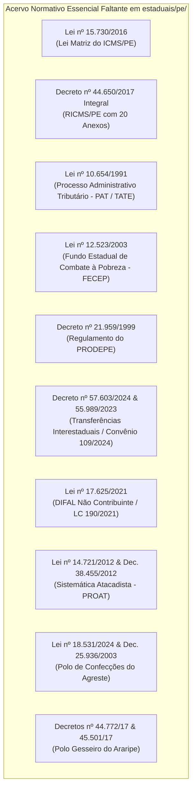
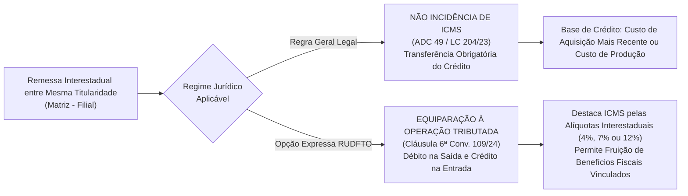
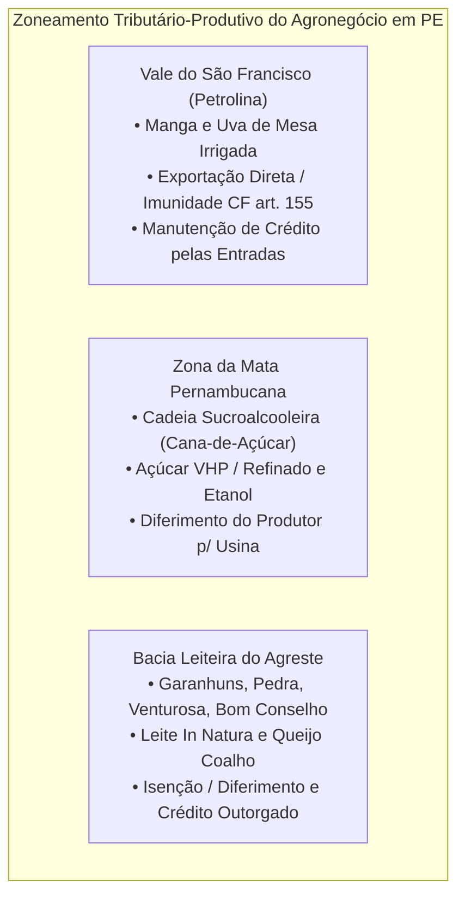
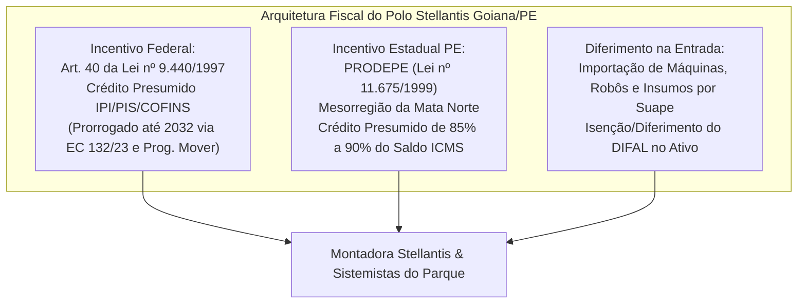
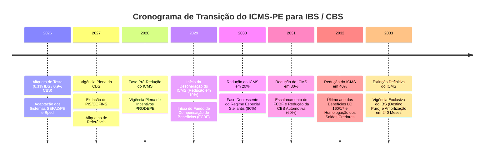

# AUDITORIA JURÍDICO-TRIBUTÁRIA DO ESTADO DE PERNAMBUCO (PE)
**Mapeamento Normativo, Relacionamento Interestadual, Mecanismos Creditícios, Dinâmica Setorial e Transição para a Reforma Tributária (IBS/CBS)**

---

## 1. SUMÁRIO EXECUTIVO E METADADOS DA AUDITORIA

* **Unidade Federativa:** Estado de Pernambuco (PE)
* **Região Geoeconômica:** Nordeste (NE)
* **Órgão Fazendário Superior:** Secretaria da Fazenda do Estado de Pernambuco ([SEFAZ/PE](https://www.sefaz.pe.gov.br))
* **Tribunal Administrativo:** Tribunal Administrativo Tributário do Estado de Pernambuco ([TATE/PE](https://www.sefaz.pe.gov.br/TATE))
* **Data da Auditoria:** Outubro de 2026 (vigência plena da Lei Complementar nº 204/2023, Convênio ICMS nº 109/2024, Lei Estadual nº 18.305/2023 e marco regulatório da Emenda Constitucional nº 132/2023 e Lei Complementar nº 214/2025).
* **Alíquota Interna Geral / Modal do ICMS em PE:** **20,5%** (elevada originariamente de 18% para 20,5% pela Lei Estadual nº 18.305/2023, com efeitos a contar de 01/01/2024, em consonância com a Lei Estadual nº 15.730/2016).
* **Adicional do Fundo de Pobreza (FECEP/PE):** **2,0%** (Lei Estadual nº 12.523/2003, incidente sobre bens e serviços supérfluos, elevando a carga efetiva interna para até 22,5% em operações ordinárias e 27% a 29% em itens específicos).

O Estado de Pernambuco ostenta a 7ª maior economia do país e se posiciona como o principal polo logístico e de comércio atacadista da Região Nordeste, alavancado pelo Complexo Industrial e Portuário de Suape, pelo Polo Automotivo da Stellantis na Zona da Mata Norte (Goiana), pelo Polo de Biotecnologia/Farmacêutico, pelo Polo de Confecções do Agreste (Caruaru, Toritama e Santa Cruz do Capibaribe), pelo Polo Frutícola Irrigado de exportação do Vale do São Francisco (Petrolina) e pelo Polo Gesseiro do Sertão do Araripe. 

Essa diversidade econômica resulta em um arranjo tributário sofisticado, intensivo em benefícios fiscais de créditos presumidos e diferimentos, estruturados substancialmente no âmbito do **PRODEPE** (Programa de Desenvolvimento do Estado de Pernambuco - Lei nº 11.675/1999) e convalidados perante o CONFAZ com fulcro na Lei Complementar Federal nº 160/2017 e Convênio ICMS nº 190/2017.

---

## 2. DIAGNÓSTICO DO REPOSITÓRIO LOCAL (`estaduais/pe/`) E LACUNAS NORMATIVAS

### 2.1. Inventário Crítico dos Arquivos Existentes

A auditoria inspecionou os arquivos presentes no diretório `estaduais/pe/` deste repositório, identificando a seguinte situação técnica:

| Arquivo Local | Classificação / Tipo | Situação no Repositório | Diagnóstico Jurídico e Técnico |
| :--- | :--- | :--- | :--- |
| `ricms/decreto-44650-2017.md` | Regulamento do ICMS (RICMS/PE) | **Resumo Executivo (89 linhas)** | **Incompleto para fins de parametrização operacional.** Contém a espinha dorsal dos fatos geradores, alíquotas (20,5%), regra do DIFAL e menção ao Convênio 109/2024, mas não reproduz os mais de 400 artigos nem os 20 Anexos regulamentares (Anexo 12 - Fronteiras/Antecipação, Anexo de Isenções, Anexo de Substituição Tributária e Anexos de Benefícios Fiscais). |
| `ricms/lei-11675-1999-prodepe-pe.md` | Lei de Benefício Fiscal (PRODEPE) | **Resumo Executivo Estruturado (81 linhas)** | **Parcialmente suficiente para consulta rápida, porém carece do texto compilado integral.** Sintetiza as alíquotas de crédito presumido industrial (75% a 95%), central de distribuição (3% na saída e 3% na entrada sobre frete) e importação em Suape, mas omite as regras procedimentais de habilitação no CONDIC, regras de penalidades, descredenciamento e vinculação ao Fundo Estadual de Equilíbrio Fiscal (FEEF/PE). |
| `leis/itcmd/lei-13974-2009.md` | Lei Ordinária do ICD (ITCMD) | **Texto Consolidado Integral (2.360 linhas)** | **Excelente estado de integridade documental.** Contém o texto normativo completo, histórico de alterações pelas Leis nº 14.298/2011, 15.601/2015, 18.305/2023 e já abrange as atualizações da Lei Complementar Estadual nº 563/2025 para adequação à EC 132/2023 (progressividade do imposto e regras de competência territorial). |
| `leis/ipva/lei-10849-1992.md` | Lei Ordinária do IPVA | **Texto Consolidado Integral (3.636 linhas)** | **Excelente estado de integridade documental.** Abrange a disciplina completa do fato gerador, base de cálculo por pauta venal, isenções, infrações e as reduções introduzidas pela Lei Estadual nº 18.305/2023 e Lei nº 18.383/2023 (redução da alíquota modal de veículos de passeio de 3% para 2,4%). |

### 2.2. Mapeamento de Normas Críticas Faltantes no Repositório

Para que o repositório atinja nível pleno de conformidade e auditoria automatizada para Pernambuco, faz-se estritamente necessária a ingestão das seguintes normas estaduais fundamentais:



1. **Lei Ordinária Estadual nº 15.730, de 17 de março de 2016:** A Lei Matriz do ICMS de Pernambuco. Revogou a histórica Lei nº 10.259/1989 e compilou todo o fato gerador, base de cálculo, sujeição passiva, responsabilidade por substituição, alíquotas (art. 15), regras de base dupla do DIFAL (art. 12, X e § 1º) e penalidades do imposto.
2. **Decreto Estadual nº 44.650, de 30 de junho de 2017 (Texto Consolidado e Anexos):** Atualmente presente apenas como síntese de 89 linhas. É impreterível incorporar os Livros I e II e os Anexos 1 a 20, com ênfase no Anexo 12 (Sistemática de Fronteiras / Antecipação Tributária com e sem encerramento da fase de tributação) e Anexo 19 (Regimes Especiais de Tributação).
3. **Lei Estadual nº 10.654, de 27 de novembro de 1991:** Dispõe sobre o Processo Administrativo-Tributário (PAT) no Estado de Pernambuco e disciplina a estrutura e o funcionamento do Tribunal Administrativo Tributário do Estado (TATE/PE), prazos de impugnação (30 dias), rito sumário de Notificação de Débito e rito ordinário do Auto de Infração e Apreensão.
4. **Lei Estadual nº 12.523, de 30 de dezembro de 2003:** Institui o Fundo Estadual de Combate e Erradicação da Pobreza (FECEP/PE), estabelecendo o adicional de 2% nas alíquotas de ICMS para produtos e serviços supérfluos, e disciplinando a expressa vedação de compensação do montante com créditos ordinários da apuração normal de ICMS.
5. **Decreto Estadual nº 21.959, de 27 de dezembro de 1999:** Regulamenta detalhadamente a Lei do PRODEPE (Lei nº 11.675/1999), trazendo a matriz de produtos beneficiados, os índices de agregação de valor mínimo exigidos pelo CONDIC e as condições de manutenção dos investimentos.
6. **Decreto Estadual nº 55.989, de 29 de dezembro de 2023 e Decreto nº 57.603, de 30 de outubro de 2024:** Normas de recepção e consolidação das decisões da ADC 49/STF, da Lei Complementar nº 204/2023 e dos Convênios ICMS nº 178/2023 e nº 109/2024 no Estado de Pernambuco, disciplinando o tratamento da não incidência na remessa interestadual entre estabelecimentos do mesmo titular e a opção anual pela tributação registrada no RUDFTO.
7. **Lei Estadual nº 17.625, de 31 de dezembro de 2021:** Adequou a legislação tributária do ICMS em Pernambuco aos ditames da Emenda Constitucional nº 87/2015 e da Lei Complementar Federal nº 190/2021, fixando a disciplina do DIFAL nas operações e prestações destinadas a consumidor final não contribuinte.
8. **Lei Estadual nº 14.721, de 04 de julho de 2012 e Decreto nº 38.455, de 27 de julho de 2012:** Instituem a Sistemática de Tributação do Comércio Atacadista de Produtos Alimentícios, de Limpeza, de Higiene Pessoal, Bebidas e Papelaria (PROAT), um dos regimes especiais de maior peso arrecadatório e operacional de Pernambuco.
9. **Lei Estadual nº 18.531, de 03 de maio de 2024:** Institui o Programa "PE Produz Polo de Confecções" no Agreste Pernambucano, integrando as regras do Decreto nº 25.936/2003 e Decreto nº 44.765/2017 para concentração da carga tributária na entrada de insumos fabris e desoneração da comercialização de vestuário.
10. **Decretos Estaduais nº 44.772/2017, nº 45.501/2017 e arts. 289-A a 289-L do RICMS/PE:** Sistemática Especial de Tributação do Polo Gesseiro do Sertão do Araripe, concentrando o ICMS na extração minerária da gipsita e outorgando isenção e crédito presumido no transporte rodoviário interestadual.
11. **Lei Estadual nº 13.942, de 04 de dezembro de 2009:** Programa de Estímulo à Atividade Portuária de Pernambuco, que desonera o desembaraço aduaneiro de mercadorias importadas por meio do Porto de Suape e Porto do Recife.

---

## 3. RELACIONAMENTO TRIBUTÁRIO COM OS DEMAIS 26 ESTADOS E O DISTRITO FEDERAL

O relacionamento do Estado de Pernambuco com as demais Unidades Federadas é pautado pelo binômio geoeconômico de ser um polo importador e distribuidor no Nordeste, situado como polo de destino em relação ao Centro-Sul e polo de origem em relação aos demais Estados do Norte e Nordeste.

### 3.1. Arquitetura de Alíquotas Interestaduais (Resoluções do Senado Federal nº 22/1989 e nº 13/2012)

```
                            ┌────────────────────────────────────────┐
                            │    ESTADO DE PERNAMBUCO (PE)           │
                            │    Alíquota Interna Modal: 20,5%       │
                            └───────────────────┬────────────────────┘
                                                │
         ┌──────────────────────────────────────┼──────────────────────────────────────┐
         │                                      │                                      │
         ▼                                      ▼                                      ▼
┌──────────────────┐                  ┌──────────────────┐                  ┌──────────────────┐
│ SAÍDAS PARA      │                  │ SAÍDAS DE PE     │                  │ MERCADORIAS COM  │
│ QUALQUER UF      │                  │ (ORIGEM)         │                  │ CONTEÚDO IMP.>40%│
│ Alíquota: 12%    │                  │ p/ Todas as UFs: │                  │ Res. SF 13/2012  │
│ (Res. SF 22/89)  │                  │ Fixa em 12%      │                  │ Alíquota: 4%     │
└──────────────────┘                  └──────────────────┘                  └──────────────────┘
         ▲                                                                             ▲
         │ ENTRADAS INTERESTADUAIS EM PERNAMBUCO (DESTINO PE):                        │
         ├─────────────────────────────────────────────────────────────────────────────┤
         │ • Remetente no Sul e Sudeste (exceto ES): Entrada tributada a 7%            │
         │ • Remetente no Norte, Nordeste, Centro-Oeste e ES: Entrada tributada a 12%  │
         │ • Mercadorias importadas (Res. SF 13/2012): Entrada tributada a 4%         │
         └─────────────────────────────────────────────────────────────────────────────┘
```

1. **Saídas Interestaduais promovidas por contribuinte pernambucano:**
   - Para qualquer Estado da Federação (N, NE, CO, Sul, Sudeste e DF), a alíquota aplicável é invariavelmente de **12%** (art. 1º, II da Resolução SF nº 22/1989).
   - Se o bem for importado do exterior ou possuir Conteúdo de Importação superior a 40% apurado na Ficha de Conteúdo de Importação (FCI), a alíquota interestadual nas saídas é de **4%** (Resolução SF nº 13/2012 e Convênio ICMS nº 38/2013).
   - Prestação de transporte aéreo de passageiros, carga e mala postal: **4%** (Resolução SF nº 95/1996).

2. **Entradas Interestaduais destinadas a contribuintes ou consumidores em Pernambuco:**
   - Mercadorias procedentes dos Estados das Regiões Sul e Sudeste (exceto Espírito Santo): alíquota de **7%**.
   - Mercadorias procedentes dos Estados das Regiões Norte, Nordeste, Centro-Oeste e do Estado do Espírito Santo: alíquota de **12%**.
   - Mercadorias importadas sujeitas à Resolução SF nº 13/2012: alíquota de **4%**.

### 3.2. Diferencial de Alíquotas (DIFAL) nas Operações Interestaduais

Pernambuco adota dois regimes metodológicos completamente distintos para a apuração do DIFAL, conforme o adquirente seja ou não contribuinte habitual do imposto:

#### A. DIFAL em Operações com Contribuinte (Uso, Consumo ou Ativo Permanente) — Metodologia da Base Dupla (Cálculo por Dentro)
O art. 12, inciso X e § 1º da Lei Estadual nº 15.730/2016, com redação ajustada pela Lei nº 17.118/2020 e regulamentada no RICMS/PE, determina a aplicação do método de **Base Dupla** para o cálculo do DIFAL nas entradas de fora do Estado destinadas a integrar o Ativo Imobilizado ou destinadas a Uso e Consumo de contribuinte do CACEPE:

$$\text{Valor da Operação de Origem} = V_{\text{orig}}$$
$$\text{ICMS Origem} = V_{\text{orig}} \times \text{ALQ}_{\text{inter}}$$
$$\text{Base de Cálculo PE (Base Dupla)} = \frac{V_{\text{orig}} - \text{ICMS Origem}}{1 - \text{ALQ}_{\text{interna\_PE}}}$$
$$\text{ICMS Interno Total} = \text{Base de Cálculo PE} \times \text{ALQ}_{\text{interna\_PE}}$$
$$\text{DIFAL a Recolher a PE} = \text{ICMS Interno Total} - \text{ICMS Origem}$$

*Exemplo Prático Parametrizado (Aquisição de SP por contribuinte de PE para uso/consumo):*
- Valor da mercadoria em SP: R$ 10.000,00 | Alíquota interestadual (SP -> PE): 7% | ICMS Origem destacado: R$ 700,00.
- Alíquota interna em Pernambuco: 20,5%.
- Base excluído o ICMS de origem: $\text{R\$ } 10.000,00 - \text{R\$ } 700,00 = \text{R\$ } 9.300,00$.
- Recomposição da base de cálculo em PE ("por dentro"): $\frac{\text{R\$ } 9.300,00}{1 - 0,205} = \frac{\text{R\$ } 9.300,00}{0,795} = \text{R\$ } 11.698,11$.
- Débito de ICMS à alíquota de PE: $\text{R\$ } 11.698,11 \times 20,5\% = \text{R\$ } 2.398,11$.
- **DIFAL a recolher à SEFAZ/PE:** $\text{R\$ } 2.398,11 - \text{R\$ } 700,00 = \mathbf{\text{R\$ } 1.698,11}$.
*(Nota: Pelo método simplificado de base única, o imposto seria de R$ 10.000,00 x (20,5% - 7%) = R$ 1.350,00. A base dupla impõe uma majoração efetiva de R$ 348,11 decorrente do recalculo do tributo sobre sua própria base).*

#### B. DIFAL Não Contribuinte (Consumidor Final / E-Commerce — EC 87/2015, LC 190/2021 e Lei PE nº 17.625/2021)
Nas remessas de bens ou serviços originadas em qualquer UF destinadas a consumidor final não contribuinte situado em Pernambuco (CFOPs `6.107` e `6.108`):
- O remetente da outra UF é o responsável tributário pelo cálculo e recolhimento integral do DIFAL ao Estado de Pernambuco.
- **Base de Cálculo:** Aplica-se a sistemática da **base única** estabelecida pelo Convênio ICMS nº 236/2021 (incorporado ao direito pernambucano), onde o montante do ICMS correspondente à diferença entre a alíquota interna do Estado de destino (PE: 20,5% + 2% FECEP, se aplicável) e a alíquota interestadual (4%, 7% ou 12%) integra a base de cálculo da própria operação.
- O recolhimento dá-se por Guia Nacional de Recolhimento de Tributos Estaduais (GNRE) vinculada a cada operação ou, na hipótese de inscrição estadual especial como Substituto Tributário concedida pela SEFAZ/PE, mediante apuração mensal unificada com vencimento até o dia 15 do mês subsequente.

### 3.3. Transferências Interestaduais entre Filiais (ADC 49/STF, LC 204/2023 e Convênio ICMS nº 109/2024)

O Estado de Pernambuco disciplinou a matéria por meio do **Decreto nº 55.989, de 29/12/2023**, posteriormente revogado e consolidado pelo **Decreto nº 57.603, de 30/10/2024**, alinhando-se aos termos do Convênio ICMS nº 109/2024:



1. **Regra Geral de Não Incidência com Transferência de Crédito:**
   - Não se considera ocorrido o fato gerador do ICMS na saída física de mercadorias de um estabelecimento para outro pertencente ao mesmo titular (art. 12, § 4º da LC 87/96 incluído pela LC 204/2023).
   - É obrigatória a transferência dos créditos da operação anterior para o estabelecimento destinatário em Pernambuco ou a partir dele, escriturados via campos próprios da EFD-ICMS/IPI:
     * Para bens industrializados: limitado ao valor do ICMS correspondente ao custo de produção dos bens expedidos.
     * Para bens adquiridos para revenda: limitado ao valor médio ponderado ou mais recente de entrada das mercadorias.
2. **Opção Anual pela Equiparação à Operação Regularmente Tributada:**
   - Exercendo a faculdade conferida pela Cláusula sexta do Convênio ICMS nº 109/2024 e chancelada pelo Decreto Estadual nº 57.603/2024, os estabelecimentos remetentes em Pernambuco podem optar anualmente por considerar a transferência interestadual como uma operação sujeita à incidência normal do ICMS.
   - **Registro Obrigatório:** A opção deve ser lavrada no Livro Registro de Utilização de Documentos Fiscais e Termos de Ocorrências (RUDFTO) e comunicada eletronicamente à SEFAZ/PE no mês de janeiro, produzindo efeitos para todo o ano-calendário.
   - **Importância Econômica:** Essa faculdade é vital para as indústrias incentivadas pelo PRODEPE e agroindústrias instaladas em Pernambuco, pois a incidência formal do imposto viabiliza a apropriação do crédito presumido estadual (75% a 95%) e impede o acúmulo de saldos credores ilíquidos na unidade fabril local.

### 3.4. Substituição Tributária (ICMS-ST) e Sistemática de Fronteiras de Pernambuco

Pernambuco é signatário das principais regras nacionais de Substituição Tributária harmonizadas pelo **Convênio ICMS nº 142/2018** e opera paralelamente um rígido sistema de barreiras e postos fiscais fronteiriços:

1. **MVA Ajustada nas Entradas de Outras UFs:**
   - Nas operações interestaduais sujeitas à ST promovidas por remetentes de outras UFs com destino a Pernambuco, aplica-se a fórmula padrão do Convênio 142/2018 para evitar o favorecimento fiscal da compra interestadual:
   
   $$\text{MVA Ajustada} = \left[ \frac{(1 + \text{MVA-ST Original}) \times (1 - \text{ALQ Inter})}{(1 - \text{ALQ Intra})} \right] - 1$$
   
   - Com a elevação da alíquota modal interna de Pernambuco para **20,5%** (Lei nº 18.305/2023), o denominador $(1 - \text{ALQ Intra})$ foi reduzido para **0,795**, o que provocou a imediata elevação automática da MVA Ajustada em todas as aquisições provenientes de outros Estados, majorando a base do ICMS-ST recolhido a Pernambuco.
   - **Optantes do Simples Nacional (Convênio ICMS nº 35/2011):** Quando o remetente for empresa enquadrada no Simples Nacional, veda-se a aplicação da MVA Ajustada, aplicando-se estritamente a MVA-ST Original fixada no RICMS/PE.

2. **Sistemática de Fronteiras / Antecipação Tributária (Art. 329 e Anexo 12 do RICMS/PE):**
   - Nas entradas interestaduais de mercadorias destinadas à comercialização ou industrialização não contempladas com convênio ou protocolo formal de Substituição Tributária interestadual, o Estado de Pernambuco exige o ICMS por **Antecipação Tributária com ou sem encerramento da fase de tributação**.
   - **Controle pelo Sistema e-Fisco (Extrato de Fronteiras):** A SEFAZ/PE monitora o cruzamento dos Manifestos Eletrônicos de Documentos Fiscais (MDF-e) e NF-e nas barreiras eletrônicas e gera o DAE de Fronteiras para pagamento antes do ingresso físico da mercadoria ou com vencimento no dia 20 do mês subsequente para contribuintes credenciados.

---

## 4. MECANISMOS DE DEDUÇÃO E TOMADA DE CRÉDITO NO ICMS-PE

### 4.1. Princípio da Não-Cumulatividade no RICMS/PE (Decreto nº 44.650/2017 e Lei nº 15.730/2016)

A disciplina do direito creditório em Pernambuco subordina-se estritamente aos princípios da não-cumulatividade material:
1. **Condições de Apropriação:** O crédito fiscal depende da idoneidade material e formal do documento fiscal (NF-e, CT-e), de seu registro na EFD-ICMS/IPI e da vinculação da entrada a subsequentes saídas tributadas ou amparadas por manutenção legal de crédito.
2. **Estorno Obrigatório do Crédito:** Exige-se o estorno proporcional do ICMS creditado na entrada quando as mercadorias:
   - Forem objeto de saída subsequente isenta ou não tributada;
   - Forem consumidas em processo industrial cuja saída final não seja tributada;
   - Sofrerem perecimento, extravio, deterioração, perda, furto ou roubo;
   - Tiverem sua base de cálculo reduzida na saída subsequente (estorno proporcional ao percentual da redução).
3. **Manutenção do Crédito:** Não se estorna o crédito relativo a insumos e mercadorias nas saídas:
   - Destinadas ao exterior (exportação direta ou remessa com fim específico de exportação - art. 155, § 2º, X, "a" da CF/88 e Lei Kandir art. 3º, II);
   - Amparadas por diferimento expressamente dotado de manutenção pelo RICMS/PE.

### 4.2. Ativo Permanente / Imobilizado e CIAP (LC nº 102/2000)

A apropriação do ICMS incorrido na aquisição de bens para o Ativo Imobilizado dá-se por meio do **CIAP (Controle de Crédito de ICMS do Ativo Permanente)**, escriturado no Bloco G da EFD:
- **Fracionamento Temporal:** À razão de **1/48 (um quarenta e oito avos)** por mês civil, a contar do mês em que o bem entrar em efetiva operação e atividade produtiva.
- **Fator de Proporcionalidade Mensal:**

$$\text{Crédito Mensal Apropriável} = \left( \frac{\text{ICMS Total do Bem}}{48} \right) \times \left( \frac{\text{Saídas Tributadas e Exportações do Mês}}{\text{Total das Saídas e Prestações do Mês}} \right)$$

- **Alienação ou Desincorporação Prematura:** Se o bem do ativo for vendido ou transferido antes de completados os 48 meses, cessa-se imediatamente a apropriação dos 1/48 avos restantes, vedando-se a apropriação de qualquer fração a partir da data de saída.

### 4.3. Restrições Legais da Lei Complementar Federal nº 87/1996

Em estrita harmonia com a Lei Kandir, o Estado de Pernambuco mantém restrições ao aproveitamento de créditos:
- **Energia Elétrica (Art. 33, II da LC 87/96):** O crédito de ICMS referente à entrada de energia elétrica no estabelecimento é restrito à parcela consumida diretamente no processo de industrialização (mediante **Laudo Técnico Pericial de Rateio de Energia Elétrica** emitido por perito habilitado pelo CREA), à energia objeto de operação de saída (comercialização) ou proporcionalmente à receita de operações de exportação. Estabelecimentos atacadistas e varejistas não têm direito ao crédito sobre a energia de seus estabelecimentos.
- **Serviços de Comunicação (Art. 33, III da LC 87/96):** Tomada de crédito admitida exclusivamente quando os serviços forem utilizados na execução de serviços de telecomunicações da mesma natureza ou quando vinculados a operações de exportação para o exterior.
- **Uso e Consumo (Art. 33, I da LC 87/96):** A apropriação de crédito sobre mercadorias destinadas ao uso ou consumo do estabelecimento permanece sobrestada até **1º de janeiro de 2033** (termo prorrogado pela Lei Complementar Federal nº 171/2019 e incorporado ao RICMS/PE).

### 4.4. O Adicional do FECEP (2%) e a Vedação à Compensação Financeira

O Fundo Estadual de Combate e Erradicação da Pobreza de Pernambuco (Lei nº 12.523/2003 e Decreto nº 26.402/2004) adiciona 2% à alíquota de itens seletivos:
- **Bens Atingidos:** Cervejas, aguardentes e bebidas alcoólicas destiladas, fumo e derivados de tabaco, embarcações e aeronaves esportivas de recreio, artigos de joalheria, perfumes e cosméticos de alto valor.
- **Incomunicabilidade de Contas Gráficas:** O recolhimento do adicional do FECEP é de natureza vinculada e **independente da apuração normal do ICMS**. O sujeito passivo é expressamente proibido de compensar os créditos acumulados ordinários do ICMS com o montante devido a título de FECEP.
- O imposto referente ao FECEP deve ser apurado em conta gráfica segregada e recolhido sob código de receita específico da SEFAZ/PE (`099-0` ou correlato via DAE/GNRE).

### 4.5. Ressarcimento e Controle de Créditos Acumulados no Sistema e-Fisco

Contribuintes com exportações maciças (como os produtores de uva e manga de Petrolina ou indústrias químicas de Suape) ou sujeitos a descompassos crônicos de alíquotas (compra interna a 20,5% e venda interestadual a 12% ou 4%) geram saldos credores acumulados de grande vulto:
1. **Procedimento Eletrônico via e-Fisco:** A homologação do saldo credor acumulado obedece ao trâmite de auditoria eletrônica da SEFAZ/PE, com envio de arquivos da EFD-ICMS/IPI e peticionamento formal no sistema corporativo fazendário.
2. **Hipóteses de Utilização Autorizada:**
   - Transferência para outros estabelecimentos da mesma empresa em Pernambuco para compensação com saldos devedores;
   - Transferência para terceiros inscritos no CACEPE a título de pagamento de fornecedores locais de matérias-primas e embalagens;
   - Transferência para liquidação de aquisição de máquinas e equipamentos fabricados no Estado ou importados sem similar nacional para integração ao Ativo Imobilizado.
3. **Ressarcimento de ICMS-ST (Tema 201 do STF):** Quando a base de cálculo real da venda a consumidor for inferior à base de cálculo presumida fixada na pauta/MVA da SEFAZ/PE, ou em caso de perda ou não ocorrência do fato gerador presumido, o contribuinte pernambucano pode postular o ressarcimento da parcela de ST recolhida a maior, observando a metodologia do Decreto nº 44.650/2017.

---

## 5. O SETOR AGRÍCOLA E RURAL PERNAMBUCANO

O agronegócio pernambucano exibe três vetores territoriais completamente distintos, cada um amparado por sistemáticas fiscais customizadas:



### 5.1. Polo Frutícola Irrigado do Vale do São Francisco (Petrolina e Lagoa Grande)
O Vale do São Francisco constitui o maior centro de fruticultura irrigada e de exportação de uva de mesa e manga do Brasil:
- **Imunidade de Exportação (CF/88, art. 155, § 2º, X, "a" e Lei Kandir):** Toda a manga e uva exportadas diretamente para a União Europeia, Estados Unidos e Reino Unido saem com não incidência plena de ICMS, gerando volumoso saldo credor pelas aquisições de insumos agrícolas, caixas de papelão, maquinários de packing house e energia elétrica.
- **Mercado Interno (Convênio ICMS nº 44/1975 e RICMS/PE):** Saídas internas de produtos hortifrutigranjeiros em estado natural beneficiadas por **isenção do ICMS**; saídas interestaduais tributadas a 12% ou amparadas por reduções específicas autorizadas em convênio.
- **Energia Elétrica de Irrigação:** Isenção ou diferimento concedido à energia consumida em bombas d'água de captação no Rio São Francisco por produtores rurais cadastrados, aliviando o custo fixo de operação.

### 5.2. O Complexo Sucroalcooleiro da Zona da Mata
Trata-se do setor produtivo mais antigo de Pernambuco, concentrando as usinas sucroalcooleiras e fornecedores independentes de cana:
- **Diferimento nas Remessas de Cana-de-Açúcar:** A saída de cana-de-açúcar promovida pelo produtor rural fornecedor com destino a usinas e destilarias situadas no Estado de Pernambuco opera sob **diferimento do ICMS** (art. 11 do Decreto nº 44.650/2017). O imposto é diferido para a fase de comercialização subsequente do açúcar ou etanol fabricado pela indústria compradora.
- **Regime dos Combustíveis (LC 192/2022 e Convênios CONFAZ):**
  - **Etanol Anidro Combustível (EAC):** Operações com EAC destinadas a refinarias ou distribuidoras ocorrem com diferimento do ICMS, que é recolhido na fase da Gasolina "C" sob a alíquota *ad rem* nacional única fixada pelo Convênio ICMS nº 15/2023.
  - **Etanol Hidratado Combustível (EHC):** Sujeito à alíquota *ad rem* unificada nos termos da Lei Complementar nº 192/2022, assegurando neutralidade de arrecadação entre os Estados.
- **Bioeletricidade de Biomassa:** Crédito outorgado e isenção na queima de bagaço de cana para cogeração de energia elétrica e fornecimento à rede básica do SIN.

### 5.3. A Bacia Leiteira do Agreste Pernambucano
Compreendendo municípios como Garanhuns, São Bento do Una, Bom Conselho, Buíque, Pedra e Venturosa:
- **Leite Cru (*in natura*):** Saída do produtor rural para cooperativas e indústrias de laticínios sob **isenção ou diferimento**.
- **Indústrias de Laticínios:** Crédito outorgado de ICMS concedido no RICMS/PE calculado sobre o valor das saídas de leite pasteurizado, queijo coalho e requeijão artesanal, garantindo que a carga tributária efetiva final seja mantida em níveis entre 0% e 2%, conferindo competitividade frente aos laticínios de Minas Gerais e Goiás.

### 5.4. Convênio ICMS nº 100/1997 (Insumos Agropecuários)
Pernambuco aplica rigorosamente as desonerações nacionais do Convênio ICMS nº 100/1997:
- **Isenção:** Sementes fiscalizadas e certificadas, mudas de plantas e pintos de um dia.
- **Redução Progressiva de Base de Cálculo:** Fertilizantes, adubos, defensivos agrícolas, calcário agrícola e rações balanceadas, sujeitos às alíquotas interestaduais escalonadas de 4% e reduções de base interna em cumprimento aos Convênios ICMS nº 26/2021 e nº 190/2021.

### 5.5. Obrigações Acessórias: NFP-e e Regime Simplificado do Produtor Rural
- **Inscrição no CACEPE:** O produtor rural pessoa física obtém inscrição simplificada no Cadastro de Contribuintes do Estado de Pernambuco, dispensado da escrituração contábil formal complexa (dispensado de Sped Contábil).
- **Nota Fiscal de Produtor Eletrônica (NFP-e, modelo 55):** Pernambuco avançou no cronograma de substituição da antiga Nota Fiscal Avulsa (NFA-e em papel) pela NFP-e emitida diretamente pelo aplicativo da Nota Fiscal Fácil (NFF) ou pelo sistema e-Fisco, conferindo agilidade para trânsito de cargas e controle do diferimento nas saídas para cooperativas e indústrias.

---

## 6. O SETOR INDUSTRIAL E PORTUÁRIO PERNAMBUCANO

Pernambuco abriga dois dos maiores polos de atração industrial do Brasil: o Complexo Industrial Portuário de Suape e o Polo Automotivo de Goiana, catalisados pelo programa estadual PRODEPE.

### 6.1. Complexo Industrial e Portuário Governador Eraldo Gueiros (Suape)
Localizado entre os municípios de Ipojuca e Cabo de Santo Agostinho, Suape é o porto público de maior calado e movimentação de cabotagem do Norte/Nordeste:
1. **Refinaria Abreu e Lima (RNEST - Petrobras):**
   - Maior empreendimento industrial de refino do Nordeste, processando óleo pesado e produzindo Óleo Diesel S-10 com ultrabaixo teor de enxofre, GLP, nafta e coque de petróleo.
   - Aplicação do regime monofásico de ICMS (LC 192/2022) nas saídas de diesel e GLP, recolhidos por alíquota específica *ad rem* por litro/kg.
2. **Polo Petroquímico (PetroquímicaSuape / Alpek Polyester):**
   - Produção de Ácido Tereftálico Purificado (PTA) e polímeros de Polietileno Tereftalato (PET).
   - Operações estruturadas sob diferimento do ICMS na recepção de paraxileno por duto a partir do porto e vendas com benefícios PRODEPE para a cadeia de embalagens plásticas e fios sintéticos.
3. **Polo Naval e Offshore (Estaleiro Atlântico Sul - EAS e Vard Promar):**
   - Construção e reparo de navios petroleiros, gaseiros e embarcações de apoio marítimo.
   - Aplicação de regimes de Drawback (Convênio ICMS nº 27/1990) e Repetro-Sped (Lei nº 13.586/2017 e Convênio ICMS nº 03/2018), com suspensão e isenção de ICMS no desembaraço aduaneiro de partes, peças e tubos de aço destinados à construção naval.

### 6.2. O Polo Automotivo da Stellantis em Goiana (Zona da Mata Norte)
O Polo de Goiana é um marco da industrialização nordestina, onde a Stellantis opera a fábrica mais moderna da América Latina, produzindo veículos das marcas Jeep (Renegade, Compass, Commander), Fiat (Toro) e Ram (Rampage), integrada a um parque de mais de 30 sistemistas (fornecedores de autopeças) instalados no mesmo complexo:



1. **Incentivo Federal do Setor Automotivo do Nordeste (Lei nº 9.440/1997, art. 40):**
   - Concede crédito presumido sobre as contribuições federais (PIS/COFINS e IPI) como contrapartida aos vultosos investimentos industriais no Nordeste. O incentivo foi prorrogado e preservado pela Emenda Constitucional nº 132/2023 (art. 19) e pela Lei nº 14.802/2024 (Programa Mover) até **31 de dezembro de 2032**.
2. **Incentivo Estadual do PRODEPE:**
   - Enquadramento no Agrupamento Industrial Prioritário Automotivo: diferimento do ICMS no desembaraço aduaneiro de máquinas, prensas e robôs importados via Suape;
   - **Crédito Presumido de ICMS de até 85% a 90%** sobre o saldo devedor mensal das saídas de veículos automotores e autopeças incentivadas, em razão de sua localização fora da RMR (Mata Norte pernambucana).

### 6.3. O Programa PRODEPE (Lei nº 11.675/1999 e Decreto nº 21.959/1999)
O PRODEPE é a espinha dorsal do desenvolvimento industrial de Pernambuco, convalidado nacionalmente perante o CONFAZ com arrimo na Lei Complementar Federal nº 160/2017 e Convênio ICMS nº 190/2017, com vigência assegurada até **31 de dezembro de 2032**:

| Localização Geográfica do Empreendimento | Enquadramento Setorial | Crédito Presumido sobre o Saldo Devedor do ICMS |
| :--- | :--- | :--- |
| **Região Metropolitana do Recife (RMR)** | Agrupamentos Prioritários (Químico, Fármacos, Têxtil, Alimentos, Plásticos, Metalmecânico) | **75%** (podendo alcançar até **85%** para projetos industriais estruturadores estratégicos aprovados pelo CONDIC) |
| **Região Metropolitana do Recife (RMR)** | Outras Atividades Industriais Relevantes | **47,5% a 72,5%** |
| **Mesorregiões da Zona da Mata e do Agreste** | Indústrias Habilitadas | **85% a 90%** |
| **Mesorregião do Sertão Pernambucano** | Indústrias Habilitadas | **90% a 95%** |

*Contrapartidas e Encargos Financeiros:*
- **Taxa de Administração da AD DIPER (Agência de Desenvolvimento de Pernambuco):** Recolhimento obrigatório de **2,0%** sobre o montante financeiro do incentivo fiscal efetivamente usufruído em cada período de apuração mensal;
- **FEEF/PE (Fundo Estadual de Equilíbrio Fiscal - Lei nº 15.865/2016):** Exigência de depósito de até 10% sobre a parcela do benefício fiscal utilizado, exigível para determinados setores ou mitigado mediante incremento real de arrecadação e metas de postos de trabalho.

### 6.4. Polos Industriais Especializados
- **Polo Farmacêutico e Biotecnológico de Goiana:** Instalações da Hemobrás (fábrica pública de hemoderivados e biotecnologia) e indústrias farmacêuticas privadas (como Aché Laboratórios). Beneficiam-se de regime prioritário no PRODEPE com 85% de crédito presumido e diferimento integral do ICMS na importação de fármacos e princípios ativos de alta complexidade.
- **Polo Gesseiro do Sertão do Araripe (Araripina, Trindade, Ipubi, Ouricuri e Bodocó):**
  - Responde por mais de 90% de todo o gesso consumido no Brasil.
  - **Sistemática Especial de Tributação (Decreto nº 45.501/2017 e arts. 289-A a 289-L do RICMS/PE):** O imposto estadual é concentrado na mineradora (saída da gipsita bruta), operando as calcinadoras e fábricas de gesso em pó e placas de drywall com ampla desoneração nas etapas intermediárias.
  - **Benefício no Transporte Interestadual:** O art. 289-B do RICMS/PE concede **crédito presumido e isenção** de ICMS no frete rodoviário interestadual de gipsita e gesso com destino aos grandes centros consumidores do Centro-Sul, compensando a distância geográfica do Sertão.

### 6.5. Comércio Importador e Programa Portuário (Lei nº 13.942/2009 e PRODEPE Importação)
Para empresas de comércio atacadista importador estabelecidas em Pernambuco que canalizem suas cargas pelos portos de Suape e Recife:
- **Diferimento:** Desoneração do ICMS no desembaraço aduaneiro da mercadoria importada;
- **Crédito Presumido nas Saídas Subsequentes:**
  - *Nas saídas interestaduais (sujeitas a 4% da Res. SF 13/2012):* Crédito presumido outorgado que reduz o recolhimento efetivo final de ICMS para **1,0% a 2,5%** sobre o valor da operação;
  - *Nas saídas internas:* Carga tributária efetiva líquida reduzida entre **3,5% e 6,5%**.

---

## 7. O SETOR DE PRODUTO ACABADO (ATACADO, VAREJO E DISTRIBUIÇÃO)

Pernambuco é historicamente o principal centro atacadista e redistribuidor do Norte/Nordeste, concentrando os maiores operadores logísticos do país em cidades como Jaboatão dos Guararapes, Cabo de Santo Agostinho e Moreno.

### 7.1. PRODEPE Central de Distribuição — CD (Arts. 8º a 11 da Lei nº 11.675/1999)
Regime de estímulo à instalação de Centros de Distribuição que atendam lojistas e indústrias em múltiplos Estados:
1. **Crédito Presumido na Saída Interestadual:** Concede-se crédito presumido equivalente a **3,0% (três por cento)** do valor contábil total das saídas interestaduais tributadas à alíquota de 12% (reduzindo a carga líquida interestadual de 12% para 9%).
2. **Crédito Presumido na Entrada Interestadual de Fora do Nordeste:** Concede-se crédito presumido equivalente a **3,0% (três por cento)** da base de cálculo do ICMS relativo à operação de entrada por transferência ou aquisição oriunda de indústria situada fora da Região Nordeste, limitado ao valor do serviço de transporte (frete) da mercadoria até o CD em Pernambuco.
3. **Efeito Fiscal Combinado:** O mecanismo anula a desvantagem histórica da compra de mercadorias no Sul/Sudeste (entrada a 7%) e venda interestadual no Nordeste (saída a 12%), conferindo blindagem tributária e competitividade frente aos atacadistas sediados no Espírito Santo e na Bahia.

### 7.2. Sistemática do Comércio Atacadista de Alimentos e Higiene (Lei nº 14.721/2012 e Decreto nº 38.455/2012 - PROAT)
Institui regime especial de tributação do ICMS para estabelecimentos atacadistas de produtos alimentícios, limpeza, higiene pessoal, bebidas e papelaria:
- **Apuração por Carga Líquida:** O atacadista recolhe o ICMS próprio e a antecipação tributária através de alíquotas líquidas calculadas sobre as entradas e saídas, dispensando a complexa apuração de débitos e créditos item a item;
- **Retenção de ICMS-ST:** O credenciamento na Lei 14.721/2012 atribui ao atacadista a condição de substituto tributário nas saídas internas, aplicando MVA reduzida específica da sistemática;
- **Requisitos:** Faturamento anual mínimo, cumprimento de percentual mínimo de vendas no atacado (vedação expressa à pulverização varejista em balcão acima do teto regulamentar) e regularidade fiscal estrita no CACEPE.

### 7.3. MVA / IVA-ST e Pautas Fiscais da SEFAZ/PE
Nas mercadorias sujeitas à Substituição Tributária (bebidas frias, cervejas, refrigerantes, águas minerais, combustíveis, farinha de trigo, cimento, tintas e vernizes, autopeças):
- **Preço Médio Ponderado a Consumidor Final (PMPF):** A Diretoria de Tributação da SEFAZ/PE adota prioritariamente o PMPF fixado em Instruções Normativas e Boletins Informativos para calcular a base da ST de cervejas, refrigerantes e água mineral, apurado em pesquisas de mercado realizadas nos canais de varejo pernambucanos.
- **MVA Original e Ajustada:** Quando inexistente o PMPF, aplica-se a Margem de Valor Agregado prevista no RICMS/PE, obrigatoriamente recalculada como MVA Ajustada quando a mercadoria ingressar de outra UF com alíquota de 7% ou 4% e a interna for de 20,5%.

### 7.4. O Polo de Confecções do Agreste (Caruaru, Toritama e Santa Cruz do Capibaribe)
O Polo de Moda do Agreste responde pela fabricação e comercialização de milhões de peças de vestuário e jeans ("moda pop"):
1. **Dinâmica Econômica e Combate à Informalidade:** A região opera com milhares de facções, pequenas tecelagens e feirantes (Moda Center Santa Cruz, Feira da Sulanca de Caruaru e Parque das Feiras de Toritama).
2. **Sistemática Histórica do Decreto nº 25.936/2003 e Decreto nº 44.765/2017:**
   - Concentração do recolhimento do ICMS no início da cadeia: cobrança por substituição tributária ou antecipação na entrada de **fios, tecidos e artigos de armarinho** (aviamentos);
   - A concentração da carga no insumo permite a desoneração ou tributação sob carga mínima na confecção e circulação física das peças prontas na região do Agreste, evitando a retenção de mercadorias sem nota fiscal no trânsito rodoviário.
3. **Programa "PE Produz Polo de Confecções" (Lei Estadual nº 18.531/2024):**
   - Instituiu novos incentivos para formalização de Microempresas (ME) e Empresas de Pequeno Porte (EPP) têxteis no CACEPE;
   - Mecanismos de compras públicas centralizadas pelo Governo do Estado de Pernambuco de uniformes e fardamentos escolares diretamente dos pequenos confeccionistas credenciados da Mesorregião do Agreste.

### 7.5. E-commerce e Marketplaces (Responsabilidade Tributária)
Com a instalação de centros de distribuição de gigantes globais do comércio eletrônico em Pernambuco:
- **Responsabilidade Solidária (Art. 13 da Lei nº 15.730/2016):** As plataformas digitais, marketplaces e intermediadores de pagamento são solidariamente responsáveis pelo recolhimento do ICMS nas vendas de mercadorias realizadas por seus anunciantes sem emissão de nota fiscal idônea ou sob fraude cadastral;
- Exigência de integração dos sistemas das transportadoras e plataformas com os sistemas de desembaraço eletrônico de MDF-e da SEFAZ/PE.

---

## 8. TRANSIÇÃO PARA O IBS / CBS DA REFORMA TRIBUTÁRIA (EC 132/2023 E LC 214/2025)

A transição para o novo modelo de tributação sobre o consumo fundado no Imposto sobre Bens e Serviços (IBS) e na Contribuição sobre Bens e Serviços (CBS) impõe a mais profunda transformação estrutural da história tributária de Pernambuco.



### 8.1. A Extinção Gradual do ICMS e o Fim do Paradigma da Competitividade pela Origem
Entre **2029 e 2032**, as alíquotas do ICMS serão proporcionalmente reduzidas em todo o Brasil (90% do valor em 2029; 80% em 2030; 70% em 2031; 60% em 2032) até a **extinção integral em 1º de janeiro de 2033**:
- **Desidratação do PRODEPE:** O PRODEPE opera outorgando créditos presumidos sobre o débito de saída apurado na origem pernambucana (75% a 95%). À medida que a alíquota do ICMS cai, o valor nominal do incentivo diminui na mesma proporção.
- **Princípio do Destino:** A partir de 2033, o IBS pertence exclusivamente ao Estado e Município de destino/consumo final do bem (art. 156-A, § 1º, V da CF/88). Nenhum Estado poderá conceder crédito presumido ou benefício fiscal para atrair indústrias para exportar bens tributados a outros Estados.

### 8.2. O Fundo de Compensação de Benefícios Fiscais (FCBF — CF/88, art. 159-A e LC 214/2025)
Para compensar a perda dos incentivos fiscais estaduais concedidos sob a vigência da Lei Complementar nº 160/2017 e convalidados no Convênio ICMS nº 190/2017:
- **Dotação Federal de R$ 160 Bilhões:** A União repassará recursos orçamentários ao FCBF entre 2029 e 2032;
- **Direito das Indústrias Habilitadas em PE:** As pessoas jurídicas que usufruem do PRODEPE (indústrias da Zona da Mata, RMR, Sertão e Centros de Distribuição) deverão apresentar perante o Comitê Gestor e a União a comprovação da fruição regular do benefício em 2028 para habilitar o recebimento de parcelas compensatórias em pecúnia direta decorrentes da perda de margem operacional durante a transição 2029-2032.

### 8.3. A Preservação do Polo Stellantis de Goiana (Art. 19 da EC nº 132/2023)
Uma das maiores vitórias da bancada pernambucana na Reforma Tributária foi a inclusão do **artigo 19 da Emenda Constitucional nº 132/2023**, regulamentado no âmbito da Lei nº 14.802/2024 (Programa Mover):
- **Migração do Crédito Presumido:** O incentivo federal da Lei nº 9.440/1997 é convertido em **crédito presumido da Contribuição sobre Bens e Serviços (CBS)** gerada pelo polo automotivo instalado em Goiana/PE;
- **Condicionante Tecnológica:** O benefício exige a apresentação de projetos de implantação de novas linhas de montagem voltadas à transição energética (veículos híbridos flex, elétricos e bicombustíveis) e pesquisa e desenvolvimento em engenharia automotiva na região;
- **Escalonamento Decrescente entre 2029 e 2032:**
  - Anos 2026, 2027 e 2028: **100%** do valor do benefício;
  - Ano de 2029: **80%** do valor;
  - Ano de 2030: **60%** do valor;
  - Ano de 2031: **40%** do valor;
  - Ano de 2032: **20%** do valor;
  - A partir de 1º de janeiro de 2033: Extinção definitiva do incentivo especial regional.

### 8.4. Homologação de Saldos Credores Acumulados de ICMS (Art. 134 do ADCT / LC 214/2025)
Grandes exportadores (fruticultura de Petrolina, petroquímica e estaleiros de Suape) e atacadistas acumularão montantes bilionários de créditos escriturais de ICMS até **31 de dezembro de 2032**:
1. **Procedimento de Homologação em 2033:** Os saldos credores de ICMS existentes ao final de 2032 deverão ser declarados eletronicamente e submetidos a auditoria conclusiva pela SEFAZ/PE para fins de homologação;
2. **Compensação em 240 Parcelas Mensais:**
   - O saldo credor homologado será amortizado ao longo de **240 meses (20 anos)**, a contar de 1º de janeiro de 2033, atualizado monetariamente pela taxa oficial de inflação (IPCA);
   - A empresa compensará a parcela mensal (1/240) primariamente contra o débito próprio do IBS devido ao Comitê Gestor;
   - Caso não haja débito de IBS suficiente na empresa em Pernambuco, a parcela mensal poderá ser transferida a terceiros ou ressarcida diretamente em moeda corrente pelo Comitê Gestor do IBS.

### 8.5. Reposicionamento Estratégico de Pernambuco e de Suape
Com o fim da "Guerra Fiscal" em 2033, a atratividade do Estado de Pernambuco não poderá mais depender de créditos presumidos de ICMS:
- **Vantagem Logística:** Pernambuco precisará maximizar a eficiência aduaneira de Suape, expandir as ferrovias (conclusão do ramal da Transnordestina até Suape) e ampliar a geração de energias renováveis (eólica e solar no Sertão e Agreste) para produção de Hidrogênio Verde (H2V) e derivados petroquímicos de baixo carbono.

---

## 9. PLANO DE AÇÃO E RECOMENDAÇÕES PARA O REPOSITÓRIO LOCAL (`estaduais/pe/`)

Para garantir que o repositório local represente com precisão cirúrgica a legislação pernambucana, recomenda-se a seguinte esteira de implementação:

### 9.1. Matriz de Ingestão Prioritária de Normas Faltantes

```
estaduais/pe/
├── leis/
│   ├── icms/
│   │   ├── lei-15730-2016.md              <-- PRIORIDADE MÁXIMA (Lei Matriz do ICMS)
│   │   ├── lei-18305-2023.md              <-- PRIORIDADE ALTA (Alíquota 20,5% e IPVA 2,4%)
│   │   └── lei-17625-2021.md              <-- PRIORIDADE ALTA (DIFAL Não Contribuinte)
│   ├── beneficios/
│   │   ├── lei-11675-1999-completa.md     <-- PRIORIDADE ALTA (PRODEPE Texto Consolidado)
│   │   ├── lei-12523-2003-fecep.md        <-- PRIORIDADE ALTA (FECEP 2%)
│   │   ├── lei-14721-2012-proat.md        <-- PRIORIDADE MÉDIA (Atacadista de Alimentos)
│   │   └── lei-18531-2024-confeccoes.md   <-- PRIORIDADE MÉDIA (Polo de Confecções)
│   ├── processo/
│   │   └── lei-10654-1991-pat-tate.md     <-- PRIORIDADE MÁXIMA (Processo Administrativo/TATE)
│   ├── itcmd/
│   │   └── lei-13974-2009.md              [OK - Presente no repositório]
│   └── ipva/
│       └── lei-10849-1992.md              [OK - Presente no repositório]
└── ricms/
    ├── decreto-44650-2017-completo.md     <-- PRIORIDADE MÁXIMA (RICMS/PE com 20 Anexos)
    ├── decreto-21959-1999-prodepe.md      <-- PRIORIDADE ALTA (Regulamento PRODEPE)
    └── transferencias/
        └── decreto-57603-2024.md          <-- PRIORIDADE ALTA (Transferências / Conv. 109/2024)
```

### 9.2. Atualização dos Arquivos Existentes
- **`estaduais/pe/ricms/decreto-44650-2017.md`:** Substituir a atual síntese de 89 linhas pelo texto consolidado integral do regulamento ou estruturá-lo em livros e anexos regulamentares específicos.
- **`estaduais/pe/ricms/lei-11675-1999-prodepe-pe.md`:** Mover para a pasta `leis/beneficios/` e incorporar o texto compilado de todos os seus 22 artigos e tabelas de agrupamentos industriais.

---

## 10. CONCLUSÃO E PARECER TÉCNICO

O ordenamento jurídico-tributário do Estado de Pernambuco é um modelo de alta complexidade técnica, marcado pela conciliação entre a preservação de sua base arrecadatória interna (alíquota modal elevada a 20,5% e FECEP de 2%) e uma arrojada política de incentivos fiscais setoriais (PRODEPE, Suape, Stellantis Goiana, Polo Gesseiro e Polo de Confecções).

A transição inaugurada pela Emenda Constitucional nº 132/2023 e disciplinada pela Lei Complementar nº 214/2025 impõe ao Estado e aos seus contribuintes o dever de planejar rigorosamente a extinção progressiva dos benefícios de ICMS entre 2029 e 2032, a habilitação tempestiva perante o Fundo de Compensação de Benefícios Fiscais (FCBF), a conversão do regime do polo automotivo para créditos presumidos de CBS (art. 19 da EC 132/23) e o meticuloso processo de auditoria e homologação dos créditos acumulados do ICMS perante a SEFAZ/PE para futura compensação em 240 meses com o IBS.
