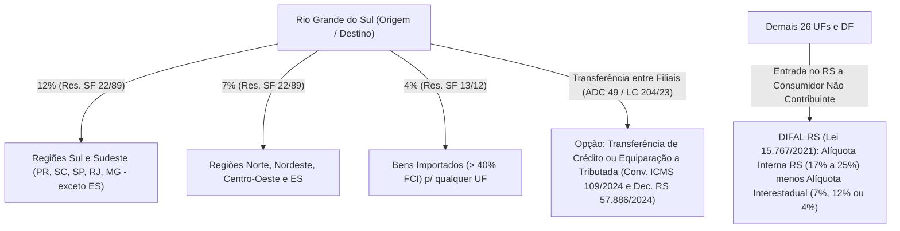
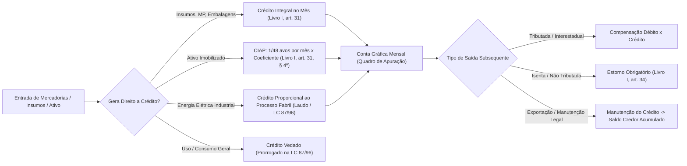
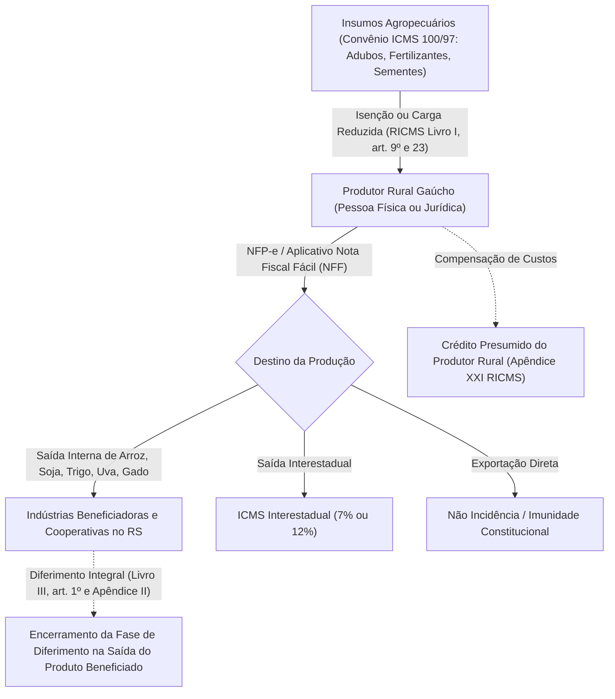
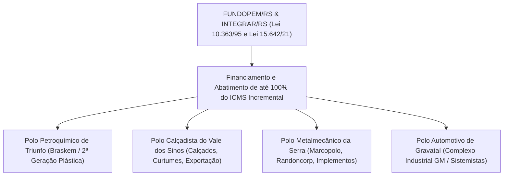
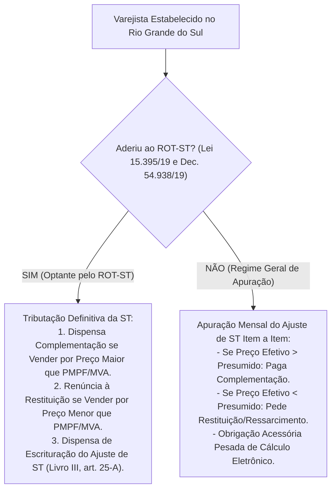
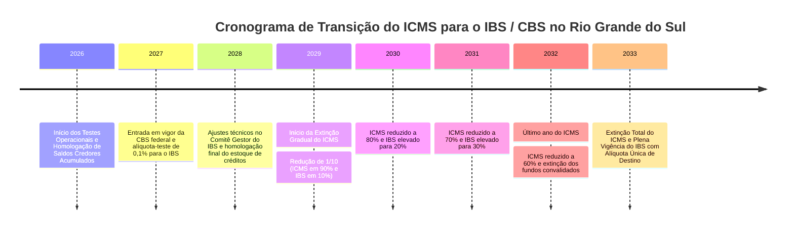

# RELATÓRIO TÉCNICO DE AUDITORIA TRIBUTÁRIA — ESTADO DO RIO GRANDE DO SUL (RS)

**Data de Elaboração:** Outubro de 2026  
**Jurisdição:** Estado do Rio Grande do Sul (SEFAZ/RS — Receita Estadual do RS)  
**Competência Analítica:** Direito Tributário Estadual, Direito Financeiro e Contabilidade Fiscal  
**Destinação:** Repositório Analítico de Legislação Tributária Brasileira (`_auditoria/estados/auditoria_rs.md`)

---

## SUMÁRIO EXECUTIVO

O presente relatório consolida uma auditoria estrutural e analítica da legislação tributária do Estado do Rio Grande do Sul (RS), avaliando o estado atual do repositório em `estaduais/rs/`, catalogando o acervo normativo vigente e ausente, e dissecando os fluxos operacionais, creditórios, setoriais e interestaduais do Imposto sobre Operações Relativas à Circulação de Mercadorias e sobre Prestações de Serviços de Transporte Interestadual e Intermunicipal e de Comunicação (ICMS), bem como dos tributos estaduais afins (ITCMD, IPVA, PAT/TARF-RS e FUNDOPEM/RS).

Adicionalmente, o relatório analisa os impactos da calamidade climática histórica ocorrida em maio de 2024, que deflagrou profundas alterações no sistema de diferimento, isenções para reconstituição do ativo permanente, moratórias e dispensa do estorno de créditos fiscais (Convênio ICMS nº 54/2024 e Decretos Estaduais correlatos), além de projetar a transição federativa para o Imposto sobre Bens e Serviços (IBS) e a Contribuição sobre Bens e Serviços (CBS) no âmbito da Emenda Constitucional nº 132/2023 e da Lei Complementar nº 214/2025 (regulamentação da Reforma Tributária).

---

## 1. AUDITORIA DO REPOSITÓRIO LOCAL (`estaduais/rs/`) E LACUNAS NORMATIVAS

### 1.1. Diagnóstico do Acervo Existente no Repositório

Uma inspeção minuciosa no diretório `estaduais/rs/` revela a existência de três arquivos de normas:

1. **`estaduais/rs/ricms/decreto-37699-1997.md`**:
   - *Status:* Parcialmente estruturado (extrato inicial de 10.028 bytes).
   - *Conteúdo:* Apresenta o cabeçalho YAML e transcreve os primeiros artigos do Título I do Regulamento do ICMS (RICMS/RS), cobrindo incidência, fato gerador e conceitos basilares.
   - *Diagnóstico Crítico:* Trata-se de um extrato incompleto. O Decreto Estadual nº 37.699/1997 é um dos maiores regulamentos tributários do Brasil, estruturado em **3 Livros interdependentes** e mais de **35 Apêndices**, os quais concentram as tabelas de substituição tributária, reduções de base de cálculo, diferimentos, créditos outorgados e pautas fiscais. A ausência dos Livros II (Obrigações Acessórias) e III (Substituição Tributária e Regimes Especiais) fragiliza consultas automatizadas do repositório.

2. **`estaduais/rs/leis/itcmd/lei-8821-1989.md`**:
   - *Status:* Presente e consolidado.
   - *Conteúdo:* Texto da Lei Estadual nº 8.821, de 27 de janeiro de 1989 (Institui o Imposto sobre a Transmissão "Causa Mortis" e Doação de Quaisquer Bens ou Direitos - ITCD/RS), atualizado até a Lei Estadual nº 16.244/2024.
   - *Diagnóstico:* Atende aos padrões documentais.

3. **`estaduais/rs/leis/ipva/lei-8115-1985.md`**:
   - *Status:* Presente e consolidado.
   - *Conteúdo:* Texto da Lei Estadual nº 8.115, de 30 de dezembro de 1985 (Institui o Imposto sobre a Propriedade de Veículos Automotores - IPVA/RS), atualizado até a Lei Estadual nº 16.307/2025.
   - *Diagnóstico:* Atende aos padrões documentais.

---

### 1.2. Mapeamento das Principais Normas Faltantes (Gaps Regulatórios)

Para que o acervo tributário do Rio Grande do Sul atinja suficiência técnico-jurídica, identificam-se as seguintes normas fundamentais ausentes:

| Norma Ausente | Ementa / Objeto Principal | Impacto Operacional no Repositório | Prioridade de Ingestão |
| :--- | :--- | :--- | :---: |
| **Lei Estadual nº 8.820, de 27/01/1989** | **Lei Básica do ICMS gaúcho**. Disciplina a incidência, não incidência, isenções, alíquotas internas, sujeição passiva, responsabilidade tributária, substituição tributária e regime sancionatório (infrações e multas materiais/formais). | **Crítico**. É o fundamento de validade de todo o RICMS/RS e base legal para lançamentos de ofício. | **URGÊNCIA MÁXIMA** |
| **Decreto Estadual nº 37.699, de 26/08/1997 (RICMS/RS Consolidado)** | Livros I, II e III integrais, acompanhados dos Apêndices I (Isenções e Reduções), II (Diferimento), XVII e XXI a XXXV (Substituição Tributária e Créditos Outorgados). | **Crítico**. Sem os Livros II e III e os Apêndices, não é possível auditar regras de ST, crédito presumido, diferimento e obrigações acessórias. | **URGÊNCIA MÁXIMA** |
| **Lei Estadual nº 6.537, de 27/02/1973** | **Lei do Procedimento Tributário Administrativo (PAT/RS)**. Regula a fiscalização tributária, o Auto de Lançamento, os prazos de impugnação, produção de provas, e o funcionamento das Câmaras e do Tribunal Pleno do Tribunal Administrativo de Recursos Fiscais (TARF-RS). | **Alto**. Vital para a defesa administrativa, contencioso fiscal e segurança jurídica dos lançamentos. | **ALTA** |
| **Lei Estadual nº 10.363, de 09/12/1995** | **Lei do FUNDOPEM/RS** (Fundo Operação Empresa do Estado do Rio Grande do Sul) e Programa INTEGRAR/RS. Modernizada pela Lei nº 15.642/2021 e regulada pelo Decreto nº 56.055/2021. | **Alto**. Principal instrumento de atração e incentivo à industrialização gaúcha, convalidado na LC 160/2017 e Convênio ICMS 190/2017. | **ALTA** |
| **Instrução Normativa DRP nº 45, de 26/10/1998** | Consolidação das Instruções Normativas da Receita Estadual do RS. Detalha a operacionalização de livros eletrônicos, CIAP, ROT-ST, pautas fiscais, regimes especiais e NFP-e. | **Alto**. É a "bíblia procedimental" da fiscalização gaúcha na prática diária dos contribuintes. | **ALTA** |
| **Lei Estadual nº 14.742, de 24/09/2015** | Institui o Fundo de Proteção e Amparo Social do Estado do Rio Grande do Sul (**AMPARA/RS**), fixando adicional de 2% de ICMS sobre produtos supérfluos. | **Médio-Alto**. Relevante para cálculos de ICMS interno e DIFAL em operações com bebidas, cigarros e cosméticos. | **MÉDIA** |
| **Lei Estadual nº 15.767, de 21/12/2021** | Adequação do ICMS do RS à Lei Complementar Federal nº 190/2021 (Regulamentação do DIFAL não contribuinte - EC 87/2015). | **Médio-Alto**. Fixa as bases legais para a exigência do DIFAL de entrada e saída no comércio interestadual a consumidor final. | **ALTA** |
| **Decreto Estadual nº 57.886/2024 e Decretos Conexos** | Regulamenta no RS o Convênio ICMS nº 109/2024 (que revogou o Convênio 178/2023), disciplinando a opção do contribuinte pela transferência de créditos em remessas interestaduais entre estabelecimentos de mesma titularidade (pós-ADC 49 STF e LC 204/2023). | **Alto**. Impacta diretamente toda a logística interestadual de indústrias e varejistas sediados no RS. | **ALTA** |
| **Decretos de Calamidade e Convênio ICMS nº 54/2024** | Decretos Estaduais nº 57.596/2024, 57.600/2024 e 57.618/2024. Disciplinam a isenção de bens para o ativo imobilizado, não exigência de estorno de crédito por estoques destruídos, prorrogação de tributos e regimes de socorro pós-enchentes de maio de 2024. | **Alto**. Efeito duradouro sobre a reconstituição fiscal dos negócios no Rio Grande do Sul. | **ALTA** |

---

## 2. RELACIONAMENTO DO ICMS-RS COM OS DEMAIS 26 ESTADOS E DISTRITO FEDERAL

O Rio Grande do Sul localiza-se na Região Sul do Brasil. Em virtude do pacto federativo e da arquitetura do art. 155, § 2º, IV da Constituição Federal de 1988, seu fluxo mercantil interestadual é regido por regras assimétricas de partilha de base tributária e de alíquotas interestaduais.

### 2.1. Alíquotas Interestaduais Aplicáveis

Com fundamento na Resolução do Senado Federal nº 22, de 19 de maio de 1989, e na Resolução do Senado Federal nº 13, de 25 de abril de 2012, as operações interestaduais originadas no ou destinadas ao Rio Grande do Sul submetem-se ao seguinte regramento:

1. **Saídas do RS destinadas às Regiões Sul e Sudeste (exceto Espírito Santo):**
   - **Alíquota de 12%**: Aplicável quando os destinatários estiverem situados nos Estados de Santa Catarina (SC), Paraná (PR), São Paulo (SP), Rio de Janeiro (RJ) e Minas Gerais (MG).
2. **Saídas do RS destinadas às Regiões Norte, Nordeste, Centro-Oeste e Espírito Santo:**
   - **Alíquota de 7%**: Aplicável quando as mercadorias forem remetidas para qualquer Estado do Norte (AC, AP, AM, PA, RO, RR, TO), Nordeste (AL, BA, CE, MA, PB, PE, PI, RN, SE), Centro-Oeste (GO, MT, MS, DF) e para o Estado do Espírito Santo (ES). O desnível (12% vs. 7%) visa conceder maior parcela de arrecadação aos estados destinatários de menor capacidade de consumo econômico.
3. **Alíquota de 4% para Bens e Mercadorias Importados do Exterior:**
   - Nos termos da **Resolução SF nº 13/2012** e do **Convênio ICMS nº 38/2013**, aplica-se a alíquota de **4%** nas operações interestaduais com bens e mercadorias importados que, após seu desembaraço aduaneiro:
     - Não tenham sido submetidos a processo de industrialização;
     - Ainda que submetidos a processo de transformação, beneficiamento ou montagem, resultem em mercadorias cujo **Conteúdo de Importação seja superior a 40%** (apurado via Ficha de Conteúdo de Importação - FCI).
   - *Exceções à alíquota de 4%:* Bens sem similar nacional constantes da lista CAMEX; bens e mercadorias produzidos em conformidade com os Processos Produtivos Básicos (PPB - Zona Franca de Manaus e Lei de Informática); e gás natural importado.

---

### 2.2. O Diferencial de Alíquotas (DIFAL) nas Operações com Consumidor Final

#### 2.2.1. Marco Legal: EC 87/2015, LC 190/2021 e Lei Gaúcha nº 15.767/2021
A Emenda Constitucional nº 87/2015 instituiu a cobrança do DIFAL nas operações e prestações interestaduais que destinem bens e serviços a consumidor final não contribuinte do ICMS. Após a declaração de inconstitucionalidade da cobrança sem lei complementar federal pelo STF (Tema 1.093 / RE 1.287.019 e ADI 5469), o Congresso Nacional promulgou a **Lei Complementar nº 190, de 04 de janeiro de 2022**.

O Estado do Rio Grande do Sul adequou sua legislação por intermédio da **Lei Estadual nº 15.767, de 21 de dezembro de 2021**, alterando a Lei nº 8.820/1989 (arts. 2º, 4º, 10 e 12) e introduzindo o art. 13-A e seguintes no Livro I do RICMS/RS:

* **Fato Gerador:** Realização de operação ou prestação interestadual destinada a consumidor final não contribuinte localizado no RS.
* **Contribuinte Responsável:** O remetente da mercadoria ou prestador localizado em outra UF.
* **Inscrição Estadual Especial:** A Receita Estadual do RS concede Inscrição Especial como Substituto Tributário DIFAL (via solicitação eletrônica simplificada), desobrigando o remetente de emissão de GNRE avulsa a cada nota fiscal.
* **Cálculo da Alíquota Básica Modal do RS:** A alíquota interna padrão do RS é de **17%** (Lei nº 8.820/1989, art. 12, I). Nas operações com mercadorias sujeitas ao AMPARA/RS (Lei nº 14.742/2015), a alíquota interna atinge **19%** (17% + 2%) ou mais (como no caso de bebidas alcoólicas que chegam a 25% + 2% = 27%).

#### 2.2.2. Metodologia de Cálculo: Base Única vs. Base Dupla
Para saídas a consumidor final **não contribuinte**, nos moldes do art. 13 da LC 87/96 (redação da LC 190/2021) e Cláusula Quinta do Convênio ICMS nº 236/2021, o cálculo do DIFAL no RS utiliza a sistemática de **Base Única** (o valor da operação integra a sua própria base de cálculo):

$$\text{DIFAL Devido ao RS} = V_{\text{oper}} \times \left( \frac{\text{Alíquota Interna RS} - \text{Alíquota Interestadual}}{100} \right)$$

*Exemplo Prático:*  
- Remetente: Indústria em São Paulo (SP).  
- Destinatário: Pessoa Física (consumidor final não contribuinte) em Porto Alegre (RS).  
- Valor da Mercadoria (com frete e IPI embutido na base): R$ 10.000,00.  
- Alíquota Interestadual (SP -> RS): 12%.  
- Alíquota Interna RS (Mercadoria Geral): 17%.  
- ICMS Interestadual (SP): $R\$ 10.000,00 \times 12\% = R\$ 1.200,00$.  
- DIFAL Devido ao RS: $R\$ 10.000,00 \times (17\% - 12\%) = R\$ 10.000,00 \times 5\% = R\$ 500,00$.

*Atenção:* Já para a entrada interestadual de bens para **Uso, Consumo ou Ativo Imobilizado de adquirente CONTRIBUINTE do ICMS no RS**, aplica-se a sistemática da **Base Dupla** (Lei nº 8.820/1989, art. 13-A e Livro I, art. 16, I, "h" do RICMS/RS), onde o imposto da origem é excluído e o montante com a alíquota interna é incluído por dentro, elevando o recolhimento efetivo do diferencial.

---

### 2.3. Transferências entre Estabelecimentos da Mesma Empresa: Impactos da ADC 49 do STF

#### 2.3.1. O Julgamento da ADC 49 e a LC 204/2023
O Plenário do Supremo Tribunal Federal julgou procedente a **Ação Declaratória de Constitucionalidade nº 49 (ADC 49)**, fixando com eficácia vinculante que:
> *"O mero deslocamento de mercadorias entre estabelecimentos do mesmo titular, por não importar em transferência da titularidade jurídica do bem, não constitui fato gerador do ICMS, sendo irrelevante se os estabelecimentos encontram-se no mesmo Estado ou em Estados distintos."*

Os efeitos da decisão foram modulados para surtirem eficácia a partir de **1º de janeiro de 2024**. O Congresso Nacional editou a **Lei Complementar nº 204, de 28 de dezembro de 2023**, que alterou a Lei Kandir (LC 87/96, art. 12, § 4º e § 5º), determinando:
1. Não incidência do ICMS nas transferências de mercadorias entre estabelecimentos do mesmo titular.
2. Garantia da manutenção integral dos créditos das operações anteriores em favor do contribuinte.
3. Possibilidade de transferência dos créditos vinculados à mercadoria para a unidade federada de destino.
4. **Opção de Equiparação a Operação Tributada:** Por meio da derrubada dos vetos presidenciais em 2024 (§ 5º do art. 12 da LC 87/96), facultou-se ao contribuinte equiparar a remessa interestadual a uma operação tributada comum, sujeitando-se às alíquotas interestaduais de 7%, 12% ou 4%, preservando a dinâmica tradicional de débito e crédito na cadeia.

#### 2.3.2. A Normatização no Rio Grande do Sul: Convênios CONFAZ e Decretos Estaduais
O CONFAZ publicou inicialmente o **Convênio ICMS nº 178/2023**, que impunha a obrigatoriedade da transferência de créditos com destaque meramente escritural nas notas fiscais de transferência.

Com o advento do **Convênio ICMS nº 109, de 03 de setembro de 2024** (que revogou expressamente o Convênio 178/2023), consolidou-se em âmbito nacional a faculdade concedida pela LC 204/2023. O Estado do Rio Grande do Sul recepcionou essa diretriz por meio de atos normativos da Receita Estadual e Decretos Governamentais (com destaque para o **Decreto nº 57.886/2024** e instruções da DRP/RS):

* **Opção Anual Irretratável:** O contribuinte estabelecido no RS pode optar por transferir os bens como não tributados (com transferência puramente escritural do crédito do insumo/mercadoria calculada pelo custo médio ou custo de aquisição mais recente) **OU** exercer a opção de equiparar todas as transferências interestaduais a operações sujeitas à incidência do imposto.
* **Formalização no RUDFTO Eletrônico:** A opção deve ser formalizada perante a Receita Estadual do RS por meio do livro eletrônico Registro de Utilização de Documentos Fiscais e Termos de Ocorrências (RUDFTO) e mantida para todos os estabelecimentos do contribuinte até o encerramento do exercício financeiro.

---

### 2.4. ICMS Substituição Tributária (ICMS-ST) e Protocolos Interestaduais

O Rio Grande do Sul é signatário do **Convênio ICMS nº 142/2018**, que padroniza os segmentos e procedimentos de substituição tributária no Brasil, e de centenas de Protocolos e Convênios específicos.

#### 2.4.1. Principais Segmentos Sujeitos a Protocolos no RS
O Livro III e o Apêndice II, Seção II, do RICMS/RS submetem à retenção interestadual na condição de substituto tributário os seguintes setores prioritários:
- **Autopeças** (Protocolo ICMS 41/2008 e alterações).
- **Medicamentos e Produtos Farmacêuticos** (Convênio ICMS 234/2017).
- **Cosméticos, Perfumaria e Higiene Pessoal** (Protocolos bilaterais com SP, PR, SC, MG).
- **Materiais de Construção, Acabamento e Bricolagem** (Protocolo ICMS 85/2011).
- **Bebidas Quentes e Vinhos** (Protocolos ICMS 103/2012 e conexos).
- **Cervejas, Chopes, Refrigerantes e Águas Minerais** (Protocolos ICMS 10/1992 e 11/1991).
- **Pneus e Câmaras de Ar** (Convênio ICMS 102/2017).
- **Combustíveis e Lubrificantes** (Regime monofásico da LC 192/2022 para combustíveis líquidos e Convênio ICMS 110/2007 para demais derivados).

#### 2.4.2. Fórmula da Margem de Valor Agregado Ajustada (MVA Ajustada)
Nas aquisições interestaduais efetuadas por contribuintes gaúchos quando a alíquota interestadual for inferior à alíquota interna do RS, a Margem de Valor Agregado Original deve ser recalculada pela fórmula:

$$MVA_{\text{ajustada}} = \left[ \frac{(1 + MVA_{\text{original}}) \times (1 - ALIQ_{\text{inter}})}{1 - ALIQ_{\text{intra}}} \right] - 1$$

*Onde:*
- $MVA_{\text{original}}$: Margem prevista no Apêndice II do RICMS/RS para operações internas;
- $ALIQ_{\text{inter}}$: Alíquota interestadual aplicável (7%, 12% ou 4%);
- $ALIQ_{\text{intra}}$: Alíquota interna do produto no RS (ex: 17% ou 17% + 2% AMPARA = 19%).

#### 2.4.3. Antecipação Tributária com Encerramento de Fase
Caso um contribuinte situado em outro Estado remeta mercadoria para distribuidor ou varejista gaúcho sem a retenção na origem (por inexistência de Protocolo interestadual celebrado entre o RS e a UF de origem), incide a regra do **art. 46 do Livro III do RICMS/RS**: a responsabilidade pelo recolhimento do ICMS-ST é transferida integralmente ao adquirente gaúcho, que deverá calcular e recolher o imposto por antecipação tributária no momento da entrada da mercadoria em território riograndense (ou no prazo do seu domicílio fiscal caso possua regime especial de dilação).

---

## 3. MECANISMOS DE DEDUÇÃO E TOMADA DE CRÉDITO

O princípio da não-cumulatividade do ICMS no Rio Grande do Sul está alicerçado no art. 155, § 2º, I da Constituição Federal, nos arts. 19 a 23 da Lei Complementar nº 87/1996 e no **Livro I, Título VI (arts. 30 a 37) do RICMS/RS (Decreto nº 37.699/1997)**.

### 3.1. Não-Cumulatividade, Apropriação e Hipóteses de Estorno

#### 3.1.1. Direito ao Crédito Básico
O contribuinte tem direito a creditar-se do valor do ICMS regularmente cobrado e destacado nos documentos fiscais relativos a:
1. Mercadorias destinadas à comercialização;
2. Matérias-primas, produtos intermediários e materiais de embalagem destinados à industrialização;
3. Serviços de transporte interestadual e intermunicipal tomados para a realização dessas operações mercantis.

#### 3.1.2. Hipóteses Estritas de Estorno (Livro I, Art. 34 do RICMS/RS)
O contribuinte deve obrigatoriamente estornar o crédito de que se tiver apropriado sempre que a mercadoria entrada no estabelecimento:
- Vier a ser objeto de saída isenta ou não tributada, sendo essa circunstância imprevisível à data da entrada;
- For integrada ou consumida em processo de industrialização quando o produto resultante for isento ou não tributado;
- Vier a ser utilizada em fim alheio à atividade operacional do estabelecimento;
- **Perecer, deteriorar-se, extraviar-se, for roubada ou objeto de sinistro.**

#### 3.1.3. Exceções Legais ao Estorno (Manutenção de Crédito)
Nos termos do art. 35 do Livro I do RICMS/RS, não se exige o estorno do imposto relativo às entradas quando a desoneração posterior decorrer de:
- **Operações de Exportação para o Exterior** (imunidade do art. 155, § 2º, X, "a" da CF/88 e art. 3º, II da LC 87/96);
- Saídas contempladas com benefício fiscal de isenção ou redução de base de cálculo em que haja cláusula expressa em Convênio CONFAZ ou no Apêndice I do RICMS/RS assegurando a "manutenção integral dos créditos da fase anterior".

---

### 3.2. Controle de Crédito do Ativo Permanente — CIAP (1/48 Avos)

A tomada de crédito sobre bens do ativo imobilizado (máquinas, equipamentos, instalações fabris) observa rigorosamente o art. 20, § 5º da LC 87/96 (com redação da LC 102/2000), o art. 31, § 4º do Livro I do RICMS/RS e o **Título I, Capítulo V da Instrução Normativa DRP nº 45/98**:

1. **Fracionamento Temporal:** O montante do crédito fiscal destacado no documento de aquisição é apropriado à razão de **1/48 (um quarenta e oito avos) por mês**, iniciando no mês em que o bem entrar em operação.
2. **Coeficiente de Aproveitamento Mensal:** A cota de 1/48 é multiplicada pelo quociente entre as saídas tributadas (somadas às exportações para o exterior) e o total das saídas do período:

$$\text{Crédito Mensal Apropriável} = \left( \frac{\text{Valor do ICMS da NF de Entrada}}{48} \right) \times \left( \frac{\text{Saídas Tributadas} + \text{Exportações}}{\text{Total das Saídas e Prestações}} \right)$$

3. **Escrituração Fiscal Digital (EFD-ICMS/IPI):** A apuração é realizada no **Bloco G** (Controle do Crédito de ICMS do Ativo Permanente), preenchendo os registros G110, G125 e G126.
4. **Alienação Antecipada:** Se o bem do ativo for alienado ou baixado antes do término do quadriênio (48 meses), cessa imediatamente o direito de apropriação das frações restantes, cancelando-se o saldo credor remanescente sem direito a qualquer indenização tributária.

---

### 3.3. Restrições Legais: Energia Elétrica e Telecomunicações

Em cumprimento ao art. 33, II e IV da LC 87/96, com sucessivas prorrogações da vigência pelo legislador federal (reafirmadas pela Lei Complementar nº 171/2019 e LC 204/2023), o Livro I, art. 31, II do RICMS/RS disciplina restrições categóricas:

* **Energia Elétrica:** Somente confere direito a crédito do ICMS incidente na entrada de energia elétrica:
  1. Quando for consumida diretamente no processo de industrialização (exige segregação entre consumo industrial e administrativo/comercial, comumente demonstrada por meio de **Laudo Técnico Pericial de Engenharia Elétrica** ou medição independente);
  2. Quando sua saída for objeto de operação de fornecimento de energia (distribuidoras e comercializadoras);
  3. Quando resultar em operação de saída de mercadorias ou serviços para o exterior, na proporção das exportações sobre as saídas totais.
* **Serviços de Comunicação:** O creditamento é admitido exclusivamente:
  1. Quando forem utilizados por empresas de prestação de serviços de comunicação;
  2. Quando os serviços forem utilizados na execução de serviços da mesma natureza;
  3. Quando os serviços de comunicação estiverem vinculados a prestações de saída com destino ao exterior.
  *É expressamente vedado o crédito de contas telefônicas ou conexões corporativas de internet para uso administrativo comum.*

---

### 3.4. Fundo de Proteção e Amparo Social (AMPARA/RS)

Instituído pela **Lei Estadual nº 14.742, de 24 de setembro de 2015**, regulamentada no RICMS/RS (Livro I, art. 27, parágrafo único e Livro I, art. 38, V):

* **Objetivo:** Constituir receita vinculada destinada a programas sociais de erradicação da pobreza extrema, nutrição e proteção à infância no Rio Grande do Sul.
* **Incidência:** Adicional de **2% (dois pontos percentuais)** incidente sobre as operações internas e sobre o DIFAL com produtos classificados como supérfluos (cervejas, bebidas espirituosas, cigarros, perfumaria, cosméticos de luxo, embarcações esportivas e aeronaves recreativas).
* **Segregação Financeira e Fiscal Inafastável:**
  > [!IMPORTANT]
  > O valor arrecadado a título de AMPARA/RS não ingressa na conta corrente fiscal comum da empresa. O montante relativo aos 2% **não pode ser compensado com créditos acumulados regulares de ICMS**. O contribuinte deve apurar e recolher a fração do AMPARA em código de receita específico (ou segregar na EFD como débito especial), transferindo o valor integralmente para a conta do Fundo Social Estadual, sob pena de autuação material no TARF.

---

### 3.5. Sistema de Gestão e Homologação de Créditos Acumulados

A apuração contínua do ICMS pode gerar **saldo credor ordinário** (mero excesso contábil de crédito transferido para o mês seguinte na conta gráfica). Distingue-se deste o **Crédito Acumulado Homologado**, decorrente de hipóteses estruturais expressamente autorizadas pelo legislador gaúcho no Livro I, arts. 56 a 62 do RICMS/RS e no Título I, Capítulo VIII da Instrução Normativa DRP nº 45/98:

1. **Hipóteses Geradoras:**
   - Realização habitual de operações de exportação desoneradas com direito a manutenção de créditos;
   - Saídas internas beneficiadas com diferimento legal;
   - Saídas com redução de base de cálculo acompanhadas de manutenção expressa de créditos das entradas;
   - Desnível crônico de alíquotas (operações com insumos tributados a 12% ou 17% e saídas interestaduais a 7%).
2. **Procedimento de Homologação Fazendária:**
   - A empresa deve apresentar processo administrativo eletrônico perante a Receita Estadual do RS, acompanhado de arquivos digitais auditados (arquivos da EFD, comprovação de custos e faturamento);
   - A fiscalização fazendária audita a legitimidade, exatidão e efetividade do recolhimento nas etapas anteriores;
   - Uma vez emitido o Certificado de Homologação de Crédito Acumulado, o valor adquire liquidez jurídica.
3. **Modalidades de Utilização do Crédito Homologado:**
   - Transferência entre estabelecimentos da mesma pessoa jurídica situados no território do Rio Grande do Sul;
   - Transferência para fornecedores estabelecidos no RS, a título de pagamento por aquisição de matérias-primas, insumos industriais, embalagens ou bens do ativo permanente fabricados no Estado;
   - Compensação com débitos tributários próprios vencidos ou parcelados (mediante despacho específico do Diretor da Receita Estadual e da Procuradoria-Geral do Estado - PGE/RS).

---

## 4. O COMPLEXO AGRÍCOLA E RURAL GAÚCHO

O agronegócio representa historicamente mais de 40% do PIB total e das exportações do Rio Grande do Sul. Por essa razão, a tributação agropecuária gaúcha é dotada de um arcabouço sofisticado de diferimentos, incentivos e proteções contra intempéries climáticas.

### 4.1. Insumos Agropecuários e o Convênio ICMS nº 100/1997

O Rio Grande do Sul internalizou o **Convênio ICMS nº 100/1997** no Livro I, art. 9º, incisos VIII a X (isenções) e art. 23, incisos IX e X (reduções de base de cálculo), e Apêndice I do RICMS/RS:

* **Sementes Fiscalizadas e Certificadas:** Isenção total do ICMS nas saídas internas e interestaduais de sementes registradas no MAPA, vedado o benefício se o produto for desvirtuado para consumo animal ou humano.
* **Defensivos Agrícolas e Vacinas Veterinárias:** Redução de base de cálculo de 60% nas operações interestaduais e isenção ou carga reduzida em operações internas.
* **Fertilizantes e Adubos:** Submetidos à sistemática do **Convênio ICMS nº 26/2021**, que estabeleceu a tributação gradativa com alíquotas interestaduais e internas unificadas (evolução de 1% a 4%), equalizando o tratamento entre fertilizantes nacionais e importados.

---

### 4.2. O Instituto do Diferimento nas Saídas Internas Agropecuárias

O diferimento tributário (transferência do momento do lançamento e recolhimento do imposto para etapas posteriores da cadeia produtiva) constitui a espinha dorsal do ICMS rural gaúcho, previsto no **Livro III, arts. 1º e 2º e detalhado no Apêndice II do RICMS/RS**:

#### 4.2.1. Arroz em Casca
O Rio Grande do Sul é o maior produtor de arroz do Brasil (responsável por cerca de 70% da colheita nacional).
* *Regra de Diferimento:* A saída de arroz em casca de estabelecimento de produtor rural para cooperativa, engenho de beneficiamento ou cerealista estabelecido no RS opera sob **diferimento integral**.
* *Encerramento do Diferimento:* Ocorre no momento da saída do arroz beneficiado (polido ou parboilizado) pelo engenho, ou quando o grão em casca for remetido para fora do Estado (operação interestadual), oportunidade em que o ICMS deve ser pago pelo remetente com alíquotas de 7% ou 12%.

#### 4.2.2. Soja em Grão
* As operações internas do produtor rural para cooperativas agropecuárias (como Cotrijal, Cotrisel, Cotripal) ou indústrias de esmagamento (processamento de farelo e óleo de soja) no RS gozam de diferimento total.
* Quando a soja se destina à exportação (via Corredor de Exportação do Porto de Rio Grande), o diferimento encerra-se com a desoneração total de ICMS (imunidade constitucional do art. 155, § 2º, X, "a" da CF/88 e Lei Kandir), com expressa manutenção dos créditos acumulados pela cooperativa ou trading.

#### 4.2.3. Trigo e Milho
* As saídas de milho em grão destinadas a fábricas de ração animal ou avicultores/suinocultores gozam de diferimento integral no território estadual.
* O trigo destinado à moagem em moinhos farinheiros do RS opera com diferimento, sendo a tributação transferida para a saída da farinha de trigo (esta frequentemente amparada por redução de base de cálculo na cesta básica ou crédito outorgado).

#### 4.2.4. Vitivinicultura (Uva e Vinho na Serra Gaúcha)
* Na região de Bento Gonçalves, Garibaldi, Flores da Cunha e Caxias do Sul, a entrega da colheita de uva comum ou vinífera pelo viticultor para cantinas e vinícolas cooperativas (ex: Cooperativa Vinícola Aurora, Garibaldi) ocorre com diferimento total do imposto.
* O recolhimento recai sobre a indústria enológica na saída da garrafa de vinho, espumante ou suco de uva, com forte incidência de ICMS-ST e do AMPARA/RS.

#### 4.2.5. Pecuária (Bovinos, Suínos e Frangos)
* A circulação interna de gado bovino em pé entre estabelecimentos rurais gaúchos para cria, recria e engorda beneficia-se do diferimento.
* A remessa de animais para frigoríficos inspecionados (SIF ou CISPOA) para abate imediato ocorre com diferimento, encerrando-se a fase com a exigência do ICMS na saída das carnes e subprodutos do abatedouro (com previsão de créditos presumidos para frigoríficos para assegurar competitividade interestadual).

---

### 4.3. Créditos Presumidos e Cooperativismo Gaúcho

O cooperativismo agropecuário no RS (sob a égide da FecoAgro/RS e Ocergs) possui relevante musculatura econômica. Para evitar distorções decorrentes da falta de créditos formais por parte dos produtores pessoas físicas, o RICMS/RS confere regimes de crédito outorgado:

1. **Crédito Presumido ao Produtor Rural Pessoa Física:** Previsto no Apêndice XXI do RICMS/RS, permite a apropriação de um percentual fixo sobre o valor da nota fiscal de saída da produção própria, atenuando os custos incorridos com maquinário e combustíveis que não geraram crédito mercantil direto.
2. **Créditos Outorgados para Cooperativas e Indústrias Lácteas:** Na captação de leite cru de produtores do RS e subsequente transformação em leite UHT, leite em pó e queijos maturados, a legislação concede crédito presumido compensatório de ICMS, neutralizando a bitributação gerada pelas perdas operacionais do setor.

---

### 4.4. A Nota Fiscal de Produtor Eletrônica (NFP-e) e o App Nota Fiscal Fácil (NFF)

Historicamente, o produtor rural utilizava talões de notas fiscais manuais em papel. A transição para a era digital no campo seguiu os seguintes passos:

* **Obrigatoriedade da NFP-e (Modelo 55):** Instituída em âmbito nacional pelo CONFAZ, foi sendo gradualmente implementada no RS. Embora o Ajuste SINIEF e a Receita Estadual houvessem fixado prazos peremptórios para a extinção total do talão em papel, as enchentes de 2024 levaram a Receita Estadual e o CONFAZ (**Ajuste SINIEF nº 10/2024**) a prorrogar a exigibilidade definitiva da NFP-e para o primeiro semestre de 2025 para a agricultura familiar.
* **Aplicativo Nota Fiscal Fácil (NFF):** Desenvolvido em parceria com a SEFAZ/RS, permite que pequenos produtores rurais emitam a NFP-e diretamente de seus smartphones, mesmo em áreas rurais sem sinal de internet imediato (emissão off-line com transmissão automática assim que o dispositivo detecta conexão de rede).

---

### 4.5. Impacto das Calamidades Climáticas (Enchentes de Maio de 2024)

Em maio de 2024, o Estado do Rio Grande do Sul foi devastado pela maior tragédia climática de sua história, com mais de 90% dos seus municípios atingidos por inundações severas, perda colossal de lavouras de arroz e soja prontas para colheita, silos inundados e centenas de indústrias e propriedades rurais sob as águas.

A resposta da administração tributária gaúcha, em articulação com o CONFAZ, resultou em medidas extraordinárias de urgência:

1. **Convênio ICMS nº 54/2024 (alterado pelo Convênio ICMS nº 58/2024):**
   - Autorizou o Estado do RS a conceder **isenção de ICMS** nas saídas internas e no DIFAL de mercadorias destinadas ao ativo imobilizado (máquinas agrícolas, tratores, bombas d'água, equipamentos fabris, partes e peças de reposição) para estabelecimentos atingidos pela calamidade pública.
   - *Cláusula de Salvaguarda:* Exige-se que o bem adquirido com isenção permaneça no patrimônio da empresa por no mínimo **12 (doze) meses**; caso ocorra a alienação anterior, o ICMS dispensado deve ser recolhido com juros de mora.
2. **Dispensa de Estorno de Crédito Fiscal por Perda de Estoques:**
   - Com respaldo no § 1º da Cláusula primeira do Convênio ICMS nº 54/2024 e no Decreto Estadual nº 57.618/2024, o Fisco Gaúcho **dispensou a obrigatoriedade do estorno de créditos** (que ordinariamente incidiria por força do art. 21 da LC 87/96 e art. 34 do Livro I do RICMS/RS) relativo a mercadorias, grãos, insumos agrícolas e matérias-primas perecidos, estragados ou destruídos pelas cheias.
3. **Prorrogação de Prazos de Vencimento e Moratória:**
   - Edição dos Decretos Estaduais nº 57.596/2024 e nº 57.600/2024, suspendendo e prorrogando por até 90 dias o recolhimento do ICMS declarado em GIA/EFD para empresas localizadas nas áreas de calamidade, bem como suspendendo prazos processuais no contencioso do TARF-RS.

---

## 5. O PARQUE INDUSTRIAL GAÚCHO: REGIMES E POLOS ESTRATÉGICOS

A indústria gaúcha é a segunda mais diversificada da Região Sul e a quarta do Brasil. A mecânica de apropriação de créditos de insumos fabris e a concessão de incentivos fiscais estruturantes sustentam quatro macrosetores econômicos.

### 5.1. Tomada de Crédito sobre Matérias-Primas, Peças de Desgaste e Energia

Para o setor industrial estabelecido no Rio Grande do Sul, a apropriação de créditos obedece à interpretação consolidada pelo TARF-RS e pelas Câmaras Superiores:
* **Matérias-Primas e Embalagens:** Crédito financeiro/físico integral de tudo que se incorpore fisicamente ao produto final ou seja consumido diretamente no processo de transformação (ex: tintas, solventes, abrasivos, embalagens primárias e secundárias).
* **Produtos Intermediários e Peças de Desgaste Rápido:** Crédito reconhecido para materiais que, embora não se incorporem ao produto final, sofram desgaste acelerado pelo contato físico e químico direto no processo produtivo (refratários de fornos, ferramentas de corte, feltros de desaguamento), desde que exauridos em prazo inferior a um ano (jurisprudência pacificada da Súmula 126 do extinto TFR e precedentes do STJ).
* **Energia Elétrica Fabril:** Admitido o crédito estritamente mediante demonstração por laudo técnico pericial de consumo fabril ou instalação de medidores setoriais blindados (excluindo-se áreas de refeitório, almoxarifado administrativo e escritórios de vendas).

---

### 5.2. Programa FUNDOPEM/RS e INTEGRAR/RS

O **Fundo Operação Empresa do Estado do Rio Grande do Sul (FUNDOPEM/RS)**, instituído pela **Lei Estadual nº 10.363, de 09 de dezembro de 1995**, e profundamente modernizado pela **Lei Estadual nº 15.642, de 24 de maio de 2021** (regulamentada pelo Decreto Estadual nº 56.055/2021), é o principal veículo de atração de capital produtivo do Estado:

1. **Natureza Jurídica:** Não se trata de uma isenção ou renúncia de receita pura e simples, mas sim de um **financiamento do ICMS incremental decorrente de investimentos produtivos** (expansão fabril, implantação de novas plantas ou modernização tecnológica).
2. **Mecânica Operacional:**
   - A empresa beneficiária apura normalmente o ICMS gerado por sua operação industrial.
   - O imposto apurado que exceder a média histórica (ICMS incremental) tem parcela financiada de **até 100%**, com carência prolongada de amortização.
   - Pela pontualidade do pagamento das parcelas de financiamento, o Estado outorga abatimento extraordinário por intermédio do **Programa INTEGRAR/RS**, reduzindo substancialmente o encargo financeiro da indústria.
3. **Critérios de Enquadramento do INTEGRAR/RS:** A concessão do benefício máximo depende de pontuação apurada no projeto, considerando:
   - Coeficiente de regionalização (localização da fábrica em municípios com Índice de Desenvolvimento Socioeconômico - IDESE reduzido, promovendo desconcentração da Região Metropolitana);
   - Geração líquida de novos postos de trabalho diretos formais;
   - Grau de encadeamento com fornecedores locais de peças e matéria-prima;
   - Investimento em sustentabilidade ambiental e transição energética.
4. **Convalidação Nacional (Segurança Jurídica):** O FUNDOPEM/RS e o INTEGRAR/RS foram integralmente registrados e depositados no CONFAZ, nos termos da **Lei Complementar Federal nº 160/2017** e do **Convênio ICMS nº 190/2017**, assegurando sua legitimidade contra contestações de guerra fiscal até **31 de dezembro de 2032**.

---

### 5.3. Principais Polos Industriais Gaúchos

#### 5.3.1. Polo Petroquímico de Triunfo
Situado no município de Triunfo, no complexo de terceira geração química:
* Abriga a central de matérias-primas da Braskem e indústrias transformadoras de resinas plásticas (polietileno, polipropileno).
* *Regime Tributário:* Beneficia-se de regimes especiais de diferimento nas transferências internas de hidrocarbonetos pesados e nafta petroquímica descarregada no Terminal Almirante Soares Dutra (TEDUT) em Osório e transportada por oleodutos, com apuração de créditos desonerados na saída interestadual de pellets e compostos plásticos.

#### 5.3.2. Polo Calçadista do Vale do Rio dos Sinos e Paranhana
Compreende Novo Hamburgo, Campo Bom, Sapiranga, Parobé e Igrejinha:
* Berço histórico da indústria de calçados de couro feminina e infantil no Brasil.
* *Incentivos Específicos:* Submetido a créditos presumidos setoriais de ICMS instituídos pelo Estado do RS para contrabalançar a concorrência asiática predatória e os incentivos do PROBAHIA e PRODEPE no Nordeste; forte vocação exportadora amparada em regimes de drawback de couro e componentes sintéticos.

#### 5.3.3. Polo Metalmecânico e de Transporte da Serra Gaúcha
Concentrado em Caxias do Sul, Bento Gonçalves, Farroupilha e arredores:
* Sede de corporações globais: **Marcopolo** (carrocerias de ônibus), **Randoncorp** (semirreboques, autopeças e fundição), **Agrale** (tratores e chassis) e indústria moveleira.
* *Fluxo Fiscal:* Estrutura complexa de subcontratação em cadeia (usinagem, estamparia, pintura industrial) com aplicação sistemática do regime de industrialização por conta e ordem de terceiros (Livro II, art. 59 do RICMS/RS) com suspensão do ICMS nas remessas internas de componentes e chapas de aço.

#### 5.3.4. Polo Automotivo de Gravataí
Complexo Industrial Automotivo de Gravataí (CIAG):
* Planta da **General Motors do Brasil** (montagem de veículos compactos) operando em simbiose com 16 sistemistas industriais instalados dentro do mesmo perímetro industrial condominial.
* *Engenharia Tributária:* Aplicação de regime aduaneiro especial e diferimento de ICMS nas remessas internas entre os sistemistas e a montadora, evitando descompassos no fluxo de caixa decorrentes do acúmulo de créditos fiscais no processo de montagem sequenciada (*just-in-time*).

---

### 5.4. Regimes de Importação e Desembaraço Aduaneiro: O Porto de Rio Grande

O Rio Grande do Sul conta com um dos portos de águas profundas mais eficientes da América Latina: o Porto de Rio Grande (Terminal de Contêineres - TECON Rio Grande).

1. **Momento da Cobrança do ICMS Importação:** Conforme art. 155, § 2º, IX, "a" da CF/88 e Livro I, art. 16, I, "c" do RICMS/RS, o ICMS importação incide no momento do desembaraço aduaneiro ou da entrega antecipada da mercadoria importada.
2. **Guerra Fiscal Portuária contra Santa Catarina:** Historicamente, indústrias e importadoras gaúchas eram atraídas por regimes tributários especiais do Estado vizinho de Santa Catarina (notadamente o Tratamento Tributário Diferenciado - **TTD 409** de SC, que concedia diferimento total e carga efetiva reduzida de 0,6% a 2,6% na saída interestadual).
3. **Contramedidas Gaúchas:** O Estado do RS editou normas estaduais (inclusive com amparo na LC 160/17) conferindo diferimento do ICMS na importação de insumos sem similar nacional e bens do ativo permanente que ingressem pelo Porto de Rio Grande, atrelando os benefícios ao desembarque e desembaraço alfandegário exclusivo em território gaúcho para fomentar a arrecadação das taxas portuárias locais e gerar emprego na região portuária sul.

---

## 6. O SETOR DE PRODUTO ACABADO (ATACADO, VAREJO E DISTRIBUIÇÃO)

O setor comercial gaúcho opera sob estreita vigilância da Receita Estadual do RS, que possui um dos sistemas de inteligência fiscal e cruzamento de documentos fiscais eletrônicos mais avançados do país.

### 6.1. MVA, Pautas Fiscais e Preço Médio Ponderado a Consumidor Final (PMPF)

Para os produtos sujeitos à substituição tributária progressiva, a base de cálculo é apurada por três metodologias sucessivas (art. 16 do Livro III do RICMS/RS):

1. **Preço Final a Consumidor Fixado por Autoridade Competente:** Utilizado exclusivamente para medicamentos e derivados submetidos a controle de preços da CMED (tabelamento de Preço Máximo ao Consumidor - PMC).
2. **Preço Médio Ponderado a Consumidor Final (PMPF):** Apurado periodicamente pela Receita Estadual do RS através de levantamento censitário de preços praticados no mercado varejista gaúcho (extraído diretamente do banco de dados das Notas Fiscais de Consumidor Eletrônicas - NFC-e).
   - É amplamente aplicado para: **Cervejas, refrigerantes, águas minerais, vinhos e combustíveis líquidos**.
   - As pautas fiscais de PMPF são publicadas e atualizadas periodicamente na Instrução Normativa DRP nº 45/98 (Apêndice do Título I).
3. **Margem de Valor Agregado (MVA):** Utilizada subsidiariamente para os demais produtos industrializados (autopeças, cosméticos, alimentos industrializados, material de construção). A MVA é aplicada sobre o preço de venda da fábrica adicionado de frete, seguro e tributos federais (IPI).

---

### 6.2. O Regime Optativo de Tributação da Substituição Tributária (ROT-ST)

Um dos temas mais litigiosos do direito tributário brasileiro foi pacificado pelo STF no **Tema 201 (RE 593.849/MG)**, onde se assentou:
> *"É devida a restituição da diferença do ICMS pago a mais no regime de substituição tributária para frente se a base de cálculo efetiva da operação for inferior à presumida."*

Em simetria jurídica, os Estados instituíram a **complementação do ICMS-ST** quando a base de cálculo da venda efetiva ao consumidor final for superior à base presumida.

1. **Instituição do Regime Geral de Ajuste de ST:**  
   O Decreto nº 54.308/2018 introduziu no RICMS/RS (Livro III, arts. 25-A a 25-C) a sistemática de apuração mensal do ajuste do ICMS-ST para todo o comércio varejista. Caso um supermercado comprasse uma mercadoria com ICMS-ST retido com base presumida de R$ 10,00 e a vendesse na ponta por R$ 12,00, era compelido a calcular e pagar a complementação do imposto sobre a diferença de R$ 2,00.
2. **Criação do ROT-ST:**  
   Diante da avalanche de custos de conformidade e da pressão das federações do comércio (Fecomércio/RS, AGAS e CDL), o Estado promulgou a **Lei Estadual nº 15.395, de 16 de dezembro de 2019**, regulamentada pelo **Decreto Estadual nº 54.938/2019**:
   - Faculta-se aos contribuintes varejistas aderirem voluntariamente ao **Regime Optativo de Tributação da Substituição Tributária (ROT-ST)**.
   - Pela adesão ao ROT-ST, a tributação por substituição tributária adquire caráter **absolutamente definitivo**: o varejista fica integralmente dispensado de recolher o complemento do ICMS-ST se praticar preço final superior à pauta; em contrapartida, renuncia expressamente a qualquer pedido de restituição se praticar preço menor.
   - *Adesão em Massa:* Mais de 85% do comércio varejista do RS aderiu formalmente ao ROT-ST, prorrogado sucessivamente até a transição para a Reforma Tributária.

---

### 6.3. Centros de Distribuição e Comércio Eletrônico (Marketplaces)

* **Regime de Atração de Centros de Distribuição (CDs):** Para evitar que operadores logísticos e atacadistas instalassem seus galpões em Santa Catarina ou no Paraná para atender o mercado gaúcho, a legislação do RS prevê regimes especiais conferindo diferimento na entrada e carga efetiva reduzida de ICMS em operações interestaduais de centros de distribuição instalados no Estado.
* **Responsabilidade Tributária de Marketplaces e Plataformas Digitais:** Alinhado ao Convênio ICMS nº 142/2018 e alterações na Lei nº 8.820/1989, as plataformas eletrônicas de intermediação comercial (marketplaces) respondem solidariamente pelo recolhimento do ICMS e pelo cumprimento das obrigações acessórias decorrentes de vendas realizadas em seus ambientes por empresas que não emitam nota fiscal ou estejam com a inscrição estadual baixada/irregular perante a Receita Estadual do RS.

---

## 7. A TRANSIÇÃO FEDERATIVA PARA O IBS / CBS DA REFORMA TRIBUTÁRIA

A promulgação da **Emenda Constitucional nº 132/2023** e a tramitação avançada da legislação complementar de regência (com destaque para a **Lei Complementar nº 214/2025**) alteram estruturalmente o panorama tributário gaúcho. O ICMS será extinto de forma gradativa entre 2029 e 2032, sendo integralmente substituído pelo Imposto sobre Bens e Serviços (IBS - estadual/municipal) e pela Contribuição sobre Bens e Serviços (CBS - federal).

### 7.1. Impactos Estruturais no Modelo Econômico Gaúcho

A introdução do princípio do destino puro encerra uma era na política fazendária do Rio Grande do Sul:

1. **Fim da Guerra Fiscal e Desidratação do FUNDOPEM:** Com a vedação expressa à concessão de incentivos fiscais unilaterais e desonerações heterônomas no IBS (art. 156-A, § 1º, X da CF/88), o Rio Grande do Sul não poderá mais utilizar o diferimento ou financiamento de ICMS para atrair plantas industriais. A competitividade do Estado passará a depender exclusivamente de fatores reais de produção: logística, infraestrutura portuária, energia, qualificação da mão de obra e tecnologia.
2. **Impacto na Indústria de Transformação e Agronegócio Exportador:**  
   - O RS é um estado tipicamente exportador líquido para os demais entes da Federação (vende ônibus, implementos, calçados e grãos para SP, MG e Centro-Oeste) e para o mercado internacional.  
   - Sob o princípio da origem (vigente até 2028), o RS retém parte da renda tributária na expedição física das mercadorias. Sob a nova regra do destino, a tributação caberá integralmente ao Estado consumidor.
   - *Mecanismo de Proteção Federativa:* A perda imediata de arrecadação será neutralizada pela **regra de transição federativa de 50 anos (2029 a 2078)** prevista no art. 131 do ADCT, que redistribui a arrecadação global do IBS baseando-se na média histórica de participação de cada Estado na arrecadação do ICMS entre 2019 e 2028.

---

### 7.2. Fundo de Compensação de Benefícios Fiscais (FCBF)

Para proteger os investimentos realizados sob o abrigo da Lei Complementar nº 160/2017 e do FUNDOPEM/RS, a EC 132/2023 inseriu o **art. 159-A na CF/88 e o art. 133 no ADCT**, criando o Fundo de Compensação de Benefícios Fiscais:

* **Financiamento com Recursos da União:** A União aportará recursos federais anuais crescentes (atingindo até R$ 32 bilhões por ano nacionalmente a partir de 2032).
* **Direito Adquirido das Indústrias Gaúchas Habilitadas:** As empresas signatárias de contratos ativos do FUNDOPEM/INTEGRAR que tiverem seus benefícios extintos pela supressão gradual do ICMS receberão indenização financeira direta entre **2029 e 2032**, reduzida à razão de **25% ao ano**:
  - Em 2029: 100% do valor do benefício histórico;
  - Em 2030: 75%;
  - Em 2031: 50%;
  - Em 2032: 25%;
  - Em 2033: Extinção definitiva da compensação.

---

### 7.3. Homologação e Ressarcimento dos Saldos Credores Acumulados de ICMS

O ponto de maior fricção financeira para a indústria gaúcha e para as cooperativas é a liquidação dos estoques gigantescos de créditos acumulados de ICMS, represados por décadas de exportações desoneradas pela Lei Kandir.

#### 7.3.1. O Mandamento do Art. 134 do ADCT
O art. 134 do Ato das Disposições Constitucionais Transitórias estabelece que:
1. Os saldos credores de ICMS existentes ao final de 2032, decorrentes da entrada de mercadorias e bens do ativo, devidamente **homologados pela Receita Estadual do RS**, poderão ser compensados com o IBS estadual.
2. **Prazo de Compensação em 240 Meses (20 Anos):** A compensação dar-se-á em até **240 parcelas mensais, iguais e sucessivas**, com início em **1º de janeiro de 2033**.
3. **Atualização Monetária pelo IPCA:** O saldo residual das parcelas não amortizadas será corrigido monetariamente com base no Índice Nacional de Preços ao Consumidor Amplo (IPCA).

#### 7.3.2. Mecânica de Amortização das 240 Parcelas
Se uma grande cooperativa agropecuária do RS possuir um estoque de créditos homologados de R$ 240.000.000,00 ao fim de 2032:

$$\text{Parcela Mensal} = \frac{R\$ 240.000.000,00}{240} = R\$ 1.000.000,00/\text{mês} \quad (\text{corrigido pelo IPCA})$$

- A cada mês, a cooperativa deduz R$ 1.000.000,00 do montante devido de IBS estadual.
- *Inexistência de Débito Suficiente:* Se a empresa for predominantemente exportadora e não gerar débitos mensais de IBS suficientes para absorver a parcela de R$ 1.000.000,00, a legislação complementar autoriza a:
  - Transferência do crédito a terceiros adquirentes no âmbito do Estado do RS;
  - Ressarcimento financeiro direto pago pelo Comitê Gestor do IBS com recursos retidos da arrecadação estadual do mês.

#### 7.3.3. Risco Iminente: O Gargalo de Homologação Fazendária
> [!CAUTION]
> A condição *sine qua non* para que o contribuinte tenha direito à amortização em 240 meses é a **homologação formal e expressa pela SEFAZ/RS até 31/12/2032**. Caso o pedido protocolado não seja auditado ou for indeferido pela fiscalização por falha documental ou ausência de capacidade operacional do Fisco gaúcho, o crédito fiscal extinguir-se-á com o ICMS, transformando-se em perda contábil irreparável para o setor produtivo. Recomenda-se que as empresas gaúchas iniciem imediatamente a auditoria preventiva de seus créditos e protocolem os pedidos de homologação formal perante a Receita Estadual.

---

## 8. SÍNTESE COMPARATIVA E RECOMENDAÇÕES PARA O REPOSITÓRIO

### 8.1. Quadro Sinótico do Ordenamento Tributário Gaúcho

| Dimensão Tributária | Regra Geral Vigente no RS | Base Legal / Normativa | Peculiaridade Gaúcha |
| :--- | :--- | :--- | :--- |
| **Alíquota Modal Interna** | **17%** | Lei nº 8.820/1989, art. 12, I | Propostas de aumento para 19,5% e 19% foram rejeitadas/retiradas em 2023/2024; carga mantida em 17% pós-enchentes. |
| **Fundo Social (AMPARA)** | Adicional de **2%** | Lei nº 14.742/2015 | Incide sobre supérfluos; vedada qualquer compensação com saldos credores de ICMS. |
| **DIFAL Não Contribuinte** | Alíquota interna - interestadual | LC 190/2021; Lei RS nº 15.767/2021 | Base Única para saídas; Base Dupla nas entradas para uso/consumo e ativo de contribuintes. |
| **Transferências entre Filiais** | Não incidência com opção de tributação | ADC 49; LC 204/2023; Convênio 109/2024; Dec. 57.886/2024 | Opção anual irretratável registrada no RUDFTO eletrônico da SEFAZ/RS. |
| **Ativo Imobilizado (CIAP)** | Apropriação em 1/48 avos | LC 102/2000; IN DRP nº 45/98 | Controlado via Bloco G da EFD; cancelamento em caso de alienação antecipada. |
| **Substituição Tributária (ROT)** | Definitividade optativa da ST | Lei nº 15.395/2019; Decreto nº 54.938/2019 | Dispensa complementação e veda restituição no varejo aderente. |
| **Agronegócio** | Diferimento integral em operações internas | Livro III e Apêndice II do RICMS/RS | Diferimento no arroz, soja, trigo, uva e pecuária; encerramento na saída industrializada. |
| **Calamidade Climática** | Isenção de ativo e dispensa de estorno | Convênio ICMS 54/2024; Decretos 57.600 e 57.618/2024 | Dispensa de estorno para estoques inundados e isenção de ICMS/DIFAL em reposição de máquinas. |
| **Incentivo Industrial** | FUNDOPEM / INTEGRAR | Lei nº 10.363/1995; Lei nº 15.642/2021; Dec. 56.055/2021 | Financiamento de até 100% do ICMS incremental; convalidado no CONFAZ até 2032. |
| **Transição da Reforma** | Compensação de crédito em 240 parcelas | Art. 134 do ADCT; EC 132/2023; LC 214/2025 | Exige homologação até 2032; FCBF cobrirá desidratação do FUNDOPEM (2029-2032). |

---

### 8.2. Recomendações Técnicas para Enriquecimento do Repositório

1. **Ingestão Prioritária da Lei Básica do ICMS (Lei nº 8.820/1989):**  
   Inserir com urgência o texto consolidado da Lei Estadual nº 8.820/1989 em `estaduais/rs/leis/icms/lei-8820-1989.md`, contemplando as alterações recentes promovidas pela Lei 15.767/2021 e leis de calamidade.
2. **Consolidação dos Livros II e III do RICMS/RS:**  
   Substituir o arquivo resumido `estaduais/rs/ricms/decreto-37699-1997.md` pela estrutura integral dos Livros I, II e III do Decreto nº 37.699/1997, ou criar subpastas específicas com os Livros e os Apêndices essenciais (Apêndices I, II, XVII e XXI).
3. **Ingestão da Lei do Procedimento Tributário Administrativo (Lei nº 6.537/1973):**  
   Disponibilizar a íntegra da legislação do PAT/RS em `estaduais/rs/leis/pat/lei-6537-1973.md`, fundamental para compreensão da jurisprudência do TARF-RS.
4. **Ingestão da Legislação do FUNDOPEM/RS:**  
   Cadastrar a Lei nº 10.363/1995 e a Lei nº 15.642/2021 em `estaduais/rs/leis/incentivos/lei-10363-1995.md`.
5. **Criação de Seção Infralegal para a IN DRP nº 45/1998:**  
   Catalogar os capítulos de maior impacto da Instrução Normativa DRP nº 45/1998 (CIAP, ROT-ST, pautas fiscais de PMPF e regimes especiais).

---

*Relatório técnico estruturado e concluído com rigor analítico, normativo e doutrinário para o repositório de legislação tributária.*
