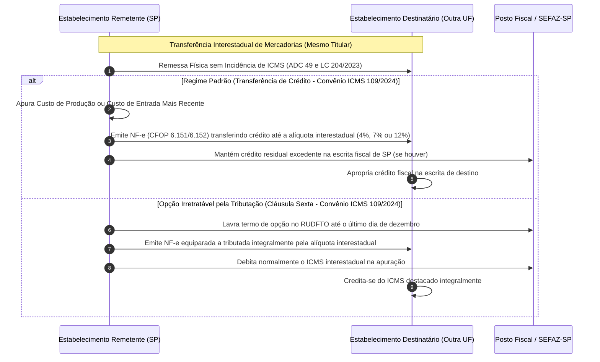
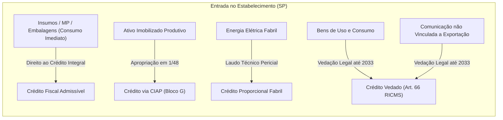
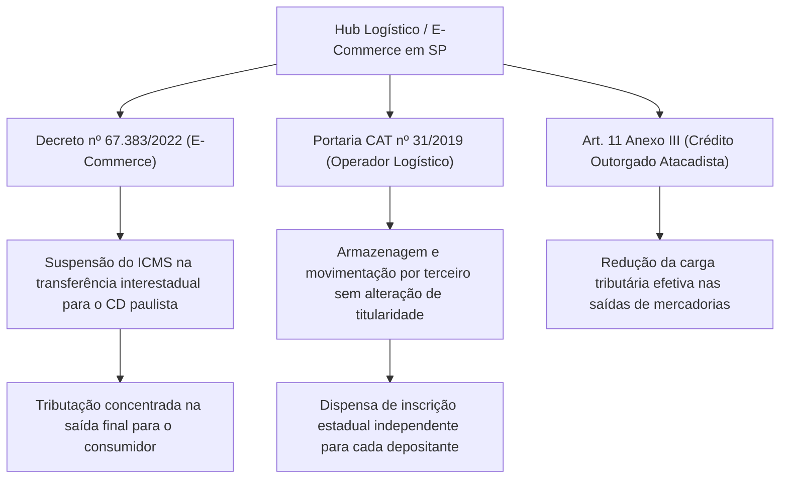
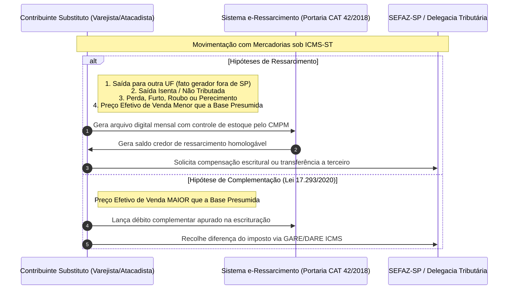
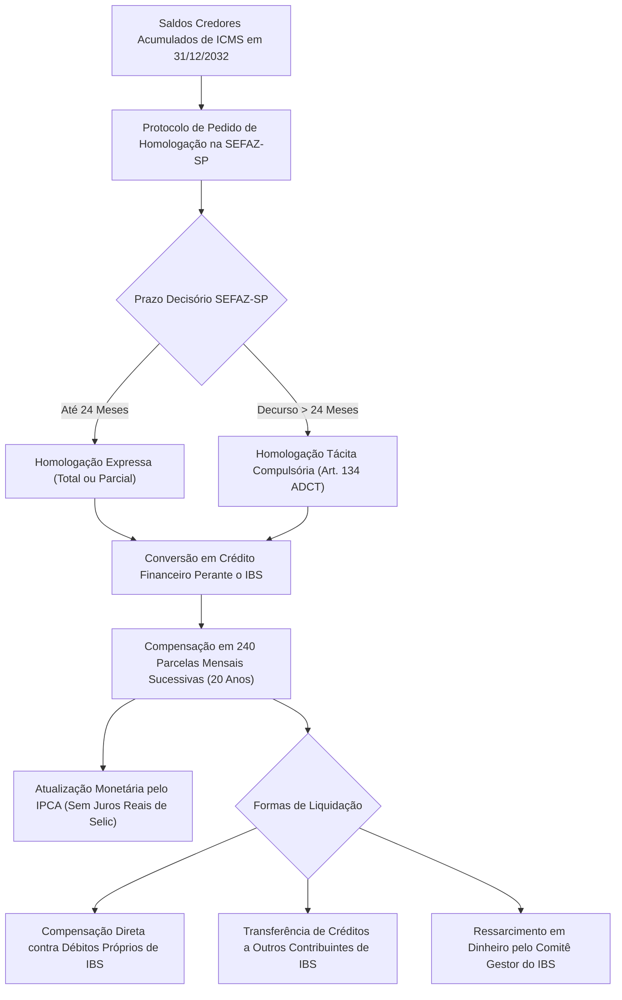

# Relatório de Auditoria Tributária Estadual: São Paulo (SP)

**Unidade Federativa:** São Paulo (SP)  
**Data da Auditoria:** 31 de outubro de 2026  
**Responsável:** Agente Especialista na Tributação do Estado de São Paulo  
**Status da Base Normativa Estadual:** Parcialmente Mapeada / Lacunas Críticas Identificadas  
**Documento de Destino:** `_auditoria/estados/auditoria_sp.md`

---

## Sumário Executivo

O Estado de São Paulo representa o maior polo industrial, financeiro, logístico e de consumo da América Latina, respondendo historicamente por aproximadamente um terço do Produto Interno Bruto (PIB) do Brasil e pela maior arrecadação individual de Imposto sobre Operações Relativas à Circulação de Mercadorias e sobre Prestações de Serviços de Transporte Interestadual e Intermunicipal e de Comunicação (ICMS).

Esta auditoria técnica visa a:
1. Analisar o inventário normativo do repositório `estaduais/sp/`, apontando as normas catalogadas e detalhando as normas estaduais ausentes indispensáveis à operação jurídica e fiscal;
2. Examinar minuciosamente a geometria interestadual do ICMS paulista no relacionamento com as demais 26 Unidades Federativas e o Distrito Federal (alíquotas, DIFAL, transferências não tributadas pós-ADC 49/LC 204 e regime de substituição tributária);
3. Delinear as regras de dedução e creditamento (não-cumulatividade, ativo imobilizado - CIAP, energia/comunicação e o complexo sistema e-CredAc de crédito acumulado);
4. Avaliar o regime tributário do setor agrícola e agroindustrial bandeirante (Convênio 100/97, diferimentos, créditos outorgados e NFP-e);
5. Analisar o complexo industrial paulista (créditos físicos/químicos, programas ProAtivo e IncentivAuto, incentivos a TICs e diferimento de bens de capital);
6. Investigar o setor de produto acabado, atacado, varejo, centros de distribuição e o contencioso de ressarcimento/complementação de ICMS-ST (Portaria CAT 42/2018);
7. Projetar os impactos econômicos e jurídicos da transição para o IBS/CBS sob a Emenda Constitucional nº 132/2023, a Lei Complementar nº 214/2025 e a Lei Complementar nº 227/2026, com foco na inversão da origem para o destino, na homologação do saldo credor acumulado de ICMS em 240 parcelas (art. 134 do ADCT) e no Fundo de Compensação de Benefícios Fiscais (FCBF).

---

## 1. Inventário do Repositório `estaduais/sp/` e Mapeamento de Lacunas Normativas

### 1.1. Diagnóstico do Acervo Existente

A inspeção física dos diretórios do repositório `estaduais/sp/` revelou a existência de apenas 3 (três) atos normativos estaduais:

| Arquivo no Repositório | Ato Normativo | Ementa Sumária | Limitações Detectadas |
| :--- | :--- | :--- | :--- |
| `estaduais/sp/ricms/decreto-45490-2000.md` | **Decreto Estadual nº 45.490/2000** | Regulamento do ICMS do Estado de São Paulo (RICMS/SP) | Contém apenas 89 linhas com excertos genéricos dos Títulos I a IV. Não abrange os Anexos I (Isenções), II (Reduções de Base), III (Créditos Outorgados), nem as centenas de regras de substituição tributária, fiscalização e penalidades. |
| `estaduais/sp/leis/ipva/lei-13296-2008.md` | **Lei Estadual nº 13.296/2008** | Lei Instituidora do IPVA em SP | Contém 82 linhas com excertos dos Capítulos I a III (fato gerador, contribuintes, base de cálculo e alíquotas). Faltam os capítulos de isenção, fiscalização, processo e infrações. |
| `estaduais/sp/leis/itcmd/lei-10705-2000.md` | **Lei Estadual nº 10.705/2000** | Lei Instituidora do ITCMD em SP | Contém 81 linhas com excertos dos Capítulos I a IV (incidência, territorialidade, isenções e sujeitos passivos). Faltam as disposições sobre base de cálculo arbitral, penalidades e contencioso. |

### 1.2. Mapeamento de Normas Críticas Ausentes no Repositório

Para conferir higidez técnico-jurídica à atuação profissional e consultiva, é imperativo catalogar e incorporar ao repositório as seguintes normas primárias e secundárias:

```mermaid
flowchart TD
    A["Legislação Tributária Paulista (SP)"] --> B["Normas Legais Primárias Faltantes"]
    A --> C["Regulamentos e Decretos Faltantes"]
    A --> D["Atos Infralegais (Portarias SRE/CAT)"]

    B --> B1["Lei Estadual nº 6.374/1989 (Matriz do ICMS/SP)"]
    B --> B2["Lei Estadual nº 10.941/2009 (Processo Administrativo Tributário - TIT/SP)"]
    B --> B3["Lei Estadual nº 17.293/2020 (Ajuste Fiscal e Complementação ST)"]
    B --> B4["Lei Estadual nº 17.470/2021 (DIFAL Consumidor Final / Base Dupla)"]
    B --> B5["Lei Estadual nº 16.006/2015 (FECOEP - Fundo de Pobreza)"]
    B --> B6["Lei Complementar nº 1.320/2018 (Programa Nos Conformes)"]

    C --> C1["Decreto nº 45.490/2000 Integral (RICMS/SP completo com Anexos I, II e III)"]
    C --> C2["Decreto nº 68.243/2023 (Recepção do Convênio ICMS 178/2023 - Transferências)"]
    C --> C3["Decreto nº 67.383/2022 (Regime Especial de E-commerce)"]
    C --> C4["Decreto nº 66.398/2021 (Programa ProAtivo de Investimentos)"]
    C --> C5["Decretos Convalidadores (LC 160/17 e Convênio ICMS 190/17)"]

    D --> D1["Portaria SRE nº 65/2023 (Regulamento Geral do e-CredAc)"]
    D --> D2["Portaria CAT nº 42/2018 (Ressarcimento e Complementação de ICMS-ST)"]
    D --> D3["Portaria CAT nº 25/2001 (Controle de CIAP)"]
    D --> D4["Portaria CAT nº 31/2019 (Operadores Logísticos)"]
```



#### Detalhamento das Normas Ausentes:
1. **Lei Estadual nº 6.374, de 1º de março de 1989**: É o diploma fundamental que institui o ICMS no Estado de São Paulo, editado sob a égide do art. 155, II da CF/88. Todas as tipificações de fato gerador, base de cálculo, alíquotas (art. 34), sujeição passiva por substituição (art. 8º) e o extenso catálogo sancionatório (art. 527 do RICMS/SP decorre do art. 85 da Lei 6.374/89) exigem referência estrita a este diploma. Qualquer autuação fiscal paulista sem este arrimo legal padece de nulidade formal.
2. **Lei Estadual nº 10.941, de 23 de dezembro de 2009**: Disciplina o Processo Administrativo Tributário (PAT) decorrente de Notificação de Lançamento e Auto de Infração e Imposição de Multa (AIIM). Estrutura o Tribunal de Impostos e Taxas (TIT/SP), rege os prazos processuais (30 dias para impugnação e recurso ordinário), os pressupostos de admissibilidade do Recurso Especial ao TIT (dissídio jurisprudencial notório entre Câmaras Julgadoras), as atribuições das Delegacias Tributárias de Julgamento (DTJs) e os efeitos das Súmulas Vinculantes do TIT.
3. **Lei Estadual nº 17.293, de 15 de outubro de 2020**: Conhecida como Lei do Ajuste Fiscal de SP, autorizou a renovação e redução de benefícios fiscais, instituiu o conceito de benefício como "tributação parcial" e previu a complementação do ICMS-ST quando a base efetiva for superior à presumida (art. 66-H da Lei 6.374/89).
4. **Lei Estadual nº 17.470, de 13 de dezembro de 2021**: Adequou a legislação paulista às diretrizes da Emenda Constitucional nº 87/2015 e do julgamento do Tema 1093 do STF (posteriormente consolidado na Lei Complementar Federal nº 190/2021), disciplinando a cobrança do DIFAL nas operações destinadas a consumidor final não contribuinte e instituindo a base de cálculo dupla para entradas interestaduais em SP.
5. **Portarias SRE e CAT Chave**:
   - *Portaria SRE nº 65/2023*: Revogou e consolidou as normas da antiga Portaria CAT nº 26/2010, disciplinando todo o processo eletrônico de geração, apropriação, utilização e transferência do crédito acumulado de ICMS (Sistema e-CredAc).
   - *Portaria CAT nº 42/2018*: Fixa o Sistema de Apuração do Ressarcimento ou Complementação do ICMS retido por substituição tributária ou pago por antecipação (Sistema e-Ressarcimento).
   - *Portaria CAT nº 25/2001*: Disciplina o modelo e a escrituração do CIAP (Controle de Crédito de ICMS do Ativo Permanente) em conjunto com o Bloco G da EFD-ICMS/IPI.

---

## 2. Relacionamento do ICMS-SP com os Demais 26 Estados e DF

A posição geográfica e industrial de São Paulo torna suas fronteiras tributárias o epicentro do fluxo mercantil brasileiro. A regulação dessas operações interestaduais envolve articulações complexas entre a competência estadual e as normas emanadas do Senado Federal e do CONFAZ.

```
+---------------------------------------------------------------------------------------------------------+
|                                    GEOMETRIA INTERESTADUAL DO ICMS/SP                                    |
+---------------------------------------------------------------------------------------------------------+
|  SAÍDAS DE SÃO PAULO                                                                                    |
|  - Destino: Norte, Nordeste, Centro-Oeste e ES ---------> Alíquota: 7% (Res. SF 22/89)                  |
|  - Destino: Sul e Sudeste (exceto ES) ------------------> Alíquota: 12% (Res. SF 22/89)                 |
|  - Bens Importados / Conteúdo Importação > 40% ---------> Alíquota: 4% (Res. SF 13/12 / Convênio 38/13)  |
+---------------------------------------------------------------------------------------------------------+
|  ENTRADAS EM SÃO PAULO                                                                                  |
|  - Procedência: Qualquer UF do território nacional -----> Alíquota destacada: 12% ou 4% (se importado)  |
|  - Diferencial de Alíquotas (Uso, Consumo ou Ativo) ----> Exigência de Base Dupla (Lei 17.470/2021)    |
|  - Inexistência de Protocolo ST ------------------------> Antecipação Tributária (Art. 426-A RICMS/SP) |
+---------------------------------------------------------------------------------------------------------+
```

### 2.1. Alíquotas Interestaduais Aplicáveis

Em observância ao art. 155, § 2º, IV da Constituição Federal e às resoluções do Senado Federal:
1. **Saídas de SP com destino a estabelecimentos nas Regiões Norte, Nordeste, Centro-Oeste e ao Estado do Espírito Santo**: Alíquota de **7%** (Resolução do Senado Federal nº 22/1989).
2. **Saídas de SP com destino a estabelecimentos nas Regiões Sul e Sudeste (Minas Gerais, Rio de Janeiro, Paraná, Santa Catarina e Rio Grande do Sul, exceto ES)**: Alíquota de **12%** (Resolução do Senado Federal nº 22/1989).
3. **Bens e Mercadorias Importados do Exterior**: Alíquota interestadual uniforme de **4%** (Resolução do Senado Federal nº 13/2012 e Convênio ICMS nº 38/2013), aplicável em operações interestaduais com:
   - Bens e mercadorias que, após o desembaraço aduaneiro, não tenham sido submetidos a processo de industrialização;
   - Bens e mercadorias submetidos a processo de transformação, beneficiamento, montagem ou acondicionamento, cujo Conteúdo de Importação seja **superior a 40%**, apurado nos termos da Ficha de Conteúdo de Importação (FCI).
   - *Exceções à Alíquota de 4%*: Produtos sem similar nacional constantes de lista CAMEX; gás natural importado; mercadorias produzidas em conformidade com os Processos Produtivos Básicos (PPB) da Zona Franca de Manaus e áreas de livre comércio.
4. **Entradas no Estado de SP procedentes de outras UFs**:
   - Procedentes de qualquer outra Unidade da Federação: A alíquota interestadual de origem que onera a entrada em SP é de **12%** (ou **4%** se importada).

### 2.2. Diferencial de Alíquotas (DIFAL)

O DIFAL no Estado de São Paulo apresenta cisão estrutural entre operações destinadas a contribuintes e não contribuintes do imposto.

#### A) DIFAL Não Contribuinte (EC 87/2015, LC 190/2021 e Lei Estadual nº 17.470/2021)
- **Hipótese de Incidência**: Venda de bens ou prestação de serviços iniciada em outra UF e destinada a consumidor final não contribuinte do ICMS localizado em São Paulo.
- **Sujeito Passivo**: O remetente estabelecido em outra UF, na qualidade de contribuinte substituto. Deve recolher o DIFAL via GNRE operação a operação ou obter inscrição estadual como Substituto Tributário no CADESP paulista para apuração e recolhimento mensal.
- **Base de Cálculo (Base Única com Integração Interna)**:
  Nos termos do art. 2º, § 5º da Lei nº 6.374/1989 (com a redação dada pela Lei nº 17.470/2021):
  $$\text{Valor da Operação} = \frac{V_{\text{sem ICMS}}}{(1 - \text{Alíquota Interna SP})}$$
  O imposto a recolher a SP corresponde à aplicação da alíquota interna paulista (18% modal, ou alíquotas seletivas de 12% ou 25%, acrescida de até 2% do FECOEP nos produtos elegíveis) sobre a base única, deduzido o ICMS de origem calculado pela alíquota interestadual (4%, 7% ou 12%).

#### B) DIFAL Contribuinte (Entradas para Uso, Consumo ou Ativo Imobilizado) - Metodologia de Base Dupla
Com a promulgação da Lei nº 17.470/2021, São Paulo abandonou a base simples e instituiu o cálculo do DIFAL com **Base Dupla** (arts. 49 e 117 do RICMS/SP):

$$\text{Valor Excluído} = V_{\text{total operação}} - \text{ICMS Origem}$$

$$\text{Base de Cálculo Destino (SP)} = \frac{\text{Valor Excluído}}{(1 - \text{Alíquota Interna SP})}$$

$$\text{ICMS Total SP} = \text{Base de Cálculo Destino (SP)} \times \text{Alíquota Interna SP}$$

$$\text{DIFAL a Recolher a SP} = \text{ICMS Total SP} - \text{ICMS Origem Destacado}$$

> **Exemplo Prático Numérico de Base Dupla:**  
> - Aquisição interestadual de bem para ativo imobilizado por R$ 100.000,00 vindo de Minas Gerais (alíquota interestadual de 12%).  
> - ICMS Origem destacado: R$ 12.000,00.  
> - Alíquota interna em SP: 18%.  
> 1. Exclusão do ICMS de origem da operação: $100.000 - 12.000 = \text{R\$\ } 88.000,00$.  
> 2. Formação da Base de Cálculo paulista ('por dentro'): $\frac{88.000}{1 - 0,18} = \frac{88.000}{0,82} = \text{R\$\ } 107.317,07$.  
> 3. Débito total paulista: $107.317,07 \times 18\% = \text{R\$\ } 19.317,07$.  
> 4. DIFAL devido a SP: $19.317,07 - 12.000,00 = \mathbf{\text{R\$\ } 7.317,07}$.  
> *(Pelo cálculo antigo de base simples seria $100.000 \times (18\% - 12\%) = \text{R\$\ } 6.000,00$. O acréscimo de arrecadação representa um ônus adicional de 21,95% sobre o imposto devido).*

- **Empresas do Simples Nacional**: O art. 115, XV-A do RICMS/SP prevê a exigência da antecipação da diferença entre a alíquota interna e a interestadual nas entradas de mercadorias para industrialização ou revenda, cuja validade constitucional foi chancelada pelo STF no **Tema 517 da Repercussão Geral (RE 970.821)**.

### 2.3. Transferências entre Estabelecimentos da Mesma Empresa (ADC 49/STF, LC 204/2023, Convênios ICMS 178/2023 e 109/2024 e Decreto SP nº 68.243/2023)

O encerramento do julgamento da Ação Declaratória de Constitucionalidade nº 49 (ADC 49) pelo Supremo Tribunal Federal fixou a tese de que a mera circulação física de bens entre estabelecimentos da mesma pessoa jurídica (matriz e filiais) não constitui fato gerador do ICMS.



1. **Recepção Paulista e Marco Temporal**: O Estado de São Paulo editou o Decreto nº 68.243, de 22 de dezembro de 2023, incorporando o Convênio ICMS nº 178/2023 ao RICMS/SP. Posteriormente, em 2024, o CONFAZ revogou o Convênio 178/23 e publicou o **Convênio ICMS nº 109/2024**, conferindo disciplina unificada e permanente à matéria.
2. **Sistemática Padrão de Transferência de Crédito**:
   - A operação de saída física de bens é não tributada (CFOP `6.151` ou `6.152` para interestaduais, `5.151` ou `5.152` para internas; CST `090` ou `041`).
   - O remetente fica **obrigado a transferir o crédito** vinculado à operação para o estabelecimento de destino. O valor do crédito a ser transferido é limitado à aplicação da alíquota interestadual cabível (4%, 7% ou 12%) sobre:
     - O valor da entrada mais recente da mercadoria;
     - O custo da mercadoria produzida (matéria-prima, insumos, mão de obra e custos diretos);
     - O preço corrente da mercadoria no mercado atacadista do estabelecimento remetente (na hipótese de mercadorias não industrializadas).
   - O saldo de crédito remanescente no estabelecimento remetente em SP (decorrente, por exemplo, de entradas anteriores tributadas a 18%) **não sofre estorno**, permanecendo acumulado em sua escrita fiscal ordinária.
3. **Opção Irretratável de Equiparação a Operação Tributada (Convênio ICMS 109/2024)**:
   - Os contribuintes paulistas que preferirem manter a apuração clássica com débito e crédito podem exercer opção anual irretratável por estabelecimento, lavrando termo no Livro Registro de Utilização de Documentos Fiscais e Termos de Ocorrências (RUDFTO) até o último dia útil de dezembro, com eficácia para todo o ano-calendário subsequente.
   - Exercida a opção, a saída interestadual entre filiais é tratada como regularmente tributada pelas alíquotas interestaduais de 4%, 7% ou 12%, afastando as complexidades de rateio de custo unitário de produção.

### 2.4. ICMS-ST e Protocolos Interestaduais Celebrados por SP (Convênio ICMS 142/2018)

São Paulo aplica de forma massiva a sistemática da Substituição Tributária progressiva (para a frente), com base nos arts. 8º da Lei 6.374/89 e arts. 268 a 313-Z20 do RICMS/SP, disciplinados pelo Convênio ICMS nº 142/2018.

- **Conflito de Protocolos e Política Fiscal Paulista**: Historicamente, São Paulo denunciou diversos Protocolos ICMS interestaduais (ex.: protocolos com o setor de cosméticos, produtos alimentícios e autopeças celebrados com estados do Sul e Nordeste) para repelir distorções concorrenciais e fechar seu mercado contra planejamentos tributários baseados em incentivos ilegais concedidos por outras UFs.
- **Aplicação do Art. 426-A do RICMS/SP (Antecipação Tributária na Entrada)**:
  Na ausência de Protocolo ou Convênio ICMS firmado entre SP e o Estado de origem da mercadoria, **o estabelecimento paulista destinatário é obrigado a recolher o imposto por antecipação tributária** no momento da entrada da mercadoria em território paulista (ou até o 15º dia do mês subsequente, se gozar de Regime Especial de Dilação de Prazo).
- **Cálculo da MVA Ajustada (Margem de Valor Agregado)**:
  Quando a mercadoria oriunda de outro Estado entra tributada pela alíquota interestadual (4% ou 12%) e a alíquota interna paulista for de 18% ou superior, a MVA-ST deve ser ajustada para igualar o encargo final:

$$\text{MVA Ajustada} = \left[ \frac{(1 + \text{MVA Original}) \times (1 - \text{ALQ Inter})}{(1 - \text{ALQ Intra})} \right] - 1$$

- **Exceção de Remetente Optante pelo Simples Nacional (Convênio ICMS 35/2011)**:
  Caso a remessa interestadual para contribuinte paulista seja efetuada por remetente enquadrado no Simples Nacional, **veda-se a aplicação da MVA Ajustada**, aplicando-se estritamente a **MVA Original** prevista nas portarias da SEFAZ/SP.

---

## 3. Mecanismos de Dedução e Tomada de Crédito

### 3.1. Não-Cumulatividade no RICMS/SP (arts. 59 a 68)

O princípio constitucional da não-cumulatividade tem seus limites traçados de forma rígida pela Secretaria da Fazenda e Planejamento de São Paulo (SEFAZ/SP).



1. **Requisitos Materiais e Formais (art. 59 e 61)**:
   - Para que o valor destacado na NF-e gere direito a crédito fiscal em SP, a operação antecedente deve ter sido legitimamente tributada, a mercadoria deve ter entrado fisicamente no estabelecimento e o documento fiscal deve preencher todas as formalidades regulamentares.
   - **Glosa de Créditos de Fornecedores Inidôneos (Art. 59, § 3º)**: Operações com fornecedores cuja inscrição estadual venha a ser declarada nula ou cassada no CADESP geram auto de infração com glosa de crédito e multa punitiva de 50% a 100%, exigindo do contribuinte a comprovação cumulativa da veracidade da operação, do pagamento bancário e do transporte físico da carga (Súmula 509 do STJ).
2. **Vedações Expressas ao Crédito (art. 66)**:
   - Entrada de bens destinados a integração ao ativo imobilizado ou insumos vinculados a saídas de mercadorias isentas ou não tributadas pelo imposto;
   - Aquisições de bens para uso ou consumo do estabelecimento (prorrogado para 2033 pela LC 87/96, atualizada pela LC 204/23);
   - Serviços de transporte contratados sob cláusula CIF ou serviços de transporte vinculados a operações isentas/não tributadas sem manutenção expressa.
3. **Estorno de Crédito Obrigatório (art. 67)**:
   - Mercadorias que vierem a perecer, deteriorar-se, ser objeto de furto, roubo ou extravio, ou que forem empregadas na fabricação de produtos cuja saída final resulte isenta ou não tributada.
   - Procedimento fiscal paulista: emissão de Nota Fiscal de baixa de estoque e estorno a débito na apuração da EFD-ICMS/IPI.
4. **Manutenção de Crédito Assegurada**:
   - Saídas de mercadorias destinadas à exportação direta ou indireta (art. 3º, II e art. 68 do RICMS/SP c/c art. 155, § 2º, X, 'a' da CF/88);
   - Remessas de papel imune destinado à impressão de livros, jornais e periódicos (art. 150, VI, 'd' da CF/88 e Súmula Vinculante nº 57 do STF);
   - Hipóteses com cláusula expressa de "sem estorno de crédito" em convênio do CONFAZ ou no Anexo II do RICMS/SP.

### 3.2. CIAP - Controle de Crédito do Ativo Permanente (Portaria CAT nº 25/2001 e art. 61, § 10)

A apropriação dos créditos decorrentes da entrada de bens destinados ao ativo imobilizado industrial segue as balizas da Lei Complementar nº 102/2000, regulamentada em SP pela **Portaria CAT nº 25/2001**:

1. **Fração Temporal de Apropriação**:
   O crédito total destacado no documento fiscal de aquisição do ativo é fracionado à razão de **1/48 (um quarenta e oito avos) por mês**, iniciando-se no mês em que ocorrer a efetiva entrada em operação do bem no processo produtivo.
2. **Fator de Proporcionalidade das Saídas Tributadas ($F$)**:
   A apropriação mensal é modulada pela relação percentual entre o somatório das saídas e prestações tributadas (acrescidas das saídas para o exterior) e o total geral de saídas e prestações promovidas no período:

$$F = \frac{\sum \text{Saídas e Prestações Tributadas} + \sum \text{Exportações para o Exterior}}{\sum \text{Total Geral das Saídas e Prestações}}$$

$$\text{Parcela CIAP Apropriável no Mês} = \left( \frac{\text{ICMS Total do Bem}}{48} \right) \times F$$

3. **Escrituração Fiscal e Modelos**:
   - A escrituração formal é obrigatória por meio do **Bloco G da EFD-ICMS/IPI**, identificando item a item o código individual do ativo imobilizado, a chave da NF-e de aquisição, a taxa de depreciação e o histórico de parcelas remanescentes.
   - O saldo não aproveitado no mês por força de saídas isentas não se transfere para meses seguintes, sendo definitivamente extinto.
4. **Desincorporação e Alienação Antecipada**:
   - Se o bem for alienado ou baixado antes do decurso do prazo de 48 meses, cessará imediatamente o direito às parcelas remanescentes a partir da data da alienação. Não há retroatividade para exigir o estorno das parcelas regularmente apropriadas nos meses anteriores.
5. **Decisão Normativa CAT nº 01/2001 (Restrição aos Bens Produtivos)**:
   A SEFAZ/SP veda peremptoriamente a tomada de crédito sobre bens do ativo imobilizado que não atuem de modo instrumental, direto e indispensável na linha de transformação industrial ou circulação de mercadorias (ex.: mobiliário de escritório administrativo, frotas de veículos leves para gerência e equipamentos de ar-condicionado de setores administrativos têm crédito sumariamente glosado).

### 3.3. Restrições para Energia Elétrica e Comunicações (LC 87/96, art. 33)

Em linha com o art. 33 da Lei Kandir e o art. 61 do RICMS/SP:

1. **Energia Elétrica**:
   Apenas gera direito a crédito do ICMS incidente sobre o seu fornecimento quando:
   - For objeto de operação de subsequente saída de energia (geradoras e comercializadoras);
   - For consumida em processo de industrialização;
   - For consumida em estabelecimento que realize operações de saída de mercadorias para o exterior, na proporção destas sobre as saídas totais.
   - **Exigência de Laudo Técnico Pericial em SP**: Para os estabelecimentos industriais com apuração mista (área fabril e área administrativa conectadas ao mesmo medidor de tensão), a SEFAZ/SP condiciona o creditamento à existência de **Laudo Técnico Pericial de Engenharia Elétrica**, emitido por profissional habilitado no CREA/SP, renovável periodicamente, que quantifique a fração de consumo elétrico estritamente atribuível às máquinas industriais e linhas de produção. O creditamento de energia sem laudo hábil enseja lavratura de AIIM por creditamento indevido.
2. **Serviços de Comunicação**:
   A apropriação de crédito sobre serviços de telefonia, links de internet e transmissão de dados somente é admitida se:
   - O contribuinte for prestador de serviços de comunicação de mesma natureza;
   - O contribuinte utilizar os serviços diretamente em operações que destinem mercadorias ao exterior, proporcionalmente às saídas internacionais.
   - Todas as demais utilizações são legalmente equiparadas a despesas operacionais/uso e consumo, cujo creditamento permanece diferido para 2033.

### 3.4. Crédito Acumulado de ICMS (e-CredAc / Portaria SRE nº 65/2023)

O acúmulo financeiro de saldo credor de ICMS é uma das principais patologias tributárias em São Paulo, decorrente de sua vocação exportadora e de saídas interestaduais desoneradas ou com alíquotas reduzidas.

```mermaid
flowchart TD
    CA["Geração do Crédito Acumulado (Art. 71 RICMS/SP)"] --> CA1["Alíquotas Diversificadas (Entrada 18% / Saída 7% ou 12%)"]
    CA --> CA2["Redução de Base com Manutenção Integral de Crédito"]
    CA --> CA3["Exportação Direta ou Indireta (Não Incidência Constitucional)"]

    CA1 & CA2 & CA3 --> AP["Geração e Apuração via e-CredAc (Portaria SRE 65/2023)"]
    
    AP --> METODOS{"Regime de Custeio"}
    METODOS -->|Simplificado| M_SIMP["Portaria CAT 83/2009 (Margens Pré-Fixadas)"]
    METODOS -->|Custeio Real| M_CUST["Custo das Mercadorias Vendidas (CMV Ficha Técnica)"]

    M_SIMP & M_CUST --> PEDIDO["Protocolo de Apropriação na Delegacia Regional Tributária (DRT)"]
    
    PEDIDO --> HOMOLOGACAO{"Via de Liberação"}
    HOMOLOGACAO -->|Ordinária| FISC["Auditoria Fiscal Prévia (Fila de 12 a 36 meses)"]
    HOMOLOGACAO -->|Acelerada (Garantia)| FIAN["Seguro Garantia / Fiança Bancária (Liberação Imediata)"]
    HOMOLOGACAO -->|Acelerada (Nos Conformes)| CONF["Rating A+ / A (LC 1.320/2018 - Liberação sem Garantia)"]

    FISC & FIAN & CONF --> CC["Disponibilização em Conta Corrente Fiscal e-CredAc"]

    CC --> UTIL["Destinações Autorizadas"]
    UTIL --> U1["Compensação com Débito Próprio de ICMS"]
    UTIL --> U2["Transferência para Estabelecimentos da Mesma Empresa em SP"]
    UTIL --> U3["Pagamento a Fornecedores de Insumos, Matérias-Primas e Embalagens em SP"]
    UTIL --> U4["Aquisição de Bens do Ativo Permanente Fabricados em SP"]
    UTIL --> U5["Transferência entre Empresas Não Interdependentes (Anuência SEFAZ)"]
```

1. **Hipóteses Geradoras de Crédito Acumulado (Art. 71 do RICMS/SP)**:
   - I — Aplicação de alíquotas diversificadas em operações de entrada e saída (ex.: compra de insumos a 18% e venda de produtos finais a 7% ou 12%);
   - II — Operações de saída com redução de base de cálculo com manutenção assegurada de crédito;
   - III — Saídas amparadas pela não incidência em razão de exportação para o exterior.
2. **Sistema e-CredAc e Métodos de Apuração (Portaria SRE nº 65/2023)**:
   - *Custeio Real*: Exige o levantamento do Custo das Mercadorias Vendidas (CMV) item a item, correlacionando a ficha técnica dos produtos fabricados, o consumo efetivo de matéria-prima e os estoques de abertura e fechamento;
   - *Apuração Simplificada*: Aplicável a contribuintes autorizados, utilizando percentuais médios pré-fixados de apropriação.
3. **Mecanismos de Liberação Acelerada**:
   - Tradicionalmente, o pedido de apropriação enfrentava morosidade de até três anos para homologação pelas Delegacias Regionais Tributárias (DRTs).
   - O Programa "Nos Conformes" (Lei Complementar Estadual nº 1.320/2018) instituiu a classificação de contribuintes por risco fiscal (ratings A+, A, B, C, D e E). Contribuintes classificados nos perfis A+ e A têm direito à apropriação prévia e simplificada do crédito acumulado, com dispensa de garantia.
   - Contribuintes de outros ratings podem obter liberação antecipada mediante apresentação de Carta de Fiança Bancária ou Seguro Garantia, correspondente ao montante pleiteado.
4. **Transferências de Crédito Acumulado Permitidas (Art. 73 a 84 do RICMS/SP)**:
   - Entre estabelecimentos do mesmo titular localizados no Estado de São Paulo;
   - Para estabelecimentos industriais fornecedores de matérias-primas, produtos intermediários ou materiais de embalagem localizados em SP;
   - Para fornecedores de bens destinados ao ativo imobilizado fabricados em território paulista;
   - Entre empresas não interdependentes (operação no mercado secundário com deságio financeiro de 15% a 30%), condicionada à autorização expressa do Secretário da Fazenda e Planejamento.

---

## 4. Setor Agrícola e Rural Paulista

O agronegócio paulista lidera os setores de cana-de-açúcar/etanol/açúcar, citricultura, papel e celulose, avicultura, pecuária de corte e hortifrutigranjeiros, contando com disciplina tributária estruturada em diferimentos e regimes especiais.

```
+------------------------------------------------------------------------------------------------------+
|                                   ARQUITETURA DO AGRO PAULISTA                                       |
+------------------------------------------------------------------------------------------------------+
|  INSUMOS AGROPECUÁRIOS                                                                               |
|  - Convênio ICMS 100/97 (Anexos I e II do RICMS/SP)                                                  |
|  - Isenção interna nas saídas de fertilizantes, adubos e sementes selecionadas                       |
|  - Tributação interestadual escalonada (1% a 4% sob os Convênios 26/2021 e 129/2024)                 |
+------------------------------------------------------------------------------------------------------+
|  PRODUÇÃO PRIMÁRIA E SAÍDAS                                                                         |
|  - Diferimento Total (Arts. 340 a 354 do RICMS/SP)                                                   |
|  - Cana-de-açúcar, grãos, gado em pé, leite cru e madeira: imposto diferido para a indústria        |
|  - Obrigatoriedade da NFP-e (Modelo 55): extinção definitiva dos blocos manuais de papel             |
+------------------------------------------------------------------------------------------------------+
|  TRANSFORMAÇÃO AGROINDUSTRIAL                                                                        |
|  - Crédito Outorgado Sucroenergético (Art. 40 do Anexo III)                                          |
|  - Carga reduzida para carnes e subprodutos de abatedouros                                           |
|  - Regime de exportação para Polo Citrícola (Suco FCOJ e NFC)                                        |
+------------------------------------------------------------------------------------------------------+
```

### 4.1. Convênio ICMS 100/97 no RICMS/SP (Insumos Agropecuários)

O Convênio ICMS nº 100/1997 é o pilar de desoneração dos fatores de produção agrícola:
- **Isenções no Anexo I do RICMS/SP**: Art. 41 do Anexo I prevê a isenção do ICMS nas operações internas com defensivos agrícolas, adubos simples e compostos, fertilizantes, calcário, sementes certificadas, rações balanceadas e concentrados para alimentação animal.
- **Reduções de Base de Cálculo no Anexo II (Arts. 9º e 10)**: Aplicáveis às operações interestaduais e saídas internas tributadas, com manutenção assegurada de crédito.
- **Mudanças Introduzidas pelos Convênios ICMS nº 26/2021 e 129/2024**:
  - Encerraram a desoneração integral linear sobre fertilizantes e adubos, implementando cronograma de tributação progressiva nas importações e saídas interestaduais com alíquotas efetivas de **1%, 2%, 3% e 4%**, aplicadas mediante redução proporcional da base de cálculo.

### 4.2. Diferimento do ICMS na Saída de Produtor Rural (Arts. 340 e seguintes)

Para neutralizar a cumulatividade no campo e evitar a cobrança tributária de pessoas físicas rurais desprovidas de estrutura contábil, o RICMS/SP aplica o diferimento generalizado:
- **Produtos Abrangidos**: Cana-de-açúcar em colmo (art. 345), milho e soja em grãos (art. 350), café cru em coco ou em grão (art. 333), gado bovino e suíno em pé (art. 364), leite cru resfriado (art. 358) e madeira bruta reflorestada.
- **Mecânica do Diferimento**: O lançamento e o recolhimento do ICMS incidente sobre a saída do imóvel rural ficam postergados para o momento em que ocorrer:
  - A saída subsequente para outro Estado ou para o exterior promovida pelo adquirente;
  - A saída dos produtos resultantes de sua industrialização (usina de açúcar e etanol, frigorífico/abatedouro, indústria de torrefação, fecularia);
  - A perda, perecimento ou consumo no próprio estabelecimento adquirente.
- **Interrupção do Diferimento**: Caso a mercadoria diferida seja alienada a consumidor final ou a estabelecimento não inscrito, encerra-se o diferimento, cabendo ao remetente o recolhimento imediato do imposto incidente.

### 4.3. Créditos Outorgados para o Agronegócio e Agroindústria Paulista (Anexo III)

O Governo de São Paulo estabelece benefícios unilaterais expressos na forma de crédito presumido/outorgado para equalizar a competitividade em face de outros estados produtores:
1. **Setor Sucroenergético (Etanol e Açúcar)**:
   - O art. 40 do Anexo III e normas complementares outorgam crédito presumido aos fabricantes paulistas de etanol hidratado combustível (EHC), conferindo crédito que neutraliza parte do débito gerado nas saídas internas e interestaduais, assegurando sobrevivência concorrencial perante o Centro-Oeste.
2. **Frigoríficos e Abatedouros (Carnes Bovina, Suína e Aves)**:
   - Art. 40 do Anexo III prevê opção de crédito outorgado em montante que resulte em carga tributária líquida efetiva de **0,1% a 7%** nas saídas de carnes e produtos comestíveis de abate, em substituição ao aproveitamento de quaisquer outros créditos decorrentes da entrada de energia, água e embalagens.
3. **Polo Citrícola**:
   - Tratamento simplificado com diferimento na compra da laranja in natura e regimes de manutenção integral de créditos e estorno mitigado nas exportações em grande escala de Suco de Laranja Congelado Concentrado (FCOJ) e Não Concentrado (NFC).

### 4.4. NFP-e e Regime Simplificado do Produtor Rural em SP

- **Obrigatoriedade da NFP-e (Modelo 55)**:
  - Extinção compulsória da antiga Nota Fiscal de Produtor em talão de papel (Modelo 4). Os produtores rurais paulistas estão obrigados à emissão privativa da Nota Fiscal Avulsa Eletrônica ou Nota Fiscal Eletrônica de Produtor Rural (NFP-e - modelo 55) com certificação digital.
- **Inscrição no CADESP Rural**:
  - O produtor pessoa física não é obrigado a se registrar na Junta Comercial (JUCESP) como sociedade empresária; obtém Inscrição Estadual individual atrelada ao seu CPF e ao número do imóvel rural no INCRA/CAR.
- **Aproveitamento de Créditos pelos Produtores Rurais**:
  - O produtor rural paulista que adquire insumos, defensivos, tratores e combustíveis com imposto destacado não pode, em regra, abater créditos na saída com diferimento total.
  - A legislação de SP (arts. 70-A e seguintes do RICMS/SP e Portaria CAT 153/2011) autoriza o produtor rural credenciado a transferir os créditos acumulados de ICMS decorrentes de suas aquisições para os estabelecimentos industriais adquirentes de sua produção diferida (usinas e cooperativas), viabilizando a monetização dos insumos.

---

## 5. Setor Industrial Paulista

A indústria de transformação em São Paulo é a mais verticalizada do país, abrangendo os setores metalmecânico, automotivo, aeroespacial, farmacêutico, químico, petroquímico e de tecnologia da informação.

### 5.1. Tomada de Crédito sobre Insumos, Matérias-Primas e Embalagens

A tomada de crédito industrial em São Paulo submete-se ao critério estrito da **integração física ou consumo direto e imediato**:

```
+--------------------------------------------------------------------------------------------------+
|                            REGIME DE TOMADA DE CRÉDITO INDUSTRIAL EM SP                          |
+--------------------------------------------------------------------------------------------------+
|  CONDIÇÃO ESSENCIAL: DECISÃO NORMATIVA CAT Nº 01/2001                                            |
|  - Matérias-Primas que se incorporam fisicamente ao produto final (Gera Crédito Integral)        |
|  - Materiais de Embalagem utilizados no acondicionamento primário/transporte (Gera Crédito)      |
|  - Produtos Intermediários consumidos diretamente no ciclo produtivo (Gera Crédito)              |
+--------------------------------------------------------------------------------------------------+
|  LIMITES DA GLOSA FISCAL (JURISPRUDÊNCIA TIT/SP)                                                 |
|  - Desgaste por Atrito: Brocas, matrizes, moldes e rebolos: crédito admitido se o desgaste for   |
|    imediato e integral na fabricação (vida útil inferior a 12 meses e consumo na transformação) |
|  - Peças de Reposição e Manutenção Preventiva: Vedado o crédito imediato (Ativo ou Uso/Consumo)   |
|  - Equipamentos de Proteção Individual (EPI): Não geram crédito (considerados despesa operacional)|
|  - Combustíveis de Empilhadeiras: Admitido apenas se operarem dentro da linha fabril             |
+--------------------------------------------------------------------------------------------------+
```

### 5.2. Programas de Incentivo e Desenvolvimento Industrial Paulistas

A despeito das amarras da Guerra Fiscal e dos limites do CONFAZ, São Paulo desenvolveu programas industriais de grande relevância:

#### A) Programa ProAtivo (Decreto Estadual nº 66.398/2021 e alterações)
- Mecanismo que autoriza a apropriação e utilização parcelada de créditos acumulados de ICMS para empresas industriais que realizarem investimentos em novas plantas produtivas, modernização tecnológica ou ampliação fabril em território paulista, com aportes mínimos escalonados e metas de geração de empregos.

#### B) Setor Automotivo - Programa IncentivAuto (Decreto nº 64.130/2019 e alterações)
- Programa de apoio a montadoras e sistemistas instalados em SP, concedendo abatimento de até **25% no ICMS devido** em função do volume de investimentos novos (mínimo de R$ 1 bilhão a R$ 5 bilhões) voltados à modernização de plataformas veiculares, eletrificação (veículos híbridos e elétricos) e descarbonização da mobilidade urbana.

#### C) Polo Aeroespacial (São José dos Campos e Região do Vale do Paraíba)
- Alinhado ao Convênio ICMS nº 75/1991 e art. 30 do Anexo I e Anexo III do RICMS/SP: isenção e desoneração ampla em partes, peças, matérias-primas e equipamentos destinados à fabricação, manutenção e reparo de aeronaves militares e civis, subsistemas espaciais e tecnologia de defesa, consolidando a cadeia produtiva da EMBRAER e de seus fornecedores de primeiro nível.

#### D) Indústria de Informática, Eletrônicos e TICs (Arts. 26 e seguintes do Anexo III)
- Concede crédito outorgado que reduz a carga tributária líquida para **7% ou 12%** nas saídas internas e interestaduais de produtos de informática, telecomunicações e automação fabricados no Estado em consonância com o Processo Produtivo Básico (PPB) da Lei Federal de Informática.

### 5.3. Diferimento do ICMS na Importação de Bens de Capital sem Similar Paulista

Para incentivar a modernização fabril sem exportar divisas tributárias internas, o Estado de São Paulo confere regime especial de diferimento na importação de máquinas industriais:
- **Base Legal**: Decreto Estadual nº 51.310/2006, Decreto nº 52.587/2007 e art. 29 das Disposições Transitórias (DDTT) do RICMS/SP.
- **Requisitos Operacionais**:
  1. A importação deve ser realizada diretamente pelo estabelecimento fabricante industrial para integrar seu ativo imobilizado fixo;
  2. O desembaraço aduaneiro deve ocorrer em território paulista (portos de Santos/São Sebastião ou aeroportos de Viracopos/Guarulhos);
  3. Ausência de produto similar produzido em território paulista, demonstrada mediante atestado ou laudo emitido pela Federação das Indústrias do Estado de São Paulo (FIESP) ou órgão homologador competente.
- **Mecânica Fiscal**: O recolhimento do ICMS devido na importação fica suspenso e diferido para o momento da futura alienação ou é considerado amortizado proporcionalmente pelas subsequentes saídas de produtos acabados tributados resultantes do parque fabril instalado.

---

## 6. Setor de Produto Acabado (Atacado, Varejo e Distribuição)

São Paulo concentra a maior rede logística do país, abrangendo operadores atacadistas e centros de distribuição estratégicos localizados ao longo do Rodoanel Mário Covas e das rodovias Anhanguera, Bandeirantes, Castelo Branco e Dutra.

### 6.1. Metodologia de MVA / IVA-ST e Pautas Fiscais da SEFAZ/SP

Para fixar as margens de valor agregado da substituição tributária, a Secretaria da Fazenda e Planejamento de São Paulo observa os arts. 28-A, 28-B e 28-C da Lei Estadual nº 6.374/1989:
1. **Pesquisa Amostral de Preços**: A SEFAZ/SP celebra convênios com institutos de pesquisa econômica independentes (com destaque histórico para a Fundação Instituto de Pesquisas Econômicas - FIPE) para realizar levantamentos sistemáticos dos preços reais à vista praticados no mercado varejista consumidor em todas as regiões do Estado.
2. **Edição de Portarias SRE Periódicas**: As MVAs originais são publicadas mediante Portarias SRE/CAT setoriais (ex.: medicamentos, produtos de limpeza, autopeças, cosméticos, materiais de construção), com vigência média de 1 a 2 anos.
3. **Pauta Fiscal / PMPF (Preço Médio Ponderado a Consumidor Final)**: Aplicada a setores com elevada homogeneidade e pulverização de consumo, como bebidas (cervejas, refrigerantes, águas minerais e energéticos) e cigarros. Nessas hipóteses, o imposto da ST não é calculado mediante aplicação de percentual de margem sobre o valor da nota de saída fabril, mas sim pela multiplicação da alíquota interna sobre o valor fixo unitário em Reais constante da tabela oficial divulgada por Portaria da Subsecretaria da Receita Estadual.

### 6.2. Regimes Especiais para Atacadistas, Centros de Distribuição e E-Commerce



1. **Decreto nº 67.383/2022 (Regime Especial de Comércio Eletrônico)**:
   - Permite que empresas que operam com comércio eletrônico (b2c) transfiram mercadorias importadas ou de outras filiais para seus Centros de Distribuição paulistas com suspensão do ICMS. O recolhimento do imposto é postergado para o momento da efetiva saída física ao adquirente final, impedindo o acúmulo financeiro de saldo credor decorrente de descompasso de alíquotas.
2. **Portaria CAT nº 31/2019 (Operadores Logísticos)**:
   - Disciplina a prestação de serviços logísticos de armazenagem, separação, manuseio e expedição de mercadorias pertencentes a contribuintes estabelecidos dentro ou fora de SP. O operador logístico atua como fiel depositário, utilizando regras de emissão de NF-e com CFOP próprio (`5.905`/`6.905` e `5.906`/`6.906`), desonerando as partes da necessidade de aluguel de filiais fiscais individualizadas.
3. **Marketplaces e Responsabilidade Tributária (Lei nº 17.293/2020)**:
   - Foi inserida a responsabilidade solidária dos intermediadores digitais (marketplaces) pelo recolhimento do ICMS e pelo cumprimento de obrigações acessórias das vendas intermediadas em suas plataformas eletrônicas caso os lojistas virtuais não emitam documentação fiscal ou não estejam regularmente inscritos no CADESP.

### 6.3. Ressarcimento e Complementação de ICMS-ST (Portaria CAT nº 42/2018 / e-Ressarcimento)

A pacificação da jurisprudência do STF no **Tema 201 da Repercussão Geral (RE 593.849)** consolidou o direito do contribuinte substituído de reaver a quantia paga a maior a título de ICMS-ST quando a base de cálculo real da venda ao consumidor for inferior à base presumida arbitrada pelo Fisco. Em contrapartida, o Estado de São Paulo introduziu a exigência da complementação pelo contribuinte quando o preço praticado for superior à base presumida.



- **Metodologia de Apuração Obrigatória**:
  - A Portaria CAT nº 42/2018 determina a utilização privativa do **Custo Médio Ponderado Móvel (CMPM)** para controle de entradas, saídas e estoques de mercadorias sujeitas à substituição tributária.
  - O arquivo digital mensal contém o inventário eletrônico e o cotejamento entre o valor da base presumida das entradas e o valor de cada cupom ou nota fiscal de saída a consumidor final.
- **Modalidades de Liquidação do Ressarcimento**:
  Uma vez acolhido o arquivo pelo sistema e-Ressarcimento, o contribuinte pode utilizar o saldo deferido para:
  1. Compensação escritural com débitos próprios de ICMS ou outros débitos de ICMS-ST;
  2. Transferência para outro estabelecimento da mesma empresa localizado no território paulista;
  3. Transferência para o fornecedor original substituto tributário que efetuou a retenção, como crédito comercial para abatimento em compras futuras;
  4. Liquidação financeira em conta corrente (mediante prévio e exaustivo processo homologatório).

---

## 7. Transição para o IBS / CBS da Reforma Tributária

A promulgação da Emenda Constitucional nº 132/2023, complementada pela Lei Complementar nº 214/2025 (Instituição do IBS e CBS) e pela Lei Complementar nº 227/2026 (Processo e Contencioso do IBS), inaugura a maior transformação do sistema tributário sobre o consumo da história nacional, atingindo profundamente o modelo econômico e fiscal do Estado de São Paulo.

```
+---------------------------------------------------------------------------------------------------------+
|                               CRONOGRAMA DE EXTINÇÃO DO ICMS/SP (2026-2033)                             |
+---------------------------------------------------------------------------------------------------------+
|  2026: Fase de Calibragem / Alíquota de Teste Nacional: CBS (0,9%) e IBS (0,1%)                         |
|  2027: Extinção do PIS/Cofins, início da cobrança plena da CBS e redução proporcional de benefícios federais|
|  2028: Calibragem final do IBS e funcionamento integral do Comitê Gestor (CG-IBS)                        |
|  2029: Início da redução gradual do ICMS: Vigência de 90% das alíquotas paulistas (10% de IBS)          |
|  2030: Vigência de 80% das alíquotas paulistas (20% de IBS)                                             |
|  2031: Vigência de 70% das alíquotas paulistas (30% de IBS)                                             |
|  2032: Vigência de 60% das alíquotas paulistas (40% de IBS)                                             |
|  2033: Extinção definitiva do ICMS paulista / Entrada plena e exclusiva do IBS (Princípio do Destino)    |
+---------------------------------------------------------------------------------------------------------+
```

### 7.1. Impacto da Perda da Tributação na Origem para o Estado de São Paulo

1. **A Inversão Geopolítica da Arrecadação (Origem $\rightarrow$ Destino)**:
   - Sob o ICMS, São Paulo operou como grande exportador tributário líquido: o Estado recolhia 7% ou 12% em todas as saídas de produtos industrializados com destino aos 25 outros estados e ao Distrito Federal.
   - O art. 156-A da CF/88 consagra o **Princípio do Destino Pleno** para o IBS: a receita do imposto pertencerá integralmente ao Estado e Município onde ocorrer o domicílio do adquirente ou o consumo material do bem ou serviço.
   - Em consequência, São Paulo perde a arrecadação das vendas de sua indústria remetidas para o resto do país, ficando restrito à arrecadação das importações e do seu próprio mercado interno consumidor (que, embora pujante, não absorve toda a capacidade de sua indústria).
2. **Mitigação Federativa: A Transição de 50 Anos (Art. 131 do ADCT)**:
   - Para evitar colapso imediato nas finanças públicas paulistas, o art. 131 do ADCT institui um mecanismo de partilha equalizadora gerido pelo Comitê Gestor do IBS (CG-IBS) com duração de 50 anos (de 2029 a 2078):
     - Entre 2029 e 2032, a receita é distribuída majoritariamente pela média histórica de arrecadação do ICMS;
     - A partir de 2033, inicia-se o desmonte progressivo à taxa de 2% ao ano da parcela retida na origem, migrando gradativamente para a proporção populacional e de consumo final até atingir 100% no destino em 2078.
3. **Fim Definitivo da Guerra Fiscal e de Incentivos Locais**:
   - Com a tributação na sede de consumo e sob comando centralizado do Comitê Gestor do IBS, extingue-se a prerrogativa do Governo do Estado de conceder créditos presumidos, reduções de base de cálculo e diferimentos setoriais unilaterais para atrair empresas. As decisões de investimento industrial em SP deverão se basear em produtividade, malha logística, qualificação de mão de obra e proximidade de mercado consumidor.

### 7.2. Procedimento de Homologação de Saldo Credor Acumulado de ICMS (Art. 134 do ADCT e LC 214/2025)

A liquidação dos estoques bilionários de créditos de ICMS acumulados pelas indústrias e exportadores em São Paulo constitui um dos pontos mais críticos da transição.



1. **Requisitos e Prazos Decisórios**:
   - Os contribuintes deverão protocolar o pedido de homologação dos saldos credores de ICMS decorrentes de entradas legítimas e investimentos existentes em **31 de dezembro de 2032**.
   - A SEFAZ/SP terá o prazo decadencial de **24 (vinte e quatro) meses** para auditar e se manifestar expressamente sobre os valores pleiteados. O silêncio administrativo importará em **homologação tácita irrevogável**.
2. **Sistemática de Parcelamento em 240 Meses (20 Anos)**:
   - O saldo credor homologado não poderá ser utilizado de uma só vez para liquidar débitos de IBS. Será fracionado em **240 parcelas mensais, iguais e sucessivas**, a partir de 1º de janeiro de 2033.
   - **Correção Monetária**: As parcelas mensais serão corrigidas unicamente pelo Índice Nacional de Preços ao Consumidor Amplo (IPCA), sem aplicação de juros moratórios ou Selic. Na prática, isso gera relevante perda do valor financeiro no tempo para indústrias e exportadores bandeirantes com centenas de milhões de reais retidos em conta corrente.
3. **Mecanismo de Desafogo / Cessão de Crédito**:
   - Caso o contribuinte titular não gere débito mensal suficiente de IBS para absorver sua cota-parte de 1/240, a Lei Complementar nº 214/2025 assegura:
     - Transferência do crédito a terceiros adquirentes sujeitos ao IBS;
     - Ressarcimento em moeda corrente efetuado diretamente pelo Comitê Gestor do IBS, financiado por retenção compulsória das receitas tributárias pertencentes ao Estado de São Paulo.
4. **Risco de Glosa e Contencioso em SP**:
   - Prevê-se uma corrida de fiscalizações nas DRTs paulistas para glosar créditos acumulados sob alegação de: (a) vícios materiais de documentação fiscal; (b) ausência de comprovação de consumo imediato de insumos; (c) benefícios fiscais locais sem o devido registro no Convênio ICMS 190/2017. As empresas que não mantiverem acervos probatórios impecáveis enfrentarão retenções e disputas perante o TIT/SP e a Justiça Comum Estadual.

### 7.3. Fundo de Compensação de Benefícios Fiscais (FCBF) e Fim dos Regimes Especiais

1. **Finalidade e Base Constitucional**:
   - Criado pelo art. 159-A da Constituição Federal e art. 130 do ADCT para compensar pessoas jurídicas beneficiárias de incentivos de ICMS convalidados com fulcro na Lei Complementar nº 160/2017 e no Convênio ICMS nº 190/2017, cuja vigência seja encurtada em decorrência do cronograma de extinção do imposto estadual entre 2029 e 2032.
2. **Aporte de Recursos pela União**:
   - O Governo Federal alocará recursos orçamentários progressivos no montante cumulativo de até R$ 160 bilhões de 2029 a 2032 (R$ 8 bilhões em 2029, R$ 16 bilhões em 2030, R$ 24 bilhões em 2031 e R$ 32 bilhões em 2032) para suprir o FCBF.
3. **Condições de Habilitação para as Empresas Paulistas**:
   - Para fazer jus ao recebimento de indenizações financeiras diretas do FCBF, o contribuinte estabelecido em São Paulo deve comprovar:
     1. Que o benefício fiscal (crédito outorgado, isenção ou diferimento) estava vigente em 31 de maio de 2023;
     2. Que o ato normativo concessor estadual foi regularmente publicado, registrado e depositado no CONFAZ em estrita observância à Lei Complementar nº 160/2017;
     3. Que realizou os investimentos produtivos ou cumpriu as contrapartidas econômicas vinculadas no termo de concessão do regime especial;
     4. Habilitação prévia e tempestiva perante o órgão federal gestor do FCBF.

---

## 8. Matriz Comparativa e Recomendações Técnicas para o Repositório

### 8.1. Plano de Ação de Atualização Normativa de `estaduais/sp/`

| Prioridade | Categoria | Ato Normativo / Norma Recomendada | Justificativa Técnico-Jurídica |
| :---: | :---: | :---: | :--- |
| **Alta** | Lei Primária | **Lei Estadual nº 6.374/1989** | Diploma matriz instituidor do ICMS/SP. Essencial para fundamentação de fatos geradores, alíquotas e base de cálculo. |
| **Alta** | Lei Primária | **Lei Estadual nº 10.941/2009** | Regula o contencioso administrativo tributário (TIT/SP), prazos de impugnação, recursos e nulidades. |
| **Alta** | Regulamento | **RICMS/SP (Decreto nº 45.490/2000 Integral)** | Incorporação dos Anexos I (Isenções), II (Reduções de Base) e III (Créditos Outorgados), além de capítulos de ST. |
| **Alta** | Atos Infralegais | **Portaria SRE nº 65/2023** | Disciplina o sistema e-CredAc (apropriação e transferência de créditos acumulados de ICMS). |
| **Alta** | Atos Infralegais | **Portaria CAT nº 42/2018** | Disciplina o sistema e-Ressarcimento e o cálculo de complementação/ressarcimento do ICMS-ST. |
| **Média** | Atos Infralegais | **Portaria CAT nº 25/2001** | Modelo e regras de apropriação de CIAP (1/48 avos). |
| **Média** | Decretos | **Decreto Estadual nº 68.243/2023 e Convênio 109/2024** | Normas de transferências interestaduais entre matriz e filiais (ADC 49 e LC 204/2023). |
| **Média** | Decretos | **Decreto Estadual nº 67.383/2022** | Regime especial de e-commerce e centros de distribuição. |

### 8.2. Síntese dos Pontos Críticos e Implicações Práticas

1. **Gestão de Fornecedores e Riscos de Glosa**:
   A postura agressiva da fiscalização da SEFAZ/SP em autuações por "falta de estorno de crédito" ou "inidoneidade cadastral" impõe checagem cadastral contínua dos parceiros comerciais via Sintegra/CADESP e arquivamento perene de comprovantes de pagamento e Conhecimentos de Transporte Eletrônico (CT-e).
2. **Otimização de Créditos Acumulados Antes de 2032**:
   Diante do fracionamento compulsório em 240 parcelas sem juros reais a partir de 2033 (art. 134 ADCT), as indústrias e exportadores paulistas devem acelerar o saneamento e apropriação de seus saldos no e-CredAc durante o período 2026-2028, priorizando a transferência a terceiros ou a quitação de compras de imobilizado no Estado para mitigar a desvalorização inflacionária das 240 quotas de IBS.
3. **Monitoramento do Contencioso do DIFAL e ST**:
   A aplicação da base dupla instituída pela Lei nº 17.470/2021 eleva substancialmente a carga tributária nas aquisições interestaduais destinadas ao ativo fixo. Empresas em fase de implantação em SP devem avaliar pleitos de Regime Especial de Diferimento na importação de bens sem similar nacional para neutralizar o desembolso financeiro inicial.

---
*Relatório técnico estruturado e consolidado em consonância com as exigências constitucionais, complementares e infralegais do ordenamento tributário paulista.*
