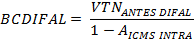

# Decreto nº 4.852, de 29 de dezembro de 1997 (RCTE/GO)

## Nota editorial de conferência — 05/11/2026

Texto extraído da Secretaria da Economia de Goiás. Preservadas as redações anteriores e as notas de alteração da fonte: este arquivo não apresenta apenas os dispositivos vigentes. A transcrição não substitui a publicação no Diário Oficial. Transcrição da página principal, sem os anexos externos. As duas fórmulas publicadas como imagem foram preservadas em arquivos locais. Para o DIFAL do contribuinte, conferir o art. 65, III, e a orientação oficial [21629](https://orientacaotributaria.economia.go.gov.br/spo-web/perguntasfrequentes/perguntafrequente/21629); foi removido o exemplo editorial que subtraía o ICMS de origem da base recomposta sem respaldo nesse dispositivo. A cobrança vinculada ao FUNDEINFRA foi encerrada para operações a partir de janeiro de 2026 pela [Lei nº 24.133/2026](../leis/fundos/lei-24133-2026-encerramento-contribuicao-fundeinfra.md). Não confundir o encerramento da contribuição com revogação integral da lei instituidora do fundo.

## Texto oficial

R C T E

CONSOLIDADO ATÉ O DECRETO Nº 10.986, DE 16.09.26.

Clique aqui para ver a relação de decretos que introduziram alterações no RCTE;

Índice dos artigos do RCTE

DECRETO Nº 4.852 DE 29 DE DEZEMBRO DE 1997.

(PUBLICADO NO DOE de 29.12.97)

NOTAS:

1. O art. 8º do Decreto nº 5.157, de 29.12.99, estabelece que as referências feitas ao:

a) Cadastro Geral de Contribuintes do Ministério da Fazenda - CGC/MF, consideram-se feitas ao Cadastro Nacional de Pessoas Jurídicas do Ministério da Fazenda - CNPJ/MF;

b) Instituto Goiano de Defesa Agropecuário - IGAP, consideram-se feitas à Agência Goiana de Desenvolvimento Rural e Fundiário;

2. O art. 6º do Decreto nº 5.245, de 19.06.00, estabelece que as referências feitas:

a) à Diretoria da Receita Estadual, consideram-se feitas à Superintendência da Receita Estadual;

b) ao Diretor da Receita Estadual, consideram-se feitas ao Superintendente da Receita Estadual;

3. Por força do art. 5º do Decreto nº 6.028, os ajustes que se fizerem necessários em decorrência da - vigência, com efeito retroativo, nos dispositivos modificados no Decreto nº 4.852/97 - RCTE, devem ser feitos até o 2º mês subseqüente ao da sua publicação;

4.Os ajustes que se fizerem necessários, em decorrência da - vigência com efeito retroativo dos dispositivos modificados pelo Decreto nº 7.043, de 29.12.09, devem ser feitos até o mês de fevereiro.

5. Texto atualizado, consolidado.

Regulamenta a Lei nº 11.651, de 26 de dezembro de 1991, que instituiu o Código Tributário do Estado de Goiás.

O GOVERNADOR DO ESTADO DE GOIÁS, usando de suas atribuições constitucionais, com fundamento no art. 37, inciso IV, da Constituição do Estado e no art. 4º das Disposições Transitórias da Lei nº 11.651, de 26 de dezembro de 1991, e tendo em vista o que consta do Processo nº 15634531,

D E C R E T A:

DISPOSIÇÃO PRELIMINAR

Art. 1º Este decreto regulamenta a Lei nº 11.651, de 26 de dezembro de 1991, que instituiu o Código Tributário do Estado de Goiás.

LIVRO PRIMEIRO

REGULAMENTO DO ICMS

### TÍTULO I

DA INCIDÊNCIA

### CAPÍTULO I

DO FATO GERADOR

### Seção I

Das Disposições Gerais

Art. 2º Imposto sobre Operações Relativas à Circulação de Mercadorias e sobre Prestações de Serviços de Transporte Interestadual e Intermunicipal e de Comunicação - ICMS - é o tributo que incide sobre a operação de circulação de mercadoria e sobre as prestações de serviço de transporte interestadual e intermunicipal e de comunicação, ainda que a operação e as prestações se iniciem no exterior.

Parágrafo único. É (Lei nº 11.651/91, art. 12):

I - operação de circulação de mercadoria, o fato econômico, juridicamente relevado pela lei tributária, concernente a cada etapa dos processos de extração, geração, produção e distribuição de mercadoria com o objetivo de consumo ou de utilização em outro processo da mesma natureza, inclusive na prestação de serviço;

II - mercadoria, qualquer bem móvel, novo ou usado, inclusive produto natural, semovente e energia elétrica, extraído, gerado, produzido ou adquirido com objetivo de mercancia;

III - prestação de serviço, o fato econômico, juridicamente relevado pela lei tributária, concernente a atividade produtiva humana que, não assumindo a forma de um produto material, satisfaz necessidade.

Art. 3º Fato gerador é a situação definida em lei que dá nascimento à obrigação tributária.

Parágrafo único. A caracterização do fato gerador independe da natureza jurídica da operação ou da prestação que o constitua.

Art. 4º O ICMS tem como fato gerador a (Lei nº 11.651/91, art. 11 e 12):

I - operação relativa à circulação de mercadoria;

II - prestação de serviço de transporte interestadual e intermunicipal, por qualquer via, de pessoa, bem, mercadoria ou valor;

III - prestação onerosa de serviço de comunicação, por qualquer meio, inclusive a geração, a emissão, a recepção, a transmissão, a retransmissão, a repetição e a ampliação de comunicação de qualquer natureza, ainda que iniciada ou prestada no exterior.

§ 1º É, também, fato gerador do ICMS:

I - a saída da mercadoria ou de sua resultante, em retorno ao estabelecimento que a tenha destinado para industrialização ou outro tratamento;

II - a entrada, no território goiano, de mercadoria ou bem oriundos de outro Estado, adquiridos por contribuinte e destinados a uso, consumo final ou integração ao ativo imobilizado do estabelecimento, ainda que o imposto não tenha sido cobrado na origem; (Redação original - vigência: 01.01.98 a 31.12.15)

II - a entrada, no território goiano, de mercadoria ou bem oriundos de outro Estado, ainda que o imposto não tenha sido cobrado na origem, adquiridos por: (Redação conferida pelo Decreto nº 8.519 - vigência: 01.01.16)

a) contribuinte e destinados a uso, consumo final ou integração ao ativo imobilizado do estabelecimento; (Redação acrescida pelo Decreto nº 8.519 - vigência: 01.01.16)

b) não contribuinte; (Redação acrescida pelo Decreto nº 8.519 - vigência: 01.01.16)

Nota: A alínea "b" do inciso II do § 1º do art. 4º encontrava-se sem aplicabilidade, até a entrada em vigor de Lei Complementar 90/2022 que alterou a Lei Complementar 87/96, por força da decisão do Supremo na Ação Declaratória de Inconstitucionalidade nº 5469, porém, a partir de 05/01/2022, voltou a produzir efeitos, conforme orientação da Procuradoria-Geral do Estado de Goiás no Despacho nº 25/22 - PGE/PTR, com a ressalva de que a referida orientação é válida somente enquanto pendente decisão do STF na ADI 7070/AL.”

NOTA: Redação com vigência de 01.01.16 a 04.04.22.

Conferida nova redação ao INCISO II do § 1º do art. 4º pelo art. 1º do Decreto nº 10.611, de 18.12.24 - vigência: 05.04.22.

II – a entrada, no território goiano, de mercadoria ou bem oriundos de outro Estado, ainda que o imposto não tenha sido cobrado na origem, adquiridos por contribuinte e destinados ao seu uso, ao consumo final ou à integração ao seu ativo imobilizado;

III - a entrada, no território goiano, decorrente de operação interestadual, dos seguintes produtos, quando não destinados à comercialização ou à industrialização:

a) petróleo, inclusive lubrificante e combustível líquido e gasoso dele derivados;

NOTA: Redação com vigência de 01.01.98 a 30.04.23.

Conferida nova redação Á ALÍNEA "A" DO INCISO III do § 1º do art. 4º pelo art. 1º do Decreto nº 10.326, de 29.09.23 - vigência: 01.05.23.

a) petróleo, inclusive lubrificante e combustível líquido e gasoso dele derivados, exceto aqueles referidos no art. 43-A; e

b) energia elétrica;

IV - a entrada de mercadoria ou bem importados do exterior, por pessoa natural ou jurídica, ainda quando se tratar de bem destinado a uso, consumo final, ou a integração ao ativo imobilizado do estabelecimento;

NOTA: Redação com vigência de 01.01.98 a 26.12.01.

Conferida nova redação ao inciso IV do § 1º do art. 4º pelo art. 1º do Decreto nº 5.885, de 30.12.03 - vigência: 27.12.01.

IV - a entrada de mercadoria ou bem importados do exterior, por pessoa natural ou jurídica, ainda que não seja contribuinte habitual do imposto, qualquer que seja sua finalidade;

V - a entrada de mercadoria ou bem, sujeitos à substituição tributária, no estabelecimento do adquirente ou em outro por ele indicado;

VI - o fornecimento de mercadoria com prestação de serviço:

a) não compreendido na competência tributária dos municípios;

b) compreendido na competência tributária dos municípios, quando a lei complementar aplicável expressamente o sujeitar à incidência do ICMS;

VII - o fornecimento de alimentação, bebida ou outra mercadoria em bar, restaurante e estabelecimento similar;

VIII - a utilização, por contribuinte, de serviço de transporte ou de comunicação, cuja prestação tenha-se iniciado em outro Estado e não esteja vinculada à operação ou prestação subseqüente, ainda que o imposto não tenha sido cobrado na origem; (Redação original - vigência: 01.01.98 a 31.12.15)

VIII - a utilização de serviço de transporte ou de comunicação, cuja prestação tenha-se iniciado em outro Estado, ainda que o imposto não tenha sido cobrado na origem, adquiridos por: (Redação conferida pelo Decreto nº 8.519 - vigência: 01.01.16)

a) contribuinte, desde que não esteja vinculada à operação ou prestação subsequente; (Redação acrescida pelo Decreto nº 8.519 - vigência: 01.01.16)

b) não contribuinte; (Redação acrescida pelo Decreto nº 8.519 - vigência: 01.01.16)

Nota:A alínea "b" do inciso VIII do § 1º do art. 4º encontrava-se sem aplicabilidade, até a entrada em vigor de Lei Complementar 90/2022 que alterou a Lei Complementar 87/96, por força da decisão do Supremo na Ação Declaratória de Inconstitucionalidade nº 5469, porém, a partir de 05/01/2022, voltou a produzir efeitos, conforme orientação da Procuradoria-Geral do Estado de Goiás no Despacho nº 25/22 - PGE/PTR, com a ressalva de que a referida orientação é válida somente enquanto pendente decisão do STF na ADI 7070/AL.”

NOTA: Redação com vigência de 01.01.16 a 04.04.22.

Conferida nova redação ao INCISO viII do § 1º do art. 4º pelo art. 1º do Decreto nº 10.611, de 18.12.24 - vigência: 05.04.22.

VIII – a utilização, por contribuinte, de serviço de transporte ou de comunicação cuja prestação tenha-se iniciado em outro Estado, ainda que o imposto não tenha sido cobrado na origem, desde que não esteja vinculada à operação ou prestação subsequente;

IX - o serviço de transporte ou de comunicação prestado no exterior ou cuja prestação lá se tenha iniciado.

ACRESCIDO O INCISO X AO § 1º do art. 4º pelo art. 1º do Decreto nº 9.918, de 06.08.21 - vigência: 01.04.21.

X - a entrada, no território goiano, de mercadoria oriunda de outro estado, do Distrito Federal ou do exterior, inclusive em transferência, sujeita ao regime de antecipação do imposto, com ou sem encerramento da tributação.

ACRESCIDO O INCISO XI AO § 1º do art. 4º pelo art. 1º do Decreto nº 10.611, de 18.12.24 - vigência: 05.04.22.

XI – a saída de estabelecimento de contribuinte localizado em outro Estado de mercadoria ou bem destinados a consumidor final não contribuinte do imposto domiciliado ou estabelecido em território goiano;

ACRESCIDO O INCISO XI AO § 1º do art. 4º pelo art. 1º do Decreto nº 10.611, de 18.12.24 - vigência: 05.04.22.

XII – a prestação de serviço de transporte iniciada em outro Estado, não vinculada a operação ou prestação subsequente, destinada a tomador não contribuinte do imposto domiciliado ou estabelecido em território goiano; e

ACRESCIDO O INCISO XI AO § 1º do art. 4º pelo art. 1º do Decreto nº 10.611, de 18.12.24 - vigência: 29.02.24.

XIII – a entrada, no território goiano, de mercadoria oriunda de outro Estado, adquirida por contribuinte optante pelo Simples Nacional, inclusive o Microempreendedor Individual - MEI, nos termos da Lei Complementar federal nº 123, de 14 de dezembro de 2006, e destinada à comercialização, produção rural ou utilização em processo de industrialização como produto intermediário, material de embalagem e material secundário.

§ 2º Equipara-se:

I - à saída ou à entrada, a transferência de mercadoria ou a transmissão de propriedade, ou do título que a represente, quando esta não transitar pelo estabelecimento do contribuinte;

II - à saída:

a) o uso, consumo final ou integração ao ativo imobilizado, relativamente à mercadoria produzida pelo próprio estabelecimento ou adquirida inicialmente para comercialização ou industrialização;

b) o fornecimento de energia elétrica;

III - à importação, a entrada da mercadoria ou de sua resultante, em retorno ao estabelecimento que a tenha remetido para industrialização ou outro tratamento no exterior.

§ 3º Presume-se:

I - saída deste Estado e a este destinada, a mercadoria encontrada em situação fiscal irregular, permitida a aplicação da alíquota própria, caso seja inequivocamente conhecido o destino da mercadoria;

NOTA: Redação com vigência de 01.01.98 a 26.12.01.

Conferida nova redação ao inciso I do § 3º do art. 4º pelo art. 1º do Decreto nº 5.885, de 30.12.03 - vigência: 27.12.01.

I - saída deste Estado e a este destinada, a mercadoria:

a) encontrada em situação fiscal irregular, permitida a aplicação da alíquota própria, caso seja inequivocamente conhecido o destino da mercadoria;

b) consignada em documento fiscal relativo a operação de saída interestadual, sem a comprovação da respectiva saída do território goiano;

c) que adentrar o território goiano, com documentação fiscal indicando como destino outra Unidade da Federação, sem a comprovação da efetiva saída do Estado de Goiás;

II - a vender em território goiano:

a) a mercadoria sem destinatário certo ou destinada a contribuinte não inscrito no cadastro estadual ou em situação cadastral irregular;

b) o estoque de mercadoria existente em estabelecimento de contribuinte não inscrito no cadastro estadual ou em situação cadastral irregular;

III - iniciado neste Estado, o serviço de transporte cuja prestação seja executada em situação fiscal irregular, permitida a aplicação da alíquota própria, caso seja inequivocamente conhecido o usuário do serviço;

IV - prestado neste Estado a usuário aqui localizado, o serviço de comunicação cuja prestação seja executada em situação fiscal irregular, permitida a aplicação da alíquota própria, caso seja inequivocamente conhecido o usuário do serviço.

§ 4º Não se considera bem do ativo imobilizado o reprodutor, a matriz e os demais animais, inclusive ave, de cria ou de trabalho na atividade agrícola.

Art. 5º Considera-se industrialização, qualquer processo que modifique a natureza, o funcionamento, o acabamento, a apresentação ou a finalidade do produto ou o aperfeiçoe para o consumo, tais como (Lei nº 11.651/91, art. 12, II, “b”):

I - transformação, o que, exercido sobre a matéria-prima ou produto intermediário, importe na obtenção de nova espécie;

II - beneficiamento, o que importe em modificar, aperfeiçoar ou, de qualquer forma, alterar o funcionamento, a utilização, o acabamento ou a aparência do produto;

III - montagem, o que consista na reunião de produtos, peças ou partes e de que resulte um novo produto, ou unidade autônoma, ainda que sob a mesma classificação fiscal;

IV - acondicionamento ou reacondicionamento, o que importe em alterar a apresentação do produto, pela colocação de embalagem, ainda que em substituição da original, salvo quando a embalagem colocada se destine apenas ao transporte da mercadoria;

V - renovação ou recondicionamento, o que, exercido sobre o produto usado ou parte remanescente de produto deteriorado ou inutilizado, renove ou restaure o produto para utilização.

Parágrafo único. São irrelevantes, para caracterizar a operação como industrialização, o processo utilizado para obtenção do produto, a localização e a condição da instalação ou o equipamento empregado.

### Seção II

Do Momento da Ocorrência do Fato Gerador

Art. 6º Ocorre o fato gerador do ICMS, no momento (Lei nº 11.651/91, art. 13):

I - da saída de mercadoria, a qualquer título, de estabelecimento de contribuinte, ainda que para outro estabelecimento do mesmo contribuinte;

II - da entrada, no território goiano, de mercadoria ou bem oriundos de outro Estado, adquiridos por contribuinte, destinados a uso, consumo final ou integração ao ativo imobilizado do estabelecimento, ainda que o imposto não tenha sido cobrado na origem; (Redação original - vigência: 01.01.98 a 31.12.15)

II - da entrada, no território goiano, de mercadoria ou bem oriundos de outro Estado, ainda que o imposto não tenha sido cobrado na origem adquiridos por: (Redação conferida pelo Decreto nº 8.519 - vigência: 01.01.16)

a) contribuinte, destinados a uso, consumo final ou integração ao ativo imobilizado do estabelecimento; (Redação acrescida pelo Decreto nº 8.519 - vigência: 01.01.16)

b) não contribuinte; (Redação acrescida pelo Decreto nº 8.519 - vigência: 01.01.16)

Nota:A alínea "b" do inciso II do art. 6º encontrava-se sem aplicabilidade, até a entrada em vigor de Lei Complementar 90/2022 que alterou a Lei Complementar 87/96, por força da decisão do Supremo na Ação Declaratória de Inconstitucionalidade nº 5469, porém, a partir de 05/01/2022, voltou a produzir efeitos, conforme orientação da Procuradoria-Geral do Estado de Goiás no Despacho nº 25/22 - PGE/PTR, com a ressalva de que a referida orientação é válida somente enquanto pendente decisão do STF na ADI 7070/AL.”

NOTA: Redação com vigência de 01.01.16 a 04.04.22.

Conferida nova redação ao INCISO II do art. 6º pelo art. 1º do Decreto nº 10.611, de 18.12.24 - vigência: 05.04.22.

II – da entrada, no território goiano, de mercadoria ou bem oriundos de outro Estado, ainda que o imposto não tenha sido cobrado na origem, adquiridos por contribuinte, desde que destinados ao seu uso, consumo final ou à integração ao seu ativo imobilizado;

III - da entrada, no território goiano, decorrente de operação interestadual, dos seguintes produtos, quando não destinados à comercialização ou à industrialização:

a) petróleo, inclusive lubrificante e combustível líquido e gasoso dele derivados;

NOTA: Redação com vigência de 01.01.98 a 30.04.23.

Conferida nova redação Á ALÍNEA "A" DO INCISO III do § 1º do art. 6º pelo art. 1º do Decreto nº 10.326, de 29.09.23 - vigência: 01.05.23.

a) petróleo, inclusive lubrificante e combustível líquido e gasoso dele derivados, exceto aqueles referidos no art. 43-A; e

b) energia elétrica;

IV - da entrada de mercadoria ou bem, sujeitos à substituição tributária, no estabelecimento do adquirente ou em outro por ele indicado;

V - da transferência de mercadoria ou da transmissão de propriedade, ou de título que a represente, quando esta não transitar pelo estabelecimento do transmitente;

VI - do desembaraço aduaneiro de mercadoria ou bem importados do exterior;

NOTA:Observar o inciso VII e parágrafo único do art. 14 do CTE acrescido pela Lei nº 14.382/02, de 30.12.02, com vigência a partir de 01.01.03.

VII - da aquisição, em licitação pública, de mercadoria ou bem importados do exterior, apreendidos ou abandonados;

VIII - do fornecimento de mercadoria com prestação de serviço:

a) não compreendido na competência tributária dos municípios;

b) compreendido na competência tributária dos municípios, quando a lei complementar aplicável expressamente o sujeitar à incidência do ICMS;

IX - do fornecimento de alimentação, bebida ou outra mercadoria, em bar, restaurante e estabelecimento similar;

X - da utilização, por contribuinte, de serviço de transporte ou de comunicação, cuja prestação tenha-se iniciado em outro Estado e não esteja vinculada à operação ou prestação subsequente, ainda que o imposto não tenha sido cobrado na origem; (Redação original - vigência: 01.01.98 a 31.12.15)

X - da utilização de serviço de transporte ou de comunicação, cuja prestação tenha-se iniciado em outro Estado, ainda que o imposto não tenha sido cobrado na origem, por: (Redação conferida pelo Decreto nº 8.519 - vigência: 01.01.16)

a) contribuinte, desde que não esteja vinculada à operação ou prestação subsequente; (Redação acrescida pelo Decreto nº 8.519 - vigência: 01.01.16)

b) não contribuinte; (Redação acrescida pelo Decreto nº 8.519 - vigência: 01.01.16)

Nota:A alínea "b" do inciso X do § 1º do art. 6º encontrava-se sem aplicabilidade, até a entrada em vigor de Lei Complementar 90/2022 que alterou a Lei Complementar 87/96, por força da decisão do Supremo na Ação Declaratória de Inconstitucionalidade nº 5469, porém, a partir de 05/01/2022, voltou a produzir efeitos, conforme orientação da Procuradoria-Geral do Estado de Goiás no Despacho nº 25/22 - PGE/PTR, com a ressalva de que a referida orientação é válida somente enquanto pendente decisão do STF na ADI 7070/AL.”

NOTA: Redação com vigência de 01.01.16 a 04.04.22.

Conferida nova redação ao INCISO X do art. 6º pelo art. 1º do Decreto nº 10.611, de 18.12.24 - vigência: 05.04.22.

X – da utilização, por contribuinte, de serviço de transporte ou de comunicação cuja prestação tenha-se iniciado em outro estado, ainda que o imposto não tenha sido cobrado na origem, e não esteja vinculada a operação ou prestação subsequente;

XI - do recebimento, pelo destinatário, de serviço de transporte ou de comunicação, prestado no exterior ou cuja prestação lá se tenha iniciado;

XII - do início da prestação de serviço de transporte interestadual e intermunicipal, por qualquer via, de pessoa, bem, mercadoria ou valor;

XIII - do ato final do serviço de transporte iniciado no exterior;

XIV - da prestação onerosa de serviço de comunicação, por qualquer meio, inclusive a geração, a emissão, a recepção, a transmissão, a retransmissão, a repetição e a ampliação de comunicação de qualquer natureza, ainda que iniciada ou prestada no exterior.

ACRESCIDO O INCISO XV AO art. 6º pelo art. 1º do Decreto nº 9.918, de 06.08.21 - vigência: 01.04.21.

XV - da entrada, no território goiano, de mercadoria oriunda de outro Estado, do Distrito Federal ou do exterior, inclusive em transferência, sujeita ao regime de antecipação do imposto, com ou sem encerramento da tributação.

ACRESCIDO O INCISO XVI Ao art. 6º pelo art. 1º do Decreto nº 10.611, de 18.12.24 - vigência: 05.04.22.

XVI – da saída de estabelecimento de contribuinte localizado em outro estado de bem ou mercadoria destinados a consumidor final não contribuinte do imposto domiciliado ou estabelecido em território goiano;

ACRESCIDO O INCISO XVII Ao art. 6º pelo art. 1º do Decreto nº 10.611, de 18.12.24 - vigência: 05.04.22.

XVII – do início da prestação de serviço de transporte interestadual não vinculada a operação ou prestação subsequente, com destino a tomador não contribuinte do imposto domiciliado ou estabelecido em território goiano; e

ACRESCIDO O INCISO XVIII Ao art. 6º pelo art. 1º do Decreto nº 10.611, de 18.12.24 - vigência: 29.02.24.

XVIII – da entrada, no território goiano, de mercadoria oriunda de outro estado e adquirida por contribuinte optante pelo Simples Nacional, inclusive o MEI, nos termos da Lei Complementar federal nº 123, de 2006, desde que destinada à comercialização, produção rural ou utilização em processo de industrialização como produto intermediário, material de embalagem e material secundário.

Parágrafo único. Na prestação onerosa de serviço de comunicação, quando o serviço for prestado mediante pagamento em ficha, cartão ou assemelhado, considera-se ocorrido o fato gerador do imposto quando do fornecimento desses instrumentos ao adquirente.

ACRESCIDO O ART. 6º-a pelo art. 1º do Decreto nº 10.326, de 29.09.23 - vigência: 01.05.23.

Art. 6º-A Nas operações sujeitas à incidência única do imposto, nos termos do art. 43-A, ocorre o fato gerador no momento (Lei nº 11.651/91, art. 13-A):

I - do desembaraço aduaneiro do combustível, nas operações de importação; ou

II - da saída de combustível de estabelecimento de contribuinte, exceto se for importado.

ACRESCIDO O INCISO III AO ART. 6º-A PELO ART. 1º DO DECRETO Nº 10.485, DE 26.06.24 - vigência: 01.05.23.

III - da constatação de mercadoria encontrada em situação fiscal irregular.

ACRESCIDO O PARÁGRAFO ÚNICO AO ART. 6º-A PELO ART. 1º DO DECRETO Nº 10.485, DE 26.06.24 - vigência: 01.05.23.

Parágrafo único. Não se considera fato gerador do imposto a comercialização de combustível à temperatura ambiente pelos estabelecimentos distribuidores, em volume superior ao recebido de seus fornecedores e faturado a 20° C (vinte graus Celsius), decorrente de variação volumétrica que esteja dentro do limite previsto pelo fator de correção do volume - FCV divulgado em Ato COTEPE/ICMS.

Art. 7º Considera-se, também, ocorrido o fato gerador do imposto, no momento (Lei nº 11.651/91, art. 14):

I - do uso, consumo final ou integração ao ativo imobilizado, relativamente à mercadoria produzida pelo próprio estabelecimento ou adquirida inicialmente para comercialização ou industrialização;

II - do encerramento da atividade do estabelecimento, relativamente ao estoque nele existente, declarado pelo sujeito passivo como o da contagem física ou do trancamento, efetuado pelo fisco, desse estoque;

III - da verificação da existência de estabelecimento de contribuinte não inscrito no cadastro estadual ou em situação cadastral irregular, em relação ao estoque de mercadoria nele encontrado;

IV - da verificação da existência de mercadoria a vender em território goiano;

NOTA: Redação com vigência de 01.01.98 a 29.12.03.

Conferida nova redação ao inciso Iv do art. 7º pelo art. 1º do Decreto nº 5.885, de 30.12.03 - vigência: 30.12.03.

IV - da verificação da existência de mercadoria a vender em território goiano sem destinatário certo ou destinada a contribuinte em situação cadastral irregular;

V - em que o ouro deixar de ser considerado como ativo financeiro ou instrumento cambial.

acrescido o inciso vi ao art. 7º pelo art. 1º do Decreto nº 5.885, de 30.12.03 - vigência: 27.12.01.

VI - da constatação de que não ocorreu a efetiva saída do Estado de Goiás da mercadoria que tenha adentrado, com documentação fiscal indicando como destino outra Unidade da Federação;

acrescido o inciso vii ao art. 7º pelo art. 1º do Decreto nº 5.885, de 30.12.03 - vigência: 01.01.03.

VII - da entrega da mercadoria ou bem importados do exterior, caso a entrega ocorra antes do desembaraço aduaneiro, devendo a autoridade responsável exigir a comprovação do pagamento do ICMS incidente no ato da entrega, salvo se a legislação tributária dispuser o contrário.

### CAPÍTULO II

DA BASE DE CÁLCULO

Art. 8º Base de cálculo é o valor correspondente ao montante sobre o qual deve ser calculado o imposto, mediante utilização da alíquota aplicável à operação ou prestação.

Art. 9º A base de cálculo do imposto é (Lei nº 11.651/91, art. 15):

I - na operação relativa à circulação de mercadoria, o valor da operação;

II - na prestação de serviço de transporte ou de comunicação, o valor da prestação.

Parágrafo único. Em se tratando de devolução de mercadoria, utiliza-se a base de cálculo adotada no documento fiscal que houver acobertado a operação anterior de remessa.

NOTA:O Ato Normativo GSF nº 138/90 de 23.02.90 (DOE de 07.03.90), com vigência a partir de 07.03.90, disciplina os procedimentos a serem adotados na devolução de mercadorias.

Art. 10. Na falta do valor da operação ou da prestação, ressalvado o disposto no artigo seguinte, a base de cálculo do imposto é (Lei nº 11.651/91, arts. 16 e 18):

I - o preço corrente da mercadoria, ou de sua similar, no mercado atacadista do local da operação ou, na sua falta, no mercado atacadista regional, caso o remetente seja produtor agropecuário, extrator ou gerador, inclusive de energia;

II - o preço FOB estabelecimento industrial, à vista, caso o remetente seja industrial;

III - o preço FOB estabelecimento comercial, à vista, na venda a outro comerciante ou industrial, caso o remetente seja comerciante;

IV - o preço corrente do serviço, no local da prestação.

§ 1º Para aplicação dos incisos II e III do caput deste artigo, adota-se sucessivamente:

I - o preço efetivamente cobrado pelo estabelecimento remetente na operação mais recente;

II - caso o remetente não tenha efetuado venda de mercadoria, o preço corrente da mercadoria ou de sua similar no mercado atacadista do local da operação ou, na falta deste, no mercado atacadista regional.

§ 2º Na hipótese do inciso II do caput deste artigo, caso não haja mercadoria similar, a base de cálculo é o custo de produção da mercadoria.

§ 3º Na hipótese do inciso III do caput deste artigo, caso o estabelecimento remetente não efetue venda a outro comerciante ou industrial ou, em qualquer caso, se não houver mercadoria similar, a base de cálculo do imposto é equivalente a 75% (setenta e cinco por cento) do preço corrente de venda a varejo.

§ 4º Preço com aplicação da cláusula:

I - FOB é aquele em que o custo do frete e do seguro é de responsabilidade do comprador ou destinatário;

II - CIF é aquele em que o custo do frete e do seguro é de responsabilidade do vendedor ou remetente.

§ 5º Custo de produção da mercadoria é a soma do custo da matéria-prima, material secundário e de acondicionamento, energia e mão-de-obra direta.

Art. 11. Na saída de mercadoria para estabelecimento localizado neste ou em outro Estado, pertencente à mesma pessoa natural ou jurídica, a base de cálculo do imposto é o (Lei nº 11.651/91, art. 17):

I - valor correspondente à entrada mais recente da referida espécie da mercadoria;

II - custo de produção da mercadoria;

III - preço corrente da mercadoria, no mercado atacadista do estabelecimento remetente, quando se tratar de mercadoria não industrializada.

§ 1º O estabelecimento que possuir controle permanente de estoque, pode, opcionalmente, utilizar o valor do custo médio ponderado da mercadoria com a reintrodução do valor do ICMS, quando este tiver sido excluído, em substituição ao valor correspondente à entrada mais recente da mercadoria.

NOTA: Redação com vigência de 01.01.98 a 31.12.00.

Conferida nova redação ao § 1º do art. 11 pelo art. 1º do Decreto nº 5.885, de 30.12.03 - vigência: 01.01.01.

§ 1º O estabelecimento que possuir controle permanente de estoque, pode, em substituição ao valor correspondente à entrada mais recente da mercadoria, utilizar o valor do custo médio ponderado, com a reintrodução do valor do ICMS, quando este tiver sido excluído, calculado pela alíquota efetiva de entrada ou alíquota efetiva média das entradas.

§ 2º Na transferência interna de bem do ativo imobilizado, antes de decorrido o período de cinco anos, a base de cálculo é igual ao valor da aquisição, multiplicado pelo tempo que faltar para completar o qüinqüênio, na razão de 1/60 (um sessenta avos) por mês ou fração.

NOTA: Redação com vigência de 01.01.98 a 31.12.00.

Conferida nova redação ao § 2º do art. 11 pelo art. 1º do Decreto nº 5.885, de 30.12.03 - vigência: 01.01.01.

§ 2º A base de cálculo na transferência interna de bem do ativo imobilizado é igual ao valor da aquisição, multiplicado pelo tempo que faltar para completar:

I - o qüinqüênio, na razão de 1/60 (um sessenta avos) por mês ou fração, para o bem cuja entrada no estabelecimento tenha ocorrido até 31 de dezembro de 2000;

NOTA: Redação com vigência de 01.01.01 a 18.05.11.

REVOGADO O INCISO I DO § 2º DO ART. 11 PELO ART. 3º DO DECRETO Nº 7.344, de 18.05.11 - vigência: 19.05.11.

I - revogado.

II - o quadriênio, na razão de 1/48 (um quarenta e oito avos) por mês ou fração, para o bem cuja entrada no estabelecimento tenha ocorrido a partir de 1º de janeiro de 2001.

Art. 12. Nas seguintes situações específicas, a base de cálculo do imposto é (Lei nº 11.651/91, art. 19):

I - na importação do exterior, a soma dos seguintes valores:

a) da mercadoria ou bem constante do documento de importação;

b) do Imposto de Importação;

c) do Imposto sobre Produtos Industrializados;

d) do Imposto sobre Operações de Câmbio;

e) de qualquer despesa aduaneira;

NOTA: Redação com vigência de 01.01.98 a 31.12.01.

CONFERIDA NOVA REDAÇÃO À ALÍNEA “E” DO INCISO I Do ART. 12 PELO ART. 2º DO DECRETO Nº 5.707, DE 27.12.02 - vigência: 01.01.02.

e) de quaisquer outros impostos, taxas, contribuições e despesas aduaneiras;

II - na aquisição, em licitação pública, de mercadoria ou bem importados do exterior, apreendidos ou abandonados, a soma das seguintes valores:

a) do valor da operação;

b) do Imposto de Importação;

c) do Imposto sobre Produtos Industrializados;

d) de toda despesa cobrada ou debitada ao adquirente;

III - na entrada de mercadoria, ou de sua resultante, em retorno ao estabelecimento que a tenha remetido para industrialização ou outro tratamento no exterior, o valor previsto para a importação, deduzida a parcela relativa ao valor da respectiva remessa, quando esta parcela estiver incluída naquele valor;

IV - na entrada, decorrente de operação interestadual, de mercadoria ou bem destinado ao uso, consumo final ou integração ao ativo imobilizado do estabelecimento, o valor da operação de aquisição, acrescido do valor do Imposto sobre Produtos Industrializados; (Redação original - vigência: 01.01.98 a 31.12.15)

IV - o valor da operação de aquisição, acrescido do valor do Imposto sobre Produtos Industrializados, na entrada de mercadoria ou bem destinados: (Redação conferida pelo Decreto nº 8.519 - vigência: 01.01.16)

a) ao uso, consumo final ou integração ao ativo imobilizado do estabelecimento contribuinte do imposto; (Redação acrescida pelo Decreto nº 8.519 - vigência: 01.01.16)

b) a não contribuinte; (Redação acrescida pelo Decreto nº 8.519 - vigência: 01.01.16)

Nota:A alínea "b" do inciso IV do art. 12 encontrava-se sem aplicabilidade, até a entrada em vigor de Lei Complementar 90/2022 que alterou a Lei Complementar 87/96, por força da decisão do Supremo na Ação Declaratória de Inconstitucionalidade nº 5469, porém, a partir de 05/01/2022, voltou a produzir efeitos, conforme orientação da Procuradoria-Geral do Estado de Goiás no Despacho nº 25/22 - PGE/PTR, com a ressalva de que a referida orientação é válida somente enquanto pendente decisão do STF na ADI 7070/AL.”

NOTA: Redação com vigência de 01.01.16 a 04.04.22.

Conferida nova redação ao INCISO IV do art. 12 pelo art. 1º do Decreto nº 10.611, de 18.12.24 - vigência: 05.04.22.

V - na entrada, no território goiano, decorrente de operação interestadual, de petróleo, inclusive lubrificante e combustível líquido e gasoso dele derivados, quando não destinados à comercialização ou à industrialização, o valor da operação de que decorrer a entrada;

NOTA: Redação com vigência de 01.01.98 a 31.12.00.

Conferida nova redação ao inciso v do art. 12 pelo art. 1º do Decreto nº 5.885, de 30.12.03 - vigência: 01.01.01.

V - na entrada, no território goiano, decorrente de operação interestadual, de petróleo, inclusive lubrificante, combustível líquido e gasoso dele derivados e energia elétrica, quando não destinados à comercialização ou à industrialização, o valor da operação de que decorrer a entrada;

NOTA: Redação com vigência de 01.01.01 a 30.04.23.

Conferida nova redação E ACRESCIDAS AS ALÍNEAS "A" E "B" AO INCISO V do art. 12 pelo art. 1º do Decreto nº 10.326, de 29.09.23 - vigência: 01.05.23.

IV – na entrada de mercadoria ou bem adquiridos em outro estado destinados ao uso, ao consumo final ou à integração ao ativo imobilizado do estabelecimento contribuinte do imposto, ainda que tenham sido adquiridos inicialmente para comercialização ou industrialização, o valor da operação no Estado de Goiás, acrescido do valor do Imposto sobre Produtos Industrializados;

V - o valor da operação de que decorrer a entrada no território goiano, relativa à operação interestadual dos seguintes produtos, quando não destinados à comercialização ou à industrialização:

a) petróleo, inclusive lubrificantes e combustíveis líquidos e gasosos dele derivados, exceto aqueles referidos no art. 43-A; e

b) energia elétrica;

VI - o preço corrente da mercadoria, ou de sua similar, no mercado atacadista, acrescido do valor resultante da aplicação do Índice de Valor Agregado - IVA - fixado no Anexo VII deste regulamento:

a) na operação com mercadoria procedente de outro Estado, a vender ou sem destinatário certo;

NOTA: Redação com vigência de 01.01.98 a 31.03.21.

Conferida nova redação ao À ALÍNEA "A" DO inciso vI do art. 12 pelo art. 1º do Decreto nº 9.918, de 06.08.21 - vigência: 01.04.21.

a) na operação com mercadoria procedente de outro estado, a vender ou sem destinatário certo, observado o disposto no art. 59-C do Anexo VIII deste regulamento;

b) na operação promovida por contribuinte eventual deste Estado;

c) na operação com mercadoria destinada a contribuinte não inscrito no cadastro estadual ou em situação cadastral irregular;

d) na verificação da existência de mercadoria em trânsito, em situação fiscal irregular;

NOTA: Redação com vigência de 01.01.98 a 30.04.23.

CONFERIDA NOVA REDAÇÃO À ALÍNEA "D" DO INCISO VI DO ART. 12 PELO ART. 1º DO DECRETO Nº 10.485, DE 26.06.24 - vigência: 01.05.23.

d) na verificação da existência de mercadoria em trânsito em situação fiscal irregular, exceto quanto aos produtos especificados no art. 43-A deste Regulamento;

VII - na saída de mercadoria para o exterior, o valor da operação, acrescido do valor de tributos, contribuições e demais importâncias cobradas ou debitadas ao adquirente e realizadas até o embarque, inclusive;

VIII - na remessa para venda fora do estabelecimento, o custo de produção ou aquisição mais recente da mercadoria remetida;

IX - na saída de mercadoria, ou de sua resultante, em retorno ao estabelecimento que a tenha remetido para industrialização ou outro tratamento, o valor a ela agregado no respectivo processo, assim entendido o preço efetivamente cobrado, nele se incluindo o valor do serviço prestado e dos demais insumos não fornecidos pelo encomendante;

X - na posterior destinação de mercadoria, inicialmente adquirida para comercialização ou industrialização, ao uso, consumo final ou integração ao ativo imobilizado do estabelecimento, o valor da operação de aquisição, ou o relativo a entrada mais recente da mesma espécie de mercadoria, se for impossível identificar os dados relativos à mercadoria adquirida, acrescido, em ambos os casos, do valor do Imposto sobre produtos Industrializados;

XI - no uso, consumo final ou integração ao ativo imobilizado, relativamente à mercadoria produzida pelo próprio estabelecimento, o custo de produção da mercadoria;

XII - na verificação de estoque de mercadoria existente em estabelecimento de contribuinte não inscrito no cadastro estadual ou em situação cadastral irregular, o preço corrente da mercadoria no mercado atacadista, acrescido do valor resultante da aplicação do Índice de Lucro Bruto - ILB - estabelecido para a respectiva atividade, na forma do Anexo VII deste regulamento;

XIII - relativamente à mercadoria constante do estoque final à data do encerramento da atividade, o custo de produção ou de aquisição mais recente;

XIV - no fornecimento de mercadoria com prestação de serviço não compreendido na competência tributária dos municípios, o valor da operação, assim entendido o valor da mercadoria fornecida e do serviço prestado;

XV - no fornecimento de mercadoria com prestação de serviço compreendido na competência tributária dos municípios, quando a lei complementar aplicável expressamente o sujeitar a incidência do ICMS, o preço corrente a varejo da mercadoria fornecida ou empregada;

XVI - no fornecimento de alimentação, bebida ou outra mercadoria, em bar, restaurante e estabelecimento similar, o valor da operação, compreendendo mercadoria e serviço;

XVII - na utilização, por contribuinte, de serviço de transporte ou de comunicação, cuja prestação tenha-se iniciado em outro Estado e não esteja vinculada à operação ou prestação subsequente, o valor da prestação no Estado de origem; (Redação original - vigência: 01.01.98 a 31.12.15)

XVII - o valor da prestação no Estado de origem, na utilização de serviço de transporte ou de comunicação, cuja prestação tenha-se iniciado em outro Estado, por: (Redação conferida pelo Decreto nº 8.519 - vigência: 01.01.16)

a) contribuinte do imposto, desde que não esteja vinculada a operação ou prestação subsequente; (Redação acrescida pelo Decreto nº 8.519 - vigência: 01.01.16)

b) não contribuinte; (Redação acrescida pelo Decreto nº 8.519 - vigência: 01.01.16)

Nota:A alínea "b" do inciso XVII do art. 12 encontrava-se sem aplicabilidade, até a entrada em vigor de Lei Complementar 90/2022 que alterou a Lei Complementar 87/96, por força da decisão do Supremo na Ação Declaratória de Inconstitucionalidade nº 5469, porém, a partir de 05/01/2022, voltou a produzir efeitos, conforme orientação da Procuradoria-Geral do Estado de Goiás no Despacho nº 25/22 - PGE/PTR, com a ressalva de que a referida orientação é válida somente enquanto pendente decisão do STF na ADI 7070/AL.”

NOTA: Redação com vigência de 01.01.16 a 04.04.22.

Conferida nova redação ao INCISO XVII do art. 12 pelo art. 1º do Decreto nº 10.611, de 18.12.24 - vigência: 05.04.22.

XVII – na utilização de serviço de transporte ou de comunicação, cuja prestação tenha-se iniciado em outro Estado, por contribuinte, desde que não esteja vinculada a operação ou prestação subsequente, o valor da prestação no Estado de Goiás;

XVIII - no recebimento de serviço de transporte ou de comunicação prestado no exterior ou cuja prestação lá se tenha iniciado, o valor da prestação acrescido, se for o caso, de todo encargo relacionado com a sua utilização;

XIX - na prestação de serviço em situação fiscal irregular, o preço corrente do serviço no local da prestação.

ACRESCIDO O INCISO XX Ao art. 12 pelo art. 1º do Decreto nº 10.326, de 29.09.23 - vigência: 01.05.23.

XX - o volume ou o peso do combustível, conforme o caso, nas operações com os combustíveis sujeitos à incidência única do imposto, nos termos do art. 43-A.

NOTA: Redação com vigência de 01.05.23 a 30.04.23.

CONFERIDA NOVA REDAÇÃO AO INCISO XX DO ART. 12 PELO ART. 1º DO DECRETO Nº 10.485, DE 26.06.24 - vigência: 01.05.23.

XX - o volume ou o peso do combustível, conforme o caso, nas operações com os combustíveis sujeitos à incidência única do imposto, nos termos do art. 43-A, inclusive na hipótese de mercadoria em situação fiscal irregular, observado o § 7º deste artigo.

ACRESCIDO O INCISO XXI Ao art. 12 pelo art. 1º do Decreto nº 10.611, de 18.12.24 - vigência: 05.04.22.

XXI – na saída de estabelecimento de contribuinte localizado em outro estado de bem ou mercadoria destinados a consumidor final não contribuinte do imposto domiciliado ou estabelecido em território goiano, o valor da operação, acrescido do valor do Imposto sobre Produtos Industrializados;

ACRESCIDO O INCISO XXII Ao art. 12 pelo art. 1º do Decreto nº 10.611, de 18.12.24 - vigência: 05.04.22.

XXII – na prestação de serviço interestadual não vinculada a operação ou prestação subsequente cujo tomador domiciliado ou estabelecido em território goiano não seja contribuinte do imposto, o valor da prestação de serviço; e

ACRESCIDO O INCISO XXIII Ao art. 12 pelo art. 1º do Decreto nº 10.611, de 18.12.24 - vigência: 29.02.24.

XXIII – na entrada, no território goiano, de mercadoria oriunda de outro Estado, adquirida por contribuinte optante pelo Simples Nacional, inclusive o MEI, nos termos da Lei Complementar federal nº 123, de 2006, quando destinada à comercialização, à produção rural ou à utilização em processo de industrialização como produto intermediário, material de embalagem e material secundário, o valor da operação.

§ 1º O preço de importação expresso em moeda estrangeira deve ser convertido em moeda nacional pela mesma taxa de câmbio fixada para o cálculo do imposto de importação, sem qualquer acréscimo ou devolução posterior se houver variação dessa taxa até o pagamento efetivo do preço (Lei nº 11.651/91, art. 24);

§ 2º O valor fixado pela autoridade aduaneira para base de cálculo do Imposto de Importação, nos termos da lei aplicável, substitui o preço declarado no documento de importação (Lei nº 11.651/91, art. 24, parágrafo único);

§ 3º Entende-se como qualquer despesa aduaneira aquela efetivamente paga à repartição alfandegária até o momento do desembaraço da mercadoria, tais como diferença de peso, classificação fiscal e multa por infração.

§ 4º Para efeito de pagamento do diferencial de alíquotas, são considerados os benefícios fiscais concedidos na forma e condições estabelecidas para a operação ou prestação interna.

ACRESCIDO O § 5º AO ART. 12 PELO ART. 1º DO DECRETO Nº 10.191, DE 02.01.23 - vigência: 03.01.23.

§ 5º Na hipótese prevista na alínea "e" do inciso I do caput deste artigo, nas operações de importação de bens ou mercadorias realizadas por meio da Declaração Única de Importação, quando não houver a possibilidade de individualizar por item o valor dos componentes integrantes da base de cálculo do ICMS, devem ser utilizados os seguintes critérios de rateio (Ajuste SINIEF nº 32/21):

I - peso líquido do bem ou mercadoria indicado em cada item, no caso do Adicional ao Frete para Renovação da Marinha Mercante - AFRMM; e

II - valor aduaneiro do bem ou mercadoria indicado em cada item da operação de importação, em relação à Taxa de Utilização do Siscomex - Taxa Siscomex e demais casos.

ACRESCIDO O § 6º AO ART. 12 PELO ART. 1º DO DECRETO Nº 10.191, DE 02.01.23 - vigência: 03.01.23.

§ 6º O valor dos componentes integrantes da base de cálculo do ICMS deve ser calculado pela divisão do valor total do ICMS proporcionalmente ao item, tributado ou não, de acordo com os critérios definidos pelos incisos I e II do § 5º deste artigo.

ACRESCIDO O § 7º AO ART. 12 PELO ART. 1º DO DECRETO Nº 10.485, DE 26.06.24 - vigência: 01.05.23, EXCETO EM RELAÇÃO AO INCISO II QUE TEM VIGÊNCIA A PARTIR DE 01.06.23.

§ 7º Na aplicação do disposto no inciso XX deste artigo, a base de cálculo da operação com os produtos a seguir especificados é o volume do combustível convertido a 20° C (vinte graus Celsius) faturado pelo contribuinte:

I - Óleo Diesel A; e

II - Gasolina A.

Art. 13. Integra a base de cálculo do imposto o valor correspondente (Lei nº 11.651/91, art. 20):

I - ao montante do próprio imposto, constituindo o respectivo destaque mera indicação para fim de controle, ressalvadas as seguintes situações específicas:

NOTA: Redação com vigência de 01.01.98 a 31.12.01.

CONFERIDA NOVA REDAÇÃO AO CAPUT DO INCISO I Do ART. 13 PELO ART. 2º DO DECRETO Nº 5.707, DE 27.12.02 - vigência: 01.01.02.

I - ao montante do próprio imposto, constituindo o respectivo destaque mera indicação para fim de controle, inclusive nas seguintes situações específicas:

a) importação do exterior;

b) aquisição em licitação pública de mercadoria ou bem importados do exterior, apreendidos ou abandonados;

c) a entrada, no território goiano, decorrente de operação interestadual, quando não destinados à comercialização ou à industrialização, de petróleo, inclusive lubrificante e combustível líquido e gasoso dele derivados;

NOTA: Redação com vigência de 01.01.98 a 31.12.01.

CONFERIDA NOVA REDAÇÃO à ALÍNEA "C" DO INCISO I Do ART. 13 PELO ART. 2º DO DECRETO Nº 5.707, DE 27.12.02 - vigência: 01.01.02.

c) a entrada, no território goiano, decorrente de operação interestadual, das seguintes mercadorias, quando não destinadas à comercialização ou à industrialização:

1. petróleo, inclusive lubrificantes e combustíveis líquidos e gasosos dele derivados;

NOTA: Redação com vigência de 01.01.02 a 30.04.23.

Conferida nova redação AO ITEM 2 DA ALÍNEA "C" DO INCISO I do Art. 13 pelo art. 1º do Decreto nº 10.326, de 29.09.23 - vigência: 01.05.23.

1. petróleo, inclusive lubrificantes e combustíveis líquidos e gasosos dele derivados, exceto aqueles referidos no art. 43-A; e

2. energia elétrica;

ACRESCIDO A ALÍNEA “D” AO INCISO I DO ART. 13 PELO ART. 2º DO DECRETO Nº 5.707, DE 27.12.02 - vigência: 01.01.02.

d) o recebimento de serviço de transporte ou de comunicação prestado no exterior ou cuja prestação lá se tenha iniciado;

II - a seguro, juro e demais importâncias pagas, recebidas ou debitadas, bem como bonificação e desconto concedidos sob condição;

III - ao frete, caso o transporte seja efetuado pelo próprio remetente, ou por sua conta e ordem, e seja cobrado em separado;

NOTA:A Instrução Normativa nº 034/96-DRE, de 10.07.96, com vigência a partir de 15.07.96, fixa o entendimento sobre a não incidência do ICMS sobre o frete nas operações contratadas com cláusula CIF e, transportadas pelo próprio vendedor em veículo de sua propriedade.

IV - ao montante do Imposto sobre Produtos Industrializados, quando a mercadoria for destinada:

a) ao uso, consumo final ou à integração ao ativo imobilizado do estabelecimento destinatário;

b) a consumidor final não-contribuinte do ICMS;

V - à importância cobrada a título de montagem ou instalação na operação com máquina, aparelho, equipamento, estrutura ou conjunto industrial ou outro produto, de qualquer natureza, quando o estabelecimento remetente ou outro do mesmo titular ou interdependente tiver assumido contratualmente a obrigação de entregá-lo montado para uso;

VI - ao preço, dentre outros, dos serviços de telecomunicação classificados sob as seguintes denominações (Convênio ICMS 2/96):

NOTA: Redação com vigência de 01.01.98 a 24.09.98.

a) assinatura de telefonia celular;

b) salto;

c) atendimento simultâneo;

d) siga-me;

e) telefone virtual.

CONFERIDA NOVA REDAÇÃO AO INCISO VI DO ART. 13 PELO ART. 2º DO DECRETO 4.954, DE 22.09.98 - vigência: 25.09.98.

VI - ao valor dos seguintes serviços que compõem a prestação do serviço de comunicação, cobrados a título de (Convênio ICMS 69/98):

a) assinatura;

b) acesso;

c) adesão;

d) ativação;

e) habilitação;

f) disponibilidade;

g) utilização;

h) serviço suplementar ou facilidade adicional, independentemente da denominação que lhes seja dada, que otimize ou agilize o processo de comunicação, tais como:

1. salto;

2. atendimento simultâneo;

3 siga-me;

4. telefone virtual.

Parágrafo único. É obrigatória a reintrodução do valor do imposto, para efeito de determinação da base de cálculo do ICMS, inclusive para aplicação do Índice de Valor Agregado - IVA - correspondente à mercadoria, quando configurada, por qualquer motivo, a exclusão do valor do ICMS para efeito de apuração do custo de aquisição de mercadoria.

Art. 14. Não integra a base de cálculo do imposto o montante do (Lei nº 11.651/91, art. 21):

I - Imposto sobre Produtos Industrializados, quando a operação, realizada entre contribuintes e relativa a produto destinado a industrialização ou comercialização, configurar fato gerador de ambos os impostos;

II - acréscimo financeiro pago à empresa financiadora, na intermediação de venda a prazo.

ACRESCIDO O INCISO III AO art. 14 pelo art. 1º do Decreto nº 10.611, de 18.12.24 - vigência: 29.02.24.

III – Imposto sobre Produtos Industrializados e do valor do frete, na hipótese prevista no inciso XXIII do art. 12 deste Regulamento.

Parágrafo único. Considera-se empresa financiadora, a instituição financeira, pública ou privada, como tal definida e regulada pela legislação federal específica.

Art. 15. Na operação e prestação entre estabelecimentos de contribuintes diferentes, caso haja reajuste do seu valor depois da remessa ou da prestação, a diferença fica sujeita ao imposto no estabelecimento do remetente ou do prestador (Lei nº 11.651/91, art. 22);

Art. 16. Quando o frete for cobrado por estabelecimento pertencente ao mesmo titular da mercadoria ou por outro estabelecimento de empresa que com aquele mantenha relação de interdependência, se o valor do frete exceder o nível normal de preço em vigor, no mercado local para serviço de transporte semelhante, constante de tabela elaborada por órgão competente, o valor excedente é tido como parte do preço da mercadoria (Lei nº 11.651/91, art. 23);

Parágrafo único. Consideram-se interdependentes duas empresas quando:

I - uma delas, por si, seu titular, seus sócios ou acionistas, e respectivos cônjuges e filhos menores for titular de mais de 50% (cinqüenta por cento) do capital da outra;

II - uma mesma pessoa fizer parte de ambas, na qualidade de diretor, ou sócio com funções de gerência, ainda que exercida sob outra denominação;

III - uma delas locar ou transferir a outra, a qualquer título, veículo destinado ao transporte de mercadoria ou bem.

Art. 17. A base de cálculo do imposto deve ser arbitrada pela autoridade fiscal, podendo o sujeito passivo contraditá-la no correspondente processo administrativo tributário, sempre que, alternativa ou cumulativamente (Lei nº 11.651/91, art. 25):

I - o valor ou preço da mercadoria, bem, serviço ou direito:

a) seja omisso;

b) declarado pelo sujeito passivo seja notoriamente inferior ao praticado no mercado considerado;

II - não mereçam fé a declaração, esclarecimento prestado ou o documento expedido pelo sujeito passivo ou terceiro legalmente obrigado.

§ 1º Presume-se decorrente de operação ou prestação tributada não registrada, o valor, apurado em procedimento fiscal, correspondente:

I - ao saldo credor na conta caixa ou nas disponibilidades;

NOTA: Redação com vigência de 01.01.98 a 07.10.18.

CONFERIDA NOVA REDAÇÃO AO INCISO I DO § 1º DO ART. 17 PELO ART. 1º DO DECRETO Nº 9.329 – VIGÊNCIA: 08.10.18

I - ao saldo credor na conta caixa;

II - ao saldo credor fictício ou em montante superior ao comprovado, em sua escrita contábil;

ACRESCIDO O INCISO II-A AO § 1º DO ART. 17 PELO ART. 1º DO DECRETO Nº 9.267 - VIGÊNCIA: 16.01.18.

II-A - à falta de registro de pagamentos efetuados;

ACRESCIDO O INCISO II-B AO § 1º DO ART. 17 PELO ART. 1º DO DECRETO Nº 9.267 - VIGÊNCIA: 16.01.18.

II-B - a ativo oculto cujo registro contábil deveria ter ocorrido em período compreendido no procedimento fiscal;

ACRESCIDO O INCISO II-C AO § 1º DO ART. 17 PELO ART. 1º DO DECRETO Nº 9.267 - VIGÊNCIA: 16.01.18.

II-C - à falta de registro contábil de documento relativo à entrada, aquisição de mercadorias ou bens ou utilização de serviços e outros elementos que representem custos;

ACRESCIDO O INCISO II-D AO § 1º DO ART. 17 PELO ART. 1º DO DECRETO Nº 9.267 - VIGÊNCIA: 16.01.18.

II-D - a valores creditados em conta de depósito ou de investimento mantida junto a instituição financeira, em relação aos quais o titular da conta, regularmente notificado a prestar informações, não comprove, mediante documentação hábil e idônea, a origem dos recursos utilizados nessas operações financeiras;

III - ao suprimento de caixa ou de disponibilidades sem a devida comprovação de sua origem, inclusive fornecido à empresa por administrador, sócio, titular da firma individual, acionista controlador da companhia, ou por terceiro, se a efetividade da entrega e a origem dos recursos não forem satisfatoriamente comprovados;

NOTA: Redação com vigência de 01.01.98 a 07.10.18.

CONFERIDA NOVA REDAÇÃO AO INCISO III DO § 1º DO ART. 17 PELO ART. 1º DO DECRETO Nº 9.329 – VIGÊNCIA: 08.10.18

III - ao suprimento de caixa sem a devida comprovação de sua origem, inclusive fornecido à empresa por administrador, sócio, titular da firma individual, acionista controlador da companhia, ou por terceiros, se a efetividade da entrega e a origem dos recursos não forem satisfatoriamente comprovadas;

IV - ao déficit financeiro existente no confronto do saldo das disponibilidades no início do período, acrescido do ingresso de numerário, e deduzido do desembolso e do saldo final das disponibilidades, considerando-se, ainda, as despesas indispensáveis à manutenção do estabelecimento, mesmo que não escrituradas, tais como:

a) salário e retirada;

b) aluguel, água, luz, telefone e outra taxa, preço ou tarifa;

c) tributo;

d) outras despesas gerais;

V - à diferença verificada mediante o controle quantitativo das entradas e saídas de mercadoria tributada num determinado período, levando em consideração os estoques inicial e final;

VI - ao montante constante de qualquer meio de controle de venda de mercadoria ou prestação de serviço, sem a respectiva emissão de documento fiscal, ou o montante da diferença quando emitido com valor inferior ao real;

VII - ao saldo das disponibilidades existentes ou das constantes do balanço da empresa que exceder ao saldo reconstituído pelo fisco, na mesma data;

VIII - à diferença a menor entre o valor agregado auferido pelo contribuinte e o obtido mediante a aplicação do Índice de Lucro Bruto - ILB - previsto, pela legislação tributária, para a respectiva atividade econômica, ambos aplicados ao custo de aquisição ou produção de mercadoria tributada, desde que efetivamente comprovada irregularidade na sua escrituração fiscal ou contábil;

IX - à diferença a maior entre o valor agregado auferido pelo contribuinte e o obtido mediante a aplicação do Índice de Lucro Bruto - ILB - previsto, pela legislação tributária, para a respectiva atividade econômica, ambos aplicados ao custo de aquisição ou de produção de mercadoria isenta, não tributada ou sujeita à substituição tributária, desde que efetivamente comprovada irregularidade na sua escrituração fiscal ou contábil;

NOTA: Redação com vigência de 01.01.98 a 29.12.09.

CONFERIDA NOVA REDAÇÃO AO INCIOSO IX DO § 1º do art. 17 pelo art. 2º dO DECRETO nº 7.078, de 15.03.10 - vigência: 30.12.09.

IX - à diferença a maior entre o valor:

a) agregado auferido pelo contribuinte e o obtido mediante a aplicação do Índice de Lucro Bruto - ILB - previsto, pela legislação tributária, para a respectiva atividade econômica, ambos aplicados ao custo de aquisição ou de produção de mercadoria isenta, não tributada ou sujeita à substituição tributária, desde que efetivamente comprovada irregularidade na sua escrituração fiscal ou contábil;

b) informado pela administradora de "shopping center", de centro comercial, de cartão de crédito ou de débito em conta-corrente ou por estabelecimento similar e o informado pelo contribuinte;

NOTA: Redação com vigência de 30.12.09 a 27.04.23.

CONFERIDA NOVA REDAÇÃO à ALÍNEA "B" DO INCISO IX DO § 1º do art. 17 pelo art. 1º dO DECRETO nº 10.334, de 25.10.23 - vigência: 28.04.23.

b) informado pela administradora de shopping center ou de centro comercial, instituição, intermediador financeiro ou de pagamento ou qualquer estabelecimento similar, integrante ou não do Sistema de Pagamentos Brasileiro - SPB, além do intermediador de serviços e de negócios referentes às transações comerciais ou de prestação de serviços intermediadas, realizadas por pessoas jurídicas inscritas no Cadastro Nacional da Pessoa Jurídica - CNPJ ou pessoas físicas inscritas no Cadastro de Pessoa Física - CPF, ainda que não inscritas no Cadastro de Contribuintes do ICMS, e o informado pelo contribuinte;

X - ao preço corrente da mercadoria ou de sua similar, ou da prestação, em situação fiscal irregular, no local de domicílio do contribuinte fiscalizado ou no da verificação fiscal, podendo se utilizar da pauta de valores elaborada pela Secretaria da Fazenda;

XI - ao montante que mais se aproximar aos estabelecidos com base nos incisos anteriores, na impossibilidade de aplicação de qualquer deles, na ocorrência de circunstância não prevista neste parágrafo.

ACRESCIDO O § 1º-A AO ART. art. 17 pelo art. 1º dO DECRETO nº 10.198, de 19.01.23 - vigência: 01.12.22.

§ 1º-A Na hipótese de a presunção de operação ou prestação tributada não registrada decorrer de auditoria contábil procedida em escrituração centralizada sem que se possa identificar o estabelecimento responsável pelo fato, o valor dessa operação ou dessa prestação deve ser:

I - imputado a qualquer dos estabelecimentos quando eles se situarem no Estado de Goiás; ou

II - dividido proporcionalmente pelos estabelecimentos situados no Estado de Goiás e em outras unidades da Federação.

§ 2º Considera-se omisso o valor ou preço da mercadoria, bem ou serviço que estiver em situação fiscal irregular.

§ 3º As demais condições e procedimentos relativos ao arbitramento constam de ato do Secretário da Fazenda.

NOTA: Redação com vigência de 01.01.98 a 31.12.03.

CONFERIDA NOVA REDAÇÃO AO § 3º DO ART. 17 PELO ART. 2º DO DECRETO Nº 5.998, DE 20.08.04 - vigência: 01.01.04.

§ 3º Na hipótese de o contribuinte comercializar também mercadorias isentas ou não tributadas no período fiscalizado, a base de cálculo deve ser obtida por meio da multiplicação do valor apurado em procedimento fiscal pela fração obtida da divisão do valor das entradas tributadas, exceto aquelas sujeitas à substituição tributária pelas operações posteriores, pelo valor correspondente ao total das entradas de mercadorias destinadas à comercialização ou industrialização.

ACRESCIDO O § 4º AO ART. 17 PELO ART. 2º DO DECRETO Nº 5.998, DE 20.08.04 - vigência: 01.01.04.

§ 4º O saldo das disponibilidades financeiras mencionado no inciso IV do § 1º deste artigo é aquele obtido no procedimento fiscal correspondente, devendo ser considerado igual a zero na hipótese de ser negativo.

ACRESCIDO O § 5º AO ART. 17 PELO ART. 2º DO DECRETO Nº 5.998, DE 20.08.04 - vigência: 01.01.04.

§ 5º As demais normas, quanto aos procedimentos relativos ao arbitramento, devem ser fixadas na legislação tributária.

Art. 18. Mediante pesquisa periódica de preços, a Secretaria da Fazenda pode elaborar pauta de valores, informando o preço corrente da mercadoria ou do serviço, para fixação da base de cálculo.

NOTAS:

1. A Instrução Normativa nº 46/98-DRE, de 18.12.98, com vigência no período de 28.12.98 a 20.07.00, estabeleceu valores correntes de mercadoria e serviço para efeito de base de cálculo do ICMS;

2. A Instrução Normativa nº 107/00-DRE, de 20.07.00, com vigência no período de 21.07.00 a 27.03.03, estabeleceu valores correntes de mercadoria e serviço para efeito de base de cálculo do ICMS;

3. A Instrução Normativa nº 194/03-SAT, de 19.03.03, com vigência no período 28.03.03 a 05.04.04, adotou valores correntes de mercadorias e serviços para efeito de base de cálculo do ICMS;

4. A Instrução Normativa nº 001/04-SGAF, de 02.04.04, com vigência no período de 06.04.04 a 25.01.08, adota valores correntes de mercadorias e serviços para efeito de base de cálculo do ICMS;

5. A Instrução Normativa nº 053/09-SAT, 20.01.09, com vigência a partir de 26.01.09 a 18.06.19, adota valores correntes de mercadorias e serviços para efeito de base de cálculo do ICMS;

6. As Instruções Normativas nºs 01/19-SIF, 02/19-SIF e 03/19-SIF, de 14.06.19, adontam valores correntes de mercadorias e serviços para efeito de base de cálculo do ICMS.

### CAPÍTULO III

DA ALÍQUOTA

Art. 19. Alíquota é o percentual aplicável à base de cálculo para determinar o montante do imposto devido, em virtude da ocorrência do fato gerador.

Art. 20. As alíquotas do imposto são (Lei nº 11.651/91, art. 27):

NOTAS:

1- A Lei nº 12.951, com vigência no período de 22.11.96 a 29.12.08, autoriza o Chefe do Poder Executivo, na forma e condições que estabelecer, a reduzir para até 12% (doze por cento) a alíquota do ICMS aplicável às operações internas com óleo diesel e lubrificante derivados de petróleo.

2- A Lei 13.772/00, com vigência a partir de 01.01.01, estabelece que nas operações e prestações internas a seguir relacionadas, as alíquotas serão de:

- 25% para energia elétrica, ressalvado o fornecimento para estabelecimento de produtor rural; os produtos relacionados no Anexo I do CTE e querosene de aviação;

- 26% para álcool carburante e gasolina; e serviços de comunicação;

- 18% para óleo diesel.

I - 17% (dezessete por cento), na operação e prestação internas, observado o disposto no § 1º;

NOTA: Redação com vigência de 01.01.98 a 31.03.24.

CONFERIDA NOVA REDAÇÃO AO O INCISO I DO ART. 20 PELO ART. 1º DO DECRETO Nº 10.485, DE 26.06.24 - vigência: 01.04.24.

I - 19% (dezenove por cento), na operação e na prestação internas, observado o disposto no § 1º deste artigo;

II - 12% (doze por cento), na operação e prestação interestaduais, observado o inciso seguinte;

III - 4% (quatro por cento), na prestação de transporte aéreo interestadual de passageiro, carga e mala postal (Resolução do Senado Federal nº 95/96); (Redação original - vigência 01.03.09 a 26.12.12)

III - 4% (quatro por cento): (Redação conferida pelo Decreto nº 7.816 - vigência:01.01.13)

a) na prestação de transporte aéreo interestadual de passageiro, carga e mala postal (Resolução do Senado Federal nº 95/96); (Redação conferida pelo Decreto nº 7.816 - vigência:01.01.13)

b) na operação interestadual com bem e mercadoria importados do exterior que, após seu desembaraço aduaneiro (Resolução do Senado Federal nº 13/12): (Redação conferida pelo Decreto nº 7.816 - vigência:01.01.13)

1. não tenham sido submetidos a processo de industrialização; (Redação conferida pelo Decreto nº 7.816 - vigência:01.01.13)

2. tenham sido submetidos processo de transformação, beneficiamento, montagem, acondicionamento, reacondicionamento, renovação ou recondicionamento, do qual resulte em mercadoria ou bem cujo Conteúdo de Importação seja superior a 40% (quarenta por cento), conforme disposto no Capítulo XXXII do Anexo XII do RCTE; (Redação conferida pelo Decreto nº 7.816 - vigência:01.01.13)

IV - 13% (treze por cento), na exportação de mercadoria e serviço de comunicação ao exterior.

§ 1º Nas seguintes situações específicas, as alíquotas do imposto são:

I - 25% (vinte e cinco por cento):

NOTA: Redação com vigência de 01.01.98 a 31.12.00.

a) na operação interna com:

1. energia elétrica, ressalvado o fornecimento para estabelecimento de produtor agropecuário;

2. álcool carburante, gasolina e querosene de aviação;

3. os produtos relacionados no Anexo I deste regulamento;

b) na prestação interna de serviço de comunicação;

Conferida nova redação ao inciso i do § 1º do art. 20 pelo art. 1º do Decreto nº 5.885, de 30.12.03 - vigência: 01.01.01.

I - 25% (vinte e cinco por cento) na operação interna com:

a) energia elétrica, ressalvado o fornecimento para estabelecimento de produtor agropecuário regularmente inscrito no Cadastro de Contribuintes do Estado;

NOTA: Redação com vigência de 01.01.01 a 31.03.05.

Conferida nova redação a ALÍENA "A" DO inciso i do § 1º do art. 20 pelo art. 1º do Decreto nº 6.179, de 24.06.05 - vigência: 01.04.05.

a) energia elétrica para residência atendida por circuito monofásico e cujo consumo mensal não exceda a 80 (oitenta) kwh;

a) Dispositivo declarado inconstitucional por decisão do STF.

NOTAS

1.Redação da alínea “a” sem efeitos a partir de 23 de junho de 2022 em função da Lei Complementar Federal nº 194, de 23 de junho de 2022.

2.Alínea “a” declarada inconstitucional, a partir de 1º de janeiro de 2024, pela decisão do Supremo Tribunal Federal em Ação Direta de Inconstitucionalidade (ADI nº 7123 - GO).

b) querosene de aviação;

NOTA:Redação da alínea “b” sem efeitos a partir de 23 de junho de 2022 em função da Lei Complementar Federal nº 194, de 2022.

c) os produtos relacionados no Anexo I deste Regulamento;

NOTA: Redação com vigência de 01.01.98 a 21.10.20

CONFERIDA NOVA REDAÇÃO À ALÍNEA "C" DO INCISO i DO § 1º DO ART. 20 PELO ART. 1º DO DECRETO Nº 9.791 - VIGÊNCIA: 22.10.20

c) os produtos relacionados no Anexo I deste Regulamento, ressalvada a operação com cerveja que contenha, no mínimo, 16% (dezesseis por cento) de fécula de mandioca em sua composição;

II - 12% (doze por cento):

a) na operação interna com os seguintes produtos:

1. arroz e feijão;

NOTA: Redação com vigência de 01.01.98 a 30.04.99.

CONFERIDA NOVA REDAÇÃO AO ITEM 1 DA ALÍNEA “A” DO INCISO II Do § 1º DO ART. 20 PELO ART. 2º DO DECRETO Nº 5.067, DE 25.06.99 - vigência: 01.05.99.

1. açúcar; arroz; café; farinhas de mandioca, de milho e de trigo; feijão; fubá; iogurte; macarrão; margarina vegetal; manteiga de leite; milho; óleo vegetal comestível, exceto de oliva; queijo, inclusive requeijão; rapadura; sal iodado e vinagre;

NOTA: Redação com vigência de 01.05.99 a 28.03.18

CONFERIDA NOVA REDAÇÃO AO ITEM 1 DA ALÍNEA “A” DO INCISO II DO § 1º DO ART. 20 PELO ART. 1º DO DECRETO Nº 9.267 - VIGÊNCIA: 29.03.18.

1. açúcar; café; farinhas de mandioca, de milho e de trigo; fubá; iogurte; macarrão; margarina vegetal; manteiga de leite; milho; óleo vegetal comestível, exceto de oliva; queijo, inclusive requeijão; rapadura; sal iodado e vinagre;

NOTA: Redação com vigência de 29.03.18 a 31.03.21.

Conferida nova redação ao ITEM 1. DA ALÍNEA "A" DO inciso II DO § 1º DO art. 20 pelo art. 1º do Decreto nº 9.918, de 06.08.21 - vigência: 01.01.21.

1. açúcar; arroz; café; farinhas de mandioca, de milho e de trigo; feijão; fubá; iogurte; macarrão; margarina vegetal; manteiga de leite; milho; óleo vegetal comestível, exceto de oliva; queijo, inclusive requeijão; rapadura; sal iodado e vinagre;

2. batata e cebola em estado natural;

NOTA: Redação com vigência de 01.01.98 a 30.04.99.

CONFERIDA NOVA REDAÇÃO AO ITEM 2 DA ALÍNEA “A” DO INCISO II DO § 1º DO ART. 20 PELO ART. 2º DO DECRETO Nº 5.067, DE 25.06.99 - vigência: 01.05.99.

2. hortifrutícola em estado natural;

3. pão francês;

4. ovo;

5. leite em estado natural ou pasteurizado, exceto o tipo longa vida;

NOTA: Redação com vigência de 01.01.98 a 30.04.99.

CONFERIDA NOVA REDAÇÃO AO ITEM 5 DA ALÍNEA “A” DO INCISO II DO § 1º DO ART. 20 PELO ART. 2º DO DECRETO Nº 5.067, DE 25.06.99 - vigência: 01.05.99.

5. leite em estado natural, pasteurizado ou esterilizado (UHT);

6. ave e gado vivos, inclusive o produto comestível resultante da matança destes animais, em estado natural ou simplesmente resfriado ou congelado;

NOTA: Redação com vigência de 01.01.98 a 30.04.99.

CONFERIDA NOVA REDAÇÃO AO ITEM 6 DA ALÍNEA “A” DO INCISO II DO § 1º DO ART. 20 PELO ART. 2º DO DECRETO Nº 5.067, DE 25.06.99 - vigência: 01.05.99.

6. ave, rã e gado vivos, inclusive os produtos comestíveis resultantes de sua matança, em estado natural ou simplesmente resfriados ou congelados;

NOTA: Redação com vigência de 01.05.99 a 30.10.99.

CONFERIDA NOVA REDAÇÃO AO ITEM 6 DA ALÍNEA “A” DO INCISO II DO § 1º DO ART. 20 PELO ART. 2º DO DECRETO Nº 5.157, DE 29.12.99 - vigência: 01.11.99.

6. ave, coelho, peixe, rã e gado vivos, inclusive os produtos comestíveis resultantes de suas matanças, em estado natural ou simplesmente resfriados e congelados;

NOTA: Redação com vigência de 01.11.99 a 31.12.99.

CONFERIDA NOVA REDAÇÃO AO ITEM 6 DA ALÍNEA “A” DO INCISO II DO § 1º DO ART. 20 PELO ART. 2º DO DECRETO Nº 5.175, DE 28.02.00 - vigência: 01.01.00.

6. ave, peixe e gado vivos, inclusive os produtos comestíveis resultantes de suas matanças, em estado natural ou simplesmente resfriados e congelados;

NOTA: Redação com vigência de 01.01.00 a 31.12.02.

Conferida nova redação ao item 6 da ALÍNEA “a” do inciso ii do § 1º do art. 20 pelo art. 1º do Decreto nº 5.885, de 30.12.03 - vigência: 01.01.03.

6. ave, peixe e gado vivos, bem como carne fresca, resfriada, congelada, salgada, temperada ou salmourada, e miúdo comestível resultantes do abate desses animais;

7. energia elétrica, para o consumo em estabelecimento de produtor agropecuário;

NOTA: Redação com vigência de 01.01.98 a 29.12.03

CONFERIDA NOVA REDAÇÃO AO ITEM 7 DA ALÍNEA “A” DO INCISO II DO § 1º DO ART. 20 PELO ART. 2º DO DECRETO Nº 5.884, DE 30.12.03 - vigência: 30.12.03.

7. energia elétrica, para o consumo em estabelecimento de produtor rural regularmente inscrito no Cadastro de Contribuintes do Estado;

8. gás natural ou liqüefeito de petróleo para uso doméstico;

NOTA: Redação com vigência de 01.01.98 a 30.04.23.

REVOGADO O ITEM 8 DA ALÍNEA “A” DO INCISO II DO § 1º DO ART. 20 pelo art. 10 DO DECRETO Nº 10.485, DE 26.06.24 - vigência: 01.02.24.

8. revogado;

ACRESCIDO O ITEM 9 À ALÍNEA “A” DO INCISO II DO § 1º DO ART. 20 PELO ART. 2º DO DECRETO Nº 5.067, DE 25.06.99 - vigência: 01.05.99.

9. absorvente higiênico, água sanitária, fósforo, papel higiênico, pasta dental, sabão em barra e sabonete;

ACRESCIDO O ITEM 10 À ALÍNEA “A” DO INCISO II DO § 1º DO ART. 20 PELO ART. 2º DO DECRETO Nº 5.067, DE 25.06.99 - vigência: 01.05.99.

10. veículo automotor identificado pelos seguintes códigos da NBM/SH: 8702, 8703, 8703.21.00, 8703.22, 8703.23, 8703.24, 8703.32.10, 8703.32.90, 8703.33, 8704.21, 8704.31, 8711, 8701.20.00, 8702.10.00, 8704.21.10 a 8704.23.90, 8704.31.10 a 8704.32.90, 8706.00.10 e 8706.00.90; (Redação acrescida pelo Decreto nº 5.067 - vigência: 01.05.99 a 31.12.15)

10. revogado; (Redação revogada pelo Decreto nº 8.519 - vigência: 01.01.16)

NOTA: A Lei nº 13.448, de 13.04.99, com vigência a partir de 14.04.99, sem aplicabilidade por decurso de prazo, estabeleceu alíquota de 9%, no período de 14.04.99 a 26.05.99, para os veículos nacionais com os seguintes códigos da NBM/SH: 8702, 8703, 8704.21, 8704.31, 8701.20.00, 8702.10.00, 8704.21.10 a 8704.23.90, 8704.31.10 a 8704.32.90, 8706.00.10, 8706.00.90.

ACRESCIDO O ITEM 11 À ALÍNEA "A" DO INCISO II DO § 1º DO ART. 20 PELO ART. 1º DO DECRETO Nº 9.791 - VIGÊNCIA: 22.10.20

11. cerveja que contenha, no mínimo, 16% (dezesseis por cento) de fécula de mandioca em sua composição;

b) na prestação interna de serviço de transporte aéreo de passageiro, carga e mala postal (Convênio ICMS 120/96, cláusula primeira);

NOTA: Suspensa a aplicação do disposto nesta alínea, em virtude de decisão judicial acerca da inconstitucionalidade do Convênio 120/96, sendo portanto, utilizada para esta prestação a alíquota de 17%.

III - 7% (sete por cento) na operação interna realizada com os seguintes insumos agropecuários, inclusive quando utilizados na apicultura, aqüicultura, avicultura, cunicultura, ranicultura e sericicultura (Lei nº 13.220/97, art. 1º):

NOTA: Redação com vigência de 01.01.98 a 29.12.03

a) acaricida, adesivo, desfolhante, dessecante, espalhante, estimulador e inibidor de crescimento (regulador), formicida, fungicida, germicida, herbicida, inseticida, medicamento de uso veterinário, nematicida, parasiticida, raticida, soro e vacina;

b) ácidos fosfórico, nítrico e sulfúrico, fosfato natural bruto e enxofre;

c) adubo simples ou composto e fertilizantes, especialmente, amônia, cloreto de potássio; DAP (di-amônio fosfato), DL Metionina e seus análogos, MAP (mono-amônio fosfato), nitrato de amônio, nitrocálcio, sulfato de amônio e uréia;

d) alevino; embrião e sêmen congelados ou resfriados; girino; ovo fértil; pinto de um dia;

e) calcário calcítico; calcário e gesso, como corretivo ou recuperador do solo; caroço de algodão; esterco animal; feno;

f) enzima preparada para decomposição de matéria orgânica animal, classificada no código 3507.90.4 da NBM/SH;

g) farelo: de arroz, de glúten de milho, de casca e de semente de uva ou de polpa cítrica; farelo e torta: de algodão, de amendoim, de babaçu, de cacau, de canola, de linhaça, de mamona, de milho, de soja ou de trigo; farinha: de peixe, de ostra, de carne, de osso, de pena, de sangue ou de víscera;

NOTA: Redação com vigência de 01.01.98 a 13.07.98.

CONFERIDA NOVA REDAÇÃO À ALÍNEA “G” DO INCISO Iii DO § 1º DO ART. 20 PELO ART. 2º DO DECRETO 4.954, DE 22.09.98 - vigência: 14.07.98.

g) alho em pó, farelo: de arroz, de glúten de milho, de casca e de semente de uva ou de polpa cítrica; farelo e torta: de algodão, de amendoim, de babaçu, de cacau, de canola, de linhaça, de mamona, de milho, de soja ou de trigo; farinha: de peixe, de ostra, de carne, de osso, de pena, de sangue ou de víscera;

NOTA: Redação com vigência de 14.07.98 a 29.12.03

h) milho, exceto o verde; glúten de milho; sal mineralizado; sorgo;

i) muda de planta; semente certificada ou fiscalizada destinada à semeadura;

j) ração para animal, concentrado e suplemento;

revogado o inciso iii do § 1º do art. 20 pelo art. 2º Decreto nº 5.885, de 30.12.03 - vigência: 30.12.03.

III - revogado:

IV - equivalente à diferença entre a alíquota interna utilizada neste Estado e a interestadual aplicável no Estado de origem, relativamente à:

a) entrada, no estabelecimento de contribuinte, de mercadoria ou bem oriundo de outro Estado e destinado a uso, consumo final ou a integração ao ativo imobilizado; (Redação original - vigência: 01.01.98 a 31.12.15)

a) entrada de mercadoria ou bem oriundo de outro Estado destinados: (Redação conferida pelo Decreto nº 8.519 - vigência: 01.01.16)

1. a estabelecimento de contribuinte para seu uso, consumo final ou integração ao ativo imobilizado; (Redação acrescida pelo Decreto nº 8.519 - vigência: 01.01.16)

2. a não contribuinte; (Redação conferida pelo Decreto nº 8.519 - vigência: 01.01.16)

Nota:O item 2 da alínea "a" do inciso IV do § 1º do art. 20 encontrava-se sem aplicabilidade, até a entrada em vigor de Lei Complementar 90/2022 que alterou a Lei Complementar 87/96, por força da decisão do Supremo na Ação Declaratória de Inconstitucionalidade nº 5469, porém, a partir de 05/01/2022, voltou a produzir efeitos, conforme orientação da Procuradoria-Geral do Estado de Goiás no Despacho nº 25/22 - PGE/PTR, com a ressalva de que a referida orientação é válida somente enquanto pendente decisão do STF na ADI 7070/AL.”

NOTA: Redação com vigência de 01.01.16 a 04.04.22.

Conferida nova redação À ALÍNEA “A” DO INCISO IV DO § 1º DO ART. 20 pelo art. 1º do Decreto nº 10.611, de 18.12.24 - vigência: 05.04.22.

a) entrada de mercadoria ou bem oriundos de outro estado destinados a estabelecimento de contribuinte para seu uso, consumo final ou integração ao ativo imobilizado;

b) utilização, por contribuinte, de serviço de transporte ou de comunicação, cuja prestação tenha-se iniciado em outro Estado e não esteja vinculada à operação ou prestação subseqüente. (Redação original - vigência: 01.01.98 a 31.12.15)

b) utilização de serviço, cuja prestação de serviço de transporte ou de comunicação tenha-se iniciado em outro Estado, por: (Redação conferida pelo Decreto nº 8.519 - vigência: 01.01.16)

1. contribuinte, desde que não esteja vinculada a operação ou prestação subsequente; (Redação acrescida pelo Decreto nº 8.519 - vigência: 01.01.16)

2. não contribuinte; (Redação acrescida pelo Decreto nº 8.519 - vigência: 01.01.16)

Nota:O item 2 da alínea "b" do inciso IV do § 1º do art. 20 encontrava-se sem aplicabilidade, até a entrada em vigor de Lei Complementar 90/2022 que alterou a Lei Complementar 87/96, por força da decisão do Supremo na Ação Declaratória de Inconstitucionalidade nº 5469, porém, a partir de 05/01/2022, voltou a produzir efeitos, conforme orientação da Procuradoria-Geral do Estado de Goiás no Despacho nº 25/22 - PGE/PTR, com a ressalva de que a referida orientação é válida somente enquanto pendente decisão do STF na ADI 7070/AL.”

NOTA: Redação com vigência de 01.01.16 a 04.04.22.

Conferida nova redação À ALÍNEA “B” DO INCISO IV DO § 1º DO ART. 20 pelo art. 1º do Decreto nº 10.611, de 18.12.24 - vigência: 05.04.22.

b) utilização de serviço, cuja prestação de serviço de transporte ou de comunicação tenha-se iniciado em outro estado, por contribuinte, desde que não esteja vinculada a operação ou prestação subsequente;

ACRESCIDA A ALÍNEA “C” AO INCISO IV DO § 1º DO ART. 20 pelo art. 1º do Decreto nº 10.611, de 18.12.24 - vigência: 05.04.22.

c) saída de estabelecimento de contribuinte localizado em outro estado de bem ou mercadoria destinados a consumidor final não contribuinte do imposto domiciliado ou estabelecido no território goiano;

ACRESCIDA A ALÍNEA “D” AO INCISO IV DO § 1º DO ART. 20 pelo art. 1º do Decreto nº 10.611, de 18.12.24 - vigência: 05.04.22.

d) prestação de serviço de transporte iniciada em outro estado, não vinculada a operação ou prestação subsequente, destinada a tomador não contribuinte do imposto domiciliado ou estabelecido no território goiano; e

ACRESCIDA A ALÍNEA “E” AO INCISO IV DO § 1º DO ART. 20 pelo art. 1º do Decreto nº 10.611, de 18.12.24 - vigência: 29.02.24.

e) entrada, no território goiano, de mercadoria oriunda de outro Estado, adquirida por contribuinte optante pelo Simples Nacional, inclusive o MEI, nos termos da Lei Complementar federal nº 123, de 2006, destinada à comercialização, à produção rural ou à utilização em processo de industrialização como produto intermediário, material de embalagem e material secundário.

acrescido o inciso v ao § 1º do art. 20 pelo art. 1º do Decreto nº 5.885, de 30.12.03 - vigência: 01.01.01.

V - 26% (vinte e seis por cento) na:

NOTA: Redação com vigência de 01.01.01 a 31.03.05.

CONFERIDA NOVA REDAÇÃO AO INCISO v DO § 1º do ART. 20 PELO ART. 1º DO DECRETO N° 6.341, DE 29.12.05 - vigência: 01.04.05.

V - 29% (vinte e nove por cento) na:

NOTA: Redação com vigência de 01.04.05 a 31.03.06

CONFERIDA NOVA REDAÇÃO AO CAPUT INCISO V DO § 1º DO ART. 20 PELO ART. 1º dO DECRETO Nº 6.537, DE 21.08.06 - vigência: 01.04.06.

V - 27% (vinte e sete por cento) na:

a) operação interna com álcool carburante e gasolina;

NOTA: Redação com vigência de 01.01.01 a 31.03.06.

REVOGADA A ALÍNEA "A" DO INCISO v DO § 1º DO ART. 20 PELO ART. 4º dO DECRETO Nº 6.537, DE 21.08.06 - vigência: 01.04.06.

a) revogada;

b) prestação interna de serviço de comunicação;

b) dispositivo declarado inconstitucional por decisão do STF;

NOTAS:

1.Redação da alínea “b” sem efeitos a partir de 23 de junho de 2022 em função da Lei Complementar Federal nº 194, de 2022.

2.Alínea “b” declarada inconstitucional, a partir de 1º de janeiro de 2024, pela decisão do Supremo Tribunal Federal em Ação Direta de Inconstitucionalidade (ADI nº 7123 - GO).

acrescida a alínea "c" AO INCISO v DO § 1º do ART. 20 PELO ART. 1º DO DECRETO N° 6.341, DE 29.12.05 - vigência: 01.04.05.

c) operação interna com energia elétrica;

NOTA: Redação com vigência de 01.04.05 a 31.12.06.

CONFERIDA NOVA REDAÇÃO À ALÍNEA “C” DO INCISO V DO § 1º DO art. 20 PELO ART. 2º DO DECRETO Nº 6.634, DE 11.06.07 - vigência: 01.01.07.

c) operação interna com energia elétrica, ressalvado o fornecimento para o consumo em estabelecimento de produtor rural e em residência atendida por circuito monofásico e cujo consumo mensal não exceda a 80 (oitenta) kwh;

c) dispositivo declarado inconstitucional por decisão do STF;

NOTAS:

1.Redação da alínea “c” sem efeitos a partir de 23 de junho de 2022 em função da Lei Complementar Federal nº 194, de 2022.

2.Alínea “b” declarada inconstitucional, a partir de 1º de janeiro de 2024, pela decisão do Supremo Tribunal Federal em Ação Direta de Inconstitucionalidade (ADI nº 7123 - GO).

d) operação interna com gasolina; (Redação acrescida pelo Decreto nº 6.634 - vigência: 01.01.07 a 31.12.15)

d) revogada; (Redação revogada pelo Decreto nº 8.519 - vigência: 01.01.16)

VI - 18% (dezoito por cento) na operação interna com óleo diesel; (Redação acrescida pelo Decreto nº 5.885 - vigência: 01.01.01 à 31.12.17)

VI - 14% (quatorze por cento), na operação interna com óleo diesel; (Redação conferida pelo Decreto nº 9.125 - vigência: 01.01.18)

NOTA: Redação com vigência de 01.01.18 a 30.04.23.

REVOGADO O INCISO VI DO § 1º DO ART. 20 pelo art. 10 DO DECRETO Nº 10.485, DE 26.06.24 - vigência: 01.02.24.

VI - revogado;

acrescido o inciso viI ao § 1º do art. 20 pelo art. 1º do Decreto nº 6.179, de 24.06.05 - vigência: 01.04.05.

VII - 29% (vinte e nove por cento) na operação interna com energia elétrica.

NOTA: Redação sem - vigência em função da alteração retroagir seus efeitos a 01.04.05.

REVOGADO O INCISO VII DO § 1º DO ART. 20 PELO ART. 2º DO DECRETO N° 6.341, DE 29.12.05 - vigência: 01.04.05.

VII - revogado.

VIII - 29% (vinte e nove por cento) na operação interna com álcool carburante e gasolina. (Redação acrescida pelo Decreto nº 6.537 - vigência: 01.04.06 a 31.12.06)

VIII - 29% (vinte e nove por cento) na operação interna com álcool carburante. (Redação conferida pelo Decreto nº 6.634 - vigência: 01.01.07 a 31.12.17)

VIII - 23% (vinte e três por cento), na operação interna com álcool carburante; (Redação conferida pelo Decreto nº 9.125 - vigência: 01.01.18)

NOTA:Redação do inciso VIII sem efeitos a partir de 23 de junho de 2022 em função da Lei Complementar Federal nº 194, de 2022, sendo que, a partir de 15 de julho de 2022, é aplicada a alíquota de 14,17% (quatorze inteiros e dezessete décimos por cento) em função do disposto no art. 4º da Emenda Constitucional nº 123, de 14 de julho de 2022.

IX - 28% (vinte e oito por cento), nas operações internas com gasolina. (Redação acrescida pelo Decreto nº 8.519 - vigência: 01.01.16)

NOTAS:

1. Redação do inciso IX sem efeitos de 23.06.22 a 29.04.23 em função da Lei Complementar Federal nº 194, de 2022.

2. Redação com vigência de 01.01.16 a 31.05.23.

REVOGADO O INCISO IX DO § 1º DO ART. 20 pelo art. 10 DO DECRETO Nº 10.485, DE 26.06.24 - vigência: 01.06.23.

IX - Revogado;

§ 2º A alíquota interna é, também, aplicada:

I - à operação ou à prestação que se tenha iniciado no exterior, inclusive quando da aquisição em licitação pública de mercadoria ou bem importados do exterior, apreendidos ou abandonados;

II - na entrada, no território goiano, de petróleo, inclusive lubrificante e combustível líquido e gasoso dele derivados, quando não destinado à comercialização ou à industrialização;

NOTA: Redação com vigência de 01.01.98 a 30.04.23.

CONFERIDA NOVA REDAÇÃO AO O INCISO II DO § 2º DO ART. 20 PELO ART. 1º DO DECRETO Nº 10.485, DE 26.06.24 - vigência: 01.05.23.

II - na entrada, no território goiano, de petróleo, inclusive lubrificantes e combustíveis líquidos e gasosos dele derivados, exceto quanto aos produtos especificados no art. 43-A deste Regulamento, não destinados à comercialização ou à industrialização;

III - na entrada de mercadoria ou bem, sujeitos à substituição tributária, no estabelecimento do adquirente ou em outro por ele indicado;

IV - no encerramento da atividade do estabelecimento, relativamente ao estoque nele existente, salvo se o destino da mercadoria for inequivocamente conhecido;

V - no uso, consumo final ou integração ao ativo imobilizado, relativamente à mercadoria produzida pelo próprio estabelecimento ou adquirida inicialmente para comercialização ou industrialização;

VI - na prestação de serviço de transporte aéreo interestadual de pessoa, carga e mala postal, quando tomada por não-contribuinte do imposto ou a este destinada;

VII - no abastecimento com combustível e no fornecimento de lubrificante, parte, peça ou outra mercadoria necessária a manutenção e reparo, efetuado em veículo automotor de outro Estado, em trânsito pelo território goiano. (Redação original - vigência: 01.01.98 a 31.12.15)

VII - revogado. (Redação revogada pelo Decreto nº 8.519 - vigência: 01.01.16)

ACRESCIDO O INCISO VIII AO § 2º DO art. 20 pelo art. 1º do Decreto nº 9.918, de 06.08.21 - vigência: 01.04.21.

VIII - na entrada, no território goiano, de mercadoria oriunda de outro estado, do Distrito Federal ou do exterior, inclusive em transferência, sujeita ao regime de antecipação do imposto, com ou sem encerramento da tributação.

ACRESCIDO O INCISO IX AO § 2º DO ART. 20 pelo art. 1º do Decreto nº 10.611, de 18.12.24 - vigência: 05.04.22.

IX – na prestação de serviço de transporte interestadual de passageiros iniciado no Estado de Goiás cujo tomador não seja contribuinte do imposto.

§ 3º Na operação ou prestação que destine bem ou serviço a consumidor final localizado em outro Estado, adota-se: (Redação original - vigência: 01.01.98 a 31.12.15)

I - a alíquota interestadual, quando o destinatário for contribuinte do imposto; (Redação original - vigência: 01.01.98 a 31.12.15)

II - a alíquota interna, quando o destinatário não o for. (Redação original - vigência: 01.01.98 a 31.12.15)

§ 3º Revogado; (Redação conferida pelo Decreto nº 8.519 - vigência: 01.01.16)

§ 4º Em se tratando de devolução de mercadoria, utiliza-se a alíquota adotada no documento fiscal que houver acobertado a operação anterior de remessa.

NOTA:O Ato Normativo GSF nº 138/90, de 23.02.90 (DOE de 07.03.90), com vigência a partir de 07.03.90, disciplina os procedimentos a serem adotados na devolução de mercadorias.

§ 5º Para o cálculo do imposto devido sobre o valor agregado, na saída de mercadoria, ou de sua resultante, em retorno ao estabelecimento que a tenha remetido para industrialização ou outro tratamento, deve ser observada a alíquota aplicável à mercadoria ou ao produto resultante do processo ali referido, conforme o caso.

§ 6º A alíquota do imposto incidente na prestação interna de serviço de comunicação e na operação interna com energia elétrica, ressalvado o fornecimento para o consumo em estabelecimento de produtor rural e em residência atendida por circuito monofásico e cujo consumo mensal não exceda a 80 (oitenta) kwh, e com os produtos e serviços relacionados no Anexo XIV deste decreto fica acrescida de 2 (dois) pontos percentuais, cujo produto da arrecadação desse adicional destina-se a prover recursos ao Fundo de Proteção Social do Estado de Goiás - PROTEGE GOIÁS - (Lei nº 11.651/91, art. 27, § 5º); (Redação acrescida pelo Decreto nº 6.537 - vigência: 01.04.06 a 31.12.06)

§ 6º A alíquota do imposto incidente na prestação interna de serviço de comunicação, na operação interna com gasolina, com energia elétrica, ressalvado o fornecimento para o consumo em estabelecimento de produtor rural e em residência atendida por circuito monofásico e cujo consumo mensal não exceda a 80 (oitenta) kwh, e com os produtos e serviços relacionados no Anexo XIV deste decreto fica acrescida de 2 (dois) pontos percentuais, cujo produto da arrecadação desse adicional destina-se a prover recursos ao Fundo de Proteção Social do Estado de Goiás - PROTEGE GOIÁS - (Lei nº 11.651/91, art. 27, § 5º); (Redação conferida pelo Decreto nº 6.634 - vigência: 01.01.07 a 31.12.17)

§ 6º A alíquota do imposto incidente na prestação interna de serviço de comunicação, na operação interna com gasolina, óleo diesel, energia elétrica, ressalvado o fornecimento para o consumo em estabelecimento de produtor rural e em residência atendida por circuito monofásico e cujo consumo mensal não exceda a 80 (oitenta) kwh, e com os produtos e serviços relacionados no Anexo XIV deste Decreto fica acrescida de 2 (dois) pontos percentuais, cujo produto da arrecadação desse adicional destina-se a prover recursos ao Fundo de Proteção Social do Estado de Goiás - PROTEGE GOIÁS - (Lei nº 11.651/91, art. 27, § 5º); (Redação conferida pelo Decreto nº 9.125 - vigência: 01.01.18)

Notas:

1. Relativamente ao prazo para pagamento do adicional PROTEGE previsto no § 6º deste artigo vide a o § 1º do art. 5º DA Instrução Normativa 784/06;

2. Em função da Lei Complementar Federal nº 194, de 2022, não se aplica o disposto no § 6º às operações internas de serviços de comunicação e com gasolina, óleo diesel e energia elétrica a partir de 23 de junho de 2022.

3. Redação com vigência de 01.01.18 a 30.04.23.

Conferida nova redação AO § 6º do Art. 20 pelo art. 1º do Decreto nº 10.326, de 29.09.23 - vigência: 01.05.23.

§ 6º A alíquota do imposto incidente nas operações internas com gasolina e com os produtos e os serviços relacionados no Anexo XIV deste Decreto fica acrescida de 2 (dois) pontos percentuais, cujo produto da arrecadação desse adicional destina-se a prover recursos ao Fundo de Proteção Social do Estado de Goiás - PROTEGE GOIÁS (Lei nº 11.651/91, art. 27, § 5º).

§ 7º A alíquota referida na alínea "b" do inciso III não se aplica à operação com: (Redação conferida pelo Decreto nº 7.816 - vigência:01.01.13)

I - bens e mercadorias importados do exterior que não tenham similar nacional, conforme definido em lista específica editada pelo Conselho de Ministros da Câmara de Comércio Exterior - CAMEX -; (Redação conferida pelo Decreto nº 7.816 - vigência:01.01.13)

II - bens produzidos em conformidade com os processos produtivos básicos de que tratam o Decreto-Lei nº 288, de 28 de fevereiro de 1967, e as Leis nºs 8.248, de 23 de outubro de 1991, 8.387, de 30 de dezembro de 1991, 10.176, de 11 de janeiro de 2001, e 11.484, de 31 de maio de 2007; (Redação conferida pelo Decreto nº 7.816 - vigência:01.01.13)

III - gás natural importado do exterior. (Redação conferida pelo Decreto nº 7.816 - vigência:01.01.13)

ACRESCIDO O ART. 20-A pelo art. 1º do Decreto nº 10.326, de 29.09.23 - vigência: 01.05.23.

Art. 20-A. Nas operações sujeitas à incidência única do imposto, as alíquotas são específicas por unidade de medida, nos seguintes valores (Lei nº 11.651/91, art. 27, § 8º):

I - R$ 0,9456, por litro, para o diesel e biodiesel; e

NOTA: Redação com vigência de 01.05.23 a 31.01.24.

CONFERIDA NOVA REDAÇÃO AO O INCISO I DO ART. 20-A PELO ART. 1º DO DECRETO Nº 10.485, DE 26.06.24 - vigência: 01.02.24.

I - R$ 1,0635 por litro, para o diesel e o biodiesel;

NOTA: Redação com vigência de 01.02.24 a 31.01.25.

CONFERIDA NOVA REDAÇÃO AO O INCISO I DO ART. 20-A PELO ART. 1º DO DECRETO Nº 10.671, DE 02.04.25 - vigência: 01.02.25.

I - R$ 1,12 por litro, para o diesel e o biodiesel;

NOTA: Redação com vigência de 01.02.25 a 31.12.26.

CONFERIDA NOVA REDAÇÃO AO O INCISO I DO ART. 20-A PELO ART. 1º DO DECRETO Nº 10.873, DE 12.03.26 - vigência: 01.01.26.

I - R$ 1,17 por litro, para o diesel e o biodiesel;

II - R$ 1,2571, por quilograma, para o gás liquefeito de petróleo - GLP, inclusive o derivado de gás natural - GLGN.

NOTA: Redação com vigência de 01.05.23 a 31.01.24.

CONFERIDA NOVA REDAÇÃO AO O INCISO II DO ART. 20-A PELO ART. 1º DO DECRETO Nº 10.485, DE 26.06.24 - vigência: 01.02.24.

II - R$ 1,4139 por quilograma, para o gás liquefeito de petróleo - GLP, inclusive o derivado de gás natural - GLGN;

NOTA: Redação com vigência de 01.02.24 a 31.01.25.

CONFERIDA NOVA REDAÇÃO AO O INCISO II DO ART. 20-A PELO ART. 1º DO DECRETO Nº 10.671, DE 02.04.25 - vigência: 01.02.25.

II - R$ 1,39 por quilograma, para o gás liquefeito de petróleo - GLP, inclusive o derivado de gás natural - GLGN;

NOTA: Redação com vigência de 01.02.25 a 31.12.26.

CONFERIDA NOVA REDAÇÃO AO O INCISO II DO ART. 20-A PELO ART. 1º DO DECRETO Nº 10.873, DE 12.03.26 - vigência: 01.01.26.

II - R$ 1,47 por quilograma, para o gás liquefeito de petróleo - GLP, inclusive o derivado de gás natural - GLGN;

ACRESCIDO O INCISO III AO ART. 20-A PELO ART. 1º DO DECRETO Nº 10.485, DE 26.06.24 - vigência: 01.02.24.

III - R$ 1,3721 por litro, para a gasolina; e

NOTA: Redação com vigência de 01.02.24 a 31.01.25.

CONFERIDA NOVA REDAÇÃO AO O INCISO iII DO ART. 20-A PELO ART. 1º DO DECRETO Nº 10.671, DE 02.04.25 - vigência: 01.02.25.

III - R$ 1,47 por litro, para a gasolina; e

NOTA: Redação com vigência de 01.02.25 a 31.12.26.

CONFERIDA NOVA REDAÇÃO AO O INCISO III DO ART. 20-A PELO ART. 1º DO DECRETO Nº 10.873, DE 12.03.26 - vigência: 01.01.26.

III - R$ 1,57 por litro, para a gasolina; e

ACRESCIDO O INCISO IV AO ART. 20-A PELO ART. 1º DO DECRETO Nº 10.485, DE 26.06.24 - vigência: 01.02.24.

IV - R$ 1,3721 por litro, para o etanol anidro combustível - EAC.

NOTA: Redação com vigência de 01.02.24 a 31.01.25.

CONFERIDA NOVA REDAÇÃO AO O INCISO iv DO ART. 20-A PELO ART. 1º DO DECRETO Nº 10.671, DE 02.04.25 - vigência: 01.02.25.

IV - R$ 1,47 por litro, para o etanol anidro combustível - EAC.

NOTA: Redação com vigência de 01.02.25 a 31.12.26.

CONFERIDA NOVA REDAÇÃO AO O INCISO IV DO ART. 20-A PELO ART. 1º DO DECRETO Nº 10.873, DE 12.03.26 - vigência: 01.01.26.

IV - R$ 1,57 por litro, para o etanol anidro combustível - EAC.

### CAPÍTULO IV

DO ESTABELECIMENTO E DO LOCAL DA OPERAÇÃO E DA PRESTAÇÃO

### Seção I

Do Estabelecimento

Art. 21. Estabelecimento é o local, privado ou público, edificado ou não, próprio ou de terceiro, onde pessoa natural ou jurídica exerça sua atividade em caráter temporário ou permanente, bem como onde se encontre armazenada mercadoria (Lei nº 11.651/91, art. 28);

Parágrafo único. Na impossibilidade de determinação do estabelecimento, considera-se como tal o local onde tenha sido efetuada a operação ou prestação, encontrada a mercadoria ou verificada a prestação.

Art. 22. É autônomo cada estabelecimento da mesma pessoa natural ou jurídica (Lei nº 11.651/91, art. 29);

§ 1º Equipara-se a estabelecimento autônomo o veículo utilizado (Lei nº 11.651/91, art. 31):

I - no comércio ambulante;

II - na captura de pescado;

III - no serviço de transporte ou de comunicação não vinculado a estabelecimento fixo;

IV - na venda de mercadoria, sem destinatário certo, neste Estado, efetuada por contribuinte de outro Estado.

§ 2º Considera-se prolongamento do estabelecimento fixo localizado neste Estado:

I - o veículo, a ele vinculado e sob sua dependência, utilizado na operação de venda fora do estabelecimento;

II - o posto de venda:

a) de bilhete de passagem da empresa de transporte de passageiro que possuir inscrição centralizada;

b) de mercadoria, pertencente a contribuinte que, para tal fim, tenha obtido despacho favorável do Superintendente da Receita Estadual, que deve estabelecer os procedimentos pertinentes. (Redação original – Vigência: 01.01.98 a 28.01.15)

b) de mercadoria, pertencente a contribuinte que, para tal fim, tenha obtido despacho favorável do titular da Delegacia Fiscal da circunscrição da requerente, que deve estabelecer os procedimentos pertinentes. (Redação conferida pelo Decreto nº 8.309 - vigência: 29.01.15)

ACRESCIDO O INCISO III AO § 2º DO ART. 22 PELO ART. 1º DO DECRETO N° 6.343, DE 29.12.05 - vigência: 01.01.06.

III - o local de fornecimento de refeição exclusivamente à empresa contratante, situado dentro de estabelecimento do contratante, desde que expressamente autorizado pelo Superintendente de Ação Fiscal.

Art. 23. O estabelecimento deve estar completamente isolado de residência, não se admitindo comunicação física entre estabelecimentos diferentes, salvo o pertencente a:

NOTAS:

A Instrução Normativa nº 112/00-SRE, de 23.08.00, com vigência no período de 29.08.00 a 23.01.08, estabeleceu critérios de admissibilidade de comunicação física entre estabelecimento de contribuinte e residência.

A Instrução Normativa nº 002/08-SAT, de 21.01.08, com vigência a partir de 24.01.08, revoga a Instrução Normativa nº 112/00-SRE que estabelecia critérios de admissibilidade de comunicação física entre estabelecimento de contribuinte e residência.

I - comerciante ambulante;

NOTA: Redação com vigência de 01.01.98 a 28.12.10.

REVOGADO O INCISO I DO ART. 23 pelo art. 5º DO DECRETO Nº 7.195, de 27.12.10 - vigência: 29.12.10.

I - revogado;

II - produtor agropecuário;

III - extrator mineral;

IV - contribuinte que, para este fim, tenha obtido despacho favorável do Superintendente da Receita Estadual.

NOTA: Redação com vigência de 01.01.98 a 20.09.10.

CONFERIDA NOVA REDAÇÃO AO INCISO IV DO ART. 23 pelo art. 2º DO DECRETO Nº 7.150, de 14.09.10 - vigência: 21.09.10.

IV - contribuinte que, para este fim, tenha obtido despacho favorável do titular da Delegacia Regional de Fiscalização em cuja circunscrição localizar-se o estabelecimento.

ACRESCIDO O PARÁGRAFO ÚNICO AO ART. 23 pelo art. 2º DO DECRETO Nº 7.150, de 14.09.10 - vigência: 21.09.10.

Parágrafo único. Na hipótese do inciso IV do caput deste artigo, do despacho denegatório cabe recurso ao Superintendente de Administração Tributária, no prazo de 30 (trinta) dias, contados da ciência do ato denegatório.

Art. 24. Respondem pelo crédito tributário todos os estabelecimentos da mesma pessoa natural ou jurídica (Lei nº 11.651/91, art. 30);

Art. 25. O contribuinte é responsável pelo cumprimento da obrigação tributária, atribuída pela legislação ao estabelecimento.

### Seção II

Do Local da Operação

Art. 26. Local da operação é o do estabelecimento em que se encontrar a mercadoria ou bem no momento da ocorrência do fato gerador do imposto (Lei nº 11.651/91, art. 32);

Art. 27. Considera-se, também, nas seguintes situações especiais, local da operação (Lei nº 11.651/91, art. 33):

I - na importação de mercadoria ou bem do exterior:

a) o do estabelecimento do contribuinte, onde ocorra a sua entrada física;

b) o do domicílio do adquirente, quando não estabelecido;

II - onde se encontre a mercadoria, quando em situação fiscal irregular;

III - o do desembarque do produto, na captura de peixe, crustáceo e molusco;

IV - aquele em que seja realizada a licitação, no caso de aquisição, em licitação pública, de mercadoria ou bem importados do exterior, apreendidos ou abandonados;

V - onde o ouro tenha sido extraído, em relação à operação em que não seja considerado ou deixe de sê-lo como ativo financeiro ou instrumento cambial;

VI - o do estabelecimento que transfira a mercadoria adquirida no País ou que transmita a propriedade, ou o título que a represente, quando esta não transitar pelo estabelecimento do contribuinte;

VII - o do estabelecimento transmitente, no caso de ulterior transmissão de propriedade da mercadoria que tenha saído do estabelecimento sem pagamento do imposto;

VIII - o do estabelecimento depositante, no caso de posterior saída, ainda que simbólica, de mercadoria depositada em armazém geral ou em depósito fechado do próprio contribuinte, salvo se para retornar ao estabelecimento do remetente, quando os estabelecimentos depositante e depositário localizarem-se neste Estado;

IX - o do estabelecimento de origem, quando a mercadoria ou o produto resultante da industrialização ou de outro tratamento for remetido a estabelecimento diverso daquele que o tiver mandado executar;

X - o do estabelecimento do contribuinte, ao qual couber, por força de disposição da legislação tributária, a obrigação de pagar o imposto relativo à operação com mercadoria objeto de aquisição ou que houver entrado no estabelecimento;

XI - onde estiver localizado o adquirente neste Estado, inclusive consumidor final, na operação interestadual com energia elétrica e petróleo, lubrificante e combustível líquido e gasoso derivados de petróleo, quando não destinados à comercialização ou à industrialização.

NOTA: Redação com vigência de 01.01.98 a 30.04.23.

CONFERIDA NOVA REDAÇÃO AO INCISO XI DO ART. 27 PELO ART. 1º DO DECRETO Nº 10.485, DE 26.06.24 - vigência: 01.05.23.

XI - onde estiver localizado o adquirente neste Estado, inclusive consumidor final, na operação interestadual com energia elétrica e petróleo, inclusive lubrificantes e combustíveis líquidos e gasosos dele derivados, exceto os referidos no art. 43-A deste Regulamento, não destinados à comercialização ou à industrialização.

ACRESCIDO O INCISO XII AO ART. 27 pelo art. 1º do Decreto nº 10.611, de 18.12.24 - vigência: 05.04.22.

XII – tratando-se de operação interestadual destinada a consumidor final estabelecido ou domiciliado em território goiano, em relação à diferença entre a alíquota interna do Estado de Goiás e a alíquota interestadual aplicável na origem:

a) o do estabelecimento do destinatário, quando o destinatário for contribuinte do imposto; e

b) o do estabelecimento do remetente, quando o destinatário não for contribuinte do imposto.

O § 1º VIGOROU COMO PARÁGRAFO ÚNICO ATÉ 04.04.22, QUANDO FOI RENUMERADO PELO ART. 5º do Decreto nº 10.611, de 18.12.24 - vigência: 05.04.22.

§ 1º O ouro deve ter sua origem identificada no documento fiscal que o acobertar e, na impossibilidade da identificação da sua origem, o local da operação é o do estabelecimento onde ele se encontrar, no momento da ocorrência do fato gerador.

ACRESCIDO O § 2º AO ART. 27 pelo art. 1º do Decreto nº 10.611, de 18.12.24 - vigência: 05.04.22.

§ 2º Na hipótese da alínea “b” do inciso XII do caput deste artigo, quando o destino final da mercadoria ou do bem for estado diferente daquele em que estiver domiciliado ou estabelecido o adquirente, o imposto correspondente à diferença entre a alíquota interna e a interestadual é devido ao estado no qual efetivamente ocorrer a entrada física da mercadoria ou do bem.

### Seção III

Do Local da Prestação

Art. 28. O local da prestação é aquele onde se inicia a prestação de serviço de transporte ou aquele onde se gera, emite, recepciona, transmite, retransmite, repete ou amplia o serviço oneroso de comunicação.

Art. 29. Considera-se, também, nas seguintes situações especiais, local da prestação, tratando-se de (Lei nº 11.651/91, art. 34):

I - serviço de transporte, aquele onde se encontre o transportador, quando a prestação estiver sendo executada em situação fiscal irregular;

II - prestação onerosa de serviço de comunicação:

a) o do estabelecimento da concessionária ou permissionária que forneça ficha, cartão ou assemelhado, necessários à prestação do serviço;

b) o da prestação do serviço, quando executada em situação fiscal irregular;

c) aquele onde seja cobrado o serviço nos demais casos;

NOTA: Redação com vigência de 01.01.98 a 31.07.00.

Conferida NOVA REDAÇÃO À ALÍNEA “c” do inciso ii do art. 29 pelo art. 1º do Decreto nº 5.885, de 30.12.03 - vigência: 01.08.00.

c) o do estabelecimento ou domicílio do tomador do serviço, quando prestado por meio de satélite;

acrescida a ALÍNEA “d” ao inciso ii do art. 29 pelo art. 1º do Decreto nº 5.885, de 30.12.03 - vigência: 01.08.00.

d) onde seja cobrado o serviço nos demais casos;

III - serviço de transporte ou de comunicação, utilizado por contribuinte, cuja prestação tenha-se iniciado em outro Estado e não esteja vinculada à operação ou prestação subsequente, o do estabelecimento destinatário do serviço (Lei nº 11.651/91, art. 36); (Redação original - vigência: 01.01.98 a 31.12.15)

III - serviço de transporte ou de comunicação, cuja prestação tenha-se iniciado em outro Estado, utilizado por: (Redação conferida pelo Decreto nº 8.519 - vigência: 01.01.16)

a) contribuinte, desde que não esteja vinculada à operação ou prestação subsequente, o do estabelecimento destinatário do serviço; (Redação acrescida pelo Decreto nº 8.519 - vigência: 01.01.16)

b) não contribuinte, o do estabelecimento ou do domicílio destinatário. (Redação acrescida pelo Decreto nº 8.519 - vigência: 01.01.16)

NOTAS:

1.A Lei nº 13.772/00, de 28.12.00, com vigência a partir de 01.08.00, dispôs que o imposto é dividido em partes iguais com a unidade da Federação onde se encontrar o prestador ou o tomador, quando tratar-se de prestação onerosa de serviço de comunicação não medido, que seja iniciado em outro Estado ou que o tenha como destino e cujo preço seja cobrado por período definido.

2.A alínea "b" do inciso III do art. 29 encontrava-se sem aplicabilidade, até a entrada em vigor de Lei Complementar 90/2022 que alterou a Lei Complementar 87/96, por força da decisão do Supremo na Ação Declaratória de Inconstitucionalidade nº 5469, porém, a partir de 05/01/2022, voltou a produzir efeitos, conforme orientação da Procuradoria-Geral do Estado de Goiás no Despacho nº 25/22 - PGE/PTR, com a ressalva de que a referida orientação é válida somente enquanto pendente decisão do STF na ADI 7070/AL.”.

NOTA: Redação com vigência de 01.01.16 a 04.04.22.

Conferida nova redação ao INCISO III do art. 29 pelo art. 1º do Decreto nº 10.611, de 18.12.24 - vigência: 05.04.22.

III – serviço de transporte ou de comunicação destinado a contribuinte estabelecido em território goiano, em relação à diferença entre a alíquota interna do Estado de Goiás e a alíquota interestadual aplicável na origem, o do estabelecimento do destinatário; e

ACRESCIDO O INCISO IV AO art. 29 pelo art. 1º do Decreto nº 10.611, de 18.12.24 - vigência: 05.04.22.

IV – serviço de transporte destinado a consumidor final não contribuinte estabelecido ou domiciliado em território goiano, em relação à diferença entre a alíquota interna do Estado de Goiás e a alíquota interestadual aplicável na origem, o do estabelecimento do remetente ou onde tiver início a prestação.

§ 1º Na operação de remessa de vasilhame, sacaria e assemelhado, para retorno com mercadoria, o ICMS relativo ao serviço de transporte, na remessa e no retorno, é devido no local onde tiver início cada uma dessas prestações (Convênio ICMS 120/89);

§ 2º Considera-se:

I - condutor, a pessoa natural que opere veículo de terceiro ou a este afretado;

II - veículo próprio, além daquele que se achar registrado em nome do contribuinte, o utilizado em regime de locação ou qualquer outra forma pela qual detenha a posse do veículo (Convênio SINIEF 6/89, art. 10, parágrafo único);

§ 3º A comprovação do regime de locação e de qualquer outra forma de contrato, pela qual o contribuinte detenha a posse do veículo, faz-se por meio de contrato devidamente registrado no cartório competente e da carteira de trabalho do motorista que demonstre seu vínculo empregatício com o contratante, quando for o caso.

acrescido o § 4º ao art. 29 pelo art. 1º do Decreto nº 5.885, de 30.12.03 - vigência: 01.08.00.

§ 4º Na hipótese do inciso III do caput, tratando-se de prestação onerosa de serviço de comunicação não medido, que seja iniciado em outro Estado ou que o tenha como destino, cujo preço seja cobrado por período definido, o imposto é dividido em partes iguais com a Unidade da Federação onde se encontrar o prestador ou o tomador.

ACRESCIDO O § 5º AO art. 29 pelo art. 1º do Decreto nº 10.611, de 18.12.24 - vigência: 05.04.22.

§ 5º Na hipótese do inciso IV do caput deste artigo, quando o destino final do serviço ocorrer em estado diferente daquele em que estiver domiciliado ou estabelecido o tomador, o imposto correspondente à diferença entre a alíquota interna e a interestadual é devido ao estado no qual efetivamente ocorrer o fim da prestação do serviço.

ACRESCIDO O § 6º AO art. 29 pelo art. 1º do Decreto nº 10.611, de 18.12.24 - vigência: 05.04.22.

§ 6º Na hipótese de serviço de transporte interestadual de passageiros cujo tomador não seja contribuinte do imposto:

I – o passageiro é considerado o consumidor final do serviço, e o fato gerador será considerado ocorrido no Estado referido no art. 28 ou no inciso I do art. 29, conforme o caso, e não se aplicará o disposto no inciso IV do caput e no § 5º deste artigo; e

II – o destinatário do serviço será considerado localizado no Estado da ocorrência do fato gerador, e a prestação ficará sujeita à tributação pela alíquota prevista para a prestação interna.

Art. 30. No serviço prestado no exterior ou cuja prestação lá se tenha iniciado, o local da prestação é (Lei nº 11.651/91, art. 35):

I - o do estabelecimento tomador, tratando-se de contribuinte;

II - o do domicílio do destinatário, nos demais casos.

Parágrafo único. Em relação ao serviço de telecomunicação na modalidade de telefonia cuja prestação tenha-se iniciado no exterior, o local da prestação é o do estabelecimento da concessionária ou permissionária que emita a conta ou fatura.

Art. 31. Considera-se local de início da prestação de serviço de transporte de passageiro aquele onde se inicia trecho de viagem indicado no bilhete de passagem, exceto, no transporte aéreo, nos casos de escala ou conexão (Convênio ICMS 25/90, cláusula sexta);

Art. 32. Não caracteriza início de nova prestação de serviço de transporte o transbordo de pessoa, bem, mercadoria ou valor, realizado pelo transportador, ainda que com interveniência de outro estabelecimento, desde que seja utilizado veículo próprio e seja mencionado no documento fiscal respectivo o local de transbordo e as condições que o ensejou (Convênio SINIEF 6/89, art. 73);

Art. 33. Quando o serviço de transporte iniciado no exterior for efetuado por etapa, a que tiver origem em território goiano é considerada como início da prestação, desde que esta não configure mero transbordo.

### TÍTULO II

DA SUJEIÇÃO PASSIVA

### CAPÍTULO I

DO CONTRIBUINTE

Art. 34. Contribuinte é qualquer pessoa, natural ou jurídica, que realize, com habitualidade ou em volume que caracterize intuito comercial, operação de circulação de mercadoria ou prestação de serviço de transporte interestadual e intermunicipal ou de comunicação, ainda que a operação e a prestação se iniciem no exterior (Lei nº 11.651/91, art. 44);

§ 1º É, também, contribuinte a pessoa natural ou jurídica que, mesmo sem habitualidade:

NOTA: Redação com vigência de 01.01.98 a 26.12.01.

§ 1º É, também, contribuinte a pessoa natural ou jurídica que, mesmo sem habitualidade ou intuito comercial: (Redação conferida pelo Decreto nº 5.885 - vigência: 27.12.01)

I - importe mercadoria ou bem do exterior, ainda que os destine a uso, consumo ou ao ativo imobilizado do estabelecimento; (Redação original - vigência: 01.01.98 a 26.12.01)

I - importe mercadoria ou bem do exterior qualquer que seja a sua finalidade; (Redação conferida pelo Decreto nº 5.885 - vigência: 27.12.01)

II - seja destinatária de serviço de transporte ou de comunicação prestado no exterior ou cuja prestação lá se tenha iniciado; (Redação original - vigência: 01.01.98)

III - adquira, em licitação pública, mercadoria ou bem importados do exterior, apreendidos ou abandonados; (Redação original - vigência: 01.01.98)

IV - adquira lubrificante e combustível líquido e gasoso derivados de petróleo e energia elétrica oriundos de outro Estado, quando não destinados à comercialização ou industrialização. (Redação original - vigência: 01.01.98)

NOTA: Redação com vigência de 01.01.98 a 30.04.23.

CONFERIDA NOVA REDAÇÃO AO INCISO IV DO § 1º DO ART. 34 PELO ART. 1º DO DECRETO Nº 10.485, DE 26.06.24 - vigência: 01.05.23.

IV - adquira lubrificantes e combustíveis líquidos e gasosos derivados de petróleo, exceto os referidos no art. 43-A deste Regulamento, bem como energia elétrica, todos oriundos de outro Estado, não destinados à comercialização ou à industrialização; e

V - adquira mercadoria, bem ou serviço oriundos de outro Estado. (Redação acrescida pelo Decreto nº 8.519 - vigência: 01.01.16)

Nota: O inciso V do § 1º do art. 34 encontrava-se sem aplicabilidade, até a entrada em vigor de Lei Complementar 90/2022 que alterou a Lei Complementar 87/96, por força da decisão do Supremo na Ação Declaratória de Inconstitucionalidade nº 5469, porém, a partir de 05/01/2022, voltou a produzir efeitos, conforme orientação da Procuradoria-Geral do Estado de Goiás no Despacho nº 25/22 - PGE/PTR, com a ressalva de que a referida orientação é válida somente enquanto pendente decisão do STF na ADI 7070/AL.”

NOTA: Redação com vigência de 01.01.16 a 04.04.22.

REVOGADO O INCISO V § 1º DO ART. 34 PELO ART. 6º DO DECRETO Nº 10.611, DE 18.12.24 - vigência: 05.04.22.

V – revogado.

ACRESCIDO O § 1-A AO ART. 34 pelo art. 1º do Decreto nº 10.326, de 29.09.23 - vigência: 01.05.23.

§ 1º-A Nas operações com combustíveis sujeitos à incidência única do imposto, nos termos da Lei Complementar federal nº 192, de 11 de março de 2022, são contribuintes do imposto:

I - o produtor nacional de biocombustíveis;

II - a refinaria de petróleo e suas bases;

III - a Central de Matéria-Prima Petroquímica - CPQ;

IV - a Unidade de Processamento de Gás Natural - UPGN ou o estabelecimento produtor e industrial a ela equiparado, definido e autorizado por órgão federal competente;

V - o formulador de combustíveis;

VI - o importador; e

VII - o distribuidor de combustíveis que atue como importador.

ACRESCIDO O § 1-B AO ART. 27 PELO ART. 1º DO DECRETO Nº 10.485, DE 26.06.24 - vigência: 01.06.24.

§ 1º-B Equiparam-se ao produtor nacional de biocombustíveis a cooperativa de produtores de etanol e a empresa comercializadora de etanol - ECE, conforme a definição e a autorização do órgão federal competente (Convênio ICMS nº 15/23, cláusula terceira, § 2º).

ACRESCIDO O § 1º-C AO art. 34 pelo art. 1º do Decreto nº 10.611, de 18.12.24 - vigência: 05.04.22.

§ 1º-C É ainda contribuinte do imposto, nas operações ou nas prestações que destinem mercadorias, bens e serviços a consumidor final domiciliado ou estabelecido em território goiano, em relação à diferença entre a alíquota interna do Estado de Goiás e a alíquota interestadual aplicável na origem:

I – o destinatário da mercadoria, do bem ou do serviço, na hipótese de contribuinte do imposto; e

II – o remetente da mercadoria ou do bem ou o prestador de serviço, na hipótese de o destinatário não ser contribuinte do imposto.

ACRESCIDO O § 1º-D AO art. 34 pelo art. 1º do Decreto nº 10.611, de 18.12.24 - vigência: 29.02.24.

§ 1º-D É também contribuinte do imposto o optante pelo Simples Nacional, inclusive o MEI, nos termos da Lei Complementar federal nº 123, de 2006, que adquirir mercadoria oriunda de outro Estado, destinada à comercialização, produção rural ou para utilização em processo de industrialização como produto intermediário, material de embalagem e material secundário, em relação à diferença entre a alíquota interna do Estado de Goiás e a alíquota interestadual aplicável na origem.

§ 2º Considera-se:

I - produtor agropecuário, a pessoa natural ou jurídica que exerça atividade de produção agropecuária ou extrativa vegetal, inclusive à captura pesqueira;

II - extrator, a pessoa natural ou jurídica que exerça, por qualquer meio ou processo, a atividade de extração de substância mineral ou fóssil;

III - gerador ou distribuidor de energia elétrica, a pessoa natural ou jurídica que, por qualquer meio ou processo, exerça a atividade de geração, importação ou distribuição deste produto;

IV - industrial, a pessoa natural ou jurídica que exerça atividade que modifique a natureza, o funcionamento, o acabamento, a apresentação ou a finalidade do produto ou o aperfeiçoe para o consumo;

V - importador, a pessoa natural ou jurídica que importe do exterior mercadoria ou bem;

VI - comerciante, a pessoa natural ou jurídica que pratique, com habitualidade, a intermediação de mercadoria, incluindo como tal, o fornecimento de mercadoria com prestação de serviço sujeito à incidência do ICMS;

VII - distribuidor de combustível, a pessoa jurídica autorizada e registrada no Departamento Nacional de Combustíveis - DNC - com instalação apropriada para o exercício da atividade de distribuição, armazenamento, transporte, comercialização e controle de qualidade, caracterizada pela aquisição a granel, exclusivamente do fabricante, de combustível líquido e gasoso derivados de petróleo, álcool combustível ou outro combustível automotivo;

VIII - transportador revendedor retalhista - TRR -, a pessoa jurídica autorizada e registrada no Departamento Nacional de Combustíveis - DNC - que, adquirindo a granel e revendendo a retalho combustível - exceto gás liquefeito de petróleo - GLP -, gasolina e álcool combustível - entregue o produto no domicílio do consumidor;

IX - prestador de serviço de comunicação, a pessoa natural ou jurídica que preste tal serviço;

X - transportador, a pessoa natural ou jurídica que preste serviço de transporte, por qualquer via, de pessoa, bem, mercadoria ou valor em veículo próprio ou afretado;

XI - intuito comercial, especialmente, a aquisição de mercadoria em quantidade incompatível com a necessidade de uso e consumo do adquirente.

§ 3º Não se considera contribuinte, para efeito do diferencial de alíquotas, a empresa de construção civil, ainda que possua inscrição cadastral.

ACRESCIDO O § 4º AO ART. 34 PELO ART. 2º DO DECRETO Nº 5.998, DE 20.08.04 - vigência: 01.01.04.

§ 4º Na aquisição interestadual de mercadoria, bem ou serviço, o destinatário deve informar ao remetente sua condição de não contribuinte do imposto, se for o caso.

### CAPÍTULO II

DA SUJEIÇÃO PASSIVA POR TRANSFERÊNCIA DA OBRIGAÇÃO TRIBUTÁRIA

### Seção I

Da Solidariedade

Art. 35. Solidariedade é o vínculo que se estabelece entre mais de uma pessoa, natural ou jurídica, por meio do qual cada uma responde pelo total da obrigação tributária.

Art. 36. É solidário, obrigando-se ao pagamento do imposto devido na operação ou prestação, a pessoa que tenha interesse comum na situação que constitua o fato gerador da obrigação principal, especialmente (Lei nº 11.651/91, art. 45): (Redação original - vigência: 01.01.98 a 30.04.08)

Art. 36. São solidariamente obrigadas ao pagamento do imposto ou da penalidade pecuniária as pessoas que tenham interesse comum na situação que constitua o fato gerador da obrigação principal, especialmente (Lei nº 11.651/91, art. 45): (Redação conferida pelo Decreto nº 6.813 - vigência: 01.05.08 a 03.12.08)

Art. 36. É solidariamente obrigada ao pagamento do imposto devido na operação ou prestação a pessoa que tenha interesse comum na situação que constitua o fato gerador da obrigação principal, especialmente (Lei nº 11.651/91, art. 45): (Redação conferida pelo Decreto nº 6.938 - vigência: 04.12.08 à 23.07.17)

Art. 36. São solidariamente obrigadas ao pagamento do imposto ou da penalidade pecuniária as pessoas que tenham interesse comum na situação que constitua o fato gerador da obrigação principal, especialmente (Lei nº 11.651/91, art. 45): (Redação conferida pelo Decreto nº 9.004 - vigência: 24.07.17)

I - o transportador: (Redação original - vigência: 01.01.98)

a) com o remetente ou o destinatário, em relação à mercadoria ou bem que transportar sem documentação fiscal;

b) com quem os receba, em relação à mercadoria ou bem entregues a pessoa diversa da indicada na documentação fiscal;

II - o possuidor de mercadoria ou bem, com aquele que os tenha fornecido, quando encontrados em situação fiscal irregular; (Redação original - vigência: 01.01.98)

III - o emitente de documento fiscal que não corresponda a uma efetiva operação ou prestação, com aquele que tenha aproveitado o crédito nele destacado; (Redação original - vigência: 01.01.98)

IV - o remetente, com os operadores subseqüentes, relativamente às operações promovidas por estes, com mercadoria ou bem que saíram de seu estabelecimento sem documentação fiscal; (Redação original - vigência: 01.01.98)

V - o armazenador ou o depositário a qualquer título, com o depositante, relativamente à mercadoria ou bem que saíram de seu estabelecimento sem documentação fiscal; (Redação original - vigência: 01.01.98)

VI - o exportador, o a ele equiparado ou outra pessoa, com o remetente, em relação à: (Redação original - vigência: 01.01.98)

a) mercadoria não exportada e para esse fim recebida, inclusive ao serviço de transporte a ela vinculada;

b) saída de mercadoria para o exterior, sem documentação fiscal;

VII - o entreposto aduaneiro ou outra pessoa: (Redação original - vigência: 01.01.98)

a) com o remetente, em relação à:

1. mercadoria não exportada e para esse fim recebida;

2. saída de mercadoria para o exterior, sem documentação fiscal;

b) com o destinatário, em relação à entrega de mercadoria ou bem importados do exterior sem comprovação de sua regularidade fiscal;

c) com quem os receber, em relação à mercadoria ou bem entregues a estabelecimento diverso daquele que os tenha importado;

VIII - a pessoa jurídica que resultar de cisão, com a pessoa jurídica cindida, relativamente ao imposto devido até a data do ato da cisão; (Redação original - vigência: 01.01.98)

IX - o representante, o mandatário e o comissário, com o representado, o mandante e o comitente, respectivamente, em relação à operação ou prestação decorrente de ato em que intervierem ou pela omissão de que forem responsáveis; (Redação original - vigência: 01.01.98)

X - o sócio que se retira da sociedade, com esta, em relação ao ato que praticar ou pela omissão de que for responsável, até o momento de sua retirada; (Redação original - vigência: 01.01.98)

XI - o leiloeiro: (Redação original - vigência: 01.01.98)

a) com o arrematante, em relação à mercadoria ou bem importados do exterior, apreendidos ou abandonados, objetos de licitação promovida pelo Poder Público;

b) com o remetente, relativamente à mercadoria ou bem que receber para serem vendidos em leilão, cuja saída do local do evento se der sem documentação fiscal idônea;

XII - os acionistas controladores, os diretores, gerentes, administradores ou representantes da pessoa jurídica, relativamente às operações ou prestações decorrentes dos atos que praticarem, intervierem ou pela omissão de que forem responsáveis, com o contribuinte; (Redação original - vigência: 01.01.98)

XII - Dispositivo declarado inconstitucional por decisão do TJ/GO.

Nota:O inciso XII foi declarado inconstitucional pelo Tribunal de Justiça do Estado de Goiás na Ação Direta de Inconstitucionalidade nº 5455494-96.2022.8.09.0000.

XII-A - com o contribuinte ou com o substituto tributário, o contabilista que, por seus atos e omissões, concorra para a prática de infração à legislação tributária; (Redação acrescida pelo Decreto nº 7.568 - vigência: 15.03.12)

XII-A - Dispositivo declarado inconstitucional por decisão do STF.

Nota: Dispositivo declarado inconstitucional por decisão do Supremo Tribunal Federal em Ação Direta de Inconstitucionalidade (ADI nº 6284 - GO)

XIII - a pessoa que por seu ato ou omissão concorra para a prática de infração à legislação tributária, com o contribuinte ou o substituto tributário. (Redação original - vigência: 01.01.98 a 17.06.14)

XIII - com o contribuinte ou o substituto tributário, a pessoa que por seus atos ou omissões concorra para a prática de infração à legislação tributária, notadamente a que tiver: (Redação conferida pelo Decreto nº 8.194 - vigência: 18.06.14)

a) fabricado, fornecido, instalado, cedido, alterado ou prestado serviço de manutenção a equipamentos ou dispositivos eletrônicos de controle fiscal, bem como as respectivas partes e peças, capacitando-os a fraudar o registro de operações ou prestações; (Redação acrescida pelo Decreto nº 8.194 - vigência: 18.06.14)

b) desenvolvido, licenciado, cedido, fornecido, instalado, alterado ou prestado serviço de manutenção a programas aplicativos ou ao “software” básico do equipamento emissor de cupom fiscal - ECF, capacitando-os a fraudar o registro de operações ou prestações; (Redação acrescida pelo Decreto nº 8.194 - vigência: 18.06.14)

c) praticado ato com excesso de poder ou infração de contrato social ou estatuto, ou ainda com abuso da personalidade jurídica, caracterizado pelo desvio de finalidade ou confusão patrimonial; (Redação acrescida pelo Decreto nº 8.194 - vigência: 18.06.14)

d) praticado ato ou negócio, em infração à lei, na condição de sócio ou administrador, de fato ou de direito, de pessoa jurídica, com a finalidade de dissimular a ocorrência do fato gerador do tributo ou a natureza dos elementos constitutivos da obrigação tributária, sobretudo nas hipóteses de interposição fraudulenta de sociedade ou de pessoas e de estruturação fraudulenta de operações mercantis, financeiras ou de serviços; (Redação acrescida pelo Decreto nº 8.194 - vigência: 18.06.14)

e) participado, de modo ativo, de organização ou associação constituída para a prática de fraude fiscal estruturada, realizada em proveito de terceiras empresas; (Redação acrescida pelo Decreto nº 8.194 - vigência: 18.06.14)

f) promovido a ocultação ou alienação de bens e direitos da pessoa jurídica com o propósito de impedir ou dificultar a cobrança do crédito tributário. (Redação acrescida pelo Decreto nº 8.194 - vigência: 18.06.14)

XIII - Dispositivo declarado inconstitucional por decisão do STF.

Nota: Dispositivo declarado inconstitucional por decisão do Supremo Tribunal Federal em Ação Direta de Inconstitucionalidade (ADI nº 6284 - GO)

XIV - com o remetente, o consumidor final não contribuinte do imposto, relativamente à mercadoria, bem ou serviço que adquirir em operação interestadual sem a retenção do imposto correspondente à diferença entre a alíquota prevista para as operações e prestações internas e a prevista para as operações e prestações interestaduais destinadas a este Estado. (Redação acrescida pelo Decreto nº 8.519 - vigência: 01.01.16)

Nota:O inciso XIV do art. 36 encontrava-se sem aplicabilidade, até a entrada em vigor de Lei Complementar 90/2022 que alterou a Lei Complementar 87/96, por força da decisão do Supremo na Ação Declaratória de Inconstitucionalidade nº 5469, porém, a partir de 05/01/2022, voltou a produzir efeitos, conforme orientação da Procuradoria-Geral do Estado de Goiás no Despacho nº 25/22 - PGE/PTR, com a ressalva de que a referida orientação é válida somente enquanto pendente decisão do STF na ADI 7070/AL.”.

NOTA: Redação com vigência de 01.01.16 a 04.04.22.

REVOGADO O INCISO XIV DO ART. 36 PELO ART. 6º DO DECRETO Nº 10.611, DE 18.12.24 - vigência: 05.04.22.

XIV – revogado.

ACRESCIDO O INCISO XV AO ART. 36 PELO ART. 1º DO DECRETO Nº 10.485, DE 26.06.24 - vigência: 01.05.23, EXCETO EM RELAÇÃO À ALÍNEA “B” QUE ENTRA EM VIGOR A PARTIR DE 01.06.23.

XV - o estabelecimento que realizar operação subsequente à tributação monofásica com as mercadorias a seguir listadas, com o contribuinte responsável, em relação ao recolhimento do imposto devido, inclusive seus acréscimos legais, se o tributo, por qualquer motivo, não tiver sido cobrado ou recolhido ou se a operação não tiver sido informada ao responsável pelo repasse, nas formas e nos prazos definidos na legislação:

a) diesel, GLP, GLGN e B100 (Convênio ICMS nº 199/22, cláusula vigésima sétima); e

b) gasolina e EAC (Convênio ICMS nº 15/23, cláusula vigésima sétima).

ACRESCIDO O INCISO XVI AO ART. 36, PELO ART. 1º DO DECRETO Nº 10.636, DE 03.02.25 – VIGÊNCIA: 16.04.24

XVI - o estabelecimento destinatário da operação subsequente à da importação com combustíveis derivados de petróleo sujeitos à tributação monofásica, com o contribuinte responsável, em relação ao recolhimento do imposto devido, inclusive seus acréscimos legais, se este, por qualquer motivo, não tiver sido objeto de cobrança ou recolhimento ou se a operação não tiver sido informada ao responsável pelo repasse, conforme dispõem a cláusula vigésima sétima e os demais dispositivos dos Convênios ICMS nº 199/22 e nº 15/23 (Convênio ICMS nº 85/09, cláusula quarta-A).

o § 1º VIGOROU COMO PARÁGRAFO ÚNICO ATÉ 27.12.11, QUANDO FOI RENUMERADO PELO ART. 2º DO DECRETO Nº 7.568, de 08.03.12 - vigência: 15.03.12.

§ 1º Considera-se, também, ter interesse comum na situação que constitua fato gerador de obrigação principal:

I - o alienante ou remetente, com o adquirente ou o destinatário, de mercadoria ou bem, em operação realizada sem documentação fiscal;

II - o prestador, com o tomador de serviço, na mesma situação do inciso anterior.

§ 2º A responsabilização do contabilista de que trata o inciso XII-A somente se dará no caso de dolo ou fraude, apurada mediante o devido processo legal. (Redação acrescida pelo Decreto nº 7.568 - vigência: 15.03.12)

§ 2º Dispositivo declarado inconstitucional por decisão do STF.

Nota:Dispositivo declarado inconstitucional por decisão do Supremo Tribunal Federal em Ação Direta de Inconstitucionalidade (ADI nº 6284 - GO)

§ 3º A solidariedade quanto à penalidade pecuniária somente incidirá no caso em que seja identificado dolo ou fraude no descumprimento da obrigação acessória, podendo alcançar o administrador, qualquer preposto ou colaborador do contribuinte, quando verificado tenham eles concorrido direta ou indiretamente para a consumação do ilícito. (Redação acrescida pelo Decreto nº 9.004 - vigência: 24.07.17)

### Seção II

Da Responsabilidade

Art. 37. Responsabilidade é a atribuição conferida à terceira pessoa de assumir a obrigação tributária, excluindo a do contribuinte, exceto quando este tenha concorrido para a prática da infração à legislação tributária.

Art. 38. É responsável pelo pagamento do imposto devido (Lei nº 11.651/91, art. 46):

NOTA: Redação com vigência de 01.01.98 a 30.04.08.

CONFERIDA NOVA REDAÇÃO AO CAPUT DO ART. 36 pelo ART. 1º DO DECRETO Nº 6.813, DE 03.11.08 - vigência: 01.05.08.

Art. 38. São responsáveis pelo pagamento do imposto ou da penalidade pecuniária (Lei nº 11.651/91, art. 46):

NOTA: Redação com vigência de 01.05.08 a 03.12.08.

CONFERIDA NOVA REDAÇÃO AO caput do art. 38 PELO ART. 2º DO DECRETO Nº 6.938, DE 01.07.09 - vigência: 04.12.08.

Art. 38. É responsável pelo pagamento do imposto devido (Lei nº 11.651/91, art. 46):

I - o transportador, em relação à mercadoria:

a) procedente de outro Estado, sem destinatário certo;

NOTA: Redação com vigência de 01.01.98 a 26.12.01.

conferida nova redação à alínea “a” do inciso i do art. 38 pelo art. 1º do Decreto nº 5.885, de 30.12.03 - vigência: 27.12.01.

a) procedentes de outros Estados:

1. sem destinatário certo;

2. com documentação fiscal indicando como destino outra Unidade da Federação, sem que a saída do território goiano seja efetivamente comprovada;

b) acompanhada de documentação fiscal que já tenha surtido efeito, ou desacompanhada de documento de controle de sua responsabilidade;

II - o armazenador ou o depositário a qualquer título, na saída de mercadoria proveniente de depositante localizado em outro Estado;

III - o leiloeiro, pelo extravio da mercadoria ou bem importados do exterior, apreendidos ou abandonados, recebidos para licitação;

IV - qualquer pessoa que adulterar, viciar ou falsificar documento de arrecadação do imposto;

V - qualquer pessoa, contribuinte ou não do imposto, que, na condição de adquirente de mercadoria ou bem ou de tomador de serviço:

a) preste ou deixe de prestar declaração ou informação de tal forma que, em razão deste ato, resulte a exoneração total ou parcial do imposto;

b) deixe de dar a correta destinação ou desvirtue a finalidade da mercadoria, bem ou do serviço utilizado, no caso de benefício fiscal condicionado, hipótese em que a responsabilidade é retroativa à data da concessão do benefício;

VI - o síndico, o comissário, o inventariante ou liquidante, em relação à saída de mercadoria ou bem decorrente de alienação destes em falência, concordata, inventário ou dissolução de sociedade, respectivamente;

VII - o prestador, que participe da prestação de serviço de comunicação iniciado no exterior, quando destinado a contribuinte pessoa natural.

Parágrafo único. Quando a responsabilidade, de que trata este artigo, alcançar mais de uma pessoa, estas respondem solidariamente pela satisfação da obrigação tributária.

### Seção III

Da Sucessão

Art. 39. Sucessão é o vínculo que se estabelece entre a pessoa que transmite a outra o seu patrimônio, em razão do qual a sucessora assume a obrigação tributária, relativamente aos fatos geradores ocorridos nas operações ou prestações realizadas até a data do ato de sucessão.

Art. 40. É sucessor, obrigando-se ao pagamento do imposto devido (Lei nº 11.651/91, art. 47):

I - a pessoa jurídica de direito privado que resultar de fusão, transformação, incorporação ou cisão de outra ou em outra, em relação aos fatos geradores ocorridos nas operações ou prestações realizadas até a data do ato, pela pessoa jurídica de direito privado fusionada, transformada, incorporada ou cindida;

II - a pessoa natural ou jurídica de direito privado que adquirir de outra, a qualquer título, fundo de comércio ou estabelecimento comercial, industrial ou de outra espécie, em relação aos fatos geradores ocorridos nas operações ou prestações por esta realizadas até a data da aquisição:

a) integralmente, se o alienante cessar a exploração da atividade;

b) subsidiariamente com o alienante, se este prosseguir na exploração ou iniciar nova atividade dentro do prazo de 6 (seis) meses, contados da data da alienação;

III - o sucessor a qualquer título e o cônjuge meeiro, pelo imposto devido pelo de cujus, até a data da partilha ou adjudicação, limitada a responsabilidade ao montante do quinhão, do legado ou da meação;

IV - o espólio, pelo imposto devido pelo de cujus, até a data da abertura da sucessão.

§ 1º O disposto no inciso I deste artigo aplica-se também, ao caso de extinção de pessoa jurídica de direito privado, quando a exploração da respectiva atividade seja continuada por qualquer sócio remanescente ou seu espólio, sob a mesma ou outra denominação ou razão social, ou por empresa em nome individual.

§ 2º Na incorporação parcial, a pessoa jurídica resultante da incorporação responde, solidariamente com a pessoa jurídica incorporada, pelo imposto devido por esta, incidente na incorporação, limitada esta responsabilidade ao acervo incorporado (Lei nº 11.651/91, art. 48);

ACRESCIDO § 3º AO ART. 40 PELO ART. 1º dO DECRETO Nº 6.537, DE 21.08.06 - vigência: 23.08.06.

§ 3º O disposto no inciso II do caput não se aplica na hipótese de alienação judicial:

I - em processo de falência;

II - de filial ou unidade produtiva isolada, em processo de recuperação judicial.

ACRESCIDO § 4º AO ART. 40 PELO ART. 1º dO DECRETO Nº 6.537, DE 21.08.06 - vigência: 23.08.06.

§ 4º Não se aplica o disposto no § 3º quando o adquirente for:

I - sócio da sociedade falida ou em recuperação judicial, ou sociedade controlada pelo devedor falido ou em recuperação judicial;

II - parente, em linha reta ou colateral até o 4º (quarto) grau, consangüíneo ou afim, do devedor falido ou em recuperação judicial ou de qualquer de seus sócios;

III - identificado como agente do falido ou do devedor em recuperação judicial com o objetivo de fraudar a sucessão tributária.

### CAPÍTULO III

DA SUJEIÇÃO PASSIVA POR SUBSTITUIÇÃO TRIBUTÁRIA

Art. 41. Substituição tributária é a transferência da responsabilidade pelo pagamento do imposto de um contribuinte vinculado ao fato gerador da obrigação tributária para outra pessoa.

Art. 42. A sujeição passiva por substituição tributária deve atender ao seguinte (Lei nº 11.651/91, art. 49):

I - o pagamento do imposto feito pelo substituto tributário é definitivo, não se permitindo reajuste, ainda que ocorra eventual diferença entre o valor regularmente tomado como base de cálculo pelo substituto e o efetivamente auferido pelo contribuinte substituído, assegurando-se, porém, o direito à restituição do valor do imposto pago, por força da substituição tributária, correspondente ao fato gerador presumido que não se realizar;

Nota: Redação com vigência de 01.01.98 a 31.03.23

CONFERIDA NOVA REDAÇÃO aO INCISO I DO ART. 42 PELO ART. 1º DO DECRETO Nº 10.202, DE 19.01.23 - VIGÊNCIA: 01.04.23.

I - relativamente ao imposto retido, cabe:

a) restituição do valor:

1. integral, no caso de o fato gerador presumido não se realizar; e

2. retido a maior, quando a base de cálculo presumida utilizada no cálculo do ICMS retido for maior que a base de cálculo da operação efetivamente realizada com o consumidor final; e

b) complementação do valor retido a menor, quando a base de cálculo presumida utilizada no cálculo do ICMS retido for menor que a base de cálculo da operação efetivamente realizada com o consumidor final;

Nota:Relativamente ao período de apuração compreendido entre 27.10.16 até 31.03.23, vide o art. 3º do Decreto nº 10.202, de 19.01.22.

II - formulado o pedido de restituição e não havendo deliberação no prazo de 90 (noventa) dias, o contribuinte substituído pode se creditar, em sua escrita fiscal, do valor objeto do pedido, devidamente atualizado segundo os mesmos critérios aplicáveis ao tributo, hipótese em que, sobrevindo decisão contrária irrecorrível, o contribuinte substituído, no prazo máximo de 15 (quinze) dias da respectiva notificação, deve proceder ao estorno dos créditos escriturados, também devidamente atualizados, com o pagamento dos acréscimos legais cabíveis;

III - caso o substituto tributário ou o contribuinte não estejam localizados neste Estado, a substituição depende de Convênio a ser firmado com o Estado da localização do sujeito passivo;

IV - tem o mesmo tratamento tributário dispensado ao transportador autônomo a pessoa jurídica transportadora estabelecida em outro Estado, cuja prestação tenha início no território goiano;

V - caso o cumprimento de obrigação decorrente de substituição tributária dependa de informação ou declaração a ser fornecida por contribuinte ou terceiro envolvido na operação ou prestação, esses respondem solidariamente com o substituto tributário pela respectiva obrigação, quando deixarem de oferecê-la ou a fizerem irregularmente.

Nota: Redação com vigência de 01.01.98 a 31.03.23

CONFERIDA NOVA REDAÇÃO aO INCISO v DO ART. 42 PELO ART. 1º DO DECRETO Nº 10.202, DE 19.01.23 - VIGÊNCIA: 01.04.23.

V - caso o cumprimento da obrigação decorrente do regime de substituição tributária dependa de informação ou declaração a ser fornecida por contribuinte ou terceiro envolvido na operação ou na prestação, eles respondem solidariamente com o substituto tributário ou com o substituído, conforme o caso, pela respectiva obrigação, quando deixarem de oferecê-la ou a fizerem irregularmente;

VI - caso o substituto tributário ou o contribuinte não estejam localizados neste Estado, a substituição dependerá de convênio a ser firmado com o Estado da localização do sujeito passivo, exceto na hipótese prevista no Anexo XV deste regulamento; (Redação conferida pelo Decreto nº 8.519 - vigência: 01.01.16)

ACRESCIDO O PARÁGRAFO ÚNICO AO ART. 42 PELO ART. 1º DO DECRETO Nº 10.202, DE 19.01.23 - VIGÊNCIA: 01.04.23.

Parágrafo único. O valor da restituição ou da complementação, nas situações previstas no item 2 da alínea "a" e na alínea "b", ambos do inciso I do caput, deve ser obtido mediante o confronto entre o somatório dos valores retidos a maior e a menor relativamente às operações de saída interna a consumidor final ocorridas no período de apuração, calculado conforme está disposto na legislação tributária.

ACRESCIDO O ART. 42-A PELO ART. 1º DO DECRETO Nº 10.202, DE 19.01.23 - VIGÊNCIA: 19.01.23.

Art. 42-A. O contribuinte substituído pode aderir ao Regime Optativo da Substituição Tributária - ROST, conforme dispuser ato do Subsecretário da Receita Estadual, e deve ser observado o seguinte (Convênio ICMS 67/19, cláusula terceira):

Nota: A Instrução Normativa nº 203/23-SRE, de 14.04.23, com vigência a partir de 19.04.23, dispõe sobre o Regime Optativo da Substituição Tributária - ROST

I - o ROST consiste na dispensa de pagamento do imposto correspondente à complementação do ICMS retido por substituição tributária, nos casos em que o valor da base de cálculo presumida utilizada no cálculo do ICMS retido for menor que a base de cálculo da operação efetivamente realizada com o consumidor final;

II - a adesão ao ROST é condicionada a que o contribuinte, relativamente às operações ocorridas no período de vigência do ROST:

a) firme compromisso de não exigir o ressarcimento, a restituição ou o creditamento do valor decorrente da operação cuja base de cálculo presumida utilizada no cálculo do ICMS retido seja maior que a base de cálculo da operação efetivamente realizada com o consumidor final; e

b) renuncie, de forma irrevogável e irretratável, ao direito a qualquer discussão administrativa ou judicial, decorrente da diferença entre a base de cálculo presumida utilizada no cálculo do ICMS retido e a base de cálculo da operação efetivamente realizada com o consumidor final, inclusive quanto à aplicação de decisões transitadas em julgado, bem como desista das ações, recursos, pedidos de restituição ou defesas já interpostos;

III - a concessão do ROST não dispensa o contribuinte do cumprimento das demais obrigações tributárias previstas na legislação;

IV - a adesão ao ROST deve:

a) incluir todos os estabelecimentos pertencentes à mesma empresa localizados no território goiano; e

b) ser praticada no exercício civil completo, exceto naquele em que ocorrer a adesão inicial, hipótese em que o regime deve ser adotado a partir do período de apuração em que ocorrer a adesão até 31 de dezembro, com renovação automatica a cada exercício civil;

V - a desistência da adesão ao ROST deve ser registrada pelo contribuinte em sistema próprio da Secretaria de Estado da Economia, com vigência a partir do primeiro dia do exercício civil seguinte ao do registro da desistência; e

VI - o contribuinte pode ser excluído de ofício do ROST, com efeitos a partir do primeiro dia do mês subsequente ao da ciência da exclusão, e a exclusão deve ser motivada e realizada nos termos previstos em ato do Subsecretário da Receita Estadual.

§ 1º Ato do Subsecretário da Receita Estadual pode delimitar os segmentos econômicos autorizados a optar pelo ROST de que trata este artigo.

§ 2º Consideram-se automaticamente aderidos ao ROST o Microempreendedor Individual - MEI e o contribuinte optante pelo Simples Nacional, e será permitido ao contribuinte optante pelo Simples Nacional solicitar sua exclusão do ROST na forma prevista em ato do Subsecretário da Receita Estadual.

Art. 43. A substituição tributária é aplicada:

I - às operações ou prestações antecedentes, concomitantes ou subseqüentes;

II - às mercadorias discriminadas no Anexo VIII deste regulamento, no qual constam as demais normas relativas a substituição tributária, ficando excluídas as demais mercadorias relacionadas nos Anexos V e VI da Lei 11.651/91.

ACRESCIDO O CAPÍTULO IV AO TÍTULO II pelo art. 1º do Decreto nº 10.326, de 29.09.23 - vigência: 01.05.23.

### CAPÍTULO IV

DA INCIDÊNCIA ÚNICA DO ICMS SOBRE COMBUSTÍVEL - TRIBUTAÇÃO MONOFÁSICA

ACRESCIDO O ART. 43-A pelo art. 1º do Decreto nº 10.326, de 29.09.23 - vigência: 01.05.23.

Art. 43-A. O ICMS incidirá uma única vez, qualquer que seja sua finalidade, nas operações com os seguintes combustíveis, ainda que iniciadas no exterior (Lei nº 11.651/91, art. 54-A):

I - diesel e biodiesel - B100; e

II - Gás Liquefeito de Petróleo - GLP, inclusive o derivado de gás natural - GLGN.

ACRESCIDO O INCISO III AO ART. 43-A PELO ART. 1º DO DECRETO Nº 10.485, DE 26.06.24 - vigência: 01.06.23.

III - gasolina; e

ACRESCIDO O INCISO IV AO ART. 43-A PELO ART. 1º DO DECRETO Nº 10.485, DE 26.06.24 - vigência: 01.06.23.

IV - EAC.

Parágrafo único. A operacionalização do regime de tributação monofásica, sistema de incidência única do ICMS sobre combustível, atenderá ao disposto na Lei Complementar federal nº 192, de 2022, em convênio celebrado no âmbito do CONFAZ, nos termos do art. 155, §§ 4º e 5º, da Constituição federal, e no Anexo XVII deste Regulamento.

ACRESCIDO O ART. 43-B PELO ART. 1º DO DECRETO Nº 10.485, DE 26.06.24 - vigência: 01.05.23.

Art. 43-B. No regime de tributação monofásica, o valor do imposto corresponde à multiplicação da alíquota específica do combustível pelo peso ou pelo volume do combustível, conforme o caso (Convênio ICMS nº 199/22, cláusula nona, e Convênio ICMS nº 15/23, cláusula nona).

### TÍTULO III

DA COMPENSAÇÃO

### CAPÍTULO I

DAS DISPOSIÇÕES GERAIS

Art. 44. O imposto é não-cumulativo, compensado-se o que for devido em cada operação ou prestação com o montante cobrado nas anteriores por este ou por outro Estado (Lei nº 11.651, art. 55);

Parágrafo único. Considera-se:

I - imposto devido, o valor resultante da aplicação da alíquota sobre a base de cálculo de cada operação ou prestação sujeita ao imposto;

II - montante cobrado nas operações ou prestações anteriores, a importância calculada nos termos do inciso anterior e destacada em documento fiscal.

### CAPÍTULO II

DO CRÉDITO

### Seção I

Do Direito ao Crédito

NOTAS:

1. O Art. 3º do Decreto nº 5.416, de 26.04.01, estabelece:

 “Art. 3º Relativamente à energia elétrica e ao serviço de comunicação, até o dia 31 de dezembro de 2002, somente dá direito ao crédito do ICMS (Lei nº 13.772/00, art. 2º):

 I - a entrada de energia elétrica no estabelecimento, quando:

 a) for objeto de operação de saída de energia elétrica;

b) for utilizada por contribuinte enquadrado no código de atividade econômica de indústria;

c) houver operação de saída ou prestação para o exterior, na proporção destas sobre as saídas ou prestações totais;

II - o recebimento de serviço de comunicação utilizado pelo estabelecimento, quando:

a) tiver sido prestado ao estabelecimento na execução, por este, de serviços da mesma natureza;

b) houver operação de saída ou prestação para o exterior, na proporção desta sobre as saídas ou prestações totais.”

2. O Art. 6º do Decreto nº 5.825, de 05.09.03, estabelece:

“Art. 6º Relativamente à energia elétrica e ao serviço de comunicação, até o dia 31 de dezembro de 2006, somente dá direito ao crédito do ICMS (Lei nº 13.772/00, art. 2º):

I - a entrada de energia elétrica no estabelecimento, quando:

a) for objeto de operação de saída de energia elétrica;

b) for utilizada por contribuinte enquadrado no código de atividade econômica de indústria;

c) houver operação de saída ou prestação para o exterior, na proporção destas sobre as saídas ou prestações totais;

II - o recebimento de serviço de comunicação utilizado pelo estabelecimento, quando:

a) tiver sido prestado ao estabelecimento na execução, por este, de serviços da mesma natureza;

b) houver operação de saída ou prestação para o exterior, na proporção desta sobre as saídas ou prestações totais.”

3. O Art. 2º do Decreto nº 5.885, de 30.12.03, revogou o art. 6º do Decreto nº 5.825, de 05.09.03.

4. Relativamente à energia elétrica e ao serviço de comunicação, observar o inciso II art. 522 deste decreto.

Art. 45. Crédito é o valor representado pelo ICMS cobrado nas operações ou prestações anteriores, por este ou por outro Estado, relativo à aquisição de mercadoria ou à utilização de serviço de transporte ou de comunicação.

NOTAS:

1. A Instrução Normativa nº 688/04-GSF, de 17.09.04, (DOE de 17.09.04), com vigência a partir de 17.09.04, dispõe sobre o limite do crédito do ICMS a ser aproveitado relativo à entrada das mercadorias que especifica, oriundas do Estado de São Paulo;

2. A Instrução Normativa nº 689/04-GSF, de 17.09.04, (DOE de 17.09.04), com vigência no período de 17.09.04 a 14.12.04, tratou sobre a cobrança antecipada do Imposto sobre Operações Relativas à Circulação de Mercadorias e sobre Prestações de Serviços de Transporte Interestadual e Intermunicipal e de Comunicação - ICMS nas operações com mercadoria oriunda do Estado de São Paulo;

3. A Instrução Normativa nº 699/04-GSF, de 27.12.04, (DOE de 29.12.04), com vigência a partir de 15.12.04 convalida os pagamentos efetuados a partir do dia 15 de dezembro de 2004, de acordo com o disposto na IN Nº 689/04-GSF;

4. A Instrução Normativa nº 700/04-GSF, de 27.12.04, (DOE de 29.12.04), com vigência a partir de 27.12.04, dispõe sobre o limite do crédito do ICMS a ser aproveitado correspondente à entrada das mercadorias que especifica, oriundas do Estado de Minas Gerais;

5. A Instrução Normativa nº 701/04-GSF, de 27.12.04, (DOE de 29.12.04), com vigência no período de 27.12.04 a 31.07.07, disciplinou sobre o limite do crédito do ICMS a ser aproveitado correspondente à entrada de mercadorias oriundas do Estado de Mato Grosso;

6. A Instrução Normativa nº 719/05-GSF, de 19.04.05, (DOE de 19.04.05), com vigência no período de 19.04.05 a 25.04.05, dispôs sobre o limite do crédito a ser aproveitado e o momento do pagamento do ICMS correspondente à entrada no território goiano das mercadorias oriundas do Distrito Federal;

7. A Instrução Normativa nº 720/05-GSF, de 26.04.05 (DOE de 29.04.05), com vigência a partir de 26.04.05 revoga a Instrução Normativa nº 719/05-GSF, de 19.04.05;

8. A Instrução Normativa nº 731/05-GSF, de 04.07.05, (DOE de 04.07.05), com vigência no período de 04.07.05 a 14.07.05, dispôs sobre o limite do crédito a ser aproveitado e o momento do pagamento do ICMS correspondente à entrada no território goiano das mercadorias oriundas do Distrito Federal.

Parágrafo único. O crédito do imposto, salvo disposição contrária da legislação tributária, é intransferível, só produzindo efeito fiscal em favor do contribuinte consignado no documento fiscal como destinatário da mercadoria ou tomador do serviço (Lei nº 11.651/91, art. 58, § 5º);

Art. 46. É assegurado ao sujeito passivo, nos termos do disposto neste regulamento, o direito de creditar-se do imposto anteriormente cobrado em operações ou prestações resultantes (Lei nº 11.651/91, art. 58):

I - de entrada de mercadoria, real ou simbólica, no seu estabelecimento, inclusive a destinada ao seu uso, consumo final ou ao ativo imobilizado;

NOTA: A Lei 13.772/00, de 28.12.00, com vigência a partir de 01.01.01, altera o art. 58, §6º do CTE e estabelece os procedimentos relativos ao direito à apropriação do crédito decorrente da entrada de bem destinado ao ativo imobilizado, quando adquirido após 31.12.00.

II - de serviço de transporte interestadual e intermunicipal utilizado pelo estabelecimento:

a) remetente de mercadoria, correspondente à operação tributada pelo imposto, contratada com cláusula CIF;

b) destinatário de mercadoria, correspondente à operação tributada pelo imposto, contratada com cláusula FOB;

c) transportador, quando redespachar ou subcontratar o serviço com outro transportador, ainda que autônomo, vinculado à execução de serviço de transporte por aquele contratado, desde que o valor total da prestação tenha sido integralmente tributado pelo contratante e este proceda à apropriação do crédito de, no máximo, no mesmo percentual aplicado à prestação de sua responsabilidade;

III - de serviço de comunicação prestado ao estabelecimento;

IV - de entrada de mercadoria, real ou simbólica, no seu estabelecimento, inclusive a destinada ao seu uso, consumo final ou ao ativo imobilizado, realizada sem aproveitamento de crédito, face a vedação constante na legislação vigente à época, quando ocorrer a saída com débito do imposto, em proporção equivalente à quantidade saída;

V - das situações descritas nos incisos anteriores, em relação ao diferencial de alíquotas devido nessas operações e prestações.

ACRESCIDO O INCISO VI AO art. 46 pelo art. 1º do Decreto nº 9.918, de 06.08.21 - vigência: 01.04.21.

VI - da entrada, no território goiano, de mercadoria sujeita ao regime de antecipação do imposto, relacionada no Apêndice XXVI do Anexo VIII deste regulamento, oriunda de outro estado, do Distrito Federal ou do exterior, inclusive em transferência, hipótese em que o crédito abrange o ICMS destacado no documento correspondente à entrada e o pago antecipadamente.

ACRESCIDO O INCISO VII AO ART. 46 PELO ART. 1º DO DECRETO Nº 10.485, DE 26.06.24 - vigência: 01.05.23, EXCETO A ALÍNEA “B” QUE ENTRA EM VIGOR A PARTIR DE 01.06.23.

VII - da aquisição dos produtos a seguir especificados, quando forem utilizados como insumo pelo sujeito passivo, ressalvado o disposto no art. 57-A deste Regulamento (Convênio ICMS nº 26/23, cláusula primeira):

a) Óleo Diesel B, GLP e GLGN; e

b) Gasolina C.

ACRESCIDa a alínea “c” ao INCISO ViI dO ART. 46, PELO ART. 1º DO DECRETO Nº 10.636, DE 03.02.25 – VIGÊNCIA: 01.05.23

c) Óleo Diesel Marítimo.

§ 1º O direito de crédito, para efeito de compensação com o débito do imposto, reconhecido ao estabelecimento que tenha recebido a mercadoria ou para o qual tenham sido prestado o serviço, está condicionado à:

I - idoneidade da documentação fiscal, emitida por contribuinte em situação regular perante o fisco, e esteja acompanhada, quando exigido, do comprovante do pagamento do imposto ou de documento de controle previsto na legislação tributária;

NOTAS:

1. Instrução Normativa nº 268/96-GSF, de 29.07.96, com vigência no período de 01.08.96 a 15.09.02, disciplinou a utilização do Selo de Trânsito nas operações com mercadorias que especifica;

2. A Instrução Normativa nº 556/02-GSF, de 02.08.02, com vigência a partir de 16.09.02, revogou a IN Nº 268/96 e institui o documento de controle denominado Passe Fiscal a ser utilizado nas operações com mercadorias que especifica;

3. A Instrução Normativa nº 173/02-SRE, de 10.09.02, com vigência no período de 16.09.02 a 31.10.04, dispôs sobre emissão e baixa do Passe Fiscal;

4. A Instrução de Serviço nº 008/02-DFIS, de 12.09.02, com vigência a partir de 16.09.02 a 16.11.06, estabeleceu procedimentos para emissão do Passe Fiscal;

5. A Instrução Normativa nº 013/04-SGAF, de 04.11.04, com vigência a partir de 01.11.04, revoga a IN Nº 173/02-SRE e dispõe sobre a utilização do documento de controle denominado Passe Fiscal nas operações de circulação de mercadoria que especifica.

6. A Instrução de Serviço nº 005/06-SGAF, de 17.11.06, com vigência a partir de 17.11.06, revoga a Instrução de Serviço nº 008/02-DFIS, de 12.09.02 e dispõe sobre os procedimentos a serem adotados em relação ao Passe Fiscal .

II - escrituração, quando exigida, nos prazos e condições estabelecidos na legislação tributária;

NOTAS:

1.A Instrução Normativa nº 053/93-GSF, de 08.01.93 (DOE de 18.01.93), com vigência a partir de 18.01.93, instituiu o Documento de Controle de Crédito (DC-1) destinado ao registro junto à SEFAZ do crédito do ICMS do produtor agropecuário;

2.A Instrução de Serviço nº 09/93-DRE, de 17.05.93 (DOE de 20.05.93), com vigência a partir de 17.05.93, estabelece controle em relação ao crédito do ICMS na situação que especifica;

3.A Instrução Normativa nº 074/93-GSF, de 19.05.93 (DOE de 26.05.93), no período de 01.07.93 a 30.06.00, regulamentou o regime especial concedido aos produtores agropecuários;

4.A Instrução Normativa nº 380/99-GSF, de 25.06.99 (DOE de 01.07.99), com vigência no período de 01.07.99 a 30.09.04, dispôs sobre o credenciamento de produtor agropecuário e extrator de substância mineral ou fóssil para emissão da sua própria Nota Fiscal, modelos 1 ou 1-A;

5.A Instrução Normativa nº 673/04-GSF, de 02.07.04 (DOE de 07.07.04), com vigência a partir de 01.08.04, dispõe sobre o credenciamento de produtor agropecuário ou de extrator de substância mineral ou fóssil para emissão da sua própria Nota Fiscal, modelo 1 ou 1-A, e sobre o crédito presumido de ICMS.

III - observância da correta identificação do destinatário ou usuário, em relação ao documento de arrecadação que excepcionalmente substituir o documento fiscal próprio, estabelecido na legislação tributária para a operação ou prestação;

IV - observância do correto valor destacado na 1ª (primeira) via do documento fiscal, hipótese em que o aproveitamento do crédito fica limitado ao valor:

a) do respectivo destaque, tratando-se de valor destacado a menor, sendo assegurado ao contribuinte o direito de utilizar o crédito correspondente à diferença, mediante a obtenção de documento fiscal complementar, emitido pelo remetente da mercadoria ou pelo prestador do serviço;

b) correto do imposto devido na operação ou prestação respectiva, quando destacado a maior;

c) do destaque existente em documento fiscal complementar, emitido pelo remetente da mercadoria ou prestador de serviço, caso não tenha havido destaque no documento fiscal original, sendo tributada a operação ou prestação.

acrescidA A ALÍNEA "D" AO INCISO IV DO § 1º Do art. 46 pelo art. 1º do Decreto nº 5.991, de 19.08.04 - vigência: 09.06.04.

d) equivalente à aplicação sobre a base de cálculo do percentual constante de ato do Secretário da Fazenda, correspondente ao imposto efetivamente cobrado em operação ou prestação interestaduais, quando a operação ou prestação tiver origem em unidade federada que tenha concedido benefício, incentivo, subsídio ou favor, fiscais ou financeiros, sob qualquer condição ou denominação, dos quais tenha resultado, direta ou indiretamente, exoneração, dispensa, redução, eliminação, total ou parcial, do ônus do imposto devido na operação ou prestação interestaduais, ressalvada a concessão feita de acordo com o disposto na alínea “g” do inciso XII do § 2º do art. 155 da Constituição Federal (art. 2º da Lei nº 14.781/04);

NOTAS:

1. A Instrução Normativa nº 688/04, de 17.09.04, (DOE de 17.09.04), com vigência a partir de 17.09.04, dispõe sobre o limite do crédito do ICMS a ser aproveitado relativo à entrada das mercadorias que especifica, oriundas do Estado de São Paulo;

2. A Instrução Normativa nº 689/04, de 17.09.04, (DOE de 17.09.04), com vigência no período de 17.09.04 a 14.12.04, dispôs sobre a cobrança antecipada do Imposto sobre Operações Relativas à Circulação de Mercadorias e sobre Prestações de Serviços de Transporte Interestadual e Intermunicipal e de Comunicação - ICMS nas operações com mercadoria oriunda do Estado de São Paulo;

3. A Instrução Normativa nº 699/04, de 27.12.04, (DOE de 29.12.04), com vigência a partir de 15.12.04, revoga a IN Nº 689/04-GSF e convalida os pagamentos efetuados a partir do dia 15 de dezembro de 2004, de acordo com o disposto na IN Nº 689/04-GSF;

4. A Instrução Normativa nº 700/04, de 27.12.04, (DOE de 29.12.04), com vigência a partir de 27.12.04, dispõe sobre o limite do crédito do ICMS a ser aproveitado correspondente à entrada das mercadorias que especifica, oriundas do Estado de Minas Gerais;

5. A Instrução Normativa nº 701/04, de 27.12.04, (DOE de 29.12.04), com vigência no período de 27.12.04 a 31.07.07, dispôs sobre o limite do crédito do ICMS a ser aproveitado correspondente à entrada de mercadorias oriundas do Estado de Mato Grosso;

6. A Instrução Normativa nº 719/05, de 19.04.05, (DOE de 19.04.05), com vigência no período de 19.04.05 a 26.04.05, dispôs sobre o limite do crédito a ser aproveitado e o momento do pagamento do ICMS correspondente à entrada no território goiano das mercadorias oriundas do Distrito Federal;

7. A Instrução Normativa nº 731/05, de 04.07.05, (DOE de 04.07.05), com vigência no período de 04.07.05 a 14.07.05, dispôs sobre o limite do crédito a ser aproveitado e o momento do pagamento do ICMS correspondente à entrada no território goiano das mercadorias oriundas do Distrito Federal;

8. A Instrução Normativa nº 732/05, de 08.07.05 (DOE de 08.07.05 - SUPLEMENTO); com vigência a partir de 08.07.05, altera a IN Nº 731/05, que dispõe sobre o limite do crédito a ser aproveitado e o momento do pagamento do ICMS correspondente à entrada no território goiano das mercadorias oriundas do Distrito­­ Federal;

9. A Instrução Normativa nº 733/05, de 15.07.05, DOE DE 20.07.05), com vigência a partir de 15.07.05, revoga a IN Nº 731/05-GSF que dispunha sobre o limite do crédito a ser aproveitado e o momento do pagamento do ICMS correspondente à entrada no território goiano das mercadorias oriundas do Distrito Federal.

§ 2º Quando a documentação fiscal discriminar mercadoria em quantidade superior à transportada ou existente no estabelecimento, o crédito do imposto é proporcional à quantidade da mercadoria.

§ 3º Relativamente à energia elétrica e aos serviços de telecomunicação, considera-se como mês da entrada da mercadoria ou da utilização do serviço, aquele indicado no documento fiscal como o de vencimento da respectiva conta (Lei nº 12.972/96, art. 3º, parágrafo único, II);

acrescido o § 4º ao art. 46 pelo art. 1º do Decreto nº 5.885, de 30.12.03 - vigência: 01.01.01.

§ 4º A apropriação do crédito decorrente da entrada de bem destinado ao ativo imobilizado é feita à razão de 1/48 (um quarenta e oito avos) por mês, proporcionalmente aumentada ou diminuída, pro rata die, se o período de apuração for superior ou inferior a um mês, devendo ser observado o seguinte:

I - a apropriação do crédito é o resultado da multiplicação da razão de 1/48 (um quarenta e oito avos) pelo resultado da divisão entre o valor das operações e prestações tributadas e o valor total das operações e prestações ocorridas no mesmo período, devendo ser observado, ainda, o seguinte:

a) as saídas e as prestações com destino ao exterior, consideram-se como sendo tributadas;

b) não são computadas no total das operações os valores correspondentes às devoluções e as saídas de mercadorias, desde que retornem ao estabelecimento, tais como: remessa para armazém geral, depósito fechado, industrialização, exposição, feira e conserto;

II - a apropriação deve ocorrer a partir do mês de entrada do bem no estabelecimento;

III - o saldo remanescente do crédito passível de apropriação deve ser cancelado, quando:

a) ocorrer o final do quadragésimo oitavo mês, contado da data da entrada do bem no estabelecimento;

b) houver a alienação ou transferência do bem antes de completado o quadragésimo oitavo mês.

NOTA: Redação com vigência de 01.01.01 a 31.05.04.

CONFERIDA NOVA REDAÇÃO à ALÍNEA "B" DO INCISO III DO § 4º DO ART. 46 PELO ART. 2º DO DECRETO Nº 5.998, DE 20.08.04 - vigência: 01.06.04.

b) houver a alienação, transferência ou, na hipótese de arrendamento mercantil, restituição do bem antes de completado o quadragésimo oitavo mês.

ACRESCIDO O § 5º AO ART. 46 PELO ART. 2º DO DECRETO Nº 5.998, DE 20.08.04 - vigência: 01.06.04.

§ 5º Na hipótese prevista no § 4º deste artigo, em se tratando de operação de arrendamento mercantil, o crédito correspondente ao imposto pago na aquisição do bem pode ser apropriado pelo estabelecimento arrendatário, observado o seguinte (Convênio ICMS 04/97, cláusula primeira):

I - a empresa arrendadora deve possuir inscrição no Cadastro de Contribuintes do Estado - CCE -, por meio da qual deve ser feita a aquisição do bem;

II - a empresa arrendatária deve ser signatária de termo de acordo de regime especial para tal operação;

III - na nota fiscal de aquisição do bem por parte da empresa arrendadora, deve constar a identificação do estabelecimento arrendatário.

§ 6º Na apropriação do crédito decorrente de aquisição de combustível por estabelecimento prestador de serviço de transporte interestadual e intermunicipal deve ser observado o seguinte: (Redação acrescida pelo Decreto nº 5.998 - vigência: 25.08.04)

I - o crédito restringe-se ao combustível efetivamente consumido em prestação de serviço iniciada no território deste Estado; (Redação acrescida pelo Decreto nº 5.998 - vigência: 25.08.04)

II - no caso de aquisição de combustível para abastecimento do veículo durante a prestação de serviço, a cada abastecimento deve corresponder uma única nota fiscal que deve conter a identificação do veículo abastecido, vedada sua emissão de forma a englobar mais de uma aquisição no período; (Redação acrescida pelo Decreto nº 5.998 - vigência: 25.08.04 a 31.08.12)

II - revogado; (Revogado pelo Decreto nº 7.815 - vigência: 01.09.12 a 29.12.14)

II - no caso de aquisição de combustível para abastecimento do veículo durante a prestação de serviço, a cada abastecimento deve corresponder uma única nota fiscal que deve conter a identificação do veículo abastecido, vedada sua emissão de forma a englobar mais de uma aquisição no período; (Redação revigorada pelo Decreto nº 8.304 - vigência: 30.12.14)

III - o valor do crédito deve ser apropriado na proporção que o montante das prestações tributadas iniciadas no território goiano representar do valor total dos serviços de transporte interestadual e intermunicipal realizadas no mesmo período de apuração; (Redação acrescida pelo Decreto nº 5.998 - vigência: 25.08.04)

III - revogado; (Revogado pelo Decreto nº 7.815 - vigência: 01.09.12)

IV - ato do Secretário da Fazenda pode estabelecer: (Redação acrescida pelo Decreto nº 5.998 - vigência: 25.08.04)

a) controles necessários à demonstração de que o combustível do qual originou-se o crédito tenha sido utilizado em prestação de serviço iniciada no Estado de Goiás; (Redação acrescida pelo Decreto nº 5.998 - vigência: 25.08.04)

b) parâmetros relacionados ao consumo médio de combustível de acordo com as características dos veículos utilizados na prestação, com vistas a limitar o valor do crédito a ser apropriado. (Redação acrescida pelo Decreto nº 5.998 - vigência: 25.08.04)

Art. 47. Constitui, também, crédito para efeito de compensação com o débito do imposto, o valor:

I - da restituição do indébito tributário sob a forma de aproveitamento de crédito, quando autorizado pela legislação tributária;

II - do imposto correspondente à entrada de mercadoria por devolução, de um contribuinte para outro, quando acobertada por documento fiscal;

III - pago indevidamente, em virtude de erro de fato ocorrido na escrituração dos livros fiscais ou no preparo do documento de arrecadação, mediante escrituração, no período de sua constatação, desde que:

a) seja realizada no livro Registro de Apuração do ICMS, no quadro Crédito do Imposto - Outros Créditos, até a data da apuração do mês de fevereiro do exercício seguinte ao do pagamento, especificando a natureza do erro;

NOTA: Redação com vigência de 01.01.98 a 25.11.07.

CONFERIDA NOVA REDAÇÃO À ALÍNEA “A” DO INCISO III DO ART. 47 PELO ART. 1º DO DECRETO Nº 6.686, DE 21.11.07 - vigência: 26.11.07.

a) a escrituração seja realizada, até a data da apuração do mês de fevereiro do exercício seguinte ao do pagamento, com especificação da natureza do erro, no livro Registro de Apuração do ICMS:

1. na linha OBSERVAÇÕES, quando se tratar de contribuinte beneficiário dos Programas FOMENTAR ou PRODUZIR;

2. no quadro Crédito do Imposto - Outros Créditos, nas demais hipótese;

b) a ocorrência seja registrada no livro Registro de Utilização de Documentos Fiscais e Termos de Ocorrências;

IV - do imposto destacado na saída de mercadoria não entregue ao destinatário e reintroduzida no estabelecimento, observado o disposto na legislação tributária;

NOTA: Assunto disciplinado pelo Ato Normativo GSF nº 138/90, de 23.02.90 (DOE de 07.03.90), com vigência a partir de 07.03.90.

ACRESCIDO O INCISO V AO ART. 47 PELO ART. 2º DO DECRETO Nº 4.893, DE 14.05.98 - vigência: 14.04.98.

V - do imposto destacado na nota fiscal de remessa para o usuário do serviço de comunicação de recepção de som e imagem por meio de satélite, dos equipamentos de recepção desse, quando ocorrer a devolução, por parte daquele usuário, à empresa fornecedora dos referidos equipamentos (Convênio ICMS 10/98, cláusula segunda);

ACRESCIDO O INCISO VI AO ART. 47 PELO ART. 1º DO DECRETO 5.522, DE 18.12.01 - vigência: 20.12.01.

VI - da restituição do valor do depósito extrajudicial sob a forma de aproveitamento de crédito, quando autorizado pela legislação tributária.

ACRESCIDO O INCISO Vii AO ART. 47 PELO ART. 1º DO DECRETO Nº 5.885, DE 30.12.03 - vigência: 30.12.03.

VII - resultante da aplicação da alíquota interna sobre a base de cálculo, multiplicado pelo tempo que faltar para completar o quadriênio, na razão de 1/48 (um quarenta e oito avos) por mês ou fração, na transferência de ativo imobilizado cuja entrada no estabelecimento tenha ocorrido a partir de 1º de janeiro de 2001.

ACRESCIDO O INCISO ViiI AO ART. 47 PELO ART. 1º DO DECRETO Nº 10.083, DE 06.05.22 - vigência: 06.05.22.

VIII - do imposto destacado na NF3e substituída nos termos previstos no art. 181-Q, quando ela tiver sido escriturada com débito do imposto.

§ 1º. Na situação do inciso VII, caso a aquisição inicial tenha ocorrido de outra Unidade da Federação com isenção do diferencial de alíquota, aplica-se a alíquota interestadual utilizada na operação de aquisição.

NOTA: O § 1º vigorou como parágrafo único até 25.11.07, quando foi renumerado pelo art. 2º do Decreto nº 6.686, de 21.11.07.

ACRESCIDO O § 2º AO ART. 47 PELO ART. 1º DO DECRETO Nº 6.686, DE 21.11.07 - vigência: 26.11.07.

§ 2º Nas hipóteses dos inciso III:

I - quando a constatação ocorrer após o mês de fevereiro do exercício seguinte ao do pagamento, a apropriação do crédito fica condicionada à autorização do titular da delegacia regional ou fiscal em cuja circunscrição localizar-se o estabelecimento do contribuinte;

II - quando se tratar de contribuinte beneficiário dos Programas FOMENTAR ou PRODUZIR, deve se proceder aos ajustes no valor do financiamento.

Art. 48. O crédito do imposto, nas situações a seguir discriminadas, é conferido ao:

I - contribuinte, quando se tratar de consumo de energia elétrica ou utilização de serviço de telecomunicação, fornecida ou prestado comprovadamente ao contribuinte, ainda que faturado em nome de terceiro;

NOTA: O art. 7º da Lei nº 14.382, de 30.12.02, estabelece:

“Art. 2º O direito à apropriação do crédito do Imposto sobre Operações Relativas à Circulação de Mercadorias e sobre Prestações de Serviços de Transporte Interestadual e Intermunicipal e de Comunicação - ICMS previsto na Lei nº 11.651, de 26 de dezembro de 1991, Código Tributário do Estado de Goiás - CTE -, durante o período de 1º de janeiro de 2001 até 31 de dezembro de 2006, fica limitado às seguintes situações:

I - se relativo à entrada de energia elétrica no estabelecimento quando:

a) for objeto de operação de saída de energia elétrica;

b) for consumida no processo de industrialização;

c) seu consumo resultar em operação de saída ou prestação para o exterior, na proporção destas sobre as saídas ou prestações totais;

II - se relativo ao recebimento de serviços de comunicação utilizados pelo estabelecimento quando:

a) tenham sido prestados ao estabelecimento na execução, por este, de serviços da mesma natureza;

b) sua utilização resultar em operação de saída ou prestação para o exterior, na proporção desta sobre as saídas ou prestações totais.”

II - detentor de mercadoria a vender ou sem destinatário certo, ou ainda, quando oriunda de outro Estado, destinada a contribuinte do imposto não inscrito no cadastro estadual ou em situação cadastral irregular, no momento do pagamento do imposto relativo às vendas que serão realizadas no território do Estado, ou do registro de sua aquisição, atendidas as demais exigências estabelecidas na legislação tributária;

III - possuidor da mercadoria encontrada em trânsito ou em estabelecimento não inscrito no cadastro estadual ou em situação cadastral irregular, desde que:

a) o destinatário do documento fiscal seja o próprio possuidor ou nele não conste a especificação de destinatário;

b) a mercadoria encontrada corresponda à descrita no documento fiscal.

Art. 49. Na entrada de mercadoria proveniente de consumidor final não-contribuinte do imposto, em virtude de troca, ou de devolução feita em razão de garantia de fábrica ou legal, o aproveitamento do crédito fica condicionado, no caso de:

I - troca, à prova de sua efetivação dentro do prazo de 30 (trinta) dias, a contar da data da saída originária, mediante a emissão de Nota Fiscal modelo 1 ou 1-A na entrada e de nova nota fiscal para acobertar a saída resultante da troca;

II - devolução, à comprovação da efetiva entrada da mercadoria no estabelecimento, mediante emissão de Nota Fiscal modelo 1 ou 1-A, observado o prazo máximo de 180 (cento e oitenta) dias, a contar da data da expedição do documento fiscal relativo à operação originária.

Parágrafo único. Não se considera devolução o retorno da mercadoria para conserto, em razão de garantia.

Art. 50. Cabe ao sujeito passivo o direito de se creditar proporcionalmente do imposto estornado ou não creditado em operações ou prestações anteriores, sempre que realizar operação tributada com produto agropecuário, antecedida de operações ou prestações isentas ou não tributadas e estas, por sua vez, antecedida de operação ou prestação tributada, desde que, cumulativamente (Lei nº 11.651/91, art. 58, § 2º):

I - possua cópia da documentação comprobatória de sua origem, assim entendida a que prove a cadeia de operações anteriormente realizadas desde a operação tributada anterior àquela em que o crédito deixou de ser aproveitado ou tenha sido estornado;

II - seja acrescida, à documentação referida no inciso anterior, a expressa declaração do contribuinte que procedeu ao estorno ou não-aproveitamento do crédito, confirmando o fato;

III - o requeira ao Delegado Fiscal de sua circunscrição, a quem compete autorizá-lo, dentro do prazo de 60 (sessenta) dias contados da data da protocolização do pedido, após a realização da necessária diligência confirmatória da legitimidade do crédito pleiteado.

§ 1º Do despacho denegatório do aproveitamento do crédito, cabe recurso ao Superintendente da Receita Estadual, o qual deve proferir decisão administrativa final sobre o aproveitamento, no prazo de 30 (trinta) dias contados da data de protocolização do recurso.

§ 2º Inexistindo deliberação nos prazos estabelecidos para manifestação nas respectivas instâncias, o contribuinte pode se creditar, em sua escrita fiscal, do valor objeto do pedido e, caso sobrevenha decisão contrária irrecorrível, no prazo máximo de 15 (quinze) dias da respectiva notificação, deve proceder ao estorno dos créditos escriturados, com os acréscimos legais cabíveis inclusive a multa de caráter moratório.

Art. 51. Na forma estabelecida em ato do Secretário da Fazenda, o direito ao crédito conferido ao produtor agropecuário e ao extrator pode ser substituído por um valor estimado, hipótese em que, ao final do período considerado, é feita a devida compensação do valor eventualmente excedente ou insuficiente.

Art. 52. O documento fiscal não registrado no período de apuração do imposto pode ter seu registro autorizado e, se for o caso, constituir crédito, desde que comprovada a sua idoneidade e nele conste o visto do Delegado Fiscal da circunscrição do contribuinte, hipótese em que, a inclusão da mercadoria no estoque físico do estabelecimento, é computada de acordo com a data da efetiva entrada.

NOTA: Redação com vigência de 01.01.98 a 27.10.09.

Parágrafo único. O visto concedido na forma deste artigo não exime o contribuinte da responsabilidade por irregularidade verificada em seus livros fiscais ou contábeis, relativa ao documento vistado, de que resulte omissão total ou parcial do pagamento do imposto.

CONFERIDA NOVA REDAÇÃO AO ART. 52 PELO ART. 1º DO DECRETO Nº 7.013, DE 23.10.09 - vigência: 28.10.09.

Art. 52. O documento fiscal não registrado no período de apuração correspondente à entrada da mercadoria ou à utilização do serviço pode, independentemente de autorização, ter seu registro efetivado pelo contribuinte e, se for o caso, constituir crédito, desde que a escrituração seja realizada até a data da apuração do mês de fevereiro do exercício seguinte, hipótese em que o contribuinte deve registrar o fato no livro Registro de Utilização de Documentos Fiscais e Termos de Ocorrências.

NOTA: Redação com vigência de 28.10.09 A 01.10.18.

CONFERIDA NOVA REDAÇÃO AO CAPUT DO ART. 52 PELO ART. 1º DO DECRETO Nº 9.324, DE 02.10.18 - vigência: 02.10.18.

Art. 52. O documento fiscal não registrado no período de apuração correspondente à entrada da mercadoria ou à utilização do serviço pode, independentemente de autorização, ter seu registro efetivado pelo contribuinte e, se for o caso, constituir crédito, hipótese em que o contribuinte deve registrar o fato no livro Registro de Utilização de Documentos Fiscais e Termos de Ocorrências.

§ 1º Após o prazo previsto no caput, o documento fiscal pode ser registrado e, se for o caso, constituir crédito, desde que seja comprovada sua idoneidade e nele conste visto do titular da Delegacia Regional de Fiscalização em cuja circunscrição localizar-se o contribuinte.

NOTA: Redação com vigência de 28.10.09 A 01.10.18.

REVOGADO O § 1º DO ART. 52 PELO ART. 2º DO DECRETO Nº 9.324, DE 02.10.18 - vigência: 02.10.18.

§ 1º Revogado.

§ 2º O visto concedido na forma do § 1º não exime o contribuinte da responsabilidade por irregularidade verificada em seus livros fiscais ou contábeis, relativa ao documento vistado, da qual resulte omissão total ou parcial do pagamento do imposto.

NOTA: Redação com vigência de 28.10.09 A 01.10.18.

REVOGADO O § 2º DO ART. 52 PELO ART. 2º DO DECRETO Nº 9.324, DE 02.10.18 - vigência: 02.10.18.

§ 2º Revogado.

§ 3º Na hipótese prevista neste artigo, a inclusão da mercadoria no estoque físico do estabelecimento deve ser computada de acordo com a data da efetiva entrada da mercadoria ou da utilização do serviço.

§ 4º O disposto neste artigo aplica-se também à situação em que o documento fiscal tenha sido registrado sem a correspondente escrituração do crédito nele destacado.

Art. 53. Ocorrendo perda ou extravio da 1ª (primeira) via do documento fiscal respectivo, pode o contribuinte solicitar, ao Delegado Fiscal de sua circunscrição, o registro e, se for o caso, o aproveitamento do imposto cobrado na operação ou prestação anterior, anexando ao pedido uma cópia autenticada da via pertencente ao emitente do documento, além de outros documentos que comprovem a efetiva entrada da mercadoria, ou da utilização do serviço pelo estabelecimento.

§ 1º O Delegado Fiscal, à vista da regularidade da operação ou prestação, devidamente comprovada na forma deste artigo, deve autorizar o registro e, se for o caso, o aproveitamento do crédito respectivo ao estabelecimento destinatário, dentro do prazo de 60 (sessenta) dias contados da data de protocolização do pedido, podendo determinar a realização da diligência para complementar informação ou esclarecer circunstância que julgar necessário.

§ 2º Do despacho denegatório do aproveitamento do crédito, cabe recurso, no prazo de 15 (quinze) dias, contados da data da notificação, ao Superintendente da Receita Estadual, o qual deve proferir decisão administrativa final sobre o aproveitamento, no prazo de 30 (trinta) dias contados da data de protocolização do recurso.

§ 3º Inexistindo deliberação nos prazos estabelecidos, o contribuinte pode, se for o caso, creditar-se, em sua escrita fiscal, do valor objeto do pedido e caso sobrevenha decisão contrária irrecorrível, no prazo de 15 (quinze) dias da respectiva notificação, deve proceder ao estorno dos créditos escriturados, com os acréscimos legais cabíveis inclusive a multa de caráter moratório.

§ 4º Aplica-se o disposto neste artigo aos casos em que a 1ª (primeira) via do documento fiscal, por motivo de exigência legal, deva ficar retida em outro órgão ou instituição, hipótese em que a cópia autenticada da 1ª (primeira) via ou a própria 2ª (segunda) via do documento substitui a via pertencente ao emitente do documento.

Art. 54. O direito de utilizar o crédito extingue-se depois de decorrido o prazo de cinco anos, a contar da data de emissão do documento (Lei nº 11.651/91, art. 58, § 4º);

### Seção II

Da Transferência de Crédito

NOTA: A Instrução Normativa nº 715/05-GSF, de 17.03.05, com vigência a partir de 01.04.05, disciplina a transferência de crédito acumulado do ICMS.

Art. 55. O contribuinte que realizar operação e prestação destinando ao exterior mercadoria ou serviço, incluída a remessa com o fim específico de exportação, pode, na proporção que represente do montante de todas operações ou prestações realizadas no mesmo período de apuração (Lei nº 11.651/91, art. 59):

I - imputar eventual saldo credor acumulado a qualquer estabelecimento seu situado neste Estado, mediante a emissão de nota fiscal própria em que consigne:

NOTA: Redação com vigência de 01.01.98 a 01.04.05.

CONFERIDA NOVA REDAÇÃO aO caput do INCISO I DO ART. 55 PELO ART. 1º DO DECRETO Nº 6.095, DE 28.02.05 - vigência: 01.04.05.

I - imputar eventual saldo credor acumulado a qualquer estabelecimento seu situado neste Estado;

a) como natureza da operação: TRANSFERÊNCIA DE CRÉDITO ACUMULADO;

NOTA: Redação com vigência de 01.01.98 a 31.03.05.

REVOGADA A ALÍNEA "A" DO INCISO I DO ART. 55 PELO ART. 2º DO DECRETO Nº 6.095, DE 28.02.05 - vigência: 01.04.05.

a) revogada;

b) no quadro Destinatário/Remetente, a indicação completa do estabelecimento destinatário;

NOTA: Redação com vigência de 01.01.98 a 31.03.05.

REVOGADA A ALÍNEA "B" DO INCISO I DO ART. 55 PELO ART. 2º DO DECRETO Nº 6.095, DE 28.02.05 - vigência: 01.04.05.

b) revogada;

c) no quadro Cálculo do Imposto, nos campos Valor do ICMS e Valor Total da Nota, o valor do crédito a transferir;

NOTA: Redação com vigência de 01.01.98 a 31.03.05.

REVOGADA A ALÍNEA "C" DO INCISO I DO ART. 55 PELO ART. 2º DO DECRETO Nº 6.095, DE 28.02.05 - vigência: 01.04.05.

c) revogada;

d) no quadro Dados Adicionais, a seguinte expressão: NOTA FISCAL EMITIDA PARA FIM DE TRANSFERÊNCIA DE CRÉDITO ACUMULADO;

NOTA: Redação com vigência de 01.01.98 a 31.03.05.

REVOGADA A ALÍNEA "d" DO INCISO I DO ART. 55 PELO ART. 2º DO DECRETO Nº 6.095, DE 28.02.05 - vigência: 01.04.05.

d) revogada;

II - havendo saldo remanescente e atendidas as condições estabelecidas em ato do Secretário da Fazenda:

a) transferi-lo para outro contribuinte, que com ele tenha relação comercial ou prestacional;

NOTA: Redação com vigência de 01.01.98 a 31.03.05.

CONFERIDA NOVA REDAÇÃO À ALÍNEA "A" dO INCISO II DO ART. 55 PELO ART. 1º DO DECRETO Nº 6.095, DE 28.02.05 - vigência: 01.04.05.

a) transferi-lo para outro contribuinte situado neste Estado, do qual tenha adquirido mercadoria, bem ou serviço, exceto na aquisição de energia elétrica e serviço de comunicação;

b) compensá-lo com o imposto de sua responsabilidade devido por substituição tributária.

ACRESCIDA A ALÍNEA "C" ao INCISO II DO ART. 55 PELO ART. 1º DO DECRETO Nº 6.182, DE 24.06.05 - vigência: 27.06.05.

c) transferi-lo para o contribuinte substituto tributário inscrito no Cadastro de Contribuintes do Estado de Goiás - CCE, do qual tenha adquirido mercadoria sujeita à substituição tributária, desde que autorizado caso a caso pelo Secretário da Fazenda.

ACRESCIDA A ALÍNEA "D" ao INCISO II DO ART. 55 PELO ART. 1º DO DECRETO Nº 10.757, DE 13.08.25 - vigência: 13.08.25.

d) transferi-lo para outro contribuinte situado neste Estado, desde que:

Nota: Vide Instrução Normativa nº 1.611/25-GSE

1. comprove a aquisição de cotas de fundos de investimentos vinculados a projetos aprovados pelo Conselho de Governo em valor igual ou superior ao montante do crédito a ser transferido; e

2. a Secretaria de Estado da Economia ateste a aquisição das cotas de que trata o item 1 desta alínea.

Parágrafo único. A transferência de crédito a outro contribuinte fica limitada a 5% (cinco por cento) do valor da operação, sendo facultado ao contribuinte emitir apenas um documento fiscal para englobar todas as operações realizadas no período de um mês.

NOTA: Redação com vigência de 01.01.98 a 24.09.98.

CONFERIDA NOVA REDAÇÃO AO PARÁGRAFO ÚNICO DO ART. 55 PELO ART. 2º DO DECRETO 4.954, DE 22.09.98 - vigência: 25.09.98.

Parágrafo único. A transferência de crédito a outro contribuinte fica limitada a 5% (cinco por cento) do valor da operação ou da prestação, sendo facultada a emissão de apenas um documento fiscal para englobar todas as operações ou prestações realizadas no período de um mês.

NOTA: Redação com vigência de 25.09.98 a 30.11.00.

CONFERIDA NOVA REDAÇÃO AO PARÁGRAFO ÚNICO DO ART. 55 PELO ART. 2º DO DECRETO Nº 5.349, DE 29.12.00 - vigência: 01.12.00.

Parágrafo único. A transferência de crédito a outro contribuinte fica limitada a 20% (vinte por cento) do valor da operação ou da prestação, sendo facultada a emissão de apenas um documento fiscal para englobar todas as operações ou prestações realizadas no período de um mês.

NOTA: Redação com vigência de 01.12.00 a 15.01.02.

CONFERIDA NOVA REDAÇÃO AO PARÁGRAFO ÚNICO DO ART. 55 PELO ART. 2º DO DECRETO Nº 5.530, DE 26.12.01 - vigência: 16.01.02.

Parágrafo único. A transferência de crédito a outro contribuinte fica limitada a 30% (trinta por cento) do valor da operação ou da prestação, sendo facultada a emissão de apenas um documento fiscal para englobar todas as operações ou prestações realizadas no período de um mês.

NOTA: Redação com vigência de 16.01.02 a 31.03.05.

CONFERIDA NOVA REDAÇÃO aO PARÁGRAFO ÚNICO DO ART. 55 PELO ART. 1º DO DECRETO Nº 6.095, DE 28.02.05 - vigência: 01.04.05.

Parágrafo único. A transferência de crédito a outro contribuinte fica limitada a 30% (trinta por cento) do valor da operação ou da prestação.

NOTA: Redação com vigência de 01.04.05 a 12.08.25.

RENUMERADO O PARÁGRAFO ÚNICO PARA § 1º PELO ART. 2º, COM NOVA REDAÇÃO CONFERIDA PELO ART. 1º DO DO DECRETO Nº 10.757, DE 13.08.25 - vigência: 13.08.25.

§ 1º Nas hipóteses das alíneas "a" e "c" do inciso II do caput deste artigo, a transferência de crédito a outro contribuinte fica limitada a 30% (trinta por cento) do valor da operação ou da prestação.

ACRESCIDO O § 2º AO ART. 55 PELO ART. 1º DO DECRETO Nº 10.757, DE 13.08.25 - vigência: 13.08.25.

§ 2º Na hipótese da alínea "d" do inciso II do caput deste artigo, a utilização dos créditos recebidos pelo contribuinte destinatário fica limitada, em cada período de apuração, a 50% (cinquenta por cento) do valor do imposto a pagar obtido após as demais deduções previstas na legislação, inclusive os benefícios ou os incentivos dos Programas FOMENTAR, PRODUZIR ou PROGOIÁS.

Art. 56. A sistemática de transferência prevista no artigo anterior aplica-se, também, ao contribuinte:

NOTA: Redação com vigência de 01.01.98 a 02.04.98.

I - que apresente saldo credor permanente em sua escrita fiscal, decorrente de operação realizada com mercadoria:

a) sujeita à substituição tributária pelas operações ou prestações posteriores;

b) abrigada por benefício fiscal, quando a legislação tributária permitir a manutenção dos créditos pelas entradas;

II - cujo estabelecimento tenha sido eleito substituto tributário, relativamente ao crédito decorrente de aquisições de insumo, matéria-prima, material de embalagem, produto intermediário e energia elétrica utilizados e da prestação de serviços de transporte e comunicação correspondentes às operações praticadas no âmbito do projeto agroindustrial, dispensada a observância do limite estabelecido no parágrafo único do artigo anterior (Lei 12.955/96, art. 5º);

Parágrafo único. Saldo credor permanente é aquele que, relacionado com operação realizada com mercadoria sujeita à substituição tributária ou abrigada por benefício fiscal associado com o de manutenção do crédito, persista por período superior a 3 (três) meses.

CONFERIDA NOVA REDAÇÃO AO ART. 56 PELO ART. 2º DO DECRETO Nº 4.893, DE 14.05.98 - vigência: 03.04.98.

Art. 56. A transferência de crédito prevista no artigo anterior aplica-se, também, ao contribuinte:

NOTA: Redação com vigência de 03.04.98 a 12.08.25.

conferida nova redação ao caput do art. 56 PELO ART. 1º DO DO DECRETO Nº 10.757, DE 13.08.25 - vigência: 13.08.25.

Art. 56. A transferência de crédito prevista no art. 55 deste Decreto, exceto em relação à alínea "d" de seu inciso II, aplica-se, também, ao contribuinte:

Nota: Vide o Decreto nº 10.089, de 17.05.22.

I - que apresente saldo credor permanente em sua escrita fiscal, decorrente de operação ou prestação (Lei nº 11.651/91, art. 59, § 1º):

a) sujeita à substituição tributária;

b) abrigada por benefício fiscal, quando a legislação tributária permitir a manutenção dos créditos pelas entradas;

NOTA: Redação com vigência de 03.04.98 a 28.12.09.

REVOGADA A ALÍNEA "B" DO INCISO I DO ART. 56 pelo art. 1º dO DECRETO Nº 7.044, de 28.12.09 - vigência: 29.12.09.

b) revogada;

II - substituído, relativamente ao crédito decorrente de suas aquisições de insumo, matéria-prima, material de embalagem, produto intermediário e energia elétrica utilizados e da prestação de serviços de transporte e comunicação correspondentes às operações praticadas no âmbito do projeto agroindustrial (Lei 12.955/96, art. 5º);

ACRESCIDO O INCISO III AO ART. 56 PELO ART. 2º DO DECRETO Nº 5.998, DE 20.08.04 - vigência: 09.06.04.

III - industrial substituído, decorrente de suas aquisições de energia elétrica, matéria-prima e material secundário e de acondicionamento e da prestação de serviços de transporte, correspondentes às operações praticadas com o industrial de veículo automotor substituto tributário beneficiário dos créditos outorgados previstos no inciso XXXVIII do art. 11 do Anexo IX deste regulamento (Lei nº 13.194/97, art. 2º-B);

Redação sem - vigência em função da alteração retroagir seus efeitos a 09.06.04.

Conferida nova redação ao inciso iii do art. 56 pelo art. 1º do Decreto nº 6.028, de 27.10.04 - vigência: 09.06.04.

III - industrial substituído, decorrente de suas aquisições de energia elétrica, matéria-prima e material secundário e de acondicionamento e da prestação de serviços de transporte, correspondentes às operações praticadas com o industrial de veículo automotor substituto tributário beneficiário dos créditos outorgados previstos no inciso XXXVIII do art. 11 do Anexo IX deste regulamento (Lei nº 13.194/97, art. 2º-B);

NOTA: Redação com vigência de 09.06.04 a 31.07.08.

REVOGADO tacitamente O INCISO III DO ART. 56 PELO ART. 4º DO DECRETO Nº 6.755, DE 30.06.08 - vigência: 01.08.08.

III - revogado.

ACRESCIDO O INCISO IV AO ART. 56 PELO ART. 1º DO DECRETO Nº 6.095, DE 28.02.05 - vigência: 01.04.05.

IV - que apresente saldo credor acumulado, cuja possibilidade de transferência encontre-se expressamente prevista neste regulamento.

ACRESCIDO O INCISO v AO ART. 56 PELO ART. 1º DO DECRETO Nº 6.182, DE 27.06.05 - vigência: 27.06.05.

V - substituído, relativamente à restituição de indébito tributário decorrente de aquisição de mercadoria sujeita à substituição tributária, na impossibilidade de compensação com débito devido por operação própria ou de sua responsabilidade por substituição tributária, e desde que autorizado caso a caso pelo Secretário da Fazenda.

§ 1º O limite estabelecido no parágrafo único do artigo anterior não se aplica quando a transferência de crédito for realizada:

I - entre estabelecimento da mesma pessoa jurídica localizados neste Estado;

II - por substituído:

a) na hipótese prevista no inciso II do caput deste artigo;

NOTA: Redação com vigência de 03.04.98 a 08.06.04.

CONFERIDA NOVA REDAÇÃO à alínea "a" do inciso ii do § 1º dO ART. 56 PELO ART. 2º DO DECRETO Nº 5.998, DE 20.08.04 - vigência: 09.06.04.

a) nas hipóteses previstas nos incisos II e III do caput deste artigo;

b) pela operação ou prestação posterior, quando devem ser observados os procedimentos contidos no art. 49 do Anexo VIII deste regulamento.

ACRESCIDO O INCISO III AO § 1º DO ART. 56 PELO ART. 1º DO DECRETO Nº 6.095, DE 28.02.05 - vigência: 01.04.05.

III - com base em dispositivo deste regulamento que expressamente o exclua.

§ 2º A aplicação do disposto neste artigo condiciona-se ao atendimento de normas contidas em ato do Secretário da Fazenda, exceto nas hipóteses previstas no parágrafo anterior.

NOTA: Redação com vigência de 03.04.98 a 31.03.05.

REVOGADO O § 2º DO ART. 56 PELO ART. 2º DO DECRETO Nº 6.095, DE 28.02.05 - vigência: 01.04.05.

§ 2º Revogado;

§ 3º Saldo credor permanente é aquele que, relacionado com operação ou prestação sujeita à substituição tributária ou abrigada por benefício fiscal associado com o de manutenção do crédito, persista por período superior a 3 (três) meses.

§ 4º Em qualquer hipótese, o disposto neste artigo não se aplica ao saldo credor acumulado em decorrência da alíquota de entrada ser superior à de saída da mercadoria ou da prestação de serviço (11.651/91, art. 59, § 2º);

acrescido o art. 56-A pelo art. 1º do Decreto nº 5.885, de 30.12.03 - vigência: 30.12.03.

Art. 56-A. O contribuinte que possuir mais de um estabelecimento no território do Estado pode compensar o saldo credor de um deles com o saldo devedor do outro. (Lei nº 11.651/91, art. 56, § 3º):

§ 1º A compensação do saldo devedor com o saldo credor dá-se por intermédio de transferência de crédito de um para outro estabelecimento do contribuinte, mediante a emissão de nota fiscal, no último dia do mês, em que consigne:

NOTA: Redação com vigência de 01.01.98 a 31.03.05.

CONFERIDA NOVA REDAÇÃO aO caput do § 1º do ART. 56-a PELO ART. 1º DO DECRETO Nº 6.095, DE 28.02.05 - vigência: 01.04.05.

§ 1º A compensação do saldo devedor com o saldo credor dá-se por intermédio de transferência de crédito de um para outro estabelecimento do contribuinte.

NOTA: A Instrução Normativa nº 715/05-GSF, de 17.03.05, com vigência a partir de 01.04.05, disciplina a transferência de crédito acumulado do ICMS.

I - como natureza da operação: TRANSFERÊNCIA DE CRÉDITO;

NOTA: Redação com vigência de 30.12.03 a 31.03.05.

REVOGADO O INCISO I DO ART. 56-a, PELO ART. 1º DO DECRETO Nº 6.095, DE 28.02.05 - vigência: 01.04.05.

I - revogado;

II - no quadro Destinatário/Remetente, a indicação completa do estabelecimento destinatário;

NOTA: Redação com vigência de 30.12.03 a 31.03.05.

REVOGADO O INCISO II DO ART. 56-a, PELO ART. 1º DO DECRETO Nº 6.095, DE 28.02.05 - vigência: 01.04.05.

II - revogado;

III - no quadro Cálculo do Imposto, nos campos Valor do ICMS e Valor Total da Nota, o valor do crédito a transferir;

NOTA: Redação com vigência de 30.12.03 a 31.03.05.

REVOGADO O INCISO III DO ART. 56-a, PELO ART. 1º DO DECRETO Nº 6.095, DE 28.02.05 - vigência: 01.04.05.

III - revogado;

IV - no quadro Dados Adicionais, a seguinte expressão: NOTA FISCAL EMITIDA PARA FIM DE TRANSFERÊNCIA DE CRÉDITO ENTRE ESTABELECIMENTOS DO MESMO CONTRIBUINTE.

NOTA: Redação com vigência de 30.12.03 a 31.03.05.

REVOGADO O INCISO IV DO ART. 56-a, PELO ART. 1º DO DECRETO Nº 6.095, DE 28.02.05 - vigência: 01.04.05.

IV - revogado;

§ 2º O crédito a ser transferido fica limitado ao menor valor entre o saldo:

I - devedor do estabelecimento destinatário;

II - credor do estabelecimento remetente.

ACRESCIDO O ART. 56-B PELO ART. 1º DO DECRETO Nº 6.095, DE 28.02.05 - vigência: 01.04.05.

Art. 56-B. A aplicação do disposto nesta seção condiciona-se ao atendimento de normas contidas em ato do Secretário da Fazenda.

### Seção III

Da Vedação ao Crédito

Art. 57. Não implica crédito (Lei nº 11.651/91, art. 60):

I - a entrada de mercadoria, bem ou utilização de serviço:

a) resultante de operação ou prestação isentas ou não tributadas;

b) alheios à atividade operacional do estabelecimento, admitida a prova em contrário;

ACRESCIDA A ALÍNEA "C" AO INCISO I DO ART. 57 pelo art. 1º do Decreto nº 10.326, de 29.09.23 - vigência: 01.05.23.

c) para integração ou consumo em processo de produção ou industrialização de Óleo Diesel A, B100, GLP e GLGN, sujeitos à incidência única do ICMS;

Nota: Redação com vigência de 01.05.23 a 30.04.23.

REVOGADA A ALÍNEA “C” DO INCISO I DO ART. 57pelo art. 10 DO DECRETO Nº 10.485, DE 26.06.24 - vigência: 01.06.23.

c) revogada;

II - salvo se a operação de saída subseqüente destinar mercadoria ao exterior, a entrada no estabelecimento ou a prestação de serviço a ele feita:

a) para integração ou consumo em processo de industrialização, extração mineral ou produção rural, quando a saída do produto resultante não for tributada ou estiver isenta do imposto;

b) para comercialização ou prestação de serviço, quando a saída ou a prestação subseqüente não for tributada ou estiver isenta do imposto;

III - a entrada de mercadoria ou produto, a título de devolução ou troca feita por consumidor final, salvo nas condições estabelecidas para troca e devolução em razão de garantia de fábrica ou legal;

IV - a entrada de mercadoria ou a utilização de serviço acobertados por documento fiscal em que não se destacou o ICMS devido na operação ou prestação;

V - o imposto destacado em documento fiscal não correspondente a uma efetiva operação ou prestação, salvo nas situações específicas estabelecidas para a transferência de crédito;

VI - o imposto destacado em excesso, por contribuinte deste ou de outro Estado;

VII - o imposto correspondente a documento fiscal que não for apresentado à fiscalização, quando exigido, ainda que escriturado no livro Registro de Entradas;

VIII - o imposto que, mesmo pago, esteja destacado em documento falso, adulterado ou viciado ou contenha qualquer outro defeito capaz de o tornar inidôneo, conforme definido na legislação tributária;

IX - o imposto destacado em documento fiscal que não tenha sido registrado no livro Registro de Entradas, no período em que a mercadoria entrou no estabelecimento ou no em que o serviço foi prestado, observado o disposto na Seção I deste Capítulo;

X - o imposto destacado em documento fiscal cuja entrada que acobertar esteja desacompanhada de documento de arrecadação ou de controle exigido na legislação tributária para a respectiva operação ou prestação, salvo quando afastada a inidoneidade nos termos da legislação tributária;

XI - a entrada de mercadoria sujeita a substituição tributária pelas operações subsequentes, salvo os casos previstos na legislação tributária.

§ 1º A vedação do crédito prevista neste artigo estende-se ao imposto incidente sobre serviço de transporte ou de comunicação vinculado com a mercadoria objeto da operação.

NOTA: O § 1º vigorou como parágrafo único até 24.09.98, quando foi renumerado pelo art. 6º inciso I do Decreto nº 4.954, de 22.09.98.

ACRESCIDO O § 2º AO ART. 57 PELO ART. 2º DO DECRETO 4.954, DE 22.09.98 - vigência: 25.09.98.

§ 2º Para os efeitos da vedação do crédito previsto neste artigo e os estornos tratados na seção seguinte, entende-se como operação ou prestação não tributada, inclusive, aquela que se encontra fora do campo de incidência do ICMS.

ACRESCIDO O ART. 57-A PELO ART. 1º DO DECRETO Nº 10.485, DE 26.06.24 - vigência: 01.05.23, EXCETO O INCISO II QUE ENTRA EM VIGOR A PARTIR DE 01.06.23.

Art. 57-A. Fica vedada a apropriação de crédito relativa à operação e à prestação antecedentes à saída, qualquer que seja a sua natureza, com os produtos a seguir discriminados, e caberá ao contribuinte promover o devido estorno na proporção das saídas destes produtos (Lei nº 11.651, de 1991, art. 60-A):

I - Óleo Diesel A, B100, GLP e GLGN; e

II - Gasolina A e EAC.

### Seção IV

Do Estorno de Crédito

Art. 58. O sujeito passivo deve efetuar o estorno do imposto de que se tiver creditado, sempre que o serviço tomado, a mercadoria ou bem que entraram no estabelecimento, quando (Lei nº 11.651/91, art. 61):

I - sendo imprevisível a ocorrência das circunstâncias seguintes, na data da entrada da mercadoria ou bem, ou da utilização do serviço, forem:

a) objeto de saída ou prestação de serviço correspondente isenta ou não tributada;

b) objeto de saída ou prestação de serviço correspondente contemplada com redução de base de cálculo, hipótese em que o estorno é proporcional a essa redução;

c) utilizada como insumo em processo de industrialização ou prestação de serviços, quando:

NOTA: Redação com vigência de 01.01.98 a 31.12.00.

1. a saída do produto resultante ou do serviço prestado for isento ou não tributado;

2. houver saída ou prestações isentas ou não tributadas e sendo impossível determinar a qual delas corresponde a mercadoria ou o serviço, na proporção em que estas saídas ou prestações representarem do total das saídas e prestações no mesmo período;

conferida nova redação à alínea “c” do inciso i do art. 58 pelo art. 1º do Decreto nº 5.885, de 30.12.03 - vigência: 01.01.01.

c) for integrada ou consumida em processo de produção ou industrialização, quando:

1. a saída da mercadoria resultante for isenta ou não-tributada;

2. houver saída isenta ou não tributada e sendo impossível determinar a qual delas corresponde a mercadoria, na proporção em que estas saídas representarem do total das saídas no mesmo período;

ACRESCIDO O ITEM 3 À ALÍNEA "C" DO INCISO I DO ART. 58 PELO ART. 1º DO DECRETO Nº 7.344, de 18.05.11 - vigência: 19.05.11.

3. a saída da mercadoria resultante for contemplada com redução de base de cálculo, hipótese em que o estorno é proporcional a essa redução;

d) integrada ao ativo imobilizado do estabelecimento, quando houver:

NOTA: Redação com vigência de 01.01.98 a 31.12.00.

conferida nova redação ao caput da ALÍNEA “d” do inciso i do art. 58 pelo art. 1º do Decreto nº 5.885, de 30.12.03 - vigência: 01.01.01.

d) integrada, até 31 de dezembro de 2000, ao ativo imobilizado do estabelecimento, quando houver:

NOTA: Redação com vigência de 01.01.01 a 18.05.11.

1. saída de produto ou mercadoria isentos ou não tributados;

2. perecimento, sinistro, furto, roubo, ou qualquer outro motivo que implique a deterioração do bem;

revogada a alínea "d" do inciso i do art. 58 PELO ART. 3º DO DECRETO Nº 7.344, de 18.05.11 - vigência: 19.05.11.

d) revogada.

e) utilizada no uso ou consumo final do próprio estabelecimento, quando houver saída ou prestações isentas ou não tributadas, na proporção em que estas saídas ou prestações representarem do total das saídas e prestações no mesmo período, considerando-se como período de sua utilização o da apuração em que se verificar a sua entrada no estabelecimento;

NOTA: Redação com vigência de 01.01.98 a 31.12.00.

conferida NOVA REDAÇÃO À ALÍNEA “e” do inciso i do art. 58 pelo art. 1º do Decreto nº 5.885, de 30.12.03 - vigência: 01.01.01.

e) for utilizada no consumo do próprio estabelecimento, relativa e proporcionalmente à parcela das operações ou prestações isentas ou não-tributadas, considerando-se as saídas e as prestações com destino ao exterior como sendo tributadas;

ACRESCIDA A ALÍNEA "F" AO INCISO I DO ART. 58 pelo art. 1º do Decreto nº 10.326, de 29.09.23 - vigência: 01.05.23.

f) integrada ou consumida em processo de produção ou industrialização de Óleo Diesel A, B100, GLP e GLGN, sujeitos à incidência única do ICMS;

Nota: Redação com vigência de 01.05.23 a 30.04.23.

REVOGADA A ALÍNEA “F” DO INCISO I DO ART. 58 pelo art. 10 DO DECRETO Nº 10.485, DE 26.06.24 - vigência: 01.06.23.

f) revogada;

II - forem utilizados em fim alheio à atividade operacional do estabelecimento;

III - inexistir, por qualquer motivo, operação ou prestação posterior, em razão de sinistro, furto, roubo, perecimento ou qualquer outro motivo, desde que devidamente comprovados;

IV - a conta mercadoria, no final do exercício ou no encerramento da atividade do estabelecimento, por seu valor bruto, apresentar prejuízo, hipótese em que o estorno é proporcional ao percentual do prejuízo apresentado, aplicado sobre o montante dos créditos apropriados no período de formação do resultado.

NOTA: Redação com vigência de 01.01.98 a 31.12.00.

conferida nova redação ao inciso iv do art. 58 pelo art. 1º do Decreto nº 5.885, de 30.12.03 - vigência: 01.01.01.

IV - a conta mercadoria, no final do exercício ou no encerramento da atividade do estabelecimento, por seu valor bruto, apresentar prejuízo, hipótese em que o estorno é proporcional ao percentual do prejuízo apresentado, aplicado sobre o montante dos créditos apropriados.

§ 1º A anulação do crédito de imposto deve ser efetuada dentro do mesmo período em que ocorrer o registro da operação ou prestação ou em que ficar evidenciada a situação que lhe der causa.

§ 2º O estabelecimento que receber mercadoria em transferência deve estornar o imposto correspondente ao valor da diferença verificada, quando a base de cálculo utilizada na operação subseqüente for inferior à da respectiva transferência.

acrescido o § 3º ao art. 58 pelo art. 1º do Decreto nº 5.885, de 30.12.03 - vigência: 01.01.01.

§ 3º na situação prevista no inciso IV deste artigo, o ICMS base para o estorno, no final do período de apuração, é composto do valor resultante do somatório do imposto apropriado relativo às mercadorias do inventário inicial, adicionado do imposto decorrente das entradas no período, menos o imposto apropriado relativo às mercadorias do inventário final.

acrescido o § 4º ao art. 58 pelo art. 1º do Decreto nº 6.939, de 01.07.09 - vigência: 06.07.09

§ 4º Na saída ou prestação correspondente, referidas na alínea "b" do inciso I do caput deste artigo, cuja entrada ou utilização tenham sido contempladas, também, com redução de base de cálculo:

I - não se exigirá o estorno de crédito, se a entrada ou utilização tiverem sido contempladas com redução de base de calculo, cuja carga tributária seja menor ou igual à aplicável à saída ou prestação correspondente;

II - deve ser efetuado o estorno de crédito, se a entrada ou utilização tiverem sido contempladas com redução de base de cálculo, cuja carga tributária seja maior que a aplicável à saída ou prestação correspondente, da seguinte forma:

a) calcula-se o percentual correspondente à diferença entre a carga tributária correspondente à entrada ou utilização e a aplicável à saída ou prestação correspondente;

b) sobre o valor da operação ou prestação correspondente à entrada, aplica-se o percentual calculado na forma da alínea "a".

ACRESCIDO O § 5º AO ART. 58 PELO ART. 1º DO DECRETO Nº 7.504, DE 30.11.11 - vigência: 06.12.11.

§ 5º O disposto no § 4º não se aplica à saída contemplada com redução de base de cálculo, cuja entrada decorrente de operação interestadual tenha sido contemplada com redução de base de cálculo concedida com a finalidade de excluir o valor das contribuições para o PIS/PASEP e para a COFINS referente às operações subsequentes cobradas englobadamente, nos termos de Lei federal, ficando exigido o estorno de crédito previsto no inciso I do caput deste artigo.

NOTA: O Decreto nº 6.939, de 01.07.09 convalida os procedimentos adotados até a data de sua publicação na operação ou prestação contemplada com redução de base de cálculo, cuja aquisição da mercadoria ou do serviço tenha sido contemplada, também, com redução de base de cálculo.

Art. 59. Havendo mais de uma operação ou prestação e sendo impossível determinar a qual delas corresponde a mercadoria ou o serviço, o imposto a estornar deve ser calculado mediante aplicação da alíquota média entre as vigentes na data do estorno, sobre o preço mais recente da aquisição de mercadoria ou bem, ou do serviço tomado.

POR FORÇA DO ART. 2º DO DECRETO Nº 7.344, DE 18.05.11, Com vigência A PARTIR DE 19.05.11, FICA RENUMERADO O PARÁGRAFO ÚNICO PARA § 1º.

§ 1º. A alíquota média é encontrada mediante a adoção da seguinte seqüência:

I - somando-se, separadamente, as bases de cálculo e os créditos, das aquisições de mercadorias ou bens no período, encontrando-se, com este procedimento, o somatório das bases de cálculo e dos créditos;

NOTA: Redação sem - vigência em função da alteração retroagir a 01.01.98.

CONFERIDA NOVA REDAÇÃO AO INCISO I DO § 1º DO ART. 59 PELO ART. 2º DO DECRETO Nº 5.002, DE 29.01.99 - vigência: 01.01.98.

NOTA: O art. 8º do Decreto 5.002, de 29.01.99, estabelece que o contribuinte deve efetuar os ajustes necessários, até 28.02.99, para se adequar à alteração introduzida nos incisos I a III deste artigo.

I - somando-se, separadamente, os valores contábeis e os créditos das aquisições de mercadorias ou bens no período, encontrando-se, com este procedimento, o somatório dos valores contábeis e dos créditos;

II - dividindo-se o somatório dos créditos pelo somatório das bases de cálculo, encontrando-se, com este procedimento a razão entre os créditos e as bases de cálculo;

NOTA: Redação sem - vigência em função da alteração retroagir a 01.01.98.

CONFERIDA NOVA REDAÇÃO AO INCISO II DO § 1º DO ART. 59 PELO ART. 2º DO DECRETO Nº 5.002, DE 29.01.99 - vigência: 01.01.98.

II - dividindo-se o somatório dos créditos pelo somatório dos valores contábeis, encontrando-se, com este procedimento, a razão entre os créditos e os valores contábeis;

III - multiplicando-se a razão entre os créditos e as bases de cálculo por 100 (cem);

NOTA: Redação sem - vigência em função da alteração retroagir a 01.01.98.

CONFERIDA NOVA REDAÇÃO AO INCISO III DO § 1º DO ART. 59 PELO ART. 2º DO DECRETO Nº 5.002, DE 29.01.99 - vigência: 01.01.98.

III - multiplicando-se a razão entre os créditos e os valores contábeis por 100 (cem);

ACRESCIDO O § 2º AO ART. 59 PELO ART. 1º DO DECRETO Nº 7.344, de 18.05.11 - vigência: 19.05.11.

§ 2º Com relação às aquisições de mercadoria ou de serviço contempladas com redução de base de cálculo, cuja carga tributária seja menor ou igual à aplicável à saída ou à prestação correspondente, conforme disposto no inciso I do § 4º do art. 58, para fins de obtenção da alíquota média deve ser observado o seguinte, no que se refere à soma mencionada no inciso I do § 1º.

I - os valores dos créditos correspondentes não compõem o somatório dos créditos;

II - os valores contábeis correspondentes compõem o somatório dos valores contábeis;

ACRESCIDO O § 3º AO ART. 59 PELO ART. 1º DO DECRETO Nº 7.344, de 18.05.11 - vigência: 19.05.11.

§ 3º Se, no período de apuração, inexistir aquisição de mercadoria idêntica à da saída, o contribuinte pode adotar os procedimentos do § 1º, tomando por base o período de apuração mais recente em que tenha havido a referida aquisição.

ACRESCIDO O § 4º AO ART. 59 PELO ART. 1º DO DECRETO Nº 7.344, de 18.05.11 - vigência: 19.05.11.

§ 4º O estabelecimento que possuir controle permanente de estoque, pode, em substituição ao valor correspondente ao preço mais recente referido no caput, utilizar o custo médio ponderado, com a reintrodução do valor do ICMS, quando este tiver sido excluído, calculado pela alíquota efetiva de entrada ou pela alíquota efetiva média das entradas, calculada de acordo com o § 1º.

Art. 60. Quando houver saída ou prestações isentas ou não tributadas juntamente com saída ou prestações tributadas, o estorno deve ser feito na proporção em que estas saídas ou prestações isentas ou não tributadas representarem do total das saídas e prestações no mesmo período.

NOTA: Redação com vigência de 01.01.98 a 30.04.23.

Conferida nova redação Ao art. 60 pelo art. 1º do Decreto nº 10.326, de 29.09.23 - vigência: 01.05.23.

Art. 60. Quando houver saídas ou prestações isentas, não tributadas ou sujeitas à incidência única do imposto juntamente com saídas ou prestações tributadas pela incidência normal do ICMS, o estorno deve ser feito na proporção em que estas saídas isentas, não tributadas ou sujeitas à incidência única representarem do total das saídas e prestações no mesmo período.

Art. 61. O estorno de crédito nas situações mencionadas nos artigos anteriores desta seção estende-se ao imposto incidente sobre a energia elétrica e os serviços de transporte e de comunicação.

Art. 62. O valor a estornar relativo à mercadoria ou bem que são destinados ao ativo imobilizado do estabelecimento é o equivalente ao obtido pela multiplicação do respectivo crédito pelo fator igual a 1/60 (um sessenta avos) da relação entre a soma das saídas e prestações isentas e não tributadas e o total das saídas e prestações no mesmo período, devendo ser observado, ainda, o seguinte:

NOTA: Redação com vigência de 01.01.98 a 29.12.03.

conferida nova redação ao caput do art. 62 pelo art. 1º do Decreto nº 5.885, de 30.12.03 - vigência: 30.12.03.

Art. 62. O valor a estornar relativo à mercadoria ou bem destinados ao ativo imobilizado, que tenha entrado no estabelecimento até 31 de dezembro de 2000, é o equivalente ao obtido pela multiplicação do respectivo crédito pelo fator igual a 1/60 (um sessenta avos) da relação entre a soma das saídas e prestações isentas e não tributadas e o total das saídas e prestações no mesmo período, devendo ser observado, ainda, o seguinte:

NOTA: Redação com vigência de 30.12.03 a 18.05.11.

I - as saídas e prestações com destino ao exterior consideram-se como sendo tributadas;

II - a saída de mercadoria ou bem, que constitua mera movimentação física, nos termos da legislação tributária, desde que devam retornar ao estabelecimento, não é computada para efeito do cálculo do valor a estornar;

NOTA: Redação com vigência de 01.01.98 a 24.09.98.

CONFERIDA NOVA REDAÇÃO AO INCISO II DO ART. 62 PELO ART. 2º DO DECRETO 4.954, DE 22.09.98 - vigência: 25.09.98.

II - não é computada para efeito do cálculo do valor a estornar a saída de mercadoria ou bem:

a) que constitua mera movimentação física, nos termos da legislação tributária, desde que devam retornar ao estabelecimento;

b) em devolução ou retorno;

III - a alienação do bem, antes de decorrido o prazo de 5 (cinco) anos contados da data da sua aquisição, implica o estorno:

a) integral, se a alienação se der no curso do primeiro ano;

b) proporcional ao tempo que faltar para completar o qüinqüênio, na razão de 1/60 (um sessenta avos) por mês ou fração, a partir do primeiro ano, exclusive.

REVOGADO O ART. 62 PELO ART. 1º DO DECRETO Nº 7.344, de 18.05.11 - vigência: 19.05.11.

Art. 62. Revogado.

### Seção V

Do Crédito Presumido

Art. 63. Crédito presumido é o valor correspondente ao montante que o contribuinte é autorizado a apropriar, em substituição à apropriação de qualquer outro crédito relativo à aquisição de mercadoria ou bem, ou à utilização de serviço de transporte ou de comunicação.

§ 1º A opção pela utilização do crédito presumido feita pelo contribuinte deve ser consignada no livro Registro de Utilização de Documentos Fiscais e Termos de Ocorrências e ser praticada no exercício civil completo, exceto quando a legislação determinar de forma diferente ou a opção ocorrer em exercício corrente, devendo a mesma, neste último caso, alcançar, no mínimo, 31 de dezembro.

§ 2º Não são observados os limites para a aplicação da opção pelo crédito presumido prevista no parágrafo anterior quando esse exaurir-se em data diferente de 31 de dezembro, hipótese em que a opção extingue-se concomitantemente com o crédito concedido.

Art. 64. É concedido crédito presumido ao estabelecimento:

I - prestador de serviço de transporte interestadual e intermunicipal, excetuado o de transporte aéreo, no percentual de 20% (vinte por cento), aplicado sobre o valor do ICMS devido na prestação, que deve ser adotado, opcionalmente, pelo contribuinte, em substituição ao sistema normal de creditamento (Convênio ICMS 106/96, cláusula primeira);

NOTA:A Instrução de Serviço nº 6/98-DRE, de 07.11.98, com vigência a partir de 13.11.98, estabelece procedimentos na emissão do DF1.1 e Nota Fiscal Avulsa com o crédito presumido para o prestador de serviço de transporte.

II - prestador de serviço de transporte aéreo, no percentual de 4% (quatro por cento), aplicado sobre o valor do ICMS devido na prestação interna, que deve ser adotado, opcionalmente, pelo contribuinte, em substituição ao sistema normal de creditamento (Convênio ICMS 120/96, cláusula primeira, § 1º);

NOTA: Redação sem - vigência em função da alteração retroagir a 01.01.98.

CONFERIDA NOVA REDAÇÃO AO INCISO II DO ART. 64 PELO ART. 2º DO DECRETO Nº 4.893, DE 14.05.98 - vigência: 01.01.98.

II - prestador de serviço de transporte aéreo, no percentual de 4% (quatro por cento), aplicado sobre o valor da prestação interna, que deve ser adotado, opcionalmente, pelo contribuinte, em substituição ao sistema normal de creditamento (Convênio ICMS 120/96, cláusula primeira, § 1º);

III - titular de projeto agroindustrial de avicultura e suinocultura no percentual de 5,37% (cinco inteiros e trinta e sete centésimos por cento) na operação que destine produto comestível decorrente da industrialização de ave e suíno para os Estados das Regiões Norte, Nordeste, Centro-Oeste e para o Estado do Espírito Santo (Lei 12.955/96, art. 7º);

NOTA: Redação com vigência de 01.01.98 a 29.06.99.

REVOGADO O INCISO III DO ART. 64 PELO ART. 8º, I, DO DECRETO Nº 5.067, DE 25.06.99 - vigência: 30.06.99.

III - revogado;

IV - industrializador de mandioca, calculado sobre o valor do imposto incidente no momento da saída de produto originário da industrialização daquela mercadoria, até 30 de abril de 1999, nos seguintes percentuais (Convênios ICMS 39/93, cláusula primeira; 151/94, cláusula primeira, III, “h”; e 102/96, cláusula primeira, IV, “b” ):

NOTA: Redação com vigência de 01.01.98 a 30.04.99.

CONFERIDA NOVA REDAÇÃO AO CAPUT DO INCISO IV DO ART. 64 PELO ART. 2º DO DECRETO Nº 5.067, DE 25.06.99 - vigência: 01.05.99.

IV - industrializador de mandioca, calculado sobre o valor do imposto incidente no momento da saída de produto originário da industrialização daquela mercadoria, até 30 de abril de 2001, nos seguintes percentuais (Convênios ICMS 39/93, cláusula primeira; 151/94, cláusula primeira, III, “h”; 102/96, cláusula primeira, IV, “b”; e 5/99, cláusula primeira, IV, 18):

NOTA: Redação com vigência de 01.05.99 a 31.07.01.

CONFERIDA NOVA REDAÇÃO AO CAPUT DO INCISO IV DO ART. 64 PELO ART. 2º DO DECRETO Nº 5.494, DE 15.10.01 - vigência: 01.08.01.

IV - industrializador de mandioca, calculado sobre o valor do imposto incidente no momento da saída de produto originário da industrialização daquela mercadoria, até 31 de julho de 2003, nos seguintes percentuais (Convênios ICMS 39/93, cláusula primeira; 151/94, cláusula primeira, III, “h”; 102/96, cláusula primeira, IV, “b”; 5/99, cláusula primeira, IV, 18; 51/01, cláusula primeira, IV):

NOTA: Redação com vigência de 01.08.01 a 31.07.03..

CONFERIDA NOVA REDAÇÃO AO CAPUT DO INCISO IV DO ART. 64 PELO ART. 2º DO DECRETO Nº 5.825, DE 05.09.03 - vigência: 01.08.03.

IV - industrializador de mandioca, calculado sobre o valor do imposto incidente no momento da saída de produto originário da industrialização daquela mercadoria, até 31 de julho de 2004, nos seguintes percentuais (Convênios ICMS 39/93, cláusula primeira; 151/94, cláusula primeira, III, “h”; 102/96, cláusula primeira, IV, “b”);

NOTA: Redação com vigência de 01.08.03 a 31.07.04.

CONFERIDA NOVA REDAÇÃO AO inciso iv DO ART. 64 PELO ART. 2º DO DECRETO Nº 5.998, DE 20.08.04 - vigência: 01.08.04.

IV - industrializador de mandioca, calculado sobre o valor do imposto incidente no momento da saída de produto originário da industrialização daquela mercadoria, até 31 de outubro de 2004, nos seguintes percentuais (Convênios ICMS 39/93, cláusula primeira; 151/94, cláusula primeira, III, “h”; 102/96, cláusula primeira, IV, “b” e 54/04, cláusula primeira);

NOTA: Redação com vigência de 01.08.04 a 31.10.04.

a) 58,824% (cinqüenta e oito inteiros e oitocentos e vinte quatro milésimos por cento) na operação interna sujeita à alíquota de 17% (dezessete por cento);

b) 41,666% (quarenta e um inteiros e seiscentos e sessenta e seis milésimos por cento) na operação interestadual sujeita à alíquota de 12% (doze por cento);

CONFERIDA NOVA REDAÇÃO AO INCISO IV DO ART. 64 PELO ART. 2º DO DECRETO Nº 6.057/04, DE 30.12.04 - vigência: 01.11.04.

IV - industrializador de mandioca, até 31 de dezembro de 2004, de tal forma que resulte aplicação sobre o valor da operação do equivalente ao percentual de 7% (sete por cento) na saída de produto originário da industrialização daquela mercadoria (Convênios ICMS 39/93, cláusula primeira);

NOTA: Redação com vigência de 01.11.04 a 31.12.04.

O INCISO IV do ART. 64, EXAURIU-SE EM FUNÇÃO DO DECURSO DO PRAZO DE - vigência.

IV - revogado;

ACRESCIDO O INCISO V AO ART. 64 PELO ART. 2º DO DECRETO Nº 5.067, DE 25.06.99 - vigência: 01.08.99.

V - produtor agropecuário e extrator de substância mineral ou fóssil, no percentual de até 20% (vinte por cento) sobre o valor do imposto devido, que deve ser adotado opcionalmente pelo contribuinte em substituição à apropriação de qualquer outro crédito, atendidos os limites e as demais normas estabelecidos em ato do Secretário da Fazenda, observado ainda o seguinte (Lei nº 13.453/99, art. 2º, I):

NOTA: Redação com vigência de 01.08.99 a 08.06.04

CONFERIDA NOVA REDAÇÃO AO inciso v do art. 64 PELO ART. 1º DO DECRETO Nº 5.958, DE 04.06.04 - vigência: 09.06.04.

V - produtor agropecuário ou extrator de substância mineral ou fóssil, no percentual de até 20% (vinte por cento) sobre o valor do imposto devido, em substituição à apropriação de qualquer outro crédito, atendidos os limites e as demais normas estabelecidos em ato do Secretário da Fazenda, sendo que a apropriação do crédito presumido deve ser feita no momento da emissão da documentação correspondente à operação ou prestação, por intermédio (Lei nº 13.453/99, art. 2º, I):

NOTAS:

1. Redação com vigência de 08.06.04 a 09.06.09.

2. A Instrução Normativa nº 381/99-GSF, de 28.06.99 (DOE de 02.07.99), com vigência no período de 01.08.99 a 30.09.04, dispôs sobre o crédito presumido a ser apropriado pelo produtor e extrator.

 a) a opção pela aplicação do crédito presumido deve ser consignada junto ao órgão fazendário em cuja circunscrição estiver localizado o estabelecimento produtor ou extrator;

 b) a apropriação do crédito presumido deve ser feita no momento da emissão da documentação correspondente à operação ou prestação, por intermédio:

 1. do órgão fazendário;

 2. do substituto tributário pela operação anterior;

 c) a apropriação do crédito presumido não se aplica ao produtor ou extrator que fizer a apuração periódica do imposto;

3. A Instrução Normativa nº 673/04-GSF, de 02.07.04 (DOE de 07.07.04), com vigência a partir de 01.08.04, dispõe sobre o credenciamento de produtor agropecuário ou de extrator de substância mineral ou fóssil para emissão da sua própria Nota Fiscal, modelo 1 ou 1-A, e sobre o crédito presumido de ICMS.

a) do órgão fazendário;

b) do substituto tributário pela operação anterior;

c) do próprio estabelecimento produtor agropecuário ou extrator de substância mineral ou fóssil.

CONFERIDA NOVA REDAÇÃO AO INCISO V DO ART. 64 PELO ART. 1º DO DECRETO Nº 6.928, DE 05.06.09 - vigência: 10.06.09.

V - produtor agropecuário ou extrator de substância mineral ou fóssil, no percentual de até 40% (quarenta por cento) sobre o valor do imposto devido, em substituição à apropriação de qualquer outro crédito, atendidos os limites e as demais normas estabelecidos em ato do Secretário da Fazenda, sendo que a apropriação do crédito presumido deve ser feita (Lei nº 13.453/99, art. 2º, I):

a) no momento da emissão do documento fiscal correspondente à operação, por intermédio do órgão fazendário;

b) pelo estabelecimento produtor agropecuário ou extrator de substância mineral ou fóssil e pelo substituto tributário pela operação anterior, na forma disposta na legislação tributária.

ACRESCIDO O INCISO VI AO ART. 64 PELO ART. 1º DO DECRETO Nº 7.243, de 04.03.11 - vigência: 04.03.11.

VI - industrializador de açúcar e álcool, relativo ao ativo imobilizado, opcionalmente ao sistema normal de creditamento, nos percentuais a seguir discriminados aplicáveis sobre o valor do ICMS destacado nas notas fiscais relativas às entradas de bens para uso e consumo e para ativo imobilizado, atendidos os limites e as demais normas estabelecidos em termo de acordo de regime especial celebrado para tal fim:

a) 80% (oitenta por cento), quando da implantação da unidade industrial;

b) 57% (cinquenta e sete por cento), quando a unidade industrial estiver em operação.

ACRESCIDO O § 1º AO ART. 64 PELO ART. 2º DO DECRETO Nº 5.157, DE 29.12.99 - vigência: 30.12.99.

§ 1º O prestador de serviço de transporte interestadual e intermunicipal que optar pela adoção do crédito presumido de que trata o inciso I do caput deste artigo deve aplicar essa opção a todos os seus estabelecimentos localizados no território nacional (Convênio ICMS 106/96, cláusula primeira, § 2º);

NOTA: Redação com vigência de 30.12.99 a 02.11.03

CONFERIDA NOVA REDAÇÃO AO § 1º DO ART. 64 PELO ART. 2º DO DECRETO Nº 5.884, DE 30.12.03 - vigência: 03.11.03.

§ 1º O prestador de serviço de transporte interestadual e intermunicipal que optar pela adoção do crédito presumido de que trata o inciso I do caput deste artigo deve:

I - aplicar essa opção a todos os seus estabelecimentos localizados no território nacional (Convênio ICMS 106/96, cláusula primeira, § 2º);

II - apropriar o crédito no próprio documento de arrecadação, quando não estiver obrigado à inscrição cadastral ou à escrituração fiscal (Convênio ICMS 106/96, cláusula primeira, § 3º);

ACRESCIDO O § 2º AO ART. 64 PELO ART. 2º DO DECRETO Nº 5.157, DE 29.12.99 - vigência: 30.12.99.

§ 2º O contribuinte localizado no Estado de Goiás, no prazo máximo de 15 dias contados da data da opção de que trata o parágrafo anterior, além de comunicar a opção às demais unidades federadas onde tenha estabelecimento prestador de serviço de transporte, deve comunicá-la à Superintendência da Receita Estadual da Secretaria da Fazenda do Estado de Goiás.

RENOMEADO O PARÁGRAFO ÚNICO DO ART. 64, PARA 3º, PELO ART. 11 DO DECRETO Nº 5.157, DE 29.12.99 - vigência: 01.01.00.

§ 3º O industrializador de mandioca deve:

I - consignar, normalmente, na nota fiscal acobertadora da operação que praticar com produto por ele industrializado, os valores da operação, da base de cálculo e do destaque do ICMS calculado pela respectiva alíquota (Convênio ICMS 39/93, cláusula primeira, § 1º);

II - elaborar, a cada período de apuração, um demonstrativo no qual deve relacionar as notas fiscais de saídas, indicando os valores da operação e do crédito presumido, registrando o valor total do crédito no livro Registro de Apuração do ICMS no item 007 - OUTROS CRÉDITOS com a expressão: CRÉDITO PRESUMIDO (Convênio ICMS 39/93, cláusula segunda)

NOTAS:

1.Inicialmente as remissões aos convênios se referia, também, ao Convênio ICMS 1/94, porém, o art. 3º do decreto nº 4.893, de 14.05.98, determinou, a partir de 29.05.98, a sua exclusão.

2.Redação com vigência de 01.01.00 a 31.12.04.

O § 3º do ART. 64, EXAURIU-SE EM FUNÇÃO DO DECURSO DO PRAZO DE - vigência.

§ 3º Revogado.

ACRESCIDO O § 4º AO ART. 64 PELO ART. 1º DO DECRETO Nº 7.243, de 04.03.11 - vigência: 04.03.11.

§ 4º A escrituração e apropriação do crédito presumido de ICMS de que trata o inciso VI do caput deve ser feita com observância das regras estabelecidas na legislação tributária para a escrituração e apropriação do crédito de ICMS decorrente da entrada de bem destinado ao ativo imobilizado.

### CAPÍTULO III

DA APURAÇÃO E DO PAGAMENTO

### Seção I

Da Forma de Apuração

Art. 65. O imposto a pagar resulta da diferença a maior, entre o débito referente às operações com mercadoria ou prestações de serviços realizadas pelo contribuinte, em determinado período, e o crédito relativo ao ICMS cobrado nas operações ou prestações anteriores, devendo ser observado o seguinte (Lei nº 11.651/91, art. 56):

I - o saldo de imposto verificado a favor do contribuinte transfere-se para o período de apuração seguinte;

II - a apuração do imposto deve ser realizada em cada estabelecimento do sujeito passivo;

NOTA: A Instrução Normativa nº 457/00-GSF, de 31.07.00, com vigência de 01.08.00 a 30.12.03, disciplinou a compensação dos saldos credor e devedor entre estabelecimentos do mesmo sujeito passivo localizados no território goiano. Sem aplicabilidade em função do prazo e do Decreto nº 5.885, de 30.12.03.

III - relativamente ao diferencial de alíquotas, o contribuinte obrigado a manter e escriturar livros fiscais deve calcular o montante do imposto correspondente à diferença de alíquotas, devido em cada operação ou prestação, totalizando-o ao final de cada período de apuração. (Redação original - vigência: 01.01.98 a 31.12.15)

III - relativamente ao diferencial de alíquotas, o contribuinte deve calcular o montante do imposto devido em cada operação ou prestação, mediante a aplicação do percentual correspondente à diferença entre a alíquota prevista para as operações e prestações internas e a prevista para as operações e prestações interestaduais destinadas a este Estado sobre a base de cálculo obtida a partir da seguinte fórmula: (Redação conferida pelo Decreto nº 8.519 - vigência: 01.01.16),

NOTA: O Decreto n°8.845/16 de 14.12.16 (DOE 16.12.16) disciplinou a convalidação do cáculo do imposto devido, relativo ao diferencial de alíquotas efetuado no período de 1º de janeiro de 2016 a 30 de setembro de 2016, de acordo com a regra constante do neste inciso do RCTE, antes da alteração efetuada pelo Decreto nº 8.519, de 29 de dezembro de 2015.

Onde:

BCDIFAL = base de cálculo do diferencial de alíquotas;

VTNANTES DIFAL = valor total da nota antes da obtenção do valor do diferencial de alíquotas;

AICMS INTRA = alíquota prevista para as operações ou prestações internas no Estado de Goiás;

NOTA: Redação com vigência de 01.01.16 a 04.04.22.

Conferida nova redação ao INCISO III do art. 65 pelo art. 1º do Decreto nº 10.611, de 18.12.24 - vigência: 05.04.22.

III – relativamente ao diferencial de alíquotas devido pela aquisição de bens ou mercadorias para uso, consumo final ou integração ao ativo imobilizado, o contribuinte deve calcular o montante do imposto devido em cada operação ou prestação, mediante a aplicação do percentual correspondente à diferença entre a alíquota prevista para as operações e as prestações internas e a prevista para as operações e as prestações interestaduais destinadas a este Estado sobre a base de cálculo obtida a partir da seguinte fórmula:

Onde:

BCDIFAL = base de cálculo do diferencial de alíquotas;

VTNANTES DIFAL = valor total da nota antes da obtenção do valor do diferencial de alíquotas; e

AICMS INTRA = alíquota prevista para as operações ou prestações internas no Estado de Goiás;

ACRESCIDO O INCISO IV AO art. 65 pelo art. 1º do Decreto nº 10.611, de 18.12.24 - vigência: 05.04.22.

IV – relativamente ao diferencial de alíquotas devido na operação com mercadoria ou bem e na prestação de serviço não vinculada a operação ou prestação subsequente destinados a consumidor final não contribuinte do ICMS, o remetente ou o prestador deve calcular o montante do imposto devido em cada operação ou prestação, observado o disposto no Anexo XV deste Regulamento; e

ACRESCIDO O INCISO V AO art. 65 pelo art. 1º do Decreto nº 10.611, de 18.12.24 - vigência: 29.02.24.

V – relativamente ao diferencial de alíquotas devido na aquisição de mercadoria destinada à comercialização, à produção rural ou à utilização em processo de industrialização como produto intermediário, material de embalagem e material secundário adquiridos por contribuinte optante pelo Simples Nacional, inclusive o MEI, nos termos da Lei Complementar federal nº 123, de 2006, o contribuinte deve observar o disposto no Anexo XX deste Regulamento.

O § 1º VIGOROU COMO PARÁGRAFO ÚNICO ATÉ 04.04.22, QUANDO FOI RENUMERADO PELO ART. 5º do Decreto nº 10.611, de 18.12.24 - vigência: 05.04.22.

§ 1º Em se tratando de prestação de serviço, o valor do diferencial de alíquotas deve ser obtido mediante utilização da fórmula prevista no caput do inciso, hipótese em que a referência à nota fiscal deve ser substituída por referência ao documento fiscal correspondente à prestação de serviço. (Redação acrescida pelo Decreto nº 8.519 - vigência: 01.01.16)

NOTA: Redação com vigência de 01.01.16 a 04.04.22.

Conferida nova redação ao § 1º do art. 65 pelo art. 1º do Decreto nº 10.611, de 18.12.24 - vigência: 05.04.22.

§ 1º Na aplicação da fórmula prevista no inciso III do caput deste artigo, no caso de prestação de serviço, a referência à nota fiscal deve ser substituída por referência ao documento fiscal correspondente à prestação de serviço.

ACRESCIDO O § 2º Ao art. 65 pelo art. 1º do Decreto nº 10.611, de 18.12.24 - vigência: 05.04.22.

§ 2º Nas hipóteses previstas nos incisos XVI e XVII do caput do art. 6º deste Decreto, o crédito relativo às operações e às prestações anteriores deve ser deduzido apenas do débito correspondente ao imposto devido à unidade federada de origem

### Seção II

Do Período de Apuração

Art. 66. A apuração do imposto é feita, atendidas as disposições estabelecidas em ato do Secretário da Fazenda (Lei nº 11.651/91, art. 57):

I - por período;

II - por mercadoria ou serviço;

III - por estimativa.

Parágrafo único. O contribuinte sujeito a regime especial de controle, fiscalização e pagamento do imposto, pode ser submetido a qualquer das formas de apuração previstas nesta seção.

Subseção I

Da Apuração Periódica

Art. 67. Apuração periódica é a quantificação do montante do imposto a pagar ou a compensar, mediante a escrituração, nos livros fiscais, dos débitos e créditos ocorridos no período fixado em ato do Secretário da Fazenda, que não pode ultrapassar um mês civil, devendo ser observado o seguinte:

NOTA: A Instrução Normativa nº 155/94-GSF, de 09.06.94 (DOE de 10.06.94), fixa períodos de apuração do ICMS a partir de junho de 1994.

I - os débitos e créditos do imposto verificados, respectivamente, nos livros de Registro de Saídas e Registro de Entradas, são totalizados ao final do período fixado, e transportados para o livro Registro de Apuração do ICMS;

II - do confronto entre os débitos e créditos do imposto verificados no período, apura-se o montante do imposto a pagar ou o saldo credor a transferir para o período seguinte.

Parágrafo único. Em relação ao contribuinte que preste serviço de telecomunicação na modalidade de telefonia ou que opere com distribuição e fornecimento de energia elétrica, considera-se como período de apuração do imposto o mês de vencimento da conta ou fatura individual por ele emitida.

NOTA: Redação com vigência de 01.01.98 a 31.08.01(energia elétrica) e 30.09.01(serviço de telecomunicação);

CONFERIDA NOVA REDAÇÃO AO PARÁGRAFO ÚNICO DO ART. 67 PELO ART. 2º DO DECRETO Nº 5.494, DE 15.10.01 - vigência: 01.09.01, RELATIVAMENTE AO DISTRIBUIDOR DE ENERGIA ELÉTRICA E 01.10.01 PARA O SERVIÇO DE TELECOMUNICAÇÃO.

POR FORÇA DO ART. 3º DO DECRETO Nº 6.537, DE 21.08.06, Com vigência A PARTIR DE 23.08.06, FICA RENUMERADO O PARÁGRAFO ÚNICO PARA § 1º.

§ 1º Em relação ao contribuinte que preste serviço de telecomunicação na modalidade de telefonia ou que opere com distribuição e fornecimento de energia, considera-se como período de apuração do imposto o mês de faturamento da conta ou fatura individual por ele emitida.

ACRESCIDO O § 2º AO ART. 67 PELO ART. 1º dO DECRETO Nº 6.537, DE 21.08.06 - vigência: 23.08.06.

§ 2º Para o estabelecimento exportador, em relação à entrada de mercadoria ou utilização de serviço que resulte operação de saída ou prestação para o exterior, pode ser adotado período de apuração do ICMS superior ao mês civil, não podendo ultrapassar 12 (doze) meses, nos termos que dispuser ato do Secretário da Fazenda (Lei nº 11.651/91, art. 57, § 5º);

Subseção II

Da Apuração por Mercadoria ou Serviço

Art. 68. Apuração por mercadoria ou serviço é aquela aplicável à vista de cada operação ou prestação, considerando-se, para efeito de compensação do imposto devido, o crédito relativo à mercadoria e ao serviço, reciprocamente vinculados, quando se tratar de operação ou prestação:

I - realizada por contribuinte eventual ou em situação cadastral irregular;

II - sujeita a substituição tributária;

Nota: Redação com vigência de 01.01.98 a 31.03.21

ACRESCIDO O INCISO III AO art. 68 pelo art. 1º do Decreto nº 9.918, de 06.08.21 - vigência: 01.04.21.

II - sujeita ao regime de substituição tributária ou de antecipação de pagamento do imposto com ou sem encerramento da tributação;

III - sem destinatário certo ou em situação fiscal irregular;

IV - sujeita ao diferencial de alíquotas;

V - de entrada de mercadoria ou bem importados do exterior;

VI - de aquisição, em licitação pública, de mercadoria ou bem importados do exterior, apreendidos ou abandonados.

ACRESCIDO O INCISO VII AO ART. 68 PELO ART. 2º DO DECRETO Nº 5.982, DE 30.07.04 - vigência: 04.08.04.

VII - realizada por produtor rural ou extrator de substância mineral ou fóssil, excetuadas as hipóteses previstas na legislação tributária.

Subseção III

Da Apuração por Estimativa

Art. 69. Apuração por estimativa, que objetiva a simplificação do cumprimento das obrigações tributárias, é a prévia quantificação do montante do imposto a ser pago pelo contribuinte, por determinado período de tempo, não superior a um ano civil, que deve ser dividido em parcelas mensais, sendo aplicável:

NOTAS:

1. A Lei nº 13.270, de 29.05.98, com vigência no período de 01.07.98 a 30.06.07 , instituiu o regime tributário diferenciado aplicável à microempresa e à empresa de pequeno porte;

2. A Instrução Normativa nº 207/95-GSF, de 05.04.95 (DOE de 06.04.95), com vigência no período de 06.04.95 a 31.12.98, disciplinou o Sistema de Recolhimento do ICMS por Estimativa;

3. A Instrução Normativa nº 340/98-GSF, de 15.06.98 (DOE de 18.06.98), no período de 18.06.98 a 20.02.99, tratou do regime aplicável à microempresa e à empresa de pequeno porte;

4. A Instrução Normativa nº 363/99-GSF, de 17.03.99 (DOE de 19.03.99), com vigência no período de 21.02.99 a 30.06.07, tratou do regime aplicável à microempresa e à empresa de pequeno porte;

5. A Instrução Normativa nº 383/99-GSF, de 30.06.99, com vigência a partir de 20.07.99, dispõe sobre procedimento para o cálculo do crédito tributário devido por contribuinte enquadrado no regime de estimativa;

6. A Instrução Normativa nº 564/02-GSF, de 17.09.02 (DOE de 30.09.02), com vigência no período de 01.09.02 a 31.10.02, dispôs sobre o regime aplicável à microempresa e à empresa de pequeno porte;

7. A Instrução Normativa nº 572/02-GSF, de 01.11.02 (DOE de 13.11.02), com vigência no período de 01.11.02 a 30.06.06, tratou do regime aplicável à microempresa e à empresa de pequeno porte;

8. A Lei Complementar nº 123, de 14.12.06 (DOU de 15.12.06), com vigência a partir de 01.07.07. quanto aos artigos que tratam do regime de tributação, e 15.12.06 quanto aos demais artigos, dispõe sobre o regime aplicável à microempresa e à empresa de pequeno porte;

9. O Decreto nº 6.628, de 08.06.07 (DOE de 11.06.07), com vigência a partir de 01.07.07, estabelece a receita bruta anual para efeito de recolhimento do ICMS na forma do Simples Nacional;

10. O Decreto nº 6.679, de 30.10.07 (DOE de 30.10.07), com vigência a partir de 01.01.08, estabelece a receita bruta anual para efeito de recolhimento do ICMS na forma do Simples Nacional;

11. O Decreto nº 6.682, de 06.11.07 (DOE de 12.11.07), com vigência a partir de 12.11.07, estabelece regras a serem adotadas pelo contribuinte do ICMS, optante do Simples Nacional;

12. O Decreto nº 6.703, de 25.12.07 (DOE de 28.12.07), com vigência a partir de 01.01.08, determina valor fixo para recolhimento do ICMS devido por microempresa optante pelo Simples Nacional, cujo faturamento seja de até R$ 120.000,00 (cento e vinte mil reais);

13. A Instrução Normativa nº 856 /07 -GSF, de 29.06.07 (DOE de 04.07.07), com vigência a partir de 01.07.07, revoga as Instruções Normativas nsº 363/99 - GSF e 572/02 - GSF;

14. A Instrução Normativa nº 858 /07 -GSF, de 03.07.07 (DOE de 06.07.07), com vigência a partir de 06.07.07, dispõe sobre o parcelamento especial para ingresso no regime diferenciado e favorecido de que trata a Lei Complementar nº 123/06 - Simples Nacional.

I - à microempresa;

II - à empresa de pequeno porte;

III - à empresa transportadora de passageiro;

IV - ao produtor agropecuário ou extrator.

Parágrafo único. A apuração prevista nesta subseção somente é aplicada à empresa transportadora de passageiro, nas seguintes condições (Lei nº 11.651/91, art. 57, § 3º):

I - o contribuinte firme termo de acordo, irrevogável por sua própria iniciativa durante o prazo mínimo de 1 (um) ano;

II - a alíquota incidente sobre as prestações de serviço de transporte seja de 10% (dez por cento);

III - a estimativa do imposto a pagar, vedada qualquer apropriação de crédito, seja feita com base em pesquisas de preços e de taxas de ocupação dos veículos, realizadas pela Secretaria da Fazenda.

Art. 70. Para a fixação do prazo de pagamento da parcela estimada do ICMS, considera-se mensal o período de apuração do imposto, devendo ser observado que:

I - ressalvada a condição estabelecida para a empresa transportadora de passageiro, na apuração por estimativa garante-se, no final do período determinado, quando o imposto for pago:

a) com insuficiência, a sua complementação;

b) em excesso, a restituição da quantia excedente, sucessivamente:

1. sob a forma de aproveitamento de crédito;

2. em moeda corrente;

II - a inclusão de estabelecimento na apuração por estimativa:

a) não dispensa o sujeito passivo do cumprimento de obrigações acessórias;

b) confere-lhe o direito de impugná-la e instaurar processo contraditório próprio.

Parágrafo único. A aplicação desta apuração obedece as normas para tal fim expedidas pelo Secretário da Fazenda.

### Seção III

Do Pagamento

Subseção I

Do Vencimento

Art. 71. A obrigação tributária principal relativa ao ICMS vence:

I - na apuração periódica, no 1º (primeiro) dia seguinte ao do encerramento do respectivo período de apuração (Lei 11.651/91, art. 63, II);

NOTA: Redação com vigência de 01.01.98 a 26.12.01.

conferida nova redação ao inciso i do art. 71 pelo art. 1º do Decreto nº 5.885, de 30.12.03 - vigência: 27.12.01.

I - na apuração periódica, na data prevista em ato do Secretário da Fazenda;

NOTA: Redação com vigência de 27.12.01 a 22.08.06.

CONFERIDA NOVA REDAÇÃO AO INCISO I DO ART. 71 PELO ART. 1º dO DECRETO Nº 6.537, DE 21.08.06 - vigência: 23.08.06.

I - na apuração periódica, no 1º (primeiro) dia seguinte ao do encerramento do respectivo período;

II - na apuração por mercadoria ou serviço, antecipadamente, quando da execução da operação ou quando do início da prestação;

III - na apuração por estimativa, no 1º (primeiro) dia seguinte ao do encerramento do:

a) mês, relativamente a cada parcela;

b) ano, relativamente à complementação do imposto devido.

ACRESCIDA A ALÍNEA “C” AO INCISO III DO ART. 71 PELO ART. 2º DO DECRETO 4.954, DE 22.09.98 - vigência: 25.09.98.

c) último mês de enquadramento, relativamente à complementação do imposto devido, na hipótese de desenquadramento de ofício.

Parágrafo único. O valor do saldo devedor apurado deve ser atualizado monetariamente a partir do 1º (primeiro) dia subseqüente ao do encerramento do período de apuração.

NOTA: Redação com vigência de 01.01.98 a 26.12.01.

conferida nova redação ao parágrafo único do art. 71 pelo art. 1º do Decreto nº 5.885, de 30.12.03 - vigência: 27.12.01.

Parágrafo único. O valor do saldo devedor apurado deve ser atualizado monetariamente a partir do 1º (primeiro) dia subseqüente ao do vencimento.

NOTAS:

1. Inicialmente a remissão a convênio se referia ao Convênio ICMS 1/94, porém, o art. 3º do decreto nº 4.893, de 14.05.98, determinou, a partir de 29.05.98, a sua exclusão.

2. Redação com vigência de 27.12.01 a 30.06.21.

conferida nova redação ao parágrafo único do art. 71 pelo art. 1º do Decreto nº 10.047, de 09.02.22 - vigência: 01.07.21.

Parágrafo único. O valor do saldo devedor apurado está sujeito à incidência de juros de mora e acréscimos legais a partir do 1º (primeiro) dia subsequente ao do vencimento.

Subseção II

Do Local

Art. 72. O pagamento do imposto deve ser efetuado na rede bancária autorizada ou nos demais órgãos integrantes do Sistema de Arrecadação de Receitas Estaduais - SARE -, como tais definidos na legislação tributária.

NOTAS:

1.A Instrução Normativa nº 170/94-GSF, de 28.07.94 (DOE de 01.08.94), com vigência no período de 01.08.94 a 08.12.05, aprovou o Manual do Sistema de Arrecadação de Receitas Estaduais (SARE);

2.A Instrução Normativa nº 761/05-GSF, de 07.12.05, com vigência a partir de 09.12.05, revoga a Instrução Normativa nº 170/94-GSF e dispõe sobre o Sistema de Arrecadação das Receitas Estaduais e dá outras providências.

§ 1º Em caráter excepcional, o pagamento do imposto pode ser feito nos órgãos a seguir relacionados, atendidas as condições estabelecidas em ato do Secretário da Fazenda, que pode, inclusive, restringi-lo exclusivamente à rede bancária autorizada:

NOTA: O § 1º vigorou como parágrafo único até 24.09.98, quando foi renumerado pelo art. 6º inciso II do Decreto nº 4.954, de 22.09.98.

I - posto fiscal e comando volante, relativamente àquele devido por substituição tributária ou verificado mediante ação fiscal desencadeada nessas unidades de fiscalização;

II - AGENFA ou outro órgão arrecadador designado, quando na localidade não existir estabelecimento bancário autorizado ou, no caso de plantão fiscal, fora do horário de funcionamento do estabelecimento bancário;

III - posto de arrecadação situado fora da zona urbana do município, relativamente àqueles discriminados nos documentos ali emitidos.

ACRESCIDO O § 2º AO ART. 72 PELO ART. 2º DO DECRETO 4.954, DE 22.09.98 - vigência: 25.09.98.

§ 2º O pagamento do imposto em favor de Goiás, efetuado em outra unidade da Federação, por meio de Guia Nacional de Recolhimento de Tributos Estaduais - GNRE -, deve ser feito em instituição financeira ou não, oficial ou privada, contratada pela Secretaria da Fazenda, observado o disposto em ato editado pelo titular desta Pasta (Convênio Arrecadação 1/98, cláusula primeira);

Subseção III

Da Forma

Art. 73. O imposto é liquidado com pagamento em moeda corrente ou em cheque, mediante a utilização dos seguintes documentos:

NOTAS:

1..A Instrução Normativa nº 144/94-GSF, de 08.04.94, com vigência no período de 14.04.94 a 16.08.02, instituiu o Documento Fiscal (DF-1.1) a ser utilizado quando da emissão de documentos fiscais avulsos, com vigência no período de 14.04.94 a 15.08.02, exceto quanto à utilização do formulário, cuja - vigência é do período de 01.08.94 até 15.08.02;

2. A Instrução Normativa nº 169/94-GSF, de 28.07.94 (DOE de 01.08.94), com vigência a partir de 01.08.94, instituiu a Tabela dos Códigos das Receitas do Estado de Goiás a ser utilizada no preenchimento do DARE;

3. A Instrução Normativa nº 170/94-GSF, de 28.07.94 (DOE de 01.08.94), com vigência no período de 01.08.94 a 08.12.05, aprovou o Manual do Sistema de Arrecadação de Receitas Estaduais (SARE);

4. Os documentos fiscais DF-1.1 e DARE, modelos 3.1 e 4.1, podem ser confeccionados com as característica constante da Instrução Normativa nº 298/97-GSF, de 18.03.97 (DOE de 21.03.97), com vigência a partir de 21.03.97.

5. A Instrução Normativa nº 558/02-GSF, de 12.08.02, (DOE de 16.08.02), com vigência no período de 16.08.02 a 12.11.06 dispõe sobre a emissão da nota fiscal avulsa, modelo 1; do formulário documento fiscal DF-1.1; do selo digital de segurança e do DARE 4.1, com vigência no período de 16.08.02 a 16.11.06.

6. A Instrução Normativa nº 761/05-GSF, de 07.12.05, com vigência a partir de 09.12.05, dispõe sobre o Sistema de Arrecadação das Receitas Estaduais e dá outras providências.

7. A Instrução Normativa nº 829/06-GSF, de 13.11.06, com vigência a partir de 17.11.06, dispõe sobre a emissão e a especificação técnica da Nota Fiscal Avulsa, modelo 1; do Selo Digital de Segurança e do DARE 4.1.

I - Documento de Arrecadação de Receitas Estaduais - DARE -, instituído em ato do Secretário da Fazenda, quando efetuado no território goiano ou, excepcionalmente, em outra unidade da Federação;

II - Guia Nacional de Recolhimento de Tributos Estaduais - GNRE -, modelo 23, adotado em ato do Secretário da Fazenda, quando efetuado, exclusivamente, em outra unidade da Federação.

§ 1º Relativamente ao diferencial de alíquotas, o contribuinte pode, opcionalmente:

NOTA: Redação com vigência de 01.01.98 a 24.08.04.

I - proceder o seu pagamento por meio de documento de arrecadação específico e distinto;

II - escriturar o seu valor no livro Registro de Apuração do ICMS, no campo OUTROS DÉBITOS, caso mantenha escrituração fiscal (Lei nº 11.651/91, art. 63, VI, “b”);

CONFERIDA NOVA REDAÇÃO AO § 1º do art. 73 PELO ART. 2º DO DECRETO Nº 5.998, DE 20.08.04 - vigência: 25.08.04.

§ 1º Relativamente ao diferencial de alíquotas, o contribuinte deve:

NOTA: Redação com vigência de 25.08.04 a 04.04.22.

Conferida nova redação ao CAPUT DO § 1º do art. 73 pelo art. 1º do Decreto nº 10.611, de 18.12.24 - vigência: 05.04.22.

§ 1º Relativamente ao diferencial de alíquotas, o contribuinte deve calcular o montante do imposto correspondente à diferença entre as alíquotas devido em cada operação ou prestação, totalizando-o ao final de cada período de apuração, observado o disposto nos §§ 1º-A e 1º-B, e ainda: (Lei nº 11.651, de 1991, art. 63, §§ 1º e 2º):

I - calcular o montante do imposto correspondente à diferença de alíquotas, devido em cada operação ou prestação, totalizando-o ao final de cada período de apuração e lançar o seu valor a débito no livro Registro de Apuração do ICMS; se for obrigado a manter e escriturar livros fiscais;

NOTA: Redação com vigência de 25.08.04 a 04.04.22.

Conferida nova redação ao INCISO I DO § 1º do art. 73 pelo art. 1º do Decreto nº 10.611, de 18.12.24 - vigência: 05.04.22.

I – lançar os valores:

a) por operação e o total apurado no mês, a débito, na apuração do ICMS próprio, se obrigado à Escrituração Fiscal Digital – EFD; ou

b) em demonstrativo mensal, nos termos definidos em ato do Secretário de Estado da Economia, por operação e, na coluna “OBSERVAÇÕES” do livro Registro de Entradas, o valor total apurado no período, se for optante pelo Simples Nacional ou MEI; e

II - proceder o seu pagamento por meio de documento de arrecadação específico e distinto, se não for obrigado a manter e escriturar livros fiscais.

ACRESCIDO O § 1º-A AO art. 73 pelo art. 1º do Decreto nº 10.611, de 18.12.24 - vigência: 05.04.22.

§ 1º-A Relativamente ao diferencial de alíquotas devido na operação com mercadoria ou bem e na prestação de serviço não vinculada a operação ou prestação subsequente destinados a consumidor final não contribuinte do ICMS domiciliado ou estabelecido em território goiano, o estabelecimento de contribuinte localizado em outro estado deve efetuar o pagamento e informar seu valor na escrita fiscal na forma e no prazo previsto no Anexo XV deste Regulamento.

ACRESCIDO O § 1º-A AO art. 73 pelo art. 1º do Decreto nº 10.611, de 18.12.24 - vigência: 29.02.24.

§ 1º-B Relativamente ao diferencial de alíquotas devido na aquisição de mercadoria destinada à comercialização, produção rural ou utilização em processo de industrialização como produto intermediário, material de embalagem e material secundário adquiridos por contribuinte optante pelo Simples Nacional, inclusive o MEI, nos termos da Lei Complementar federal nº 123, de 2006, o contribuinte deve efetuar o pagamento e informar seu valor na escrita fiscal na forma e no prazo previsto no Anexo XX deste Regulamento.

§ 2º Relativamente ao imposto devido por substituição tributária, o contribuinte, salvo disposição expressa da legislação tributária, deve proceder o seu pagamento:

I - independentemente do resultado da apuração relativa às operações ou prestações que o substituto realizar no período;

II - por meio de documento de arrecadação específico e distinto.

§ 3º Ato do Secretário da Fazenda pode estabelecer, em caráter excepcional e na forma indicada em regime especial, para contribuinte estabelecido neste Estado, que o imposto devido na importação do exterior, seja escriturado no livro Registro de Apuração do ICMS, no campo OUTROS DÉBITOS.

acrescido o § 4º ao art. 73 PELO ART. 1º DO DECRETO Nº 7.527/11-GSF, de 28.12.11 - vigência: 28.12.11.

§ 4º Na importação do exterior realizada por estabelecimento pertencente a grupo econômico ou a pessoa jurídica a ele vinculada, mediante termo de acordo de regime especial, pode liquidar (Lei nº 17.442/11, art. 6º):

I - o ICMS incidente na importação de matéria-prima, de produto intermediário e de material de embalagem, por ocasião da entrada dos mesmos no estabelecimento, mediante o registro a débito no livro Registro de Apuração do ICMS;

II - o débito correspondente ao ICMS devido na importação de bem para integração ao ativo imobilizado em até 48 (quarenta e oito) parcelas iguais, mensais e sucessivas.

ACRESCIDO O § 5º Ao art. 73 pelo art. 1º do Decreto nº 10.326, de 29.09.23 - vigência: 01.05.23.

§ 5º Nas operações com combustíveis sujeitos à incidência única do imposto, inclusive na importação, conforme previsto no art. 43-A, o momento do pagamento e a repartição do imposto devido entre os estados envolvidos devem ser realizados na forma prevista em convênio celebrado no âmbito do CONFAZ, nos termos do art. 155, §§ 4º e 5º, da Constituição federal (Lei nº 11.651/91, art. 63, § 2º-A).

Art. 74. A Guia Nacional de Recolhimento de Tributos Estaduais - GNRE -, modelo 23, utilizada para pagamento de tributo devido a Estado diverso ao do domicílio do contribuinte, contém as seguintes indicações (Convênio SINIEF 6/89, art. 88):

I - denominação GUIA NACIONAL DE RECOLHIMENTO DE TRIBUTOS ESTADUAIS - GNRE-;

II - campo 1 - Código da unidade federada favorecida;

III - campo 2 - Código da Receita: a ser preenchido pelo contribuinte, conforme especificado em tabela impressa no verso da GNRE;

IV - campo 3 - CNPJ/CPF do contribuinte: número do CNPJ/MF ou CPF/MF, conforme o caso;

V - campo 4 - Nº do Documento de Origem: identificar somente o número do auto de infração, do parcelamento, da inscrição como dívida ativa ou da declaração da importação, conforme o caso, atendendo as necessidades de cada unidade da Federação;

VI - campo 5 - Período de Referência ou Nº Parcela: mês e ano (no formato MM/AAAA) referente à ocorrência do fato gerador do tributo ou o número da parcela, quando se tratar de parcelamento;

VII - campo 6 - Valor Principal: valor nominal histórico do tributo;

VIII - campo 7 - Atualização Monetária: valor da atualização monetária incidente sobre o valor principal;

IX - campo 8 - Juros: valor dos juros de mora;

X - campo 9 - Multa: valor da multa de mora ou da multa aplicada em decorrência da infração;

XI - campo 10 - Total a Recolher: valor do somatório dos campos 6 a 9;

XII - campo 11 - Reservado: para uso das unidades da Federação;

XIII - campo 12 - Microfilme;

XIV - campo 13 - UF Favorecida: nome e a sigla da unidade da Federação favorecida;

XV - campo 14 - Data de Vencimento: dia, mês e ano (no formato DD/MM/AAAA) em que o tributo deve ser recolhido;

XVI - campo 15 - Número do Convênio ou Protocolo/Especificação da Mercadoria: número do Convênio ou Protocolo que criou a obrigação tributária e especificada a mercadoria correspondente ao pagamento do tributo;

XVII - campo 16 - Nome, Firma ou Razão Social: nome, a firma ou a razão social, do contribuinte;

XVIII - campo 17 - Inscrição Estadual na UF Favorecida: número da inscrição estadual do contribuinte na unidade da Federação favorecida;

XIX - campo 18 - Endereço Completo: o logradouro, o número e complemento do endereço do contribuinte;

XX - campo 19 - Município: Município do contribuinte;

XXI - campo 20 - UF: sigla da unidade da Federação do contribuinte;

XXII - campo 21 - CEP: Código de Endereçamento Postal do contribuinte;

XXIII - campo 22 - DDD/Telefone: número do telefone do contribuinte;

XXIV - campo 23 - Informações Complementares: reservado a outras informações exigidas pela legislação tributária ou que se façam necessárias;

XXV - campo 24 - Autenticação: espaço para aposição da chancela indicativa do recolhimento da receita pelo agente arrecadador;

XXVI - campo 25 - Código de Barras: espaço reservado para impressão do Código de Barras.

§ 1° A Guia Nacional de Recolhimento de Tributos Estaduais - GNRE - deve conter, no verso, instruções para preenchimento e as seguintes tabelas:

I - Códigos de unidade da Federação:

a) 01 - 9: Acre;

b) 02 - 7: Alagoas;

c) 03 - 5: Amapá;

d) 04 - 3: Amazonas;

e) 05 - 1: Bahia;

f) 06 - 0: Ceará;

g) 07 - 8: Distrito Federal;

h) 08 - 6: Espirito Santo;

i) 10 - 8: Goiás;

j) 12 - 4: Maranhão;

l) 13 - 2: Mato Grosso;

m) 28 - 0: Mato Grosso do Sul;

n) 14 - 0: Minas Gerais;

o) 15 - 9: Pará;

p) 16 - 7: Paraíba;

q) 17 - 5: Paraná;

r) 18 - 3: Pernambuco;

s) 19 - 1: Piauí;

t) 20 - 5: Rio Grande do Norte;

u) 21 - 3: Rio Grande do Sul;

v) 22 - 1: Rio de Janeiro;

x) 23 - 0: Rondônia;

z) 24 - 8: Roraima;

a.a) 25 - 6: Santa Catarina;

a.b) 26 - 4: São Paulo;

a.c) 27 - 2: Sergipe;

a.d) 29 - 9: Tocantins;

II - Especificações e Códigos de Receita:

a) ICMS Comunicação - Código 10001-3;

b) ICMS Energia Elétrica - Código 10002-1;

c) ICMS Transporte - Código 10003-0;

d) ICMS Substituição Tributária - Código 10004-8;

NOTA: Redação com vigência de 01.01.98 a 03.10.01.

CONFERIDA NOVA REDAÇÃO À ALÍNEA “D” DO INCISO ii DO § 1º DO ART. 74 PELO ART. 2º DO DECRETO Nº 5.530, DE 26.12.01 - vigência: 04.10.01.

d) ICMS Substituição Tributária por Apuração - Código 10004 - 8;

e) ICMS Importação - Código 10005-6;

f) ICMS Autuação Fiscal - Código 10006-4;

g) ICMS Parcelamento - Código 10007-2;

h) ICMS Dívida Ativa - Código 15001-0;

i) Multa p/infração à obrigação acessória - Código 50001-1;

j) Taxa - Código 60001-6.

ACRESCIDA A ALÍNEA “L” AO INCISO ii DO § 1º DO ART. 74 PELO ART. 2º DO DECRETO Nº 5.530, DE 26.12.01 - vigência: 04.10.01.

l) ICMS Recolhimentos Especiais - Código 10008 - 0;

ACRESCIDA A ALÍNEA “M” AO INCISO ii DO § 1º DO ART. 74 PELO ART. 2º DO DECRETO Nº 5.530, DE 26.12.01 - vigência: 04.10.01.

m) ICMS Substituição Tributária por Operação - Código 10009 - 9.

§ 2° A GNRE obedece às seguintes especificações gráficas:

I - medidas:

a) 10,5 x 21,0 cm, quando impressa em formulário plano;

b) 10,2 x 24,0 cm, quando impressa em formulário contínuo;

II - deve ser utilizado papel sulfite (apergaminhado) branco, de primeira qualidade, gramatura de 75 gramas por metro quadrado;

III - o texto e a tarja da GUIA NACIONAL DE RECOLHIMENTO DE TRIBUTOS ESTADUAIS - GNRE - são impressos na cor preta.

§ 3° A GNRE deve ser emitida em 3 vias com a seguinte destinação:

I - a primeira via deve ser remetida pelo agente arrecadador ao fisco da unidade da Federação favorecida;

II - a segunda via deve ficar em poder do contribuinte;

III - a terceira via deve ser retida pelo fisco federal, por ocasião do despacho aduaneiro ou da liberação da mercadoria na importação, ou pelo fisco estadual da unidade da Federação destinatária, no caso da exigência do recolhimento imediato, hipótese em que acompanha o trânsito da mercadoria.

§ 4° Cada via contém impressa a sua própria destinação na margem esquerda, observado, ainda, que as vias não se substituem nas suas respectivas destinações.

§ 5° As empresas interessadas ficam autorizadas a imprimir e comercializar a GNRE, desde que, ao imprimirem o documento, indiquem no rodapé do formulário sua razão social e o respectivo número de inscrição Federal e atendam as especificações técnicas deste artigo, fazendo, também, menção ao Convênio SINIEF 6/89.

§ 6° Fica autorizada a emissão da GNRE por meio eletrônico, desde que atenda às especificações técnicas constantes deste artigo.

ACRESCIDO O ART. 74-A pelo art. 2º DO DECRETO Nº 7.150, de 14.09.10 - vigência: 01.01.10.

Art. 74-A. A Guia Nacional de Recolhimento de Tributos Estaduais On-Line - GNRE On-Line-, modelo 28, utilizada para pagamento de tributo devido a Estado diverso ao do domicílio do contribuinte, contém as seguintes indicações (Convênio SINIEF 6/89, art. 88-A):

Nota: Redação com vigência de 01.01.10 a 09.12.21

CONFERIDA NOVA REDAÇÃO AO CAPUT DO ART. 74-A PELO ART. 1º DO DECRETO Nº 10.152, DE 30.09.22 - VIGÊNCIA: 10.12.21.

Art. 74-A. A Guia Nacional de Recolhimento de Tributos Estaduais On-Line - GNRE On-Line, modelo 28, utilizada para o recolhimento de tributos devidos a estado diverso ao do domicílio do contribuinte e para o recolhimento de tributos devidos por contribuinte estabelecido em Goiás, contém as seguintes indicações (Convênio SINIEF 6/89, art. 88-A):

I - Denominação "Guia Nacional de Recolhimento de Tributos Estaduais On-Line - GNRE On-Line";

II - UF Favorecida: sigla da unidade da Federação favorecida;

III - Código da Receita: identificação da receita tributária;

IV - Nº de Controle: número de controle do documento gerado pela UF favorecida;

V - Data de Vencimento: dia, mês e ano (no formato DD/MM/AAAA) de vencimento da obrigação tributária;

VI - Nº do Documento de Origem: número do documento vinculado a origem da obrigação tributária;

VII - Período de Referência: mês e ano (no formato MM/AAAA) referente à ocorrência do fato gerador do tributo;

VIII - Nº Parcela: número da parcela, quando se tratar de parcelamento;

IX - Valor Principal: valor nominal histórico do tributo;

X - Atualização Monetária: valor da atualização monetária incidente sobre o valor principal;

XI - Juros: valor dos juros de mora;

XII - Multa: valor da multa de mora ou da multa aplicada em decorrência da infração;

XIII - Total a Recolher: deve ser indicado o valor do somatório dos campos: Valor Principal, Atualização Monetária, Juros e Multa;

XIV - Dados do Emitente:

a) Razão Social: razão social ou nome do contribuinte;

b) CNPJ/CPF: número do CNPJ ou CPF, conforme o caso;

c) Inscrição Estadual: número da inscrição estadual;

d) Endereço: logradouro, número e complemento do endereço do contribuinte;

e) Município: município do domicílio do contribuinte;

f) UF: sigla da unidade da Federação do contribuinte;

g) CEP: Código de Endereçamento Postal do contribuinte;

h) DDD/Telefone: código DDD e número do telefone do contribuinte;

XV - Dados do Destinatário:

a) CNPJ/CPF: número do CNPJ ou CPF, conforme o caso;

b) Inscrição Estadual: número da inscrição estadual;

c) Município: município do contribuinte destinatário;

XVI - Informações à Fiscalização:

a) Convênio/Protocolo: número do Convênio ou Protocolo que criou a obrigação tributária;

b) Produto: especificação da mercadoria correspondente ao pagamento do tributo;

XVII - Informações Complementares: outras informações exigidas pela legislação tributária ou que se façam necessárias, tais como o detalhamento da receita;

XVIII - Documento válido para pagamento até: data limite para recolhimento da receita pelo agente arrecadador;

XIX - Autenticação: chancela indicativa do recolhimento da receita pelo agente arrecadador quando o pagamento for efetivado na boca do caixa;

XX- Representação Numérica do Código de Barras: espaço reservado para impressão do código de barras;

XXI - Código de Barras: espaço reservado para impressão do código de barras.

Nota: Redação com vigência de 10.12.21 a 14.12.22

CONFERIDA NOVA REDAÇÃO AO INCISO XXI DO CAPUT DO ART. 74-A PELO ART. 1º DO DECRETO Nº 10.370, DE 19.12.23 - VIGÊNCIA: 15.12.22.

XXI - Código de Barras e/ou código PIX: espaço reservado para impressão do Código de Barras e/ou código PIX.

§ 1º A emissão da Guia Nacional de Recolhimento de Tributos Estaduais On-Line - GNRE On-Line - deve obedecer às seguintes tabelas:

I - Especificações/Códigos de Receita:

a) ICMS ComunicaçãoCódigo 10001-3

b) ICMS Energia ElétricaCódigo 10002-1

c) ICMS TransporteCódigo 10003-0

d) ICMS Substituição Tributária por Apuração Código 10004-8

e) ICMS ImportaçãoCódigo 10005-6

f) ICMS Autuação FiscalCódigo 10006-4

g) ICMS ParcelamentoCódigo 10007-2

h) ICMS Dívida AtivaCódigo 15001-0

i) Multa p/ infração à obrigação acessória.Código 50001-1

j) TaxaCódigo 60001-6

l) ICMS recolhimentos especiais Código 10008-0

m) ICMS Substituição Tributária por Operação Código 10009-9

n) ICMS Consumidor Final não contribuinte outra UF por Operação - Código 10010-2; (Redação acrescida pelo Decreto nº 8.567 - vigência: 01.01.16)

o) ICMS Consumidor Final não contribuinte outra UF por Apuração - Código 10011-0; (Redação acrescida pelo Decreto nº 8.567 - vigência: 01.01.16)

p) ICMS Fundo Estadual de Combate à Pobreza por Operação - Código 10012-9; (Redação acrescida pelo Decreto nº 8.567 - vigência: 01.01.16)

q) ICMS Fundo Estadual de Combate à Pobreza por Apuração – Código 10013-7. (Redação acrescida pelo Decreto nº 8.567 - vigência: 01.01.16)

r) ICMS DeSTDA Código 10014-5; (Redação acrescida pelo Decreto nº 9.095 - vigência: 01.01.17)

ACRESCIDA A ALÍNEA "S" AO INCISO I DO § 1º DO ART. 74-A PELO ART. 1º DO DECRETO Nº 10.370, DE 19.12.23 - VIGÊNCIA: 15.12.22.

s) Imposto Sobre Transmissão Causa Mortis e Doação de Quaisquer Bens ou Direitos - Código 20001-8; e

ACRESCIDA A ALÍNEA "T" AO INCISO I DO § 1º DO ART. 74-A PELO ART. 1º DO DECRETO Nº 10.370, DE 19.12.23 - VIGÊNCIA: 15.12.22.

t) Outras Receitas - Código 50002-0.

ACRESCIDA A ALÍNEA "u" AO INCISO I DO § 1º DO ART. 74-A PELO ART. 1º DO DECRETO Nº 10.605, DE 16.12.24 - VIGÊNCIA: 14.07.23.

u) ICMS Monofásico por Operação - Código 10015-3; e

ACRESCIDA A ALÍNEA "v" AO INCISO I DO § 1º DO ART. 74-A PELO ART. 1º DO DECRETO Nº 10.605, DE 16.12.24 - VIGÊNCIA: 14.07.23.

v) ICMS Monofásico por Apuração - Código 10016-1; e

II - Código de Identificação da Unidade da Federação favorecida, que deve constar no código de barras:

0290.... SECRETARIA DA FAZENDA DO ESTADO DO ACRE - EMISSÃO ON - LINEAC

0291.... SECRETARIA DA FAZENDA DO ESTADO DE ALAGOAS - EMISSÃO ON - LINEAL

0292.... SECRETARIA DA RECEITA DO ESTADO DO AMAPÁ - EMISSÃO ON - LINEAP

0293.... SECRETARIA DA FAZENDA DO ESTADO DO AMAZONAS - EMISSÃO ON - LINEAM

0294.... SECRETARIA DA FAZENDA DO ESTADO DA BAHIA - EMISSÃO ON - LINEBA

0295.... SECRETARIA DA FAZENDA DO ESTADO DO CEARÁ - EMISSÃO ON - LINECE

0296.... SECRETARIA DA FAZENDA DO ESTADO DO ESPÍRITO SANTO - EMISSÃO ON - LINEES

0297.... SECRETARIA DA FAZENDA DO ESTADO DE GOIÁS - EMISSÃO ON - LINEGO

0298.... SECRETARIA DA FAZENDA DO DISTRITO FEDERAL - EMISSÃO ON - LINEDF

0299.... SECRETARIA DA FAZENDA DO ESTADO DO MARANHÃO - EMISSÃO ON - LINEMA

0300.... SECRETARIA DA FAZENDA DO ESTADO DE MATO GROSSO - EMISSÃO ON - LINEMT

0301.... SECRETARIA DA FAZENDA DO ESTADO DE MATO GROSSO DO SUL - EMISSÃO ON - LINEMS

0302.... SECRETARIA DA FAZENDA DO ESTADO DE MINAS GERAIS - EMISSÃO ON - LINEMG

0303.... SECRETARIA DA FAZENDA DO ESTADO DO PARÁ - EMISSÃO ON - LINEPA

0304.... SECRETARIA DA FAZENDA DO ESTADO DA PARAÍBA - EMISSÃO ON - LINEPB

0305.... SECRETARIA DA FAZENDA DO ESTADO DO PARANÁ - EMISSÃO ON - LINEPR

0306.... SECRETARIA DA FAZENDA DO ESTADO DE PERNAMBUCO - EMISSÃO ON - LINEPE

0307.... SECRETARIA DA FAZENDA DO ESTADO DO PIAUÍ - EMISSÃO ON - LINEPI

0308.... SECRETARIA DA FAZENDA DO ESTADO DO RIO DE JANEIRO - EMISSÃO ON - LINERJ

0309.... SECRETARIA DA FAZENDA DO ESTADO DO RIO GRANDE DO NORTE - EMISSÃO ON - LINERN

0310.... SECRETARIA DA FAZENDA DO ESTADO DO RIO GRANDE DO SUL - EMISSÃO ON - LINERS

0311.... SECRETARIA DE ESTADO DE FINANÇAS DE RONDÔNIA - EMISSÃO ON - LINERO

0312.... SECRETARIA DA FAZENDA DO ESTADO DE RORAIMA - EMISSÃO ON - LINERR

0313.... SECRETARIA DA FAZENDA DO ESTADO DE SANTA CATARINA - EMISSÃO ON - LINESC

0314.... SECRETARIA DA FAZENDA DO ESTADO DE SÃO PAULO - EMISSÃO ON - LINESP

0315.... SECRETARIA DA FAZENDA DO ESTADO DE SERGIPE - EMISSÃO ON - LINESE

0316.... SECRETARIA DA FAZENDA DO ESTADO DE TOCANTINS - EMISSÃO ON - LINETO

§ 2º A emissão da GNRE On-Line deve obedecer ao seguinte:

I - emitida exclusivamente por meio do Portal GNRE no sítio www.gnre.pe.gov.br, com validação nos sistemas internos de cada Secretaria Estadual;

II - deve ser impressa em papel formato A4 em 2 (duas) vias e, no caso de importação de mercadoria ou bem do exterior em 3 (três) vias.

§ 3º As vias impressas da GNRE On-Line devem ter a seguinte destinação:

I - a primeira via deve ser retida pelo agente arrecadador;

II - a segunda via deve ficar em poder do contribuinte;

III - a terceira via deve ser retida pelo fisco federal, por ocasião do despacho aduaneiro ou da liberação da mercadoria na importação, ou pelo fisco estadual da unidade da Federação destinatária, no caso da exigência do recolhimento imediato, hipótese em que deve acompanhar o trânsito da mercadoria.

§ 4º Cada via deve conter impressa a sua própria destinação na parte inferior direita do documento, observando, ainda, que as vias não se substituem nas suas respectivas destinações

Nota: Redação com vigência de 10.12.21 à 14.12.22

REVOGADO O § 4º DO ART. 74-A PELO ART. 6º DO DECRETO Nº 10.370, DE 19.12.23 - VIGÊNCIA: 15.12.22.

§ 4º Revogado.

Subseção IV

Do Prazo

Art. 75. O imposto, inclusive o devido por substituição tributária, deve ser pago até o 5º (quinto) dia útil subseqüente ao do encerramento do período de apuração, ressalvado o prazo estabelecido, para o substituto tributário, em convênio firmado pelo Estado.

§ 1º O cumprimento da obrigação tributária efetuado no prazo estabelecido neste artigo, entende-se como pagamento sem imposição de penalidades, inclusive de caráter moratório.

§ 2º A falta de pagamento no prazo fixado acarreta a aplicação de penalidades e a exigência de juros de mora, atualização monetária e acréscimos legais, todos desde a data fixada para o seu vencimento.

Nota: Redação com vigência de 01.01.98 a 30.06.21.

conferida nova redação ao § 2º do art. 75 pelo art. 1º do Decreto nº 10.047, de 09.02.22 - vigência: 01.07.21.

§ 2º A falta de pagamento do imposto no prazo fixado acarreta a aplicação de penalidades e a exigência de juros de mora e acréscimos legais, a partir da data de seu vencimento.

§ 3º Quando o prazo para pagamento do imposto vencer em dia em que não houver expediente normal para os órgãos integrantes do Sistema de Arrecadação de Receitas Estaduais - SARE -, este fica prorrogado para o 1º (primeiro) dia útil subseqüente ao do vencimento.

Art. 76. Nas situações especiais, adiante arroladas, o pagamento do ICMS devido é efetuado nos seguintes prazos:

Nota:Os arts 3º e 4º do Decreto nº 7.028 de 18.11.09, com vigência a partir de 23.11.09, estabelecem:

"Art. 3º Fica mantida, até o período de apuração correspondente ao mês de novembro de 2009, a concessão de prazo especial, conforme previsto no inciso VI do caput do art. 76 do RCTE, ao contribuinte que, observados os demais requisitos, aplicar recurso no Programa Estadual de Incentivo à Cultura - GOYAZES - ou no Programa Estadual de Incentivo ao Esporte - PROESPORTE -, desde que a manifestação favorável da Secretaria da Fazenda de que trata o § 7º do referido artigo seja exarada até o dia 30 de novembro de 2009.

Art. 4º Se, em decorrência do disposto no art. 2º, a partir do dia 1º de dezembro de 2009, houver mês para o qual o contribuinte deva efetuar o pagamento de ICMS correspondente a mais de um período de apuração, fica permitido o pagamento do imposto para o qual tenha sido concedido prazo especial em função de aplicação nos programas referidos no art. 3º, em quatro parcelas mensais, iguais e sucessivas, observado o seguinte:

I - não incidem juros ou multa de mora;

II - o pagamento da primeira parcela deve ocorrer na data prevista no despacho concessivo do prazo especial."

I - relativamente à importação de mercadoria, bem ou serviço do exterior:

a) tratando-se de importação realizada por contribuinte regularmente inscrito e que possua escrituração fiscal, no dia seguinte ao da entrada da mercadoria ou bem ou da utilização do serviço pelo estabelecimento;

NOTA: Redação com vigência de 01.01.98 a 30.10.99.

CONFERIDA NOVA REDAÇÃO à alíneA "a" DO inciso I DO ART 76 PELO ART. 2º DO DECRETO Nº 5.157, DE 29.12.99 - vigência: 01.11.99.

a) no dia seguinte ao da utilização do serviço pelo estabelecimento;

b) em caráter excepcional, para o contribuinte signatário de regime especial, no mesmo prazo fixado para o pagamento do imposto devido pelas operações ou prestações que realizar;

NOTA: Redação com vigência de 01.01.98 a 30.10.99.

CONFERIDA NOVA REDAÇÃO À alínea "b" do INCISO I DO ART 76 PELO ART. 2º DO DECRETO Nº 5.157, DE 29.12.99 - vigência: 01.11.99.

b) em caráter excepcional, para o contribuinte signatário de regime especial que disponha sobre a importação, na forma, prazo e condições neles fixados;

c) antecipadamente, no desembaraço aduaneiro, para os demais casos;

NOTA: Redação com vigência de 01.01.98 a 31.12.02.

conferida nova redação À ALÍNEA “c” do inciso i do art. 76 pelo art. 1º do Decreto nº 5.885, de 30.12.03 - vigência: 01.01.03.

c) no momento de sua entrega caso esta ocorra antes do desembaraço aduaneiro;

NOTA: Observar a nova redação conferida pela Lei nº 14.382/02, de 30.12.02, com vigência a partir de 01.01.03 ao inciso I do parágrafo 3º do art. 63 do CTE.

acrescida a alínea “d” ao inciso i do art. 76 pelo art. 1º do Decreto nº 5.885, de 30.12.03 - vigência: 01.01.03.

d) no momento do desembaraço aduaneiro, para os demais casos;

II - relativamente ao diferencial de alíquotas:

NOTA:Com relação ao prazo para pagamento do ICMS relativo ao diferencial de alíquotas na operação com mercadoria, proveniente de outra unidade da Federação, destinada a contribuinte optante pelo Simples Nacional nos termos da Lei Complementar nº 123/06 e a produtor agropecuário e a extrator de substância mineral ou fóssil não autorizados a emissão de sua própria nota fiscal, no período de 01.11.07 a 25.11.12 vide a Instrução Normativa nº 880/07-GSF, de 26.11.12 a 27.05.18 vide a INSTRUÇÃO NORMATIVA Nº 1.129/12-GSF, e a partir de 28.05.18 vide a INSTRUÇÃO nORMATIVA Nº 1.399/18-Gsf.

a) tratando-se de contribuinte obrigado a manter e escriturar livros fiscais, no mesmo prazo fixado para o pagamento do imposto devido pelas operações ou prestações que realizar;

b) por antecipação, quando a mercadoria adentrar o território goiano, para os demais casos;

III - relativamente às demais situações de apuração por mercadoria ou serviço, na data do seu vencimento.

NOTA: Redação com vigência de 01.01.98 a 13.04.98.

CONFERIDA NOVA REDAÇÃO AO INCISO III DO ART. 76 PELO ART. 2º DO DECRETO Nº 4.893, DE 14.05.98 - vigência: 14.04.98.

III - relativamente à recepção de som e imagem por meio de satélite, por tomador localizado em Goiás, na prestação de serviço de comunicação em que a empresa prestadora esteja estabelecida em outra unidade federada, no 10º (décimo) dia do mês subseqüente ao da prestação, por intermédio de GNRE em favor de Goiás, observando-se o seguinte (Convênio ICMS 10/98, cláusula primeira):

a) caso o estabelecimento prestador do serviço de comunicação não seja optante do Convênio ICMS 5/95, o pagamento do imposto será feito proporcionalmente ao número de tomadores do serviço de cada unidade federada, com base no saldo devedor apurado pela empresa prestadora do serviço (Convênio ICMS 10/98, cláusula terceira);

b) a empresa prestadora do serviço deve enviar mensalmente ao Departamento de Fiscalização da Superintendência da Receita Estadual, relação contendo nome, endereço dos tomadores localizados em Goiás e os valores da prestação do serviço e do correspondente ICMS (Convênio ICMS 10/98, cláusula quarta);

acrescida a alínea “c” ao inciso iii do art. 76 pelo art. 2º do decreto nº 5.884, de 30.12.03 - vigência: 01.11.03.

c) na prestação de serviço de internet, o pagamento do imposto deve ser efetuado na proporção de 50% (cinqüenta por cento) à unidade federada de localização do usuário do serviço e 50% (cinqüenta por cento) à unidade federada de localização da empresa prestadora (Convênio ICMS 79/03, cláusula segunda);

NOTA: Redação com vigência de 01.11.03 a 22.09.05.

REVOGADA A ALÍNEA “C” DO INCISO III DO ART. 76 PELO ART. 6º Do DECRETO Nº 6.252/05, DE 20.09.05 - vigência: 23.09.05.

c) revogada;

ACRESCIDO O INCISO IV AO ART. 76 PELO ART. 2º DO DECRETO Nº 4.893, DE 14.05.98 - vigência: 14.04.98.

IV - relativamente às demais situações de apuração por mercadoria ou serviço, na data do seu vencimento;

ACRESCIDO O INCISO V AO ART. 76 PELO ART. 2º DO DECRETO 4.954, DE 22.09.98 - vigência: 25.09.98.

V - relativamente à operação interestadual com produto agropecuário relacionado em ato próprio do Secretário da Fazenda, antes de iniciada a saída, por intermédio de documento de arrecadação distinto, observado o seguinte:

NOTA: Redação com vigência de 25.09.98 a 18.05.99.

CONFERIDA NOVA REDAÇÃO AO CAPUT DO INCISO V DO ART. 76 PELO ART. 1º DO DECRETO Nº 5.045, DE 14.05.99 - vigência: 19.05.99.

V - relativamente à operação interestadual e respectiva prestação de serviço de transporte com produto agropecuário relacionado em ato próprio do Secretário da Fazenda, antes de iniciada a saída, por intermédio de documento de arrecadação distinto, observado o seguinte:

NOTA: Redação com vigência de 19.05.99 a 02.04.03.

CONFERIDA NOVA REDAÇÃO AO CAPUT DO INCISO V DO art. 76 PELO ART. 1º DO DECRETO n° 5.739, DE 31.03.03 - vigência: 03.04.03.

V - relativamente à operação interestadual e respectiva prestação de serviço de transporte com produto relacionado em ato próprio do Secretário da Fazenda, antes de iniciada a saída, por intermédio de documento de arrecadação distinto, observado o seguinte:

NOTA: Redação com vigência de 03.04.03 a 13.06.07.

CONFERIDA NOVA REDAÇÃO Ao CAPUT DO INCISO V DO ART. 76 PELO ART. 2º DO DECRETO Nº 6.634, DE 11.06.07 - vigência: 14.06.07.

V - relativamente à operação interestadual e à prestação de serviço de transporte interestadual relacionados em ato próprio do Secretário da Fazenda, antes de iniciada a saída ou a prestação, por intermédio de documento de arrecadação distinto, observado o seguinte:

NOTAS:

1. A Instrução Normativa nº 348/98-GSF, de 07.10.98, com vigência até 26.05.99 relacionava os produtos sujeitos ao recolhimento antecipado;

2. A Instrução Normativa nº 373/99-GSF, de 21.05.99, com vigência até 30.04.03:

2.1 relacionava os seguintes produtos sujeitos ao recolhimento antecipado:

·algodão em caroço, em pluma e caroço de algodão;

·feijão;

·milheto;

·milho;

·soja;

·sorgo;

2.2 exclui da obrigatoriedade do recolhimento antecipado a empresa beneficiária de TARE ou Termo de Credenciamento que determina prazo diverso.

3. A Instrução Normativa nº 598/03-GSF, de 16.04.03, com vigência a partir de 01.05.03:

3.1 relaciona os seguintes produtos sujeitos ao recolhimento antecipado:

·algodão em caroço e em pluma e caroço de algodão;

·feijão;

·milheto;

·milho;

·soja;

·sorgo;

·couro wet-blue;

·queijo e requeijão;

·gado bovino e bufalino.

3.2 exclui da obrigatoriedade do recolhimento antecipado a empresa beneficiária de TARE ou Termo de Credenciamento que determina prazo diverso.

4. Por força do art. 4º do Decreto nº 6.634, de 11.06.07, ficam convalidados os atos praticados de acordo com as alterações por ele introduzidas, no período de 03.04.03 até 14.06.07;

5. Relativamente pagamento do ICMS antecipado na operação interestadual com milho, realizada no período de 28.08.13 até 07.11.13, vide a IN 1171/13-GSF.

a) o comprovante do pagamento do imposto deve acompanhar o documento fiscal próprio, para validar a cobertura fiscal do produto no transporte;

b) é permitido ao contribuinte que mantenha escrituração fiscal utilizar seu saldo credor para substituir o documento de arrecadação exigido em cada remessa do produto;

NOTA: Redação com vigência de 01.01.98 a 31.10.99.

CONFERIDA NOVA REDAÇÃO À ALÍNEA “B” DO INCISO V DO ART. 76 PELO ART. 2º DO DECRETO Nº 5.132, DE 03.11.99 - vigência: 01.11.99.

b) o Superintendente da Receita Estadual, mediante a celebração de regime especial, pode permitir ao contribuinte que mantenha escrituração fiscal a utilização do seu saldo credor para substituir o documento de arrecadação exigido em cada remessa do produto ou prestação do serviço;

NOTA: Redação com vigência de 01.11.99 a 29.12.99.

CONFERIDA NOVA REDAÇÃO À ALÍNEA “B” DO INCISO V DO ART. 76 PELO ART. 2º DO DECRETO Nº 5.157, DE 29.12.99 - vigência: 30.12.99.

b) é permitido ao contribuinte que mantenha escrituração fiscal utilizar seu saldo credor para substituir o documento de arrecadação exigido em cada remessa do produto ou prestação de serviço;

NOTA: Redação com vigência de 30.12.99 a 02.04.03.

CONFERIDA NOVA REDAÇÃO à alínea “b” DO INCISO V DO art. 76 PELO ART. 1º DO DECRETO n° 5.739, DE 31.03.03 - vigência: 03.04.03.

b) é permitido ao contribuinte que mantenha escrituração fiscal utilizar seu saldo credor para substituir o documento de arrecadação exigido em cada remessa do produto ou prestação de serviço, exceto em relação a produto e a respectiva prestação de serviço excluídos desta permissão por ato próprio do Secretário da Fazenda;

NOTA: Redação com vigência de 03.04.03 a 13.06.07.

b) é permitido ao contribuinte que mantenha escrituração fiscal utilizar seu saldo credor para substituir o documento de arrecadação exigido em cada saída do produto ou prestação de serviço, exceto em relação a produto e a prestação de serviço excluídos desta permissão por ato próprio do Secretário da Fazenda; (Redação conferida pelo Decreto nº 6.634 - vigência: 14.06.07 a a 26.07.16)

b) revogada; (Redação revogada pelo Decreto nº 8.702 - vigência: 27.07.16)

c) na hipótese da alínea anterior o contribuinte remetente deve utilizar o Demonstrativo da Existência de Saldo Credor do ICMS - DESI -, conforme modelo constante do Apêndice II do Anexo XII deste regulamento, feitas as adaptações necessárias; (Redação original vigência: 01.01.98 a 11.08.08)

c) na hipótese da alínea "b", o contribuinte remetente deve utilizar o Demonstrativo da Existência de Saldo Credor do ICMS - DESI - , na forma estabelecida em ato do Secretário da Fazenda; (Redação conferida pelo Decreto nº 6.776 - vigência: 12.08.08 a a 26.07.16)

c) revogada; (Redação revogada pelo Decreto nº 8.702 - vigência: 27.07.16)

NOTA: Vide Instrução de Serviço nº 006/08-SAT

d) o DESI deve conter o visto do servidor do órgão fazendário em cuja circunscrição localizar o estabelecimento do contribuinte remetente, onde deve ser apresentado o seu livro Registro de Apuração do ICMS, para demonstrar o valor do saldo apurado no período imediatamente anterior à saída;

NOTA: Redação com vigência de 01.01.98 a 11.08.08.

CONFERIDA NOVA REDAÇÃO À ALÍNEA "D" DO INCISO V DO ART. 76 pelo ART. 2º DO DECRETO Nº 6.776, DE 06.08.08 - vigência: 12.08.08.

d) o contribuinte deve apresentar ao órgão fazendário em cuja circunscrição localizar seu estabelecimento, os livros e documentos fiscais exigidos para demonstrar o valor do saldo apurado no período imediatamente anterior à saída;

e) o produtor que promover a saída interestadual com emissão de documento por intermédio de órgão fazendário pode subtrair seus créditos apurados em Documento de Crédito (DC) do débito correspondente a essa saída.

NOTA: Redação com vigência de 25.09.98 a 31.07.99.

CONFERIDA NOVA REDAÇÃO à alínea “e” do INCISO V DO ART. 76 PELO ART. 2º DO DECRETO Nº 5.067, DE 25.06.99 - vigência: 01.08.99.

e) o produtor que promover a saída interestadual com emissão de documento por intermédio de órgão fazendário pode, de acordo com as normas estabelecidas em ato do Secretário da Fazenda, subtrair o crédito presumido do débito correspondente a essa saída.

ACRESCIDO O INCISO VI AO ART. 76 PELO ART. 1º DO DECRETO Nº 5.336, DE 12.12.00 - vigência: 19.12.00.

VI - em até 60 (sessenta) dias contados do encerramento do período de apuração, relativamente ao imposto devido por contribuinte que aplicar em projeto cultural ou artístico aprovado pela Agência Goiana da Cultura Pedro Ludovico - AGEPEL, observado o seguinte (Lei nº 13.613/00, art. 5º):

NOTA: Redação com vigência de 19.12.00 a 26.12.02.

a) o contribuinte para fazer jus ao prazo especial deve:

1. aplicar recurso no Programa Estadual de Incentivo à Cultura - Programa Goyazes, eqüivalente a, no mínimo, 5% (cinco por cento) do valor do imposto apurado em regime normal e por substituição tributária pelas operações anteriores, no trimestre imediatamente anterior à aplicação;

2. celebrar termo de acordo de regime especial, para tal fim, com a Secretaria da Fazenda

b) o prazo especial pode ser concedido pelo período máximo de 6 (seis) meses consecutivos;

CONFERIDA NOVA REDAÇÃO AO INCISO VI DO ART. 76 PELO ART. 2º DO DECRETO Nº 5.707, DE 27.12.02 - vigência: 27.12.02.

VI - relativamente ao imposto devido por contribuinte que aplicar no Programa Estadual de Incentivo à Cultura - GOYAZES -, em projeto aprovado pela Agência Goiana de Cultura Pedro Ludovico Teixeira - AGEPEL -, o pagamento fica postergado em até:

NOTA: Redação com vigência de 27.12.02 a 11.09.03.

a) 60 (sessenta) dias, contados do prazo previsto em ato do Secretário da Fazenda para pagamento do ICMS normal;

b) 30 (trinta) dias, contados do prazo previsto em regime especial ou em ato do Secretário da Fazenda que determine prazo especial de pagamento do ICMS;

CONFERIDA NOVA REDAÇÃO AO INCISO Vi DO ART. 76 PELO ART. 2º DO DECRETO Nº 5.825, DE 05.09.03 - vigência: 12.09.03.

VI - relativamente ao imposto devido por contribuinte que aplicar no Programa Estadual de Incentivo à Cultura - GOYAZES -, o pagamento, observados os §§ 5º e 6º deste artigo, fica postergado em:

NOTA: Redação com vigência de 12.09.03 a 29.09.03.

CONFERIDA NOVA REDAÇÃO AO INCISO Vi DO ART. 76 PELO ART. 1º DO DECRETO Nº 5.834, DE 30.09.03 - vigência: 30.09.03.

VI - relativamente ao imposto devido por contribuinte que aplicar no Programa Estadual de Incentivo à Cultura - GOYAZES - ou no Programa Estadual de Incentivo ao Esporte - PROESPORTE -, o pagamento, observado os §§ 5º e 6º deste artigo, fica postergado em:

NOTA: Redação com vigência de 30.09.03 a 03.11.04.

CONFERIDA NOVA REDAÇÃO AO CAPUT do INCISO VI DO ART 76 PELO ART. 1º DO DECRETO Nº 6.026, DE 27.10.04 - vigência: 04.11.04.

VI - relativamente ao imposto devido por contribuinte que aplicar no Programa Estadual de Incentivo à Cultura - GOYAZES - ou no Programa Estadual de Incentivo ao Esporte - PROESPORTE -, o pagamento, observado os §§ 5º ao 7º deste artigo, fica postergado em:

NOTA: Redação com vigência de 04.11.04 a 22.11.09.

a) tratando-se de aplicação em projeto aprovado pela Agência Goiana de Cultura Pedro Ludovico Teixeira - AGEPEL:

NOTA: Redação com vigência de 12.09.03 a 29.09.03.

CONFERIDA NOVA REDAÇÃO À ALÍNEA “a” dO INCISO Vi DO ART. 76 PELO ART. 1º DO DECRETO Nº 5.834, DE 30.09.03 - vigência: 30.09.03.

a) tratando-se de aplicação em projeto aprovado pela Agência Goiana de Cultura Pedro Ludovico Teixeira - AGEPEL - ou pela Agência Goiana de Esporte e Lazer - AGEL:

NOTA: Redação com vigência de 30.09.03 a 22.11.09.

1. 60 (sessenta) dias, contados do prazo previsto em ato do Secretário da Fazenda para pagamento do ICMS normal;

2. 30 (trinta) dias, contados do prazo previsto em regime especial ou em ato do Secretário da Fazenda que determine prazo especial de pagamento do ICMS;

b) tratando-se de aplicação no Programa, sem vinculação à projeto específico:

1. 90 (noventa) dias, contados do prazo previsto em ato do Secretário da Fazenda para pagamento do ICMS normal;

2. 60 (sessenta) dias, contados do prazo previsto em regime especial ou em ato do Secretário da Fazenda que determine prazo especial de pagamento do ICMS.

REVOGADO O INCISO VI DO ART. 76 PELO ART. 2º DO DECRETO Nº 7.028, DE 18.11.09 - vigência: 23.11.09.

VI - revogado;

RENUMERADO O PARÁGRAFO ÚNICO DO ART. 76 PARA § 1º PELO ART. 9º DO DECRETO Nº 5.002, DE 29.01.99 - vigência: 17.12.98.

§ 1º Salvo quando expressamente autorizado pela legislação tributária, a mercadoria ou bem importados do exterior somente podem ser entregues ao destinatário, pelo depositário, mediante a autorização do órgão responsável pelo seu desembaraço aduaneiro, que exige a devida comprovação do pagamento do ICMS incidente no ato do respectivo despacho aduaneiro.

ACRESCIDO O § 2º AO ART. 76 PELO ART. 2º DO DECRETO Nº 5.002, DE 29.01.99 - vigência: 17.12.98.

§ 2º A não exigência do pagamento do imposto, por ocasião da liberação da mercadoria ou bem, em virtude de isenção, não incidência, diferimento ou outro motivo, deve ser comprovada mediante apresentação da “Guia para Liberação de Mercadoria Estrangeira sem Comprovação do Recolhimento do ICMS”, modelo constante do Anexo VI deste regulamento, em relação à qual deve ser observado o seguinte (Convênio ICM 10/81, cláusula quarta, § 1º):

NOTAS:

1. Redação com vigência de 17.12.98 a 30.09.08.

2. O art. 3º do Decreto nº 5.002, de 29.01.99, permite a utilização do formulário Declaração de Exoneração do ICM na Entrada de Mercadoria Estrangeira até 31.03.99.

I - o fisco da unidade federada onde ocorrer o despacho aduaneiro deve apor o “visto” no campo próprio da Guia, sendo esta condição indispensável, em qualquer caso, para a liberação da mercadoria ou bem importado;

II - sendo a não exigência do imposto decorrente de benefício fiscal, o “visto” de que trata o inciso anterior somente deve ser aposto se houver o convênio correspondente, celebrado nos termos da Lei Complementar nº 24, de 7 de janeiro de 1975, com a pertinente indicação na Guia;

III - quando o despacho se verificar em território de unidade federada distinta daquela onde esteja localizado o importador e a não exigência do imposto se der em razão de diferimento ou por outros motivos previstos na legislação de sua unidade federada, o fisco desta deve apor o seu “visto”, no campo próprio da Guia, antes do “visto” de que trata o inciso I.

ACRESCIDO O INCISO IV AO § 2º dO ART. 76 PELO ART. 2º DO DECRETO Nº 6.551, DE 28.09.06 - vigência: 12.07.06 A 31.07.07.

IV - quando o despacho aduaneiro ocorrer em ponto de fronteira alfandegado localizado nos Estados do Paraná, Rio Grande do Sul e Santa Catarina, deve ser exigido somente o visto do fisco de Goiás, no campo próprio da guia.

NOTA: Redação com vigência de 31.07.07 a 24.07.08.

CONFERIDA NOVA REDAÇÃO aO INCISO iV DO ART. 76 pelo ART. 2º DO DECRETO Nº 6.814, DE 03.11.08 - vigência: 01.08.08.

IV - até 31 de julho de 2009, quando o despacho aduaneiro ocorrer em ponto de fronteira alfandegado localizado nos Estados do Paraná, Rio Grande do Sul e Santa Catarina deve ser exigido somente o visto do fisco de Goiás, no campo próprio da guia.

NOTAS:

1. Redação com vigência de 01.08.08 a 30.09.08.

2. Prazo prorrogado até 31/12/09 pelo Convênio ICMS nº 69/09, Cláusula Primeira, inciso CXXVII.

CONFERIDA NOVA REDAÇÃO AO § 2º DO ART. 76 pelo art. 2º dO DECRETO nº 7.043, de 29.12.09 - vigência: 01.10.09.

§ 2º A não-exigência do pagamento do imposto, integral ou parcial, por ocasião da liberação de bens ou mercadorias, em virtude da imunidade, isenção, não incidência, ou outro motivo, deve ser comprovada mediante apresentação da Guia para Liberação de Mercadoria Estrangeira sem Comprovação do Recolhimento do ICMS - GLME -, modelo constante do Anexo VI deste Regulamento, em relação à qual deve ser observado o seguinte (Convênio ICMS 85/09, cláusula terceira):

I - o fisco da unidade federada do importador deve apor o "visto" no campo próprio da GLME, sendo esta condição indispensável, em qualquer caso, para a liberação de bens ou mercadorias importados (Convênio ICMS 85/09, cláusula terceira, I);

NOTA: Redação com vigência de 01.10.09 a 27.07.26.

CONFERIDA NOVA REDAÇÃO AO inciso I DO § 2º DO ART 76 PELO ART. 1º DO DECRETO Nº 10.968, DE 28.07.26 - vigência: 28.07.26.

I - o fisco da unidade federada do importador deve apor o “visto” no campo próprio da GLME, exceto nos casos de importação por conta e ordem em que o visto será aposto pelo fisco da unidade federada do adquirente, sendo condição indispensável em qualquer caso para a liberação de bens ou mercadorias importadas (Convênio ICMS 85/09, cláusula terceira, I); e

II - o depositário do recinto alfandegado do local onde ocorrer o desembaraço aduaneiro, após o "visto" da GLME deve efetuar o registro da entrega da mercadoria no campo 8 da GLME (Convênio ICMS 85/09, cláusula terceira, II);

NOTA: Redação com vigência de 01.10.09 a 27.07.26.

CONFERIDA NOVA REDAÇÃO AO inciso II DO § 2º DO ART 76 PELO ART. 1º DO DECRETO Nº 10.968, DE 28.07.26 - vigência: 28.07.26.

II - o depositário do recinto alfandegado do local onde ocorrer o desembaraço aduaneiro, após o “visto” da GLME da unidade federada do importador ou adquirente, conforme o caso, deve efetuar o registro da entrega da mercadoria no campo 9 da GLME (Convênio ICMS 85/09, cláusula terceira, II).

ACRESCIDO O § 3º AO ART. 76 PELO ART. 2º DO DECRETO Nº 5.002, DE 29.01.99 - vigência: 17.12.98.

§ 3º A Guia a ser preenchida pelo contribuinte em 4 (quatro) vias, após serem visadas, devem ter a seguinte destinação (Convênio ICM 10/81, cláusula quarta, § 3º):

NOTA: Redação com vigência de 17.12.98 a 30.09.08.

I - 1ª via: contribuinte, devendo acompanhar a mercadoria ou bem no seu transporte;

II - 2ª e 3ª vias: retidas pelo fisco estadual da localidade do despacho, no momento da entrega para recebimento do “visto”, devendo a 2ª via ser remetida, mensalmente, ao fisco da unidade federada da situação do importador;

III - 4ª via: fisco federal - retida por ocasião do despacho ou liberação da mercadoria ou bem.

CONFERIDA NOVA REDAÇÃO AO § 3º DO ART. 76 pelo art. 2º dO DECRETO nº 7.043, de 29.12.09 - vigência: 01.10.09.

§ 3º A GLME deve ser preenchida pelo contribuinte em 3 (três) vias, após serem visadas, que tem a seguinte destinação (Convênio ICMS 85/09, cláusula terceira, § 2º):

NOTA: Redação com vigência de 01.10.09 a 27.07.26.

CONFERIDA NOVA REDAÇÃO AO CAPUT DO § 3º DO ART 76 PELO ART. 1º DO DECRETO Nº 10.968, DE 28.07.26 - vigência: 28.07.26.

§ 3º A GLME pode ser emitida eletronicamente e deve ser preenchida pelo contribuinte em 3 (três) vias que, após serem visadas, têm a seguinte destinação (Convênio ICMS 85/09, cláusula terceira, § 2º):

I - 1ª via, importador, devendo acompanhar o bem ou mercadoria no seu transporte;

II - 2ª via, fisco federal ou recinto alfandegado - retida por ocasião do desembaraço aduaneiro ou entrega do bem ou mercadoria;

III - 3ª via, fisco.

ACRESCIDO O § 3º-a AO ART. 76 PELO ART. 2º DO DECRETO Nº 6.551, DE 28.09.06 - vigência: 12.07.06 A 31.07.07 (VIGÊNCIA ORIGINAL PRORROGADA PARA 31.07.08 PELO cONVÊNIO ICMS 77/07);

§ 3º-A. No caso previsto no inciso IV do § 2º, a guia deve ser preenchida pelo contribuinte em 3 (três) vias que, após visadas, devem ter a seguinte destinação (Convênio ICM 10/81, cláusula quarta, § 3ºA):

NOTA: Redação com vigência de 12.07.06 a 31.07.08.

CONFERIDA NOVA REDAÇÃO AO CAPUT DO § 3º-A DO ART. 76 pelo ART. 2º DO DECRETO Nº 6.814, DE 03.11.08 - vigência: 01.08.08.

§ 3º-A Até 31 de julho de 2009, no caso previsto no inciso IV do § 2º, a guia deve ser preenchida pelo contribuinte em 3 (três) vias que, após visadas, devem ter a seguinte destinação (Convênio ICM 10/81, cláusula quarta, § 3º-A):

NOTA: Prazo prorrogado até 31/12/09 pelo Convênio ICMS nº 69/09, Cláusula Primeira, inciso CXXVII.

I - 1ª via: contribuinte, devendo acompanhar a mercadoria ou bem no seu transporte;

II - 2ª via: retida pelo fisco de Goiás;

III - 3ª via: fisco federal - retida por ocasião do despacho ou liberação da mercadoria ou bem.

ACRESCIDO O § 3º-b AO ART. 76 pelo art. 2º dO DECRETO nº 7.043, de 29.12.09 - vigência: 01.10.09.

§ 3º-B Fica dispensada a exigência da GLME na importação de bens de caráter cultural, de que trata a Instrução Normativa RFB nº 874/08, de 8 de setembro de 2008, da Secretaria da Receita Federal do Brasil, cujo transporte é feito com cópia da Declaração Simplificada de Importação - DSI - ou da Declaração de Bagagem Acompanhada - DBA -, instruída com seu respectivo Termo de Responsabilidade - TR -, quando cabível, conforme disposto em legislação específica (Convênio ICMS 85/09, cláusula oitava);

ACRESCIDO O §3º-c AO ART. 76 PELO ART. 1º DO dECRETO Nº 9.716, DE 22.09.20 - vIGÊNCIA: 01.12.19

§ 3º-C A solicitação de exoneração de que trata o § 2º deste artigo por meio do módulo "Pagamento Centralizado", do Portal Único de Comércio Exterior, deve ser apresentada em via única da GLME e o seu deferimento pelo Fisco estadual dispensa o visto, sendo substituído por uma assinatura digital (Convênio ICMS 85/09, cláusula terceira, § 5º).

ACRESCIDO O § 3º-D AO ART 76 PELO ART. 1º DO DECRETO Nº 10.968, DE 28.07.26 - vigência: 28.07.26.

§ 3º-D Ficam também dispensadas da exigência da GLME (Convênio ICMS 85/09, cláusulas oitava-A e oitava-B):

I - as isenções disciplinadas na alínea “c” do inciso LV e no inciso LVII, ambos do art. 6º do Anexo IX deste Regulamento, desde que atendidos os requisitos neles previstos;

II - as entradas de bens ou mercadorias submetidos ao Regime Aduaneiro Especial de Admissão Temporária com suspensão total do pagamento dos tributos federais incidentes na importação, sem registro da Declaração de Importação - DI ou da Declaração Simplificada de Importação - DSI, na forma do art. 5º da Instrução Normativa RFB nº 1.600, de 14 de dezembro de 2015, ou outro instrumento normativo que venha a substituí-la;

III - as entradas de bens ou mercadorias importados do exterior, sujeitos ao Regime de Tributação Simplificada, desde que as importações sejam amparadas por DSI ou por Declaração de Importação de Remessa - DIR;

IV - as entradas de bens ou mercadorias importados do exterior, desde que as importações sejam amparadas por DSI, por missão diplomática, repartição consular de caráter permanente ou seus integrantes estrangeiros, bem como por representação de organismos internacionais de que o Brasil seja membro, ou seus funcionários de nacionalidade estrangeira;

V - as entradas de bens ou mercadorias submetidos ao Regime Aduaneiro Especial de Admissão Temporária com suspensão total do pagamento dos tributos federais incidentes na importação, desde que as importações sejam amparadas por DSI, por pessoa física estrangeira ou brasileira residente no exterior quando destinados ao exercício temporário de atividade profissional de não residente;

VI - as entradas de bens ou mercadorias submetidos ao Regime Aduaneiro Especial de Admissão Temporária com suspensão total do pagamento dos tributos federais incidentes na importação, observados os prazos e condições estabelecidos na legislação federal, quando destinado a espetáculos, exposições e outros eventos, artísticos ou culturais;

VII - as entradas de bens ou mercadorias submetidas ao Regime Aduaneiro Especial de Entreposto Aduaneiro com suspensão total do pagamento dos tributos federais incidentes na importação, observados os prazos e condições estabelecidos na legislação federal;

VIII - as entradas de bens ou mercadorias submetidas ao Regime Aduaneiro Especial de Depósito Especial com suspensão total do pagamento dos tributos federais incidentes na importação, observados os prazos e condições estabelecidos na legislação federal; e

IX - os casos de redução de base de cálculo que resultem em alteração de carga tributária.

ACRESCIDO O § 4º AO ART. 76 PELO ART. 2º DO DECRETO Nº 5.002, DE 29.01.99 - vigência: 17.12.98.

§ 4º O “visto” de que tratam os incisos I e III do § 2º não tem efeito homologatório, sujeitando-se o contribuinte ao pagamento do imposto, das penalidades e dos acréscimos legais, quando cabíveis.

NOTA: Redação com vigência de 17.12.98 a 11.07.06.

CONFERIDA NOVA REDAÇÃO Ao § 4º dO ART. 76 PELO ART. 2º DO DECRETO Nº 6.551, DE 28.09.06 - vigência: 12.07.06.

§ 4º O "visto" de que tratam os incisos I, III e IV do § 2º não tem efeito homologatório, sujeitando-se o contribuinte ao pagamento do imposto, das penalidades e dos acréscimos legais, quando cabíveis.

NOTA: Redação com vigência de 12.07.06 a 30.09.08.

CONFERIDA NOVA REDAÇÃO AO § 4º DO ART. 76 pelo art. 2º dO DECRETO nº 7.043, de 29.12.09 - vigência: 01.10.09.

§ 4º O "visto" de que tratam os incisos I e II do § 2º não tem efeito homologatório, sujeitando-se o importador, adquirente ou o responsável solidário ao pagamento do imposto, das penalidades e dos acréscimos legais, quando cabíveis (Convênio ICMS 85/09, cláusula terceira, § 1º);

NOTA: Redação com vigência de 01.10.09 a 27.07.26.

CONFERIDA NOVA REDAÇÃO AO § 4º DO ART 76 PELO ART. 1º DO DECRETO Nº 10.968, DE 28.07.26 - vigência: 28.07.26.

§ 4º O “visto” de que tratam os incisos I e II do § 2º deste artigo, que pode ser concedido eletronicamente, não tem efeito homologatório, sujeitando-se o importador, adquirente ou o responsável solidário ao pagamento do imposto, das penalidades e dos acréscimos legais, quando cabíveis (Convênio ICMS 85/09, cláusula terceira, § 1º).

ACRESCIDO O § 5º AO ART. 76 PELO ART. 2º DO DECRETO Nº 5.707, DE 27.12.02 - vigência: 27.12.02.

§ 5º O contribuinte para fazer jus ao prazo especial para pagamento do ICMS previsto no inciso VI do caput deste artigo, deve:

NOTA: Redação com vigência de 27.12.02 a 22.11.09.

I - aplicar recurso no Programa Estadual de Incentivo à Cultura - GOYAZES -, equivalente a, no mínimo, 5% (cinco por cento) da média do valor do imposto apurado em regime normal e por substituição tributária pelas operações anteriores, no trimestre imediatamente anterior à aplicação;

NOTA: Redação com vigência de 27.12.02 a 11.09.03.

CONFERIDA NOVA REDAÇÃO AO INCISO I DO § 5º DO ART. 76 PELO ART. 2º DO DECRETO Nº 5.825, DE 05.09.03 - vigência: 12.09.03.

I - aplicar recurso no Programa Estadual de Incentivo à Cultura - GOYAZES -, equivalente a, no mínimo, 5% (cinco por cento) da média do valor do imposto a pagar, apurado em regime normal e por substituição tributária pelas operações anteriores, no trimestre imediatamente anterior à aplicação;

NOTA: Redação com vigência de 12.09.03 a 29.09.03.

CONFERIDA NOVA REDAÇÃO AO INCISO i DO § 5º do ART. 76 PELO ART. 1º DO DECRETO Nº 5.834, DE 30.09.03 - vigência: 30.09.03.

I - aplicar recurso no Programa Estadual de Incentivo à Cultura - GOYAZES - ou no Programa Estadual de Incentivo ao Esporte - PROESPORTE -, equivalente a, no mínimo, 5% (cinco por cento) da média do valor do imposto a pagar, apurado em regime normal e por substituição tributária pelas operações anteriores, no trimestre imediatamente anterior à aplicação;

NOTA: Redação com vigência de 230.09.03 a 20.08.07.

CONFERIDA NOVA REDAÇÃO AO inciso i do § 5º DO ART. 76 PELO ART. 2º DO DECRETO Nº 6.659, DE 16.08.07 - vigência: 21.08.07.

I - aplicar recurso no Programa Estadual de Incentivo à Cultura - GOYAZES - ou no Programa Estadual de Incentivo ao Esporte - PROESPORTE -, equivalente a, no mínimo, 5% (cinco por cento) da média do valor do imposto a pagar, apurado em regime normal e por substituição tributária pelas operações anteriores, nos últimos três meses, contados a partir do segundo mês anterior à solicitação da manifestação da Secretaria da Fazenda de que trata o § 7º;

NOTA: Redação com vigência de 21.08.07 a 22.11.09.

II - ser autorizado, caso a caso, por despacho do Secretário da Fazenda, observada a conveniência e a oportunidade para a Administração Tributária.

NOTA: Redação com vigência de 27.12.02 a 11.09.03.

CONFERIDA NOVA REDAÇÃO AO inciso Ii do § 5º DO ART. 76 PELO ART. 2º DO DECRETO Nº 5.825, DE 05.09.03 - vigência: 12.09.03.

II - ser autorizado, caso a caso, por despacho do Secretário da Fazenda.

NOTA: Redação com vigência de 12.09.03 a 22.11.09.

REVOGADO O § 5º DO ART. 76 PELO ART. 2º DO DECRETO Nº 7.028, DE 18.11.09 - vigência: 23.11.09.

§ 5º Revogado.

ACRESCIDO DO § 6º AO ART. 76 PELO ART. 2º DO DECRETO Nº 5.825, DE 05.09.03 - vigência: 12.09.03.

§ 6º Excepcionalmente, para projeto de valor igual ,ou superior a R$ 300.000,00 (trezentos mil reais), o Secretário da Fazenda, visando a preservação da arrecadação, pode, mediante análise individual, definir prazos diversos dos referidos no inciso VI do caput deste artigo.

NOTA: Redação com vigência de 12.09.03 a 03.11.04.

CONFERIDA NOVA REDAÇÃO AO § 6º DO ART 76 PELO ART. 1º DO DECRETO Nº 6.026, DE 27.10.04 - vigência: 04.11.04.

§ 6º Observado o disposto no § 5º, quando o contribuinte aplicar nos Programas GOYAZES ou PROESPORTE, isoladamente, valor igual ou superior a 40.000,00 (quarenta mil reais), o Secretário da Fazenda, visando a preservação da arrecadação, pode, mediante análise individual, definir prazos diversos dos referidos no inciso VI do caput deste artigo.

NOTA: Redação com vigência de 04.11.04 a 22.11.09.

REVOGADO O § 6º DO ART. 76 PELO ART. 2º DO DECRETO Nº 7.028, DE 18.11.09 - vigência: 23.11.09.

§ 6º Revogado.

ACRESCIDO O § 7º AO ART 76 PELO ART. 1º DO DECRETO Nº 6.026, DE 27.10.04 - vigência: 04.11.04.

§ 7º Previamente ao depósito do recurso na conta bancária específica vinculada ao projeto ou ao Programa, conforme o caso, o contribuinte deve obter da Secretaria da Fazenda a manifestação favorável sobre a viabilidade financeira da concessão do prazo especial.

NOTA: Redação com vigência de 04.11.04 a 22.11.09.

REVOGADO O § 7º DO ART. 76 PELO ART. 2º DO DECRETO Nº 7.028, DE 18.11.09 - vigência: 23.11.09.

§ 7º Revogado.

ACRESCIDO O § 8º AO ART. 76 PELO ART. 1º DO dECRETO Nº 9.716, DE 22.09.20 - vIGÊNCIA: 01.12.19

§ 8º A RFB exigirá, antes da entrega da mercadoria ou bem ao importador, a exibição do comprovante de pagamento do ICMS ou da GLME, de acordo com o art. 12, §§ 2º e 3º da Lei Complementar nº 87, de 13 de setembro de 1996, exceto se o pagamento ou a solicitação de exoneração for feito(a) por meio do módulo "Pagamento Centralizado", do Portal Único de Comércio Exterior (Convênio ICMS 85/09, cláusula quarta).

NOTA: Redação com vigência de 01.12.19 a 27.07.26.

CONFERIDA NOVA REDAÇÃO ao § 8º DO ART 76 PELO ART. 1º DO DECRETO Nº 10.968, DE 28.07.26 - vigência: 28.07.26.

§ 8º A RFB deve exigir, antes da entrega da mercadoria ou bem ao importador, a exibição do comprovante de pagamento do ICMS ou da GLME, de acordo com os §§ 2º e 3º do art. 12 da Lei Complementar nº 87, de 13 de setembro de 1996, exceto se o resultado da análise do pagamento ou da exoneração for informado pelo fisco estadual ao módulo de “Pagamento Centralizado do Portal Único de Comércio Exterior” (Convênio ICMS 85/09, cláusula quarta).

ACRESCIDO O § 8º-A AO ART 76 PELO ART. 1º DO DECRETO Nº 10.968, DE 28.07.26 - vigência: 28.07.26.

§ 8º-A Em qualquer hipótese de recolhimento ou exoneração do ICMS, uma das vias do comprovante de recolhimento ou da GLME deve acompanhar a mercadoria ou bem em seu trânsito, podendo ser dispensado, por meio de ato do Secretário de Estado da Economia, nos casos de circulação dentro do Estado de Goiás (Convênio ICMS 85/09, cláusula quarta, § 1º).

ACRESCIDO O § 9º AO ART. 76, PELO ART. 1º DO DECRETO Nº 10.636, DE 03.02.25 – VIGÊNCIA: 16.04.24

§ 9º Quando o desembaraço aduaneiro de combustíveis derivados de petróleo se efetivar em território de unidade da Federação diversa daquela do importador situado no Estado de Goiás, deve ser exigida também a manifestação do Fisco da unidade federada de desembaraço da mercadoria em relação à:

NOTA: Redação com vigência de 16.04.24 a 27.07.26.

I - regularidade do valor do imposto recolhido, quando for devido, acompanhada da memória de cálculo, respeitadas as alíquotas específicas previstas no § 8º do art. 27 da Lei nº 11.651, de 26 de dezembro de 1991; e

II - validade da Guia de Liberação de Mercadoria Estrangeira - GLME emitida, que só pode ser admitida nos casos previstos no § 1º do art. 9º do Anexo XVII e no § 1º do art. 9º do Anexo XIX, ambos deste Regulamento, desde que sejam cumpridos os requisitos neles exigidos.

NOTA: Redação com vigência de 16.04.24 a 27.07.26.

CONFERIDA NOVA REDAÇÃO ao § 9º DO ART 76 PELO ART. 1º DO DECRETO Nº 10.968, DE 28.07.26 - vigência: 28.07.26.

§ 9º Quando o desembaraço aduaneiro se verificar em território de unidade da Federação distinta daquela do importador ou adquirente, deve ser observado o seguinte:

I - o recolhimento do ICMS, se devido, deve ser feito em Guia Nacional de Recolhimento de Tributos Estaduais - GNRE, prevista em normas de convênio, com indicação da unidade federada beneficiária, ou Documento de Arrecadação de Receita Estadual - DARE, exceto no caso de celebração e implementação de convênio com a RFB para débito automático do imposto em conta bancária indicada pelo importador (Convênio ICMS 85/09, cláusula primeira);

II - no caso de importação de combustível derivado de petróleo, deve ser exigida também a manifestação do Fisco da unidade federada de desembaraço da mercadoria em relação à (Convênio ICMS 85/09, cláusula quarta, § 2º):

a) regularidade do valor do imposto recolhido, quando devido, acompanhada da memória de cálculo, respeitadas as alíquotas específicas previstas no § 8º do art. 27 da Lei nº 11.651, de 26 de dezembro de 1991; e

b) validade da GLME emitida, que só pode ser admitida nos casos previstos no § 1º do art. 9º do Anexo XVII e no § 1º do art. 9º do Anexo XIX, ambos deste Regulamento, desde que sejam cumpridos os requisitos neles exigidos; e

III - no caso de importação de nafta não petroquímica classificada na NCM/SH 2710.12.49, deve ser exigida também a manifestação do Fisco da unidade federada de desembaraço da mercadoria em relação à regularidade do ICMS recolhido por substituição tributária nos termos do Convênio ICMS nº 181, de 6 de dezembro de 2024 (Convênio ICMS 85/09, cláusula quarta, § 2º-A).

acrescido o § 9º-A DO ART 76 PELO ART. 1º DO DECRETO Nº 10.968, DE 28.07.26 - vigência: 28.07.26.

§ 9º-A O disposto no inciso I do § 9º deste artigo aplica-se também às aquisições em licitação pública de bens ou mercadorias importados do exterior e apreendidos ou abandonados (Convênio ICMS 85/09, cláusula segunda).

ACRESCIDO O § 10 AO ART. 76, PELO ART. 1º DO DECRETO Nº 10.636, DE 03.02.25 – VIGÊNCIA: 16.04.24

§ 10. A mercadoria não deverá ser liberada quando não for apresentada a manifestação de que trata o § 9º deste artigo ou quando a opinião emitida for contrária à liberação, e caberá ao importador/adquirente pagar ou complementar o imposto devido ou sanar os erros apontados, conforme o caso.

NOTA: Redação com vigência de 16.04.24 a 27.07.26.

CONFERIDA NOVA REDAÇÃO ao § 10 DO ART 76 PELO ART. 1º DO DECRETO Nº 10.968, DE 28.07.26 - vigência: 28.07.26.

§ 10. A mercadoria não deve ser liberada quando não for apresentada a manifestação de que tratam os incisos II e III do § 9º deste artigo ou quando emitida de forma contrária à liberação, cabendo ao importador ou adquirente pagar ou complementar o imposto devido ou sanar os erros apontados, conforme o caso (Convênio ICMS 85/09, cláusula quarta, § 3º).

ACRESCIDO O § 11 AO ART. 76, PELO ART. 1º DO DECRETO Nº 10.636, DE 03.02.25 – VIGÊNCIA: 16.04.24

§ 11. Na hipótese da modalidade despacho aduaneiro de importação denominado "despacho sobre águas OEA", prevista na Portaria Coana/SRF nº 85, de 14 de novembro de 2017, ou outro instrumento que vier a substituí-lo, as obrigações previstas nos §§ 9º e 10 deste artigo ficarão a cargo da unidade federada de localização do porto de efetivo desembarque em que estiver situado o recinto alfandegado que receber a carga desembarcada.

ACRESCIDO o § 12 AO ART 76 PELO ART. 1º DO DECRETO Nº 10.968, DE 28.07.26 - vigência: 28.07.26.

§ 12. A GLME emitida eletronicamente:

I - pode conter código de barras e deve conter no mínimo as seguintes informações (Convênio ICMS 85/09, cláusula terceira, § 3º):

a) CNPJ ou CPF do importador;

b) número da Declaração Única de Importação - DUIMP, da DI ou da DSI;

c) código do recinto alfandegado constante do Sistema Integrado de Comércio Exterior - SISCOMEX; e

d) unidade federada do destino da mercadoria ou bem;

II - fica dispensada das assinaturas dos campos 7, 8 e 9 (Convênio ICMS 85/09, cláusula terceira, § 4º); e

III - após visada, somente pode ser cancelada mediante deferimento de petição, encaminhada à unidade federada do importador ou adquirente, conforme o caso, devidamente fundamentada e instruída com todas as vias, quando (Convênio ICMS 85/09, cláusula quinta):

a) estiver em desacordo com as regras previstas neste artigo, acerca da utilização da própria GLME; e

b) verificada a impossibilidade da ocorrência do desembaraço aduaneiro da mercadoria ou bem importados.

ACRESCIDO o § 13 AO ART 76 PELO ART. 1º DO DECRETO Nº 10.968, DE 28.07.26 - vigência: 28.07.26.

§ 13. A GLME também deve ser exigida na hipótese de admissão em regime aduaneiro especial, amparado ou não pela suspensão dos tributos federais (Convênio ICMS 85/09, cláusula sexta).

ACRESCIDO o § 14 AO ART 76 PELO ART. 1º DO DECRETO Nº 10.968, DE 28.07.26 - vigência: 28.07.26.

§ 14. O ICMS, na hipótese do § 13 deste artigo, quando devido, deve ser recolhido por ocasião do despacho aduaneiro de nacionalização da mercadoria ou bem importados ou nas hipóteses de extinção do regime aduaneiro especial previstas na legislação federal (Convênio ICMS 85/09, cláusula sexta, parágrafo único).

ACRESCIDO o § 15 AO ART 76 PELO ART. 1º DO DECRETO Nº 10.968, DE 28.07.26 - vigência: 28.07.26.

§ 15. Fica dispensada a exigência da GLME na entrada de mercadoria ou bem despachados sob o regime aduaneiro especial de trânsito aduaneiro, definido nos termos da legislação federal pertinente (Convênio ICMS 85/09, cláusula sétima).

ACRESCIDO o § 16 AO ART 76 PELO ART. 1º DO DECRETO Nº 10.968, DE 28.07.26 - vigência: 28.07.26.

§ 16. O transporte de mercadorias sob o regime aduaneiro especial de que trata o § 15 deste artigo, acobertado pelo Certificado de Desembaraço de Trânsito Aduaneiro, ou por documento que venha a substituí-lo, deve ser apresentado ao Fisco Estadual sempre que exigido (Convênio ICMS 85/09, cláusula sétima, parágrafo único).

ACRESCIDO o § 17 AO ART 76 PELO ART. 1º DO DECRETO Nº 10.968, DE 28.07.26 - vigência: 28.07.26.

§ 17. A entrega da mercadoria ou bem importado pelo recinto alfandegado fica condicionada ao atendimento do disposto nos arts. 54 e 55 da Instrução Normativa SRF nº 680/06, da Secretaria da Receita Federal do Brasil, ou outro instrumento normativo que venha a substituí-la, podendo o acesso aos sistemas de controle eletrônico de importação das unidades federadas ser centralizado em portal via web (Convênio ICMS 85/09, cláusula nona).

Art. 77. Ato do Secretário da Fazenda pode estabelecer que o imposto possa ser pago em data diversa da fixada nesta subseção, desde que observados os seguintes limites, contados do encerramento do período de apuração, para os estabelecimentos:

NOTAS:

1. A Instrução Normativa nº 155/94-GSF, de 09.06.94 (DOE de 10.06.94), fixa períodos de apuração do ICMS a partir de junho de 1994.

2. O Decreto nº 6.207, de 25.07.05, com vigência a partir de 1º.08.05, dispõe sobre prazo para pagamento do ICMS devido pelos contribuintes inscritos no evento "Liquida Goiânia 2005”.

3. O Decreto nº 6.448, de 26.04.06, com vigência a partir de 22.03.06, dispõe sobre prazo para pagamento do ICMS devido pelos contribuintes inscritos no evento "Liquida Interior 2006”.

4. O Decreto nº 6.652, de 08.08.07, com vigência a partir de 13.08.07, dispõe sobre prazo para pagamento do ICMS devido pelos contribuintes inscritos no evento "Liquida Goiânia 2007".

5. O Decreto nº 6.798, de 2.10.08, com vigência a partir de 07.10.08, dispõe sobre o prazo para pagamento do ICMS devido pelos contribuintes inscritos no evento "Liquida Goiânia 2008".

I - de contribuinte industrial até:

NOTA: Redação com vigência de 01.01.98 a 26.12.03.

a) 150 (cento e cinqüenta) dias, em caráter excepcional e na forma estabelecida em regime especial, na saída de produto resultante de processo de industrialização;

NOTA: Redação com vigência de 01.01.98 a 31.12.02.

b) 60 (sessenta) dias, quanto ao fabricante de conserva alimentícia (Lei nº 12.181/93, art. 7º);

NOTA: Redação com vigência de 01.01.98 a 26.12.03.

c) 40 (quarenta) dias, quanto aos demais (Lei nº 11.651/91, art. 63, III, “a”);

NOTA: Redação com vigência de 01.01.98 a 26.12.03.

conferida nova redação ao inciso i do art. 77 pelo art. 1º do Decreto nº 5.885, de 30.12.03 - vigência: 27.12.01, exceto quanto a línea “a” cuja - vigência é a partir de 01.01.03.

I - de contribuinte industrial até:

conferida nova redação À alínea “a” do inciso i do art. 77 pelo art. 1º do Decreto nº 5.885, de 30.12.03 - vigência: 01.01.03.

a) 90 (noventa) dias, em caráter excepcional e na forma estabelecida em regime especial, na saída de produto resultante de processo de industrialização próprio (Lei nº 13.213/97, art. 1º, I);

NOTA: Redação com vigência de 01.01.03 a 31.12.08.

revogadA tacitamente A ALÍNEA a DO inciso i do art. 77 pelo INCISO viii DO ART. 13 DA LEI Nº 16.440, DE 30.12.08 - vigência: 01.01.09.

a) revogada;

b) 70 (setenta) dias, em caráter excepcional e na forma estabelecida em regime especial, quanto ao fabricante de veículo automotor que possua centro de distribuição no Estado de Goiás (Lei nº 14.058/01, art. 2º);

NOTA: Redação com vigência de 27.12.01 a 31.12.08.

revogadA tacitamente A ALÍNEA B DO inciso i do art. 77 pelo INCISO xi DO ART. 13 DA LEI Nº 16.440, DE 30.12.08 - vigência: 01.01.09.

b) revogada;

c) 60 (sessenta) dias, quanto ao fabricante de conserva alimentícia (Lei nº 12.181/93, art. 7º);

NOTA: Redação com vigência de 27.12.01 a 31.12.08.

revogadA tacitamente A ALÍNEA c DO inciso i do art. 77 pelo INCISO ii DO ART. 13 DA LEI Nº 16.440, DE 30.12.08 - vigência: 01.01.09.

c) revogada;

d) 40 (quarenta) dias, quanto aos demais (Lei nº 11.651/91, art. 63, § 1º, I);

ACRESCIDO O INCISO I-A AO ART. 77 PELO ART. 2º DO DECRETO Nº 6.634, DE 11.06.07 - vigência: 15.12.06.

I-A - 90 (noventa) dias, quanto ao (Lei nº 11.651/91, art. 63, § 1º, III):

a) gerador de energia elétrica;

b) transmissor, distribuidor ou fornecedor de energia elétrica;

NOTA: Redação com vigência de 15.12.06 a 29.12.08.

revogado tacitamente o inciso i-A do art. 77 pelo ART. 13 DA LEI Nº 16.440, DE 30.12.08 - vigência: 30.12.08.

I-A - revogado;

II - dos demais contribuintes, 20 (vinte) dias (Lei nº 11.651/91, art. 63, III, “b”);

NOTA: Redação com vigência de 01.01.98 a 26.12.01.

conferida nova redação ao inciso ii do art. 77 pelo art. 1º do Decreto nº 5.885, de 30.12.03 - vigência: 27.12.01.

II - 20 (vinte) dias, para os demais contribuintes (Lei nº 11.651/91, art. 63, § 1º, II);

acrescido o § único ao art. 77 pelo art. 1º do Decreto nº 5.885, de 30.12.03 - vigência: 27.12.01.

Parágrafo único. O disposto na alínea “b” do inciso I aplica-se, também, ao estabelecimento distribuidor de veículo automotor pertencente ao fabricante.

### TÍTULO IV

DA NÃO-INCIDÊNCIA E DOS BENEFÍCIOS FISCAIS

### CAPÍTULO I

DA NÃO-INCIDÊNCIA

Art. 78. Não-incidência é a situação que não está contemplada no campo de incidência do imposto ou aquela que a lei elegeu como não sujeita à ocorrência do fato gerador da obrigação tributária.

Art. 79. O imposto não incide sobre (Lei nº 11.651/91, art. 37):

I - a operação:

a) que destine ao exterior mercadoria, inclusive produto primário e produto industrializado semi-elaborado;

b) que destine a outro Estado petróleo, inclusive lubrificante, combustível líquido e gasoso dele derivados, e energia elétrica, quando destinados à comercialização ou à industrialização, observado o disposto no § 3º;

NOTA: Redação com vigência de 01.01.98 a 30.04.23.

Conferida nova redação Á ALÍNEA "B" DO INCISO I do art. 79 pelo art. 1º do Decreto nº 10.326, de 29.09.23 - vigência: 01.05.23.

b) que destine a outro estado petróleo, inclusive lubrificante, combustível líquido e gasoso dele derivados, exceto aqueles referidos no art. 43-A, e energia elétrica, quando destinados à comercialização ou à industrialização, observado o disposto no § 3º;

c) com ouro, quando definido em lei como ativo financeiro ou instrumento cambial;

d) com livro, jornal e periódico e o papel destinado a sua impressão;

e) relativa à mercadoria que tenha sido ou que se destine a ser utilizada na prestação de serviço sujeito ao imposto de competência municipal, pelo próprio autor da saída, cujo fornecimento constitua condição indispensável à sua execução e não esteja expressamente excluído dessa sujeição na lei complementar aplicável;

f) que destine mercadoria a sucessor legal, quando em decorrência desta não haja saída física da mercadoria, tais como a:

1. fusão, transformação, incorporação ou cisão;

2. integralização de capital em sociedade comercial, com mercadoria proveniente do fundo de estoque decorrente do encerramento de atividade de firma individual;

3. transferência de estabelecimento para o local de outro estabelecimento pertencentes à mesma empresa;

g) decorrente de alienação fiduciária em garantia, inclusive a operação efetuada pelo credor em decorrência do inadimplemento do devedor;

h) de arrendamento mercantil, não compreendida a venda do bem arrendado ao arrendatário;

i) de qualquer natureza de que decorra a transferência de bem móvel salvado de sinistro para companhia seguradora;

j) que destine mercadoria a depósito fechado do próprio contribuinte, localizado no território deste Estado, e o seu retorno ao estabelecimento depositante;

l) que destine mercadoria a armazém geral, situado neste Estado, para depósito em nome do remetente e o seu retorno ao estabelecimento depositante;

NOTA:A Instrução Normativa nº 018/92-GSF, de 10.06.92 (DOE de 17.06.92), disciplina a remessa de grãos, com suspensão do pagamento do ICMS, por produtores agropecuários goianos, para depósito em outros Estados, nos termos e condições estabelecidas em Protocolos, com vigência a partir de 17.06.92.

m) de saída decorrente de alienação de mercadoria integrada ao ativo imobilizado do estabelecimento;

n) de saída interna de bem, em comodato;

NOTA: Redação com vigência de 01.01.98 a 30.04.99.

CONFERIDA NOVA REDAÇÃO À ALÍNEA “N” DO INCISO I DO ART. 79 PELO ART. 2º DO DECRETO Nº 5.067, DE 25.06.99 - vigência: 01.05.99.

n) de saída de bem em comodato;

o) com obra de arte, quando comercializada pelo próprio autor ou na primeira venda por intermediário especializado, assim entendida aquela cuja obra de arte tenha sido adquirida para revenda diretamente do autor, pela galeria de arte ou por outra categoria de comerciante que disponha de departamento especializado nesta atividade;

p) de saída de mercadoria em razão de mudança de endereço do estabelecimento, de um para outro local no território do Estado, desde que o contribuinte:

1. apresente à delegacia fiscal em cuja circunscrição se localize seu estabelecimento, para serem visadas, as notas fiscais ou a relação das mercadorias, bens de uso ou consumo e do ativo imobilizado a serem transferidos e, ainda, comprove haver feito as devidas alterações do registro na Junta Comercial ou no cartório competente, conforme o caso, bem como da inscrição no Cadastro Nacional de Pessoas Jurídicas do Ministério da Fazenda;

2. mencione, nos documentos emitidos, o dispositivo legal referente à não-incidência;

3. preencha, nas notas fiscais, se for o caso, o espaço reservado à natureza da operação com os dizeres: OUTRAS SAÍDAS - MUDANÇA DE ENDEREÇO;

4. providencie a atualização da sua inscrição no Cadastro de Contribuintes do Estado - CCE -, junto à delegacia fiscal em cuja circunscrição se localize o estabelecimento destinatário;

q) de saída interna de mercadoria destinada à industrialização ou outro tratamento, desde que a mercadoria ou o produto resultante retorne ao estabelecimento de origem, dentro do prazo de 90 (noventa) dias, a contar da data da respectiva saída, prorrogável por igual período a critério do titular da delegacia fiscal em cuja circunscrição se localize o estabelecimento do contribuinte remetente, admitindo-se, ainda, excepcionalmente, uma segunda prorrogação; (Redação original - vigência: 01.01.98 a 26.02.13)

q) de saída interna de mercadoria destinada à industrialização ou outro tratamento, desde que a mercadoria ou o produto resultante retorne ao estabelecimento de origem, dentro do prazo de 270 (duzentos e setenta) dias, a contar da data da respectiva saída; (Redação conferida pelo Decreto nº 7.817 - vigência:27.02.13)

r) de saída interna de couro em estado fresco, salmourado ou salgado;

NOTA: Redação com vigência de 01.01.98 a 31.07.08.

REVOGADa A ALÍNEA “R” DO INCISO I DO ART. 79 pelo ART. 2º DO DECRETO Nº 6.769, DE 30.07.08 - vigência: 01.08.08.

r) revogada;

s) de saída interna de mercadoria ou bem, que constitua mera movimentação física, especialmente nas situações a seguir citadas, desde que retorne ao remetente:

1. para conserto ou reparo, quando o retorno se fizer dentro do prazo de 90 (noventa) dias, a contar da data da respectiva saída, prorrogável por igual período a critério do titular da delegacia fiscal em cuja circunscrição se localize o estabelecimento do contribuinte remetente, admitindo-se, ainda, excepcionalmente, uma segunda prorrogação; (Redação original - vigência: 01.01.98 a 26.02.13)

1. para conserto ou reparo, quando o retorno se fizer dentro do prazo de 270 (duzentos e setenta) dias, a contar da data da respectiva saída; (Redação conferida pelo Decreto nº 7.815 - vigência: 27.02.13)

2. para demonstração, mostruário ou teste, quando o retorno se fizer dentro do prazo de 30 (trinta) dias, a contar da data da respectiva saída; (Redação original - vigência: 01.01.98 a 31.07.08)

2. para demonstração ou teste, quando o retorno se fizer dentro do prazo de 60 (sessenta) dias, a contar da data da respectiva saída, prorrogável por igual período a critério do titular da delegacia fiscal em cuja circunscrição se localize o estabelecimento do contribuinte remetente; (Redação conferida pelo Decreto nº 6.814 - vigência: 01.08.08 a 26.02.13)

2. para demonstração ou teste, quando o retorno se fizer dentro do prazo de 120 (cento e vinte) dias, a contar da data da respectiva saída; (Redação conferida pelo Decreto nº 7.815 - vigência: 27.02.13 à 31.05.18)

CONFERIDA NOVA REDAÇÃO AO ITEM 2 DA ALÍNEA "S" DO INCISO I DO ART. 79 PELO ART. 1º DO DECRETO Nº 9.334 - VIGÊNCIA: 01.06.18.

2. para teste, quando o retorno se fizer dentro do prazo de 120 (cento e vinte) dias, a contar da data da respectiva saída;

2-A. para mostruário ou treinamento, quando o retorno se fizer dentro do prazo de 90 (noventa) dias, a contar da data da respectiva saída, prorrogável por igual período a critério do titular da delegacia fiscal em cuja circunscrição se localize o estabelecimento do contribuinte remetente; (Redação acrescida pelo Decreto nº 6.814 - vigência: 01.08.08 a 26.02.13)

2-A. para mostruário ou treinamento, quando o retorno se fizer dentro do prazo de 120 (cento e vinte) dias, a contar da data da respectiva saída; (Redação conferida pelo Decreto nº 7.815 - vigência: 27.02.13)

Nota: Redação com vigência de 27.02.13 à 31.05.18

REVOGADO O ITEM 2-A DA ALÍNEA “S” DO INCISO I DO ART. 79 PELO ART. 6º DO DECRETO Nº 9.334 - VIGÊNCIA: 01.06.18.

3. destinada a leiloeiro, quando o retorno se fizer dentro do prazo de 30 (trinta) dias, a contar do dia da respectiva remessa;

t) de saída interna de produto agropecuário em estado natural, para fim de beneficiamento ou outro tratamento, tais como: classificação, imunização, secagem, acasalamento, cruzamento, engorda, criação, com o objetivo de conservação ou melhoria, desde que deva retornar ao estabelecimento de origem, dentro do prazo de 30 (trinta) dias, a contar da data da respectiva saída, admitindo-se, excepcionalmente, uma prorrogação a critério do titular da delegacia fiscal em cuja circunscrição se localize o estabelecimento do contribuinte remetente;

NOTA: Redação com vigência de 01.01.98 a 02.04.03.

CONFERIDA NOVA REDAÇÃO à ALÍNEA "T" DO INCISO I DO art. 79 PELO ART. 1º DO DECRETO n° 5.739, DE 31.03.03 - vigência: 03.04.03.

t) de saída interna de produto agropecuário em estado natural, para fim de beneficiamento ou outro tratamento, tais como: classificação, imunização, secagem, acasalamento, cruzamento, engorda, criação, com o objetivo de conservação ou melhoria, desde que deva retornar ao estabelecimento de origem dentro do prazo:

1. de 30 (trinta) dias, a contar da data da respectiva saída, prorrogável por período que não exceda 90 (noventa) dias contados da data da saída, a critério do titular da delegacia regional em cuja circunscrição localizar-se o estabelecimento do remetente; (Redação conferida pelo Decreto nº 5739 - vigência: 03.04.03 a 26.02.13)

1. de 90 (noventa) dias, a contar da data da respectiva saída; (Redação conferida pelo Decreto nº 7.815 - vigência:01.01.13)

2. estabelecido em termo de acordo de regime especial, quando tais saídas forem realizadas com habitualidade pelo contribuinte ou houver necessidade de prazo superior ao previsto no item 1 desta alínea;

u) a saída interna de mercadoria coletada em campanha de assistência social, obedecidas as condições estabelecidas em ato do Secretário da Fazenda;

NOTA: A Instrução Normativa nº 334/98-GSF, de 07.05.98 (DOE de 08.05.98), com vigência a partir de 08.05.98, estabelece procedimentos para doação de mercadorias às vítimas da seca do Nordeste.

ACRESCIDA A ALÍNEA “V” AO INCISO I DO ART. 79 PELO ART. 1º DO DECRETO Nº 5.273, DE 22.08.00 - vigência: 25.08.00.

v) de saída interna de produto agrícola de produção própria do estabelecimento remetente para outro estabelecimento pertencente à mesma pessoa natural ou jurídica, localizado neste Estado na mesma área, em área contínua ou diversa, destinado a utilização em processo de industrialização ou de outro tratamento em atividade integrada dos estabelecimentos;

NOTA: Redação com vigência de 25.08.00 a 26.12.01.

conferida NOVA REDAÇÃO À ALÍNEA “V” Do inciso i do art. 79 pelo art. 1º do Decreto nº 5.885, de 30.12.03 - vigência: 27.12.01.

v) de saída interna, com os produtos a seguir enumerados, de produção própria do estabelecimento remetente para outro estabelecimento pertencente à mesma pessoa natural ou jurídica, localizado neste Estado, na mesma área, em área contínua ou diversa, destinados a utilização em processo de industrialização ou de outro tratamento em atividade integrada desses estabelecimentos:

1. produto agrícola;

2. polpa de tomate e SI - tomate em cubos, classificados respectivamente nos códigos 2002.90.90 e 2002.10.00 da NBM/SH;

3. produto semi-elaborado descrito no Apêndice I do Anexo IX do Regulamento do Código Tributário do Estado;

ACRESCIDA A ALÍNEA “X” AO INCISO I DO ART. 79 PELO ART. 1º DO DECRETO Nº 9.334 - VIGÊNCIA: 01.06.18.

x) de saída de mercadoria remetida para demonstração, inclusive com destino a consumidor ou usuário final, condicionada ao retorno da mercadoria ao estabelecimento de origem em até 60 (sessenta) dias, contados da data da saída, observado o disposto no § 7º, e, ainda, o seguinte (Ajuste SINIEF 02/18, cláusula quarta):

1. a não incidência compreende a saída da mercadoria promovida pelo destinatário em retorno ao estabelecimento de origem;

2. o imposto deve ser exigido, conforme o caso, no momento em que ocorrer:

2.1. a transmissão da propriedade;

2.2. o decurso do prazo de que trata o caput da alínea “x” sem que ocorra a transmissão da propriedade ou o retorno da mercadoria, sujeitando-se o recolhimento espontâneo à atualização monetária e aos acréscimos legais;

Nota: Redação com vigência de 01.06.18 a 30.06.21.

conferida nova redação AO SUBITEM 2.2 DA ALÍNEA "X" DO INCISO I DO ART. 79pelo art. 1º do Decreto nº 10.047, de 09.02.22 - vigência: 01.07.21.

2.2. o decurso do prazo de que trata o caput da alínea “x” sem que ocorra a transmissão da propriedade ou o retorno da mercadoria, sujeitando-se o recolhimento espontâneo à exigência de juros de mora e acréscimos legais;

ACRESCIDA A ALÍNEA “Z” AO INCISO I DO ART. 79 PELO ART. 1º DO DECRETO Nº 9.334 - VIGÊNCIA: 01.06.18.

z) de saída de mercadoria remetida para mostruário ou treinamento, condicionada ao retorno da mercadoria ao estabelecimento de origem em até 180 (cento e oitenta) dias, contados da data da saída, observado o disposto no § 7º (Ajuste SINIEF 02/18, cláusula décima);

II - a prestação de serviço de transporte:

a) vinculada à operação de exportação de mercadoria para o exterior;

b) relativa à primeira remessa da mercadoria diretamente do estabelecimento produtor agropecuário destinada a:

1. depósito fechado do próprio contribuinte, localizado no território deste Estado;

2. armazém geral, situado neste Estado, para depósito em nome do remetente;

III - a prestação de serviço de comunicação destinado ao exterior.

§ 1º Equipara-se à saída para o exterior, incluída a prestação de serviço de transporte vinculada a esta operação, a remessa de mercadoria, com o fim específico de exportação para o exterior, destinada a (Lei nº 11.651/91, art. 38):

a) empresa comercial exportadora, inclusive “tradings” ou outro estabelecimento da mesma empresa;

b) armazém alfandegado ou entreposto aduaneiro.

§ 2º Empresa comercial exportadora é a pessoa jurídica devidamente inscrita nesta condição no Cadastro de Exportadores e Importadores da Secretaria de Comércio Exterior - SECEX - do Ministério da Industria do Comércio e do Turismo - MICT - (Convênio ICMS 113/96, cláusula primeira, parágrafo único);

§ 3º Fica mantido o crédito do ICMS relativamente à entrada que corresponder a operação que destine energia elétrica a outro Estado com a não-incidência prevista neste artigo (Convênio ICMS 118/96);

NOTA: Redação sem - vigência em função da alteração retroagir a 01.01.98.

CONFERIDA NOVA REDAÇÃO AO § 3º DO ART. 79 PELO ART. 2º DO DECRETO Nº 4.893, DE 14.05.98 - vigência: 01.01.98.

§ 3º Fica mantido o crédito do imposto relativamente às hipóteses de não-incidência previstas:

I - no inciso I:

a) nas alíneas: “a”, “f”, “j”, “l”, “o”, “p” “q”, “r”, “s” e “t”;

NOTA: Redação com vigência de 01.01.98 a 24.08.00.

CONFERIDA NOVA REDAÇÃO À ALÍNEA “A” DO § 3º DO ART. 79 PELO ART. 1º DO DECRETO Nº 5.273, DE 22.08.00 - vigência: 25.08.00.

a) nas alíneas: “a”, “f”, “j”, “l”, “o”, “p” “q”, “r”, “s”, “t” e “v”;

b) na alínea “b”, até 30 de abril de 1999 (Convênios ICMS 118/96 e 23/98, cláusula primeira, III, 42);

NOTA: Redação com vigência de 01.01.98 a 30.04.99.

CONFERIDA NOVA REDAÇÃO À ALÍNEA “B” DO INCISO I DO § 3º DO ART. 79 PELO ART. 2º DO DECRETO Nº 5.067, DE 25.06.99 - vigência: 01.05.99.

b) na alínea “b”, até 30 de abril de 2001, relativamente à energia elétrica (Convênios ICMS 118/96; 23/98, cláusula primeira, III, 42; 05/99, cláusula primeira, IV, 24);

NOTA: Redação com vigência de 01.05.99 a 30.04.03.

a alínea "b" do INCISO I DO § 3º do ART. 79, EXAURIU-SE EM FUNÇÃO DO DECURSO DO PRAZO DE - vigência.

b) revogada;

II - nos incisos II e III.

ACRESCIDO O § 3º-a AO ART. 79 pelo art. 2º dO DECRETO nº 7.078, de 15.03.10 - vigência: 30.12.09.

§ 3º-A Na situação prevista na alínea "v" do inciso I, o estabelecimento remetente deve efetuar o estorno do imposto de que se tiver creditado, na hipótese em que a saída subsequente da mercadoria resultante do processo de industrialização ou de outro tratamento, promovida pelo estabelecimento destinatário, tenha sido contemplada com (Lei 11.651/91, art. 62, parágrafo único):

I - isenção, não-incidência ou redução de base de cálculo, nos casos em que a legislação tributária exija a anulação do crédito correspondente à entrada e ao serviço utilizado;

II - crédito presumido ou crédito outorgado concedido em substituição ao sistema normal de tributação do ICMS ou para o qual haja vedação ao aproveitamento de quaisquer créditos relativos à entrada e ao serviço utilizado.

§ 4º O ouro é considerado como ativo financeiro ou instrumento cambial, desde a sua extração, inclusive, em qualquer estado de pureza, em bruto ou refinado, quando destinado ao mercado financeiro ou, à execução da política cambial do País, em operação realizada com interveniência de instituição integrante do Sistema Financeiro Nacional, na forma e condição autorizada pelo Banco Central do Brasil (Lei Federal nº 7.766/89, art. 1º);

ACRESCIDO O § 5º AO ART. 79 PELO ART. 1º DO DECRETO Nº 5.273, DE 22.08.00 - vigência: 25.08.00.

§ 5º Considera-se integrada a atividade produtiva de diversos estabelecimentos, quando o produto decorrente da atividade de qualquer um deles constitui, em relação ao outro, matéria-prima ou produto intermediário dentro do ciclo produtivo da mercadoria.

§ 6º Na operação interna de alienação de bem integrado ao ativo imobilizado do estabelecimento, quando da emissão da nota fiscal, fica facultado ao remetente efetuar o destaque do imposto, observado o seguinte: (Redação acrescida pelo Decreto nº 8.293/14 - Vigência: 01.11.14)

I - o valor do imposto não poderá ser superior ao montante que resultar do produto do valor do imposto correspondente à aquisição do bem pelo tempo que faltar para completar o quadriênio, na razão de 1/48 (um quarenta e oito avos) por mês ou fração; (Redação acrescida pelo Decreto nº 8.293/14 - Vigência: 01.11.14)

II - o imposto destacado pode ser creditado pelo destinatário, obedecidas as regras específicas relacionadas à aquisição de ativo imobilizado, não constituindo débito para o remetente. (Redação acrescida pelo Decreto nº 8.293/14 - Vigência: 01.11.14)

ACRESCIDO O § 7º AO ART. 79 PELO ART. 1º DO DECRETO Nº 9.334 - VIGÊNCIA: 01.06.18.

§ 7º A não incidência prevista nas alíneas “x” e “z” deste artigo abrange, inclusive, o recolhimento do imposto correspondente à diferença entre a alíquota interna do Estado destinatário e a alíquota interestadual prevista no Convênio ICMS 93/15 (Ajuste SINIEF 02/18, cláusula décima, parágrafo único)

ACRESCIDO O ART. 79-A PELO ART. 1º DO DECRETO Nº 10.187, DE 30.12.22 - VIGÊNCIA: 30.12.22.

Art. 79-A. A não incidência a que se referem a alínea "a" do inciso I do caput e o § 1º, ambos do art. 79, em relação às mercadorias discriminadas a seguir, fica condicionada à comprovação da efetiva exportação (Lei nº 11.651, de 26 de dezembro de 1991, art. 38-A):

I - milho;

II - soja;

III - carne fresca, resfriada, congelada, salgada, temperada ou salmourada e miúdo comestível resultante do abate de gado bovino ou bufalino;

IV - amianto;

V - ferroliga;

VI - minério de cobre e seus concentrados; e

VII - ouro, incluído o ouro platinado.

§ 1º Para o controle das operações destinadas ao exterior e a comprovação da efetiva exportação de que trata este artigo, fica exigido o pagamento do ICMS relativo a cada operação ou prestação, no momento da saída da mercadoria do estabelecimento remetente, por meio de documento de arrecadação distinto, cujo comprovante de recolhimento deve acompanhar o documento fiscal que acobertar a operação, garantida a restituição do valor do imposto efetivamente pago após a comprovação da efetiva exportação.

§ 2º Em substituição ao disposto no § 1º deste artigo, o contribuinte pode optar pelo pagamento de contribuição ao Fundo Estadual de Infraestrutura - FUNDEINFRA, instituído pela Lei nº 21.670, de 6 de dezembro de 2022, e fica submetido a regime especial de controle de exportação, mediante termo de credenciamento celebrado com a Secretaria de Estado da Economia, observado ainda o disposto no § 6º também deste artigo.

§ 3º O valor do ICMS previsto no § 1º deste artigo deve ser obtido por meio da aplicação da alíquota prevista para as operações internas com a mercadoria objeto da operação sobre:

I - o valor constante da pauta de valores elaborada pela Secretaria de Estado da Economia, vigente no último dia do mês anterior ao da saída da mercadoria; ou

II - o valor da operação, quando inexistir valor estabelecido para a mercadoria objeto da operação na pauta de valores de que trata o inciso I deste parágrafo.

§ 4º O valor da contribuição para o FUNDEINFRA previsto no § 2º deste artigo deve ser obtido por meio da aplicação do percentual indicado no Anexo XVI deste Regulamento sobre o valor da operação.

§ 5º Fica dispensada a contribuição para o FUNDEINFRA nas hipóteses em que o pagamento correspondente já tenha ocorrido em operações anteriores com a mercadoria objeto da exportação.

§ 6º A contribuição para o FUNDEINFRA deve ser recolhida em documento de arrecadação distinto, à vista de cada operação, no momento da emissão da Nota Fiscal de saída para o exterior ou das remessas de que trata o § 1º do art. 79 deste Regulamento ou por período definido no termo de credenciamento, conforme for estabelecido em ato do titular da Secretaria de Estado da Economia.

Art. 80. Considera-se semi-elaborado, o produto (Lei nº 11.651/91, art. 12, III):

I - que resulte de matéria-prima de origem animal, vegetal ou mineral em estado natural;

II - cuja matéria-prima de origem animal, vegetal ou mineral não tenha sofrido qualquer processo que implique modificação da natureza química originária;

III - cujo custo da matéria-prima de origem animal, vegetal ou mineral represente mais de 60% (sessenta por cento) do custo do correspondente produto, apurado segundo o nível tecnológico disponível no País e conforme a regra estabelecida pelo Conselho Nacional de Política Fazendária - CONFAZ -.

§ 1º A respectiva planilha de custo industrial deve ser fornecida pelo contribuinte, quando requerida, à Secretaria da Fazenda e ao CONFAZ, para a elaboração e atualização da lista de produtos industrializados semi-elaborados, sempre que for necessário.

§ 2º É assegurado ao contribuinte o direito de reclamar, perante a Secretaria da Fazenda, contra a inclusão, entre os produtos semi-elaborados, de bem de sua fabricação, cuja reclamação deve ser:

I - entregue pelo interessado, à Superintendência da Receita Estadual da Secretaria da Fazenda, acompanhada das razões de fato e de direito e da documentação que amparem a sua pretensão (Convênio ICMS 73/91, cláusula segunda);

II - recebida sem efeito suspensivo (Convênio ICMS 73/91, cláusula quarta);

III - julgada, mediante despacho do Secretário da Fazenda no processo respectivo, dentro do prazo de 30 (trinta) dias, a contar da data de sua protocolização, que, se:

a) procedente, deve submeter a matéria ao CONFAZ, por meio da COTEPE/ICMS, a quem compete elaborar parecer com proposta de exclusão do produto da lista de produtos industrializados semi-elaborados, instruída com a cópia do processo respectivo (Convênio ICMS 73/91, cláusula terceira, inciso I e parágrafo único);

b) improcedente, deve remeter à COTEPE/ICMS cópias dos pareceres técnicos da decisão, para a divulgação aos seus membros (Convênio ICMS 73/91, cláusula terceira, inciso II);

### CAPÍTULO II

DOS BENEFÍCIOS FISCAIS

Art. 81. Benefício fiscal é o subsídio concedido pelo Estado, na forma de renúncia total ou parcial de sua receita decorrente do imposto, relacionado com incentivo em futuras operações ou prestações nas atividades por ele estimuladas (Lei nº 11.651/91, art. 39);

Art. 82. Os benefícios fiscais, com base no ICMS, são exclusivamente os previstos neste Capítulo e são concedidos ou revogados mediante deliberação dos Estados e do Distrito Federal, nos termos do art. 155, § 2º, XII, “g”, da Constituição da República (Lei nº 11.651/91, art. 40);

Art. 83. São benefícios fiscais (Lei nº 11.651/91, art. 41):

I - a isenção;

II - a redução da base de cálculo;

III - o crédito outorgado;

IV - a manutenção de crédito;

V - a devolução total ou parcial do imposto.

Art. 84. Equipara-se a benefício fiscal e sujeita-se às exigências para este requeridas, a concessão, sob qualquer forma, condição ou denominação, de quaisquer outros incentivos, benefícios ou favores, dos quais resulte, direta ou indiretamente, dilação do prazo para pagamento do ICMS ou exoneração, dispensa, redução, eliminação, total ou parcial, do ônus do imposto devido na respectiva operação ou prestação, mesmo que o cumprimento da obrigação vincule-se à realização de operação ou prestação posterior ou, ainda, a qualquer outro evento futuro (Lei nº 11.651/91, art. 42);

Parágrafo único. O disposto neste artigo não alcança os casos de anistia ou remissão do crédito tributário, que são concedidos por meio de lei específica.

Art. 85. A concessão de benefício fiscal não dispensa o sujeito passivo do cumprimento das obrigações acessórias previstas na legislação tributária (Lei nº 11.651/91, art. 43);

ACRESCIDO O ART. 85-A PELO ART. 2º DO DECRETO Nº 6.938, DE 01.07.09 - vigência: 30.12.08.

Art. 85-A. Na operação ou prestação interestadual que destine bem e serviço a consumidor final não contribuinte do ICMS, deve ser considerado o benefício fiscal aplicável à operação ou prestação interna destinada a consumidor final não contribuinte do imposto, salvo disposição em contrário (Lei nº 11.651/91, art. 43-A);

Art. 86. Quando o benefício fiscal for concedido sob condição e esta não for atendida, o contribuinte perde o direito ao benefício e fica obrigado ao pagamento do imposto acrescido das cominações legais cabíveis, desde a data da ocorrência do fato gerador em que tenha havido a utilização do benefício, ressalvada a disposição em contrário.

Art. 87. As demais normas relativas aos benefícios fiscais previstos neste artigo, constam do Anexo IX deste regulamento.

### TÍTULO V

DAS OBRIGAÇÕES ACESSÓRIAS

### CAPÍTULO I

DAS DISPOSIÇÕES GERAIS

NOTA: A Lei nº 18.842/15 dispensa a SANEAGO das obrigações acessórias nela especificadas.

Art. 88. O sujeito passivo da obrigação tributária, além do pagamento do imposto, é obrigado ao cumprimento das prestações, positivas ou negativas, estabelecidas na legislação tributária (Lei nº 11.651/91, art. 64);

§ 1º O contribuinte do imposto e as demais pessoas sujeitas ao cumprimento de obrigação tributária, relacionada com o ICMS, são obrigados a (Lei nº 11.651, art. 64, § 2º):

I - inscrever-se no Cadastro de Contribuintes do Estado;

II - emitir documento fiscal;

III - manter e escriturar livro fiscal;

IV - apresentar documento de informação;

NOTA: Redação com vigência de 01.01.98 a 31.12.03.

CONFERIDA NOVA REDAÇÃO AO inciso iv do § 1º DO ART. 88 PELO ART. 2º DO DECRETO Nº 5.998, DE 20.08.04 - vigência: 01.01.04.

IV - apresentar guias, documentos de informação e outros demonstrativos relacionados com o imposto, na forma que dispuser a legislação tributária;

V - exibir ao fisco, sempre que exigido, documento, livro, programa, arquivo e demais documentos relacionados com a sua atividade.

§ 2º Os documentos em geral e os livros fiscais devem obedecer aos modelos e às demais formalidades extrínsecas e intrínsecas contidas na legislação tributária.

§ 3º O contribuinte que possuir mais de um estabelecimento, seja filial, sucursal, agência, depósito, fábrica, ou qualquer outro, deve manter sistema de emissão de documento fiscal e de escrituração fiscal próprios em cada estabelecimento, vedada a sua centralização (Lei nº 11.651/91, art. 64, § 3º; Convênio SINIEF SN/70, art. 66);

NOTA: Redação com vigência de 01.01.98 a 19.12.05.

CONFERIDA NOVA REDAÇÃO AO § 3º do ART. 88 PELO ART. 1º DO DECRETO N° 6.331, DE 14.12.05 - vigência: 20.12.05.

§ 3º Sem prejuízo de disposições específicas previstas em Convênio ou Protocolo celebrado entre as unidades da Federação, o contribuinte que possuir mais de um estabelecimento, seja filial, sucursal, agência, depósito, fábrica, ou qualquer outro, deve manter sistema de emissão de documento fiscal e de escrituração fiscal próprios em cada estabelecimento, vedada a sua centralização (Lei nº 11.651/91, art. 64, § 3º; Convênio SINIEF SN/70, art. 66).

ACRESCIDO O § 4º AO ART. 88 PELO ART. 1º DO DECRETO Nº 5.273, DE 22.08.00 - vigência: 25.08.00.

§ 4º O fabricante e o revendedor de combustível devem utilizar em seus estabelecimentos equipamento medidor eletrônico de vazão da mercadoria, observadas as condições estabelecidas em ato do Secretário da Fazenda, que pode, inclusive, atendendo o interesse da Administração Fazendária, dispensar determinada categoria de contribuinte dessa obrigação (Lei nº 11.651/91, art. 64, § 4º).

ACRESCIDO O § 5º Ao ART. 88 PELO ART. 1º DO DECRETO N° 6.331, DE 14.12.05 - vigência: 20.12.05.

§ 5º Fica reservada à Administração a faculdade de conceder inscrição única, com centralização da escrituração dos livros fiscais e do pagamento do imposto, à pessoa física que, na qualidade de produtor rural ou extrator, explore propriedades, contíguas ou não, sediadas no mesmo Município (Lei nº 11.651/91, art. 64, § 3º);

NOTA: Redação com vigência de 20.12.05 a 31.12.05.

CONFERIDA NOVA REDAÇÃO AO § 5º do ART. 88 PELO ART. 1º DO DECRETO N° 6.343, DE 29.12.05 - vigência: 01.01.06.

§ 5º O contribuinte, comerciante varejista, deve afixar, em local visível ao cliente e perto do caixa, cartaz com pelos menos um dos seguintes dizeres:

NOTA: Redação com vigência de 01.01.06 a 13.12.07.

I - “Consumidor, Exija Nota Fiscal”;

II - “Consumidor, Exija Cupom Fiscal”.

CONFERIDA NOVA REDAÇÃO AO § 5º DO ART. 88 pelo ART. 1º DO DECRETO Nº 6.813, DE 03.11.08 - vigência: 14.12.07.

§ 5º O contribuinte, comerciante varejista, deve afixar próximo ao caixa, em local visível ao consumidor, cartaz com o seguinte dizer: "Consumidor, Exija Nota Fiscal ou Cupom Fiscal".

ACRESCIDO O § 6º DO ART. 88 PELO ART. 1º DO DECRETO N° 6.343, DE 29.12.05 - vigência: 01.01.06.

§ 6º O cartaz a que se refere o § 5º pode ser confeccionado em qualquer material, em tamanho mínimo de 21,0 cm por 29,7 cm (folha-ofício), com letras no tamanho mínimo de 1,0 cm de altura por 0,5 cm de largura (Lei nº 15.392/05, art. 1º, parágrafo único).

ACRESCIDO O § 7º AO ART. 88 PELO ART. 1º dO DECRETO Nº 6.537, DE 21.08.06 - vigência: 20.12.05.

§ 7º Fica reservada à Administração Tributária a faculdade de conceder inscrição única, com centralização da escrituração dos livros fiscais e do pagamento do imposto, à pessoa física que, na qualidade de produtor rural ou extrator, explore propriedades, contíguas ou não, sediadas no mesmo Município (Lei nº 11.651/91, art. 64, § 3º e Convênio SINIEF SN/70, art. 66, parágrafo único);

NOTA: Redação com vigência de 20.12.05 a 15.08.23.

CONFERIDA NOVA REDAÇÃO AO § 7º DO ART. 88 PELO ART. 1º DO DECRETO Nº 10.365, DE 19.12.23 - vigência: 16.08.23.

§ 7º Fica reservada à Administração Tributária a faculdade de conceder inscrição única, com a centralização da escrituração dos livros fiscais e do pagamento do imposto, ao produtor rural ou ao extrator que explorar propriedades, contíguas ou não, sediadas no mesmo município (Lei nº 11.651, de 1991, art. 64, § 3º, e Convênio SINIEF SN/70, art. 66, parágrafo único).

acrescido o § 7º-A ao art. 88 PELO ART. 1º DO DECRETO Nº 7.527/11-GSF, de 28.12.11 - vigência: 28.12.11.

§ 7º-A. Aplica-se o disposto no § 7º deste artigo ao industrial que explore atividade de produção rural ou de extração de substância mineral ou fóssil, inclusive em parceria com o produtor rural ou extrator (Lei nº 11.651/91, art. 64, § 3º-A).

ACRESCIDO O § 8º AO ART. 88 pelo art. 2º dO DECRETO nº 7.078, de 15.03.10 - vigência: 30.12.09.

§ 8º O estabelecimento comercial varejista de combustível para veículos automotores fica sujeito à utilização de equipamento destinado ao controle, registro, gravação e transmissão de informações relacionadas ao fornecimento de combustível, na forma, condições, prazos e especificações estabelecidos em ato do Secretário da Fazenda (Lei 11.651/91, art. 64, § 6º).

ACRESCIDO O § 9º AO ART. 88 pelo art. 1º dO DECRETO nº 10.383, de 09.01.24 - vigência: 09.01.24.

§ 9º Fica reservada à Administração Tributária a faculdade de conceder inscrição única à Empresa Brasileira de Correios e Telégrafos - ECT na sede de sua Diretoria no Estado de Goiás, para o efeito de escrituração, apuração e pagamento do ICMS (Ajuste SINIEF 03/89).

Art. 89. Objetivando a aglutinação em grupos homogêneos, nos documentos e livros fiscais, nas guias de informação e em todas as análises de dados, as operações e prestações realizadas pelos contribuintes do imposto são identificadas por meio do Código Fiscal de Operações e Prestações - CFOP - e do Código de Situação Tributária - CST -, constantes dos Anexos IV e V deste regulamento (Convênio SINIEF SN/70, art. 5º); (Redação original - vigência: 01.01.98 a 30.09.10.)

CONFERIDA NOVA REDAÇÃO AO art. 89 pelo art. 1º DO DECRETO Nº 7.184, de 12.11.10 - vigência: 01.10.10.

Art. 89. Objetivando a aglutinação em grupos homogêneos, nos documentos e livros fiscais, nas guias de informação e em todas as análises de dados, as operações e prestações realizadas pelos contribuintes do imposto são identificadas por meio do Código Fiscal de Operações e Prestações - CFOP -, do Código de Situação Tributária - CST -, do Código de Regime Tributário - CRT - e do Código da Operação no Simples Nacional - CSOSN -, constantes dos Anexos IV, V e V-A, respectivamente, deste regulamento (Convênio SINIEF SN/70, art. 5º e Ajuste SINIEF 7/05, cláusula terceira, §5º); (Redação conferida pelo Decreto nº 7.184 - vigência: 01.10.10 a 31.12.15)

Nota:Vide art. 4º do Decreto nº 7.345, de 18.05.11 - vigência: 19.05.11

Art. 89. Objetivando a aglutinação em grupos homogêneos, nos documentos e livros fiscais, nas guias de informação e em todas as análises de dados, as operações e prestações realizadas pelos contribuintes do imposto são identificadas por meio do Código Fiscal de Operações e Prestações - CFOP -, do Código de Situação Tributária - CST -, do Código de Regime Tributário - CRT -, do Código da Operação no Simples Nacional - CSOSN -, e do Código Especificador da Substituição Tributária - CEST -, constantes dos Anexos IV, V V-A e V-B, respectivamente, deste Regulamento (Convênio SINIEF SN/70, art. 5º, Ajuste SINIEF 7/05, cláusula terceira, §5º e Convênio ICMS 92/15); (Redação conferida pelo Decreto nº 8.567 - vigência: 01.01.16)

Parágrafo único. O CRT e o CSOSN somente devem ser utilizados pelo contribuinte que emita Nota Fiscal Eletrônica - NF-e.

Nota: Redação com vigência de 01.01.98 a 31.12.21

REVOGADO O PARÁGRAFO ÚNICO DO ART. 89 pelo art. 6º do decreto 10.416, de 29.02.24 - vigência: 01.01.22

Parágrafo único. Revogado.

### CAPÍTULO II

DO CADASTRO DE CONTRIBUINTES

NOTA: Redação com vigência de 01.01.98 a 31.08.07.

### Seção I

Do Cadastro e sua Finalidade

Art. 90. O Cadastro de Contribuintes do Estado - CCE - é o conjunto de informações relativas ao contribuinte e ao seu estabelecimento, sistematicamente organizado nos arquivos da Secretaria da Fazenda.

Art. 91. O CCE tem por finalidade registrar os elementos indispensáveis à identificação do contribuinte, tais como a denominação social, o tipo de sociedade, a localização e a descrição das principais atividades econômicas por ele desenvolvidas, notadamente as relacionadas com a circulação de mercadoria e prestação de serviço de transporte e de comunicação.

### Seção II

Dos Eventos Cadastrais

Art. 92. Evento cadastral é o ato ou fato que enseja o registro, a atualização ou o cancelamento das informações relativas ao contribuinte no CCE.

ACRESCIDO O § 1º aO ART. 92 PELO ART. 2º DO DECRETO Nº 5.530, DE 26.12.01 - vigência: 16.01.02.

§ 1° O evento cadastral deve ser formalizado pelo contribuinte por intermédio de profissional liberal contabilista ou organização contábil expressamente indicado no documento cadastral correspondente ao evento, excetuadas as hipóteses previstas na legislação tributária.

NOTA: Redação com vigência de 16.01.02 a 31.08.07.

ACRESCIDO O § 2º aO ART. 92 PELO ART. 2º DO DECRETO Nº 5.530, DE 26.12.01 - vigência: 16.01.02.

§ 2° Presume-se estar o profissional liberal contabilista ou organização contábil expressamente indicado no documento cadastral, autorizado pelo titular ou sócio-gerente da pessoa jurídica a:

NOTA: Redação com vigência de 16.01.02 a 31.08.07.

I - prestar informação de natureza econômico-fiscal à Secretaria da Fazenda;

II - consultar a base de dados dos serviços constantes do “auto-atendimento via internet” da Secretaria da Fazenda;

III - elaborar e encaminhar à Secretaria da Fazenda documentos e arquivos previstos na legislação tributária estadual.

ACRESCIDO O inciso iv Ao § 2º DO ART. 92 PELO ART. 2º DO DECRETO Nº 5.998, DE 20.08.04 - vigência: 25.08.04.

IV - solicitar à Secretaria da Fazenda a autorização para confecção e impressão de documento fiscal, bem como a liberação de seu uso.

NOTA: Redação com vigência de 25.08.04 a 09.11.06.

CONFERIDA NOVA REDAÇÃO AO inciso iv Ao § 2º DO ART. 92 PELO ART. 1º DO DECRETO Nº 6.565, DE 06.11.06 - vigência: 09.11.06.

IV - solicitar à Secretaria da Fazenda a autorização para confecção, impressão e liberação de uso de documento fiscal, bem como a autenticação eletrônica de livros e documentos fiscais.

NOTA: Redação com vigência de 09.11.06 a 31.08.07.

Art. 93. Os eventos cadastrais são:

I - o cadastramento;

II - a alteração;

III - a suspensão;

IV - a reativação;

V - o recadastramento;

VI - a baixa.

Art. 94. O evento cadastral deve ser feito perante a delegacia fiscal em cuja circunscrição se localizar o estabelecimento do contribuinte ou, nos casos excepcionalmente previstos na legislação tributária, no Departamento de Informações Econômico - Fiscais da Superintendência da Receita Estadual - DIEF - (Lei nº 11.651/91, art. 153);

Subseção I

Do Cadastramento

Art. 95. Cadastramento é o ato de inscrição no CCE, formalizado com a inclusão das informações concernentes ao contribuinte e a seu estabelecimento, nos arquivos da Secretaria da Fazenda.

Art. 96. O contribuinte do ICMS é obrigado a inscrever-se no CCE, antes do início de qualquer atividade que constitua fato gerador do imposto (Lei nº 11.651/91, art. 152);

§ 1º É, também, obrigado a inscrever-se no CCE qualquer pessoa, natural ou jurídica de direito público ou privado, que promova operação ou preste serviço, cuja atividade envolva circulação ou emprego de mercadoria.

§ 2º A inscrição é ato de controle da administração tributária, não implicando, necessariamente, a caracterização da pessoa como contribuinte, tampouco a ausência de inscrição ou a situação cadastral irregular descaracteriza a condição de contribuinte.

ACRESCIDO O § 3º AO ART. 96 PELO ART. 2º DO DECRETO Nº 5.067, DE 25.06.99 - vigência: 01.08.99.

§ 3º Ato do Secretário da Fazenda pode determinar e disciplinar o cadastramento em regime tributário simplificado do contribuinte que realiza pequena atividade mercantil e promova a saída de mercadoria destinada exclusivamente a consumidor final.

NOTA: Redação com vigência de 01.08.99 a 31.08.07.

Art. 97. Está em situação cadastral irregular o contribuinte não inscrito no cadastro estadual ou que estiver com sua inscrição cadastral suspensa, ainda que a seu pedido (Lei nº 11.651/91, art. 156);

Parágrafo único. A irregularidade cadastral de que trata o caput deste artigo relacionada ao contribuinte com inscrição suspensa a seu pedido, aplica-se exclusivamente ao próprio estabelecimento objeto da suspensão.

Art. 98. Cada estabelecimento, seja matriz, sucursal, filial, agência, depósito ou representante, constitui uma unidade cadastral distinta e deve ser identificado por um número próprio de inscrição.

Art. 99. O número de inscrição deve constar obrigatoriamente, mediante impressão gráfica, incrustação, gravação ou qualquer outro processo indelével, em:

I - documento fiscal, fatura, duplicata ou outro documento de natureza econômico-fiscal emitido pelo contribuinte;

II - termos de abertura e encerramento de livro fiscal;

III - rótulo, invólucro, etiqueta e embalagem destinados a identificar ou a acondicionar mercadoria industrializada, importada, extraída, produzida ou comercializada pelo estabelecimento.

Subseção II

Das Alterações

Art. 100. O contribuinte deve providenciar a atualização de seu cadastro sempre que ocorrer qualquer fato que implique alteração nos dados cadastrais anteriormente declarados, dentro do prazo de 10 (dez) dias, a contar da data da ocorrência (Lei nº 11.651/91, art. 154);

Parágrafo único. O disposto neste artigo aplica-se, também, à modificação da composição societária, bem como à transferência de titularidade do estabelecimento, hipótese em que a comunicação deve ser feita tanto pelo transmitente quanto pelo adquirente.

Art. 101. A alteração decorrente de fusão ou desmembramento de municípios é de iniciativa do DIEF.

Subseção III

Da Suspensão

Art. 102. Suspensão é o evento que interrompe temporariamente a regularidade cadastral do contribuinte perante a administração tributária e o impede de exercer sua atividade, ficando vedada a utilização da inscrição suspensa em operação de circulação de mercadoria ou em prestação de serviço de transporte ou de comunicação.

Art. 103. A suspensão dá-se:

I - a pedido do contribuinte;

II - de ofício.

Art. 104. A suspensão de inscrição a pedido do contribuinte é realizada quando este comunica a paralisação temporária de sua atividade, hipótese em que deve apresentar os livros e documentos fiscais necessários à conclusão do evento.

Parágrafo único. 0 prazo concedido para a paralisação temporária da atividade exercida no estabelecimento é de até 12 (doze) meses, prorrogáveis por igual período, desde que o interessado apresente requerimento até o dia imediatamente anterior ao do encerramento do prazo.

Art. 105. Deve ser suspensa de ofício, sem prejuízo da medida legal cabível, a inscrição da pessoa que (Lei nº 11.651/91, art. 155):

I - não comunicar, no prazo estabelecido, a paralisação temporária ou o encerramento da atividade;

II - não for localizada no endereço constante de sua ficha cadastral, inclusive quando for solicitada, pelo proprietário, a liberação do imóvel;

III - tenha declarado informação comprovadamente falsa para a sua obtenção;

IV - a tenha utilizado para finalidade expressamente vedada na legislação tributária;

V - esteja constituída, comprovadamente, por interposta pessoa que não seja o verdadeiro sócio, acionista ou titular, conforme o caso.

ACRESCIDO O INCISO VI AO ART. 105 PELO ART. 2º DO DECRETO Nº 6.634, DE 11.06.07 - vigência: 28.12.06.

VI - adquirir, distribuir, transportar, estocar ou revender derivados de petróleo, gás natural e suas frações recuperáveis, álcool etílico hidratado carburante e demais combustíveis líquidos carburantes, em desconformidade com as especificações estabelecidas pelo órgão regulador competente;

NOTA: Redação com vigência de 28.12.06 a 31.08.07.

ACRESCIDO O INCISO VII AO ART. 105 PELO ART. 2º DO DECRETO Nº 6.634, DE 11.06.07 - vigência: 28.12.06.

VII - comercializar, adquirir, estocar ou expuser mercadorias falsificadas ou contrabandeadas, ou produto de carga roubada.

NOTA: Redação com vigência de 28.12.06 a 31.08.07.

§ 1º Considera-se encerrada, e não comunicada, a atividade do contribuinte:

NOTA: Redação com vigência de 01.01.98 a 03.08.04

CONFERIDA NOVA REDAÇÃO AO caput do § 1º DO ART. 105 PELO ART. 2º DO DECRETO Nº 5.982, DE 30.07.04 - vigência: 04.08.04.

§ 1º Considera-se encerrada ou paralisada temporariamente, e não comunicada, a atividade do contribuinte:

NOTA: Redação com vigência de 04.08.04 a 31.08.07.

I - produtor agropecuário arrendatário que após o vencimento do seu contrato não promover a renovação deste;

II - que deixar de concluir, dentro do prazo de 30 (trinta) dias contados da data da solicitação, os procedimentos relativos ao pedido de mudança de endereço;

III - que não prestar, no prazo estabelecido na legislação tributária, as informações cadastrais exigidas para o recadastramento ou complementação de informações.

ACRESCIDO O INCISO IV AO § 1º DO ART. 105 PELO ART. 2º DO DECRETO Nº 5.982, DE 30.07.04 - vigência: 04.08.04.

IV - que por 3 (três) meses consecutivos:

NOTA: Redação com vigência de 04.08.04 a 31.08.07.

a) deixar de apresentar documento de informação e apuração do imposto exigido pela legislação tributária;

b) apresentar documento de informação e apuração do imposto exigido pela legislação tributária, com valores de operações e prestações iguais a zero;

§ 2º A suspensão de ofício pode ser regularizada se o contribuinte atualizar seus dados cadastrais e apresentar todos os livros e documentos fiscais necessários à fiscalização.

NOTA: Redação com vigência de 01.01.98 a 27.12.06.

CONFERIDA NOVA REDAÇÃO Ao § 2º DO art. 105 PELO ART. 2º DO DECRETO Nº 6.634, DE 11.06.07 - vigência: 28.12.06.

§ 2º A suspensão prevista nos incisos II a V pode ser regularizada se o contribuinte atualizar seus dados cadastrais e apresentar todos os livros e documentos fiscais necessários à fiscalização.

NOTA: Redação com vigência de 28.12.06 a 31.08.07.

ACRESCIDO O § 3º AO ART. 105 PELO ART. 2º DO DECRETO Nº 6.634, DE 11.06.07 - vigência: 28.12.06.

§ 3º A suspensão prevista nos incisos VI e VII:

I - não pode ser por prazo superior a 5 (cinco) anos e depende de decisão proferida em processo administrativo instaurado pelo órgão estadual competente para apurar a irregularidade, nos termos da legislação pertinente;

II - implica, para os sócios do estabelecimento penalizado, pessoas físicas ou jurídicas, em conjunto ou separadamente, enquanto perdurar a suspensão, a proibição de se conceder inscrição de nova empresa, no mesmo ramo de atividade.

Subseção IV

Da Reativação

Art. 106. A reativação da inscrição dá-se com:

I - o saneamento da irregularidade que tiver motivado a sua suspensão;

II - o retorno do contribuinte à atividade que se encontrava paralisada.

Art. 107. A reativação da atividade deve ser comunicada antecipadamente à delegacia fiscal em cuja circunscrição se localizar o estabelecimento do contribuinte, sendo concluída depois da:

I - verificação do local do estabelecimento, se a suspensão for a pedido do contribuinte;

II - fiscalização do estabelecimento, se a suspensão for de ofício.

Parágrafo único. O contribuinte, no momento da solicitação da reativação, deve informar a alteração porventura ocorrida, devidamente comprovada.

Subseção V

Do Recadastramento

Art. 108. A Secretaria da Fazenda, quando julgar necessário, pode determinar o recadastramento, ou a complementação de informação, junto ao CCE.

Parágrafo único. O recadastramento ou a complementação de informações pode ser de caráter geral ou abranger apenas determinado tipo de estabelecimento ou de atividade econômica.

Subseção VI

Da Baixa

Art. 109. No prazo máximo de 10 (dez) dias, contados da data do encerramento da atividade do estabelecimento, o contribuinte é obrigado a solicitar a baixa de sua inscrição no CCE, hipótese em que deve apresentar todos os seus livros e documentos fiscais necessários à conclusão do evento.

§ 1º Solicitada a baixa, até a conclusão desta, a inscrição cadastral do solicitante fica suspensa.

§ 2º A inscrição baixada não pode ser utilizada:

I - em operação de circulação de mercadoria ou em prestações de serviço de transporte ou de comunicação;

II - para o cadastramento do mesmo ou de outro contribuinte.

Art. 110. Procede-se a baixa de ofício quando:

I - transcorrer o prazo:

a) de 5 (cinco) anos da suspensão da inscrição do contribuinte, sem que este tenha regularizado sua inscrição;

b) concedida na suspensão a pedido do contribuinte por paralisação temporária da atividade exercida, sem que este solicite a reativação ou a baixa da inscrição, desde que o estabelecimento tenha sido comprovadamente fiscalizado;

II - ocorrer a alienação de toda a área de estabelecimento do produtor agropecuário inscrito como pessoa natural e o adquirente interessado no cadastramento apresentar escritura registrada do imóvel, comprovando a transferência da propriedade;

III - não houver necessidade de manutenção da inscrição do contribuinte substituto tributário estabelecido em outro Estado, em função da legislação tributária específica aplicável.

ACRESCIDO O INCISO IV AO ART. 110 PELO ART. 2º DO DECRETO Nº 5.132, DE 03.11.99 - vigência: 01.11.99.

IV - houver interesse da administração pública estadual, mediante ato do Secretário da Fazenda expedido em processo administrativo.

NOTA: Redação com vigência de 01.11.99 a 31.08.07.

### Seção III

Da Administração

Art. 111. O CCE é administrado, no âmbito:

I - estadual, pelo DIEF;

II - regional, pela delegacia fiscal.

Art. 112. As demais normas relativas ao CCE são disciplinadas em ato do Secretário da Fazenda.

CONFERIDA NOVA REDAÇÃO AO CAPÍTULO II PELO ART. 1º DO DECRETO Nº 6.669, DE 26.09.07 - vigência: 01.10.07.

### CAPÍTULO II

DO CADASTRO DE CONTRIBUINTES

### Seção I

Do Cadastro e sua Finalidade

CONFERIDA NOVA REDAÇÃO AO ART. 90 PELO ART. 1º DO DECRETO Nº 6.669, DE 26.09.07 - vigência: 01.10.07.

Art. 90. O Cadastro de Contribuintes do Estado - CCE - é o conjunto de informações relativas ao contribuinte e ao seu estabelecimento e às demais pessoas sujeitas à inscrição, sistematicamente organizado nos arquivos da Secretaria da Fazenda.

NOTA: A Instrução Normativa nº 946/09-GSF, de 07.04.09 (DOE de 14.04.09), com vigência a partir de 14.04.09, dispõe sobre o Cadastro de Contribuintes do Estado de Goiás - CCE.

CONFERIDA NOVA REDAÇÃO AO ART. 91 PELO ART. 1º DO DECRETO Nº 6.669, DE 26.09.07 - vigência: 01.10.07.

Art. 91. O CCE tem por finalidade obter, registrar e manter informações referentes ao contribuinte, que permitam determinar sua identificação, localização, nome empresarial, tipo de sociedade, descrição das atividades econômicas desenvolvidas, quadro de sócios ou qualquer outro atributo que seja de interesse da administração tributária do Estado.

### Seção II

Dos Eventos Cadastrais

CONFERIDA NOVA REDAÇÃO AO ART. 92 PELO ART. 1º DO DECRETO Nº 6.669, DE 26.09.07 - vigência: 01.10.07.

Art. 92. Evento cadastral é o ato ou fato que enseja o registro, a atualização ou a modificação das informações relativas ao contribuinte no CCE.

§ 1° Os dados cadastrais são de exclusiva responsabilidade do declarante, devendo o evento cadastral ser formalizado pelo contribuinte ou por intermédio de profissional liberal contabilista ou organização contábil expressamente indicado no documento cadastral, excetuadas as hipóteses previstas na legislação tributária.

NOTA:A Instrução Normativa nº 302/97-GSF, de 11.04.97 (DOE de 17.04.97), com vigência a partir de 17.04.97, dispõe sobre o credenciamento do profissional liberal contabilista e organização contábil.

§ 2° Presume-se estar o profissional liberal contabilista ou organização contábil expressamente indicado no documento cadastral autorizado pelo titular ou sócio-gerente da pessoa jurídica a:

I - prestar e solicitar informação de natureza econômico-fiscal à Secretaria da Fazenda;

II - consultar a base de dados dos serviços constantes do “auto-atendimento via internet” da Secretaria da Fazenda;

III - elaborar e encaminhar à Secretaria da Fazenda documentos e arquivos exigidos pela legislação tributária estadual.

CONFERIDA NOVA REDAÇÃO AO ART. 93 PELO ART. 1º DO DECRETO Nº 6.669, DE 26.09.07 - vigência: 01.10.07.

Art. 93. São os seguintes os eventos cadastrais:

NOTAS:

1. A Instrução de Serviço nº 8/98-DRE, de 03.12.98, com vigência no período de 08.12.98 a 11.06.03, dispõe sobre os procedimentos de fiscalização nos eventos cadastrais de alteração, baixa, reativação e suspensão para paralisação temporária.

2. A Instrução de Serviço nº 05/03-SGAF, de 12.06.03, dispõe sobre o procedimento simplificado a ser adotado na fiscalização das empresas que especifica.

I - cadastramento;

II - alteração;

III - paralisação temporária;

IV - suspensão;

V - cassação;

VI - reativação;

VII - recadastramento;

VIII – baixa;

IX – anulação. (Redação acrescida pelo Decreto nº 8.194 - vigência: 18.06.14)

CONFERIDA NOVA REDAÇÃO AO ART. 94 PELO ART. 1º DO DECRETO Nº 6.669, DE 26.09.07 - vigência: 01.10.07.

Art. 94. A solicitação para a realização de evento cadastral pode ser feita em qualquer unidade administrativa da Secretaria da Fazenda, cabendo, no entanto, à Delegacia Regional ou Fiscal a que o contribuinte estiver vinculado a responsabilidade pela homologação do evento requerido.

ACRESCIDO O ART. 94-A PELO ART. 1º DO DECRETO Nº 6.669, DE 26.09.07 - vigência: 01.10.07.

Art. 94-A. Na realização dos eventos cadastrais para os quais for exigida a apresentação de livros e documentos fiscais necessários para a conclusão do evento ou para posterior fiscalização, o delegado, observada a conveniência da administração tributária, poderá nomear como fiel depositário qualquer sócio ou representante da empresa para a guarda dessa documentação mediante lavratura de Termo de Fiel Depositário, devendo nele constar a indicação do local onde serão mantidos.

Parágrafo único. É de competência do delegado decidir quais os livros e documentos que poderão ficar em poder do fiel depositário, observados critérios, tais como: porte do estabelecimento, condições físicas e de segurança do local onde serão guardados e facilidade de acesso.

Subseção I

Do Cadastramento

CONFERIDA NOVA REDAÇÃO AO ART. 95 PELO ART. 1º DO DECRETO Nº 6.669, DE 26.09.07 - vigência: 01.10.07.

Art. 95. Cadastramento é o ato de inscrição no CCE a ser formalizado antes do início das atividades do estabelecimento e consiste na inclusão das informações concernentes ao contribuinte e ao seu estabelecimento nos arquivos da Secretaria da Fazenda (Lei nº 11.651/91, art. 153);

CONFERIDA NOVA REDAÇÃO AO ART. 96 PELO ART. 1º DO DECRETO Nº 6.669, DE 26.09.07 - vigência: 01.10.07.

Art. 96. O contribuinte do ICMS sujeita-se à inscrição no Cadastro de Contribuintes do Estado - CCE - e à prestação de informações exigidas pela administração tributária (Lei nº 11.651/91, art. 152, caput);

NOTA: A Instrução Normativa nº 386/99-GSF, de 12.08.99, que vigoru até 31.12.07, dispunha sobre o cadastramento no regime tributário simplificado aplicável à pessoa natural que realiza com habitualidade operações relativas à circulação de mercadorias em pequena atividade mercantil, e sobre a sistemática de tributação pelo ICMS a que está sujeita.

§ 1º Sujeitam-se, também, à inscrição no CCE e à prestação de informações exigidas pela administração tributária o armazém geral, o armazém frigorífico, a base armazenadora de combustíveis e qualquer outro depositário de mercadorias (Lei nº 11.651/91, art. 152, § 1º);

NOTA: Redação com vigência de 01.10.07 a 30.04.23.

CONFERIDA NOVA REDAÇÃO AO caput e acrescidos os INCISO I e ii ao § 1º DO ART. 96 PELO ART. 1º DO DECRETO Nº 10.485, DE 26.06.24 - vigência: 01.05.23.

§ 1º Também estão sujeitos à inscrição no CCE e à prestação de informações exigidas pela administração tributária:

I - os armazéns gerais, os armazéns frigoríficos, as bases armazenadoras de combustíveis e quaisquer outros depositários de mercadorias; e

II - o estabelecimento localizado em outra unidade da Federação que efetue operações com os combustíveis de que trata o art. 43-A deste Regulamento nas hipóteses previstas na legislação.

§ 2º A inscrição é ato de controle da administração tributária, não implicando esta, necessariamente, na caracterização da pessoa como contribuinte, tampouco a ausência de inscrição ou a situação cadastral irregular na descaracterização da condição de contribuinte.

§ 3º Mediante procedimento administrativo próprio, o Superintendente de Gestão da Ação Fiscal - SGAF - pode dispensar, em caráter provisório, a inscrição cadastral de estabelecimento ou de pessoas, bem como autorizar a inscrição quando esta não for obrigatória (Lei nº 11.651/91, art. 152, § 2º); (Redação conferida pelo Decreto nº 6.669 - vigência: 01.10.07 a 17.06.14)

§ 3º Mediante procedimento administrativo próprio, o Titular da Delegacia Fiscal da circunscrição do requerente pode dispensar, em caráter provisório, a inscrição cadastral de estabelecimento ou de pessoas, bem como autorizar a inscrição quando esta não for obrigatória (Lei nº 11.651/91, art. 152, § 2º); (Redação conferida pelo Decreto nº 8.194 - vigência: 18.06.14)

§ 4º O estabelecimento gráfico exclusivamente prestador de serviço fica dispensado de se inscrever no Cadastro de Contribuintes do Estado - CCE -. (Redação acrescida pelo Decreto nº 8.309 - vigência: 29.01.15)

ACRESCIDO O ART. 96-A PELO ART. 1º DO DECRETO Nº 6.669, DE 26.09.07 - vigência: 01.10.07.

Art. 96-A. No interesse da administração tributária e mediante procedimento administrativo próprio, a inscrição cadastral pode ser (Lei nº 11.651/91, art. 153-A):

I - concedida por prazo certo, findo o qual a inscrição poderá converter-se em definitiva, para o que deve haver manifestação expressa do contribuinte;

Nota: Redação com vigência de 01.10.07 a 12.01.22

revogado o inciso i do caput do ART. 96-a, PELO ART. 2º DO DECRETO Nº 10.100, DE 14.06.22 - VIGÊNCIA: 13.01.22

I - revogado;

II - alterada de ofício, a qualquer tempo, com base em documentos comprobatórios, relativamente aos dados cadastrais omitidos, incorretamente informados ou alterados pelas pessoas sujeitas ao cadastro ou pelos seus sócios;

III - concedida ou convertida em caráter precário, nas seguintes hipóteses, prazos e condições:

Nota: Redação com vigência de 01.10.07 a 12.01.22

CONFERIDA NOVA REDAÇÃO AO CAPUT DO INCISO III DO ART. 96-A, PELO ART. 1º DO DECRETO Nº 10.100, DE 14.06.22 - VIGÊNCIA: 13.01.22

III - concedida ou convertida em caráter precário, nas hipóteses, nos prazos e nas condições especificados a seguir, situação em que o estabelecimento não está apto à comercialização de mercadorias, salvo em situações especiais previstas na legislação tributária:

a) empreendimento em processo de implantação, com planta física não concluída, até a conclusão da mesma, após o que a inscrição poderá ter eficácia plena;

b) canteiro de obra, até a conclusão da construção, após o que a inscrição poderá ter eficácia plena ou ser baixada por iniciativa do contribuinte;

Nota: Redação com vigência de 01.10.07 a 12.01.22

revogadA A ALÍNEA "B" inciso IIi do caput do ART. 96-a, PELO ART. 2º DO DECRETO Nº 10.100, DE 14.06.22 - VIGÊNCIA: 13.01.22

b) revogada;

c) inscrição para efeito de implantação, incorporação, fusão, cisão, transformação ou liquidação condicionadas a requisitos ou restrições legais, até que sejam satisfeitas as exigências e implementado o ato respectivo, após o que a inscrição poderá ter eficácia plena;

d) contribuintes cujo cadastro inicial apresente pendências cadastrais comprovadamente passíveis de saneamento, por período não superior a 6 (seis) meses, prorrogável por igual período, mediante despacho fundamentado expedido pela autoridade concedente, podendo ter eficácia plena se sanadas as pendências;

Nota: Redação com vigência de 01.10.07 a 12.01.22

revogadA A ALÍNEA "d" inciso IIi do caput do ART. 96-a, PELO ART. 2º DO DECRETO Nº 10.100, DE 14.06.22 - VIGÊNCIA: 13.01.22

d) revogada;

e) estabelecimentos não obrigados à inscrição, admitida a precariedade por tempo indeterminado;

f) qualquer outra situação em que houver interesse da administração tributária, mediante despacho fundamentado da autoridade concedente;

Nota: Redação com vigência de 01.10.07 a 12.01.22

CONFERIDA NOVA REDAÇÃO À ALÍNEA "F" DO INCISO III DO ART. 96-A, PELO ART. 1º DO DECRETO Nº 10.100, DE 14.06.22 - VIGÊNCIA: 13.01.22

f) qualquer outra situação prevista em ato do Secretário de Estado da Economia;

IV - denegada, se:

a) constatada a falsidade de dados declarados ao fisco;

b) comprovada a incapacidade econômico-financeira do interessado para fazer face ao empreendimento;

c) comprovada a inexistência de estabelecimento para o qual foi solicitada inscrição;

d) constatada a existência de outro estabelecimento no mesmo endereço, em atividade ou que esteja paralisado temporariamente; (Redação acrescida pelo Decreto nº 8.194 - vigência: 18.06.14 a 28.01.15)

d) constatada a existência de outro estabelecimento em atividade no mesmo endereço; (Redação conferida pelo Decreto nº 8.309 - vigência: 29.01.15)

V - baixada de ofício, quando ocorrer as seguintes situações:

a) transcorrer o prazo de 5 (cinco) anos da suspensão da inscrição do contribuinte, quando esta for passível de regularização, sem que tenha sido regularizada;

b) expirar o prazo concedido para paralisação temporária, sem que o contribuinte solicite a reativação ou a baixa da inscrição;

c) expirar o prazo da inscrição concedida por prazo certo, sem prejuízo das exigências previstas para o encerramento de suas atividades;

Nota: Redação com vigência de 01.10.07 a 12.01.22

revogadA A ALÍNEA "c" inciso V do caput do ART. 96-a, PELO ART. 2º DO DECRETO Nº 10.100, DE 14.06.22 - VIGÊNCIA: 13.01.22

c) revogada;

d) ocorrer a alienação de toda a área de estabelecimento do produtor agropecuário inscrito como pessoa natural e o adquirente interessado no cadastramento apresentar escritura registrada do imóvel, comprovando a transferência da propriedade;

e) deixar de ser necessária a manutenção da inscrição do contribuinte substituto tributário estabelecido em outra unidade federada, em função da legislação tributária aplicável.

f) constatar a baixa da empresa com base em documentos comprobatórios ou em informações obtidas em bancos de dados fornecidos pela Junta Comercial ou pela Receita Federal do Brasil. (Redação acrescida pelo Decreto nº 8.194 - vigência: 18.06.14)

VI - bloqueada de ofício, nas seguintes hipóteses: (Redação acrescida pelo Decreto nº 9.004 - vigência: 24.07.17)

a) não atualização do Cadastro de Contribuintes do Estado - CCE, dentro do prazo legal, de modificação em ato constitutivo da atividade empresária, notadamente a alteração no respectivo quadro societário ou de administração ou de gerência, inclusive as exercidas por meio de instrumento de procuração;

b) constatação de divergência ou inconsistências entre a real movimentação de mercadorias e serviços constantes de documentos fiscais efetivamente emitidos pelo contribuinte ou a ele destinados em determinado período, em relação aos documentos de informações ou declarações que o contribuinte se encontra obrigado a prestar ou entregar ao Fisco;

c) como medida acautelatória, mediante despacho fundamentado do Delegado Regional de Fiscalização ou Gerente Especial, diante das circunstâncias e elementos que demonstrem a verossimilhança de fraude fiscal, com risco iminente de lesão grave ou de difícil reparação ao erário estadual;

d) após 30 (trinta) dias da exclusão do contabilista, caso não seja providenciado o cadastramento de novo responsável técnico contábil vinculado à respectiva inscrição estadual.

§ 1º A inscrição concedida por prazo certo de que trata o inciso I do caput deste artigo, observada a conveniência para a administração tributária, pode ser prorrogada mediante solicitação do contribuinte.

Nota: Redação com vigência de 01.10.07 a 12.01.22

revogadO O § 1º do ART. 96-a, PELO ART. 2º DO DECRETO Nº 10.100, DE 14.06.22 - VIGÊNCIA: 13.01.22

§ 1º Revogado.

§ 2º A inscrição concedida em caráter precário de que trata o inciso III do caput deste artigo:

I - deve ser suspensa de ofício se o contribuinte postergar o início do empreendimento por mais de 12 (doze) meses ou paralisar a obra por igual período sem justificativas fundamentadas;

II - impede o estabelecimento de comercializar mercadorias e confeccionar documentos fiscais ou efetuar alterações cadastrais.

Nota: Redação com vigência de 01.10.07 a 12.01.22

CONFERIDA NOVA REDAÇÃO AO INCISO II DO § 2º DO ART. 96-A, PELO ART. 1º DO DECRETO Nº 10.100, DE 14.06.22 - VIGÊNCIA: 13.01.22

II - impede o estabelecimento de comercializar mercadorias, salvo em situações especiais previstas na legislação tributária.

§ 3º A inscrição cadastral bloqueada, nos termos do inciso VI do caput deste artigo, será desbloqueada: (Redação acrescida pelo Decreto nº 9.004 - vigência: 24.07.17)

I - de ofício, sobrevindo a constatação da insubsistência do motivo que lhe deu causa;

II - por solicitação do contribuinte, mediante comprovação do saneamento da omissão ou irregularidade que lhe deu causa.

Art. 96-B. Ato do Secretário da Fazenda deve dispor sobre os documentos e os requisitos necessários para instrução do pedido de inscrição cadastral, bem assim para a realização dos demais eventos cadastrais previstos neste Capítulo. (Redação acrescida pelo Decreto nº 6.669 - vigência: 01.10.07)

Art. 96-C. Na instrução do pedido de inscrição cadastral de setores econômicos definidos em ato do Secretário da Fazenda pode ser exigido do interessado o preenchimento de outros requisitos e a apresentação de documentos, especialmente (Lei nº 11.651/91, art. 153-B): (Redação acrescida pelo Decreto nº 6.669 - vigência: 01.10.07)

Nota: Redação com vigência de 01.10.07 a 12.01.22

CONFERIDA NOVA REDAÇÃO AO CAPUT DO ART. 96-A, PELO ART. 1º DO DECRETO Nº 10.100, DE 14.06.22 - VIGÊNCIA: 13.01.22

Art. 96-C. Na instrução do pedido de inscrição ou de reativação da inscrição cadastral de setores econômicos definidos em ato do Secretário de Estado da Economia, podem ser exigidos do interessado o preenchimento de outros requisitos e a apresentação de documentos, especialmente (Lei nº 11.651, de 1991, art. 153-B):

I - comprovação da capacidade econômico-financeira dos sócios e da empresa, do capital exigido ou registrado;

II - licença ambiental, quando exigida por órgão regulador estadual;

III - aqueles exigidos por agências reguladoras de âmbito federal ou estadual;

IV - entrevista com os sócios.

§ 1º O disposto neste artigo aplica-se, ainda, quando for o caso, aos eventos de alteração e reativação. (Renumerado para § 1º o parágrafo único pelo Decreto nº 8.309 - vigência: 29.01.15)

§ 2º O disposto nos inciso II e III deste artigo somente se aplica nos casos previstos em convênio celebrado com a Secretaria da Fazenda. (Redação acrescida pelo Decreto nº 8.309 - vigência: 29.01.15)

CONFERIDA NOVA REDAÇÃO AO ART. 97 PELO ART. 1º DO DECRETO Nº 6.669, DE 26.09.07 - vigência: 01.10.07.

Art. 97. A microempresa e empresa de pequeno porte devem ter tratamento cadastral diferenciado e facilitado, em conformidade com o disposto na Lei Complementar nº 123, de 14 de dezembro de 2006, e demais normas dela decorrentes (Lei nº 11.651/91, art. 152, § 3º);

CONFERIDA NOVA REDAÇÃO AO ART. 98 PELO ART. 1º DO DECRETO Nº 6.669, DE 26.09.07 - vigência: 01.10.07.

Art. 98. Considera-se em situação cadastral irregular o contribuinte que (Lei nº 11.651/91, art. 156, caput):

I - não esteja inscrito no cadastro estadual;

II - esteja com sua inscrição cadastral suspensa ou tenha sido cassada a sua eficácia; (Redação conferida pelo Decreto nº 6.669 - vigência: 01.10.07 a 17.06.14)

II - esteja com sua inscrição cadastral suspensa, tenha sido cassada a sua eficácia ou declarada nula; (Redação conferida pelo Decreto nº 8.194 - vigência: 18.06.14)

III - esteja utilizando inscrição desativada em virtude de paralisação temporária do estabelecimento.

CONFERIDA NOVA REDAÇÃO AO ART. 99 PELO ART. 1º DO DECRETO Nº 6.669, DE 26.09.07 - vigência: 01.10.07.

Art. 99. Cada estabelecimento, seja matriz, sucursal, filial, agência, depósito ou representante, constitui uma unidade cadastral autônoma e deve ser identificado de forma distinta por um número próprio de inscrição.

§ 1º O domicílio indicado pelo contribuinte poderá ser recusado, quando impossibilitar ou dificultar a arrecadação ou a fiscalização.

§ 2º A Secretaria da Fazenda poderá exigir inscrições distintas para atividades diferentes exercidas pelo mesmo contribuinte no mesmo estabelecimento.

acrescida a subseção i-a ao capítulo ii PELO ART. 1º DO DECRETO Nº 7.688, de 03.08.12 - vigência: 06.08.12.

Subseção I-A

Do Domicílio Tributário Eletrônico

Nota: Sobre este assunto vide a Instrução Normativa nº 1124/12-GSF.

acrescido o art. 99-a PELO ART. 1º DO DECRETO Nº 7.688, de 03.08.12 - vigência: 06.08.12.

Art. 99-A. Domicílio Tributário Eletrônico -DTE- é o local residente no sistema eletrônico de processamento de dados da Secretaria da Fazenda, onde esse órgão posta comunicação de caráter oficial, inclusive notificação e intimação, para o contribuinte ou para seu representante legal. (Lei nº 11.651/91, art. 152-A);

§ 1º O DTE deve revestir-se de todo mecanismo de segurança de modo a preservar o sigilo, a autenticidade e a integridade da comunicação. (Lei nº 11.651/91, art. 152-A, § 1º);

§ 2º O DTE é administrado pela Gerência de Informações Econômico-Fiscais da Superintendência da Receita da Secretaria da Fazenda.

acrescido o art. 99-b PELO ART. 1º DO DECRETO Nº 7.688, de 03.08.12 - vigência: 06.08.12.

Art. 99-B. O contribuinte do ICMS sujeita-se ao DTE.

Parágrafo único. A Secretaria da Fazenda pode dispensar o DTE a quem a ele se obriga, bem como autorizá-lo a quem a ele não se obriga. (Lei nº 11.651/91, art. 152-A, § 2º);

acrescido o art. 99-c PELO ART. 1º DO DECRETO Nº 7.688, de 03.08.12 - vigência: 06.08.12.

Art. 99-C. O DTE abrange todos os estabelecimentos do contribuinte.

acrescido o art. 99-d PELO ART. 1º DO DECRETO Nº 7.688, de 03.08.12 - vigência: 06.08.12.

Art. 99-D. O acesso à comunicação dá-se por meio da Caixa Postal Eletrônica -CPE-, que é a unidade de comunicação do DTE.

Parágrafo único. A cada estabelecimento, seja matriz, sucursal, filial, agência, depósito ou representante, é atribuída uma CPE distinta.

acrescido o art. 99-e PELO ART. 1º DO DECRETO Nº 7.688, de 03.08.12 - vigência: 06.08.12.

Art. 99-E. A habilitação da pessoa, natural ou jurídica, para acessar a comunicação contida na CPE dá-se por meio de credenciamento.

Parágrafo único. Somente pode credenciar-se a pessoa, natural ou jurídica, que possua certificação digital emitida por autoridade certificadora credenciada pela Infraestrutura de Chaves Públicas Brasileiras - ICP-Brasil -.

acrescido o art. 99-f PELO ART. 1º DO DECRETO Nº 7.688, de 03.08.12 - vigência: 06.08.12.

Art.99-F. O credenciado pode, por meio de procuração eletrônica cadastrada no DTE, permitir que terceiros acessem sua CPE.

Parágrafo único. O substabelecimento de procuração implica a suspensão do procurador original de ter acesso ao DTE, sendo a suspensão temporária no caso de substabelecimentos com reserva de poder.

acrescido o art. 99-g PELO ART. 1º DO DECRETO Nº 7.688, de 03.08.12 - vigência: 06.08.12.

Art. 99-G. O acesso à comunicação constante da CPE dá-se da seguinte maneira:

I - ampla, em que o credenciado acessa todas as CPE;

II - restrita, em que o credenciado acessa uma ou algumas CPE;

III - particularizada, em que o credenciado acessa apenas determinado tipo de comunicação.

Parágrafo único. É possível combinar a maneira particularizada com as demais.

acrescido o art. 99-h PELO ART. 1º DO DECRETO Nº 7.688, de 03.08.12 - vigência: 06.08.12.

Art. 99-H. Os prazos previstos na legislação tributária estadual aplicam-se à comunicação de caráter oficial postada no DTE, da seguinte forma:

I - se a legislação tributária fizer referência à data de expedição de comunicação por via eletrônica, considera-se esta como a data da postagem da comunicação no DTE;

II - se a legislação tributária definir como termo inicial para contagem de prazos a data de tomada de ciência pelo destinatário, considera-se dada a ciência:

a) na data de acesso do destinatário à CPE;

b) dez dias após a data da postagem da comunicação na CPE, se essa não for acessada nesse período.

acrescido o art. 99-i PELO ART. 1º DO DECRETO Nº 7.688, de 03.08.12 - vigência: 06.08.12.

Art. 99-I. As demais normas, quanto aos procedimentos relativos ao DTE, devem ser fixadas em ato do Secretário da Fazenda.

Subseção II

Das Alterações

CONFERIDA NOVA REDAÇÃO AO ART. 100 PELO ART. 1º DO DECRETO Nº 6.669, DE 26.09.07 - vigência: 01.10.07.

Art. 100. O contribuinte e as demais pessoas sujeitas ao cadastro devem comunicar à Secretaria da Fazenda, no prazo de até 30 (trinta) dias da ocorrência, qualquer alteração dos dados declarados para a obtenção da inscrição (Lei nº 11.651/91, art. 154, caput);

Parágrafo único. O disposto no caput aplica-se, também, à empresa cujo sócio se retirar da sociedade ou quando da outorga de poderes de gerência ou administração a terceiros que não façam parte do quadro social. (Lei nº 11.651/91, art. 154, parágrafo único);

NOTA: Redação com vigência de 01.10.07 a 20.09.10.

CONFERIDA NOVA REDAÇÃO AO PARÁGRAFO ÚNICO DO ART. 100 pelo art. 2º DO DECRETO Nº 7.150, de 14.09.10 - vigência: 21.09.10.

Parágrafo único. A obrigatoriedade de comunicação à Secretaria da Fazenda, no prazo previsto no caput, aplica-se, também (Lei nº 11.651/91, art. 154, parágrafo único):

I - à empresa cujo sócio se retirar da sociedade ou quando da outorga de poderes de gerência ou administração a terceiros que não façam parte do quadro social;

II - ao sócio-gerente que se retirar da sociedade ou ao terceiro com poderes de gerência ou administração que se desligar da empresa, no que se refere à mudança de seu endereço residencial, quando essa mudança ocorrer no prazo decadencial.

CONFERIDA NOVA REDAÇÃO AO ART. 101 PELO ART. 1º DO DECRETO Nº 6.669, DE 26.09.07 - vigência: 01.10.07.

Art. 101. A alteração cadastral decorrente de fusão ou desmembramento de municípios é de iniciativa da administração do CCE.

Subseção III

Da Paralisação Temporária

CONFERIDA NOVA REDAÇÃO AO ART. 102 PELO ART. 1º DO DECRETO Nº 6.669, DE 26.09.07 - vigência: 01.10.07.

Art. 102. O contribuinte pode solicitar a paralisação temporária de sua atividade, antes da realização do evento, mediante a apresentação de todos os livros e documentos fiscais necessários à sua conclusão. (Lei nº 11.651/91, art. 153-C) (Redação conferida pelo Decreto nº 6.669 - vigência: 01.10.07 a 17.06.14)

Art. 102. O contribuinte pode solicitar a paralisação temporária de sua inscrição junto ao CCE, antes de paralisar as suas atividades, ficando os sócios como fiéis depositários dos livros e documentos fiscais, devendo apresentá-los no momento da realização das auditorias mediante notificação da autoridade fiscal. (Redação conferida pelo Decreto nº 8.194 - vigência: 18.06.14)

§ 1º A paralisação temporária da atividade do estabelecimento pode ser concedida pelo prazo de até 5 (cinco) anos, não prorrogáveis. (Redação conferida pelo Decreto nº 6.669 - vigência: 01.10.07 a 17.06.14)

§ 1º A paralisação temporária da atividade do estabelecimento pode ser concedida pelo prazo de até 2 (dois) anos, não prorrogáveis. (Redação conferida pelo Decreto nº 8.194 - vigência: 18.06.14)

§ 2º A paralisação temporária importa desativação temporária da inscrição cadastral do estabelecimento, para todos os efeitos legais (Lei nº 11.651/91, art. 153-C, parágrafo único); (Redação conferida pelo Decreto nº 6.669 - vigência: 01.10.07)

§ 3º O contribuinte deve solicitar à unidade administrativa a que estiver vinculado, até o término do prazo da paralisação temporária, a reativação de sua inscrição. (Redação conferida pelo Decreto nº 6.669 - vigência: 01.10.07)

§ 4º O reinício das atividades do estabelecimento pode ocorrer a qualquer tempo, antes do término do prazo concedido para a paralisação, desde que precedido da devida solicitação. (Redação conferida pelo Decreto nº 6.669 - vigência: 01.10.07)

§ 5º Durante o período de inatividade, o contribuinte cuja inscrição encontrar-se paralisada temporariamente fica dispensado da apresentação de documentos, relatórios e demais obrigações acessórias relativas à sua atividade econômica. (Redação conferida pelo Decreto nº 6.669 - vigência: 01.10.07)

Subseção IV

Da Suspensão

NOTA: Vide IN 951/09-GSF, de 10.06.09, que dispõe sobre procedimentos de suspensão do cadastro estadual.

CONFERIDA NOVA REDAÇÃO AO ART. 103 PELO ART. 1º DO DECRETO Nº 6.669, DE 26.09.07 - vigência: 01.10.07.

Art. 103. Suspensão é o evento que interrompe temporariamente a regularidade cadastral do contribuinte perante a administração tributária e o impede de exercer sua atividade enquanto perdurar a suspensão, ficando vedada a utilização da inscrição suspensa para todos os efeitos legais (Lei nº 11.651/91, art. 155, I);

CONFERIDA NOVA REDAÇÃO AO ART. 104 PELO ART. 1º DO DECRETO Nº 6.669, DE 26.09.07 - vigência: 01.10.07.

Art. 104. A inscrição no CCE, a qualquer tempo e mediante processo administrativo, pode ser suspensa de ofício, sem prejuízo de outras medidas legais cabíveis, nas seguintes situações:

I - não comunicação, quando exigida pela legislação pertinente, da paralisação temporária, do reinício ou do encerramento das atividades;

II - não substituição pela inscrição definitiva da inscrição concedida em caráter precário, quando não mais persistir a precariedade ou na ocorrência das hipóteses previstas no inciso I do § 2º do art. 96-A;

III - inatividade do estabelecimento para o qual foi obtida a inscrição, ou este não for localizado no endereço constante dos dados cadastrais, inclusive quando for solicitada, pelo proprietário, a liberação do imóvel;

IV - identificação incorreta, falta ou recusa de identificação dos controladores ou beneficiários de empresas de investimento sediadas no exterior, que figurem no quadro societário ou acionário de empresa envolvida em ilícitos fiscais;

V - aquisição, distribuição, transporte, estocagem ou revenda de produtos derivados de petróleo, gás natural e suas frações recuperáveis, álcool etílico hidratado carburante e demais combustíveis líquidos carburantes e medicamentos, em desconformidade com as especificações estabelecidas pelo órgão regulador competente; (Redação conferida pelo Decreto nº 6.669 - vigência: 01.10.07 a 30.06.14)

V - Revogado; (Redação revogada pelo Decreto nº 8.309 - vigência: 01.07.14)

VI - utilização de documentos adulterados ou falsificados, compreendendo aqueles confeccionados irregularmente ou com valores distintos em suas respectivas vias ou contendo valores que não correspondam aos da efetiva operação ou prestação;

VII - reiterados atos de recusa ou embaraço à fiscalização;

VIII - resistência à fiscalização, como tal entendida a restrição ou negativa de acesso ao estabelecimento ou qualquer de suas dependências, ao domicílio fiscal ou a qualquer outro local onde o contribuinte exerça sua atividade ou em que se encontrem mercadorias, bens, documentos ou arquivos digitais de sua posse ou propriedade, relacionados com a situação que dê origem à obrigação tributária;

IX - promoção reiterada de operações de circulação de mercadorias ou prestações de serviços de transportes intermunicipal e interestadual e de comunicação sem a obrigatória emissão de documento fiscal próprio;

ACRESCIDO O INCISO X AO ART. 104 pelo art. 2º dO DECRETO nº 7.078, de 15.03.10 - vigência: 30.12.09.

X - existência de comunicação física entre estabelecimento e residência ou entre estabelecimentos diferentes, exceto nos casos autorizados.

XI - suspensão, revogação ou cancelamento do registro ou autorização de funcionamento do estabelecimento pelo órgão regulador da atividade ou meio ambiente; (Redação acrescida pelo Decreto nº 8.194 - vigência: 18.06.14 a 26.03.15)

XI - suspensão do registro ou autorização de funcionamento do estabelecimento pelo órgão regulador da atividade ou meio ambiente; (Redação conferida pelo Decreto nº 8.347 - vigência: 27.03.15)

XII - redução do quadro societário de empresa limitada, restando apenas um sócio, quando não forem apresentados novos sócios ou quando não se efetuar alteração para empresa individual ou EIRELI no prazo estipulado nos termos do art. 1.033 do Código Civil. (Redação acrescida pelo Decreto nº 8.194 - vigência: 18.06.14)

Nota: Redação com vigência de 18.06.14 a 12.01.22

revogadO O INCISO XII DO CAPUT do ART. 104, PELO ART. 2º DO DECRETO Nº 10.100, DE 14.06.22 - VIGÊNCIA: 13.01.22

XII - revogado.

§ 1º A suspensão da inscrição cadastral nas situações previstas no caput deste artigo:

I - nas hipóteses dos incisos I a IV, comporta solicitação de reativação, desde que sejam sanadas as irregularidades que as motivaram; (Redação conferida pelo Decreto nº 6.669 - vigência: 01.10.07 a 29.12.09)

I - nas hipóteses dos incisos I a IV e X, comporta solicitação de reativação, desde que sejam sanadas as irregularidades que as motivaram; (Redação conferida pelo Decreto nº 7.078 - vigência: 30.12.09 a 17.08.06))

I - nas hipóteses dos incisos I a IV e X a XII, comporta solicitação de reativação, desde que sejam sanadas as irregularidades que as motivaram; (Redação conferida pelo Decreto nº 8.194 - vigência: 18.06.14 a 26.03.15)

I - nas hipóteses dos incisos I a IV, X e XII, comporta solicitação de reativação, desde que sejam sanadas as irregularidades que as motivaram; (Redação conferida pelo Decreto nº 8.347 - vigência: 27.03.15)

Nota: Redação com vigência de 27.03.15 a 12.01.22

CONFERIDA NOVA REDAÇÃO AO INCISO I DO § 1º DO ART. 104, PELO ART. 1º DO DECRETO Nº 10.100, DE 14.06.22 - VIGÊNCIA: 13.01.22

I - as hipóteses dos incisos I a IV, X e XI comportam solicitação de reativação, desde que sejam sanadas as irregularidades que as motivaram; e

II - nas hipóteses dos incisos V a IX; (Redação conferida pelo Decreto nº 6.669 - vigência: 01.10.07 a 28.01.15)

II - nas hipóteses dos incisos VI a IX e XI: (Redação conferida pelo Decreto nº 8.309 - vigência: 29.01.15)

Nota: Redação com vigência de 29.01.15 a 12.01.22

CONFERIDA NOVA REDAÇÃO AO caput do INCISO II DO § 1º DO ART. 104, PELO ART. 1º DO DECRETO Nº 10.100, DE 14.06.22 - VIGÊNCIA: 13.01.22

II - nas hipóteses dos incisos VI a IX:

a) não pode ter prazo de duração superior a 5 (cinco) anos e depende de decisão proferida em processo administrativo instaurado pelo órgão estadual competente para apurar a irregularidade, nos termos da legislação pertinente; (Redação acrescida pelo Decreto nº 6.669 - vigência: 01.10.07)

b) implica, para os sócios do estabelecimento apenado, pessoas físicas ou jurídicas, em conjunto ou separadamente, enquanto perdurar a suspensão, a proibição de se conceder inscrição de nova empresa no mesmo ramo de atividade; (Redação acrescida pelo Decreto nº 6.669 - vigência: 01.10.07)

c) não comporta reativação da inscrição, conclusão de paralisação temporária ou de baixa, enquanto perdurar a suspensão. (Redação acrescida pelo Decreto nº 6.669 - vigência: 01.10.07 a 26.03.15)

c) não comporta reativação da inscrição, conclusão de paralisação temporária ou de baixa, enquanto perdurar a suspensão no órgão regulador competente. (Redação conferida pelo Decreto nº 8.347 - vigência: 27.03.15)

§ 2º Para efeito do inciso I do caput deste artigo, considera-se encerrada ou paralisada temporariamente e não comunicada, a atividade do contribuinte:

I - produtor agropecuário arrendatário que, após o vencimento do seu contrato, não promover a comunicação da renovação deste ou a baixa da inscrição;

II - que não prestar, no prazo estabelecido na legislação tributária, as informações cadastrais exigidas para o recadastramento ou a complementação de informações; (Redação conferida pelo Decreto nº 6.669 - vigência: 01.10.07 a 17.06.14)

II - que não prestar, no prazo estabelecido na legislação tributária, as informações cadastrais exigidas para a atualização ou a complementação de informações; (Redação conferida pelo Decreto nº 8.194 - vigência: 18.06.14)

III - cuja inscrição foi concedida por prazo certo e o contribuinte não atendeu às formalidades legais ao término do prazo concedido.

Nota: Redação com vigência de 01.10.07 a 12.01.22

revogadO O INCISO III DO § 2º do ART. 104, PELO ART. 2º DO DECRETO Nº 10.100, DE 14.06.22 - VIGÊNCIA: 13.01.22

III - revogado.

§ 3º Para efeito do inciso IV do caput deste artigo, considera-se:

I - empresa de investimento sediada no exterior (offshore), aquela que tem por objeto a inversão de investimentos financeiros fora de seu país de origem, onde é beneficiada por supressão ou minimização de carga tributária e por reduzida interferência regulatória do governo local;

II - controlador ou beneficiário, a pessoa física que efetivamente detém o controle da empresa de investimento (beneficial owner), independentemente do nome de terceiros que eventualmente figurem como titulares em documentos públicos.

Subseção V

Da Cassação

NOTA: Vide IN 951/09-GSF, de 10.06.09, que dispõe sobre procedimentos da cassação da inscrição no cadastro estadual.

CONFERIDA NOVA REDAÇÃO AO ART. 105 PELO ART. 1º DO DECRETO Nº 6.669, DE 26.09.07 - vigência: 01.10.07.

Art. 105. Cassação da inscrição no CCE é o evento que interrompe definitivamente a regularidade cadastral do contribuinte perante a administração tributária e o impede de exercer sua atividade, vedada a utilização da inscrição cassada para todos os efeitos legais (Lei nº 11.651/91, art. 155, § 3º);

§ 1º A inscrição cadastral, a qualquer tempo, pode ter a sua eficácia cassada, de ofício, nas seguintes situações: (Lei nº 11.651/91, art. 155, II)

I - fornecimento de declarações ou de informações comprovadamente falsas para sua obtenção; (Redação conferida pelo Decreto nº 6.669 - vigência: 01.10.07 a 17.06.14)

I - revogado; (Redação revogada pelo Decreto nº 8.194 - vigência: 18.06.14)

II - prática de atos ilícitos que tenham repercussão no âmbito tributário; (Redação conferida pelo Decreto nº 6.669 - vigência: 01.10.07)

III - utilização da inscrição para fins expressamente vedados na legislação tributária; (Redação conferida pelo Decreto nº 6.669 - vigência: 01.10.07)

IV - simulação de existência de estabelecimento ou de empresa; (Redação conferida pelo Decreto nº 6.669 - vigência: 01.10.07 a 17.06.14)

IV - revogado; (Redação revogada pelo Decreto nº 8.194 - vigência: 18.06.14)

V - simulação do quadro societário da empresa, caracterizada pela existência de interpostas pessoas que não sejam os verdadeiros sócios, acionistas ou titulares, tenham estes concorrido ou não para a prática do ato; (Redação conferida pelo Decreto nº 6.669 - vigência: 01.10.07 a 17.06.14)

V - revogado; (Redação revogada pelo Decreto nº 8.194 - vigência: 18.06.14)

VI - inexistência de estabelecimento para o qual foi efetuada a inscrição. (Redação conferida pelo Decreto nº 6.669 - vigência: 01.10.07 a 17.06.14)

VI - revogado; (Redação revogada pelo Decreto nº 8.194 - vigência: 18.06.14)

VII - revogação ou cancelamento do registro ou autorização de funcionamento do estabelecimento pelo órgão regulador da atividade ou do meio ambiente; (Redação acrescida pelo Decreto nº 8.194 - vigência: 18.06.14)

Nota:O inciso II do art. 16-A da Lei nº 19.262 prevê à cassação da inscrição no cadastro de contribuintes do ICMS, nos termos do inciso VII do § 1º do artigo 105..

VIII - inadimplência fraudulenta. (Redação acrescida pelo Decreto nº 8.194 - vigência: 18.06.14)

§ 2º A cassação da eficácia da inscrição é definitiva, não comportando reativação e não sendo permitido, aos sócios, abrir nova empresa no mesmo ramo de atividade pelo período determinado em decisão de processo administrativo instaurado para tal fim. (Lei nº 11.651/91, art. 155, § 3º); (Redação conferida pelo Decreto nº 6.669 - vigência: 01.10.07 a 17.06.14)

§ 2º A cassação da eficácia da inscrição estadual é definitiva, não comportando reativação e não sendo permitido aos sócios especificados na decisão do processo administrativo instaurado para fins de cassação, abrir nova inscrição no mesmo ramo de atividade pelo período nela determinado, não podendo ser superior a 5 (cinco) anos. (Redação conferida pelo Decreto nº 8.194 - vigência: 18.06.14)

§ 3º A competência para a instauração do processo administrativo para efeito da cassação da inscrição cadastral é do Delegado Regional ou Fiscal, cabendo ao Superintendente de Gestão da Ação Fiscal a expedição do ato de cassação.

Nota: Redação com vigência de 01.10.07 a 02.06.25

CONFERIDA NOVA REDAÇÃO AO § 3º DO ART. 105 PELO ART. 1º DO DECRETO Nº 10.701, DE 02.06.25 – VIGÊNCIA: 03.06.25

§ 3º A competência para a cassação da inscrição estadual é do titular da Delegacia Regional de Fiscalização da circunscrição do estabelecimento ou da gerência especializada à qual o contribuinte estiver vinculado, mediante a expedição do ato de cassação.

§ 4º Incluem-se entre os atos referidos no inciso II do § 1º deste artigo:

I - participação em organização ou associação constituída para a prática de fraude fiscal estruturada, assim entendida aquela formada com a finalidade de implementar esquema de evasão fiscal mediante artifícios envolvendo a dissimulação de atos, negócios ou pessoas, com potencial de lesividade ao Erário;

II - comercialização, aquisição, transporte, estocagem ou exposição de mercadorias falsificadas ou contrabandeadas, ou produto de carga roubada ou furtada; (Redação conferida pelo Decreto nº 6.669 - vigência: 01.10.07 a 28.01.15)

II - comercialização, distribuição, aquisição, transporte, estocagem, revenda ou exposição à venda de mercadoria falsificada, adulterada, contrabandeada, roubada, furtada ou que tenha sido objeto de descaminho, independentemente de comprovação da prática de infração penal; (Redação conferida pelo Decreto nº 8.309 - vigência: 29.01.15)

III - produção, comercialização ou estocagem de mercadoria falsificada ou adulterada; (Redação conferida pelo Decreto nº 6.669 - vigência: 01.10.07 a 28.01.15)

III - produção de mercadoria falsificada ou adulterada; (Redação conferida pelo Decreto nº 8.309 - vigência: 29.01.15)

IV - utilização como insumo, comercialização ou estocagem de mercadoria objeto de contrabando ou descaminho. (Redação conferida pelo Decreto nº 6.669 - vigência: 01.10.07 a 28.01.15)

IV - utilização com insumo de mercadoria objeto de contrabando ou descaminho; (Redação conferida pelo Decreto nº 8.309 - vigência: 29.01.15)

V - comercialização, distribuição, aquisição, transporte, estocagem, revenda ou exposição à venda de produtos derivados de petróleo, gás natural e suas frações recuperáveis, álcool etílico hidratado carburante e demais combustíveis líquidos carburantes, de medicamentos e demais produtos relacionados no regulamento, em desconformidade com as especificações estabelecidas pelos órgãos reguladores competentes. (Redação acrescida pelo Decreto nº 8.309 - vigência: 29.01.15)

§ 5º Considera-se simulada a existência do estabelecimento ou da empresa, quando:

I - a atividade relativa a seu objeto social, declarada nos seus atos constitutivos, não tiver sido efetivamente exercida;

II - não tiverem ocorrido as operações ou prestações de serviços declaradas nos registros contábeis ou fiscais.

§ 6º O processo administrativo de cassação da eficácia da inscrição estadual na situação de inadimplência fraudulenta, prevista no inciso VIII do § 1º deste artigo, será instruído com a Certidão de Dívida Ativa (CDA) e do Relatório Fiscal de Auditoria que comprove: (Redação acrescida pelo Decreto nº 8.194 - vigência: 18.06.14)

I - a existência de disponibilidade financeira para liquidação do débito inscrito em dívida ativa; (Redação acrescida pelo Decreto nº 8.194 - vigência: 18.06.14)

II - a falta de pagamento do imposto, tendo disponibilidade financeira para fazê-lo; (Redação acrescida pelo Decreto nº 8.194 - vigência: 18.06.14)

III - a transferência de recursos financeiros a coligadas, controladas ou sócios impossibilitando o recolhimento do imposto devido.) (Redação acrescida pelo Decreto nº 8.194 - vigência: 18.06.14)

Subseção VI

Da Reativação

CONFERIDA NOVA REDAÇÃO AO ART. 106 PELO ART. 1º DO DECRETO Nº 6.669, DE 26.09.07 - vigência: 01.10.07.

Art. 106. Mediante procedimento administrativo próprio, a reativação da inscrição dar-se-á:

I - por iniciativa do contribuinte:

a) quando comprovado o saneamento da irregularidade que tiver motivado a sua suspensão, quando for cabível a reativação;

b) quando do seu retorno à atividade no caso de paralisação temporária, até o vencimento do prazo concedido para o evento;

II - por iniciativa da Secretaria da Fazenda, quando constatada que a suspensão de ofício foi indevida.

CONFERIDA NOVA REDAÇÃO AO ART. 107 PELO ART. 1º DO DECRETO Nº 6.669, DE 26.09.07 - vigência: 01.10.07.

Art. 107. O retorno do contribuinte à atividade deve ser comunicado antecipadamente à Delegacia Regional ou Fiscal a que o estabelecimento estiver vinculado, devendo a reativação da inscrição ser concluída mediante a observância dos requisitos exigidos.

Parágrafo único. O contribuinte deve informar qualquer alteração nos dados cadastrais porventura ocorrida durante o período da suspensão ou da paralisação temporária.

Subseção VII

Do Recadastramento

CONFERIDA NOVA REDAÇÃO AO ART. 108 PELO ART. 1º DO DECRETO Nº 6.669, DE 26.09.07 - vigência: 01.10.07.

Art. 108. A Secretaria da Fazenda, quando julgar necessário, pode determinar o recadastramento ou a complementação de informações relacionadas ao CCE.

§ 1º O recadastramento ou a complementação de informações pode ser de caráter geral ou abranger apenas determinado tipo de estabelecimento ou de atividade econômica.

§ 2º A Secretaria da Fazenda deve comunicar aos contribuintes cujos dados tenham sido alterados, o teor das alterações de ofício decorrentes do recadastramento ou da complementação de informações.

Subseção VIII

Da Baixa

Art. 109. No encerramento da atividade do estabelecimento o contribuinte deve requerer a baixa de sua inscrição cadastral, hipótese em que deve apresentar todos os livros e documentos fiscais necessários à conclusão do evento, além de preencher os demais requisitos previstos na legislação pertinente (Lei nº 11.651/91, art. 153-D, caput); (Redação conferida pelo Decreto nº 6.669 - vigência: 01.10.07 a 17.06.14)

Art. 109. No encerramento da atividade do estabelecimento o contribuinte deve requerer a baixa de sua inscrição cadastral, devendo apresentar todos os livros e documentos fiscais ou, se for de interesse da administração, assinar o Termo de Fiel Depositário, devendo apresentá-los quando for notificado para a realização das auditorias, além de preencher os demais requisitos previstos na legislação pertinente. (Lei nº 11.651/91, art. 153-D, caput) (Redação conferida pelo Decreto nº 8.194 - vigência: 18.06.14)

§ 1º Atendido o disposto no caput, o contribuinte pode ter sua inscrição baixada, sem prejuízo da realização de procedimento de fiscalização pelo prazo decadencial do lançamento (Lei nº 11.651/91, art. 153-D, parágrafo único); (Redação conferida pelo Decreto nº 6.669 - vigência: 01.10.07 a 17.06.14)

§ 1º Atendido o disposto no caput, o contribuinte deve ter sua inscrição baixada, sem prejuízo da realização de procedimento de fiscalização pelo prazo decadencial do lançamento (Lei nº 11.651/91, art. 153-D, parágrafo único); (Redação conferida pelo Decreto nº 8.194 - vigência: 18.06.14)

§ 2º Solicitada a baixa, a inscrição cadastral do contribuinte fica desativada para todos os efeitos legais até a conclusão do evento. (Redação conferida pelo Decreto nº 6.669 - vigência: 01.10.07)

CONFERIDA NOVA REDAÇÃO AO ART. 110 PELO ART. 1º DO DECRETO Nº 6.669, DE 26.09.07 - vigência: 01.10.07.

Art. 110. Os dados referentes à inscrição baixada podem sofrer alterações, mediante:

I - processo administrativo instaurado pelo Delegado Regional ou Fiscal, com indicativo de motivação relevante que exija tais alterações;

II - decisão judicial.

Parágrafo único. Os dados empresariais de estabelecimentos baixados que sejam filiais de empresas ativas poderão ser atualizados em função de alteração de dados do estabelecimento matriz, a critério da administração tributária.

ACRESCIDO O ART. 110-A PELO ART. 1º DO DECRETO Nº 6.669, DE 26.09.07 - vigência: 01.10.07.

Art. 110-A. A baixa de inscrição não implica quitação de quaisquer créditos tributários ou exoneração de responsabilidade de natureza fiscal.

Subseção IX (Redação acrescida pelo Decreto nº 8.194 - vigência: 18.06.14)

Da anulação

Art. 110-B. Anulação da inscrição no CCE é o evento que torna inválida a inscrição cadastral perante a administração tributária desde a data da sua concessão ou alteração (Lei nº 11.651/91, art. 155, III); (Redação acrescida pelo Decreto nº 8.194 - vigência: 18.06.14)

§ 1º A inscrição cadastral, a qualquer tempo, pode ser declarada nula, de ofício, nas seguintes situações: (Redação acrescida pelo Decreto nº 8.194 - vigência: 18.06.14)

I - fornecimento de declaração ou de informação, que seja comprovadamente falsa e que seja essencial para a sua obtenção; (Redação acrescida pelo Decreto nº 8.194 - vigência: 18.06.14)

II - simulação de existência de estabelecimento ou de empresa; (Redação acrescida pelo Decreto nº 8.194 - vigência: 18.06.14)

III - simulação do quadro societário da empresa, caracterizada pela existência de interpostas pessoas que não sejam os verdadeiros sócios, acionistas ou titulares, tenham estes concorrido ou não para a prática do ato; (Redação acrescida pelo Decreto nº 8.194 - vigência: 18.06.14)

IV - inexistência de estabelecimento para o qual foi efetuada a inscrição. (Redação acrescida pelo Decreto nº 8.194 - vigência: 18.06.14)

§ 2º Considera-se simulada a existência do estabelecimento ou da empresa, quando: (Redação acrescida pelo Decreto nº 8.194 - vigência: 18.06.14)

I - a atividade relativa a seu objeto social, declarada nos seus atos constitutivos, não tiver sido efetivamente exercida;

II - não tiverem ocorrido as operações ou prestações de serviços declaradas nos registros contábeis ou fiscais. (Redação acrescida pelo Decreto nº 8.194 - vigência: 18.06.14)

§ 3º A declaração de nulidade da inscrição estadual, prevista no § 1º deste artigo é definitiva, não comportando reativação cadastral e não sendo permitido aos sócios especificados na decisão do processo administrativo instaurado para fins de anulação da inscrição, abrir nova inscrição no mesmo ramo de atividade pelo período nela determinado, não podendo ser superior a 5 (cinco) anos. (Redação acrescida pelo Decreto nº 8.194 - vigência: 18.06.14)

§ 4º A competência para a instauração do processo administrativo para efeito da anulação da inscrição cadastral é do Delegado Regional de Fiscalização da circunscrição do estabelecimento ou da Gerência Especializada à qual vincula a atividade do contribuinte, cabendo ao Superintendente da Receita a expedição do ato declaratório de nulidade. (Redação acrescida pelo Decreto nº 8.194 - vigência: 18.06.14)

Nota: Redação com vigência de 18.06.14 a 02.06.25

CONFERIDA NOVA REDAÇÃO AO § 4º DO ART. 110-b PELO ART. 1º DO DECRETO Nº 10.701, DE 02.06.25 – VIGÊNCIA: 03.06.25

§ 4º A competência para a declaração de nulidade da inscrição estadual é do titular da Delegacia Regional de Fiscalização da circunscrição do estabelecimento ou da gerência especializada à qual o contribuinte estiver vinculado, mediante a expedição do ato declaratório de nulidade.

§ 5º Os efeitos da nulidade da inscrição estadual não alcançam o terceiro de boa fé. (Redação acrescida pelo Decreto nº 8.194 - vigência: 18.06.14)

§ 6º Sendo declarada a nulidade da inscrição estadual, não exime a responsabilidade do empresário ou da sociedade de fato, dissimulados pela interposição de pessoas no quadro social, que responderão pelos efeitos das operações ou prestações efetivamente promovidas com terceiros. (Redação acrescida pelo Decreto nº 8.194 - vigência: 18.06.14)

### Seção III

Da Administração

CONFERIDA NOVA REDAÇÃO AO ART. 111 PELO ART. 1º DO DECRETO Nº 6.669, DE 26.09.07 - vigência: 01.10.07.

Art. 111. O CCE:

I - é administrado de forma centralizada, com abrangência estadual;

II - é operacionalizado de forma regionalizada, devendo as unidades administrativas e suas respectivas atribuições ser definidas em ato do Secretário da Fazenda.

ACRESCIDO O ART. 111-A PELO ART. 1º DO DECRETO Nº 6.669, DE 26.09.07 - vigência: 01.10.07.

Art. 111-A. A Secretaria da Fazenda, por meio do seu órgão responsável pela administração do CCE, fará publicar com periodicidade mensal, no Diário Oficial do Estado, a relação de empresas com inscrição suspensa, baixada de ofício ou cassada.

CONFERIDA NOVA REDAÇÃO AO ART. 112 PELO ART. 1º DO DECRETO Nº 6.669, DE 26.09.07 - vigência: 01.10.07.

Art. 112. As demais normas relativas ao CCE devem ser disciplinadas em ato do Secretário da Fazenda.

NOTA: A Instrução Normativa nº 386/99-GSF, de 12.08.99, que vigoru até 31.12.07, dispunha sobre o cadastramento no regime tributário simplificado aplicável à pessoa natural que realiza com habitualidade operações relativas à circulação de mercadorias em pequena atividade mercantil, e sobre a sistemática de tributação pelo ICMS a que está sujeita.

### CAPÍTULO III

DOS DOCUMENTOS FISCAIS

### Seção I

Das Disposições Gerais

Art. 113. Documento fiscal é o impresso ou o formulário que, confeccionado ou emitido eletronicamente com autorização da administração tributária e revestido de formalidade legal, se destina a registrar e comprovar a ocorrência de operação de circulação de mercadoria, de prestação de serviço de transporte e de comunicação, e de outras hipóteses previstas na legislação tributária.

Art. 114. Os documentos fiscais são os previstos na legislação tributária, especialmente os seguintes (Convênio SINIEF SN/70, art. 6º; Convênio SINIEF 6/89, art. 1º):

NOTAS:

1. A Instrução Normativa nº 144/94-GSF, de 08.04.94 com vigência até 15.08.02, instituiu o Documento Fiscal (DF-1.1) a ser utilizado quando da emissão de documentos fiscais avulsos, com vigência de 14.04.94 a 15.08.02, exceto quanto à utilização do formulário, cuja - vigência é do período de 01.08.94 até 15.08.02;

2. Os documentos fiscais DF-1.1 e DARE, modelos 3.1 e 4.1, podem ser confeccionados com as características constante da Instrução Normativa nº 298/97-GSF, de 18.03.97, com vigência a partir de 21.03.97;

3. A Instrução Normativa nº 323/98-GSF, de 13.01.98, com vigência até 15.08.02, dispunha sobre a emissão avulsa da nota fiscal, modelo 1, em formulário contínuo e pelo processo de impressão e emissão simultânea e instituiu o Selo Digital de segurança, com vigência no período de 21.01.98 a 15.08.02;

4. A Instrução Normativa nº 558/02-GSF, de 12.08.02, com vigência até 16.11.06, dispunha sobre a emissão da nota fiscal avulsa, modelo 1; do formulário documento fiscal DF-1.1; do selo digital de segurança e do DARE 4.1, com vigência a partir de 16.08.02;

5. A Instrução Normativa nº 829/06-GSF, de 13.11.06, com vigência a partir de 17.11.06, dispõe sobre a emissão e a especificação técnica da Nota Fiscal Avulsa, modelo 1; do Selo Digital de Segurança e do DARE 4.1.

I - Nota Fiscal, modelos 1 ou 1-A;

II - Nota Fiscal de Venda a Consumidor, modelo 2; (Redação original - vigência: 01.01.98 a 30.12.13)

II - Revogado; (Redação revogada pelo Decreto nº 8.065 - redação sem vigência em função da alteração retroagir seus efeitos a 30.12.13)

II - Nota Fiscal de Venda a Consumidor, modelo 2; (Redação revigorada pelo Decreto nº 8.124 - vigência: 30.12.13)

III - Cupom Fiscal, emitido por equipamento Emissor de Cupom Fiscal - ECF -;

IV - Nota Fiscal de Produtor, modelo 4;

V - Nota Fiscal/Conta de Energia Elétrica, modelo 6;

VI - Nota Fiscal de Serviço de Transporte, modelo 7;

VII - Conhecimento de Transporte Rodoviário de Cargas, modelo 8;

VIII - Conhecimento de Transporte Aquaviário de Cargas, modelo 9;

IX - Conhecimento Aéreo, modelo 10;

X - Conhecimento de Transporte Ferroviário de Cargas, modelo 11;

XI - Bilhete de Passagem Rodoviário, modelo 13;

XII - Bilhete de Passagem Aquaviário, modelo 14;

XIII - Bilhete de Passagem e Nota de Bagagem, modelo 15;

XIV - Bilhete de Passagem Ferroviário, modelo 16;

XV - Despacho de Transporte, modelo 17;

XVI - Resumo de Movimento Diário, modelo 18;

XVII - Ordem de Coleta de Cargas, modelo 20;

XVIII - Autorização de Carregamento e Transporte, modelo 24; (Redação original - vigência: 01.01.98 a 30.11.13)

XVIII - Revogado; (Redação revogada pelo Decreto nº 7.988 - vigência: 01.12.13)

XIX - Manifesto de Carga, modelo 25;

XX - Documento de Excesso de Bagagem;

ACRESCIDO O INCISO XX-A AO ART. 114 PELO ART. 1º DO DECRETO Nº 10.951, DE 08.07.26 – VIGÊNCIA 06.04.26

XX-A - Declaração de Conteúdo eletrônica - DC-e (Ajuste SINIEF 05/21, cláusula primeira);

XXI - Nota Fiscal de Serviço de Comunicação, modelo 21;

XXII - Nota Fiscal de Serviço de Telecomunicação, modelo 22;

Acrescido o inciso XXIII ao art. 114 pelo art. 2º do decreto nº 5.884, de 30.12.03 - vigência: 01.09.03.

XXIII - Conhecimento de Transporte Multimodal de Cargas, modelo 26;

Acrescido o inciso XXIV ao art. 114 pelo art. 1º do decreto nº 6.602, de 15.03.07 - vigência: 20.03.07.

XXIV - Nota Fiscal Eletrônica - NF-e, modelo 55 (Ajuste SINIEF 7/05, cláusula primeira);

Acrescido o inciso XXV ao art. 114 pelo art. 1º do decreto nº 6.602, de 15.03.07 - vigência: 20.03.07.

XXV - Documento Auxiliar da Nota Fiscal Eletrônica - DANFE -(Ajuste SINIEF 7/05, cláusula nona);

ACRESCIDO O INCISO XXVI AO ART. 114 PELO ART. 2º DO DECRETO Nº 6.629, DE 11.06.07 - vigência: 01.01.07.

XXVI - Nota Fiscal de Serviço de Transporte Ferroviário, modelo 27;

ACRESCIDO O INCISO XXVII AO ART. 114 PELO ART. 2º DO DECRETO Nº 6.659, DE 16.08.07 - vigência: 05.04.07.

XXVII - Nota Fiscal-fatura de Serviço de Transporte, modelo especial (Protocolo ICMS 42/05, cláusula primeira);

ACRESCIDO O INCISO XXVIII AO ART. 114 PELO ART. 2º DO DECRETO Nº 6.717, DE 30.01.08 - vigência: 01.11.07.

XXVIII - Carta de Correção Eletrônica - CC-e. (Ajustes SINIEF 7/05, cláusula décima quarta-A, § 1º e 9/07, cláusula décima sexta, § 1º);

ACRESCIDO O INCISO XXIX AO ART. 114 PELO ART. 2º DO DECRETO Nº 6.717, DE 30.01.08 - vigência: 01.11.07.

XXIX - Conhecimento de Transporte Eletrônico - CT-e -, modelo 57 (Ajuste SINIEF 9/07, cláusula primeira);

ACRESCIDO O INCISO XXX AO ART. 114 PELO ART. 2º DO DECRETO Nº 6.717, DE 30.01.08 - vigência: 01.11.07.

XXX - Documento Auxiliar do CT-e - DACTE (Ajuste SINIEF 9/07, cláusula décima primeira);

ACRESCIDO O INCISO XXXI AO ART. 114 PELO ART. 2º DO DECRETO Nº 6.717, DE 30.01.08 - vigência: 01.11.07.

XXXI - Pedido de Inutilização de Número do CT-e (Ajuste SINIEF 9/07, cláusula décima quinta);

acrescido o inciso xxxii ao art. 114 pelo PELO ART. 1º DO DECRETO Nº 7.345, de 18.05.11 - vigência: 01.04.11.

XXXII - Manifesto Eletrônico de Documentos Fiscais - MDF-e - modelo 58 (Ajuste SINIEF 21/10, cláusula primeira);

acrescido o inciso xxxiiI ao art. 114 pelo PELO ART. 1º DO DECRETO Nº 7.345, de 18.05.11 - vigência: 01.04.11.

XXXIII - Documento Auxiliar do MDF-e - DAMDFE - (Ajuste SINIEF 21/10, cláusula décima primeira);

XXXIV - Nota Fiscal de Consumidor Eletrônica - NFC-e, modelo 65 (Ajuste SINIEF 7/05, cláusula primeira, § 6º); (Redação acrescida pelo Decreto nº 8.231 - vigência: 01.02.14)

XXXV - Documento Auxiliar da Nota Fiscal de Consumidor Eletrônica – DANFE-NFC-e (Ajuste SINIEF 7/05, cláusula nona-A); (Redação acrescida pelo Decreto nº 8.231 - vigência: 01.02.14)

XXXVI - Conhecimento de Transporte Eletrônico para Outros Serviços - CT-e OS, modelo 67 (Ajuste SINIEF 9/07, cláusula primeira, § 2º-A, II, b); (Redação acrescida pelo Decreto nº 8.995 - vigência: 01.09.16)

Nota: Por força do art. 2º do Decreto nº 8.995 O Conhecimento de Transporte Eletrônico para Outros Serviços - CT-e OS-, modelo 67, será obrigatório a partir de 1º de julho de 2017.

XXXVII - Documento Auxiliar do CT-e Outros Serviços - DACTE OS (Ajuste SINIEF 9/07, cláusula décima primeira-C); (Redação acrescida pelo Decreto nº 8.995 - vigência: 01.09.16)

XXXVIII - Bilhete de Passagem Eletrônico - BP-e, modelo 63 (Ajuste SINIEF 1/17, cláusula primeira); (Redação acrescida pelo Decreto nº 9.128 - vigência: 01.01.18)

XXXIX - Documento Auxiliar do BP-e - DABPE (Ajuste SINIEF 1/17, cláusula décima); (Redação acrescida pelo Decreto nº 9.128 - vigência: 01.01.18)

ACRESCIDO O INCISO XL AO ART. 114 PELO ART. 1º DO DECRETO Nº 10.083, DE 06.05.22 - vigência: 06.05.22.

XL - Nota Fiscal de Energia Elétrica Eletrônica - NF3e, modelo 66 (Ajuste SINIEF 1/19, cláusula primeira); e

Nota: Por força do art. 2º do Decreto nº 10.083, de 06.05.22, os contribuintes do ICMS ficam obrigados ao uso da NF3e, prevista no inciso XL do art. 114, de 01.02.22 a 31.01.23

ACRESCIDO O INCISO XLI AO ART. 114 PELO ART. 1º DO DECRETO Nº 10.083, DE 06.05.22 - vigência: 06.05.22.

XLI - Documento Auxiliar da NF3e - DANF3E (Ajuste SINIEF 1/19, cláusula décima).

ACRESCIDO O INCISO XLII AO ART. 114 PELO ART. 1º DO DECRETO Nº 10.192, DE 02.01.93 - vigência: 03.01.23.

XLII - Nota Fiscal Fatura de Serviços de Comunicação Eletrônica, modelo 62 (Ajuste SINIEF 7/22, cláusula primeira); e

Nota: Vide o art. 2º do Decreto nº 10.192, de 02.01.23, com vigência a partir de 03.01.23

ACRESCIDO O INCISO XLIII AO ART. 114 PELO ART. 1º DO DECRETO Nº 10.192, DE 02.01.93 - vigência: 03.01.23.

XLIII - Documento Auxiliar da Nota Fiscal Fatura de Serviços de Comunicação Eletrônica - DANFE-COM (Ajuste SINIEF 7/22, cláusula quinta).

Parágrafo único. Nos casos especiais previstos na legislação tributária, para controle, são emitidos ainda os seguintes documentos fiscais:

I - Requisição de Documento Fiscal - RD-8 -, modelo 8-A;

NOTA: Redação com vigência de 01.01.98 a 31.12.10.

REVOGADO O INCISO I DO PARÁGRAFO ÚNICO DO ART. 114 pelo art. 7º DO DECRETO Nº 7.190, de 03.12.10 - vigência: 01.01.11.

I - Revogado;

II - Folha de Abate, modelo 9-A; (Redação original - vigência: 01.01.98 a 29.12.13)

II - Revogado; (Redação revogada pelo Decreto nº 8.124 - vigência: 30.12.13)

III - Selo de Trânsito - ST -, modelo instituído em ato do Secretário da Fazenda;

IV - Documento de Crédito - DC -, modelo instituído em ato do Secretário da Fazenda;

ACRESCIDO O INCISO V AO PARÁGRAFO ÚNICO DO ART. 114 PELO ART. 1º DO DECRETO Nº 5.628, DE 24.07.02 - vigência: 02.08.00.

V - Passe Fiscal, a ser disciplinado em ato do Secretário da Fazenda;

ACRESCIDO O INCISO Vi AO PARÁGRAFO ÚNICO DO ART. 114 pelo ART. 1º DO DECRETO Nº 6.813, DE 03.11.08 - vigência: 07.11.08.

VI - Registro Fiscal de Passagem, de existência apenas digital, a ser disciplinado em ato do Secretário da Fazenda.

NOTAS:

1. A Instrução Normativa nº 556/02-GSF, de 02.08.02, com vigência a partir de 16.09.02, instituiu o Passe Fiscal;

2. A Instrução Normativa nº 173/02-SRE, de 10.09.02, com vigência até 31.10.04, dispunha sobre emissão e baixa do Passe Fiscal;

3. A Instrução de Serviço nº 008/02-DFIS, de 12.09.02, com vigência até 16.11.06, estabelecia procedimentos para emissão do Passe Fiscal;

4. A Instrução Normativa nº 013/04-SGAF, de 04.11.04, com vigência a partir de 01.11.04, dispõe sobre a utilização do documento de controle denominado Passe Fiscal nas operações de circulação de mercadoria que especifica;

5. A Instrução de Serviço nº 05/06-SGAF, de 17.11.06, com vigência a partir de 17.11.06, dispõe sobre os procedimentos a serem adotados em relação ao Passe Fiscal.

Art. 115. O documento fiscal, quando estabelecido modelo, deve obedecer ao constante do Anexo VI deste regulamento.

Parágrafo único. O documento fiscal relativo à obrigação e procedimento especial, obedece o modelo estabelecido no mesmo dispositivo da legislação tributária que o instituir.

Art. 116. Somente surte o respectivo efeito fiscal neste Estado o documento fiscal emitido de acordo com as disposições contidas neste regulamento e normas complementares, mantida, todavia, sua validade a favor do fisco, como prova de infração, se for o caso.

Art. 117. A mercadoria ou serviço, em qualquer hipótese, deve estar sempre acompanhado de documento fiscal (Lei nº 11.651/91, art. 66);

Parágrafo único. Está em situação fiscal irregular a mercadoria ou serviço desacompanhado de documentação fiscal exigida ou acompanhado de documentação fiscal inidônea.

Art. 118. A aposição de carimbo no documento fiscal, quando do trânsito da mercadoria, deve ser feita no verso deste, podendo ser utilizado o seu anverso desde que não prejudique as indicações nele contidas ou quando este for carbonado (Convênio SINIEF SN/70, art. 19, § 17);

Art. 119. Na entrada de mercadoria ou na utilização de serviço, o contribuinte deve apor no documento fiscal, mediante carimbo, as seguintes indicações:

I - a data de sua efetiva entrada ou utilização;

II - a identificação e a assinatura do responsável pela sua recepção ou utilização.

### Seção II

Da Autorização de Impressão de Documentos Fiscais

Art. 120. O documento fiscal, inclusive o aprovado em regime especial, quando de emissão pelo contribuinte, somente pode ser confeccionado ou impresso mediante prévia autorização da repartição competente da administração tributária, ainda que realizada em gráfica do próprio usuário (Convênio SINIEF SN/70, art. 16);

§ 1º No caso do estabelecimento gráfico situar-se em unidade da Federação diversa da do domicílio do que vier a utilizar o documento fiscal a ser confeccionado, a autorização deve ser requerida por ambas as partes às repartições fiscais respectivas, precedendo a da localidade em que se situar o estabelecimento encomendante, devendo ser observado, no caso de apresentação em meio magnético, o seguinte (Convênio SINIEF SN/70, art. 17, § 3º):

I - o programa utilizado para a emissão da AIDF, deve possibilitar a impressão do referido documento;

II - mediante protocolo entre os Estados, pode ser estabelecido procedimento diverso para a concessão de autorização.

§ 2º A autorização não pode ser negada a contribuinte inscrito no Cadastro de Contribuintes do Estado - CCE -, salvo no caso em que estiver em jogo interesse da Fazenda Pública Estadual, hipótese em que o delegado fiscal deve autorizar a impressão de documento fiscal em número compatível com a necessidade do estabelecimento, devendo, para tanto, ser observado, especialmente o seguinte:

I - no início de atividade da empresa:

a) a comprovação da:

1. origem do capital integralizado;

2. propriedade ou posse dos equipamentos indispensáveis ao funcionamento da empresa;

b) a compatibilidade entre:

1. o valor do capital integralizado e a atividade ou o porte da empresa;

2. as instalação física e o objetivo social da empresa;

c) o ramo de atividade da empresa;

d) a situação econômico-financeira do titular ou sócios da empresa;

e) o modelo do documento fiscal a ser impresso;

II - nas demais situações:

a) o tempo de atividade da empresa;

b) os antecedentes e regularidade no cumprimento das obrigações fiscais;

c) a intensidade e rotatividade de utilização de documento fiscal.

Art. 121. A autorização deve ser requerida por intermédio do formulário Autorização de Impressão de Documentos Fiscais - AIDF -, modelo 17-A, podendo ser apresentada em meio magnético, contendo, no mínimo, as seguintes indicações (Convênio SINIEF SN/70, art. 17):

I - denominação AUTORIZAÇÃO DE IMPRESSÃO DE DOCUMENTOS FISCAIS;

II - número de ordem;

III - nome, endereço e números de inscrições estadual e federal, do estabelecimento gráfico;

IV - nome, endereço e números de inscrições estadual e federal, do usuário do documento fiscal a ser impresso;

V - espécie do documento fiscal, série, subsérie, números inicial e final, do documento a ser impresso, quantidade e tipo;

VI - identidade pessoal do responsável pelo estabelecimento que fizer o pedido;

VII - assinaturas dos responsáveis pelo estabelecimento encomendante e pelo estabelecimento gráfico e do funcionário que autorizou a impressão além do carimbo da repartição, exceto quando se tratar de apresentação em meio magnético;

VIII - data da entrega do documento impresso, número, série e subsérie da nota fiscal emitida pelo estabelecimento gráfico, correspondente à operação, bem como a identidade e assinatura da pessoa a quem tenha sido feita a entrega, exceto quando se tratar de apresentação em meio magnético;

IX - a data limite para confecção ou impressão do documento fiscal.

§ 1º A AIDF deve ser preenchida, no mínimo, em 3 (três) vias que têm a seguinte destinação:

I - a 1ª (primeira) via - delegacia fiscal, em cuja circunscrição se localizar o estabelecimento do contribuinte encomendante;

II - a 2ª (segunda) via - estabelecimento usuário;

III - a 3ª (terceira) via - estabelecimento gráfico.

§ 2º A empresa gráfica pode incluir, à direita da parte superior da AIDF que emitir, elemento de fantasia e de propaganda do seu estabelecimento.

§ 3º O prazo máximo para a impressão de documento fiscal é de 60 (sessenta) dias, contados da data da autorização, findo o qual se considera executado o serviço, salvo se o interessado solicitar a sua prorrogação ou cancelamento dentro do prazo de validade. (Redação original - vigência: 01.01.98 a 30.09.05)

§ 3º O prazo máximo para a impressão de documento fiscal é de 60 (sessenta) dias, contados da data da autorização, prorrogável, mediante solicitação, uma única vez por igual período, findo o qual se considera executado o serviço, salvo se o interessado solicitar o cancelamento dentro do prazo de validade. (Redação conferida pelo Decreto nº 6.251 - vigência: 01.10.05 a 28.01.15)

§ 3º O prazo máximo para a impressão de documento fiscal é de 120 (cento e vinte) dias, contados da data da autorização, findo o qual se considera executado o serviço, salvo se o interessado solicitar o cancelamento dentro do prazo de validade. (Redação conferida pelo Decreto nº 8.309 - vigência: 29.01.15)

ACRESCIDO O ART. 121-a PELO ART. 1º Do DECRETO Nº 6.251/05, DE 20.09.05 - vigência: 01.10.05.

Art. 121-A. O estabelecimento gráfico credenciado para confeccionar documentos fiscais deve entregar ao órgão fazendário da circunscrição em que se localizar o estabelecimento do contribuinte encomendante, no prazo de até 10 (dez) dias após a expiração do prazo de validade previsto para a respectiva AIDF, todas as vias do primeiro jogo do documento fiscal confeccionado, por modelo, correspondente a cada concessão de AIDF, exceto a via destinada à permanência no estabelecimento do contribuinte para exibição ao fisco.

NOTAS:

1. Redação com vigência de 01.10.05 a 27.10.09.

2. A Instrução Normativa nº 779/06-GSF, de 07.01.06, com vigência a partir de 09.02.06, institui o Documento de Controle de Entrega do Primeiro Jogo de Notas Fiscais e dispõe sobre os documentos obrigatórios que devem ser entregues pelo estabelecimento gráfico ao órgão fazendário da circunscrição em que se localizar o estabelecimento do contribuinte encomendante.

§ 1º Em todas as vias do primeiro jogo, inclusive na via destinada à permanência no estabelecimento para exibição ao fisco, deve constar a observação: "Documento fiscal destinado à SEFAZ-GO, nos termos do caput do artigo 121-A do RCTE".

§ 2º Quando se tratar de documento fiscal confeccionado sob a forma de bloco, a retirada das vias dar-se-á somente após o enfeixamento do mesmo.

§ 3º Quando se tratar de documento fiscal confeccionado sob a forma de jogo solto ou formulário contínuo, a via destinada à permanência no estabelecimento para exibição ao fisco deve ser encaminhada ao encomendante para arquivamento.

§ 4º As vias entregues ao órgão fazendário serão arquivadas no dossiê do contribuinte:

I - juntamente com 1(uma) via da AIDF emitida pelo estabelecimento gráfico e do seu respectivo pedido, tratando-se de autorização emitida via internet;

II - juntamente com a 1ª via da AIDF, modelo 17-A, e de sua respectiva concessão, nos demais casos.

§ 5º Ato do Secretário da Fazenda poderá restringir a obrigação disposta neste artigo a determinados modelos de documentos fiscais.

REVOGADO O ART. 121-A PELO ART. 2º DO DECRETO Nº 7.013, DE 23.10.09 - vigência: 28.10.09.

Art. 121-A Revogado.

Art. 122. Relativamente à AIDF, apresentada em formulário, deve ser observada toda a formalidade inerente à impressão de documento fiscal, inclusive quanto ao pedido de autorização, ficando dispensada da autenticação.

Art. 123. Fica dispensada a AIDF na confecção:

I - da primeira autorização à empresa gráfica, para a impressão da AIDF em formulário, que deve ser solicitada por requerimento, com indicação da quantidade de formulários a serem impressos, dirigido ao:

a) titular da Delegacia Fiscal a que estiver circunscrito o estabelecimento no território goiano;

b) chefe do Departamento de Informações Econômico-Fiscais - DIEF -, se o estabelecimento gráfico situar-se em outro Estado;

II - dos seguintes documentos fiscais:

a) Cupom Fiscal, emitido por equipamento emissor de cupom fiscal - ECF -;

b) Nota Fiscal/Conta de Energia Elétrica, modelo 6;

c) Nota Fiscal de Serviço de Telecomunicação, modelo 22;

d) avulso, emitido por intermédio da Secretaria da Fazenda.

Art. 124. As normas relativas à apresentação da AIDF em meio magnético e ao controle do processo de autorização para impressão de documento fiscal são estabelecidas em ato do Secretário da Fazenda, que pode, inclusive, dispensar o cumprimento de exigência.

NOTAS:

1. A Instrução Normativa nº 679/04-GSF, de 30.07.04, com vigência a partir de 10.08.04, dispõe sobre a Autorização de Impressão de Documentos Fiscais - AIDF - Eletrônica -;

2. A Instrução Normativa nº 10/04-SGAF, de 20.08.04, com vigência a partir de 20.08.04, aprova o Manual de Orientação da Autorização de Impressão de Documentos Fiscais por meio Eletrônico - AIDF Eletrônica.

### Seção III

Do Credenciamento de Estabelecimento Gráfico

Art. 125. A confecção de documento fiscal somente pode ser efetuada por estabelecimento gráfico para este fim credenciado pela Secretaria da Fazenda.

Parágrafo único. O credenciamento é anual e tem validade até o dia 31 de janeiro do exercício subseqüente àquele em que foi deferido. (Redação original - vigência: 01.01.98 a 30.11.00)

Parágrafo único. O credenciamento tem validade de 2 (dois) anos contados a partir da data do seu deferimento. (Redação conferida pelo Decreto nº 5.349 - vigência: 01.12.00 a 31.12.12.

Parágrafo único. O credenciamento tem validade de 5 (cinco anos) contados a partir da data do seu deferimento. (Redação conferida pelo Decreto nº 7.782 - vigência: 01.01.13.)

Art. 126. Para fim de credenciamento, a empresa gráfica deve apresentar à delegacia fiscal em cuja circunscrição localizar seu estabelecimento, os seguintes documentos:

I - requerimento contendo a opção de enquadramento na categoria correspondente à sua capacidade de confecção de documento fiscal sob o aspecto de apresentação do impresso;

II - instrumento de constituição primitivo e respectivas alterações, se houver, admitindo-se a última alteração quando consolidada;

III - certidões negativas para com as fazendas públicas federal, estadual e municipal (Redação original - vigência: 01.01.98 a 31.12.12.);

III - certidão negativa para com a fazenda pública estadual; (Redação conferida pelo Decreto nº 7.782 - vigência: 01.01.13.)

IV - certidão negativa da seguridade social; (Redação original - vigência: 01.01.98 a 31.12.12.)

REVOGADO O INCISO IV DO ART. 126 PELO ART. 1º DO DECRETO Nº 7.782, DE 27.12.12 - vigência: 01.01.13.

IV - revogado;(Revogado pelo Decreto nº 7.782 - vigência: 01.01.13.)

V - certificado ou laudo emitido por entidade representativa do setor, que comprove a capacidade técnica do estabelecimento.

ACRESCIDO O § 1º AO ART. 126 PELO ART. 2º DO DECRETO Nº 5.349, DE 29.12.00 - vigência: 01.12.00.

§ 1º Na renovação de credenciamento, com relação aos incisos II e V do caput:

I - podem ser apresentadas apenas as alterações contratuais ocorridas nos dois últimos anos ou a última alteração consolidada;

II - fica dispensada a apresentação do certificado ou laudo emitido por entidade representativa do setor.

§ 2º Para o credenciamento de gráfica oficial do Estado de Goiás podem ser exigidos somente o requerimento dirigido ao delegado fiscal e a ata de designação da diretoria.

§ 3º A existência de crédito tributário inscrito em dívida ativa, cuja exigibilidade esteja suspensa de acordo com o art. 503 deste decreto, não impede o credenciamento de empresa gráfica. (Acrescido pelo Decreto nº 7.782 - vigência: 01.01.13);

Art. 127. O estabelecimento gráfico deve ser credenciado de acordo com a sua capacidade técnica para a confecção de documento fiscal em:

I - bloco ou jogo solto;

II - bloco ou jogo solto e formulário contínuo;

III - formulário de segurança.

Parágrafo único. A critério da autoridade credenciadora, pode ser determinada a verificação da real condição da instalação e dos equipamentos, a fim de que seja avaliada a capacidade técnica da empresa gráfica.

Art. 128. O credenciamento deve ser efetuado por ato do Delegado Fiscal, a quem compete deferir o requerimento e firmar o Termo de Credenciamento de Estabelecimento Gráfico, modelo instituído em ato do Secretário da Fazenda, preenchido em 4 (quatro) vias, que têm as seguintes destinações:

NOTA: Redação com vigência de 01.01.98 a 30.11.00.

I - 1ª (primeira) via, DIEF;

II - 2ª (segunda) via, empresa requerente;

III - 3ª (terceira) via, delegacia fiscal;

IV - 4ª (quarta) via, processo.

CONFERIDA NOVA REDAÇÃO AO CAPUT, AOS INCISOS I E II, REVOGADOS OS INCISOS III E IV DO ART. 128 PELO ART. 2º E ART. 6º, RESPECTIVAMENTE, DO DECRETO Nº 5.349, DE 29.12.00 - vigência: 01.12.00.

Art. 128. O credenciamento deve ser efetuado por ato do delegado fiscal, a quem compete deferir o requerimento e firmar o Termo de Credenciamento de Estabelecimento Gráfico, conforme modelo instituído em ato do Secretário da Fazenda, a ser preenchido em 2 (duas) vias, com a seguinte destinação:

I - 1ª (primeira) via, empresa requerente;

II - 2ª (segunda) via, delegacia fiscal ou DIEF, conforme o caso.

§ 1º O credenciamento de empresa gráfica situada em outro Estado é feito junto ao Departamento de Informações Econômico-Fiscais da Superintendência da Receita Estadual - DIEF -, sendo obrigatória, nessa hipótese, a inscrição da empresa no Cadastro de Contribuinte do Estado - CCE -.. (Redação original - vigência: 01.01.98 a 28.01.15)

§ 1º O credenciamento de empresa gráfica situada em outro Estado é feito junto a Gerência de Informações Econômico-Fiscais da Superintendência da Receita - GIEF -. (Redação conferida pelo Decreto nº 8.309 - vigência: 29.01.15)

§ 2º Indeferido o pedido de credenciamento, cabe recurso, sem efeito suspensivo, ao Superintendente da Receita Estadual, no prazo de 30 (trinta) dias, contados da data da ciência do ato denegatório.

Art. 129. A empresa credenciada pode subcontratar outra empresa para a execução do serviço a ela autorizado, desde que:

I - a subcontratada esteja, também, devidamente credenciada;

II - a contratante comunique o fato à delegacia fiscal, mediante correspondência acompanhada de cópia do respectivo contrato.

Art. 130. Efetuado o credenciamento, a ocorrência de qualquer um dos fatos a seguir arrolados enseja a sua suspensão ou a sua revogação:

NOTA: Redação com vigência de 01.01.98 a 30.11.00.

CONFERIDA NOVA REDAÇÃO AO CAPUT DO ART. 130 PELO ART. 2º DO DECRETO Nº 5.349, DE 29.12.00 - vigência: 01.12.00.

Art. 130. O descredenciamento pode ser efetuado a qualquer tempo por iniciativa da Administração Tributária, mediante expedição de despacho, quando verificado:

I - confecção de documento fiscal sem a autorização prévia da delegacia fiscal a que estiver circunscrito o encomendante;

II - falsificação de papel ou documento público ou particular;

III - uso de documento falso;

IV - embaraço à fiscalização;

V - condenação por crime de sonegação fiscal ou contra a ordem tributária;

VI - emissão de documento fiscal inidôneo;

VII - falência;

VIII - subcontratação de empresa não credenciada para a execução de qualquer serviço relacionado com a confecção ou a impressão de documento fiscal;

IX - confecção de documento fiscal em duplicidade;

X - falta de escrituração do livro Registro de Impressão de Documentos Fiscais;

XI - suspensão ou baixa da inscrição junto ao CCE; (Redação original - vigência: 01.01.98 a 28.01.15)

XI - Revogado; (Redação revogada pelo Decreto nº 8.309 - vigência: 29.01.15)

ACRESCIDO O INCISO XII AO ART. 130 PELO ART. 2º DO DECRETO Nº 5.349, DE 29.12.00 - vigência: 01.12.00.

XII - confecção de formulário ou de impresso que se confunda com documento fiscal.

ACRESCIDO O INCISO XIII AO ART. 130 PELO ART. 1º Do DECRETO Nº 6.251/05, DE 20.09.05 - vigência: 01.10.05.

XIII - falta de entrega, pelo estabelecimento gráfico, das vias do primeiro jogo do documento fiscal confeccionado, por modelo, correspondente a cada concessão de AIDF.

XIV - não comunicação, no prazo estabelecido em legislação, das alterações nos dados cadastrais da gráfica. (Redação acrescida pelo Decreto nº 7.782 - vigência: 27.12.12)

§ 1º A revogação ou a suspensão do credenciamento é efetuada por ato do Delegado Fiscal ou do Chefe do DIEF, conforme o caso, do qual a empresa deve ser cientificada, e tem a duração:

NOTA: Redação com vigência de 01.01.98 a 30.11.00.

I - mínima de 60 (sessenta) dias e máxima de 180 (cento e oitenta) dias, conforme a situação que a motivou e a critério da autoridade competente;

II - mínima de 2 (dois) anos e máxima de 4 (quatro), no caso de reincidência.

CONFERIDA NOVA REDAÇÃO AO § 1º DO ART. 130 PELO ART. 2º DO DECRETO Nº 5.349, DE 29.12.00 - vigência: 01.12.00.

§ 1º O descredenciamento deve ter a duração mínima de 2 (dois) anos ou, no caso de descredenciamento por reincidência, de 4 (quatro) anos.

§ 2º Se a empresa discordar do ato que revogou ou suspendeu o credenciamento, pode interpor recurso, sem efeito suspensivo, ao Diretor da Receita Estadual, no prazo de 30 (trinta) dias, contados da data da ciência.

NOTA: Redação com vigência de 01.01.98 a 30.11.00.

CONFERIDA NOVA REDAÇÃO AO § 2º DO ART. 130 PELO ART. 2º DO DECRETO Nº 5.349, DE 29.12.00 - vigência: 01.12.00.

§ 2º Em substituição ao descredenciamento previsto no caput, a autoridade responsável pode, verificada a ocorrência das situações previstas nos incisos IV, VIII e X, determinar a suspensão do credenciamento por período de 60 (sessenta) a 180 (cento e oitenta) dias, observada na aplicação desse prazo a gravidade da irregularidade praticada.

NOTA: Redação com vigência de 01.12.00 a 30.09.05.

CONFERIDA NOVA REDAÇÃO AO § 2º do art. 130 PELO ART. 1º Do DECRETO Nº 6.251/05, DE 20.09.05 - vigência: 01.10.05.

§ 2º Em substituição ao descredenciamento previsto no caput, a autoridade responsável pode, verificada a ocorrência das situações previstas nos incisos IV, VIII, X e XIII, determinar a suspensão do credenciamento por período de 60 (sessenta) a 180 (cento e oitenta) dias, observada na aplicação desse prazo a gravidade da irregularidade praticada.

§ 3º O credenciamento deve ser suspenso ou revogado de ofício, dispensada a comunicação à empresa gráfica, quando esta tiver a sua inscrição junto ao CCE suspensa ou baixada.

NOTA: Redação com vigência de 01.01.98 a 30.11.00.

CONFERIDA NOVA REDAÇÃO AO § 3º DO ART. 130 PELO ART. 2º DO DECRETO Nº 5.349, DE 29.12.00 - vigência: 01.12.00.

§ 3º O descredenciamento e a suspensão do credenciamento são efetuados de ofício por ato do delegado fiscal ou do chefe do DIEF, conforme o caso, devendo a empresa descredenciada ou suspensa ser cientificada do ato, exceto quando se encontrar com sua inscrição junto ao CCE suspensa ou baixada.

ACRESCIDO O § 4º AO ART. 130 PELO ART. 2º DO DECRETO Nº 5.349, DE 29.12.00 - vigência: 01.12.00.

§ 4º Do ato do descredenciamento ou da suspensão do credenciamento cabe recurso, sem efeito suspensivo, ao Superintendente da Receita Estadual, no prazo de 30 (trinta) dias, contados da data da ciência do ato.

Art. 131. Ato do Secretário da Fazenda deve estabelecer as demais normas relativas ao credenciamento da empresa gráfica, bem como pode dispensar o cumprimento de exigência a ele relativa.

### Seção IV

Das Formalidades dos Documentos Fiscais

Subseção I

Das Características

Art. 132. O documento fiscal pode ser confeccionado em forma de bloco, jogo solto, cupom, formulário contínuo e formulário de segurança, observados os requisitos estabelecidos para os documentos correspondentes.

§ 1º O documento fiscal confeccionado em forma de bloco, deve ser enfeixado em blocos uniformes de 25 (vinte e cinco), no mínimo, e 50 (cinqüenta), no máximo, conjuntos de vias (Convênio SINIEF SN/70, art. 10, caput);

§ 2º O bloco deve ser usado pela ordem de numeração do documento fiscal e nenhum deve ser utilizado sem que estejam simultaneamente em uso, ou já tenham sido usados, os de numeração inferior (Convênio SINIEF SN/70, art. 10, § 3º);

§ 3º Ocorrendo a necessidade de uso simultâneo de blocos de documento fiscal, o contribuinte deve fazer a observação dessa circunstância no livro de Registro de Utilização de Documentos Fiscais e Termos de Ocorrências, mencionando a série, subsérie e quantidade de blocos em utilização.

Art. 133. O documento fiscal deve ser numerado em todas as suas vias, por espécie, em ordem crescente de 000.001 a 999.999 e, atingido este limite, a numeração deve ser recomeçada com a mesma designação de série e subsérie (Convênio SINIEF SN/70, art. 10);

§ 1º A numeração do documento fiscal deve ser reiniciada, também, sempre que ocorrer (Convênio SINIEF SN/70, art. 10, § 12):

I - a adoção de série e subséries distintas;

II - no caso da Nota Fiscal, modelos 1 ou 1-A, na troca do modelo.

§ 2º A emissão do documento fiscal deve ser efetuada pela ordem crescente de numeração do impresso ou formulário.

§ 3º As notas fiscais modelos: 6, 21 e 22, devem ser numeradas em ordem crescente de 01 a 999.999.999 e, atingido este limite, a numeração deve ser recomeçada com a mesma designação de série e subsérie. (Redação acrescida pelo Decreto nº 8.309 - vigência: 29.01.15)

Art. 134. As vias do documento fiscal (Convênio SINIEF SN/70, art. 8º):

I - não podem ser impressas em papel jornal;

II - não se substituem em suas respectivas funções;

III - devem ser encaminhadas aos destinos previstos na legislação tributária;

IV - devem ser dispostas em ordem seqüencial que as diferenciem, vedada a intercalação de via adicional.

Parágrafo único. No caso de extravio ou perda de via de documento fiscal que deva ser recolhido à repartição fiscal, o contribuinte pode substituí-la por cópia de outra via do mesmo documento, não se eximindo, porém, da penalidade cabível.

Art. 135. Na confecção de documento fiscal, a via destinada à permanência no estabelecimento para exibição ao fisco deve, na ordem de enfeixamento, ser colocada imediatamente após a 1ª (primeira) via com indicação expressa desta destinação.

Parágrafo único. Quando o documento fiscal for confeccionado em forma de bloco, a via que deve ficar em poder do emitente, à disposição do fisco, permanece fixa ao bloco, sendo vedada a sua retirada.

Art. 136. Os documentos fiscais, a seguir relacionados, são confeccionados e utilizados com observância das seguintes séries (Convênios SINIEF SN/70, art. 11; e 6/89, art. 3º):

I - B, na prestação de serviço a destinatário ou usuário localizado neste Estado ou no exterior:

NOTA: Redação com vigência de 01.01.98 a 29.12.03.

CONFERIDA NOVA REDAÇÃO AO caput do inciso i DO ART. 136 PELO ART. 2º DO DECRETO Nº 5.884, DE 30.12.03 - vigência: 30.12.03.

I - B, no fornecimento de energia elétrica ou na prestação de serviço a destinatário ou usuário localizado neste Estado ou no exterior:

a) Nota Fiscal de Serviço de Transporte, modelo 7;

b) Conhecimento de Transporte Rodoviário de Cargas, modelo 8;

c) Conhecimento de Transporte Aquaviário de Cargas, modelo 9;

d) Conhecimento Aéreo, modelo 10;

e) Conhecimento de Transporte Ferroviário de Cargas, modelo 11;

f) Despacho de Transporte, modelo 17;

g) Ordem de Coleta de Cargas, modelo 20;

h) Nota Fiscal de Serviço de Comunicação, modelo 21;

i) Nota Fiscal de Serviço de Telecomunicação, modelo 22;

ACRESCIDA A ALÍNEA “J” AO INCISO I DO ART. 136 PELO ART. 2º DO DECRETO 4.954, DE 22.09.98 - vigência: 25.09.98.

j) Autorização de Carregamento de Transporte, modelo 24;

acrescida a alínea “l” ao inciso i do ART. 136 PELO ART. 2º DO DECRETO Nº 5.884, DE 30.12.03 - vigência: 30.12.03.

l) Nota Fiscal/Conta de Energia Elétrica, modelo 6;

II - C, os documentos constantes do inciso anterior, na prestação de serviço a destinatário ou usuário localizado em outro Estado;

NOTA: Redação com vigência de 01.01.98 a 29.12.03.

CONFERIDA NOVA REDAÇÃO AO inciso ii DO ART. 136 PELO ART. 2º DO DECRETO Nº 5.884, DE 30.12.03 - vigência: 30.12.03.

II - C, os documentos constantes do inciso I, no fornecimento de energia elétrica ou na prestação de serviço a destinatário ou usuário localizado em outro Estado;

III - D, na operação ou prestação em que o destinatário ou usuário for consumidor:

a) Nota Fiscal de Venda a Consumidor, modelo 2;

b) Bilhete de Passagem Rodoviário, modelo 13;

c) Bilhete de Passagem Aquaviário, modelo 14;

d) Bilhete de Passagem e Nota de Bagagem, modelo 15;

e) Bilhete de Passagem Ferroviário, modelo 16;

IV - F, Resumo de Movimento Diário, modelo 18.

§ 1º O documento fiscal deve conter algarismo arábico designativo da subsérie, em ordem crescente a partir de 1, que será aposto à letra indicativa da série.

§ 2º É permitido:

I - em cada uma das séries do documento fiscal, o uso simultâneo de duas ou mais subséries;

II - o uso de documento:

1. sem distinção de série e subsérie, devendo constar a designação SÉRIE ÚNICA;

2. sem distinção de subsérie, devendo constar a designação ÚNICA após a letra indicativa da série.

§ 3º No exercício da faculdade prevista no parágrafo anterior, é obrigatória a separação, ainda que por meio de código, das operações ou prestações em relação às quais são exigidas subséries distintas.

Art. 137. O documento fiscal dever ser confeccionado e utilizado observando-se o seguinte (Convênio SINIEF SN/70, art. 11):

I - é obrigatória a utilização de séries ou subséries distintas, conforme o caso:

a) no uso concomitante da nota fiscal e da nota fiscal-fatura;

b) nas situações previstas na legislação tributária, para separar a operação de entrada da de saída;

c) pelo contribuinte que possuir inscrição centralizada, para cada local de emissão do documento fiscal;

d) na utilização da nota fiscal de consumidor, em operação:

1. isenta e não tributada;

2. com alíquotas diferentes;

3. com mercadoria sujeita à substituição tributária;

4. de efetiva venda fora do estabelecimento;

II - é permitida:

a) no interesse do contribuinte, a utilização de série ou subsérie distinta, podendo o Delegado Fiscal restringir o seu número (Convênio SINIEF SN/70, art. 11, § 10);

b) observadas as disposições específicas da Nota Fiscal, modelos 1 ou 1-A, a inclusão de indicação (Convênio SINIEF SN/70, art. 7º, § 2º):

1. necessária ao controle de outros tributos federais e municipais, desde que atendidas as normas da legislação de cada tributo;

2. de interesse do emitente, desde que não lhe prejudique a clareza;

c) a alteração na disposição e no tamanho dos diversos campos desde que não lhe prejudique a clareza e o objetivo;

III - a série da nota fiscal, modelos 1 e 1-A, é designada por algarismo arábico, em ordem crescente, a partir de 1.

Subseção II

Da Autenticação

NOTA: Redação com vigência de 01.01.98 a 30.11.00.

CONFERIDA NOVA REDAÇÃO À SUBSEÇÃO II PELO ART. 2º DO DECRETO Nº 5.349, DE 29.12.00 - vigência: 01.12.00.

Subseção II

Da Liberação de Uso

Art. 138. O documento fiscal é previamente autenticado pela delegacia fiscal a que estiver circunscrito o estabelecimento do contribuinte emitente, devendo, quando da autenticação, ser avaliada a necessidade do contribuinte, à vista da rotatividade de utilização do mesmo modelo do documento.

NOTA: Redação com vigência de 01.01.98 a 30.11.00.

§ 1º O espaço reservado para autenticação deve situar-se convenientemente afastado da lombada do bloco e ser de tamanho não inferior a 7,0 por 3,0cm.

§ 2º É dispensada a autenticação dos documentos:

I - Nota Fiscal de Venda a Consumidor, modelo 2;

II - Nota Fiscal/Conta de Energia Elétrica, modelo 6;

III - Bilhete de Passagem Rodoviário, modelo 13;

IV - Bilhete de Passagem Aquaviário, modelo 14;

V - Bilhete de Passagem e Nota de Bagagem, modelo 15;

VI - Bilhete de Passagem Ferroviário, modelo 16;

VII - Nota Fiscal de Serviços de Telecomunicação, modelo 22;

VIII - emitidos por sistema eletrônico de processamento de dados.

§ 3º Na hipótese do parágrafo anterior, deve ser mencionado no documento fiscal, no espaço reservado à autenticação, a seguinte observação DISPENSADO DA AUTENTICAÇÃO, NOS TERMOS DO ART. 138, § 2º DO REGULAMENTO DO CTE.

CONFERIDA NOVA REDAÇÃO AO ART. 138 PELO ART. 2º DO DECRETO Nº 5.349, DE 29.12.00 - vigência: 01.12.00.

Art. 138. A liberação de uso de documento fiscal dá-se com a expedição do Termo de Liberação de Uso de Documento Fiscal, conforme modelo instituído em ato do Secretário da Fazenda.

Parágrafo único. É vedada a utilização de documento fiscal sem a prévia liberação de uso.

NOTA: A Instrução Normativa nº 467/00-GSF, de 20.10.00, com vigência a partir de 01.12.00, institui o sistema de Controle de Impressão e Liberação de Uso de Documentos e Autenticação de Livros Fiscais - CIAF.

Art. 139. Ato do Secretário da Fazenda pode dispensar a autenticação de outros documentos fiscais.

NOTA: Redação com vigência de 01.01.98 a 30.11.00.

CONFERIDA NOVA REDAÇÃO AO ART. 139 PELO ART. 2º DO DECRETO Nº 5.349, DE 29.12.00 - vigência: 01.12.00.

Art. 139. Ato do Secretário da Fazenda pode autorizar a dispensa da exigência de liberação de uso de documentos fiscais.

Subseção III

Do Prazo de Utilização

Art. 140. O documento fiscal, uma vez confeccionado, deve ser utilizado pelo contribuinte no prazo máximo de 2 (dois) anos, contados a partir da data da autorização de sua confecção, findo o qual o documento deve ser recolhido, mediante recibo, à delegacia fiscal em cuja circunscrição se localizar o estabelecimento do contribuinte a que pertencer, para ser inutilizado (Convênio SINIEF SN/70, art. 16, § 2º);

NOTA: Redação com vigência de 01.01.98 a 27.10.09.

§ 1º O titular da delegacia fiscal em cuja circunscrição se localizar o estabelecimento pode, à vista da rotatividade de utilização de documento fiscal pelo contribuinte, devidamente comprovada, autorizar o seu uso em prazo superior ao estabelecido, até o limite de 4 (quatro) anos, hipótese em que o documento fiscal deve conter a informação, impressa de forma bem legível e em local destacado, da data do limite da prorrogação de sua utilização e o número e a data do despacho autorizativo.

§ 2º Presume-se viciado o documento fiscal emitido após a fluência do prazo estabelecido para a sua utilização.

NOTA: Redação com vigência de 01.01.98 a 28.12.00.

CONFERIDA NOVA REDAÇÃO AO § 2º DO ART. 140 PELO ART. 2º DO DECRETO Nº 5.349, DE 29.12.00 - vigência: 29.12.00.

§ 2º Presume-se viciado o documento fiscal emitido sem a prévia liberação de uso, quando exigida, ou após a fluência do prazo estabelecido para a sua utilização.

NOTA: Redação com vigência de 29.12.00 a 24.08.04.

REVOGADO O § 2º DO ART. 140, PELO INCISO I DO ART. 4º DO DECRETO Nº 5.998, DE 20.08.04 - vigência: 25.08.04.

§ 2º Revogado.

NOTA: Redação com vigência de 24.08.04 a 27.10.09.

CONFERIDA NOVA REDAÇÃO AO ART. 140 PELO ART. 1º DO DECRETO Nº 7.013, DE 23.10.09 - vigência: 28.10.09.

Art. 140. O prazo para utilização documento fiscal confeccionado é de 4 (quatro) anos, contados a partir da data da autorização de sua confecção, findo o qual o documento deve ser recolhido à Delegacia Regional de Fiscalização em cuja circunscrição localizar-se o contribuinte, para inutilização (Convênio SINIEF SN/70, art. 16, § 2º);

Subseção IV

Da Emissão

Art. 141. O contribuinte do imposto e as demais pessoas sujeitas ao cumprimento de obrigação tributária, relacionadas com o ICMS, devem emitir documento fiscal, em conformidade com a operação ou prestação que realizarem.

§ 1º Deve, também, ser emitido documento fiscal (Convênio SINIEF 6/89, art. 4º):

I - no reajustamento de preço, em razão de contrato escrito ou de qualquer outra circunstância, que implique aumento no valor original da operação ou da prestação, hipótese em que o documento deve ser emitido dentro do prazo de 3 (três) dias, contados da data em que se efetivou o reajustamento;

II - na regularização em virtude de diferença a menor de preço ou de quantidade, quando efetuada no período de apuração do imposto em que tenha sido emitido o documento original;

III - para destaque ou correção do valor do imposto se este tiver sido omitido ou destacado a menor, em virtude de erro de cálculo, quando a regularização ocorrer no período de apuração em que tenha sido emitido o documento original.

IV - na regularização da emissão indevida de documento fiscal eletrônico que não tenha surtido efeitos, quando o emitente tenha perdido o prazo de cancelamento previsto neste Regulamento, devendo mencionar a chave de acesso do documento fiscal emitido indevidamente e justificar a sua emissão no campo “dados adicionais”. (Acrescido pelo Decreto nº 7.781 - vigência: 27.12.12)

§ 2º Se a regularização não se efetuar dentro do próprio período de apuração, o documento deve ser também emitido, sendo que o imposto devido deve ser pago em documento de arrecadação distinto com as especificações necessárias à regularização, devendo constar no documento fiscal o número e a data do documento de arrecadação, observadas as normas do instituto da espontaneidade. (Redação original - vigência de 01.01.98 a 10.06.07)

§ 2º Se a regularização não se efetuar dentro do próprio período de apuração, o documento deve ser também emitido, sendo que o imposto devido deve ser pago em documento de arrecadação distinto com as especificações necessárias à regularização, devendo constar no documento fiscal o número e a data do documento de arrecadação, observadas as normas do instituto da espontaneidade e o seguinte: (Redação conferida pelo Decreto nº 6.629 - vigência: 11.06.07 a 26.12.12)

§ 2º Se a regularização prevista nos incisos I a III do § 1º não se efetuar dentro do próprio período de apuração, o documento deve ser também emitido, sendo que o imposto devido deve ser pago em documento de arrecadação distinto com as especificações necessárias à regularização, devendo constar no documento fiscal o número e a data do documento de arrecadação, observadas as normas do instituto da espontaneidade e o seguinte: (Redação conferida pelo Decreto nº 7.781 - vigência: 27.12.12)

I - o documento fiscal deve ser registrado no livro Registro de Saídas, de acordo com as prescrições estabelecidas neste regulamento; (Redação conferida pelo Decreto nº 6.629 - vigência: 11.06.07)

II - o valor do imposto constante do documento de arrecadação pode ser utilizado na subtração do imposto a pagar apurado após a aplicação do incentivo, no caso de contribuinte beneficiário de incentivo calculado sobre o saldo devedor do imposto; (Redação conferida pelo Decreto nº 6.629 - vigência: 11.06.07)

III - na hipótese prevista no inciso II, o documento de arrecadação correspondente ao valor pago deve ser registrado no livro Registro de Apuração do ICMS, exclusivamente no campo OBSERVAÇÕES, onde deve constar o número e o valor do respectivo documento fiscal. (Redação conferida pelo Decreto nº 6.629 - vigência: 11.06.07)

§ 3º O documento fiscal emitido para a regularização a que se refere o inciso IV, do § 1º, deve ser registrado observando o seguinte:(Acrescido pelo Decreto nº 7.781 - vigência: 27.12.12)

I - caso o documento emitido indevidamente tenha sido registrado com valores do imposto, a regularização deve se dar por meio do registro do documento fiscal, com seu pertinente imposto, a fim de promover o devido ajuste.(Acrescido pelo Decreto nº 7.781 - vigência: 27.12.12)

II - caso o documento emitido indevidamente não tenha sido registrado, a regularização deve se dar por meio do registro de ambos os documentos, no mesmo período de apuração, sem os valores do imposto, devendo o documento emitido indevidamente ser registrado de modo extemporâneo, precedido de retificação da escrituração, se for o caso. (Acrescido pelo Decreto nº 7.781 - vigência: 27.12.12)

Art. 142. É permitida a utilização de correspondência ou carta de correção, para regularização de erro ocorrido na emissão do documento fiscal, especialmente nas situações de:

NOTA: Redação com vigência de 01.01.98 a 03.04.07.

CONFERIDA NOVA REDAÇÃO AO CAPUT DO ART. 142 PELO ART. 2º DO DECRETO Nº 6.659, DE 16.08.07 - vigência: 04.04.07.

Art. 142. É permitida a utilização de correspondência ou carta de correção, para regularização de erro ocorrido na emissão do documento fiscal, especialmente nas situações de (Convênio SN/70, art. 7º, § 1º-A):

NOTA: Redação com vigência de 04.04.07 a 01.06.08.

I - falta ou erro do número ou de algarismo da inscrição cadastral do destinatário, desde que identificados o nome e o endereço do mesmo;

NOTA: Redação com vigência de 01.01.98 a 01.06.08.

II - falta ou erro do endereço do destinatário, desde que identificados corretamente o seu nome e o seu número de inscrição cadastral;

NOTA: Redação com vigência de 01.01.98 a 01.06.08.

III - erro do nome do destinatário, desde que identificados corretamente o seu número de inscrição e o seu endereço.

NOTA: Redação com vigência de 01.01.98 a 01.06.08.

Parágrafo único. Não se aplica o disposto neste artigo quando o erro implicar a mudança completa do remetente ou do destinatário ou quando o erro estiver relacionado com diferença de preço, quantidade e valores da operação ou prestação e do respectivo imposto.

NOTA: Redação com vigência de 01.01.98 a 03.04.07.

CONFERIDA NOVA REDAÇÃO AO PARÁGRAFO ÚNICO DO ART. 142 PELO ART. 2º DO DECRETO Nº 6.659, DE 16.08.07 - vigência: 04.04.07.

Parágrafo único. Não se aplica o disposto neste artigo quando o erro:

NOTA: Redação com vigência de 01.01.98 a 01.06.08.

I - implicar a mudança completa do remetente ou do destinatário;

II - estiver relacionado com diferença de preço, quantidade e valores da operação ou da prestação e do respectivo imposto;

III - estiver relacionado com a data de emissão do documento fiscal ou de saída da mercadoria.

CONFERIDA NOVA REDAÇÃO AO ART. 142 PELO DECRETO Nº 6.776, DE 06.08.08 - vigência: 02.06.08.

Art. 142. É permitida a utilização de carta de correção, para regularização de erro ocorrido na emissão do documento fiscal, desde que o erro não esteja relacionado com (Convênios SN/70, art. 7º, § 1º-A e SINIEF 6/89, art. 58-B):

I - as variáveis que determinam o valor do imposto tais como: base de cálculo, alíquota, diferença de preço, quantidade, valor da operação ou da prestação;

II - a correção de dados cadastrais que implique mudança do emitente, tomador, remetente ou do destinatário;

III - a data de emissão ou de saída.

ACRESCIDO O INCISO IV AO CAPUT DO ART. 142 PELO ART. 1º DO DECRETO Nº 9.851, DE 20.04.21 - vigência: 11.12.20.

IV - campos da NF-e de exportação informados na Declaração Única de Exportação - DU-E; e

ACRESCIDO O INCISO V AO CAPUT DO ART. 142 PELO ART. 1º DO DECRETO Nº 9.851, DE 20.04.21 - vigência: 11.12.20.

V - a inclusão ou a alteração de parcelas de vendas a prazo.

Art. 143. É obrigatória a emissão de documento fiscal distinto para operação ou prestação sujeita a alíquota diferençada, salvo quando utilizada a Nota Fiscal, modelos 1 ou 1-A.

Art. 144. O contribuinte deve conservar no bloco, no jogo solto, no formulário contínuo ou no formulário de segurança todas as vias do documento fiscal, quando este for cancelado, com declaração do motivo determinante do cancelamento e referência, se for o caso, ao novo documento emitido (Convênio SINIEF SN/70, art. 12);

Art. 145. O destinatário da mercadoria ou do serviço é obrigado a exigir documento fiscal, com todo requisito legal, de quem o deva emitir, sempre que obrigatória a emissão (Convênio SINIEF SN/70, art. 14);

Parágrafo único. O transportador não pode aceitar despacho ou efetuar o transporte de mercadoria que não esteja acompanhada do documento fiscal próprio, ressalvado os casos previstos na legislação tributária.

Art. 146. É vedada a emissão ou utilização de documento fiscal que não corresponda a uma efetiva operação ou prestação (Lei nº 11.651/91, art. 65);

Art. 147. O documento fiscal deve ser preenchido mediante a utilização dos seguintes sistemas (Convênio SINIEF SN/70, art. 7º):

I - manuscrito à tinta, no caso de bloco;

II - datilográfico, no caso de jogo solto;

III - equipamento emissor de cupom fiscal, no caso de cupom fiscal;

NOTA: Redação com vigência de 01.01.98 a 26.06.00.

CONFERIDA NOVA REDAÇÃO AO INCISO III DO ART. 147 PELO ART. 2º DO DECRETO Nº 5.245, DE 19.06.00 - vigência: 27.06.00.

III - equipamento emissor de cupom fiscal - ECF - , no caso de bobina;

IV - processamento eletrônico de dados, no caso de formulário contínuo;

NOTA: Redação com vigência de 01.01.98 a 26.06.00.

CONFERIDA NOVA REDAÇÃO AO INCISO IV DO ART. 147 PELO ART. 2º DO DECRETO Nº 5.245, DE 19.06.00 - vigência: 27.06.00.

IV - no caso de formulário contínuo:

a) ECF, para nota fiscal de venda a consumidor, modelo 2 e bilhete de passagem, modelo 13, 14 ou 16;

b) processamento eletrônico de dados, para os demais documentos fiscais;

V - processamento eletrônico de dados com impressão e emissão simultânea, no caso de formulário de segurança.

§ 1º A emissão de documento fiscal deve ser feita por decalque a carbono bicopiativo ou em papel carbonado, inclusive papel autocopiativo, exceto quando, utilizado o sistema de impressão e emissão simultânea.

§ 2º É vedada a emissão manuscrita de documento fiscal confeccionado em jogo solto, formulário contínuo ou formulário de segurança, salvo nas hipóteses e condições previstas na legislação tributária.

§ 3º O documento fiscal não pode conter emenda ou rasura, devendo os dizeres resultantes de seu preenchimento serem claros, legíveis e idênticos, em todas as suas vias.

Art. 148. Quando a operação ou prestação estiver no campo da não-incidência prevista na legislação, for amparada por benefício fiscal ou, ainda, quando estiver atribuída a outra pessoa a responsabilidade pelo pagamento do imposto, essa circunstância deve ser mencionada no documento fiscal, indicando-se o dispositivo pertinente da legislação, vedado o destaque do imposto (Convênio SINIEF SN/70, art. 9º);

NOTA: Redação com vigência de 01.01.98 a 30.06.23.

CONFERIDA NOVA REDAÇÃO AO ART. 148 PELO ART. 1º DO DECRETO Nº 9.952, DE 16.09.21 - vigência: 01.07.23.

Art. 148. Quando a operação ou prestação estiver no campo da não-incidência prevista na legislação, for amparada por benefício fiscal ou, ainda, quando estiver atribuída a outra pessoa a responsabilidade pelo pagamento do imposto, essa circunstância deve ser mencionada no documento fiscal, indicando-se o dispositivo pertinente da legislação, vedado o destaque do imposto desonerado (Convênio SINIEF SN/70, art. 9º).

Art. 148-A. O contribuinte que, alternativamente ao disposto no § 2º do art. 1º da Lei Federal nº 12.741, de 8 de dezembro de 2012, optar por emitir o documento fiscal com a informação ao consumidor, sobre o valor aproximado correspondente a totalidade dos tributos federais, estaduais e municipais, cuja incidência influa na formação do respectivo preço de venda, deve observar o seguinte (Ajuste SINIEF 07/13): (Redação acrescida pelo Decreto nº 7.988 - vigência: 10.06.13)

I - tratando de documento fiscal eletrônico ou cupom fiscal, devem ser informados em campo próprio, conforme especificado no Manual de Orientação do Contribuinte, Nota Técnica ou Ato COTEPE: (Redação acrescida pelo Decreto nº 7.988 - vigência: 10.06.13)

a) os valores referentes aos tributos incidentes sobre cada item da mercadoria ou serviço; (Redação acrescida pelo Decreto nº 7.988 - vigência: 10.06.13)

b) o valor total dos tributos. (Redação acrescida pelo Decreto nº 7.988 - vigência: 10.06.13)

II - tratando dos demais documentos fiscais: (Redação acrescida pelo Decreto nº 7.988 - vigência: 10.06.13)

a) os valores referentes aos tributos incidentes sobre cada item de mercadoria ou serviço devem ser informados logo após a respectiva descrição; (Redação acrescida pelo Decreto nº 7.988 - vigência: 10.06.13)

b) o valor total dos tributos deve ser informado no campo "Informações Complementares" ou equivalente. (Redação acrescida pelo Decreto nº 7.988 - vigência: 10.06.13)

Art. 149. Na emissão de documento fiscal não é permitido:

I - a ausência de preenchimento de claros pelo emitente, salvo o destinado ao uso da repartição fiscal ou reservados a processamento de dados;

II - o uso de código destinado à descrição da mercadoria, que importe em qualquer alteração da nomenclatura adotada pela legislação tributária brasileira, exceto quando, no próprio documento fiscal, ainda que no seu verso, haja a correspondente decodificação.

Parágrafo único. A classificação da mercadoria no documento fiscal, quando obrigatória, deve obedecer as disposições da Nomenclatura Brasileira de Mercadoria/Sistema Harmonizado - NBM/SH -.

Subseção V

Do Prazo de Validade

Art. 150. O prazo de validade do documento fiscal emitido para acobertar a mercadoria em trânsito, contado a partir do momento da respectiva saída da mercadoria do estabelecimento emitente ou remetente, é estabelecido em ato do Secretário da Fazenda.

NOTA: O Ato Normativo GSF nº 138/90, de 23.02.90 (DOE de 07.03.90), com vigência a partir de 07.03.90, fixa os prazos de validade dos documentos fiscais.

§ 1º O prazo de validade de documento fiscal não se estende às hipóteses seguintes:

I - quando a mercadoria já estiver na posse do adquirente e este seja usuário ou consumidor final, correndo o transporte por sua conta e ordem, salvo se o transporte for efetuado pelo próprio estabelecimento remetente da mercadoria ou emitente do documento fiscal;

II - quando houver possibilidade de perfeita identificação da mercadoria, por quantidade, marca, modelo e número de série de fabricação, com a descrição contida no documento fiscal;

III - quando o transporte da mercadoria tiver sido confiado a empresa transportadora legalmente estabelecida neste Estado, desde que:

a) a mercadoria tenha sido recebida, para despacho, dentro do prazo de validade previsto para a respectiva operação;

b) a empresa transportadora:

1. emita, por ocasião da entrada da mercadoria em seu estabelecimento, o conhecimento de transporte, no qual constem todos os dados relativos ao documento fiscal original correspondente;

2. registre, no verso de todas as vias do documento fiscal relativo à mercadoria, o momento de saída desta do seu estabelecimento, com aposição de carimbo e assinatura do preposto da empresa, a partir da qual o prazo de validade do documento fiscal é contado.

§ 2º Ocorrendo impossibilidade, devidamente comprovada, de se cumprir o prazo de validade do documento fiscal, este pode ser revalidado pelo prazo necessário para o transporte da mercadoria até a sua destinação, desde que esse documento seja apresentado à repartição fazendária antes da expiração de seu prazo de validade.

§ 3º No caso de operação acobertada por documento fiscal eletrônico, não havendo a indicação da data de saída no respectivo documento, o prazo previsto no caput conta-se a partir da data do protocolo de autorização de uso. (Acrescido pelo Decreto nº 7.782 - vigência: 27.12.12)

Art. 151. Na saída de mercadoria de estabelecimento deste Estado, destinada a outro Estado, o prazo de validade do documento fiscal é idêntico àquele previsto para a distância a ser percorrida pelo veículo transportador até atingir a divisa interestadual.

Art. 152. O prazo de validade de nota fiscal emitida por contribuinte de outra unidade federada inicia-se no momento da entrada da mercadoria em território goiano, comprovada esta pelo visto aposto pelo posto fiscal de divisa interestadual, no documento fiscal, e é idêntico àquele previsto para a distância a ser percorrida pelo veículo transportador até atingir o estabelecimento destinatário da mercadoria ou o local da divisa interestadual, quando em trânsito por este Estado.

Parágrafo único. Inexistindo posto fiscal no trajeto, a contagem do prazo de validade de nota fiscal é iniciada no momento da primeira interceptação do veículo por parte da fiscalização goiana.

Art. 153. Na remessa de mercadoria sem destinatário certo, a vender, no Estado, a autoridade fiscal da localidade em que se encontrar o carregamento pode, à vista da mercadoria, renovar o prazo, tantas vezes quantas forem necessárias, até que se efetive a venda da mesma, não podendo, entretanto, em cada renovação, ser o prazo superior ao previsto para a operação ou a prestação de serviço de transporte.

Art. 154. É competente para proceder a revalidação do documento fiscal, desde que a mesma seja solicitada antes da expiração de seu prazo de validade:

I - o Delegado Fiscal;

II - o agente do fisco no exercício de suas atribuições;

III - outro servidor, expressamente autorizado pelo Delegado Fiscal.

Parágrafo único. Ato do Secretário da Fazenda pode, na forma que estabelecer, autorizar, excepcionalmente, a revalidação de documento fiscal após a expiração do seu prazo de validade.

Subseção VI

Da Inidoneidade

Art. 155. É inidôneo, para todo efeito fiscal, o documento que (Lei nº 11.651/91, art. 67):

I - não seja o legalmente exigido para a respectiva operação ou prestação;

II - não contenha indicação necessária à perfeita identificação da operação ou da prestação, que enseje a falta do pagamento do imposto devido na mesma;

III - embora atendendo a requisito formal, tenha sido emitido por contribuinte em situação cadastral irregular ou por quem não esteja autorizado a fazê-lo;

IV - já tenha surtido o respectivo efeito fiscal ou tenha sido adulterado, viciado ou falsificado;

V - esteja desacompanhado de documento de controle exigido na forma deste regulamento;

VI - discrimine mercadoria ou serviço que não corresponda ao objeto da operação ou da prestação;

VII - resulte na consignação de valor, quantidade, qualidade, espécie, origem ou destino diferentes nas suas vias;

VIII - embora atendendo a todo requisito, esteja acobertando mercadoria encontrada na posse de pessoa diversa daquela nele indicada como sua destinatária, ressalvado os casos expressamente previstos na legislação tributária;

IX - não estiver acompanhado da comprovação do pagamento antecipado do ICMS destacado, exigido pela legislação tributária. (Redação acrescida pelo Decreto nº 9.004 - vigência: 24.07.17)

§ 1º Não é considerado inidôneo o documento fiscal que, não ensejando a possibilidade de sonegação, total ou parcial, do imposto, apresente qualquer das seguintes omissões ou situações:

I - falta ou erro do destaque do imposto;

II - ausência da data de saída da mercadoria;

III - falta ou erro do número ou de algarismo da inscrição cadastral do destinatário, desde que identificados o nome e o endereço do mesmo;

IV - falta ou erro do endereço do destinatário, desde que identificados corretamente o seu nome e o seu número de inscrição cadastral;

V - erro do nome do destinatário, desde que identificados corretamente o seu número de inscrição e o seu endereço;

VI - ausência de menção sobre a forma de acondicionamento dos produtos, bem como sobre quantidade, espécie, marca, número, peso bruto, peso líquido do volume transportado.

§ 2º A inidoneidade pode ser afastada mediante processo administrativo tributário, em que o sujeito passivo comprove, de forma inequívoca, que a irregularidade não importou em falta de pagamento, total ou parcial do imposto (Lei 11.651/91, art. 68);

ACRESCIDO O § 3º AO ART. 155 PELO ART. 2º DO DECRETO Nº 5.998, DE 20.08.04 - vigência: 25.08.04.

§ 3º Considera-se viciado o documento fiscal que contenha defeito ou irregularidade que lhe retire a autenticidade ou o torne duvidoso, especialmente:

I - emitido sem a prévia liberação de uso, quando exigida, ou após a fluência do prazo estabelecido na legislação tributária para a sua utilização;

NOTA: Redação com vigência de 25.08.04 a 22.08.06.

REVOGADo O INCISO I DO § 3º DO ART. 155 PELO ART. 4º dO DECRETO Nº 6.537, DE 21.08.06 - vigência: 01.04.06.

I - revogado;

II - que esteja carimbado com carimbo falso de autoridade fiscal ou com código validador inválido;

III - quando o local ou a data constantes ou grafados no carimbo aposto no documento fiscal não coincidirem com o local e data de efetivo trabalho da autoridade fiscal.

Subseção VII

Da Inutilização

Art. 156. O documento fiscal não utilizado, quando for recolhido à repartição fazendária por motivo de baixa ou suspensão da inscrição no CCE ou, ainda, por ter esgotado o prazo para sua utilização, deve ser inutilizado pelo fisco com fornecimento de comprovante ao interessado ou lavratura de ocorrência no livro próprio.

Parágrafo único. A inutilização é efetuada pelo setor próprio da delegacia fiscal por qualquer processo que impossibilite a sua reutilização, como a feitura de vários cortes ou a sua incineração.

Art. 157. O contribuinte pode solicitar ao Delegado Fiscal de sua circunscrição a autorização para proceder à inutilização de documentos fiscais após a ocorrência da prescrição dos créditos tributários decorrentes dos atos, fatos e negócios a que se refiram, anexando ao pedido relação detalhada dos documentos contendo quantidade, modelo, numeração e exercício da emissão e registro.

Parágrafo único. O Delegado Fiscal, à vista da regularidade fiscal do contribuinte e da inexistência de processo administrativo tributário em andamento relativo ao período a que se refiram os documentos, deve autorizar a inutilização, bem como a lavratura da correspondente ocorrência no livro próprio, podendo determinar a realização de diligência para complementar informação ou esclarecer circunstância que julgar necessário.

Art. 158. As disposições contidas nesta Seção aplicam-se, também, no que couber, ao documento fiscal e demais documentos emitidos por:

I - sistema eletrônico de processamento de dados, impressão e emissão simultânea disciplinado no Anexo X deste regulamento;

II - equipamento emissor de cupom fiscal (ECF), disciplinado no Anexo XI deste regulamento.

### Seção V

Dos Documentos Fiscais Relativos à Operação com Mercadoria

Subseção I

Da Nota Fiscal, modelos 1 ou 1-A

Art. 159. A Nota Fiscal, modelos 1 ou 1-A, deve ser emitida pelo contribuinte, sempre que (Convênio SINIEF SN/70, arts. 18):

I - promover a saída de mercadoria;

II - promover a transmissão de propriedade de mercadoria, inclusive quando esta não deva transitar pelo seu estabelecimento;

III - entrar no seu estabelecimento mercadoria, ou bem, real ou simbolicamente (Convênio SINIEF SN/70, art. 54):

a) nova ou usada, remetida a qualquer título por:

1. produtor agropecuário, que não for autorizado a adotar o regime periódico de apuração e pagamento do ICMS, emissão de documento fiscal e escrituração de livro fiscal, não ficando dispensada a obrigatoriedade da emissão da Nota Fiscal de Produtor (Convênio SINIEF SN/70, art. 56, parágrafo único);

NOTA: Redação com vigência de 29.12.97 a 08.06.04.

CONFERIDA NOVA REDAÇÃO AO item 1 da alínea "a" do inciso iii do art. 159 PELO ART. 1º DO DECRETO Nº 5.958, DE 04.06.04 - vigência: 09.06.04.

1. produtor agropecuário ou extrator de substância mineral ou fóssil, que não for autorizado a emitir a própria nota fiscal, não ficando dispensada a obrigatoriedade da emissão da Nota Fiscal de Produtor, modelo 4 (Convênio SINIEF SN/70, art. 56, parágrafo único);

2. pessoa natural ou jurídica não obrigada à emissão de documento fiscal;

b) em retorno, quando remetido por profissional autônomo ou avulso, ao qual tenha sido enviada para industrialização;

c) em retorno de exposição ou feira, para a qual tenha sido remetida exclusivamente para exposição ao público;

d) em retorno de remessa feita para venda fora do estabelecimento, inclusive por meio de veículo;

e) importada diretamente do exterior, bem como a arrematada em leilão ou adquirida em concorrência promovida pelo Poder Público;

f) reintroduzida no mercado interno, cuja saída tenha se dado com destino à exportação;

g) em outras hipóteses previstas na legislação tributária ou em ato do Secretário da Fazenda.

NOTA:A Instrução Normativa nº 009/92-DRE, de 23.11.92, disciplina a emissão de nota fiscal, por parte de revendedor de combustível, para aferição diária e venda para órgãos públicos.

Parágrafo único. O produtor agropecuário e o extrator de substância mineral ou fóssil, devem emitir Nota Fiscal, modelos 1 ou 1-A, nas hipóteses previstas neste artigo, somente quando forem autorizados a adotar o regime normal de compensação e pagamento do ICMS, emissão de documentos e escrituração de livros fiscais.

NOTA: Redação com vigência de 01.01.98 a 30.11.02.

CONFERIDA NOVA REDAÇÃO AO PARÁGRAFO ÚNICO Do ART. 159 PELO ART. 2º DO DECRETO Nº 5.707, DE 27.12.02 - vigência: 01.12.02.

Parágrafo único. O produtor agropecuário e o extrator de substância mineral ou fóssil, devem emitir Nota Fiscal, modelos 1 ou 1-A, nas hipóteses previstas neste artigo, quando forem autorizados a adotar o regime normal de compensação e pagamento do ICMS, emissão de documentos e escrituração de livros fiscais, ou em outras situações previstas em ato do Secretário da Fazenda.

2. Redação com vigência de 01.12.02 a 08.06.04

CONFERIDA NOVA REDAÇÃO AO parágrafo único do art. 159 PELO ART. 1º DO DECRETO Nº 5.958, DE 04.06.04 - vigência: 09.06.04.

Parágrafo único. O produtor agropecuário ou o extrator de substância mineral ou fóssil, deve emitir Nota Fiscal, modelos 1 ou 1-A, nas hipóteses previstas neste artigo, quando for autorizado a emitir sua própria nota fiscal, ou em outras situações previstas em ato do Secretário da Fazenda.

NOTAS:

1. A Instrução Normativa nº 380/99-GSF, de 25.06.99, com vigência até 30.09.04, dispunha sobre o credenciamento do produtor e extrator para emissão da sua própria Nota Fiscal , modelos 1 ou 1-A;

2. A Instrução Normativa nº 673/04-GSF, de 2.07.04 (DOE de 07.07.04), com vigência a partir de 1º.08.04, dispõe sobre o credenciamento de produtor agropecuário ou de extrator de substância mineral ou fóssil para emissão da sua própria Nota Fiscal, modelo 1 ou 1-A, e sobre o crédito presumido de ICMS;

3. A Instrução Normativa nº 913/08-GSF, de 20.08.08, com vigência a partir de 01.09.08, dispõe sobe uso de nota Fiscal eletrônica - NF-e na operação realizada pelo produtor agropecuário com gado bovino ou bufalino.

Art. 160. A Nota Fiscal, modelos 1 ou 1-A, quando emitida pela entrada, real ou simbólica, de mercadoria ou bem no estabelecimento, deve conter, adicionalmente:

I - o visto do agente do fisco que efetuou o desdobramento ou destinação do crédito do imposto, quando se tratar de mercadoria saída do estabelecimento remetente sem destinatário certo ou a vender;

II - a assinatura do vendedor, transportador ou entregador da mercadoria em qualquer hipótese;

III - o visto da autoridade fiscal que presenciou a pesagem, medição, aferição ou avaliação, se for o caso, ou número do tíquete emitido por balança pertencente a estabelecimento autorizado;

IV - o número da Nota Fiscal de Produtor ou avulsa, correspondente à mercadoria entrada no estabelecimento, quando a remessa for feita mediante a emissão desse documento.

§ 1º A nota fiscal deve ser emitida, também, pelo contribuinte no caso de retorno de mercadoria não entregue ao destinatário, hipótese em que contem as indicações do número, da série, da data da emissão e do valor da operação do documento original.

§ 2º Para emissão de nota fiscal quando entrar no seu estabelecimento mercadoria, ou bem, real ou simbolicamente, o contribuinte deve:

I - no caso de emissão por processamento eletrônico de dados, arquivar a 2ª (segunda) via do documento emitido, separadamente da relativa à saída;

II - nos demais casos, sem prejuízo do disposto no item anterior, reservar bloco ou faixa de numeração seqüencial de jogos soltos ou formulários contínuos, registrando o fato no livro Registro de Utilização de Documentos Fiscais e Termos de Ocorrências.

§ 3º Quando obrigatória a emissão de nota fiscal pela entrada de mercadoria, a Nota Fiscal, modelos 1 ou 1-A, e a Nota Fiscal de Produtor, modelo 4, na falta daquela, não geram crédito de imposto ao seu possuidor.

§ 4º O emitente da nota fiscal, modelo 1 ou 1-A, exigida pela entrada de mercadoria remetida por produtor agropecuário, deve anotar o número e a data desta na correspondente nota fiscal, relativa a saída anterior.

Art. 161. A nota fiscal pode ser emitida, ainda, pelo tomador de serviço de transporte, para escrituração englobada dos documentos fiscais relativos a utilização de serviço de transporte, no último dia de cada período de apuração, hipótese em que a emissão deve ser individualizada em relação (Convênio SINIEF SN/70, art. 54, § 4º):

NOTA: Redação com vigência de 01.01.98 a 31.12.04

CONFERIDA NOVA REDAÇÃO AO CAPUT do art. 161 PELO ART. 2º DO DECRETO Nº 5.982, DE 30.07.04 - vigência: 01.01.05

Art. 161. A nota fiscal pode ser emitida, ainda, pelo tomador de serviço de transporte não usuário de sistema eletrônico de processamento de dados, para escrituração englobada dos documentos fiscais relativos à utilização de serviço de transporte, no último dia de cada período de apuração, hipótese em que a emissão deve ser individualizada em relação (Convênio SINIEF SN/70, art. 54, § 4º):

NOTAS:

1. Redação com vigência de 01.01.05 a 28.02.11.

2.O Ajuste SINIEF 01/04 de 02.04.04, com vigência a partir de 01.05.04, alterou o § 4º do art. 54 do Convênio SINIEF S/N de 15.12.70 dispondo que apenas o tomador de serviço de transporte não usuário de sistema eletrônico de processamento de dados poderá emitir a nota fiscal da forma prevista neste artigo.

I - ao Código Fiscal de Operação e Prestação;

II - à condição tributária da prestação (tributada, amparada por não-incidência, isenta ou qualquer outro benefício fiscal);

III - à alíquota aplicada.

§ 1º A nota fiscal emitida nos termos deste artigo deve conter:

I - a indicação dos requisitos individualizados previstos no parágrafo anterior;

II - a expressão - EMITIDA NOS TERMOS DO REGULAMENTO DO CTE;

III - em relação às prestações de serviços englobadas, os valores totais:

a) das prestações;

b) das respectivas bases de cálculo do imposto;

c) do imposto destacado.

§ 2º Na hipótese deste artigo, a 1ª (primeira) via da nota fiscal fica em poder do emitente juntamente com os conhecimentos de transportes.

revogado pelo INCISO II DO art. 5º do decreto nº 7.195, de 27.12.10. - vigência: 01.03.11.

Art. 161. Revogado.

Art. 162. A emissão da Nota Fiscal, modelos 1 ou 1-A, deve ocorrer:

I - antes de iniciada a saída da mercadoria;

II - no momento do fornecimento de alimentação, bebida e outra mercadoria, em clube recreativo, restaurante, hotel, bar e estabelecimento similar e por organização de festa;

III - antes da tradição real ou simbólica da mercadoria:

a) no caso de transmissão de propriedade de mercadoria ou de título que a represente, quando esta não transitar pelo estabelecimento do transmitente;

b) no caso de ulterior transmissão de propriedade de mercadoria que, tendo transitado pelo estabelecimento transmitente, deste tenham saído sem o pagamento do ICMS, em decorrência de locação ou de remessa para armazém geral ou depósito fechado;

IV - antes de qualquer procedimento fiscal, no caso de diferença apurada no estoque de selo especial de controle fornecido ao usuário, pela repartição do fisco federal, para aplicação em seus produtos, onde:

a) a falta de selo caracteriza a saída de produto sem a emissão de nota fiscal e sem o pagamento do ICMS;

b) o excesso de selo caracteriza a saída de produto sem a aplicação de selo e sem o pagamento do ICMS;

V - no momento da destinação ao uso, consumo final ou integração ao ativo fixo do estabelecimento, de mercadoria adquirida ou produzida para comercialização;

VI - na reintrodução no mercado interno, de mercadoria saída do estabelecimento com destino a exportação;

VII - no encerramento de atividade do estabelecimento, relativamente ao estoque nele existente, hipótese em que a nota fiscal pode ter como destinatário da mercadoria o próprio titular, sócio, acionista ou dirigente da pessoa jurídica extinta;

VIII - relativamente a entrada no seu estabelecimento de bem ou mercadoria, conforme o caso:

a) no momento em que a mercadoria, ou o bem, entrar no estabelecimento;

b) no momento da aquisição da propriedade, quando a mercadoria não deva transitar pelo estabelecimento do adquirente;

c) antes de iniciada a remessa, quando emitido para acompanhar o trânsito da mercadoria, até o local do estabelecimento emitente, nas seguintes hipóteses:

1. quando o estabelecimento destinatário assumir o encargo de retirar ou de transportar a mercadoria, a qualquer título, remetida por pessoa não obrigada à emissão própria de documento fiscal, do mesmo ou de outro Município;

2. no retorno, na importação do exterior e nas outras situações previstas na legislação tributária.

ACRESCIDO O ITEM 3 À ALÍNEA “C” DO INCISO VIII DO ART. 162 PELO ART. 1º DO DECRETO Nº 10.697, DE 23.05.25 – VIGÊNCIA: 01.06.24

3. nos casos previstos nas alíneas “a” a “d” do inciso III do caput do art. 159 deste Regulamento, inclusive nas operações interestaduais.

§ 1º Na nota fiscal emitida no caso de ulterior transmissão de propriedade de mercadoria, devem ser mencionados o número, a série e a data da nota fiscal emitida anteriormente por ocasião da saída da mercadoria.

§ 2º No caso de mercadoria cuja unidade não possa ser transportada de uma só vez, a nota fiscal deve ser emitida sem indicação correspondente a cada parte ou peça, devendo constar em seu corpo a observação de que a remessa deve ser feita em parte ou peça.

§ 3º A cada remessa prevista no parágrafo anterior, deve o contribuinte emitir nova nota fiscal, sem o destaque do imposto, discriminando a parte ou peça remetida, mencionando-se o número, a série e a data da nota fiscal original.

§ 4º Tratando-se de mercadoria de procedência estrangeira que, sem adentrar no estabelecimento do importador ou arrematante, seja por este remetida a terceiro, deve o importador ou arrematante emitir nota fiscal com a declaração de que a mercadoria deve sair diretamente da repartição fiscal federal em que se processou o desembaraço.

§ 5º O campo HORA DA SAÍDA e o canhoto de recebimento somente são preenchidos quando a nota fiscal acobertar o transporte de mercadoria.

Art. 163. A Nota Fiscal, modelos 1 ou 1-A, observada a disposição gráfica, deve conter, nos quadros e campos próprios, as seguintes indicações (Convênio SINIEF SN/70, art. 19):

I - no quadro EMITENTE:

a) o nome ou razão social;

b) o endereço;

c) o bairro ou distrito;

d) o Município;

e) a unidade da Federação;

f) o telefone ou fac-símile (fax);

g) o Código de Endereçamento Postal;

h) o número de inscrição no Cadastro Nacional de Pessoas Jurídicas do Ministério da Fazenda;

i) a natureza da operação de que decorrer a saída ou a entrada, tais como: venda, compra, transferência, devolução, importação, consignação, remessa para demonstração, de industrialização ou outra;

j) o Código Fiscal de Operações e Prestações - CFOP -;

l) o número de inscrição estadual do substituto tributário na unidade da Federação em favor da qual é retido o imposto, quando o emitente da nota fiscal for o substituto tributário;

m) o número de inscrição estadual;

n) a denominação NOTA FISCAL ou NOTA FISCAL-FATURA, conforme o caso;

o) a indicação da operação, se de entrada ou de saída;

p) o número de ordem da nota fiscal e, imediatamente abaixo, a expressão SÉRIE, acompanhada do número correspondente;

q) o número e destinação da via da nota fiscal;

r) a data-limite para emissão da nota fiscal, conforme o previsto neste regulamento;

s) a data de emissão da nota fiscal;

t) a data da efetiva saída ou entrada da mercadoria no estabelecimento;

u) a hora da efetiva saída da mercadoria do estabelecimento;

II - no quadro DESTINATÁRIO/REMETENTE:

a) o nome ou denominação social;

b) o número de inscrição no Cadastro Geral de Contribuintes ou no Cadastro de Pessoas Físicas do Ministério da Fazenda;

c) o endereço;

d) o bairro ou distrito;

e) o Código de Endereçamento Postal;

f) o Município ou, na operação de exportação, a cidade e o país de destino;

g) o telefone ou fac-símile (fax);

h) a unidade da Federação;

i) o número de inscrição estadual;

III - no quadro FATURA, se adotado pelo emitente, as indicações previstas na legislação pertinente;

IV - no quadro DADOS DO PRODUTO:

a) o código adotado pelo estabelecimento para identificação do produto, indicação esta que deve ser efetuada com os dígitos correspondentes ao código de barras, se o contribuinte utilizar o referido código para o seu controle interno;

b) a descrição do produto, compreendendo: nome, marca, tipo, modelo, série, espécie, qualidade e demais elementos que permitam sua perfeita identificação;

c) a classificação fiscal do produto, quando exigida pela legislação do Imposto sobre Produtos Industrializados;

NOTA: Redação com vigência de 01.01.98 a 31.12.09.

CONFERIDA NOVA REDAÇÃO A ALÍNEA "C" DO INCISO IV DO ART. 163 pelo art. 2º dO DECRETO nº 7.043, de 29.12.09 - vigência: 01.01.10.

c) o código estabelecido na Nomenclatura Comum do Mercosul/Sistema Harmonizado - NCM/SH -, nas operações realizadas por estabelecimento industrial ou a ele equiparado, nos termos da legislação federal, nas operações de comércio exterior e nas demais operações somente é obrigatória a indicação do capítulo da NCM/SH;

d) o Código de Situação Tributária - CST -;

e) a unidade de medida utilizada para a quantificação do produto;

f) a quantidade do produto;

g) o valor unitário do produto;

h) o valor total do produto;

i) a alíquota do ICMS;

j) a alíquota do IPI, quando for o caso;

l) o valor do IPI, quando for o caso;

V - no quadro CÁLCULO DO IMPOSTO:

a) a base de cálculo total do ICMS;

b) o valor do ICMS incidente na operação;

c) a base de cálculo aplicada para a determinação do valor do ICMS retido por substituição tributária, quando o emitente da nota fiscal for o substituto tributário;

d) o valor do ICMS retido por substituição tributária, quando o emitente da nota fiscal for o substituto tributário;

e) o valor total do produto;

f) o valor do frete;

g) o valor do seguro;

h) o valor de outras despesas acessórias;

i) o valor total do IPI, quando for o caso;

j) o valor total da nota;

VI - no quadro TRANSPORTADOR/VOLUMES TRANSPORTADOS:

a) o nome ou razão social do transportador e a expressão AUTÔNOMO, se for o caso;

b) a condição de pagamento do frete: se por conta do emitente ou do destinatário;

c) a placa do veículo, no caso de transporte rodoviário, ou outro elemento identificativo, nos demais casos;

d) a unidade da Federação de registro do veículo;

e) o número de inscrição do transportador no Cadastro Geral de Contribuintes ou no Cadastro de Pessoas Físicas do Ministério da Fazenda;

f) o endereço do transportador;

g) o Município do transportador;

h) a unidade da Federação do domicílio do transportador;

i) o número de inscrição estadual do transportador, quando for o caso;

j) a quantidade de volumes transportados;

l) a espécie dos volumes transportados;

m) a marca dos volumes transportados;

n) a numeração dos volumes transportados;

o) o peso bruto dos volumes transportados;

p) o peso líquido dos volumes transportados;

VII - no quadro DADOS ADICIONAIS:

a) no campo INFORMAÇÕES COMPLEMENTARES - outros dados de interesse do emitente, como: número do pedido, vendedor, emissor da nota fiscal, propaganda ou local de entrega, quando diverso do endereço do destinatário;

b) no campo RESERVADO AO FISCO - indicações estabelecidas pela legislação tributária;

c) o número de controle do formulário, no caso de nota fiscal emitida por processamento eletrônico de dados;

VIII - no rodapé ou na lateral direita da nota fiscal: o nome, o endereço e os números de inscrições estadual e federal do impressor da nota; a data e a quantidade da impressão; o número de ordem da primeira e da última nota impressa e respectiva série, quando for o caso; e o número da autorização para impressão de documentos fiscais;

IX - no comprovante de entrega do produto, que deve integrar apenas a 1ª (primeira) via da nota fiscal, na forma de canhoto destacável, o qual pode ser dispensado desde que haja indicação deste fato na AIDF:

a) a declaração de recebimento do produto;

b) a data do recebimento do produto;

c) a identificação e assinatura do recebedor do produto;

d) a expressão NOTA FISCAL ou NOTA FISCAL-FATURA, conforme o caso;

e) o número de ordem da nota fiscal.

§ 1º A nota fiscal deve ser de tamanho não inferior a 21,0 x 28,0cm e 28,0 x 21,0cm para os modelos 1 e 1-A, respectivamente, observado o seguinte:

I - os quadros têm largura mínima de 20,3cm, exceto os quadros:

a) DESTINATÁRIO/REMETENTE, que deve ter largura mínima de 17,2cm;

b) DADOS ADICIONAIS, no modelo 1-A;

II - o campo RESERVADO AO FISCO deve ter tamanho mínimo de 8,0 x 3,0cm, em qualquer sentido;

III - os campos CNPJ, INSCRIÇÃO ESTADUAL DO SUBSTITUTO TRIBUTÁRIO, INSCRIÇÃO ESTADUAL, do quadro EMITENTE, e os campos CNPJ/CPF e INSCRIÇÃO ESTADUAL, do quadro DESTINATÁRIO/REMETENTE, deve ter largura mínima de 4,4cm.

§ 2º São impressas graficamente as indicações:

I - das alíneas “a” a “h”, “m”, “n”, “p”, “q” e “r” do inciso I, do caput deste artigo, devendo as indicações das alíneas “a”, “h” e “m” serem impressas, no mínimo, em corpo “8”, não condensado;

II - do inciso VIII do caput deste artigo, devendo ser impressas, no mínimo, em corpo “5”, não condensado;

III - das alíneas “d” e “e” do inciso IX do caput deste artigo.

§ 3º São dispensadas as indicações do inciso IV do caput deste artigo, se estas constarem de romaneio, que passa a constituir parte inseparável da nota fiscal, desde que obedecidos os requisitos abaixo:

I - o romaneio deve conter, no mínimo, as indicações das alíneas “a” a “e”, “h”, “m”, “p”, “q”, “s” e “t” do inciso I; “a” a “d”, “f”, “h” e “i” do inciso II; “j” do inciso V; “a”, “c” a “h” do inciso VI; e do inciso VIII, todos os incisos do caput deste artigo;

II - a nota fiscal deve conter as indicações do número e da data do romaneio e, este, do número e da data daquela.

§ 4º Nas operações sujeitas a mais de uma alíquota ou situação tributária os dados do quadro DADOS DO PRODUTO devem ser subtotalizados por alíquota ou situação tributária. (Redação original - vigência: 01.01.98 a 15.09.14)

§ 4º Revogado. (Redação revogada pelo Decreto nº 8.246 - vigência: 16.09.14)

§ 5º Os dados relativos ao Imposto sobre Serviços de Qualquer Natureza são inseridos, quando for o caso, entre os quadros DADOS DO PRODUTO e CÁLCULO DO IMPOSTO, conforme legislação municipal.

§ 6º Caso o transportador seja o próprio remetente ou o destinatário, esta circunstância deve ser indicada no campo NOME/RAZÃO SOCIAL, do quadro TRANSPORTADOR/VOLUMES TRANSPORTADOS, com a expressão REMETENTE OU DESTINATÁRIO, dispensadas as indicações das alíneas “b” e “e” a “i” do inciso VI do caput deste artigo.

§ 7º É permitida a:

I - inclusão de operações enquadradas em diferentes códigos fiscais numa mesma nota fiscal, hipótese em que estes devem ser indicados no campo CFOP no quadro EMITENTE e no quadro DADOS DO PRODUTO, na linha correspondente a cada item, após a descrição do produto;

II - indicação de informações complementares de interesse do emitente, impressas graficamente no verso da nota fiscal, hipótese em que deve ser reservado espaço, com a dimensão mínima de 10,0 x 15,0cm, em qualquer sentido, para aposição de carimbo no trânsito.

§ 8º O campo INFORMAÇÕES COMPLEMENTARES do quadro DADOS ADICIONAIS deve, também, conter:

I - indicação, impressa ou mediante carimbo, sobre a operação, como: preço a vista, preço final, quantidade, valor e datas de vencimento das prestações, na hipótese de venda a prazo, quando não houver emissão de nota fiscal-fatura ou de fatura ou, ainda, quando esta for emitida em separado;

II - tabela de decodificação impressa por meio indelével, quando, em substituição à aposição do código da Tabela do Imposto sobre Produtos Industrializados - TIPI -, no campo CLASSIFICAÇÃO FISCAL, for indicado outro código, podendo ser utilizado o verso da nota fiscal, no caso de insuficiência de espaço;

NOTA: Redação com vigência de 01.01.98 a 30.09.09.

REVOGADO O INCISO II DO § 2º DO ART. 163 pelo art. 6º dO DECRETO nº 7.043, de 29.12.09 - vigência: 01.10.09.

II - revogado;

III - o número, a data da emissão e o valor da operação do documento original, na nota fiscal emitida relativamente à saída de mercadoria em retorno ou em devolução;

IV - a indicação do imposto, separadamente, por operação interestadual tributada e não tributada, cujas mercadorias estejam sujeitas ao regime de substituição tributária e acobertadas pela mesma nota fiscal.

§ 9º No campo PLACA DO VEÍCULO do quadro TRANSPORTADOR/VOLUMES TRANSPORTADOS, deve ser indicada a placa do veículo tracionado, quando se tratar de reboque ou semi-reboque deste tipo de veículo, devendo a placa dos demais veículos tracionados, quando houver, ser indicada no campo INFORMAÇÕES COMPLEMENTARES.

§ 10. Caso o campo INFORMAÇÕES COMPLEMENTARES não seja suficiente para conter as indicações exigidas, pode ser utilizado, excepcionalmente, o quadro DADOS DO PRODUTO, desde que não prejudique a sua clareza.

ACRESCIDO O § 11 AO ART. 163 PELO ART. 2º DO DECRETO Nº 5.772, DE 20.06.03 - vigência: 01.01.03.

§ 11. Em se tratando dos produtos classificados nos códigos 3003 e 3004 da NBM/SH, na descrição do produto prevista na alínea “b” do inciso IV do caput, deve ser indicado, ainda, o número do lote de fabricação a que a unidade pertencer, devendo a discriminação ser feita em função dos diferentes lotes de fabricação e respectivas quantidades e valores (Convênio SINIEF SN/70, art. 19, § 25);

ACRESCIDO O § 12 AO ART. 163 PELO ART. 2º DO DECRETO Nº 5.825, DE 05.09.03 - vigência: 01.09.03.

§ 12. O estabelecimento industrial ou importador que realizar operação com os produtos de que trata a Lei Federal nº 10.147, de 21 de dezembro de 2000, deve fazer constar no campo INFORMAÇÕES COMPLEMENTARES da nota fiscal, identificação e subtotalização dos itens, por agrupamento, conforme as expressões a seguir indicadas, sem prejuízo de outras informações adicionais que entenderem necessárias (Ajuste SINIEF 3/03):

I - LISTA NEGATIVA, relativamente aos produtos classificados nas posições 3002 (soros e vacinas), exceto nos itens 3002.30 e 3002.90, 3003 (medicamentos), exceto no código 3003.90.56, e 3004 (medicamentos), exceto no código 3004.90.46, nos itens 3306.10 (dentifrícios), 3306.20 (fios dentais), 3306.90 (enxaguatórios bucais) e nos códigos 3005.10.10 (ataduras, esparadrapos, gazes, sinapismos, pensos, etc.), 3006.60.00 (preparações químicas contraceptivas à base de hormônios) e 9603.21.00 (escovas dentifrícias), todos da NBM/SH;

II - LISTA POSITIVA, relativamente aos produtos classificados nas posições 3002 (soros e vacinas), exceto nos itens 3002.30 e 3002.90, 3003 (medicamentos), exceto no código 3003.90.56, e 3004 (medicamentos), exceto no código 3004.90.46, e nos códigos 3005.10.10 (ataduras, esparadrapos, gazes, sinapismos, pensos, etc.) e 3006.60.00 (preparações químicas contraceptivas à base de hormônios), todos da NBM/SH, quando beneficiados com a outorga do crédito para o PIS/PASEP e COFINS previsto no art. 3° da Lei Federal nº 10.147/00;

III - LISTA NEUTRA, relativamente aos produtos classificados nos códigos e posições relacionados na Lei nº 10.147/00, exceto aqueles de que tratam os inciso I e II deste parágrafo desde que não tenham sido excluídos da incidência das contribuições previstas no inciso I do caput do art. 1° da referida lei, na forma do § 2° desse mesmo artigo.

ACRESCIDO O § 13 AO ART. 163 PELO ART. 2º DO DECRETO Nº 5.935, DE 22.04.04 - vigência: 01.10.04.

§ 13. O estabelecimento industrial, importador ou distribuidor que realizar operação com os produtos classificados nos códigos 3002, 3003 e 3004 da NBM/SH, deve indicar no quadro DADOS DO PRODUTO o valor correspondente ao preço constante da tabela sugerido pelo órgão competente para venda a consumidor e, na falta desse preço, o valor correspondente ao preço máximo de venda a consumidor sugerido ao público pelo estabelecimento industrial (Convênio SINIEF SN/70, art. 19, § 26);

NOTA: Redação com vigência de 01.10.04 a 31.12.04

CONFERIDA NOVA REDAÇÃO AO § 13 do art. 163 PELO ART. 2º DO DECRETO Nº 5.998, DE 20.08.04 - vigência: 01.01.05.

§ 13. A Nota Fiscal emitida por fabricante, importador ou distribuidor, relativamente à saída para estabelecimento atacadista ou varejista, dos produtos classificados nos códigos 3002, 3003, 3004 e 3006.60 da Nomenclatura Brasileira de Mercadoria/Sistema Harmonizado - NBM/SH, exceto se relativa às operações com produtos veterinários, homeopáticos ou amostras grátis, deve conter, na descrição prevista na alínea "b" do inciso IV deste artigo, a indicação do valor correspondente ao preço constante da tabela, sugerido pelo órgão competente para venda a consumidor e, na falta deste preço, o valor correspondente ao preço máximo de venda a consumidor sugerido ao público pelo estabelecimento industrial (Convênio SINIEF SN/70, art. 19, § 26);

ACRESCIDO O § 14 AO ART. 163 PELO ART. 1º DO DECRETO Nº 10.165, DE 10.11.22 - VIGÊNCIA: 06.07.22

§ 14. Nas operações e nas prestações interestaduais destinadas a consumidor final não contribuinte, quando o destino final da mercadoria, bem ou serviço ocorrer em unidade federada diferente daquela em que o adquirente ou o tomador estiver domiciliado ou estabelecido, deve considerar unidade federada de destino aquela onde ocorrer efetivamente a entrada física da mercadoria ou do bem ou o fim da prestação do serviço (Convênio SINIEF SN/70, art. 19, § 30).

Art. 164. Observados os requisitos da legislação pertinente, a nota fiscal pode ser emitida por processamento eletrônico de dados com:

I - as seguintes indicações podendo ser impressas por este sistema:

a) no quadro EMITENTE:

1. o endereço;

2. o bairro ou distrito;

3. o Município;

4. a unidade da Federação;

5. o telefone ou fac-símile (fax);

6. o Código de Endereçamento Postal;

7. o número de inscrição no Cadastro Nacional de Pessoas Jurídicas do Ministério da Fazenda;

8. o número de inscrição estadual;

9. o número de ordem da nota fiscal e, imediatamente abaixo, a expressão SÉRIE acompanhada do número correspondente;

b) o número de ordem da nota fiscal, no comprovante de entrega do produto na forma de canhoto destacável;

II - espaço em branco de até 5,0cm na margem superior, na hipótese de uso de impressora matricial;

III - impressão e emissão simultânea, em formulário de segurança.

Parágrafo único. A nota fiscal pode ser impressa em tamanho inferior a 21,0 x 28,0cm e 28,0 x 21,0cm para os modelos 1 e 1-A, respectivamente, exclusivamente no caso de emissão por processamento eletrônico de dados, desde que as indicações a serem impressas, quando da sua emissão, sejam grafadas em, no máximo, 17 caracteres por polegada.

Art. 165. As indicações a seguir discriminadas, constantes do quadro EMITENTE, têm sua impressão gráfica dispensada, quando a nota fiscal for fornecida e visada por repartição fiscal, hipótese em que os dados relativos à repartição são inseridos em quadro próprio, logo acima do quadro EMITENTE e a sua denominação deve ser NOTA FISCAL AVULSA:

I - nome ou razão social;

II - o endereço;

III - o bairro ou distrito;

IV - o Município;

V - a unidade da Federação;

VI - o telefone ou fac-símile (fax);

VII - o Código de Endereçamento Postal;

VIII - o número de inscrição no Cadastro Nacional de Pessoas Jurídicas do Ministério da Fazenda;

IX - o número de inscrição estadual.

Art. 166. A nota fiscal deve ser extraída, no mínimo, em 4 (quatro) vias, que têm a seguinte destinação (Convênio SINIEF SN/70, art. 45):

I - tratando-se de saída de mercadoria ou bem, a:

a) 1ª (primeira) via acompanha a mercadoria ou bem no seu transporte e deve ser entregue pelo transportador ao destinatário;

b) 2ª (segunda) via fica em poder do emitente, à disposição do fisco;

c) 3ª (terceira) via, na operação:

1. interna, é entregue pelo emitente à AGENFA em cuja circunscrição se localizar o seu estabelecimento, até o 5º (quinto) dia subseqüente ao período de apuração em que foi emitida;

NOTA: Redação com vigência de 01.01.98 a 20.09.10.

REVOGADO O ITEM 1 DA ALÍNEA "C" DO INCISO I DO ART. 166 pelo art. 7º DO DECRETO Nº 7.150, de 14.09.10 - vigência: 21.09.10.

1. revogado;

2. interestadual, acompanha a mercadoria ou bem para controle do fisco da unidade federada de destino;

3. para o exterior em que o embarque se processe em outro Estado, acompanha a mercadoria ou bem para ser entregue ao fisco estadual do local de embarque;

d) 4ª (quarta) via, na operação:

1. interna, acompanha a primeira e deve ser entregue, pelo transportador, ao primeiro posto fiscal por onde transitar a mercadoria ou bem ou, na ausência deste, à AGENFA em cuja circunscrição se localizar o destinatário;

2. interestadual e para o exterior, acompanha a mercadoria ou bem e deve ser entregue, pelo transportador, ao posto fiscal de divisa ou, na ausência deste, à última AGENFA no trajeto a ser normalmente percorrido;

II - tratando-se de entrada de mercadoria ou bem, a (Convênio SINIEF SN/70, art. 57):

a) 1ª (primeira) via:

1. deve ser entregue ao remetente, no caso de remessa feita a qualquer título por produtor;

2. permanece arquivada, ordenadamente, em poder do emitente, à disposição do fisco, no caso de retorno, de remessa feita a vender fora do estabelecimento, ou em razão de não ter sido entregue ao destinatário;

3. acompanha o trânsito da mercadoria ou bem até o local do estabelecimento emitente, onde deve permanecer, ordenadamente arquivada, à disposição do fisco, nos casos em que a nota fiscal sirva para acobertar o transporte;

b) 2ª (segunda) via permanece fixa ao bloco, à disposição do fisco;

c) 3ª (terceira) via deve ser encaminhada, pelo emitente, à AGENFA em cuja circunscrição se localizar, até o 5º (quinto) dia subseqüente ao período de apuração em que foi emitida;

NOTA: Redação com vigência de 01.01.98 a 20.09.10.

REVOGADA A ALÍNEA "C" DO INCISO II DO ART. 166 pelo art. 7º DO DECRETO Nº 7.150, de 14.09.10 - vigência: 21.09.10.

c) revogada;

d) 4ª (quarta) via deve ser entregue pelo emitente, ao remetente da mercadoria ou bem, devendo ser arquivada, ordenadamente, à disposição do fisco.

ACRESCIDO O § 1º AO ART. 166 PELO ART. 2º DO DECRETO Nº 4.893, DE 14.05.98 - vigência: 01.01.98.

§ 1º Pode ser autorizada a confecção de nota fiscal em 3 (três) vias.

ACRESCIDO O § 2º AO ART. 166 PELO ART. 2º DO DECRETO Nº 4.893, DE 14.05.98 - vigência: 01.01.98.

§ 2º O contribuinte pode utilizar cópia reprográfica da 1ª (primeira) via da nota fiscal:

I - ao realizar operação interestadual ou de exportação, para substituir a 4ª (quarta) via, na hipótese do parágrafo anterior;

II - quando a legislação exigir via adicional, exceto quando esta deva acobertar o trânsito da mercadoria.

ACRESCIDO O § 3º AO ART. 166 PELO ART. 1º DO DECRETO Nº 6.028, DE 27.10.04 - vigência: 04.11.04.

§ 3º O contribuinte obrigado a remeter à Secretaria da Fazenda do Estado de Goiás arquivo magnético correspondente às operações efetuadas, nos termos do art. 7º do Anexo X deste decreto, fica dispensado da entrega da 3ª via da nota fiscal prevista nos incisos I, "c", 1, e II, "c", ambos do caput deste artigo.

Art. 167. Relativamente à Nota Fiscal, modelos 1 ou 1-A, observa-se, ainda, o seguinte:

I - é vedada a utilização simultânea do modelo 1, e do modelo 1-A, salvo quando adotadas séries distintas (Convênio SINIEF SN/70, art. 6º, § 1º);

II - não é permitido o acréscimo de indicações de interesse do emitente nem alteração na disposição e no tamanho dos seus campos, exceto quanto à (Convênio SINIEF SN/70, art. 7º, § 4º):

a) inclusão do nome de fantasia, endereço telegráfico, número de telex e da caixa postal no quadro EMITENTE;

b) inclusão no quadro DADOS DO PRODUTO:

1. de colunas destinadas à indicação de descontos concedidos e outras informações correlatas que complementem as indicações previstas para o referido quadro;

2. de pauta gráfica, quando os documentos forem manuscritos;

c) inclusão, na parte inferior da nota fiscal, de indicações expressas em código de barras, desde que determinadas ou autorizadas pelo fisco estadual;

d) inclusão de propaganda na margem esquerda dos modelos 1 ou 1-A, desde que haja separação de, no mínimo, 0,5cm (cinco décimos de centímetro) do quadro do modelo;

e) a supressão dos campos referentes ao controle do Imposto sobre Produtos Industrializados, no caso de utilização de documento em operação não sujeita a esse tributo, exceto o campo VALOR TOTAL DO IPI, do quadro CÁLCULO DO IMPOSTO, hipótese em que nada deve ser anotado neste campo (Convênio SINIEF SN/70, art. 7º, § 2º);

f) alteração no tamanho dos quadros e campos, respeitados o tamanho mínimo, quando estipulado neste regulamento, e a sua disposição gráfica;

g) deslocação do comprovante de entrega na forma de canhoto destacável para a lateral direita ou para a extremidade superior do impresso;

h) utilização de retícula e fundos decorativos ou personalizantes, desde que não excedentes aos seguintes valores da escala europa:

1. 10% (dez por cento) para as cores escuras;

2. 20% (vinte por cento) para as cores claras;

3. 30% (trinta por cento) para as cores creme, rosa, azul, verde e cinza, em tintas próprias para fundos.

Acrescido o inciso III ao art. 167 pelo art. 1º do decreto nº 6.602, de 15.03.07 - vigência: 20.03.07.

III - é vedada, salvo disposição contrária da legislação tributária, a sua utilização pelo contribuinte autorizado a emitir Nota Fiscal Eletrônica - NF-e (Ajuste SINIEF 7/05, cláusula segunda, § 2º);

NOTAS:

1.A Instrução Normativa nº 913/08-GSF, de 20.08.08, com vigência a partir de 01.09.08, dispõe sobe uso de nota Fiscal eletrônica - NF-e na operação realizada pelo produtor agropecuário com gado bovino ou bufalino;

2.O art. 5º do Decreto nº 6.814, de 03.11.08, com vigência a partir de 14.07.08, relaciona os contribuintes obrigados ao uso da Nota Fiscal Eletrônica - NF-e.

Acrescida A SUBSEÇÃO I-A pelo art. 1º do decreto nº 6.602, de 15.03.07 - vigência: 20.03.07.

Subseção I-A

Da Nota Fiscal Eletrônica e do Documento Auxiliar da Nota Fiscal Eletrônica

Art. 167-A. Nota Fiscal Eletrônica - NF-e é o documento emitido e armazenado eletronicamente, de existência apenas digital, com o intuito de documentar operação e prestação, cuja validade jurídica é garantida pela assinatura digital do emitente e pela autorização de uso, antes da ocorrência do fato gerador (Ajuste SINIEF 7/05, cláusula primeira, parágrafo único); (Redação acrescida pelo Decreto nº 6.602 - vigência: 20.03.07)

NOTAS:

1.O art. 4º do Decreto nº 6.926, de 26.05.09, veda, a partir de 1º de agosto de 2009, à administração tributária autorizar Pedido de Aquisição de Formulário de Segurança - PAFS -, de que trata a cláusula quinta do Convênio ICMS 58/95, de 30 de junho de 1995, quando os formulários se destinarem à impressão do Documento Auxiliar da Nota Fiscal Eletrônica - DANFE -, sendo permitido aos contribuintes utilizarem os formulários autorizados até o final do estoque (Ajuste SINIEF 7/05, cláusula décima sétima-A, § 3º);

2.O art. 5º do Decreto nº 6.981, de 03.09.09, com vigência a partir de 11.09.09, dispõe que: a partir de 1º de janeiro de 2010, fica vedada à administração tributária autorizar Pedido de Aquisição de Formulário de Segurança - PAFS -, que trata a cláusula quinta do Convênio ICMS 58/95, de 30 de junho de 1995, quando os formulários se destinarem à impressão do documento Auxiliar da Nota Fiscal Eletrônica - DANFE -, sendo permitido aos contribuintes utilizarem os formulários autorizados até o final do estoque (Ajuste SINIEF 7/05, cláusula décima sétima-A, § 3º);

3.Por força do art. 5º do Decreto nº 7.078, de 15.03.10, com vigência a partir de 01.01.10, a partir de 1º de julho de 2010, fica vedada à administração tributária autorizar Pedido de Aquisião de Formulário de segurança - PAFS -, de que trata a cláusula quinta do Convênio ICMS 58/95, de 30 de junho de 1995, quando os formulários se destinarem à impressão do Documento Auxiliar da Nota Fiscal Eletrônica - DANFE -, sendo permitido aos contribuintes utilizar os formulários autorizados até o final do estoque (Ajuste SINIEF 7/05, cláusula décima sétima-A, § 3º);

4Por força do art. 4º do Decreto nº 7.184, de 12.11.10, com vigência a partir de 12.11.10, a partir de 1º de janeiro de 2011, fica vedada à adminsitração tributária autorizar Pedido de Aquisição de Formulário de Segurança - PAFS -, de que trta a cláusula quinta do Convênio ICMS 58/95, de 30 de junho de 1995, quando os formulários se destinarem à impressão do Documento Auxiliar da Nota Fiscal eletrônica- DAMFE -, sendo permitido aos contribuintes utilizar os formulários autorizados até o final do estoque (Ajuste SINIEF 9/10, cláusula primeira)

5O art. 2º do Decreto nº 7.569, de 08.03.12, estabelece que a partir de 1º de julho de 2012, as irregularidades constantes de Nota fiscl eletrônica NF-e somente podem ser sanadas por meio de Carta de Correção Eletrônica - CCE (Ajuste SINIEF 7/05, cláusula décima quarta-A, § 7º)

6O Decreto nº 7.083, de 24.03.10, estabelece obrigatoriedade de emissão da NF-e em substituição à Nota Fiscal modelo 1 ou 1-A.

Art. 167-A. Nota Fiscal Eletrônica - NF-e, modelo 55, é o documento emitido e armazenado eletronicamente, de existência apenas digital, com o intuito de documentar operação e prestação, cuja validade jurídica é garantida pela assinatura digital do emitente e pela autorização de uso, antes da ocorrência do fato gerador (Ajuste SINIEF 7/05, cláusula primeira, parágrafo único); (Redação conferida pelo Decreto nº 9.121 - vigência: 01.02.17)

Nota: Redação com vigência de 01.02.17 a 31.08.22

conferida nova redação ao art. 167-a pelo art. 1º do decreto nº 10.165, de 10.11.22 - vigência: 01.09.22

Art. 167-A. A Nota Fiscal Eletrônica - NF-e, modelo 55, é o documento emitido e armazenado eletronicamente, de existência apenas digital, com o intuito de documentar operações e prestações, cuja validade jurídica é garantida por uma assinatura eletrônica qualificada e pela autorização de uso por parte da administração tributária, antes da ocorrência do fato gerador (Ajuste SINIEF 7/05, cláusula primeira, § 1º).

acrescido o parágrafo único ao art. 167-a pelo art. 1º do decreto nº 10.165, de 10.11.22 - vigência: 06.07.22, E

§ 1º A assinatura eletrônica qualificada, referida neste artigo, deve pertencer:

Nota:O § 1º do art. 167-A vigorou como Parágrafo Único de 06.07.22 a 13.12.22, quando foi renumerado pelo art. 5º do Decreto nº 10.370, de 19.12.23

I - ao Cadastro de Pessoa Física - CPF do contribuinte ou Cadastro Nacional da Pessoa Jurídica - CNPJ de qualquer um dos estabelecimentos do contribuinte;

II - à respectiva administração tributária no caso do § 11 do art. 167-C; ou

III - a Provedor de Serviços de Pedido de Autorização de Uso contratado pelo contribuinte, nos termos do Ajuste SINIEF nº 9/22, de 7 de abril de 2022.

ACRESCIDO O § 2º AO ART. 167-a PELO ART. 1º DO DECRETO Nº 10.370, DE 19.12.23 - VIGÊNCIA: 14.12.22.

§ 2º As NF-e emitidas conforme os procedimentos previstos no Capítulo III-B do Anexo X devem ter sua validade jurídica, autoria, autenticidade e não-repúdio garantidos pela assinatura avançada do contribuinte, realizada pela chave privada fornecida pela administração tributária, garantidos também pela assinatura eletrônica qualificada do Provedor de Assinatura e Autorização de Documentos Fiscais Eletrônicos - PAA e pela autorização de uso por parte da administração tributária do Estado de Goiás, antes da ocorrência do fato gerador.

Art. 167-B. A Nota Fiscal Eletrônica - NF-e pode ser utilizada em substituição à Nota Fiscal, modelo 1 ou 1-A, pelo contribuinte do ICMS (Ajuste SINIEF 7/05, cláusulas primeira e segunda)); (Redação acrescida pelo Decreto 6.602/07 - vigência 20.03.07 a 31.01.11)

Art. 167-B. A Nota Fiscal Eletrônica - NF-e pode ser utilizada em substituição à Nota Fiscal, modelo 1 ou 1-A, e Nota Fiscal de Produtor, modelo 4 (Ajuste SINIEF 7/05, cláusulas primeira e segunda); (Redação conferida pelo Decreto 7.345/11 - vigência 01.02.11 a 28.02.13)

Art. 167-B. A Nota Fiscal Eletrônica - NF-e pode ser utilizada em substituição (Ajuste SINIEF 7/05, cláusulas primeira e segunda): (Redação conferida pelo Decreto nº 7.988 - vigência: 01.03.13 a 31.01.17)

Art. 167-B. A Nota Fiscal Eletrônica - NF-e, modelo 55, pode ser utilizada em substituição (Ajuste SINIEF 7/05, cláusulas primeira e segunda): (Redação conferida pelo Decreto nº 9.121 - vigência: 01.02.17)

I - à Nota Fiscal, modelo 1 ou 1-A; (Redação conferida pelo Decreto nº 7.988 - vigência: 01.03.13)

Nota:O Decreto nº 7.083, de 24.03.10, estabelece obrigatoriedade de emissão da NF-e em substituição à Nota Fiscal modelo 1 ou 1-A.

II - à Nota Fiscal de Produtor, modelo 4; (Redação conferida pelo Decreto nº 7.988 - vigência: 01.03.13)

III - à Nota Fiscal de Venda a Consumidor, modelo 2; (Redação conferida pelo Decreto nº 7.988 - vigência: 01.03.13 a 31.01.17)

III - Revogado; (Redação revoada pelo Decreto nº 9.121 - vigência: 01.02.17)

IV - ao Cupom Fiscal emitido por equipamento Emissor de Cupom Fiscal (ECF); (Redação conferida pelo Decreto nº 7.988 - vigência: 01.03.13 a 31.01.17)

IV - Revogado; (Redação conferida pelo Decreto nº 9.121 - vigência: 01.02.17)

NOTAS:

1. No período de 21.08.07 a 30.04.08, o art. 6º do Decreto nº 6.659, dispôs sobre a obrigatoriedade do uso da Nota Fiscal Eletrônica - NF-e-;

2. No período de 01.04.08 a 13.07.08, o art. 2º do Decreto nº 6.738, dispôs sobre a obrigatoriedade do uso da Nota Fiscal eletrônica, - NF-e- ;

3. A Instrução Normativa nº 913/08-GSF, de 20.08.08, com vigência a partir de 01.09.08, dispõe sobe uso de nota Fiscal eletrônica - NF-e na operação realizada pelo produtor agropecuário com gado bovino ou bufalino.”;

4. No período de 14.07.08 a 29.12.08, o art. 5º do Decreto nº 6.814 dispôs sobre obrigatoriedade do uso da Nota Fiscal Eletrônica - NF-e- (Protocolo ICMS 10/07, cláusula primeira);

5. Quanto à obrigatoriedade do uso da Nota Fiscal Eletrônica - NF-e-, vide o art. 5º do Decreto nº 6.848, de 30.12.08.

6.A Instrução Normativa nº 1.005/10-GSF, de 01.09.10, estabelece a obrigatoriedade de emissão de Nota Fiscal Eletrônica - NF-e - para estabelecimento varejista de combustível para veículo automotor de que trata este artigo.

7.O art. 1º da IN nº 1084/2012-GSF, de 17.01.12, com vigência de 01.02.12 a 31.01.13 estabelece que a operação com milho deve ser acobertada por Nota Fiscal Eletrônica - NF-e, e que o contribuinte não credenciado para emitir sua própria NF-e deve providenciar a emissão do documento por intermédio de órgão fazendário. podendo a emissão ser feita, via internet, no endereço www.sefaz.go.gov.br da Secretaria de Estado da Fazenda de Goiás.

8O art. 2º do Decreto nº 7.569, de 08.03.12, estabelece que a partir de 1º de julho de 2012, as irregularidades constantes de Nota fiscl eletrônica NF-e somente podem ser sanadas por meio de Carta de Correção Eletrônica - CCE (Ajuste SINIEF 7/05, cláusula décima quarta-A, § 7º)

§ 1º Somente está autorizado a emitir NF-e o contribuinte que celebrar termo de acordo de regime especial - TARE -, para tal fim, com a Secretaria da Fazenda.

NOTA: Redação com vigência de 20.03.07 a 28.04.08.

CONFERIDA NOVA REDAÇÃO AO § 1º do ART. 167-b PELO ART. 1º DO DECRETO Nº 6.738, DE 25.04.08 - vigência: 29.04.08.

§ 1º Somente está autorizado a emitir NF-e o contribuinte devidamente credenciado, para tal fim, pela Secretaria da Fazenda.

§ 2º É vedado ao contribuinte que não utilizar sistema eletrônico de processamento de dados nos termos do Anexo X deste regulamento, o credenciamento para emissão da NF-e.

NOTA: Redação com vigência de 20.03.07 a 31.10.07.

CONFERIDA NOVA REDAÇÃO AO § 2º DO ART. 167-B PELO ART. 2º DO DECRETO Nº 6.717, DE 30.01.08 - vigência: 01.11.07.

§ 2º É vedado ao contribuinte, exceto para aquele obrigado a emissão da NF-e, que não utilizar sistema eletrônico de processamento de dados nos termos do Anexo X deste Regulamento, o credenciamento para emissão da NF-e.

NOTA: Redação com vigência de 01.11.07 a 30.09.08.

CONFERIDA NOVA REDAÇÃO AO § 2º do art. 167-B PELO ART. 2º DO DECRETO Nº 6.848, DE 30.12.08 - vigência: 01.10.08.

§ 2º O contribuinte credenciado para emissão de NF-e deve observar, no que couber, as disposições relativas à emissão de documentos fiscais por sistema eletrônico de processamento de dados, constantes do Anexo X deste Regulamento.

§ 3º A NF-e somente pode ser utilizada em substituição à Nota Fiscal de Produtor, modelo 4, pelo contribuinte que possua Inscrição Estadual e esteja inscrito no Cadastro Nacional de Pessoa Jurídica. (Redação acrescida pelo Decreto nº 7.345/11 - vigência: 01.02.11 a 30.11.12)

§ 3º A NF-e pode ser utilizada em substituição à Nota Fiscal de Produtor, modelo 4, somente pelo contribuinte que possui inscrição estadual. (Redação conferida pelo Decreto nº 7.817 - vigência:01.12.12 a 31.01.14)

§ 3º A NF-e modelo 55 pode ser utilizada em substituição à Nota Fiscal de Produtor, modelo 4, somente pelo contribuinte que possua inscrição estadual. (Redação conferida pelo Decreto nº 8.231 - vigência: 01.02.14)

§ 4º Em substituição à Nota Fiscal, modelo 1 ou 1-A, e à Nota Fiscal de Produtor, modelo 4, deve ser emitida a Nota Fiscal Eletrônica-NF-e modelo 55. (Redação acrescida pelo Decreto nº 8.231- vigência: 01.02.14 a 31.01.17)

§ 4º Revogado; (Redação revogada pelo Decreto nº 9.121 - vigência: 01.02.17)

§ 5º Em substituição à Nota Fiscal de Venda a Consumidor, modelo 2, e ao Cupom Fiscal emitido por equipamento Emissor de Cupom Fiscal (ECF) deve ser emitida a Nota Fiscal Eletrônica-NF-e modelo 65. (Redação acrescida pelo Decreto nº 8.231- vigência: 01.02.14 a 31.01.17)

Nota: Vide a Instrução Normativa nº 1.278/16.

§ 5º Revogado; (Redação revogada pelo Decreto nº 9.121 - vigência: 01.02.17)

§ 6º O credenciamento a que se refere o § 1º deste inciso poderá ser: (Redação acrescida pelo Decreto nº 9.121 - vigência: 01.02.17)

I - voluntário, quando solicitado pelo contribuinte;

II - de ofício, quando efetuado pela Administração Tributária.

Art. 167-C. A NF-e deve ser emitida, conforme leiaute estabelecido em Ato COTEPE, por meio de software desenvolvido ou adquirido pelo contribuinte ou disponibilizado pela administração tributária, observadas as seguintes formalidades (Ajuste SINIEF 7/05, cláusula terceira): (Redação acrescida pelo Decreto nº 6.202- vigência: 20.03.07 a 30.09.09)

Art. 167-C. A NF-e deve ser emitida, conforme leiaute estabelecido no "Manual de Integração - Contribuinte", por meio de software desenvolvido ou adquirido pelo contribuinte ou disponibilizado pela administração tributária, observadas as seguintes formalidades (Ajuste SINIEF 7/05, cláusula terceira): (Redação conferida pelo Decreto nº 7.043 - vigência: 01.10.09 a 31.01.17)

Art. 167-C. A NF-e, modelo 55, deve ser emitida conforme leiaute estabelecido no Manual de Orientação do Contribuinte - MOC -, por meio de software desenvolvido ou adquirido pelo contribuinte ou disponibilizado pela administração tributária, observadas as seguintes formalidades (Ajuste SINIEF 7/05, cláusula terceira): (Redação conferida pelo Decreto nº 9.121 - vigência: 01.02.17 À 03.04.18)

CONFERIDA NOVA REDAÇÃO AO CAPUT DO ART. 167-c PELO ART. 1º DO DECRETO Nº 9.334 - VIGÊNCIA: 04.04.18.

Art. 167-C. A NF-e deve ser emitida com base em leiaute estabelecido no Manual de Orientação do Contribuinte - MOC, por meio de software desenvolvido ou adquirido pelo contribuinte, observadas as seguintes formalidades (Ajuste SINIEF 7/05, cláusula terceira):

NOTAS:

1.O leiaute DA NF-E citado neste artigo corresponde ao Ato Cotepe nº 22, de 25.06.08 .

2O art. 2º do Decreto nº 7.569, de 08.03.12, estabelece que a partir de 1º de julho de 2012, as irregularidades constantes de Nota fiscl eletrônica NF-e somente podem ser sanadas por meio de Carta de Correção Eletrônica - CCE (Ajuste SINIEF 7/05, cláusula décima quarta-A, § 7º)

I - o arquivo digital da NF-e deve ser elaborado no padrão XML (Extended Markup Language); (Redação acrescida pelo Decreto nº 6.202- vigência: 20.03.07)

II - a numeração da NF-e deve ser seqüencial de 1 a 999.999.999, por estabelecimento, devendo ser reiniciada, com série distinta, quando atingido esse limite ou, anualmente, a critério do contribuinte mediante opção declarada no TARE; (Redação acrescida pelo Decreto nº 6.202- vigência: 20.03.07 a 31.01.17)

II - a numeração da NF-e deve ser seqüencial de 1 a 999.999.999, por estabelecimento e por série, devendo ser reiniciada, quando atingido esse limite; (Redação conferida pelo Decreto nº 9.121 - vigência: 01.02.17)

III - a NF-e deve conter um código numérico, gerado pelo emitente, que comporá a “chave de acesso” de identificação da NF-e, juntamente com o CNPJ do emitente, número e série da NF-e; (Redação acrescida pelo Decreto nº 6.202- vigência: 20.03.07 a 31.08.17)

III - a NF-e deve conter um código numérico, gerado pelo emitente, que comporá a "chave de acesso" de identificação da NF-e, juntamente com o CNPJ ou CPF do emitente, número e série da NF-e; (Redação conferida pelo Decreto nº 9.121 - vigência: 01.09.17)

IV - a NF-e deve ser assinada pelo emitente com assinatura digital, certificada por entidade credenciada pela Infra-estrutura de Chaves Públicas Brasileira - ICP-Brasil, contendo o CNPJ do estabelecimento emitente ou da matriz, a fim de garantir a autoria do documento digital. (Redação acrescida pelo Decreto nº 6.202- vigência: 20.03.07 a 30.09.09)

IV - a NF-e deve ser assinada pelo emitente, com assinatura digital, certificada por entidade credenciada pela Infra-estrutura de Chaves Públicas Brasileira - ICP-Brasil, contendo o nº do CNPJ de qualquer dos estabelecimentos do contribuinte, a fim de garantir a autoria do documento digital. (Redação conferida pelo Decreto nº 6.848 - vigência: 01.10.08 a 31.08.17)

IV - a NF-e deve ser assinada pelo emitente, com assinatura digital, certificada por entidade credenciada pela Infraestrutura de Chaves Públicas Brasileira - ICP-Brasil, contendo o CPF ou o CNPJ de qualquer dos estabelecimentos do contribuinte, a fim de garantir a autoria do documento digital; (Redação conferida pelo Decreto nº 9.121 - vigência: 01.09.17)

V - a identificação das mercadorias comercializadas com a utilização da NF-e deve conter, também, o seu correspondente código estabelecido na NCM/SH, nas operações: (Redação acrescida pelo Decreto nº 7.043 - vigência: 01.10.09 a 31.01.17)

NOTA: Vide o Decreto nº 8.231.

a) realizadas por estabelecimento industrial ou a ele equiparado, nos termos da legislação federal; (Redação conferida pelo Decreto nº 7.043 - vigência: 01.10.09 a 31.01.17)

b) de comércio exterior; (Redação conferida pelo Decreto nº 7.043 - vigência: 01.10.09 a 31.01.17)

V - a identificação das mercadorias comercializadas com a utilização da NF-e deve conter, também, o seu correspondente código estabelecido na NCM/SH; (Redação conferida pelo Decreto nº 9.121 - vigência: 01.02.17)

VI - a identificação das mercadorias comercializadas com a utilização da NF-e deve conter, somente, a indicação do correspondente ao capítulo da NCM/SH, nas operações realizadas por contribuintes diversos dos previstos no inciso V. (Redação conferida pelo Decreto nº 7.043 - vigência: 01.10.09)

VII - a identificação do destinatário na NF-e modelo 65 deve ser feita pelo CNPJ ou CPF ou, tratando-se de estrangeiro, documento de identificação admitido na legislação civil, nas seguintes operações (Ajuste SINIEF 7/05, cláusula décima terceira-B): (Redação acrescida pelo Decreto nº 8.231- vigência: 01.02.14)

a) com valor igual ou superior a R$ 10.000,00 (dez mil reais); (Redação acrescida pelo Decreto nº 8.231- vigência: 01.02.14)

b) com valor inferior a R$ 10.000,00 (dez mil reais), quando solicitado pelo adquirente; (Redação acrescida pelo Decreto nº 8.231- vigência: 01.02.14)

c) quando da entrega em domicílio, hipótese em que também deve ser informado o respectivo endereço. (Redação acrescida pelo Decreto nº 8.231- vigência: 01.02.14)

VIII - a NF-e deve conter Código Especificador da Substituição Tributária, numérico e de sete dígitos, de preenchimento obrigatório no documento fiscal que acobertar operação com as mercadorias listadas no Anexo V-B deste Regulamento, independentemente de a operação estar sujeita ao regime de substituição tributária pela operação posterior. (Redação acrescida pelo Decreto nº 8.567 - vigência: 01.04.16)

Nota:Por força do art. 4º do Decreto nº 9.095, a informação do “Código Especificador da Substituição Tributária - CEST”, na emissão da NF-e que acobertar operação de que trata este inciso, tem vigência a partir de:

I - 1º de julho de 2017, para a indústria e o importador;

II - 1º de outubro de 2017, para o atacadista;

III - 1º de abril de 2018, para os demais segmentos econômicos.

acrescido o inciso ix ao caput do art. 167-c pelo art. 1º do decreto 9.475, de 19.07.19 - vigência: 01.05.19

IX - os GTIN informados na NF-e devem ser validados a partir das informações contidas no Cadastro Centralizado de GTIN, que está baseado na SEFAZ Virtual do Rio Grande do Sul (SVRS) e é composto das seguintes informações:

Nota: Redação com vigência de 01.05.19 a 31.08.19

CONFERIDA NOVA REDAÇÃO AO CAPUT DO INCISO IX dO ART. 167-c PELO ART. 1º DO DECRETO Nº 9.560 - VIGÊNCIA: 01.09.19

IX - os GTIN informados na NF-e devem ser validados a partir das informações contidas no Cadastro Centralizado de GTIN, que está baseado na SEFAZ Virtual do Rio Grande do Sul (SVRS), é acessível por meio de consulta posta à disposição dos contribuintes e é composto das seguintes informações:

a) GTIN;

b) marca;

c) tipo GTIN (8, 12, 13 ou 14 posições);

d) descrição do produto;

e) dados da classificação do produto (segmento, família, classe e subclasse/bloco);

f) país - principal mercado de destino;

g) CEST (quando existir);

h) NCM;

i) peso bruto;

j) unidade de medida do peso bruto;

k) GTIN de nível inferior, também denominado GTIN contido/item comercial contido;

l) quantidade de itens contidos;

acrescido o inciso x ao caput do art. 167-c pelo art. 1º do decreto 9.475, de 19.07.19 - vigência: 01.05.19

X - os proprietários das marcas dos produtos que possuem GTIN devem disponibilizar para a administração tributária de sua unidade federada as informações de seus produtos, relacionadas no inciso IX do “caput”, necessárias para a alimentação do Cadastro Centralizado de GTIN, que serão validadas, conforme especificado em Nota Técnica publicada no Portal Nacional da NF-e;

Nota: Redação com vigência de 01.05.19 a 31.08.19

CONFERIDA NOVA REDAÇÃO AO INCISO X dO ART. 167-c PELO ART. 1º DO DECRETO Nº 9.560 - VIGÊNCIA: 01.09.19

X - os proprietários das marcas dos produtos que possuem GTIN devem disponibilizar para a administração tributária de sua unidade federada, por meio da SVRS, as informações de seus produtos, relacionadas no inciso IX do caput deste artigo, necessárias para a alimentação do Cadastro Centralizado de GTIN, que serão validadas, conforme especificado em Nota Técnica publicada no Portal Nacional da NF-e;

acrescido o inciso xI ao caput do art. 167-c pelo art. 1º do decreto 9.475, de 19.07.19 - vigência: 01.05.19

XI - em substituição ao disposto no inciso X do “caput”, os proprietários das marcas devem autorizar a organização legalmente responsável pelo licenciamento do respectivo GTIN ou outra representante de código de produto, a repassar, mediante convênio, as informações diretamente para a SVRS;

Nota: Redação com vigência de 01.05.19 a 31.08.19

CONFERIDA NOVA REDAÇÃO AO INCISO XI dO ART. 167-c PELO ART. 1º DO DECRETO Nº 9.560 - VIGÊNCIA: 01.09.19

XI - para o cumprimento do disposto no inciso X do caput deste artigo, os proprietários das marcas devem autorizar a organização legalmente responsável pelo licenciamento dos GTIN utilizados a repassar, mediante convênio, as informações necessárias diretamente para a SVRS.

NOTA: Redação com vigência de 01.09.19 a 31.01.20

CONFERIDA NOVA REDAÇÃO AO INCISO Xi DO ART. 167-C PELO ART. 1º DO DECRETO Nº 9.807 - VIGÊNCIA: 01.02.20

XI - para o cumprimento do disposto no inciso X do caput deste artigo, os proprietários das marcas devem autorizar as instituições responsáveis pela administração, pela outorga de licenças e pelo gerenciamento do padrão de identificação de produtos GTIN, ou outros assemelhados, a repassar, mediante convênio, as informações diretamente para a SVRS.

acrescido o inciso xII ao caput do art. 167-c pelo art. 1º do decreto 9.475, de 19.07.19 - vigência: 01.05.19

XII - nos casos em que o local de entrega ou retirada seja diverso do endereço do destinatário, devem ser preenchidas as informações no respectivo grupo específico na NF-e, devendo também constar no DANFE.

acrescido o inciso xIII ao caput do art. 167-c pelo art. 1º do decreto 9.903, de 07.07.21 - vigência: 13.04.21

XIII - a NF-e, modelo 55, deve conter a identificação do número do CNPJ do intermediador ou agenciador da transação comercial realizada em ambiente virtual ou presencial.

Nota: Redação com vigência de 13.04.21 a 03.04.22

CONFERIDA NOVA REDAÇÃO AO inciso xIII ao caput do art. 167-c pelo art. 1º do decreto 9.834, de 18.03.21 - vigência: 04.04.22

XIII - a NF-e, modelo 55, deve conter a identificação do número do CPF ou do CNPJ do intermediador ou do agenciador da transação comercial realizada em ambiente virtual ou presencial.

ACRESCIDO O inciso xIV ao caput do art. 167-c pelo art. 1º do decreto 10.416, de 29.02.24 - vigência: 28.09.22

XIV - são de preenchimento facultativo, por contribuinte enquadrado como Microempreendedor Individual - MEI, Código de Regime Tributário 4, os campos GTIN, Código Especificador da Substituição Tributária - CEST e NCM do documento fiscal eletrônico, sendo o da NCM de preenchimento obrigatório apenas nas operações interestaduais e ao exterior.

§ 1º O contribuinte pode adotar série distinta designada por algarismo arábico, em ordem crescente, a partir de 1. (Redação acrescida pelo Decreto nº 6.202- vigência: 20.03.07 a 31.10.07)

§ 1º O contribuinte pode adotar série distinta designada por algarismo arábico, em ordem crescente, a partir de 1, podendo o Delegado Regional restringir a quantidade de série utilizada. (Redação conferida pelo Decreto nº 6.717 - vigência: 01.11.07 a 31.01.17)

§ 1º As séries da NF-e serão designadas por algarismos arábicos, em ordem crescente, podendo o Delegado Regional restringir a quantidade de série utilizada, e observando-se o seguinte: (Redação conferida pelo Decreto nº 9.121 - vigência: 01.02.17)

I - a utilização de série única será representada pelo número zero; (Redação acrescida pelo Decreto nº 9.121 - vigência: 01.02.17)

II - é vedada a utilização de subséries. (Redação acrescida pelo Decreto nº 9.121 - vigência: 01.02.17)

§ 2º Na eventualidade de quebra de seqüência da numeração de NF-e o contribuinte deve solicitar, por meio do Pedido de Inutilização de Número da NF-e, até o 10º (décimo) dia do mês subseqüente ao da ocorrência, a inutilização de número da NF-e não utilizado, observado o seguinte (Ajuste SINIEF 7/05, cláusula décima quarta): (Redação acrescida pelo Decreto nº 6.202- vigência: 20.03.07)

I - o Pedido de Inutilização de Número da NF-e deve ser assinado pelo emitente com assinatura digital certificada por entidade credenciada pela Infra-estrutura de Chaves Públicas Brasileira - ICP-Brasil, contendo o CNPJ do estabelecimento emitente ou da matriz, a fim de garantir a autoria do documento digital; (Redação acrescida pelo Decreto nº 6.202- vigência: 20.03.07 a 30.09.08)

I - o Pedido de Inutilização de Número da NF-e deve ser assinado pelo emitente com assinatura digital certificada por entidade credenciada pela Infra-estrutura de Chaves Públicas Brasileira - ICP-Brasil, contendo o nº do CNPJ de qualquer dos estabelecimentos do contribuinte, a fim de garantir a autoria do documento digital; (Redação conferida pelo Decreto nº 6.848 - vigência: 01.10.08 a 31.08.17)

I - O Pedido de Inutilização da NF-e deve ser assinado pelo emitente com assinatura digital certificada por entidade credenciada pela Infraestrutura de Chaves Públicas Brasileira - ICP-Brasil, contendo o CPF ou o CNPJ de qualquer dos estabelecimentos do contribuinte, a fim de garantir a autoria do documento digital; (Redação conferida pelo Decreto nº 9.121 - vigência: 01.02.17)

II - a transmissão do Pedido de Inutilização de Número da NF-e, deve ser efetivada via internet, por meio de protocolo de segurança ou criptografia. (Redação acrescida pelo Decreto nº 6.202- vigência: 20.03.07)

ACRESCIDO O INCISO III AO § 2º DO ART. 167-C PELO ART. 1º DO DECRETO 9.903, DE 07.07.21 - vigência: 01.09.21

III - a transmissão do arquivo digital da NF-e, nos termos do art. 167-M, implica cancelamento de Pedido de Inutilização de Número da NF-e já cientificado do resultado de que trata o § 3º deste artigo.

§ 3º Na hipótese do § 2º, a administração tributária deve cientificar o emitente do resultado do pedido, por meio de protocolo de segurança ou criptografia, via internet, contendo, conforme o caso, a “chave de acesso”, o número da NF-e, a data e a hora do recebimento e o número do protocolo, podendo ser autenticado mediante assinatura digital gerada com certificação digital da administração tributária ou outro mecanismo de confirmação de recebimento. (Redação acrescida pelo Decreto nº 6.202- vigência: 20.03.07)

§ 4º A administração tributária deve transmitir para a Receita Federal do Brasil a inutilização de número de NF-e. (Redação acrescida pelo Decreto nº 6.717- vigência: 20.03.07)

§ 5º A NF-e cancelada, denegada e o número inutilizado, deve ser escriturada sem valor monetário (Ajuste SINIEF 7/05, cláusula décima oitava, § 1º); (Redação acrescida pelo Decreto nº 6.717- vigência: 20.03.07)

Nota: Redação com vigência de 20.03.07 a 31.08.21

conferida nova redação ao § 5º DO ART. 167-C PELO ART. 1º DO DECRETO 9.903, DE 07.07.21 - vigência: 01.09.21

5º As NF-e canceladas, denegadas e os números inutilizados, exceto os correspondentes a inutilizações canceladas, nos termos do inciso III do § 2º deste artigo, devem ser escriturados, sem valores monetários, de acordo com a legislação tributária vigente (Ajuste SINIEF 07/05, cláusula décima oitava, § 1º).

Nota: Redação com vigência de 01.09.21 a 30.11.21

conferida nova redação ao § 5º DO ART. 167-C PELO ART. 1º DO DECRETO 10.156, DE 11.10.22 - vigência: 01.12.21

§ 5º A NF-e cancelada deve ser escriturada, sem valor monetário, de acordo com a legislação tributária vigente (Ajuste SINIEF 07/05, cláusula décima oitava, § 1º).

§ 6º Para efeito da geração do código numérico a que se refere o inciso III do caput, na hipótese de a NF-e não possuir série, o campo correspondente deverá ser preenchido com zeros. (Redação acrescida pelo Decreto nº 7.006- vigência: 09.07.09)

§ 7º Ato COTEPE deve publicar o "Manual de Integração - Contribuinte", disciplinando a definição das especificações e critérios técnicos necessários para a integração entre os Portais das Secretarias de Fazendas dos Estados e os sistemas de informações das empresas emissoras de NF-e (Ajuste SINIEF 7/05, cláusula segunda-A); (Redação acrescida pelo Decreto nº 7.043- vigência: 01.01.10 a 31.01.17)

§ 7º Ato COTEPE deve publicar o MOC, disciplinando a definição das especificações e critérios técnicos necessários para a integração entre os Portais das Secretarias de Fazenda dos Estados e os sistemas de informações das empresas emissoras de NF-e (Ajuste SINIEF 7/05, cláusula segunda-A); (Redação conferida pelo Decreto nº 9.121 - vigência: 01.02.17)

§ 8º Na hipótese do § 7º Nota técnica publicada no Portal Nacional da NF-e pode esclarecer questões referentes ao "Manual de Integração - Contribuinte" (Ajuste SINIEF 7/05, cláusula segunda-A, parágrafo único); (Redação acrescida pelo Decreto nº 7.043- vigência: 01.01.10 a 31.01.17)

§ 8º Na hipótese do § 7º, Nota Técnica publicada no Portal Nacional da NF-e pode esclarecer questões referentes ao MOC (Ajuste SINIEF 7/05, cláusula segunda-A, parágrafo único); (Redação conferida pelo Decreto nº 9.121 - vigência: 01.02.17)

§ 9º Os campos cEAN e cEANTrib da NF-e devem ser preenchidos quando o produto comercializado possuir código de barras com GTIN (Numeração Global de Item Comercial); (Redação acrescida pelo Decreto nº 7.345- vigência: 01.07.11 a 31.12.17)

§ 9º Fica obrigatório o preenchimento dos campos cEAN e cEANTrib da NF-e, com as informações a seguir indicadas, quando o produto comercializado possuir código de barras com GTIN (Numeração Global de Item Comercial), observado o disposto nos §§ 2º e 3º do art. 167-E (Ajuste SINIEF 07/05, cláusula terceira, § 6º): (Redação conferida pelo Decreto nº 9.121 - vigência: 01.01.18)

I - cEAN: Código de barras GTIN do produto que está sendo comercializado na NF-e, podendo ser referente a unidade de logística do produto; (Redação acrescida pelo Decreto nº 9.121 - vigência: 01.01.18)

II - cEANTrib: Código de barras GTIN do produto tributável, ou seja, a unidade de venda no varejo, devendo, quando aplicável, referenciar a menor unidade identificável por código GTIN; (Redação acrescida pelo Decreto nº 9.121 - vigência: 01.01.18)

III - qCom: Quantidade comercial, ou seja, a quantidade de produto na unidade de comercialização na NF-e; (Redação acrescida pelo Decreto nº 9.121 - vigência: 01.01.18)

IV - uCom: Unidade de medida para comercialização do produto na NF-e; (Redação acrescida pelo Decreto nº 9.121 - vigência: 01.01.18)

V - vUnCom: Valor unitário de comercialização do produto na NF-e; (Redação acrescida pelo Decreto nº 9.121 - vigência: 01.01.18)

VI - qTrib: Conversão da quantidade comercial à unidade de medida da apresentação do item para comercialização no varejo, devendo, quando aplicável, referenciar a menor unidade identificável por código GTIN; (Redação acrescida pelo Decreto nº 9.121 - vigência: 01.01.18)

VII - uTrib: Unidade de medida da apresentação do item para comercialização no varejo, devendo, quando aplicável, referenciar a menor unidade identificável por código GTIN; (Redação acrescida pelo Decreto nº 9.121 - vigência: 01.01.18)

VIII - vUnTrib: Conversão do valor unitário comercial à unidade de medida da apresentação do item para comercialização no varejo, devendo, quando aplicável, referenciar a menor unidade identificável por código GTIN; (Redação acrescida pelo Decreto nº 9.121 - vigência: 01.01.18)

IX - Os valores obtidos pela multiplicação entre os campos dos incisos “III” e “V” e dos incisos “VI” e “VIII” devem produzir o mesmo resultado. (Redação acrescida pelo Decreto nº 9.121 - vigência: 01.01.18)

§ 10. A NF-e deve conter o Código de Regime Tributário - CRT e, quando for o caso, o Código de Situação da Operação no Simples Nacional - CSOSN, conforme definidos nos Anexo V-A. (Redação acrescida pelo Decreto nº 9.121 - vigência: 01.02.17)

Acrescido o § 11 ao ART. 167-c pelo art. 1º do decreto nº 9.439, de 02.05.19 - vigência: 01.12.18.

§ 11 A NF-e emitida por sistema eletrônico disponibilizado pela administração tributária em seu correspondente endereço eletrônico, contendo a assinatura digital da administração tributária, denomina-se Nota Fiscal Avulsa eletrônica - NFA-e, modelo 55.

ACRESCIDO O § 11-A AO ART. 167-C PELO ART. 1º DO DECRETO Nº 10.764, DE 18.08.25 - VIGÊNCIA: 04.05.26.

§ 11-A. Na hipótese de operação presencial prevista no § 1º-D do art. 167-J deste Decreto, a informação do endereço destinatário é facultativa e deve seguir as especificações constantes do MOC.

ACRESCIDO O § 11-B AO ART. 167-C PELO ART. 1º DO DECRETO Nº 10.862, DE 30.01.26 - VIGÊNCIA: 04.05.26.

§ 11-B. É vedada a emissão de NF-e de saída que faça referência a uma NFC-e, excetuando-se a emissão de NF-e complementar.

ACRESCIDO O § 12 AO ART. 167-C PELO ART. 1º DO DECRETO Nº 9.807 - VIGÊNCIA: 07.04.20

§ 12. A administração tributária autorizadora de NF-e pode, de forma temporária ou definitiva, suspender do acesso ao seu ambiente autorizador o contribuinte que praticar, mesmo que de maneira não intencional, o consumo indevido de tal ambiente, em desacordo com os padrões estabelecidos no MOC, observado o seguinte (Ajuste SINIEF nº 7/05, Cláusula Décima Nona-B):

Nota: Redação com vigência de 07.04.20 a 15.10.20

I - a suspensão, que tem por objetivo preservar o bom desempenho do ambiente autorizador de NF-e, aplica-se aos diversos serviços disponibilizados aos contribuintes e impossibilita a quem estiver suspenso o uso desses serviços por intervalo de tempo determinado, conforme especificado no MOC;

II - decorrido o prazo determinado para a suspensão, o acesso ao ambiente autorizador deve ser restabelecido automaticamente;

III - a aplicação reiterada de suspensões por tempo determinado, conforme especificado no MOC, a critério da administração tributária autorizadora, pode determinar a suspensão definitiva do acesso do contribuinte ao ambiente autorizador; e

IV - o restabelecimento do acesso ao ambiente autorizador ao contribuinte que tenha sofrido uma suspensão definitiva depende de liberação realizada pela administração tributária da unidade federada onde estiver estabelecido.

CONFERIDA NOVA REDAÇÃO § 12 DO ART. 167-c PELO ART. 1º DO DECRETO Nº 9.893 - VIGÊNCIA: 16.10.20.

§ 12. A administração tributária autorizadora de NF-e pode suspender ou bloquear o acesso ao seu ambiente autorizador ao contribuinte que praticar, mesmo que de maneira não intencional, o consumo de tal ambiente em desacordo com os padrões estabelecidos no MOC, observado o seguinte (Ajuste SINIEF 7/05, cláusula décima nona-B):

I - a suspensão ou bloqueio, que tem por objetivo preservar o bom desempenho do ambiente autorizador de NFe, aplica-se aos diversos serviços disponibilizados aos contribuintes, impossibilitando seu uso, conforme especificado no MOC;

II - na hipótese de suspensão, uma vez decorrido seu prazo, o acesso ao ambiente autorizador deve ser restabelecido automaticamente;

III - a aplicação reiterada de suspensões, conforme especificado no MOC, pode determinar o bloqueio do acesso do contribuinte ao ambiente autorizador; e

IV - o restabelecimento do acesso aos ambientes autorizadores ao contribuinte que tenha sofrido o bloqueio depende de liberação realizada pela administração tributária da unidade federada onde estiver estabelecido.

Acrescido o § 13 ao art. 167-C pelo art. 1º do decreto nº 9.952, de 16.09.21 - vigência: 01.07.23.

§ 13. Na hipótese prevista no art. 148, é obrigatório o preenchimento dos campos "Valor do ICMS Desonerado" e "Código de Benefício na UF" da NF-e, devendo ser observadas as informações indicadas na Tabela de Códigos de Benefícios Fiscais, elaborada pela Secretaria de Estado da Economia e disponibilizada no Portal Nacional da NF-e.

Nota: A Instrução Normativa nº 1.518/22-GSE, de 03.02.22, estabelece a TABELA DE CÓDIGO DE BENEFÍCIOS FISCAIS.

Acrescido o § 14 ao art. 167-C pelo art. 1º do decreto nº 10.086, de 11.05.22 - vigência: 01.01.22.

§ 14. A exigência prevista no § 13 não se aplica ao contribuinte optante pelo Simples Nacional.

Nota: A Instrução Normativa nº 1.518/22-GSE, de 03.02.22, estabelece a TABELA DE CÓDIGO DE BENEFÍCIOS FISCAIS.

ACRESCIDO O § 15 AO ART. 167-C PELO ART. 1º DO DECRETO Nº 10.132 - VIGÊNCIA: 22.08.22

§ 15. Na hipótese de atividade de extração mineral, é obrigatório o preenchimento do número do processo minerário na Agência Nacional de Mineração - ANM no campo "Identificador do Processo ou Ato Concessionário", pertencente ao Grupo "Informações Adicionais" da NF-e, e a origem do processo deve ser especificada como "Outros".

ACRESCIDO § 16 ao ART. 167-C PELO ART. 1º DO DECRETO Nº 10.202, DE 19.01.23 - VIGÊNCIA: 01.04.23.

§ 16. Na NF-e modelo 55 emitida por contribuinte substituído intermediário que realizar operação com mercadoria destinada a contribuinte estabelecido em Goiás cujo ICMS foi retido anteriormente por substituição tributária, além das indicações previstas na legislação tributária, devem constar dos campos específicos as seguintes informações:

I - o valor da base de cálculo do ICMS retido anteriormente;

II - a alíquota utilizada no cálculo do ICMS retido;

III - o valor do ICMS próprio do substituto, se for o caso; e

IV - o valor do ICMS retido anteriormente.

ACRESCIDO § 16 ao ART. 167-C PELO ART. 1º DO DECRETO Nº 10.202, DE 19.01.23 - VIGÊNCIA: 01.04.23.

§ 17. Para efeito do disposto no § 16 deste artigo, deve ser observado o seguinte:

I - a exigência das informações somente se aplica na hipótese de a nota fiscal relativa à aquisição da mercadoria possuir o destaque ou a informação dos referidos valores; e

II - quando não for possível estabelecer a correspondência entre a mercadoria objeto da saída e sua respectiva entrada, deve ser utilizado o valor relativo à última aquisição de mercadoria da mesma espécie, observado o disposto no inciso I deste parágrafo.

ACRESCIDO § 16 ao ART. 167-C PELO ART. 1º DO DECRETO Nº 10.202, DE 19.01.23 - VIGÊNCIA: 01.04.23.

§ 18. Na hipótese de o contribuinte ter assumido a condição de substituto tributário, nos termos previstos nos itens 1 e 2 da alínea "b" do inciso II do parágrafo único do art. 34 do Anexo VIII deste Regulamento, para a determinação dos valores indicados nos incisos III e IV do § 16 deste artigo, devem ser considerados, respectivamente, o valor destacado na nota fiscal relativa à entrada da mercadoria e o valor do ICMS retido lançado na EFD do contribuinte.

Acrescido o ART. 167-D pelo art. 1º do decreto nº 6.602, de 15.03.07 - vigência: 20.03.07.

Art. 167-D. O arquivo digital da NF-e só pode ser utilizado como documento fiscal, após (Ajuste SINIEF 7/05, cláusulas quarta e quinta):

I - ser transmitido eletronicamente à administração tributária, via internet, por meio de protocolo de segurança ou criptografia, com utilização de software desenvolvido ou adquirido pelo contribuinte ou disponibilizado pela administração tributária;

Nota: Redação com vigência de 20.03.07 À 03.04.18

CONFERIDA NOVA REDAÇÃO AO INCISO I DO ART. 167-D PELO ART. 1º DO DECRETO Nº 9.334 - VIGÊNCIA: 04.04.18.

I - ser transmitido eletronicamente à administração tributária via internet, por meio de protocolo de segurança ou criptografia, com utilização de software desenvolvido ou adquirido pelo contribuinte;

II - ter seu uso autorizado por meio de Autorização de Uso da NF-e.

§ 1º A transmissão do arquivo digital da NF-e implica em solicitação de concessão de Autorização de Uso da NF-e.

§ 2º Ainda que formalmente regular, não é considerado documento fiscal idôneo a NF-e que tiver sido emitida ou utilizada com dolo, fraude, simulação ou erro que possibilite, mesmo que a terceiro, o não-pagamento do imposto ou qualquer outra vantagem indevida.

§ 3º A concessão da Autorização de Uso da NF-e não implica validação das informações transmitidas à administração tributária.

NOTA: Redação com vigência de 20.03.07 a 04.10.11.

§ 3º A concessão da Autorização de Uso da NF-e: (Redação conferida pelo Decreto nº 7.569 - vigência: 04.10.11)

I - é resultado da aplicação de regras formais especificadas no Manual de Integração - Contribuinte e não implica a convalidação das informações tributárias contidas na NF-e; (Redação acrescida pelo Decreto nº 7.569 - vigência: 04.10.11 a 31.01.17)

I - é resultado da aplicação de regras formais especificadas no MOC e não implica a convalidação das informações tributárias contidas na NF-e; (Redação conferida pelo Decreto nº 9.121 - vigência: 01.02.17)

II - identifica de forma única uma NF-e por meio do conjunto de informações formado por CNPJ do emitente, número, série e ambiente de autorização. (Redação acrescida pelo Decreto nº 7.569 - vigência: 04.10.11 a 31.08.17)

II - identifica de forma única, pelo prazo decadencial estabelecido pela legislação tributária, uma NF-e por meio do conjunto de informações formado por CNPJ ou CPF do emitente, número, série e ambiente de autorização. (Redação conferida pelo Decreto nº 9.121 - vigência: 01.09.17)

§ 4º É de responsabilidade do destinatário verificar a validade e autenticidade da NF-e e a existência da Autorização de Uso da NF-e (Ajuste SINIEF 7/05, cláusula décima, § 1º);

§ 5º. O destinatário deve comunicar o fato à unidade fazendária do seu domicílio se no prazo de 30 dias do recebimento da mercadoria não puder confirmar a existência da Autorização de Uso da NF-e (Ajuste SINIEF 7/05, cláusula décima primeira, § 2º, “b”);

Acrescido o ART. 167-E pelo art. 1º do decreto nº 6.602, de 15.03.07 - vigência: 20.03.07.

Art. 167-E. A administração tributária para a concessão da Autorização de Uso da NF-e, deve analisar, dentre outros, os seguintes elementos (Ajuste SINIEF 7/05, cláusula sexta):

I - a regularidade fiscal do emitente;

II - o credenciamento do emitente, para emissão de NF-e;

III - a autoria da assinatura do arquivo digital da NF-e;

IV - a integridade do arquivo digital da NF-e;

V - a observância ao leiaute do arquivo estabelecido em Ato COTEPE;

NOTA: Redação com vigência de 20.03.07 a 30.09.09.

CONFERIDA NOVA REDAÇÃO AO INCISO V DO ART. 167-E pelo art. 2º dO DECRETO nº 7.043, de 29.12.09 - vigência: 01.10.09.

V - a observância ao leiaute do arquivo estabelecido no "Manual de Integração - Contribuinte";

NOTA: O leiaute do arquivo citado neste inciso corresponde ao Ato Cotepe nº 22, de 25.06.08.

VI - a numeração do documento.

Parágrafo único. A concessão da Autorização de Uso é formalizada por meio do fornecimento do correspondente número de Protocolo, o qual deve ser impresso no DANFE, conforme definido no "Manual de Integração - Contribuinte" (Ajuste SINIEF 7/05, cláusula nona, § 1º-A); (Redação acrescida pelo Decreto nº 7.043 - vigência: 01.10.09 a 31.01.17)

§ 1º A concessão da Autorização de Uso é formalizada por meio do fornecimento do correspondente número de Protocolo, o qual deve ser impresso no DANFE, conforme definido no MOC (Ajuste SINIEF 7/05, cláusula nona, § 1º-A); (Renumerado para § 1º com nova redação dada pelo Decreto nº 9.121 o parágrafo único - vigência: 01.02.17)

§ 2º Os Sistemas de Autorização da NF-e deverão validar as informações descritas nos campos cEAN e cEANTrib, junto ao Cadastro Centralizado de GTIN da organização legalmente responsável pelo licenciamento do respectivo código de barras, devendo ser rejeitadas as NF-e em casos de não conformidades das informações contidas no Cadastro Centralizado de GTIN. (Ajuste SINIEF 7/05, cláusula sexta, § 4º); (Redação acrescida pelo Decreto nº 9.121 - vigência: 20.07.17)

Nota:Com relação a validação descrita neste artigo, vide o Decreto nº 9.121.

§ 3º Os detentores de códigos de barras devem manter atualizados os dados cadastrais de seus produtos junto à organização legalmente responsável pelo licenciamento do respectivo código de barras, de forma a manter atualizado o Cadastro Centralizado de GTIN (Ajuste SINIEF 7/05, cláusula sexta, § 5º); (Redação acrescida pelo Decreto nº 9.121 - vigência: 20.07.17)

NOTA: Redação com vigência de 20.07.17 A 30.04.20

CONFERIDA NOVA REDAÇÃO AO § 31º DO ART. 167-E PELO ART. 1º DO DECRETO Nº 9.807 - VIGÊNCIA: 01.05.20

§ 3º Os detentores de códigos de barras previsto no § 9º do art. 167-C devem manter atualizados os dados cadastrais de seus produtos na organização legalmente responsável pelo licenciamento do respectivo código de barras, para manter atualizado o Cadastro Centralizado de GTIN.

ACRESCIDO O § 4º AO ART. 167-E, PELO ART. 1º DO DECRETO Nº 10.636, DE 03.02.25 – VIGÊNCIA: 01.06.24

§ 4º As validações de que trata o § 2º deste artigo devem observar as definições constantes do MOC (Ajuste SINIEF nº 7/05, cláusula décima nona-A).

Acrescido o ART. 167-F pelo art. 1º do decreto nº 6.602, de 15.03.07 - vigência: 20.03.07.

Art. 167-F. A administração tributária, após o recebimento e análise do arquivo digital da NF-e, deve cientificar o emitente da (Ajuste SINIEF 7/05, cláusula sétima):

I - rejeição do arquivo da NF-e, em virtude de:

a) falha na recepção ou no processamento do arquivo;

b) falha no reconhecimento da autoria ou da integridade do arquivo digital;

c) remetente não ser credenciado para emissão da NF-e;

d) duplicidade de número da NF-e;

e) falha na leitura do número da NF-e;

f) outras falhas no preenchimento ou no leiaute do arquivo da NF-e;

ACRESCIDA A ALÍNEA "F" AO INCISO I DO ART. 167-F PELO ART. 1º DO DECRETO Nº 10.605, DE 16.12.24 - VIGÊNCIA: 01.08.24.

g) irregularidade fiscal do emitente; e

ACRESCIDA A ALÍNEA "H" AO INCISO I DO ART. 167-F PELO ART. 1º DO DECRETO Nº 10.605, DE 16.12.24 - VIGÊNCIA: 01.08.24.

h) irregularidade fiscal do destinatário;

II - denegação da Autorização de Uso da NF-e, em virtude da irregularidade fiscal do emitente; (Redação acrescida pelo Decreto nº 6.602 - vigência 20.03.07 a 04.10.11)

II - denegação da Autorização de Uso da NF-e, em virtude de irregularidade fiscal do emitente; (Redação dada pelo Decreto nº 7.569 - vigência 04.10.11 a 23.09.15)

II - denegação da Autorização de Uso da NF-e, em virtude de irregularidade fiscal do emitente ou do destinatário. (Redação dada pelo Decreto nº 8.458 - vigência 24.09.15)

NOTA: Redação com vigência de 24.09.15 A 30.07.24.

REVOGADO O INCISO II DO CAPUT DO ART. 167-F PELO ART. 11 DO DECRETO Nº 10.605, DE 16.12.24 - VIGÊNCIA: 01.08.24.

II – revogado;

III - concessão da Autorização de Uso da NF-e.

§ 1º A cientificação deve ser efetuada mediante protocolo disponibilizado ao emitente ou a terceiro autorizado pelo emitente, via internet, contendo, conforme o caso, a “chave de acesso”, o número da NF-e, a data e a hora do recebimento da solicitação e o número do protocolo, podendo ser autenticado mediante assinatura digital gerada com certificação digital da administração tributária ou outro mecanismo de confirmação de recebimento.

§ 2º Nas situações previstas nos incisos I e II do caput, o protocolo de cientificação deve conter de forma clara e precisa o motivo da não concessão da Autorização de Uso.

NOTA: Redação com vigência de 20.03.07 a 30.07.24.

CONFERIDA NOVA REDAÇÃO AO § 2º DO ART. 167-F PELO ART. 1º DO DECRETO Nº 10.605, DE 16.12.24 - VIGÊNCIA: 01.08.24.

§ 2º Nas situações previstas no inciso I do caput, o protocolo de cientificação deve conter, de forma clara e precisa, o motivo da não concessão da Autorização de Uso.

§ 3º Após a concessão da Autorização de Uso da NF-e, a NF-e:

I - não pode ser alterada;

II - deve ser transmitida imediatamente após a cessação do problema técnico que impedia a sua transmissão;

III - deve ser cancelada, caso a autorização tenha sido recebida após a Nota Fiscal, modelo 1 ou 1-A, ter sido emitida em substituição ao DANFE (Ajuste SINIEF 7/05, cláusula décima primeira, § 3º);

NOTA: Redação com vigência de 20.03.07 a 31.10.07.

REVOGADO O INCISO III DO § 3º DO ART. 167-F PELO ART. 4º DO DECRETO Nº 6.717, DE 30.01.08 - vigência: 01.11.07.

III - revogado;

IV - pode ter erros sanados em campos específicos, observado o disposto no art. 142, por meio de Carta de Correção Eletrônica - CC-e cujo leiaute é estabelecido por Ato COTEPE e observado (Ajuste SINIEF 7/05, cláusula décima quarta-A): (Redação acrescida pelo Decreto nº 6.717 - vigência: 01.11.07 a 30.09.08.)

IV - pode ter erros sanados em campos específicos, observado o disposto no art. 142, por meio de Carta de Correção Eletrônica - CC-e cujo leiaute é estabelecido por Ato COTEPE e observado o seguinte (Ajuste SINIEF 7/05, cláusula décima quarta-A): (Redação conferida pelo Decreto nº 6.848 - vigência: 01.10.08 a 30.09.09)

IV - pode ter erros sanados em campos específicos, observado o disposto no art. 142, por meio de Carta de Correção Eletrônica - CC-e cujo leiaute é estabelecido no "Manual de Integração - Contribuinte" e observado o seguinte (Ajuste SINIEF 7/05, cláusula décima quarta-A): (Redação conferida pelo Decreto nº 7.043 - vigência: 01.10.09 a 31.07.09)

IV - pode ter erros sanados em campos específicos no prazo estabelecido no "Manual de Integração - Contribuinte", observado o disposto no art. 142, por meio de Carta de Correção Eletrônica - CC-e cujo leiaute é estabelecido no referido manual e observado o seguinte (Ajuste SINIEF 7/05, cláusula décima quarta-A): (Redação conferida pelo Decreto nº 7.184 - vigência: 01.08.10 a 31.01.14)

IV - pode ter erros sanados em campos específicos da NF-e modelo 55 no prazo estabelecido no "Manual de Orientação do Contribuinte", observado o disposto no art. 142, por meio de Carta de Correção Eletrônica - CC-e cujo leiaute é estabelecido no referido manual e observado o seguinte (Ajuste SINIEF 7/05, cláusula décima quarta-A): (Redação conferida pelo Decreto nº 8.231 - vigência: 01.02.14 a 31.01.17)

IV - pode ter erros sanados em campos específicos da NF-e, modelo 55, por meio de Carta de Correção Eletrônica - CC-e, cujo leiaute é estabelecido no "MOC" e observado o seguinte (Ajuste SINIEF 7/05, cláusula décima quarta-A): (Redação conferida pelo Decreto nº 9.121 - vigência: 01.02.17)

NOTA: O leiaute DO CC-E citado neste inciso corresponde ao (Redação conferida pelo Decreto nº 8.231 - vigência: 01.02.14) , DE 25.06.08.

a) a CC-e deve ser assinada pelo emitente com assinatura digital certificada por entidade credenciada pela Infra-estrutura de Chaves Públicas Brasileira - ICP-Brasil, contendo o CNPJ do estabelecimento emitente ou da matriz e sua transmissão deve ser efetivada via internet, por meio de protocolo de segurança ou criptografia; (Redação acrescida pelo Decreto nº 6.717 - vigência: 01.11.07 a 30.09.08)

a) a CC-e deve atender ao leiaute estabelecido em Ato COTEPE e ser assinada pelo emitente com assinatura digital certificada por entidade credenciada pela Infra-estrutura de Chaves Públicas Brasileira - ICP-Brasil, contendo o nº do CNPJ de qualquer dos estabelecimentos do contribuinte, a fim de garantir a autoria do documento digital; (Redação conferida pelo Decreto nº 6.848 - vigência: 01.10.08 a 30.09.09)

a) a CC-e deve ser assinada pelo emitente com assinatura digital certificada por entidade credenciada pela Infra-estrutura de Chaves Públicas Brasileira - ICP-Brasil, contendo o número do CNPJ de qualquer dos estabelecimentos do contribuinte, a fim de garantir a autoria do documento digital; (Redação conferida pelo Decreto nº 7.043 - vigência: 01.10.09 a 31.08.17)

a) a CC-e deve atender ao leiaute estabelecido no MOC e ser assinada pelo emitente com assinatura digital certificada por entidade credenciada pela Infraestrutura de Chaves Públicas Brasileira - ICP-Brasil, contendo o CPF ou o CNPJ de qualquer dos estabelecimentos do contribuinte, a fim de garantir a autoria do documento digital; (Redação conferida pelo Decreto nº 9.121 - vigência: 01.09.17)

b) a cientificação da recepção da CC-e deve ser feita mediante protocolo disponibilizado ao emitente, via internet, contendo, conforme o caso, a “chave de acesso”, o número da NF-e, a data e a hora do recebimento da solicitação e o número do protocolo, podendo ser autenticado mediante assinatura digital gerada com certificação digital da administração tributária ou outro mecanismo de confirmação de recebimento; (Redação acrescida pelo Decreto nº 6.717 - vigência: 01.11.07)

c) o protocolo de que trata a alínea “b” não implica validação das informações contidas na CC-e; (Redação acrescida pelo Decreto nº 6.717 - vigência: 01.11.07)

d) havendo mais de uma CC-e para a mesma NF-e, o emitente deve consolidar na última todas as informações anteriormente retificadas; (Redação acrescida pelo Decreto nº 6.717 - vigência: 01.11.07)

e) a administração tributária deve transmitir a CC-e para as administrações tributárias e entidades para as quais tenham sido transmitido o NF-e. (Redação acrescida pelo Decreto nº 6.717 - vigência: 01.11.07)

f) é vedada a correção de erro relacionado com: (Redação acrescida pelo Decreto nº 9.121 - vigência: 01.02.17)

1. as variáveis que determinam o valor do imposto tais como: base de cálculo, alíquota, diferença de preço, quantidade, valor da operação ou da prestação;

2. a correção de dados cadastrais que implique mudança do remetente ou do destinatário;

3. a data de emissão ou de saída;

ACRESCIDO O ITEM 4 À ALÍNEA "F" DO INCISO IV DO § 3º DO ART. 167-F PELO ART. 1º DO DECRETO Nº 9.851, DE 20.04.21 - vigência: 11.12.20.

4. campos da NF-e de exportação informados na Declaração Única de Exportação - DU-E; e

ACRESCIDO O ITEM 5 À ALÍNEA "F" DO INCISO IV DO § 3º DO ART. 167-F PELO ART. 1º DO DECRETO Nº 9.851, DE 20.04.21 - vigência: 11.12.20.

5. a inclusão ou a alteração de parcelas de vendas a prazo;

g) é vedada a utilização de carta de correção em papel para sanar erros em campos específicos de NF-e. (Redação acrescida pelo Decreto nº 9.121 - vigência: 01.02.17)

§ 4º O arquivo digital que for rejeitado:

I - não será arquivado pela administração tributária;

II - em função das situações previstas nas alíneas “a”, “b”, e “e” do inciso I do caput, pode o emitente efetuar nova transmissão do arquivo da NF-e (Ajuste SINIEF 7/05, cláusula décima primeira, § 2º, “a”);

§ 5º Em caso de denegação da Autorização de Uso da NF-e, o arquivo digital transmitido deve ser arquivado pela administração tributária para consulta e identificado como “Denegada a Autorização de Uso”.

NOTA: Redação com vigência de 20.03.07 a 30.07.24.

REVOGADO O § 5º DO ART. 167-F PELO ART. 11 DO DECRETO Nº 10.605, DE 16.12.24 - VIGÊNCIA: 01.08.24.

§ 5º Revogado.

§ 6º Na hipótese de denegação da Autorização de Uso da NF-e, é vedada a solicitação de nova Autorização de Uso da NF-e, que contenha a mesma numeração, ainda que sanada a irregularidade objeto de denegação.

NOTA: Redação com vigência de 20.03.07 a 30.07.24.

REVOGADO O § 6º DO ART. 167-F PELO ART. 11 DO DECRETO Nº 10.605, DE 16.12.24 - VIGÊNCIA: 01.08.24.

§ 6º Revogado.

ACRESCIDO O § 7º AO ART. 167-f PELO ART. 2º DO DECRETO Nº 6.848, DE 30.12.08 - vigência: 01.10.08.

§ 7º O emitente da NF-e deve, encaminhar ou disponibilizar download do arquivo eletrônico da NF-e e seu respectivo protocolo de autorização ao destinatário, observado leiaute e padrões técnicos definidos em Ato COTEPE. (Redação acrescida pelo Decreto nº 6.848 - vigência: 01.10.08 a 30.09.09)

CONFERIDA NOVA REDAÇÃO AO § 7º DO ART. 167-f dO DECRETO nº 7.043, de 29.12.09 - vigência: 01.10.09.

§ 7º O emitente da NF-e deve encaminhar ou disponibilizar download do arquivo da NF-e e seu respectivo Protocolo de Autorização de Uso ao destinatário, imediatamente após o recebimento da autorização de uso da NF-e. (Redação conferida pelo Decreto nº 7.043 - vigência: 01.10.09 a 31.07.10)

§7º O emitente da NF-e deve encaminhar ou disponibilizar download do arquivo da NF-e e seu respectivo Protocolo de Autorização de Uso ao destinatário e ao transportador contratado, imediatamente após o recebimento da autorização de uso da NF-e. (Redação conferida pelo Decreto nº 7.184 - vigência: 01.08.10 a 30.07.11)

§ 7º Deve ser encaminhado ou disponibilizado download do arquivo da NF-e e respectivo Protocolo de Autorização de Uso: (Redação conferida pelo Decreto nº 7.345 - vigência: 01.07.11)

I - ao destinatário da mercadoria, pelo emitente da NF-e imediatamente após o recebimento da autorização de uso da NF-e; (Redação conferida pelo Decreto nº 7.345 - vigência: 01.07.11 a 31.01.14)

I - no caso de Nota Fiscal Eletrônica-NF-e modelo 55: (Redação conferida pelo Decreto nº 8.231 - vigência: 01.02.14 a 31.01.17)

a) ao destinatário da mercadoria, pelo emitente da NF-e, imediatamente após o recebimento da autorização de uso da NF-e; (Redação acrescida pelo Decreto nº 8.231 - vigência: 01.02.14 a 31.01.17)

b) ao transportador contratado, pelo tomador do serviço antes do início da prestação correspondente; (Redação acrescida pelo Decreto nº 8.231 - vigência: 01.02.14 a 31.01.17)

I - ao destinatário da mercadoria, pelo emitente da NF-e, imediatamente após o recebimento da autorização de uso da NF-e; (Redação conferida pelo Decreto nº 9.121 - vigência: 01.02.17)

II - ao transportador contratado, pelo tomador do serviço antes do início da prestação correspondente. (Redação conferida pelo Decreto nº 7.345 - vigência: 01.07.11 a 31.01.14)

II - no caso de NF-e, modelo 65, ao adquirente, quando solicitado no momento da ocorrência da operação. (Redação conferida pelo Decreto nº 8.231 - vigência: 01.02.14 a 31.01.17)

II - ao transportador contratado, pelo tomador do serviço antes do início da prestação correspondente. (Redação conferida pelo Decreto nº 9.121 - vigência: 01.02.17)

NOTA: o leiaute e padrões técnicos citados neste parágrafo correspondem ao Ato Cotepe nº 22, DE 25.06.08.

§ 8º A empresa destinatária pode informar o seu endereço de correio eletrônico no Portal Nacional da NF-e, conforme padrão técnico estabelecido no "Manual de Integração - Contribuinte". (Redação conferida pelo Decreto nº 7.043 - vigência: 01.04.10 a 31.01.17)

§ 8º A empresa destinatária pode informar o seu endereço de correio eletrônico no Portal Nacional da NF-e, conforme padrão técnico estabelecido no MOC. (Redação conferida pelo Decreto nº 9.121 - vigência: 01.02.17)

§ 9º Para os efeitos do inciso II do caput considera-se irregular a situação do contribuinte, emitente do documento fiscal ou destinatário da mercadoria, que, nos termos da legislação, estiver impedido de praticar operação na condição de contribuinte do ICMS. (Redação conferida pelo Decreto nº 7.817 - vigência:01.01.13)

NOTA: Redação com vigência de 01.01.13 a 30.07.24.

CONFERIDA NOVA REDAÇÃO AO § 9º DO ART. 167-F PELO ART. 1º DO DECRETO Nº 10.605, DE 16.12.24 - VIGÊNCIA: 01.08.24.

§ 9º Para os efeitos das alíneas “g” e “h” do inciso I do caput deste artigo, considera-se irregular a situação do contribuinte, emitente do documento fiscal ou destinatário das mercadorias, que, nos termos da legislação, estiver impedido de praticar operações na condição de contribuinte do ICMS.

Acrescido o ART. 167-G pelo art. 1º do decreto nº 6.602, de 15.03.07 - vigência: 20.03.07.

Art. 167-G. Concedida a Autorização de Uso da NF-e, a administração tributária deve transmitir a NF-e para a Receita Federal do Brasil (Ajuste SINIEF 7/05, cláusula oitava);

§ 1º A administração tributária, deve também, transmitir a NF-e para a:

NOTA: O § 1º vigorou como parágrafo único até 30.09.08, quando foi renumerado pelo art. 9º do Decreto nº 6.848, de 30.12.08, de 21.11.07.

I - unidade federada:

a) de destino da mercadoria, no caso de operação interestadual;

b) onde deva se processar o embarque de mercadoria, no caso de remessa para o exterior;

c) de desembaraço aduaneiro, no caso de operação de importação de mercadoria ou bem do exterior.

II - Superintendência da Zona Franca de Manaus - SUFRAMA quando a NF-e se referir a operação nas áreas beneficiadas;

III - administração tributária municipal, no caso em que a NF-e envolva serviço de competência tributária municipal, mediante prévio convênio ou protocolo de cooperação;

IV - a outros órgãos da administração direta, indireta, fundações e autarquias, que necessitem de informações da NF-e para desempenho de suas atividades, mediante prévio convênio ou protocolo de cooperação.

ACRESCIDO O § 2º AO ART. 167-G PELO ART. 2º DO DECRETO Nº 6.848, DE 30.12.08 - vigência: 01.10.08.

§ 2º Na hipótese da transmissão da NF-e se realizar por intermédio de WebService, fica a Receita Federal do Brasil responsável pelo procedimento dos incisos I e II do § 1º.

ACRESCIDO O § 3º AO ART. 167-G PELO ART. 1º DO dECRETO Nº 9.716, DE 22.09.20 - vIGÊNCIA: 06.04.20

§ 3º As regras para a monetização de serviços disponibilizados a partir das informações extraídas da NF-e serão definidas por normativo a ser firmado entre a Receita Federal do Brasil e as Secretarias de Estado de Fazenda, Economia, Receita, Finanças e Tributação dos Estados e do Distrito Federal no âmbito do CONFAZ, ressalvada a autonomia da administração tributária do Estado de Goiás de fazê-lo individualmente em relação às suas operações e às prestações internas e, por acordo com os demais Estados ou com o DF, em relação às operações e às prestações interestaduais.

ACRESCIDO O § 4º AO art. 167-G pelo art. 1º do decreto nº 10.165, de 10.11.22 - vigência: 06.07.22

§ 4º Para o cálculo da apuração centralizada do imposto correspondente à diferença entre as alíquotas interna da unidade federada de destino e interestadual nas operações e nas prestações destinadas a consumidor final não contribuinte do ICMS, previsto na cláusula terceira do Convênio ICMS nº 235/21, de 27 de setembro de 2021, a RFB transmitirá as NF-e que contenham o Grupo ICMS para a unidade federada de destino, excluídas as destinadas ao Estado de São Paulo, para ambiente próprio mantido pelas unidades federadas.

ACRESCIDO O art. 167-G-A pelo art. 1º do decreto nº 10.165, de 10.11.22 - vigência: 06.07.22

Art. 167-G-A. Nas operações e nas prestações interestaduais destinadas a consumidor final não contribuinte, quando o destino final da mercadoria, bem ou serviço ocorrer em unidade federada diferente daquela em que o adquirente ou o tomador estiver domiciliado ou estabelecido, considera-se unidade federada de destino aquela onde ocorrer efetivamente a entrada física da mercadoria ou do bem ou o fim da prestação do serviço (Ajuste SINIEF 7/05, cláusula oitava-A).

Art. 167-H. Após a concessão de Autorização de Uso da NF-e, o emitente pode solicitar o cancelamento da NF-e, desde que não tenha havido a circulação da respectiva mercadoria ou prestação de serviço, por meio do Pedido de Cancelamento de NF-e (Ajuste SINIEF 7/05, cláusulas décima segunda e décima terceira); (Acrescido pelo Decreto nº 6.602 - vigência: 20.03.07 a 30.09.08);

Art. 167-H. Após a concessão de Autorização de Uso da NF-e, o emitente pode solicitar o cancelamento da NF-e, em prazo não superior ao máximo definido em Ato COTEPE, contado do momento em que foi concedida a respectiva Autorização de Uso da NF-e, desde que não tenha havido a circulação da mercadoria ou a prestação de serviço (Ajuste SINIEF 7/05, cláusulas décima segunda e décima terceira); (Redação conferida pelo Decreto nº 6.848 - vigência: 01.10.08 a 31.03.10)

Art. 167-H. Após a concessão de Autorização de Uso da NF-e, o emitente pode solicitar o cancelamento da NF-e, em prazo não superior ao máximo definido no "Manual de Integração - Contribuinte", contado do momento em que foi concedida a respectiva Autorização de Uso da NF-e, desde que não tenha havido a circulação da mercadoria ou a prestação de serviço (Ajuste SINIEF 7/05, cláusulas décima segunda e décima terceira); (Redação conferida pelo Decreto nº 7.043 - vigência: 01.04.10 a 26.12.12);

Art.167-H. Após a concessão de Autorização de Uso da NF-e, o emitente pode solicitar o seu cancelamento, dentro do mês civil de emissão da NF-e, com a observância mínima do prazo definido no “Manual de Integração - Contribuinte”, desde que não tenha havido a circulação da mercadoria ou a prestação de serviço, por meio do Pedido de Cancelamento de NF-e. (Redação conferida pelo Decreto nº 7.781 - redação sem - vigência em função da alteração retroagir seus efeitos a 01.11.12 )

Art.167-H. Após a concessão de Autorização de Uso da NF-e, o emitente pode solicitar o seu cancelamento, dentro do prazo de 24 (vinte e quatro) horas, contados a partir do momento que foi concedida a Autorização de Uso da NF-e, desde que não tenha havido a circulação da mercadoria ou a prestação de serviço, por meio do registro de evento correspondente (Ajuste SINIEF 07/05, cláusulas décima segunda e décima terceira); (Redação conferida pelo Decreto nº 7.817 - vigência:01.11.12)

NOTA: Redação com vigência de 01.11.12 a 10.12.20.

CONFERIDA NOVA REDAÇÃO AO CAPUT DO ART. 167-H PELO ART. 1º DO DECRETO Nº 9.851, DE 20.04.21 - vigência: 11.12.20.

Art. 167-H. Após a concessão de Autorização de Uso da NF-e, o emitente pode solicitar o seu cancelamento, no prazo de até 24 (vinte e quatro) horas, contadas a partir do momento que foi concedida a respectiva Autorização de Uso da NF-e, desde que não tenha havido a circulação da mercadoria, a prestação de serviço ou a vinculação à Duplicata Escritural, por meio do registro de evento correspondente (Ajuste SINIEF 7/05, cláusulas décima segunda e décima terceira).

NOTAS:

1. O cancelamento da NF-e citado neste artigo correspondem ao Ato Cotepe 22, de 25.06.08;

2. Vide o Decreto nº 7.817.

§ 1º O leiaute do Pedido de Cancelamento de NF-e é aquele estabelecido em Ato COTEPE.

NOTA: Redação com vigência de 25.06.08 a 30.09.09.

§ 1º O leiaute do Pedido de Cancelamento de NF-e é estabelecido no "Manual de Integração - Contribuinte". (Redação conferida pelo Decreto nº 7043 - vigência: 01.10.09 a 31.01.17)

§ 1º O leiaute do Pedido de Cancelamento de NF-e é estabelecido no MOC. (Redação conferida pelo Decreto nº 9.121 - vigência: 01.02.17)

§ 2º O Pedido de Cancelamento de NF-e deve ser assinado pelo emitente com assinatura digital certificada por entidade credenciada pela Infra-estrutura de Chaves Públicas Brasileira - ICP-Brasil, contendo o CNPJ do estabelecimento emitente ou da matriz, a fim de garantir a autoria do documento digital.

NOTA: Redação com vigência de 20.03.07 a 30.09.08.

§ 2º O Pedido de Cancelamento de NF-e deve ser assinado pelo emitente com assinatura digital certificada por entidade credenciada pela Infra-estrutura de Chaves Públicas Brasileira - ICP-Brasil, contendo o número do CNPJ de qualquer dos estabelecimentos do contribuinte, a fim de garantir a autoria do documento digital. (Redação conferida pelo Decreto nº 6.848 - vigência: 01.10.08 a 31.08.17)

§ 2º O Pedido de Cancelamento de NF-e deve ser assinado pelo emitente com assinatura digital certificada por entidade credenciada pela Infra-estrutura de Chaves Públicas Brasileira - ICP-Brasil, contendo o CPF ou o CNPJ de qualquer dos estabelecimentos do contribuinte, a fim de garantir a autoria do documento digital. (Redação conferida pelo Decreto nº 9.121 - vigência: 01.02.17)

§ 3º A transmissão do Pedido de Cancelamento de NF-e é efetivada via internet, por meio de protocolo de segurança ou criptografia e deve ser realizada por meio de software desenvolvido ou adquirido pelo contribuinte ou disponibilizado pela administração tributária. (Acrescido pelo Decreto nº 6.602 - vigência: 20.03.07 À 03.04.18);

CONFERIDA NOVA REDAÇÃO AO § 3º DO ART. 167-H PELO ART. 1º DO DECRETO Nº 9.334 - VIGÊNCIA: 04.04.18.

§ 3º A transmissão do Pedido de Cancelamento de NF-e é efetivada via internet, por meio de protocolo de segurança ou criptografia e deve ser realizada por meio de software desenvolvido ou adquirido pelo contribuinte.

§ 4º A cientificação do resultado do Pedido de Cancelamento de NF-e é feita por meio de protocolo de segurança ou criptografia transmitido ao emitente, via internet, contendo, conforme o caso, a “chave de acesso”, o número da NF-e, a data e a hora do recebimento da solicitação pela administração tributária do contribuinte e o número do protocolo, podendo ser autenticado mediante assinatura digital gerada com certificação digital da administração tributária ou outro mecanismo de confirmação de recebimento.(Acrescido pelo Decreto nº 6.602 - vigência: 20.03.07)

§ 5º Caso a NF-e objeto de cancelamento já tenha sido transmitida à qualquer entidade, a administração tributária deve transmitir-lhe o respectivo documento de Cancelamento de NF-e. (Acrescido pelo Decreto nº 6.602 - vigência: 20.03.07)

ACRESCIDO O § 6º AO ART. 167-h PELO ART. 1º DO DECRETO Nº 10.873, DE 12.03.26 - vigência: 04.05.26.

§ 6º Na hipótese do § 16-B do art. 167-J, o emitente pode solicitar o cancelamento da NF-e, desde que tenha sido emitida uma outra NF-e em contingência para acobertar a mesma operação, em prazo não superior a cento e sessenta e oito horas, contado do momento em que foi concedida a Autorização de Uso da NF-e (Ajuste SINIEF nº 7/05, cláusula décima segunda-A).

Art. 167-I. Após a concessão de Autorização de Uso da NF-e, a administração tributária deve disponibilizar consulta pública relativa à NF-e, no endereço eletrônico nfe.sefaz.go.gov.br, pelo prazo mínimo de 180 (cento e oitenta) dias (Ajuste SINIEF 07/05, cláusula décima quinta); (Redação acrescida pelo Decreto nº 6.602 - vigência: 20.03.07)

§ 1º Após o prazo previsto no caput, os dados relativos à NF-e podem ser substituídos pela prestação de informações parciais que identifiquem a NF-e (número, data de emissão, CNPJ do emitente e do destinatário, valor e sua situação), que devem ficar disponíveis pelo prazo decadencial. (Redação acrescida pelo Decreto nº 6.602 - vigência: 20.03.07 a 31.08.17)

§ 1º Após o prazo previsto no caput , a consulta à NF-e pode ser substituída pela prestação de informações parciais que identifiquem a NF-e (número, data de emissão, CPF ou CNPJ do emitente e do destinatário, valor e sua situação), que ficarão disponíveis pelo prazo decadencial. (Redação conferida pelo Decreto nº 9.121 - vigência: 01.09.17)

§ 2º A consulta à NF-e pode ser efetuada pelo interessado, mediante informação da “chave de acesso” da NF-e. (Redação acrescida pelo Decreto nº 6.602 - vigência: 20.03.07)

§ 3º A consulta pode ser efetuada, também, subsidiariamente, no ambiente nacional disponibilizado pela Receita Federal do Brasil. (Redação acrescida pelo Decreto nº 6.717 - vigência: 01.11.07 a 31.01.14)

§ 3º A consulta à NF-e modelo 55 pode ser efetuada, também, subsidiariamente, no ambiente nacional disponibilizado pela Receita Federal do Brasil. (Redação conferida pelo Decreto nº 8.231 - vigência: 01.02.14)

ACRESCIDO O § 4º AO ART. 167-I, PELO ART. 1º DO DECRETO Nº 9.439 - VIGÊNCIA: 01.01.19

§ 4º A disponibilização completa dos campos exibidos na consulta de que trata o caput deste artigo deve ser por meio de acesso restrito e vinculada à relação do consulente com a operação descrita na NF-e consultada, nos termos do MOC.

ACRESCIDO O § 5º AO ART. 167-I, PELO ART. 1º DO DECRETO Nº 9.439 - VIGÊNCIA: 01.01.19

§ 5º A relação do consulente com a operação descrita na NF-e consultada a que se refere o § 4º deste artigo deve ser identificada por meio de certificado digital ou de acesso identificado do consulente ao portal da administração tributária da unidade federada correspondente ou ao ambiente nacional disponibilizado pela Receita Federal do Brasil.

ACRESCIDO O § 6º AO ART. 167-I, PELO ART. 1º DO DECRETO Nº 9.887 - VIGÊNCIA: 01.12.20

§ 6º As restrições previstas nos §§ 4º e 5º deste artigo não se aplicam às NF-e relativas às compras ou operações que tenham como emitente ou destinatário a União, os estados, o Distrito Federal e os municípios, bem como suas fundações e autarquias, quando as consultas forem realizadas no Portal Nacional da NF-e.

Nota: Redação com vigência de 01.12.20 a 12.04.21

conferida nova redação E ACRESCIDO OS INCISO I E II ao § 6º DO ART. 167-I PELO ART. 1º DO DECRETO 9.903, DE 07.07.21 - vigência: 13.04.21

§ 6º As restrições previstas nos §§ 4º e 5º deste artigo não se aplicam às operações:

I - que tenham como emitente ou destinatário a União, os estados, o Distrito Federal e os municípios, bem como suas fundações e autarquias, quando as consultas forem realizadas no Portal Nacional da NF-e; ou

II - em que o destinatário das mercadorias for pessoa física ou pessoa jurídica não contribuinte do ICMS.

Art. 167-J. O Documento Auxiliar da Nota Fiscal Eletrônica - DANFE -, conforme leiaute estabelecido em Ato COTEPE, é utilizado no trânsito de mercadoria e para facilitar a consulta da NF-e (Ajuste SINIEF 7/05, cláusula nona); (Redação acrescida pelo Decreto nº 6.602 - vigência: 20.03.07 a 30.09.09)

Art. 167-J. O Documento Auxiliar da Nota Fiscal Eletrônica - DANFE -, conforme leiaute estabelecido no "Manual de Integração - Contribuinte", é utilizado no trânsito de mercadoria e para facilitar a consulta da NF-e (Ajuste SINIEF 7/05, cláusula nona); (Redação conferida pelo Decreto nº 7.043 - vigência: 01.10.09 a 31.01.14)

Art. 167-J. O Documento Auxiliar da Nota Fiscal Eletrônica - DANFE -, conforme leiaute estabelecido no "Manual de Orientação do Contribuinte", é utilizado no trânsito de mercadoria e para facilitar a consulta da NF-e modelo 55 (Ajuste SINIEF 7/05, cláusula nona); (Redação conferida pelo Decreto nº 8.231 - vigência: 01.02.14)

Nota: O leiaute DO DANFE citado neste artigo corresponde ao Ato Cotepe nº 22, de 25.06.08.

§ 1º O DANFE deve ser impresso em: (Redação acrescida pelo Decreto nº 6.602 - vigência: 20.03.07)

I - papel, exceto papel jornal, no tamanho A4 (210 x 297 mm), podendo ser utilizada folha solta ou formulário contínuo, bem como ser pré-impresso;. (Redação acrescida pelo Decreto nº 6.602 - vigência: 20.03.07 a 31.10.07)

I - papel, exceto papel jornal, no tamanho A4 (210 x 297 mm), podendo ser utilizada folha solta, formulário contínuo, formulário de segurança ou formulário pré-impresso;. (Redação conferida pelo Decreto nº 6.717 - vigência: 01.11.07 a 30.09.08)

I - papel, exceto papel jornal, no tamanho mínimo A4 (210 x 297 mm) e máximo ofício 2 (230 x 330 mm), folha solta, formulário contínuo, formulário pré-impresso, formulário de segurança ou Formulário de Segurança para Impressão de Documento Auxiliar de Documento Fiscal Eletrônico (FS-DA); (Redação conferida pelo Decreto nº 6.848 - vigência: 01.10.08 a 31.01.17)

I - papel, exceto papel jornal, no tamanho mínimo A4 (210 x 297 mm) e máximo ofício 2 (230 x 330 mm), folha solta, formulário contínuo, formulário pré-impresso ou Formulário de Segurança para Impressão de Documento Auxiliar de Documento Fiscal Eletrônico (FS-DA); (Redação conferida pelo Decreto nº 9.121 - vigência: 01.02.17)

II - formulário de segurança, que atenda ao disposto na legislação tributária pertinente, quando não for possível gerar o arquivo da NF-e, transmitir ou obter resposta da Autorização de Uso da NF-e (Ajuste SINIEF 7/05, cláusula décima primeira); (Redação acrescida pelo Decreto nº 6.602 - vigência: 20.03.07 a 31.10.07)

II - formulário de segurança, que atenda ao disposto na legislação tributária pertinente, quando não for possível transmitir o arquivo da NF-e ou obter resposta da Autorização de Uso da NF-e (Ajuste SINIEF 7/05, cláusula décima primeira);(Redação conferida pelo Decreto nº 6.717 - vigência: 01.11.07 a 30.09.08)

II - Formulário de Segurança (FS) ou Formulário de Segurança para Impressão de Documento Auxiliar de Documento Fiscal Eletrônico (FS-DA), que atenda ao disposto na legislação tributária pertinente, quando não for possível transmitir o arquivo da NF-e ou obter resposta da Autorização de Uso da NF-e (Ajuste SINIEF 7/05, cláusula décima primeira); (Redação conferida pelo Decreto nº 6.848 - vigência: 01.10.08)

Nota:O Art. 10 do Decreto nº 6.848, de 30.12.08 revogou o inciso II do § 1º do art. 167-J e o art. 3º do Decreto nº 6.938, de 06.07.09 revigorou o referido dispositivo apartir de 12.10.08.

§ 1º-A O DANFE pode ser impresso em qualquer tipo de papel, exceto papel jornal, em tamanho inferior ao A4 (210 x 297 mm), caso em que é denominado "DANFE Simplificado", devendo ser observado leiaute definido em Ato COTEPE, na hipótese de venda ocorrida fora do estabelecimento. (Redação acrescida pelo Decreto nº 6.848 - vigência: 01.10.08 a 30.09.09)

§ 1º-A O DANFE pode ser impresso em qualquer tipo de papel, exceto papel jornal, em tamanho inferior ao A4 (210 x 297 mm), caso em que é denominado "DANFE Simplificado", devendo ser observada a definição constante no "Manual de Integração - Contribuinte", na hipótese de venda ocorrida fora do estabelecimento.(Redação conferida pelo Decreto nº 7.043 - vigência: 01.10.09 a 31.01.17)

§ 1º-A O DANFE pode ser impresso em qualquer tipo de papel, exceto papel jornal, em tamanho inferior ao A4 (210 x 297 mm), caso em que é denominado DANFE Simplificado, devendo ser observada a definição constante no MOC, na hipótese de venda ocorrida fora do estabelecimento; (Redação conferida pelo Decreto nº 9.121 - vigência: 01.02.17)

Nota: Redação com vigência de 01.02.17 a 31.08.19

CONFERIDA NOVA REDAÇÃO AO § 1º-a dO ART. 167-j PELO ART. 1º DO DECRETO Nº 9.560 - VIGÊNCIA: 01.09.19

§ 1º-A Na hipótese de venda ocorrida fora do estabelecimento ou de venda a varejo para consumidor final, o DANFE poderá ser impresso em qualquer tipo de papel, exceto papel jornal, em tamanho inferior ao A4 (210 x 297 mm), caso em que será denominado "DANFE Simplificado", devendo ser observadas as definições constantes no MOC.

NOTA: Redação com vigência de 01.09.19 a 06.04.20

CONFERIDA NOVA REDAÇÃO AO § 1º-a DO ART. 167-j PELO ART. 1º DO DECRETO Nº 9.807 - VIGÊNCIA: 07.04.20

§ 1º-A Na hipótese de venda ocorrida fora do estabelecimento ou de venda a varejo para consumidor final, inclusive por comércio eletrônico, venda por telemarketing ou processos semelhantes, o DANFE poderá ser impresso em qualquer tipo de papel, exceto papel jornal, em tamanho inferior ao A4 (210 x 297 mm), caso em que será denominado "DANFE Simplificado", e devem ser observadas as definições constantes no MOC.

Nota: Redação com vigência de 07.04.20 a 28.02.22

conferida nova redação ao § 1º-A DO ART. 167-J PELO ART. 1º DO DECRETO 9.903, DE 07.07.21 - vigência: 01.03.22

§ 1º-A Na hipótese de venda ocorrida fora do estabelecimento, o DANFE pode ser impresso em qualquer tipo de papel, exceto papel jornal, em tamanho inferior ao A4 (210 x 297 mm), caso em que será denominado "DANFE Simplificado", devendo ser observadas as definições constantes no MOC.

§ 1º-B Na hipótese de venda ocorrida fora do estabelecimento em que o contribuinte opte pela emissão de NF-e no momento da entrega da mercadoria, pode ser dispensada a impressão do DANFE, exceto nos casos de contingência ou quando solicitado pelo adquirente; (Redação acrescida pelo Decreto nº 9.121 - vigência: 01.02.17)

ACRESCIDO O § 1º-C AO ART. 167-j PELO ART. 1º DO DECRETO Nº 9.560 - VIGÊNCIA: 01.09.19

§ 1º-C Na hipótese prevista no § 1º-A, o emissor do documento deverá enviar o arquivo e a imagem do "DANFE simplificado" em formato eletrônico.

Nota: Redação com vigência de 01.09.19 a 28.02.22

REVOGADO O § 1-C DO ART. 167-J PELO ART. 4º DO DECRETO 9.903, DE 07.07.21 - vigência: 01.03.22

§ 1-C Revogado.

ACRESCIDO O § 1º-D AO ART. 167-J PELO ART. 1º DO DECRETO Nº 10.764, DE 18.08.25 - VIGÊNCIA: 04.05.26.

§ 1º-D Na hipótese de operações de varejo presenciais e entrega em domicílio nas quais o adquirente precise ser identificado pelo Cadastro Nacional da Pessoa Jurídica - CNPJ, o DANFE pode ser impresso em qualquer tipo de papel, exceto papel jornal, em tamanho inferior ao A4 (210 x 297 mm), caso em que será denominado “DANFE Simplificado – Varejo”, observadas as definições constantes do MOC.

§ 2º O DANFE deve conter código de barras, conforme padrão estabelecido em Ato COTEPE. (Redação acrescida pelo Decreto nº 6.602 - vigência: 20.03.07 a 30.09.09)

§ 2º O DANFE deve conter código de barras, conforme padrão estabelecido no "Manual de Integração - Contribuinte". (Redação conferida pelo Decreto nº 7043 - vigência: 01.10.09 a 31.01.17)

NOTA: O padrão de códigos de barra do DANFE citado neste parágrafo corresponde ao Ato Cotepe nº 22, de 25.06.08.

§ 2º O DANFE deve conter código de barras, conforme padrão estabelecido no MOC. (Redação conferida pelo Decreto nº 9.121 - vigência: 01.02.17)

§ 3º O DANFE pode conter outros elementos gráficos, desde que não prejudiquem a leitura do seu conteúdo ou do código de barras por leitor óptico e pode ter seu leiaute alterado pelo emitente desde que mantidos os campos obrigatórios e autorizado mediante TARE. (Redação acrescida pelo Decreto nº 6.602 - vigência: 20.03.07 a 15.12.10)

§ 3º O DANFE pode conter outros elementos gráficos, desde que não prejudiquem a leitura do seu conteúdo ou do código de barras por leitor óptico e pode ter seu leiaute alterado pelo emitente, de acordo com a permissão contida no "Manual de Integração - Contribuinte". (Redação conferida pelo Decreto nº 7.345 - vigência: 16.12.10 a 31.01.17)

§ 3º O DANFE pode conter outros elementos gráficos, desde que não prejudiquem a leitura do seu conteúdo ou do código de barras por leitor óptico e pode ter seu leiaute alterado pelo emitente, de acordo com a permissão contida no MOC. (Redação conferida pelo Decreto nº 9.121 - vigência: 01.02.17)

§ 3º-A Os títulos e informações dos campos constantes no DANFE devem ser grafados de modo que seus dizeres e indicações estejam bem legíveis. (Redação acrescida pelo Decreto nº 6.717 - vigência: 01.11.07)

§ 3º-B A aposição de carimbo no DANFE, quando do trânsito da mercadoria, deve ser feita em seu verso. (Redação acrescida pelo Decreto nº 6.717 - vigência: 01.11.07)

§ 3º-C É permitida a indicação de informação complementar de interesse do emitente, impressa no verso do DANFE, hipótese em que deve ser reservado espaço, com a dimensão mínima de 10x15 cm, em qualquer sentido, para atendimento ao disposto no § 3º-B. (Redação acrescida pelo Decreto nº 6.717 - vigência: 01.11.07)

§ 3º-D É vedada a colocação de informações no DANFE que não existam no arquivo XML da NF-e, com exceção das hipóteses previstas no "Manual de Orientação do Contribuinte". (Redação conferida pelo Decreto nº 8.231 - vigência: 01.02.14 a 31.01.17)

§ 3º-D É vedada a colocação de informações no DANFE que não existam no arquivo XML da NF-e, com exceção das hipóteses previstas no MOC. (Redação conferida pelo Decreto nº 9.121 - vigência: 01.02.17)

§ 4º O DANFE somente pode ser utilizado para transitar com a mercadoria após a: (Redação acrescida pelo Decreto nº 6.602 - vigência: 20.03.07)

I - concessão da Autorização de Uso da NF-e; (Redação acrescida pelo Decreto nº 6.602 - vigência: 20.03.07)

II - emissão em formulário de segurança em virtude da impossibilidade da geração ou transmissão do arquivo da NF-e e na impossibilidade de obtenção da resposta da Autorização de Uso da NF-e. (Redação acrescida pelo Decreto nº 6.602 - vigência: 20.03.07)

§ 5º O DANFE, quando impresso em formulário de segurança (Ajuste SINIEF 7/05, cláusula décima primeira, §§ 1º e 2º): (Redação acrescida pelo Decreto nº 6.602 - vigência: 20.03.07 a 30.09.08)

I - é emitido no mínimo em duas vias, devendo:: (Redação acrescida pelo Decreto nº 6.602 - vigência: 20.03.07 a 30.09.08)

a) uma das vias acompanhar o trânsito da mercadoria, devendo o destinatário mantê-la arquivada pelo prazo decadencial;: (Redação acrescida pelo Decreto nº 6.602 - vigência: 20.03.07 a 30.09.08)

b) o emitente manter uma das vias pelo prazo decadencial;: (Redação acrescida pelo Decreto nº 6.602 - vigência: 20.03.07 a 30.09.08)

II - deve ser consignado no campo observações a expressão: “DANFE emitido em decorrência de problema técnico”.: (Redação acrescida pelo Decreto nº 6.602 - vigência: 20.03.07 a 31.10.07)

II - deve ser consignado no campo observações a expressão: “DANFE em Contingência, impresso em decorrência de problema técnico”; (Redação conferida pelo Decreto nº 6.717 - vigência: 01.11.07 a 30.09.08)

REVOGADO O § 5º DO ART. 167-J PELO ART. 10 DO DECRETO Nº 6.848, DE 30.12.08 - vigência: 01.10.08.

§ 5º Revogado.

§ 6º Quando a legislação tributária exigir a utilização adicional de via da nota fiscal, o DANFE deve ser emitido com número de vias necessárias ao cumprimento da exigência.

NOTA: Redação com vigência de 20.03.07 a 31.10.07.

CONFERIDA NOVA REDAÇÃO AO § 6º DO ART. 167-JPELO ART. 2º DO DECRETO Nº 6.717, DE 30.01.08 - vigência: 01.11.07.

§ 6º Quando a legislação tributária exigir a utilização adicional de via da nota fiscal, o DANFE deve ser emitido com número de vias necessárias ao cumprimento da exigência, dispensado a exigência de formulário de segurança para sua impressão (Ajuste SINIEF 7/05, cláusulas nona, § 3º e décima primeira, § 4º);

NOTA: Redação com vigência de 01.11.07 a 31.07.10.

CONFERIDA NOVA REDAÇÃO AO §6º do art. 167-J pelo art. 1º DO DECRETO Nº 7.184, de 12.11.10 - vigência: 01.08.10.

§ 6º O DANFE utilizado para acompanhar o trânsito de mercadoria acobertada por NF-e deve ser impresso em uma única via. (Ajuste SINIEF 7/05, cláusula nona, § 3º);

§ 7º Em virtude da impossibilidade da geração ou transmissão do arquivo da NF-e e na impossibilidade de obtenção da resposta da Autorização de Uso da NF-e, mediante autorização constante de termo de acordo de regime especial, o contribuinte pode substituir o formulário de segurança, por Nota Fiscal, modelo 1 ou 1-A (Ajuste SINIEF 7/05, cláusula décima primeira);

NOTA: Redação com vigência de 20.03.07 a 31.010.07

REVOGADO O § 7º DO ART. 167-J PELO ART. 4º DO DECRETO Nº 6.717, DE 30.01.08 - vigência: 01.11.07.

§ 7º Revogado;

§ 8º Ainda que formalmente regular, não é considerado idôneo o DANFE que tiver sido emitido ou utilizado com dolo, fraude, simulação ou erro que possibilite, mesmo que a terceiro, o não-pagamento do imposto ou qualquer outra vantagem indevida (Ajuste SINIEF 7/05, cláusula quarta, § 2º);

§ 9º O contribuinte, mediante autorização constante de termo de acordo de regime especial, pode emitir Nota Fiscal, modelo 1 ou 1-A, em substituição à emissão do DANFE (Ajuste SINIEF 7/05, cláusula décima primeira);

NOTA: Redação com vigência de 20.03.07 a 31.010.07.

REVOGADO O § 9º DO ART. 167-J PELO ART. 4º DO DECRETO Nº 6.717, DE 30.01.08 - vigência: 01.11.07.

§ 9º Revogado;

§ 10. Na emissão do DANFE nos termos do inciso II do § 4º ou da Nota Fiscal prevista no § 7º deste artigo dever ser consignado no campo de observações do respectivo documento emitido a expressão:

NOTA: Redação com vigência de 20.03.07 a 31.010.07.

I - quando DANFE: “DANFE emitido em decorrência de problemas técnicos”;

II - quando Nota Fiscal, modelo 1 ou 1-A: “NOTA FISCAL emitida em decorrência de problemas técnicos”.

REVOGADO O § 10 DO ART. 167-J PELO ART. 4º DO DECRETO Nº 6.717, DE 30.01.08 - vigência: 01.11.07.

§ 10 Revogado;

§ 11. Na emissão do DANFE nos termos do inciso II do § 4º deste artigo o emitente deverá efetuar a transmissão da NF-e imediatamente após a cessação dos problemas técnicos que impediram a sua transmissão (Ajuste SINIEF 7/06, cláusula décima primeira, § 1º, “a”);

NOTA: Redação com vigência de 20.03.07 a 31.10.07.

CONFERIDA NOVA REDAÇÃO AO § 11 DO ART. 167-J PELO ART. 2º DO DECRETO Nº 6.717, DE 30.01.08 - vigência: 01.11.07.

§ 11. Na impressão do DANFE, nos termos do inciso II do § 4º deste artigo, o emitente deve efetuar a transmissão da NF-e gerada em contingência, imediatamente após a cessação dos problemas técnicos que impediram a transmissão ou recepção do retorno da autorização da NF-e (Ajuste SINIEF 7/06, cláusula décima primeira, § 5º);

NOTA: Redação com vigência de 01.11.07 a 30.09.08.

REVOGADO O § 11 DO ART. 167-J PELO ART. 10 DO DECRETO Nº 6.848, DE 30.12.08 - vigência: 01.10.08.

§ 11 Revogado.

§ 12. No caso de ter havido a transmissão do arquivo da NF-e e, por problemas técnicos, o contribuinte tenha optado pela emissão de Nota Fiscal, modelo 1 ou 1-A, deverá providenciar, assim que superado o problema técnico, o cancelamento da NF-e, caso esta tenha sido autorizada (Ajuste SINIEF 7/06, cláusula décima primeira, § 3º);

NOTA: Redação com vigência de 01.11.07 a 30.09.08.

REVOGADO O § 12 DO ART. 167-J PELO ART. 10 DO DECRETO Nº 6.848, DE 30.12.08 - vigência: 01.10.08.

§ 12 Revogado.

ACRESCIDO O § 13 AO ART. 167-J pelo art. 2º dO DECRETO nº 7.043, de 29.12.09 - vigência: 01.10.09.

§ 13. O emitente de NF-e deve guardar, pelo prazo decadencial, o DANFE que acompanhou o retorno de mercadoria não recebida pelo destinatário e que contenha o motivo da recusa em seu verso.

§ 14. No trânsito de mercadoria realizado no modal ferroviário, acobertado por NF-e, fica dispensada a impressão do respectivo Documento Auxiliar da Nota Fiscal Eletrônica - DANFE, desde que emitido o MDF-e e sempre apresentado quando solicitado pelo fisco. (Redação acrescida pelo Decreto nº 9.095 - vigência: 20.07.17)

ACRESCIDO O § 15 AO ART. 167-J PELO ART. 1º DO DECRETO 9.903, DE 07.07.21 - vigência: 01.03.22

§ 15. Nas operações de venda a varejo para consumidor final, por meio eletrônico, venda por telemarketing ou processos semelhantes, o DANFE pode ser impresso em qualquer tipo de papel, exceto papel jornal, em tamanho inferior ao A4 (210 x 297 mm), caso em que será denominado "DANFE Simplificado - Etiqueta", devendo ser observadas as definições constantes no MOC.

Nota: Redação com vigência de 01.03.22 a 31.01.23

CONFERIDA NOVA REDAÇÃO AO § 15 DO ART. 167-j PELO ART. 1º DO DECRETO Nº 10.370, DE 19.12.23 - VIGÊNCIA: 01.02.23.

§ 15. O DANFE pode ser impresso em qualquer tipo de papel, exceto papel jornal, em tamanho inferior ao A4 (210 x 297 mm), e nesse caso será denominado "DANFE Simplificado - Etiqueta", observadas as definições do MOC.

ACRESCIDO O § 15-A AO ART. 167-j PELO ART. 1º DO DECRETO Nº 10.370, DE 19.12.23 - VIGÊNCIA: 01.02.23.

§ 15-A. Pode ser suprimida a informação do valor total da NF-e no DANFE Simplificado - Etiqueta.

ACRESCIDO O § 15-B AO ART. 167-j PELO ART. 1º DO DECRETO Nº 10.370, DE 19.12.23 - VIGÊNCIA: 01.02.23.

§ 15-B. Quando for exigido pelo Fisco nas operações de que trata o § 15 deste artigo, deve ser apresentado, em meio eletrônico, o DANFE previsto no caput, conforme a disposição gráfica especificada no MOC.

ACRESCIDO O § 16 AO ART. 167-J PELO ART. 1º DO DECRETO 9.903, DE 07.07.21 - vigência: 01.03.22

§ 16. Nas operações de que trata o § 15 deste artigo:

Nota: Redação com vigência de 01.03.22 a 31.01.23

I - exceto nos casos de contingência com o uso de Formulário de Segurança ou quando for solicitado pelo adquirente, o DANFE pode, de forma alternativa à impressão em papel, ser apresentado em meio eletrônico, seguindo a disposição gráfica especificada no MOC, desde que tenha sido emitido o MDF-e relativo ao transporte das mercadorias relacionadas na respectiva NF-e; e

Nota: Redação com vigência de 01.03.22 a 31.01.23

II - o emissor do documento deverá enviar o DANFE em arquivo eletrônico ao consumidor final, seguindo a disposição gráfica especificada no MOC.

Nota: Redação com vigência de 01.03.22 a 31.01.23

ACRESCIDO O INCISO III AO § 16 DO art. 167-J pelo art. 1º do decreto nº 10.165, de 10.11.22 - vigência: 11.11.22

III - fica dispensada a informação do valor total da NF-e no DANFE Simplificado - Etiqueta.

Nota: Redação com vigência de 11.11.22 a 31.01.23

CONFERIDA NOVA REDAÇÃO AO § 16 AO ART. 167-j PELO ART. 1º DO DECRETO Nº 10.370, DE 19.12.23 - VIGÊNCIA: 01.02.23.

§ 16. Nas operações de venda a varejo para consumidor final, por meio eletrônico, venda por telemarketing ou processos semelhantes, exceto nos casos de contingência com o uso do Formulário de Segurança ou quando for solicitado pelo adquirente, o DANFE pode, de modo alternativo à impressão em papel, ser apresentado em meio eletrônico, observada a disposição gráfica especificada no MOC, desde que tenha sido emitido o MDF-e relativo ao transporte das mercadorias relacionadas na respectiva NF-e.

ACRESCIDO O § 16-A AO ART. 167-J PELO ART. 1º DO DECRETO Nº 10.764, DE 18.08.25 - VIGÊNCIA: 01.06.25.

§ 16-A. Nas operações realizadas por produtores rurais, exceto nos casos de contingência com o uso de Formulário de Segurança ou quando for solicitado pelo adquirente, o DANFE pode, de forma alternativa à impressão em papel, ser apresentado em meio eletrônico, seguindo a disposição gráfica especificada no MOC.

ACRESCIDO O § 16-B AO ART. 167-j DO ART. 20-A PELO ART. 1º DO DECRETO Nº 10.873, DE 12.03.26 - vigência: 04.05.26.

§ 16-B. Nas operações de varejo presenciais ou entrega em domicílio, nas quais o destinatário precise ser identificado pelo CNPJ, exceto nos casos de contingência previstos no art. 167-M deste Decreto ou quando solicitado pelo adquirente, o DANFE pode, de forma alternativa à impressão em papel, ser apresentado em meio eletrônico, conforme a disposição gráfica especificada no MOC.

ACRESCIDO O § 17 AO ART. 167-j PELO ART. 1º DO DECRETO Nº 10.370, DE 19.12.23 - VIGÊNCIA: 01.02.23.

§ 17. Nas operações de que tratam os §§ 15 e 16 deste artigo, o emissor do documento deve enviar o DANFE em arquivo eletrônico ao consumidor final, conforme a disposição gráfica especificada no MOC.

ACRESCIDO O § 18 AO ART. 167-j PELO ART. 1º DO DECRETO Nº 10.617, DE 26.12.24 - VIGÊNCIA: 26.12.24.

§ 18. Fica dispensada a impressão do DANFE no trânsito de mercadorias nas operações internas, devendo ser disponibilizado em meio eletrônico quando for solicitado pelo Fisco.

Acrescido o ART. 167-L pelo art. 1º do decreto nº 6.602, de 15.03.07 - vigência: 20.03.07.

Art. 167-L. O remetente e o destinatário da mercadoria ou do serviço devem manter em arquivo a NF-e pelo prazo decadencial para a guarda de documento fiscal (Ajuste SINIEF 7/05, cláusula décima, caput);

NOTA: Redação com vigência de 20.03.07 a 31.07.10.

CONFERIDA NOVA REDAÇÃO AO CAPUT do art. 167-L pelo art. 1º DO DECRETO Nº 7.184, de 12.11.10 - vigência: 01.08.10.

Art. 167-L. O emitente e o destinatário devem manter a NF-e em arquivo digital, sob sua guarda e responsabilidade, pelo prazo decadencial, mesmo que fora da empresa, devendo ser disponibilizado para a Administração Tributária quando solicitado (Ajuste SINIEF 7/05, cláusula décima, caput);

§ 1º O destinatário, caso não seja credenciado para a emissão de NF-e, deve manter arquivado o DANFE relativo à NF-e em substituição ao arquivo da NF-e. (Redação acrescida pelo Decreto nº 7.184 e renumerada a partir de 16.12.10 pelo Decreto nº 7.345 - vigência: 01.08.10 a 31.01.14)

§ 1º O destinatário, caso não seja credenciado para a emissão de NF-e modelo 55, pode, alternativamente, manter arquivado o DANFE relativo à NF-e modelo 55 em substituição ao arquivo da NF-e. (Redação conferida pelo Decreto nº 8.231 - vigência: 01.02.14)

ACRESCIDO O § 2º AO ART. 167-L PELO ART. 1º DO DECRETO Nº 7.345, de 18.05.11 - vigência: 16.12.10.

§ 2º O emitente de NF-e deve guardar, pelo prazo decadencial, o DANFE que acompanhou o retorno de mercadoria não entregue ao destinatário e que contenha o motivo do fato no seu verso. (Redação acrescida pelo Decreto nº 7.184 - vigência: 01.08.10 a 31.01.14)

§ 2º O emitente de NF-e modelo 55 deve guardar, pelo prazo decadencial, o DANFE que acompanhou o retorno de mercadoria não entregue ao destinatário e que contenha o motivo do fato no seu verso. (Redação conferida pelo Decreto nº 8.231 - vigência: 01.02.14)

§ 3º Fica o destinatário da NFC-e modelo 65 dispensado da guarda da referida nota em arquivo digital. (Redação acrescida pelo Decreto nº 8.231 - vigência: 01.02.14 a 31.01.17)

§ 3º Revogado; (Redação revogada pelo Decreto nº 9.121 - vigência: 01.02.17)

ACRESCIDO O ART. 167-M PELO ART. 2º DO DECRETO Nº 6.717, DE 30.01.08 - vigência: 01.11.07.

Art. 167-M. Quando em decorrência de problemas técnicos não for possível transmitir ou obter resposta à solicitação de Autorização de Uso da NF-e, o contribuinte deve gerar novo arquivo, conforme definido em Ato COTEPE, informando que a respectiva NF-e foi emitida em contingência e adotar uma das seguintes alternativas (Ajuste SINIEF 7/05, cláusula décima primeira):

NOTAS:

1. Redação com vigência de 01.11.07 a 30.09.08.

2. O leiaute DO CC-E citado neste inciso corresponde ao Ato Cotepe nº 22, DE 25.06.08.

I - transmitir a NF-e para a Receita Federal do Brasil;

II - imprimir o DANFE em formulário de segurança.

§ 1º Após a concessão da Autorização de Uso da NF-e, em que a administração tributária tenha utilizado a infra-estrutura tecnológica da Receita Federal do Brasil ou de outra unidade federada, a Receita Federal do Brasil deve transmitir a NF-e para a administração tributária.

§ 2º Se a NF-e transmitida nos termos do § 1º vier a ser rejeitada pela administração tributária, o contribuinte deve:

I - gerar novamente o arquivo com a mesma numeração e série, sanando a irregularidade;

II - solicitar nova Autorização de Uso da NF-e;

III - imprimir em formulário de segurança o DANFE correspondente à NF-e autorizada;

IV - providenciar, junto ao destinatário, a entrega da NF-e autorizada bem como do novo DANFE impresso nos termos do inciso III, caso a geração saneadora da irregularidade da NF-e tenha promovido alguma alteração no DANFE.

§ 3º Na hipótese de impressão do DANFE, o contribuinte deve lavrar termo no livro Registro de Documentos Fiscais e Termos de Ocorrência, modelo 6, informando o motivo da entrada em contingência, número dos formulários de segurança utilizados, a data e hora do seu início e seu término, bem como a numeração e série das NF-e geradas neste período.

§ 4º Na hipótese de NF-e que foi transmitida antes da contingência e ficou pendente de retorno, o emitente deve, após a cessação das falhas (Ajuste SINIEF 7/05, cláusula décima primeira-A):

I - solicitar o cancelamento da NF-e que retornou com Autorização de Uso e cuja operação não se efetivou ou foi acobertada por NF-e emitida em contingência;

II - solicitar a inutilização da numeração das NF-e que não foram autorizadas ou que foram denegadas.

CONFERIDA NOVA REDAÇÃO AO CAPUT ART. 167-M PELO ART. 2º DO DECRETO Nº 6.848, DE 30.12.08 - vigência: 01.10.08.

Art. 167-M Quando em decorrência de problemas técnicos não for possível transmitir a NF-e ou obter resposta à solicitação de Autorização de Uso da NF-e, o contribuinte deve gerar novo arquivo, conforme definido em Ato COTEPE, informando que a respectiva NF-e foi emitida em contingência e adotar uma das seguintes alternativas: (Ajuste SINIEF 7/05, cláusula décima primeira):

NOTA: Redação com vigência de 01.10.08 a 30.09.09.

Art. 167-M. Quando em decorrência de problemas técnicos não for possível transmitir a NF-e ou obter resposta à solicitação de Autorização de Uso da NF-e, o contribuinte deve gerar novo arquivo, conforme definido no "Manual de Integração - Contribuinte", informando que a respectiva NF-e foi emitida em contingência e adotar uma das seguintes alternativas (Ajuste SINIEF 7/05, cláusula décima primeira): (Redação conferida pelo Decreto nº 7.043 - vigência: 01.10.08 a 31.07.10)

Art. 167-M. Quando em decorrência de problemas técnicos não for possível transmitir a NF-e ou obter resposta à solicitação de Autorização de Uso da NF-e, o contribuinte deve operar em contingência, gerando arquivos indicando este tipo de emissão, conforme definições constantes no "Manual de Integração - Contribuinte", mediante a adoção de uma das seguintes alternativas (Ajuste SINIEF 7/05, cláusula décima primeira): (Redação conferida pelo Decreto nº 7.184 - vigência: 01.08.10 a 31.01.17)

Art. 167-M. Quando em decorrência de problemas técnicos não for possível transmitir a NF-e ou obter resposta à solicitação de Autorização de Uso da NF-e, o contribuinte deve operar em contingência, gerando arquivos indicando este tipo de emissão, conforme definições constantes no MOC, mediante a adoção de uma das seguintes alternativas (Ajuste SINIEF 7/05, cláusula décima primeira): (Redação conferida pelo Decreto nº 9.121 - vigência: 01.02.17)

Nota: A geração de novo arquivo citado neste art. corresponde ao Ato Cotepe nº 22, de 25.06.08.

I - transmitir a NF-e para o Sistema de Contingência do Ambiente Nacional (SCAN) - Receita Federal do Brasil; (Redação conferida pelo Decreto nº 6.848 - vigência: 01.10.08 a 03.10.11)

I - transmitir a NF-e para o Sistema de Contingência do Ambiente Nacional (SCAN) ou para o Sistema de Sefaz Virtual de Contingência (SVC); (Redação conferida pelo Decreto nº 7.569 - vigência: 04.10.11 a 31.01.17)

I - transmitir a NF-e para a Sefaz Virtual de Contingência - SVC; (Redação conferida pelo Decreto nº 9.121 - vigência: 01.02.17)

II - transmitir Declaração Prévia de Emissão em Contingência - DPEC (NF-e), para a Receita Federal do Brasil; (Redação conferida pelo Decreto nº 7.043 - vigência: 01.10.08 a 31.01.17)

II - transmitir Evento Prévio de Emissão em Contingência - EPEC; (Redação conferida pelo Decreto nº 9.121 - vigência: 01.02.17)

III - imprimir o DANFE em Formulário de Segurança (FS); (Redação conferida pelo Decreto nº 6.848 - vigência: 01.10.08 a 31.01.17)

III - Revogado; (Redação revogada pelo Decreto nº 9.121 - vigência: 01.02.17)

IV - imprimir o DANFE em Formulário de Segurança para Impressão de Documento Auxiliar de Documento Fiscal Eletrônico (FS-DA); (Redação conferida pelo Decreto nº 7.043 - vigência: 01.10.08 a 31.01.17)

IV - imprimir o DANFE em formulário de segurança - Formulário de Segurança para Impressão de Documento Auxiliar de Documento Fiscal Eletrônico - FS-DA. (Redação conferida pelo Decreto nº 9.121 - vigência: 01.02.17)

ACRESCIDO O INCISO V AO ART. 167-M PELO ART. 1º DO DECRETO Nº 10.764, DE 18.08.25 - VIGÊNCIA: 04.05.26.

V - efetuar geração prévia do documento fiscal eletrônico em contingência e autorização posterior, na hipótese de operações de varejo presenciais e entrega em domicílio nas quais o destinatário precise ser identificado pelo CNPJ.

§ 1º Na hipótese prevista no inciso I do caput, a administração tributária pode autorizar a NF-e utilizando-se da infra-estrutura tecnológica da Receita Federal do Brasil ou de outra unidade federada. (Redação conferida pelo Decreto nº 6.848 - vigência: 01.10.08)

§ 2º Após a concessão da Autorização de Uso da NF-e, conforme disposto no § 1º, a Receita Federal do Brasil deve transmitir a NF-e para o Estado de Goiás. (Redação conferida pelo Decreto nº 6.848 - vigência: 01.10.08 a 31.01.17)

§ 2º Após a concessão da Autorização de Uso da NF-e, conforme disposto no § 1º, a SVC deve transmitir a NF-e para o Estado de Goiás. (Redação conferida pelo Decreto nº 9.121 - vigência: 01.02.17)

§ 3º Na hipótese do inciso II do caput, o DANFE deve ser impresso em no mínimo duas vias, constando no corpo a expressão "DANFE impresso em contingência - DPEC regularmente recebido pela Receita Federal do Brasil", devendo: (Redação conferida pelo Decreto nº 6.848 - vigência: 01.10.08 a 31.01.17)

§ 3º Na hipótese do inciso II do caput, o DANFE deve ser impresso em no mínimo duas vias, constando no corpo a expressão "DANFE impresso em contingência - EPEC regularmente recebido pela Receita Federal do Brasil", devendo: (Redação conferida pelo Decreto nº 9.121 - vigência: 01.02.17)

I - uma das vias acompanhar o trânsito da mercadoria, devendo o destinatário mantê-la arquivada pelo prazo decadencial; (Redação conferida pelo Decreto nº 6.848 - vigência: 01.10.08)

II - o emitente manter uma das vias pelo prazo decadencial. (Redação conferida pelo Decreto nº 6.848 - vigência: 01.10.08)

§ 4º Presume-se inidôneo o DANFE impresso, nos termos do § 3º, quando não houver a regular recepção da DPEC pela Receita Federal do Brasil. (Redação conferida pelo Decreto nº 6.848 - vigência: 01.10.08 a 31.01.17)

§ 4º Presume-se inidôneo o DANFE impresso, nos termos do § 3º, quando não houver a regular recepção da EPEC pela Receita Federal do Brasil. (Redação conferida pelo Decreto nº 9.121 - vigência: 01.02.17)

§ 5º Na hipótese dos incisos III ou IV do caput, o Formulário de Segurança (FS) ou Formulário de Segurança para Impressão de Documento Auxiliar de Documento Fiscal Eletrônico (FS-DA) deve ser utilizado para impressão de no mínimo duas vias do DANFE, constando no corpo a expressão "DANFE em Contingência - impresso em decorrência de problemas técnicos", tendo as vias a seguinte destinação: (Redação conferida pelo Decreto nº 6.848 - vigência: 01.10.08 a 31.01.17)

§ 5º Na hipótese do inciso IV do caput, o Formulário de Segurança para Impressão de Documento Auxiliar de Documento Fiscal Eletrônico - FS-DA deve ser utilizado para impressão de no mínimo duas vias do DANFE, constando no corpo a expressão "DANFE em Contingência - impresso em decorrência de problemas técnicos", tendo as vias a seguinte destinação: (Redação conferida pelo Decreto nº 9.121 - vigência: 01.02.17)

I - uma das vias deve acompanhar o trânsito da mercadoria e deve ser mantida em arquivo pelo destinatário pelo prazo decadencial; (Redação conferida pelo Decreto nº 6.848 - vigência: 01.10.08)

II - outra via deve ser mantida em arquivo pelo emitente pelo prazo decadencial. (Redação conferida pelo Decreto nº 6.848 - vigência: 01.10.08)

§ 6º Na hipótese dos incisos III ou IV do caput, existindo a necessidade de impressão de vias adicionais do DANFE, fica dispensada a exigência do uso do Formulário de Segurança ou Formulário de Segurança para Impressão de Documento Auxiliar de Documento Fiscal Eletrônico (FS-DA); (Redação conferida pelo Decreto nº 6.848 - vigência: 01.10.08 a 31.01.17)

§ 6º Na hipótese do inciso IV do caput, existindo a necessidade de impressão de vias adicionais do DANFE, dispensa-se a exigência do uso do Formulário de Segurança para Impressão de Documento Auxiliar de Documento Fiscal Eletrônico - FS-DA das vias adicionais. (Redação conferida pelo Decreto nº 9.121 - vigência: 01.02.17)

§ 7º Na hipótese dos incisos II, III e IV do caput, imediatamente após a cessação dos problemas técnicos que impediram a transmissão ou recepção do retorno da autorização da NF-e, e até o prazo limite definido em Ato COTEPE, contado a partir da emissão da NF-e de que trata o § 12, o emitente deve transmitir à administração tributária de sua jurisdição as NF-e geradas em contingência. (Redação conferida pelo Decreto nº 6.848 - vigência: 01.10.08 A 31.03.10)

§ 7º Na hipótese dos incisos II, III e IV do caput, imediatamente após a cessação dos problemas técnicos que impediram a transmissão ou recepção do retorno da autorização da NF-e, e até o prazo limite definido no "Manual de Integração - Contribuinte", contado a partir da emissão da NF-e de que trata o § 12, o emitente deve transmitir à administração tributária de sua jurisdição as NF-e geradas em contingência. (Redação conferida pelo Decreto nº 7.043 - vigência: 01.04.10 a 28.02.13)

§ 7º Na hipótese dos incisos II, III e IV do caput, imediatamente após a cessação dos problemas técnicos que impediram a transmissão ou recepção do retorno da autorização da NF-e, e até o prazo limite de cento e sessenta e oito horas da emissão da NF-e, contado a partir da emissão da NF-e de que trata o § 12, o emitente deve transmitir à administração tributária de sua jurisdição as NF-e geradas em contingência. (Redação conferida pelo Decreto nº 7.988 - vigência: 01.03.13 a 31.01.17)

§ 7º Na hipótese dos incisos II e IV do caput, imediatamente após a cessação dos problemas técnicos que impediram a transmissão ou recepção do retorno da autorização da NF-e, e até o prazo limite de cento e sessenta e oito horas da emissão da NF-e, contado a partir da emissão da NF-e de que trata o § 12, o emitente deve transmitir à administração tributária de sua jurisdição as NF-e geradas em contingência. (Redação conferida pelo Decreto nº 9.121 - vigência: 01.02.17)

NOTA:A trasmissão ou recepção do retorno da autorização da NF-e citados neste parágrafo correspondem ao Ato Cotepe nº 22, de 25.06.08.

ACRESCIDO O § 7º-A AO ART. 167-M PELO ART. 1º DO DECRETO Nº 10.764, DE 18.08.25 - VIGÊNCIA: 04.05.26.

§ 7º-A Na hipótese do inciso V do caput deste artigo, imediatamente após a cessação dos problemas técnicos que impediram a transmissão ou a recepção do retorno da autorização da NF-e, o emitente deve transmitir à administração tributária de sua jurisdição as NF-es geradas em contingência até o primeiro dia útil subsequente contado a partir de sua emissão.

§ 8º Se a NF-e transmitida nos termos do § 7º vier a ser rejeitada pela administração tributária, o contribuinte deve: (Redação conferida pelo Decreto nº 6.848 - vigência: 01.10.08)

I - gerar novamente o arquivo com a mesma numeração e série, sanando a irregularidade desde que não se altere:

a) as variáveis que determinam o valor do imposto tais como: base de cálculo, alíquota, diferença de preço, quantidade, valor da operação ou da prestação;

b) os dados cadastrais que implique mudança do remetente ou do destinatário;

c) a data de emissão ou de saída;

II - solicitar Autorização de Uso da NF-e;

III - imprimir o DANFE correspondente à NF-e autorizada, no mesmo tipo de papel utilizado para imprimir o DANFE original;

IV - providenciar, junto ao destinatário, a entrega da NF-e autorizada bem como do novo DANFE impresso nos termos do inciso III, caso a geração saneadora da irregularidade da NF-e tenha promovido alguma alteração no DANFE.

§ 9º O destinatário deve manter em arquivo pelo prazo decadencial junto à via mencionada no inciso I do § 3º ou no inciso I do § 5º, a via do DANFE recebida nos termos do inciso IV do § 8º. (Redação conferida pelo Decreto nº 6.848 - vigência: 01.10.08)

§ 10. Se após decorrido o prazo limite previsto no § 7º, o destinatário não puder confirmar a existência da Autorização de Uso da NF-e correspondente, deve comunicar imediatamente o fato à unidade fazendária do seu domicílio. (Redação conferida pelo Decreto nº 6.848 - vigência: 01.10.08)

§ 11. O contribuinte deve lavrar termo no livro Registro de Documentos Fiscais e Termos de Ocorrência, modelo 6, informando: (Redação conferida pelo Decreto nº 6.848 - vigência: 01.10.08 a 31.03.10)

I - o motivo da entrada em contingência;

II - a data, hora com minutos e segundos do seu início e seu término;

III - a numeração e série da primeira e da última NF-e geradas neste período;

IV - identificar, dentre as alternativas prevista nos incisos I a IV do caput, qual foi a utilizada.

§ 11. Devem ser impressas no DANFE as seguintes informações contidas no arquivo da NF-e: (Redação conferida pelo Decreto nº 6.848 - vigência: 01.10.08 a 15.12.10)

§ 11. Nas situações previstas nos incisos II, III e IV do caput, devem ser impressas no DANFE as seguintes informações contidas no arquivo da NF-e: (Redação conferida pelo Decreto nº 7.345 - vigência: 16.12.10 a 31.01.17)

§ 11. Na situação prevista nos incisos II~~,~~ IV do caput, devem ser impressas no DANFE as seguintes informações contidas no arquivo da NF-e: (Redação conferida pelo Decreto nº 9.121 - vigência: 01.02.17)

I - o motivo da entrada em contingência; (Redação conferida pelo Decreto nº 6.848 - vigência: 01.10.08)

II - a data, hora com minutos e segundos do início da contingência. (Redação conferida pelo Decreto nº 6.848 - vigência: 01.10.08)

§ 12. Considera-se emitida a NF-e: (Redação conferida pelo Decreto nº 6.848 - vigência: 01.10.08 a 03.10.11)

§ 12. Considera-se emitida a NF-e em contingência, tendo como condição resolutória a sua autorização de uso: (Redação conferida pelo Decreto nº 7.569 - vigência: 04.10.11)

I - na hipótese do inciso II do caput, no momento da regular recepção da DPEC pela Receita Federal do Brasil; (Redação conferida pelo Decreto nº 6.848 - vigência: 01.10.08 a 31.01.17)

I - na hipótese do inciso II do caput, no momento da regular recepção do EPEC pela Receita Federal do Brasil; (Redação conferida pelo Decreto nº 9.121 - vigência: 01.02.17)

II - na hipótese dos incisos III e IV do caput, no momento da impressão do respectivo DANFE em contingência. (Redação conferida pelo Decreto nº 6.848 - vigência: 01.10.08 a 31.01.17)

II - na hipótese do inciso IV do caput, no momento da impressão do respectivo DANFE em contingência. (Redação conferida pelo Decreto nº 9.121 - vigência: 01.02.17)

§ 13. Na hipótese do § 1º-A do art. 167-J, havendo problemas técnicos de que trata o caput, o contribuinte deve emitir, em no mínimo duas vias, o DANFE simplificado em contingência, com a expressão "DANFE Simplificado em Contingência", sendo dispensada a utilização de formulário de segurança, devendo ser observadas as destinações da cada via conforme o disposto nos incisos I e II do § 5º. (Redação conferida pelo Decreto nº 6.848 - vigência: 01.10.08 a 31.01.17)

§ 13. Na hipótese do § 1º-A do art. 167-J, havendo problemas técnicos de que trata o caput, o contribuinte deve emitir, em no mínimo duas vias, o DANFE simplificado em contingência, com a expressão "DANFE Simplificado em Contingência", sendo dispensada a utilização do Formulário de Segurança para Impressão de Documento Auxiliar de Documento Fiscal Eletrônico - FS-DA, devendo ser observadas as destinações da cada via conforme o disposto nos incisos I e II do § 5º. (Redação conferida pelo Decreto nº 9.121 - vigência: 01.02.17)

§ 14. É vedada a reutilização, em contingência, de número de NF-e transmitida com tipo de emissão "Normal". (Redação acrescida pelo Decreto nº 7.184 - vigência: 01.08.10)

ACRESCIDO O § 14-A AO ART. 167-M PELO ART. 1º DO DECRETO Nº 10.873, DE 12.03.26 - vigência: 01.02.26.

§ 14-A. Nas operações internas realizadas por produtores rurais destinadas à cooperativa de produção rural, caso haja problemas técnicos, o produtor rural pode emitir a NF-e e o DANFE deve ser apresentado em papel ou meio eletrônico, dispensada a utilização de formulário de segurança - Documento Auxiliar (FS-DA), observadas as seguintes condições:

I - a cooperativa deve emitir NF-e de entrada que contenha, além dos demais requisitos previstos na legislação:

a) no grupo E ‘Identificação do Destinatário da Nota Fiscal Eletrônica’, o CNPJ ou o CPF, o endereço e a inscrição estadual do produtor rural; e

b) no grupo BA ‘Documento Fiscal Referenciado’, a chave de acesso da NF-e prevista no caput deste parágrafo;

II - o produtor rural deve enviar para autorização a NF-e emitida nos termos do caput deste parágrafo em até cento e sessenta e oito horas; e

III - a legislação tributária pode estabelecer outros limites, condições e exceções para a adoção do procedimento previsto neste parágrafo.

§ 15. Quando da emissão de NF-e em contingência, excetuada a hipótese da utilização do Sistema de Contingência do Ambiente Nacional - SCAN, o emitente, imediatamente após a cessação dos problemas técnicos e até o prazo limite de 168 (cento e sessenta e oito) horas da emissão da NF-e, deve transmitir à administração tributária de sua jurisdição as NF-e geradas em contingência (Ajuste SINIEF 7/05, cláusula décima primeira-B); (Redação acrescida pelo Decreto nº 7.817 - vigência:01.11.12)

§ 15. Revogado. (Redação revogada pelo Decreto nº 7.988 - vigência: 01.03.13)

§ 16. No caso da NFC-e modelo 65, em operação de contingência o contribuinte deve imprimir o DANFE-NFC-e em Formulário de Segurança para Impressão de Documento Auxiliar de Documento Fiscal Eletrônico (FS-DA); (Redação acrescida pelo Decreto nº 8.231 - vigência: 01.02.14 a 31.01.17)

§ 16. Revogado; (Redação revogada pelo Decreto nº 9.121 - vigência: 01.02.17)

§ 17. Na hipótese do § 16 o contribuinte deve observar: (Redação acrescida pelo Decreto nº 8.231 - vigência: 01.02.14 a 31.01.17)

I - a via do DANFE-NFC-e impressa em Formulário de Segurança para Impressão de Documento Auxiliar de Documento Fiscal Eletrônico (FS-DA) deve conter no corpo a expressão "DANFE-NFC-e em Contingência - impresso em decorrência de problemas técnicos"; (Redação acrescida pelo Decreto nº 8.231 - vigência: 01.02.14 a 31.01.17)

II - havendo a impressão de mais de uma via do DANFE-NFC-e é dispensado, para as vias adicionais, a exigência do uso do Formulário de Segurança ou Formulário de Segurança para Impressão de Documento Auxiliar de Documento Fiscal Eletrônico (FS-DA); (Redação acrescida pelo Decreto nº 8.231 - vigência: 01.02.14 a 31.01.17)

III - após a cessação dos problemas técnicos que impediram a transmissão ou recepção do retorno da autorização da NFC-e modelo 65, e até o prazo limite de vinte e quatro horas contado a partir de sua emissão, o emitente deve transmitir à Administração Tributária a NFC-e gerada em contingência; (Redação acrescida pelo Decreto nº 8.231 - vigência: 01.02.14 a 31.01.17)

IV - se a NFC-e modelo 65, transmitida nos termos do inciso III deste parágrafo, vier a ser rejeitada pela Administração Tributária, o contribuinte deve: (Redação acrescida pelo Decreto nº 8.231 - vigência: 01.02.14 a 31.01.17)

a) gerar novamente o arquivo com a mesma numeração e série, sanando a irregularidade desde que não se altere as variáveis que determinam o valor do imposto, a correção de dados cadastrais que implique mudança do remetente ou do destinatário e a data de emissão ou de saída; (Redação acrescida pelo Decreto nº 8.231 - vigência: 01.02.14 a 31.01.17)

b) solicitar Autorização de Uso da NF-e, modelo 65; (Redação acrescida pelo Decreto nº 8.231 - vigência: 01.02.14 a 31.01.17)

c) imprimir o DANFE-NFC-e correspondente à NFC-e modelo 65 autorizada no mesmo tipo de papel utilizado para imprimir o - DANFE-NFC-e original; (Redação acrescida pelo Decreto nº 8.231 - vigência: 01.02.14 a 31.01.17)

V - devem ser impressas no DANFE-NFC-e as seguintes informações contidas no arquivo da NFC-e modelo 65: (Redação acrescida pelo Decreto nº 8.231 - vigência: 01.02.14 a 31.01.17)

a) o motivo da entrada em contingência; (Redação acrescida pelo Decreto nº 8.231 - vigência: 01.02.14 a 31.01.17)

b) a data, hora com minutos e segundos do seu início; (Redação acrescida pelo Decreto nº 8.231 - vigência: 01.02.14 a 31.01.17)

VI - considera-se emitida a NFC-e modelo 65 em contingência, tendo como condição resolutória a sua autorização de uso, no momento da impressão do respectivo DANFE-NFC-e em contingência; (Redação acrescida pelo Decreto nº 8.231 - vigência: 01.02.14 a 31.01.17)

VII - é vedada a reutilização, em contingência, de número de NFC-e modelo 65, transmitida com tipo de emissão "Normal". (Redação acrescida pelo Decreto nº 8.231 - vigência: 01.02.14 a 31.01.17)

§ 17 Revogado; (Redação revogada pelo Decreto nº 9.121 - vigência: 01.02.17)

ACRESCIDO O § 18 AO ART. 167-M PELO ART. 1º DO DECRETO Nº 10.605, DE 16.12.24 - VIGÊNCIA: 01.08.24.

§ 18. Em relação às NF-e que foram transmitidas antes da contingência e ficaram pendentes de retorno, após a cessação das falhas, o emitente deve solicitar (Ajuste SINIEF 7/05, cláusula décima primeira-A):

I - o cancelamento, nos termos do art. 167-H, das NF-e que retornaram com Autorização de Uso e cujas operações não se efetivaram ou foram acobertadas por NF-e emitidas em contingência; e

NOTA: Redação com vigência de 01.08.24 a 03.05.26.

CONFERIDA NOVA REDAÇÃO AO O INCISO I DO § 18 DO ART. 167-M PELO ART. 1º DO DECRETO Nº 10.873, DE 12.03.26 - vigência: 04.05.26.

I - o cancelamento, nos termos do art. 167-H deste Decreto, das NF-es que retornaram com Autorização de Uso e não se efetivaram, cujas operações foram acobertadas por NF-es emitidas em contingência, observado o inciso III deste parágrafo;

II - a inutilização, nos termos do § 2º do art. 167-C, da numeração das NF-e que não foram autorizadas.

ACRESCIDO O INCISO III AO § 18 DO ART. 167-M PELO ART. 1º DO DECRETO Nº 10.873, DE 12.03.26 - vigência: 04.05.26.

III - o cancelamento, nos termos do § 6º do art. 167-H deste Decreto, das NF-es que retornaram com Autorização de Uso e não se efetivaram, cujas operações foram acobertadas por NF-es emitidas em contingência, quando utilizada a contingência prevista no inciso V do caput deste artigo.

ACRESCIDO O ART. 167-n PELO ART. 2º DO DECRETO Nº 6.848, DE 30.12.08 - vigência: 01.10.08.

Art. 167-N A Declaração Prévia de Emissão em Contingência - DPEC (NF-e) deve ser gerada com base em leiaute estabelecido em Ato COTEPE, observado o seguinte (Ajuste SINIEF 7/05, cláusula décima sétima-D): (Redação acrescida pelo Decreto nº 8.231 - vigência: 01.10.08)

NOTA: Redação com vigência de 01.10.08 a 30.09.09.

Art. 167-N. A Declaração Prévia de Emissão em Contingência - DPEC (NF-e) deve ser gerada com base em leiaute estabelecido no "Manual de Integração - Contribuinte", observado o seguinte (Ajuste SINIEF 7/05, cláusula décima sétima-D): (Redação conferida pelo Decreto nº 7.043 - vigência: 01.10.09 a 31.01.17)

Art. 167-N. O Evento Prévio de Emissão em Contingência - EPEC deve ser gerado com base em leiaute estabelecido no "MOC", observado o seguinte (Ajuste SINIEF 7/05, cláusula décima sétima-D): (Redação conferida pelo Decreto nº 9.121 - vigência: 01.02.17)

NOTA:O leiaute para geração da DPEC (NF-e) citado neste artigo corresponde ao Ato Cotepe nº 22, de 25.06.08.

I - o arquivo deve ser elaborado no padrão XML (Extended Markup Language); (Redação acrescida pelo Decreto nº 8.231 - vigência: 01.10.08)

II - a transmissão do arquivo deve ser efetuada via Internet; (Redação acrescida pelo Decreto nº 8.231 - vigência: 01.10.08)

III - a DPEC deve ser assinada pelo emitente com assinatura digital certificada por entidade credenciada pela Infra-estrutura de Chaves Públicas Brasileira - ICP-Brasil, contendo o nº do CNPJ de qualquer dos estabelecimentos do contribuinte, a fim de garantir a autoria do documento digital. (Redação acrescida pelo Decreto nº 8.231 - vigência: 01.10.08 a 31.08.17)

III - o EPEC deve ser assinado pelo emitente com assinatura digital certificada por entidade credenciada pela Infraestrutura de Chaves Públicas Brasileira - ICP-Brasil, contendo o CPF ou o CNPJ de qualquer dos estabelecimentos do contribuinte, a fim de garantir a autoria do documento digital. (Redação conferida pelo Decreto nº 9.121 - vigência: 01.09.17)

§ 1º O arquivo da DPEC deve conter informações sobre NF-e e deve conter, no mínimo: (Redação acrescida pelo Decreto nº 8.231 - vigência: 01.10.08 a 31.01.17)

§ 1º O arquivo da EPEC deve conter informações sobre NF-e e deve conter, no mínimo: (Redação conferida pelo Decreto nº 9.121 - vigência: 01.02.17)

I - a identificação do emitente; (Redação acrescida pelo Decreto nº 8.231 - vigência: 01.10.08)

II - informações das NF-e emitidas, contendo, no mínimo, para cada NF-e: (Redação acrescida pelo Decreto nº 8.231 - vigência: 01.10.08)

a) chave de acesso;

b) CNPJ ou CPF do destinatário;

c) unidade federada de localização do destinatário;

d) valor da operação;

e) valor do ICMS;

f) valor do ICMS retido por substituição tributária.

§ 2º Recebida a transmissão do arquivo da DPEC, a Receita Federal do Brasil deve analisar: (Redação acrescida pelo Decreto nº 8.231 - vigência: 01.10.08 a 31.01.17)

§ 2º Recebida a transmissão do arquivo da EPEC, a Receita Federal do Brasil deve analisar: (Redação conferida pelo Decreto nº 9.121 - vigência: 01.02.17)

I - a regularidade fiscal do emitente; (Redação acrescida pelo Decreto nº 8.231 - vigência: 01.10.08 a 30.09.09)

I - revogado; (Redação revogada pelo Decreto nº 7.043 - vigência: 01.10.09)

II - o credenciamento do emitente, para emissão de NF-e; (Redação acrescida pelo Decreto nº 8.231 - vigência: 01.10.08)

III - a autoria da assinatura do arquivo digital da DPEC; (Redação acrescida pelo Decreto nº 8.231 - vigência: 01.10.08 a 31.01.17)

III - a autoria da assinatura do arquivo digital da EPEC; (Redação conferida pelo Decreto nº 9.121 - vigência: 01.02.17)

IV - a integridade do arquivo digital da DPEC; (Redação acrescida pelo Decreto nº 8.231 - vigência: 01.10.08 a 31.01.17 )

IV - a integridade do arquivo digital da EPEC; (Redação conferida pelo Decreto nº 9.121 - vigência: 01.02.17)

V - a observância ao leiaute do arquivo estabelecido em Ato COTEPE; (Redação acrescida pelo Decreto nº 8.231 - vigência: 01.10.08 a 30.09.09)

V - a observância ao leiaute do arquivo estabelecido no "Manual de Integração - Contribuinte"; (Redação conferida pelo Decreto nº 7.043 - vigência: 01.10.09 a 31.01.17)

V - a observância ao leiaute do arquivo estabelecido no MOC; (Redação conferida pelo Decreto nº 9.121 - vigência: 01.02.17)

NOTA: O leiaute citado neste inciso e as validações citadas no inciso VI, do § 2º do art. 167-N correspondem ao Ato Cotepe nº 22, de 25.06.08.

VI - outras validações previstas em Ato COTEPE. (Redação acrescida pelo Decreto nº 8.231 - vigência: 01.10.08 a 30.09.09)

VI - outras validações previstas no "Manual de Integração - Contribuinte". (Redação conferida pelo Decreto nº 7.043 - vigência: 01.10.09 a 31.01.17)

VI - outras validações previstas no MOC. (Redação conferida pelo Decreto nº 9.121 - vigência: 01.02.17)

§ 3º Do resultado da análise, a Receita Federal do Brasil deve cientificar o emitente: (Redação acrescida pelo Decreto nº 8.231 - vigência: 01.10.08)

I - da rejeição do arquivo da DPEC, em virtude de: (Redação acrescida pelo Decreto nº 8.231 - vigência: 01.10.08 a 31.01.17)

I - da rejeição do arquivo da EPEC, em virtude de: (Redação conferida pelo Decreto nº 9.121 - vigência: 01.02.17)

a) falha na recepção ou no processamento do arquivo; (Redação acrescida pelo Decreto nº 8.231 - vigência: 01.10.08)

b) falha no reconhecimento da autoria ou da integridade do arquivo digital; (Redação acrescida pelo Decreto nº 8.231 - vigência: 01.10.08)

c) irregularidade fiscal do emitente; (Redação acrescida pelo Decreto nº 8.231 - vigência: 01.10.08 a 30.09.09)

c) revogada; (Redação revogada pelo Decreto nº 7.043 - vigência: 01.10.09)

d) remetente não credenciado para emissão da NF-e;

e) duplicidade de número da NF-e;

f) falha na leitura do número da NF-e; (Redação acrescida pelo Decreto nº 8.231 - vigência: 01.10.08 a 30.09.09)

f) revogada; (Redação revogada pelo Decreto nº 7.043 - vigência: 01.10.09)

g) outras falhas no preenchimento ou no leiaute do arquivo da DPEC; (Redação acrescida pelo Decreto nº 8.231 - vigência: 01.10.08 a 31.01.17)

g) outras falhas no preenchimento ou no leiaute do arquivo da EPEC; (Redação conferida pelo Decreto nº 9.121 - vigência: 01.02.17)

II - da regular recepção do arquivo da DPEC. (Redação acrescida pelo Decreto nº 8.231 - vigência: 01.10.08 a 31.01.17)

II - da regular recepção do arquivo da EPEC. (Redação conferida pelo Decreto nº 9.121 - vigência: 01.02.17)

§ 4º A cientificação de que trata o § 3º deve ser efetuada mediante arquivo disponibilizado ao emitente ou a terceiro autorizado pelo emitente, via internet, contendo o arquivo do DPEC, o número do recibo, data, hora e minuto da recepção, bem como assinatura digital da Receita Federal do Brasil. (Redação acrescida pelo Decreto nº 8.231 - vigência: 01.10.08 a 30.09.09)

§ 4º A cientificação de que trata o § 3º deve ser efetuada via internet, contendo o motivo da rejeição do arquivo ou o arquivo da DPEC, número do recibo, data, hora e minuto da recepção, bem como assinatura digital da Receita Federal do Brasil quando se tratar de regular recepção do arquivo da DPEC. (Redação conferida pelo Decreto nº 7.043 - vigência: 01.10.09 a 31.01.17)

§ 4º A cientificação de que trata o § 3º deve ser efetuada via internet, contendo o motivo da rejeição do arquivo, o arquivo da EPEC, número do recibo, data, hora e minuto da recepção, bem como assinatura digital da administração tributária responsável pela autorização, quando se tratar de regular recepção do arquivo da EPEC.

§ 5º Presumem-se emitidas as NF-e referidas na DPEC, quando de sua regular recepção pela Receita Federal do Brasil. (Redação acrescida pelo Decreto nº 8.231 - vigência: 01.10.08 a 31.01.17)

§ 5º Presumem-se emitidas as NF-e referidas na EPEC, quando de sua regular recepção pela administração tributária responsável pela autorização. (Redação conferida pelo Decreto nº 9.121 - vigência: 01.02.17)

§ 6º A Receita Federal do Brasil deve disponibilizar acesso às unidades federadas e Superintendência da Zona Franca de Manaus aos arquivos das DPEC recebidas. (Redação acrescida pelo Decreto nº 8.231 - vigência: 01.10.08 a 31.01.17)

§ 6º A administração tributária responsável pela autorização deve disponibilizar acesso às unidades federadas e Superintendência da Zona Franca de Manaus aos arquivos das EPEC recebidas. (Redação conferida pelo Decreto nº 9.121 - vigência: 01.02.17)

§ 7º Em caso de rejeição do arquivo digital, o mesmo não deve ser arquivado na Receita Federal do Brasil para consulta. (Redação acrescida pelo Decreto nº 8.231 - vigência: 01.10.08 a 31.01.17)

§ 7º Em caso de rejeição do arquivo digital, o mesmo não deve ser arquivado na administração tributária responsável pela autorização para consulta. (Redação conferida pelo Decreto nº 9.121 - vigência: 01.02.17)

§ 8º Alternativamente ao disposto neste artigo, a DPEC pode ser registrada como evento, conforme leiaute, prazos e procedimentos estabelecidos no Manual de Orientação do Contribuinte. (Redação acrescida pelo Decreto nº 7.817 - vigência: 01.12.12 a 31.01.17)

§ 8º Revogado; (Redação revogada pelo Decreto nº 9.121 - vigência: 01.02.17)

Art. 167-O Mediante Protocolo ICMS, e observado padrão estabelecido em Ato COTEPE , pode ser exigido do destinatário informação do recebimento das mercadorias e serviços constantes da NF-e, a saber (Ajuste SINIEF 7/05, cláusula décima sexta):

NOTA: Redação com vigência de 01.10.08 a 30.09.09.

Art. 167-O. A administração tributária, observado padrão estabelecido no "Manual de Integração - Contribuinte", pode exigir do destinatário as seguintes informações sobre o recebimento das mercadorias e serviços constantes da NF-e (Ajuste SINIEF 7/05, cláusula décima sexta): (Redação conferida pelo Decreto nº 7.043 - vigência: 01.10.09 a 31.08.13)

NOTA:O padrão para recebimento de informação e o prazo para informação de recebimento citados neste artigo correspondem ao Ato Cotepe nº 22, de 25.06.08.

I - confirmação do recebimento da mercadoria documentada por NF-e; (Redação acrescida pelo Decreto nº 6.848 - vigência: 01.10.08 a 31.08.13)

II - confirmação de recebimento da NF-e, nos casos em que não houver mercadoria documentada; (Redação acrescida pelo Decreto nº 6.848 - vigência: 01.10.08 a 31.08.13)

III - declaração do não recebimento da mercadoria documentada por NF-e; (Redação acrescida pelo Decreto nº 6.848 - vigência: 01.10.08 a 31.08.13)

IV - declaração de devolução total ou parcial da mercadoria documentada por NF-e. (Redação acrescida pelo Decreto nº 6.848 - vigência: 01.10.08 a 31.08.13)

§ 1º A Informação de Recebimento, quando exigida, deve observar o prazo máximo estabelecido em Ato COTEPE. (Redação acrescida pelo Decreto nº 6.848 - vigência: 01.10.08 a 31.03.10)

§ 1º A Informação de Recebimento, quando exigida, deve observar o prazo máximo estabelecido no "Manual de Integração - Contribuinte" (Redação conferida pelo Decreto nº 7.043 - vigência: 01.04.10 a 31.08.13);

§ 2º A Informação de Recebimento é efetivada via Internet. (Redação acrescida pelo Decreto nº 6.848 - vigência: 01.10.08 a 31.08.13)

§ 3º A cientificação do resultado da Informação de Recebimento deve ser feita mediante arquivo, contendo, no mínimo, as chaves de acesso das NF-e, a data e a hora do recebimento da solicitação pela administração tributária, a confirmação ou declaração realizada, conforme o caso, e o número do recibo, podendo ser autenticado mediante assinatura digital gerada com certificação digital da administração tributária ou outro mecanismo que garanta a sua recepção. (Redação acrescida pelo Decreto nº 6.848 - vigência: 01.10.08 a 31.08.13)

§ 4º A administração tributária deve transmitir para a Receita Federal do Brasil as Informações de Recebimento das NF-e. (Redação acrescida pelo Decreto nº 6.848 - vigência: 01.10.08 a 31.08.13)

§ 5º A Receita Federal do Brasil deve disponibilizar acesso às unidades federadas do emitente e do destinatário, e para Superintendência da Zona Franca de Manaus, quando for o caso, os arquivos de Informações de Recebimento. (Redação acrescida pelo Decreto nº 6.848 - vigência: 01.10.08 a 31.08.13)

Art. 167-O. Revogado. (Redação revogada pelo Decreto nº 8.064 - vigência: 01.09.13)

Art. 167-P. A administração tributária deve disponibilizar consulta, ao contribuinte autorizado a emissão da NF-e, da situação cadastral dos contribuintes do ICMS, conforme padrão estabelecido no "Manual de Integração - Contribuinte" (Ajuste SINIEF 7/05, cláusula décima sétima-B); (Redação acrescida pelo Decreto nº 7.043 - vigência: 01.10.09)

Art. 167-P. A administração tributária deve disponibilizar consulta, ao contribuinte autorizado a emissão da NF-e, da situação cadastral dos contribuintes do ICMS, conforme padrão estabelecido no "MOC". (Ajuste SINIEF 7/05, cláusula décima sétima-B);

Art. 167-Q. A ocorrência relacionada com uma NF-e superveniente à sua respectiva autorização de uso denomina-se Evento da NF-e e são (Ajuste SINIEF 7/05, cláusula décima quinta-A): (Redação acrescida pelo Decreto nº 7.698 - vigência:01.09.12 a 30.11.12)

Art. 167-Q. A ocorrência relacionada com uma NF-e denomina-se "Evento da NF-e" e são (Ajuste SINIEF 7/05, cláusula décima quinta-A): (Redação conferida pelo Decreto nº 7.817 - vigência:01.01.13)

I - Cancelamento; (Redação acrescida pelo Decreto nº 7.698 - vigência:01.09.12)

II - Carta de Correção Eletrônica; (Redação acrescida pelo Decreto nº 7.698 - vigência:01.09.12)

III - Registro de Passagem Eletrônico; (Redação acrescida pelo Decreto nº 7.698 - vigência:01.09.12)

IV - Ciência da Operação, recebimento pelo destinatário de informação relativa à existência de NF-e em que ele é destinatário, mas ainda não existem elementos suficientes para apresentar uma manifestação conclusiva; (Redação acrescida pelo Decreto nº 7.698 - vigência: 01.09.12 a 26.02.13)

IV - Ciência da Emissão, recebimento, pelo destinatário ou pelo remetente, de informação relativa à existência de NF-e em que esteja envolvido, quando ainda não existem elementos suficientes para apresentar uma manifestação conclusiva; (Redação conferida pelo Decreto nº 7.815 - vigência: 27.02.13)

V - Confirmação da Operação, manifestação do destinatário confirmando que a operação descrita na NF-e ocorreu; (Redação acrescida pelo Decreto nº 7.698 - vigência:01.09.12)

VI - Operação não Realizada, manifestação do destinatário declarando que a operação descrita na NF-e foi por ele solicitada, mas esta operação não se efetivou; (Redação acrescida pelo Decreto nº 7.698 - vigência:01.09.12)

VII - Desconhecimento da Operação, manifestação do destinatário declarando que a operação descrita da NF-e não foi por ele solicitada. (Redação acrescida pelo Decreto nº 7.698 - vigência:01.09.12)

VIII - Registro de Saída; (Redação conferida pelo Decreto nº 7.815 - vigência: 27.02.13)

IX - Vistoria Suframa, homologação do ingresso da mercadoria na área incentivada mediante a autenticação do Protocolo de Internamento de Mercadoria Nacional - PIN-e; (Redação conferida pelo Decreto nº 7.815 - vigência: 27.02.13)

X - Internalização Suframa, confirmação do recebimento da mercadoria pelo destinatário por meio da Declaração de Ingresso - DI. (Redação conferida pelo Decreto nº 7.815 - vigência: 27.02.13)

Nota: Redação com vigência de 27.02.13 a 31.03.24

CONFERIDA NOVA REDAÇÃO AO INCISO x Do caput do art. 167-q pelo art. 1º do decreto 10.416, de 29.02.24 - vigência: 01.04.24

X - Internamento Suframa, confirmação do cruzamento de dados do desembaraço da Nota Fiscal na Secretaria de Fazenda de destino, após a autenticação do protocolo de ingresso de mercadorias nacionais (PIN-e);

ACRESCIDO O INCISO X-A AO caput do art. 167-q pelo art. 1º do decreto 10.416, de 29.02.24 - vigência: 01.04.24

X-A - Não Internamento Suframa, não realização da vistoria dentro do prazo de 120 (cento e vinte) dias;

ACRESCIDO O INCISO X-B AO caput do art. 167-q pelo art. 1º do decreto 10.416, de 29.02.24 - vigência: 01.04.24

X-B - Desinternamento Suframa, reintrodução dos produtos no mercado interno dentro do prazo de 5 (cinco) anos;

XI - Declaração Prévia de Emissão em contingência, conforme disposto na cláusula décima sétima-D; (Redação conferida pelo Decreto nº 7.817 - vigência: 01.12.12 a 28.02.13)

XI - Declaração Prévia de Emissão em contingência; (Redação conferida pelo Decreto nº 7.988 - vigência: 01.03.13 a 31.01.17)

XI - Evento Prévio de Emissão em Contingência; (Redação conferida pelo Decreto nº 9.121 - vigência: 01.02.17)

XII - NF-e Referenciada em outra NF-e, registro que esta NF-e consta como referenciada em outra NF-e; (Redação conferida pelo Decreto nº 7.817 - vigência: 01.12.12)

XIII - NF-e Referenciada em CT-e, registro que esta NF-e consta em um Conhecimento Eletrônico de Transporte; (Redação conferida pelo Decreto nº 7.817 - vigência: 01.12.12)

XIV - NF-e Referenciada em MDF-e, registro que esta NF-e consta em um Manifesto Eletrônico de Documentos Fiscais. (Redação conferida pelo Decreto nº 7.817 - vigência: 01.12.12)

XV - Manifestação do Fisco, registro realizado pela autoridade fiscal com referência ao conteúdo ou à situação da NF-e. (Redação acrescida pelo Decreto nº 7.988 - vigência: 01.03.13)

XVI - Pedido de Contribuinte, registro realizado pelo contribuinte de solicitação de prorrogação de prazo de retorno de remessa para industrialização. (Redação acrescida pelo Decreto nº 8.428 - Vigência: 01.02.15)

Nota: Redação com vigência de 01.02.15 a 30.11.21

conferida nova redação ao INCISO XVI DO ART. 167-Q PELO ART. 1º DO DECRETO 10.156, DE 11.10.22 - vigência: 01.12.21

XVI - Pedido de Prorrogação, registro realizado pelo contribuinte de solicitação de prorrogação de prazo de retorno de remessa para industrialização;

ACRESCIDO O INCISO XVII AO ART. 167-Q, PELO ART. 1º DO DECRETO Nº 9.439 - VIGÊNCIA: 01.11.18

XVII - Eventos da Sefaz Virtual do Estado da Bahia (SVBA), de uso dos signatários do Acordo de Cooperação 01/2018.

ACRESCIDO O INCISO XVIII AO ART. 167-Q PELO ART. 1º DO DECRETO Nº 9.560 - VIGÊNCIA: 01.09.19

XVIII - Comprovante de Entrega do CT-e, resultante da propagação automática do registro de um evento "Comprovante de Entrega do CT-e" em um Conhecimento de Transporte Eletrônico que referencia esta NF-e;

ACRESCIDO O INCISO XIX AO ART. 167-Q PELO ART. 1º DO DECRETO Nº 9.560 - VIGÊNCIA: 01.09.19

XIX - Cancelamento do Comprovante de Entrega do CT-e, resultante da propagação automática do cancelamento do evento registro de entrega do CT-e propagado na NF-e.

ACRESCIDO O INCISO XX AO ART. 167-Q PELO ART. 1º DO DECRETO Nº 9.745 - VIGÊNCIA: 01.12.19

XX - Comprovante de Entrega da NF-e, registro de entrega da mercadoria, pelo remetente, mediante a captura eletrônica de informações relacionadas com a confirmação da entrega da carga; e

ACRESCIDO O INCISO XXI AO ART. 167-Q PELO ART. 1º DO DECRETO Nº 9.745 - VIGÊNCIA: 01.12.19

XXI - Cancelamento do Comprovante de Entrega da NF-e, registro de que houve o cancelamento do registro de entrega da mercadoria pelo remetente.

ACRESCIDO O INCISO XXIi AO ART. 167-Q PELO ART. 1º DO DECRETO Nº 9.893, de 22.06.21 - VIGÊNCIA: 01.12.20

XXII - transportador interessado na NF-e-Transportador, registro do emitente ou destinatário da NF-e para permissão ao download da NF-e pelos transportadores envolvidos na operação.

ACRESCIDO o INCISO XxiII AO ART. 167-Q PELO ART. 1º DO DECRETO 10.156, DE 11.10.22 - vigência: 01.12.21

XXIII - Averbação de Exportação, registro da data de embarque e de averbação da DU-E, além da quantidade de mercadoria na unidade tributável efetivamente embarcada para o exterior.

acrescido o INCISO XXIV AO CAPUT DO ART. 167-q PELO ART. 1º DO DECRETO Nº 10.370, DE 19.12.23 - VIGÊNCIA: 01.02.23.

XXIV - Insucesso na Entrega da NF-e, registro da impossibilidade da entrega da mercadoria pelo remetente, mediante a declaração dos motivos que impediram a conclusão do serviço de transporte;

acrescido o INCISO XXV AO CAPUT DO ART. 167-q PELO ART. 1º DO DECRETO Nº 10.370, DE 19.12.23 - VIGÊNCIA: 01.02.23.

XXV - Cancelamento do Insucesso na Entrega da NF-e, registro de que houve o cancelamento do registro de insucesso na entrega da mercadoria pelo remetente;

acrescido o INCISO XXVI AO CAPUT DO ART. 167-q PELO ART. 1º DO DECRETO Nº 10.370, DE 19.12.23 - VIGÊNCIA: 01.02.23.

XXVI - Insucesso na Entrega do CT-e, registro da impossibilidade da entrega da mercadoria pelo transportador, com a declaração dos motivos que impediram a conclusão do serviço de transporte; e

acrescido o INCISO XXVII AO CAPUT DO ART. 167-q PELO ART. 1º DO DECRETO Nº 10.370, DE 19.12.23 - VIGÊNCIA: 01.02.23.

XXVII - Cancelamento do Insucesso na Entrega do CT-e, registro de que houve o cancelamento do registro de insucesso na entrega da mercadoria pelo transportador.

ACRESCIDO O INCISO XXVIII AO CAPUT DO ART. 167-Q pelo art. 1º dO DECRETO nº 10.383, de 09.01.24 - vigência: 01.06.23.

XXVIII - Evento de Conciliação Financeira - ECONF, registro do emitente da NF-e para informar a transação financeira referente à operação; e

ACRESCIDO O INCISO XXIX AO CAPUT DO ART. 167-Q pelo art. 1º dO DECRETO nº 10.383, de 09.01.24 - vigência: 01.06.23.

XXIX - Evento de Cancelamento da Conciliação Financeira, registro do emitente da NF-e para cancelar a transação financeira referente à operação.

ACRESCIDO O INCISO XXX AO CAPUT DO ART. 167-Q pelo art. 1º dO DECRETO nº 10.862, de 30.01.24 - vigência: 09.01.25.

XXX - Objeto Postado - ECT;

ACRESCIDO O INCISO XXXI AO CAPUT DO ART. 167-Q pelo art. 1º dO DECRETO nº 10.862, de 30.01.24 - vigência: 09.01.25.

XXXI - Objeto Devolvido ao Remetente - ECT;

ACRESCIDO O INCISO XXXII AO CAPUT DO ART. 167-Q pelo art. 1º dO DECRETO nº 10.862, de 30.01.24 - vigência: 09.01.25.

XXXII - Objeto Entregue - ECT;

ACRESCIDO O INCISO XXXIII AO CAPUT DO ART. 167-Q pelo art. 1º dO DECRETO nº 10.862, de 30.01.24 - vigência: 09.01.25.

XXXIII - Objeto Extraviado - ECT;

ACRESCIDO O INCISO XXXIV AO CAPUT DO ART. 167-Q pelo art. 1º dO DECRETO nº 10.862, de 30.01.24 - vigência: 09.01.25.

XXXIV - Objeto Reintegrado - ECT;

ACRESCIDO O INCISO XXXV AO CAPUT DO ART. 167-Q pelo art. 1º dO DECRETO nº 10.862, de 30.01.24 - vigência: 09.01.25.

XXXV - Objeto Destruído - ECT; e

ACRESCIDO O INCISO XXXVI AO CAPUT DO ART. 167-Q pelo art. 1º dO DECRETO nº 10.862, de 30.01.24 - vigência: 09.01.25.

XXXVI - Objeto Apreendido - ECT.

§ 1º Os eventos são registrados por:

Nota: Redação com vigência de 01.01.98 a 31.08.19

CONFERIDA NOVA REDAÇÃO AO CAPUT DO § 1º PELO ART. 1º DO DECRETO Nº 9.560 - VIGÊNCIA: 01.09.19

§ 1º Os eventos de I a XVII são registrados por:

Nota: Redação com vigência de 01.09.19 a 30.11.21

conferida nova redação ao CAPUT DO § 1º DO ART. 167-Q PELO ART. 1º DO DECRETO 10.156, DE 11.10.22 - vigência: 01.12.21

§ 1º Os eventos de I, II, IV, V, VI, VII, VIII, IX, X, XI, XV, XVI, XVII, XX, XXI e XXII do caput são registrados por:

I - qualquer pessoa, física ou jurídica, envolvida ou relacionada com a operação descrita na NF-e, conforme leiaute, prazos e procedimentos estabelecidos no Manual de Orientação do Contribuinte;

II - órgão da administração pública direta ou indireta, conforme leiaute, prazo e procedimentos estabelecidos na documentação do Sistema da NF-e.

ACRESCIDO O § 1º-A AO ART. 167-Q PELO ART. 1º DO DECRETO Nº 9.560 - VIGÊNCIA: 01.09.19

§ 1º-A Os eventos de XVIII a XIX do caput deste artigo devem ser registrados de forma automática pela propagação do registro do evento relacionado em um CT-e que referencia a NF-e.

Nota: Redação com vigência de 01.09.19 a 30.11.21

conferida nova redação ao § 1º-A DO ART. 167-Q PELO ART. 1º DO DECRETO 10.156, DE 11.10.22 - vigência: 01.12.21

§ 1º-A Os eventos III, XII, XIII, XIV, XVIII, XIX e XXIII do caput deste artigo são registrados de forma automática por propagação por meio de sistemas da administração tributária.

ACRESCIDO O § 1º-B AO ART. 167-Q pelo art. 1º dO DECRETO nº 10.862, de 30.01.24 - vigência: 09.01.25.

§ 1º-B Os eventos XXX, XXXI, XXXII, XXXIII, XXXIV, XXXV e XXXVI do caput deste artigo devem ser registrados pela ECT.

§ 2º A administração tributária responsável pelo recebimento do registro do evento deve transmiti-lo para o Ambiente Nacional da NF-e, a partir do qual deve ser distribuído para os destinatários especificados no art. 167-G.

§ 3º O evento será exibido na consulta definida no art. 167-I, conjuntamente com a NF-e a que se refere.

ACRESCIDO O § 3º-A AO ART. 167-Q PELO ART. 1º DO DECRETO 10.156, DE 11.10.22 - vigência: 01.12.21

§ 3º-A A comprovação da entrega da mercadoria realizada pelo transportador, nos termos do inciso XVIII do caput, ou pelo remetente, nos termos do inciso XX do caput, substitui o canhoto em papel dos respectivos documentos auxiliares.

§ 4º O registro de eventos é de uso facultativo pelos agentes mencionados no § 2º, sendo obrigatório (Ajuste SINIEF 7/05, cláusula décima quinta-B): (Redação acrescida pelo Decreto nº 7.817 - vigência: 01.12.12 a 31.08.13)

I - na emissão da Carta de Correção Eletrônica de NF-e; (Redação acrescida pelo Decreto nº 7.817 - vigência: 01.12.12 a 31.08.13)

II - para efetuar o cancelamento de NF-e; (Redação acrescida pelo Decreto nº 7.817 - vigência: 01.12.12 a 31.08.13)

III - para registrar as situações descritas nos incisos IV, V, VI e VII do caput. (Redação acrescida pelo Decreto nº 7.817 - vigência: 01.12.12 a 31.08.13)

Nota: Com relação a obrigatoriedade prevista neste inciso vide Decreto nº 7.817

§ 4º São obrigatórios os registros dos seguintes eventos (Ajuste SINIEF 7/05, cláusula décima quinta-B): (Redação conferida pelo Decreto nº 8.064 - vigência: 01.09.13)

I - pelo emitente da NF-e: (Redação conferida pelo Decreto nº 8.064 - vigência: 01.09.13 a 31.01.14)

I - pelo emitente da NF-e modelo 55: (Redação conferida pelo Decreto nº 8.231 - vigência: 01.02.14)

a) Carta de Correção Eletrônica de NF-e; (Redação conferida pelo Decreto nº 8.064 - vigência: 01.09.13)

b) Cancelamento de NF-e; (Redação conferida pelo Decreto nº 8.064 - vigência: 01.09.13)

c) Evento Prévio de Emissão em Contingência; (Redação acrescida pelo Decreto nº 9.121 - vigência: 01.02.17)

ACRESCIDA A ALÍNEA "D" AO INCISO I DO § 4º DO ART. 167-Q PELO ART. 1º DO DECRETO Nº 9.745 - VIGÊNCIA: 01.12.19

d) Comprovante de Entrega da NF-e; e

ACRESCIDA A ALÍNEA "E" AO INCISO I DO § 4º DO ART. 167-Q PELO ART. 1º DO DECRETO Nº 9.745 - VIGÊNCIA: 01.12.19

e) Cancelamento do Comprovante de Entrega da NF-e.

ACRESCIDA A ALÍNEA "F" AO INCISO I DO § 4º DO ART. 167-Q PELO ART. 1º DO DECRETO 10.156, DE 11.10.22 - vigência: 01.12.21

f) Pedido de Prorrogação; e

ACRESCIDA A ALÍNEA "G" AO INCISO I DO § 4º DO ART. 167-Q PELO ART. 1º DO DECRETO 10.156, DE 11.10.22 - vigência: 01.12.21

g) Transportador Interessado na NF-e-Transportador;

II - pelo destinatário da NF-e, aqueles descritos nos incisos V, VI e VII do caput deste artigo. (Redação conferida pelo Decreto nº 8.064 - vigência: 01.09.13 a 31.01.14)

II - pelo destinatário da NF-e modelo 55, aqueles descritos nos incisos V, VI e VII do caput deste artigo; (Redação conferida pelo Decreto nº 8.231 - vigência: 01.02.14)

Nota: Redação com vigência de 01.02.14 a 30.11.21

conferida nova redação ao CAPUT, E ACRESCIDA AS ALINEAS DE "A" A "E" AO INCISO II DO § 4º DO ART. 167-Q PELO ART. 1º DO DECRETO 10.156, DE 11.10.22 - vigência: 01.12.21

II - pelo destinatário da NF-e, os seguintes eventos relativos à confirmação da operação descrita na NF-e:

a) Confirmação da Operação;

b) Operação não Realizada;

c) Desconhecimento da Operação;

d) Ciência da Emissão; e

e) Transportador Interessado na NF-e-Transportador.

III - pelo emitente da NFC-e modelo 65, o Cancelamento de NFC-e. (Redação conferida pelo Decreto nº 8.231 - vigência: 01.02.14 a 31.01.17)

III - Revogado; (Redação revogada pelo Decreto nº 9.121 - vigência: 01.02.17)

§ 5º A obrigatoriedade de registro de eventos que trata o inciso III do § 4º é exigido na entrada de mercadoria constante em NF-e que exija o preenchimento do Grupo Detalhamento Específico de Combustíveis, conforme disposto no Manual de Orientação do Contribuinte (Ajuste SINIEF 7/05, Anexo II); (Redação acrescida pelo Decreto nº 7.817 - vigência: 01.12.12 a 28.02.13)

§ 5º O registro de eventos de que trata o inciso III do § 4º é exigido na entrada de mercadoria constante em NF-e que exija o preenchimento do Grupo Detalhamento Específico de Combustíveis, conforme disposto no Manual de Orientação do Contribuinte, nos seguintes prazos (Ajuste SINIEF 7/05, Anexo II): (Redação conferida pelo Decreto nº 7.988 - vigência: 01.03.13 a 31.08.13)

I - na operação interna: (Redação acrescida pelo Decreto nº 7.988 - vigência: 01.03.13 a 31.08.13)

a) ciência da emissão, 5 dias; (Redação acrescida pelo Decreto nº 7.988 - vigência: 01.03.13 a 31.08.13)

b) confirmação da operação, 20 dias; (Redação acrescida pelo Decreto nº 7.988 - vigência: 01.03.13 a 31.08.13)

c) operação não realizada, 20 dias; (Redação acrescida pelo Decreto nº 7.988 - vigência: 01.03.13 a 31.08.13)

d) desconhecimento da operação, 10 dias; (Redação acrescida pelo Decreto nº 7.988 - vigência: 01.03.13 a 31.08.13)

II - na operação interestadual: (Redação acrescida pelo Decreto nº 7.988 - vigência: 01.03.13 a 31.08.13)

a) ciência da emissão, 10 dias; (Redação acrescida pelo Decreto nº 7.988 - vigência: 01.03.13 a 31.08.13)

b) confirmação da operação, 35 dias; (Redação acrescida pelo Decreto nº 7.988 - vigência: 01.03.13 a 31.08.13)

c) operação não realizada, 35 dias; (Redação acrescida pelo Decreto nº 7.988 - vigência: 01.03.13 a 31.08.13)

d) desconhecimento da operação, 15 dias; (Redação acrescida pelo Decreto nº 7.988 - vigência: 01.03.13 a 31.08.13)

III - na operação interestadual destinada a área incentivada: (Redação acrescida pelo Decreto nº 7.988 - vigência: 01.03.13 a 31.08.13)

a) ciência da emissão, 10 dias; (Redação acrescida pelo Decreto nº 7.988 - vigência: 01.03.13 a 31.08.13)

b) confirmação da operação, 70 dias; (Redação acrescida pelo Decreto nº 7.988 - vigência: 01.03.13 a 31.08.13)

c) operação não realizada, 70 dias; (Redação acrescida pelo Decreto nº 7.988 - vigência: 01.03.13)

d) desconhecimento da operação, 15 dias; (Redação acrescida pelo Decreto nº 7.988 - vigência: 01.03.13)

§ 5º O registro de eventos de que trata o inciso II do § 4º é exigido na entrada de mercadoria constante em NF-e que exija o preenchimento do Grupo de Detalhamento Específico de Combustíveis, conforme Manual de Orientação do Contribuinte, nos seguintes prazos: (Redação conferida pelo Decreto nº 8.064 - vigência: 01.09.13 a 31.07.15)

§ 5º O registro de eventos de que trata o inciso II do § 4º deve ser feito nos termos do Manual de Orientação do Contribuinte, nos seguinte prazos, devendo ainda ser observado o disposto no § 6º: (Redação conferida pelo Decreto nº 8.428 - Vigência: 01.08.15 a 31.01.17)

§ 5º O registro de eventos de que trata o inciso II do § 4º deve ser feito nos termos do MOC, nos seguinte prazos, devendo ainda ser observado o disposto nos §§ 6º e 7º; (Redação conferida pelo Decreto nº 9.121 - vigência: 01.02.17)

NOTA: Redação com vigência de 01.02.17 a 10.12.20.

CONFERIDA NOVA REDAÇÃO AO CAPUT DO § 5º DO ART. 167-Q PELO ART. 1º DO DECRETO Nº 9.851, DE 20.04.21 - vigência: 11.12.20.

§ 5º Nas situações previstas no § 6º, o registro de eventos de que trata o inciso II do § 4º deve ser feito nos termos do MOC, nos seguinte prazos:

NOTA: Vide o Decreto nº 8.231.

I - na operação interna: (Redação conferida pelo Decreto nº 8.064 - vigência: 01.09.13)

a) confirmação da operação, 20 dias; (Redação conferida pelo Decreto nº 8.064 - vigência: 01.09.13)

b) operação não realizada, 20 dias; (Redação conferida pelo Decreto nº 8.064 - vigência: 01.09.13)

c) desconhecimento da operação, 10 dias; (Redação conferida pelo Decreto nº 8.064 - vigência: 01.09.13)

II - na operação interestadual: (Redação conferida pelo Decreto nº 8.064 - vigência: 01.09.13)

a) confirmação da operação, 35 dias; (Redação conferida pelo Decreto nº 8.064 - vigência: 01.09.13)

b) operação não realizada, 35 dias; (Redação conferida pelo Decreto nº 8.064 - vigência: 01.09.13)

c) desconhecimento da operação, 15 dias; (Redação conferida pelo Decreto nº 8.064 - vigência: 01.09.13)

III - na operação interestadual destinada a área incentivada: (Redação conferida pelo Decreto nº 8.064 - vigência: 01.09.13)

NOTA: Vide o Decreto nº 8.246.

a) confirmação da operação, 70 dias; (Redação conferida pelo Decreto nº 8.064 - vigência: 01.09.13)

b) operação não realizada, 70 dias; (Redação conferida pelo Decreto nº 8.064 - vigência: 01.09.13)

c) operação não realizada, 15 dias. (Redação conferida pelo Decreto nº 8.064 - vigência: 01.09.13)

§ 6º A obrigatoriedade de que trata o § 5º deve ser observada na entrada de mercadoria constantes em NF-e que: (Redação acrescida pelo Decreto nº 8.428 - Vigência: 01.08.15)

NOTA: Redação com vigência de 01.08.15 a 10.12.20.

CONFERIDA NOVA REDAÇÃO AO CAPUT DO § 6º DO ART. 167-Q PELO ART. 1º DO DECRETO Nº 9.851, DE 20.04.21 - vigência: 11.12.20.

§ 6º Além da obrigatoriedade prevista no inciso II do § 4º, o destinatário da NF-e tem o dever de registrar, nos termos do MOC, um dos eventos previstos naquele inciso, para toda NF-e que (Ajuste 7/05, Anexo II):

I - exija o preenchimento do Grupo Detalhamento Específico de Combustíveis; (Redação acrescida pelo Decreto nº 8.428 - Vigência: 01.08.15)

II - acoberte operações com álcool para fins não combustíveis, transportados a granel; (Redação acrescida pelo Decreto nº 8.428 - Vigência: 01.08.15)

III - seja destinada a estabelecimento distribuidor ou atacadista que realize operações com: (Redação acrescida pelo Decreto nº 8.428 - Vigência: 01.08.15)

a) cigarro; (Redação acrescida pelo Decreto nº 8.428 - Vigência: 01.08.15)

b) bebida alcoólica, inclusive cerveja e chope; (Redação acrescida pelo Decreto nº 8.428 - Vigência: 01.08.15)

c) refrigerante e água mineral. (Redação acrescida pelo Decreto nº 8.428 - Vigência: 01.08.15)

§ 7º Os eventos Confirmação da Operação, Desconhecimento da Operação ou Operação não Realizada devem ser registrados em até 90 (noventa) dias, contados a partir da data de autorização da NF-e, observado o seguinte: (Redação arescida pelo Decreto nº 9.121 - vigência: 01.02.17)

NOTA: Redação com vigência de 01.02.17 a 10.12.20.

CONFERIDA NOVA REDAÇÃO AO CAPUT DO § 7º DO ART. 167-Q PELO ART. 1º DO DECRETO Nº 9.851, DE 20.04.21 - vigência: 11.12.20.

§ 7º Os eventos Confirmação da Operação, Desconhecimento da Operação ou Operação não Realizada devem ser registrados em até 180 (cento e oitenta) dias da data de autorização da NF-e, observado o seguinte (Ajuste SINIEF 7/05, cláusula décima quinta-C):

I - o prazo previsto no caput não se aplica às situações previstas no § 6º deste artigo;

II - os eventos relacionados no caput podem ser registrados uma única vez cada, tendo validade somente o evento com registro mais recente;

NOTA: Redação com vigência de 01.02.17 a 30.07.24.

CONFERIDA NOVA REDAÇÃO AO INCISO II DO § 7º DO ART. 167-m PELO ART. 1º DO DECRETO Nº 10.605, DE 16.12.24 - VIGÊNCIA: 01.08.24.

II - os eventos relacionados no caput deste parágrafo podem ser registrados até 2 (duas) vezes cada, e tem validade somente o evento com registro mais recente;

III - depois de registrado algum dos eventos relacionados no caput em uma NF-e, as retificações a que se refere o § 2º poderão ser realizadas em até 30 (trinta) dias, contados da primeira manifestação.

ACRESCIDO O INCISO IV AO § 7º DO ART. 167-Q PELO ART. 1º DO DECRETO Nº 9.851, DE 20.04.21 - vigência: 11.12.20.

IV - o evento Ciência da Emissão pode ser registrado em até 10 (dez) dias da autorização da NF-e; e

ACRESCIDO O INCISO V AO § 7º DO ART. 167-Q PELO ART. 1º DO DECRETO Nº 9.851, DE 20.04.21 - vigência: 11.12.20.

V - no caso de registro do evento Ciência da Emissão, fica obrigatório o registro, pelo destinatário, de um dos eventos descritos no caput deste parágrafo.

ACRESCIDO O INCISO VI AO § 7º DO ART. 167-Q PELO ART. 1º DO DECRETO Nº 10.159, DE 21.10.22 - vigência: 01.06.22.

VI - após 180 (cento e oitenta) dias contados a partir da data de autorização da NF-e, caso não seja informado nenhum registro dos eventos mencionados no caput deste parágrafo, considerar-se-á ocorrida a operação descrita na NF-e, tendo os mesmos efeitos que o registro "Confirmação da Operação".

acrescido o § 8º aO ART. 167-q PELO ART. 1º DO DECRETO Nº 10.370, DE 19.12.23 - VIGÊNCIA: 01.02.23.

§ 8º O evento Insucesso na Entrega da NF-e, nos termos do inciso XXIV, ou o evento Insucesso na Entrega do CT-e, nos termos do inciso XXVI, ambos deste artigo, substitui a indicação do motivo do retorno da mercadoria não entregue ao destinatário no verso do DANFE de que trata o § 2º do art. 167-L.

Art. 167-R. Na operação ou prestação acobertada por NF-e com destino a contribuinte estabelecido neste Estado, o destinatário, utilizando-se do registro do respectivo evento definido no art. 167-Q, deve conforme o caso (Ajuste SINIEF 7/05, cláusula décima sexta): (Redação acrescida pelo Decreto nº 7.698 - vigência: sem - vigência em função da alteração retroagir a 01.09.12)

I - confirmar o recebimento da mercadoria ou prestação utilizando o evento Confirmação da Operação; (Redação acrescida pelo Decreto nº 7.698 - vigência: sem - vigência em função da alteração retroagir a 01.09.12)

II - confirmar o recebimento da NF-e, no caso em que não houver mercadoria ou prestação documentada utilizando o evento Confirmação da Operação; (Redação acrescida pelo Decreto nº 7.698 - vigência: sem - vigência em função da alteração retroagir a 01.09.12)

III - declarar o não recebimento da mercadoria ou prestação utilizando o evento Operação não Realizada. (Redação acrescida pelo Decreto nº 7.698 - vigência: sem - vigência em função da alteração retroagir a 01.09.12)

Art. 167-R. Revogado. (Redação acrescida pelo Decreto nº 7.815 - vigência: 01.09.02)

Art. 167-S. As informações relativas à data, à hora de saída e ao transporte, caso não constem do arquivo XML da NF-e e o no seu respectivo DANFE, devem ser comunicadas por meio de Registro de Saída (Ajuste SINIEF 7/05, cláusula décima terceira-A);

(Redação acrescida pelo Decreto nº 7.815 - vigência: 27.02.13 a 18.08.14)

Art. 167-S. As informações relativas à data, à hora de saída e ao transporte, caso não constem do arquivo XML da NF-e modelo 55 e no seu respectivamente DANFE, devem ser comunicadas por meio de Registro de Saída (Ajuste SINIEF 7/05, cláusula décima terceira-A); (Redação conferida pelo Decreto nº 8.231 - vigência: 19.08.14)

§ 1º O Registro de Saída deve atender ao leiaute estabelecido no "Manual de Orientação do Contribuinte". (Redação acrescida pelo Decreto nº 7.815 - vigência: 27.02.13)

§ 2º A transmissão do Registro de Saída deve ser efetivada via Internet, por meio de protocolo de segurança ou criptografia. (Redação acrescida pelo Decreto nº 7.815 - vigência: 27.02.13)

§ 3º O Registro de Saída deve ser assinado pelo emitente com assinatura digital certificada por entidade credenciada pela Infraestrutura de Chaves Públicas Brasileira - ICP-Brasil, contendo o nº do CNPJ de qualquer dos estabelecimentos do contribuinte, a fim de garantir a autoria do documento digital. (Redação acrescida pelo Decreto nº 7.815 - vigência: 27.02.13 a 31.08.17)

§ 3º O Registro de Saída deve ser assinado pelo emitente com assinatura digital certificada por entidade credenciada pela Infra-estrutura de Chaves Públicas Brasileira - ICP-Brasil, contendo o CPF ou o CNPJ de qualquer dos estabelecimentos do contribuinte, a fim de garantir a autoria do documento digital. (Redação conferida pelo Decreto nº 9.121 - vigência: 01.08.17)

§ 4º A transmissão pode ser realizada por meio de software desenvolvido ou adquirido pelo contribuinte ou disponibilizado pela administração tributária. (Redação acrescida pelo Decreto nº 7.815 - vigência: 27.02.13 a 03.04.18)

CONFERIDA NOVA REDAÇÃO AO § 4º DO ART. 167-s PELO ART. 1º DO DECRETO Nº 9.334 - VIGÊNCIA: 04.04.18.

§ 4º A transmissão pode ser realizada por meio de software desenvolvido ou adquirido pelo contribuinte.

§ 5º O Registro de Saída somente é válido após a cientificação de seu resultado mediante o protocolo de que trata o § 2º, disponibilizado ao emitente, via Internet, contendo a chave de acesso da NF-e, a data e a hora do recebimento da solicitação pela administração tributária e o número do protocolo, podendo ser autenticado mediante assinatura digital gerada com certificação digital da administração tributária ou outro mecanismo de confirmação de recebimento. (Redação acrescida pelo Decreto nº 7.815 - vigência: 27.02.13)

§ 6º A administração tributária deve transmitir o Registro de Saída para as entidades previstas no art. 167-G. (Redação acrescida pelo Decreto nº 7.815 - vigência: 27.02.13)

§ 7º Caso as informações relativas à data e à hora de saída não constem do arquivo XML da NF-e e nem seja transmitido o Registro de Saída no prazo estabelecido no "Manual de Orientação do Contribuinte" será considerada como sendo a data de emissão da NF-e a data de saída. (Redação acrescida pelo Decreto nº 7.815 - vigência: 27.02.13)

Subseção I-B (Redação acrescida pelo Decreto nº 9.121 - vigência: 01.02.17)

Da Nota Fiscal de Consumidor Eletrônica e do Documento Auxiliar da Nota Fiscal de Consumidor Eletrônica

Art. 167-S-A. A Nota Fiscal de Consumidor Eletrônica - NFC-e, modelo 65, é o documento emitido e armazenado eletronicamente, de existência apenas digital, com o intuito de documentar operação e prestação, cuja validade jurídica é garantida pela assinatura digital do emitente e pela autorização de uso, antes da ocorrência do fato gerador (Ajuste SINIEF 19/16, cláusula primeira, § 1º); (Redação acrescida pelo Decreto nº 9.121 - vigência: 01.02.17)

Nota: Redação com vigência de 01.02.17 a 31.08.22

CONFERIDA NOVA REDAÇÃO AO ART. 167-S-A pelo art. 1º do decreto nº 10.165, de 10.11.22 - vigência: 01.09.22

Art. 167-S-A. A Nota Fiscal de Consumidor Eletrônica - NFC-e, modelo 65, é o documento emitido e armazenado eletronicamente, de existência apenas digital, com o intuito de documentar operações e prestações, cuja validade jurídica é garantida por uma assinatura eletrônica qualificada e pela autorização de uso por parte da administração tributária, antes da ocorrência do fato gerador (Ajuste SINIEF 19/16, cláusula primeira, § 1º).

Parágrafo único. A assinatura eletrônica qualificada referida neste artigo deve pertencer:

I - ao Cadastro Nacional da Pessoa Jurídica - CNPJ de qualquer dos estabelecimentos do contribuinte; ou

Nota: Redação com vigência de 01.09.22 a 08.07.24

CONFERIDA NOVA REDAÇÃO AO INCISO I DO ART. 167-S-a, PELO ART. 1º DO DECRETO Nº 10.674, DE 11.04.25 – VIGÊNCIA: 09.07.24.

I - ao Cadastro de Pessoas Físicas - CPF do contribuinte ou ao Cadastro Nacional da Pessoa Jurídica - CNPJ de qualquer um dos estabelecimentos do contribuinte; ou

II - a Provedor de Serviços de Pedido de Autorização de Uso contratado pelo contribuinte, nos termos do Ajuste SINIEF nº 9/22, de 7 de abril de 2022.

Art. 167-S-B. A Nota Fiscal de Consumidor Eletrônica - NFC-e, modelo 65, deve ser utilizada em substituição (Ajuste SINIEF 19/16, cláusula primeira): (Redação acrescida pelo Decreto nº 9.121 - vigência: 01.02.17)

I - à Nota Fiscal de Venda a Consumidor, modelo 2;

II - ao Cupom Fiscal emitido por equipamento Emissor de Cupom Fiscal -ECF.

acrescido o INCISO III AO ART. 167-S-B PELO ART. 1º DO DECRETO Nº 10.370, DE 19.12.23 - VIGÊNCIA: 01.02.23.

III - à Nota Fiscal do Produtor, modelo 4.

§ 1º A NF-e modelo 55 pode ser utilizada em substituição à NFC-e, modelo 65.

ACRESCIDO O § 2º AO ART. 167-S-B PELO ART. 1º DO DECRETO Nº 10.764, DE 18.08.25 - VIGÊNCIA: 04.05.26.

§ 2º Nas operações com mercadorias em que o destinatário precise ser identificado pelo Cadastro Nacional da Pessoa Jurídica - CNPJ, deve ser utilizada a Nota Fiscal eletrônica - NF-e, modelo 55.

Art. 167-S-C.Para emissão da NFC-e, modelo 65, o contribuinte deve estar previamente credenciado pela Secretaria de Estado da Fazenda (Ajuste SINIEF 19/16, cláusula segunda): (Redação acrescida pelo Decreto nº 9.121 - vigência: 01.02.17)

§ 1º O credenciamento a que se refere o caput pode ser:

I - voluntário, quando solicitado pelo contribuinte;

II - de ofício, quando efetuado pela Administração Tributária.

§ 2º O contribuinte credenciado à emissão da NFC-e, modelo 65, fica obrigado a emissão da NF-e, modelo 55, em substituição ao modelo 1 ou 1-A, ou da Nota Fiscal do Produtor, modelo 4.

Art. 167-S-D. Ato COTEPE publicará o Manual de Orientação do Contribuinte - MOC, disciplinando a definição das especificações e critérios técnicos necessários para a integração entre os Portais das Secretarias de Fazendas dos Estados e os sistemas de informações das empresas emissoras de NFC-e. (Ajuste SINIEF 19/16,cláusula terceira) (Redação acrescida pelo Decreto nº 9.121 - vigência: 01.02.17)

Parágrafo único. Nota técnica publicada em sítio eletrônico poderá esclarecer questões referentes ao MOC.

Art. 167-S-E. A NFC-e deve ser emitida com base em leiaute estabelecido no MOC, por meio de software desenvolvido ou adquirido pelo contribuinte, observadas as seguintes formalidades (Ajuste SINIEF 19/16, cláusula quarta): (Redação acrescida pelo Decreto nº 9.121 - vigência: 01.02.17)

I - o arquivo digital da NFC-e deve ser elaborado no padrão XML (Extended Markup Language);

II - a numeração da NFC-e deve ser sequencial de 1 a 999.999.999, por estabelecimento e por série, devendo ser reiniciada quando atingido esse limite;

III - a NFC-e deve conter um código numérico, gerado pelo emitente, que comporá a chave de acesso de identificação da NFC-e, juntamente com o CNPJ do emitente, número e série da NFC-e;

Nota: Redação com vigência de 01.02.17 a 08.07.24

CONFERIDA NOVA REDAÇÃO AO INCISO III DO ART. 167-S-E, PELO ART. 1º DO DECRETO Nº 10.674, DE 11.04.25 – VIGÊNCIA: 09.07.24.

III - a NFC-e deve conter um código numérico, gerado pelo emitente, que comporá a chave de acesso de identificação da NFC-e, juntamente com o CPF ou o CNPJ do emitente, o número e a série da NFC-e;

IV - a NFC-e deve ser assinada pelo emitente com assinatura digital certificada por entidade credenciada pela Infraestrutura de Chaves Públicas Brasileira - ICP - Brasil, contendo o número do CNPJ de qualquer dos estabelecimentos do contribuinte, a fim de garantir a autoria do documento digital;

Nota: Redação com vigência de 01.02.17 a 08.07.24

CONFERIDA NOVA REDAÇÃO AO INCISO IV DO ART. 167-S-E, PELO ART. 1º DO DECRETO Nº 10.674, DE 11.04.25 – VIGÊNCIA: 09.07.24.

IV - a NFC-e deve ser assinada pelo emitente com a assinatura digital certificada por entidade credenciada pela Infraestrutura de Chaves Públicas Brasileira - ICP-Brasil, com o número do CPF ou do CNPJ de qualquer dos estabelecimentos do contribuinte, a fim de garantir a autoria do documento digital;

V - a identificação das mercadorias na NFC-e com o correspondente código estabelecido na Nomenclatura Comum do Mercosul - NCM;

VI - o preenchimento dos campos cEAN e cEANTrib da NFC-e, com as informações a seguir indicadas, quando o produto comercializado possuir código de barras com GTIN (Numeração Global de Item Comercial), observado o disposto nos § 1º art. 167-S-H:

a) cEAN: Código de barras GTIN do produto que está sendo comercializado na NF-e, podendo ser referente a unidade de logística do produto;

b) cEANTrib: Código de barras GTIN do produto tributável, ou seja, a unidade de venda no varejo, devendo, quando aplicável, referenciar a menor unidade identificável por código GTIN;

c) qCom: Quantidade comercial, ou seja, a quantidade de produto na unidade de comercialização na NF-e;

d) uCom: Unidade de medida para comercialização do produto na NF-e;

e) vUnCom: Valor unitário de comercialização do produto na NF-e;

f) qTrib: Conversão da quantidade comercial à unidade de medida da apresentação do item para comercialização no varejo, devendo, quando aplicável, referenciar a menor unidade identificável por código GTIN;

g) uTrib: Unidade de medida da apresentação do item para comercialização no varejo, devendo, quando aplicável, referenciar a menor unidade identificável por código GTIN;

h) vUnTrib: Conversão do valor unitário comercial à unidade de medida da apresentação do item para comercialização no varejo, devendo, quando aplicável, referenciar a menor unidade identificável por código GTIN;

i) os valores obtidos pela multiplicação entre os campos das alíneas “c” e “e” e as alíneas “f” e “h” devem produzir o mesmo resultado;

VII - identificação do destinatário, a qual será feita pelo CNPJ ou CPF ou, tratando-se de estrangeiro, documento de identificação admitido na legislação civil, nas seguintes situações:

Nota: Redação com vigência de 01.02.17 a 03.05.26

CONFERIDA NOVA REDAÇÃO AO INCISO VII DO ART. 167-S-E PELO ART. 1º DO DECRETO Nº 10.764, DE 18.08.25 - VIGÊNCIA: 04.05.26.

VII - identificação do destinatário, a qual deve ser feita pelo CPF ou, tratando-se de estrangeiro, documento de identificação admitido na legislação civil, nas seguintes situações:

a) nas operações com valor igual ou superior a R$ 10.000,00 (dez mil reais);

b) nas operações com valor inferior a R$ 10.000,00 (dez mil reais), quando solicitado pelo adquirente;

c) nas entregas em domicílio, hipótese em que deverá constar a informação do respectivo endereço;

VIII - a NFC-e deve conter um Código Especificador da Substituição Tributária, numérico e de sete dígitos, de preenchimento obrigatório no documento fiscal que acobertar operação com as mercadorias relacionadas no Anexo V-B deste Regulamento, independentemente de a operação estar sujeita aos regimes de substituição tributária pelas operações subsequentes ou de antecipação do recolhimento do ICMS com encerramento de tributação.

ACRESCIDO O INCISO IX AO CAPUT DO ART. 167-s-e, PELO ART. 1º DO DECRETO Nº 9.475, DE 19.07.19 - VIGÊNCIA: 01.05.19

IX - os GTIN informados na NF-e devem ser validados a partir das informações contidas no Cadastro Centralizado de GTIN, que está baseado na SEFAZ Virtual do Rio Grande do Sul - SVRS, e é composto das seguintes informações:

Nota: Redação com vigência de 01.05.19 A 31.07.19

CONFERIDA NOVA REDAÇÃO AO CAPUT DO INCISO IX AO ART. 167-S-E PELO ART. 1º DO DECRETO Nº 9.560 - VIGÊNCIA: 01.08.19

IX - os GTIN informados na NF-e devem ser validados a partir das informações contidas no Cadastro Centralizado de GTIN, que está baseado na Sefaz Virtual do Rio Grande do Sul (SVRS), é acessível por meio de consulta posta à disposição dos contribuintes e é composto das seguintes informações:

a) GTIN;

b) marca;

c) tipo GTIN (8, 12, 13 ou 14 posições);

d) descrição do produto;

e) dados da classificação do produto (segmento, família, classe e subclasse/bloco);

f) país - principal mercado de destino;

g) CEST (quando existir);

h) NCM;

i) peso bruto;

j) unidade de medida do peso bruto;

k) GTIN de nível inferior, também denominado GTIN contido/item comercial contido;

l) quantidade de itens contidos;

ACRESCIDO O INCISO X AO CAPUT DO ART. 167-s-e, PELO ART. 1º DO DECRETO Nº 9.475, DE 19.07.19 - VIGÊNCIA: 01.05.19

X - os proprietários das marcas dos produtos que possuem GTIN devem disponibilizar para a administração tributária de sua unidade federada as informações de seus produtos, relacionadas no inciso IX do “caput”, necessárias para a alimentação do Cadastro Centralizado de GTIN, que serão validadas, conforme especificado em Nota Técnica publicada no Portal Nacional da NF-e;

Nota: Redação com vigência de 01.05.19 A 31.07.19

CONFERIDA NOVA REDAÇÃO AO INCISO X dO ART. 167-S-E PELO ART. 1º DO DECRETO Nº 9.560 - VIGÊNCIA: 01.08.19

X - os proprietários das marcas dos produtos que possuem GTIN devem disponibilizar para a administração tributária de sua unidade federada, por meio da SVRS, as informações de seus produtos relacionadas no inciso IX do caput deste artigo, necessárias para a alimentação do Cadastro Centralizado de GTIN, que serão validadas, conforme especificado em Nota Técnica publicada no Portal Nacional da NF-e;

ACRESCIDO O INCISO XI AO CAPUT DO ART. 167-s-e, PELO ART. 1º DO DECRETO Nº 9.475, DE 19.07.19 - VIGÊNCIA: 01.05.19

XI - em substituição ao disposto no inciso X do “caput”, os proprietários das marcas devem autorizar a organização legalmente responsável pelo licenciamento do respectivo GTIN ou outra representante de código de produto, a repassar, mediante convênio, as informações diretamente para a SVRS.

Nota: Redação com vigência de 01.05.19 A 31.07.19

CONFERIDA NOVA REDAÇÃO AO INCISO X dO ART. 167-S-E PELO ART. 1º DO DECRETO Nº 9.560 - VIGÊNCIA: 01.08.19

XI - para o cumprimento do disposto no inciso X do caput deste artigo, os proprietários das marcas devem autorizar a organização legalmente responsável pelo licenciamento dos GTIN utilizados a repassar, mediante convênio, as informações necessárias diretamente para a SVRS.

NOTA: Redação com vigência de 01.08.19 a 17.12.19

CONFERIDA NOVA REDAÇÃO ao INCISO xi DO ART. 167-s-e PELO ART. 1º DO DECRETO Nº 9.807 - VIGÊNCIA: 18.12.19

XI - para o cumprimento do disposto no inciso X do caput deste artigo, os proprietários das marcas devem autorizar as instituições responsáveis pela administração, pela outorga de licenças e pelo gerenciamento do padrão de identificação de produtos GTIN, ou outros assemelhados, a repassar, mediante convênio, as informações diretamente para a SVRS.

ACRESCIDO O INCISO XII AO ART. 167-S-E PELO ART. 1º DO DECRETO 9.903, DE 07.07.21 - vigência: 13.04.21

XII - a NFC-e, modelo 65, deve conter a identificação do número do CNPJ do intermediador ou agenciador da transação comercial realizada em ambiente virtual ou presencial.

NOTA: Redação com vigência de 13.04.21 a 04.04.22

conferida nova redação ao inciso xII do caput do art. 167-S-E pelo art. 1º do decreto 9.834, de 18.03.21 - vigência: 05.04.22

XII - a NFC-e, modelo 65, deve conter a identificação do número do CPF ou do CNPJ do intermediador ou do agenciador da transação comercial realizada em ambiente virtual ou presencial.

Acrescido o INCISO XIII AO art. 167-S-E pelo art. 1º do decreto nº 9.952, de 16.09.21 - vigência: 01.07.23.

XIII - na hipótese prevista no art. 148, é obrigatório o preenchimento dos campos "Valor do ICMS Desonerado" e "Código de Benefício na UF" da NFC-e, devendo ser observadas as informações indicadas na Tabela de Códigos de Benefícios Fiscais, elaborada pela Secretaria de Estado da Economia e disponibilizada no Portal Nacional da NF-e.

Nota: A Instrução Normativa nº 1.518/22-GSE, de 03.02.22, estabelece a TABELA DE CÓDIGO DE BENEFÍCIOS FISCAIS.

Acrescido o INCISO XIV ao art. 167-S-E pelo art. 1º do decreto nº 10.086, de 11.05.22 - vigência: 01.01.22.

XIV - a exigência prevista no inciso XIII não se aplica ao contribuinte optante pelo Simples Nacional.

ACRESCIDO O INCISO XV AO caput do art. 167-S-E pelo art. 1º do decreto 10.416, de 29.02.24 - vigência: 28.09.22

XV - são de preenchimento facultativo, por contribuinte enquadrado como Microempreendedor Individual - MEI, Código de Regime Tributário 4, os campos GTIN, Código Especificador da Substituição Tributária - CEST e NCM do documento fiscal eletrônico.

§ 1º As séries da NFC-e serão designadas por algarismos arábicos, em ordem crescente, podendo o Delegado Regional restringir a quantidade de série utilizada observando-se o seguinte:

I - a utilização de série única deve ser representada pelo número zero;

II - é vedada a utilização de subséries.

ACRESCIDO O INCISO III AO § 1º DO ART. 167-s-E, PELO ART. 1º DO DECRETO Nº 9.439 - VIGÊNCIA: 01.04.19

III - para a emissão em contingência, prevista no caput do art. 167-S-M, devem ser utilizadas exclusivamente as séries 890 a 989.

NOTA: Redação com vigência de 01.04.19 a 17.12.19

revogado o inciso iii do § 1º DO ART. 167-S-E PELO ART. 2º DO DECRETO Nº 9.807 - VIGÊNCIA: 18.12.19

III - revogado.

§ 2° Para efeitos da composição da chave de acesso a que se refere o inciso III do caput, na hipótese de a NFC-e não possuir série, o campo correspondente deve ser preenchido com zeros.

§ 3° É vedada a emissão da NFC-e, nas operações com valor igual ou superior a R$ 200.000,00 (Duzentos mil reais), sendo obrigatória a emissão da NF-e.

Art. 167-S-F. O arquivo digital da NFC-e só pode ser utilizado como documento fiscal, após (Ajuste SINIEF 19/16, cláusula quinta): (Redação acrescida pelo Decreto nº 9.121 - vigência: 01.02.17)

I - ser transmitido eletronicamente à administração tributária, nos termos do art. 167-S-G;

II - ter seu uso autorizado por meio de concessão de Autorização de Uso da NFC-e, nos termos do inciso I do art. S-I.

§ 1º Ainda que formalmente regular, não será considerado documento fiscal idôneo a NFC-e que tiver sido emitida ou utilizada com dolo, fraude, simulação ou erro, que possibilite, mesmo que a terceiro, o não-pagamento do imposto ou qualquer outra vantagem indevida.

§ 2º Para os efeitos fiscais, os vícios de que trata o § 1º atingem também o respectivo DANFE-NFC-e impresso nos termos dos arts. 167-S-L e 167-S-M, que também não serão considerados documentos fiscais idôneos.

§ 3º A concessão da Autorização de Uso:

I - é resultado da aplicação de regras formais especificadas no MOC e não implica a convalidação das informações tributárias contidas na NFC-e;

II - identifica de forma única, pelo prazo decadencial estabelecido pela legislação tributária, uma NFC-e através do conjunto de informações formado por CNPJ do emitente, número, série e ambiente de autorização.

Nota: Redação com vigência de 01.02.17 à 03.09.23

CONFERIDA NOVA REDAÇÃO AO INCISO II DO § 3º DO ART. 167-S-F PELO ART. 1º DO dECRETO Nº 9.716, DE 22.09.20 - vIGÊNCIA: 04.09.23

II - identifica uma NFC-e de forma única, pelo prazo decadencial estabelecido pela legislação tributária, por meio do conjunto de informações formado por CNPJ do emitente, número, série e tipo de emissão.

Nota: Redação com vigência de 04.09.23 a 11.12.24

CONFERIDA NOVA REDAÇÃO AO INCISO II DO § 3º DO ART. 167-S-F, PELO ART. 1º DO DECRETO Nº 10.674, DE 11.04.25 – VIGÊNCIA: 12.12.24.

II - identifica uma NFC-e de forma única, pelo prazo decadencial estabelecido pela legislação tributária, por meio do conjunto de informações formado por CPF ou CNPJ do emitente, número, série e tipo de emissão.

Art. 167-S-G. A transmissão do arquivo digital da NFC-e deve ser efetuada via Internet, por meio de protocolo de segurança ou criptografia, com utilização de software desenvolvido ou adquirido pelo contribuinte (Ajuste SINIEF 19/16, cláusula sexta): (Redação acrescida pelo Decreto nº 9.121 - vigência: 01.02.17)

Parágrafo único. A transmissão referida no caput implica solicitação de concessão de Autorização de Uso da NFC-e.

Art. 167-S-H. Previamente à concessão da Autorização de Uso da NFC-e, a administração tributária deve analisar, no mínimo, os seguintes elementos (Ajuste SINIEF 19/16, cláusula sétima): (Redação acrescida pelo Decreto nº 9.121 - vigência: 01.02.17)

I - a regularidade fiscal do emitente;

II - o credenciamento do emitente, para emissão de NFC-e;

III - a autoria da assinatura do arquivo digital da NFC-e;

IV - a integridade do arquivo digital da NFC-e;

V - a observância ao leiaute do arquivo estabelecido no MOC;

VI - a numeração do documento.

§ 1º Os Sistemas de Autorização da NFC-e devem validar as informações descritas nos campos cEAN e cEANTrib, junto ao Cadastro Centralizado de GTIN da organização legalmente responsável pelo licenciamento do respectivo código de barras, devendo ser rejeitadas as NFC-e em casos de não conformidades das informações contidas no Cadastro Centralizado de GTIN. (Redação acrescida pelo Decreto nº 9.121 - vigência: 20.07.17)

§ 2º Os detentores de códigos de barras devem manter atualizados os dados cadastrais de seus produtos junto à organização legalmente responsável pelo licenciamento do respectivo código de barras, de forma a manter atualizado o Cadastro Centralizado de GTIN. (Redação acrescida pelo Decreto nº 9.121 - vigência: 01.01.18)

NOTA: Redação com vigência de 01.01.18 a 30.04.20

CONFERIDA NOVA REDAÇÃO aO § 2º DO ART. 167-S-H PELO ART. 1º DO DECRETO Nº 9.807 - VIGÊNCIA: 01.05.20

§ 2º Os detentores de códigos de barras previsto no inciso VI do art. 167-S-E devem manter atualizados os dados cadastrais de seus produtos na organização legalmente responsável pelo licenciamento do respectivo código de barras, para manter atualizado o Cadastro Centralizado de GTIN.

ACRESCIDO O § 3º AO ART. 167-S-H, PELO ART. 1º DO DECRETO Nº 10.636, DE 03.02.25 – VIGÊNCIA: 01.06.24

§ 3º As validações de que trata o § 1º deste artigo devem observar as definições constantes do MOC (Ajuste SINIEF nº 19/16, cláusula décima oitava-A).

Art. 167-S-I. Do resultado da análise referida no art. 167 S-H, a administração tributária deve cientificar o emitente (Ajuste SINIEF 19/16, cláusula oitava): (Redação acrescida pelo Decreto nº 9.121 - vigência: 01.02.17)

I - da concessão da Autorização de Uso da NFC-e;

II - da denegação da Autorização de Uso da NFC-e, em virtude de irregularidade fiscal do emitente;

Nota: Redação com vigência de 01.02.17 à 03.09.23

REVOGADO O INCISO II DO ART. 167-S-I pelo art. 5º dO DECRETO nº 10.383, de 09.01.24 - vigência: 04.09.23.

II - revogado;

III - da rejeição do arquivo da NFC-e, em virtude de:

a) falha na recepção ou no processamento do arquivo;

b) falha no reconhecimento da autoria ou da integridade do arquivo digital;

c) remetente não credenciado para emissão da NFC-e;

d) duplicidade de número da NFC-e;

e) falha na leitura do número da NFC-e;

f) outras falhas no preenchimento ou no leiaute do arquivo da NFC-e.

ACRESCIDA A ALÍNEA "G" AO INCISO III DO ART. 167-S-I pelo art. 1º dO DECRETO nº 10.383, de 09.01.24 - vigência: 04.09.23.

g) irregularidade fiscal do emitente da NFC-e.

§ 1° Após a concessão da Autorização de Uso da NFC-e, a NFC-e não pode ser alterada, sendo vedada a emissão de carta de correção, em papel ou de forma eletrônica, para sanar erros da NFC-e.

§ 2º Em caso de rejeição do arquivo digital, o mesmo não deve ser arquivado na administração tributária para consulta, sendo permitido ao interessado nova transmissão do arquivo da NFC-e nas hipóteses das alíneas "a", "b" e "e" do inciso III do caput.

§ 3º Em caso de denegação da Autorização de Uso da NFC-e, o arquivo digital transmitido fica arquivado na administração tributária para consulta, nos termos do art. 167-S-S, identificado como "Denegada a Autorização de Uso".

Nota: Redação com vigência de 01.02.17 à 03.09.23

REVOGADO O § 3º DO ART. 167-S-I pelo art. 5º dO DECRETO nº 10.383, de 09.01.24 - vigência: 04.09.23.

§ 3º Revogado.

§ 4º No caso do § 3º, não será possível sanar a irregularidade e solicitar nova Autorização de Uso da NFC-e que contenha a mesma numeração.

§ 5º A cientificação de que trata o caput deve ser efetuada mediante protocolo disponibilizado ao emitente ou a terceiro autorizado pelo emitente, via internet, contendo, conforme o caso, a chave de acesso, o número da NFC-e, a data e a hora do recebimento da solicitação pela administração tributária e o número do protocolo, podendo ser autenticado mediante assinatura digital gerada com certificação digital da administração tributária ou outro mecanismo de confirmação de recebimento.

§ 6º Nos casos dos incisos II ou III do caput, o protocolo de que trata o § 5º deve conter informações que justifiquem de forma clara e precisa o motivo pelo qual a Autorização de Uso não foi concedida.

§ 7º Quando solicitado no momento da ocorrência da operação, o emitente da NFC-e deve encaminhar ou disponibilizar download do arquivo da NFC-e e seu respectivo Protocolo de Autorização de Uso ao adquirente.

§ 8º Para os efeitos do inciso II do caput considera-se irregular a situação do contribuinte, emitente do documento fiscal, que, nos termos da legislação estadual, estiver impedido de praticar operações na condição de contribuinte do ICMS.

§ 9° As NFC-e autorizadas devem ser disponibilizadas à Secretaria da Receita Federal - RFB.

§ 10. A administração tributária da unidade autorizadora ou a RFB também pode disponibilizar a NFC-e ou informações parciais, observado o sigilo fiscal, para:

I - administrações tributárias municipais, nos casos em que a NFC-e envolva serviços sujeitos ao ISSQN, mediante prévio convênio ou protocolo;

II - outros órgãos da administração direta, indireta, fundações e autarquias, que necessitem de informações da NFC-e para desempenho de suas atividades, mediante prévio convênio ou protocolo.

ACRESCIDO O § 11 AO ART. 167-S-I PELO ART. 1º DO dECRETO Nº 9.716, DE 22.09.20 - vIGÊNCIA: 06.04.20

§ 11. As regras para a monetização de serviços disponibilizados a partir das informações extraídas da NFC-e serão definidas por normativo a ser firmado entre a RFB e Secretarias de Estado de Fazenda, Economia, Receita, Finanças e Tributação dos Estados e do Distrito Federal no âmbito do CONFAZ, ressalvada a autonomia da administração tributária do Estado de Goiás de fazê-lo individualmente em relação às suas operações e às prestações internas, e por acordo com os demais Estados ou com o DF, em relações às operações e às prestações interestaduais.

Art. 167-S-J. O emitente deve manter a NFC-e em arquivo digital, sob sua guarda e responsabilidade, pelo prazo estabelecido na legislação tributária, mesmo que fora da empresa, devendo ser disponibilizado para a administração tributária quando solicitado. (Ajuste SINIEF 19/16, cláusula nona) (Redação acrescida pelo Decreto nº 9.121 - vigência: 01.02.17)

Parágrafo único. O emitente de NFC-e deve guardar pelo prazo estabelecido na legislação tributária o DANFE NFC-e que acompanhou o retorno de mercadoria não entregue ao destinatário e que contenha o motivo do fato em seu verso.

Art. 167-S-L. O Documento Auxiliar da NFC-e - DANFE-NFC-e, conforme leiaute estabelecido no "Manual de Especificações Técnicas do DANFE - NFC-e e QR Code", é o documento emitido com o intuito de representar as operações acobertadas por NFC-e ou para facilitar a consulta prevista no art. 167-S-S (Ajuste SINIEF 19/16, cláusula décima); (Redação acrescida pelo Decreto nº 9.121 - vigência: 01.02.17)

§ 1º O DANFE-NFC-e só pode ser utilizado para representar as operações acobertadas por NFC-e após a concessão da Autorização de Uso da NFC-e, de que trata o inciso I do art. 167-S-I ou na hipótese prevista do art. 167-S-M.

§ 2º O DANFE-NFC-e deve:

I - ser impresso em papel com largura mínima de 58 mm e altura mínima suficiente para conter todas as seções especificadas no "Manual de Especificações Técnicas do DANFE-NFC-e e QR Code", com tecnologia que garanta sua legibilidade pelo prazo mínimo de seis meses;

Nota: Redação com vigência de 01.02.17 à 30.09.18

CONFERIDA NOVA REDAÇÃO AO INCISO I do § 2º DO ART. 167-s-L PELO ART. 1º DO DECRETO Nº 9.334 - VIGÊNCIA: 01.10.18.

I - ser impresso em papel com largura mínima de 56 mm e altura mínima suficiente para conter todas as seções especificadas no "Manual de Especificações Técnicas do DANFE-NFC-e e QR Code", com tecnologia que garanta sua legibilidade pelo prazo mínimo de seis meses;

II - conter um código bidimensional com mecanismo de autenticação digital que possibilite a identificação da autoria do DANFE-NFC-e conforme padrões técnicos estabelecidos no "Manual de Especificações Técnicas do DANFE - NFC-e e QR Code";

III - conter a impressão do número do protocolo de concessão da Autorização de Uso, conforme definido no "Manual de Especificações Técnicas do DANFE-NFC-e e QR Code", ressalvadas as hipóteses previstas no art. 167-S-M.

§ 3º Se o adquirente concordar, o DANFE-NFC-e pode:

I - ter sua impressão substituída pelo envio em formato eletrônico ou pelo envio da chave de acesso do documento fiscal a qual ele se refere;

NOTA: Redação com vigência de 01.02.17 a 08.08.23.

CONFERIDA NOVA REDAÇÃO AO INCISO I DO § 3º DO ART. 167-S-L PELO ART. 1º DO DECRETO Nº 10.605, DE 16.12.24 - VIGÊNCIA: 09.08.23.

I - ter sua impressão substituída:

a) pelo envio em formato eletrônico ou pelo envio da chave de acesso do documento fiscal a que ele se refere; ou

b) por consulta disponibilizada em programas de cidadania fiscal ou em outros meios, desde que:

Nota: Redação com vigência de 09.08.23 a 31.01.25

CONFERIDA NOVA REDAÇÃO AO CAPUT DA ALÍNEA “B” DO INCISO I DO § 3º DO ART. 167-S-L, PELO ART. 1º DO DECRETO Nº 10.674, DE 11.04.25 – VIGÊNCIA: 01.02.25.

b) por consulta disponibilizada pela administração tributária em programas de cidadania fiscal ou em plataformas eletrônicas específicas, desde que:

1. o adquirente informe o CPF ou o CNPJ;

Nota: Redação com vigência de 09.08.23 a 03.05.26

CONFERIDA NOVA REDAÇÃO AO ITEM 1 DA ALÍNEA “B” DO INCISO I DO § 3º DO ART. 167-S-L PELO ART. 1º DO DECRETO Nº 10.764, DE 18.08.25 - VIGÊNCIA: 04.05.26.

1. o adquirente informe o CPF;

2. a NFC-e não seja emitida em contingência; e

3. se o adquirente solicitar, haja o envio do DANFE-NFC-e em formato eletrônico ou da respectiva chave de acesso; ou

II - ser impresso de forma resumida, sem identificação detalhada das mercadorias adquiridas, conforme especificado no "Manual de Especificações Técnicas do DANFE - NFC-e e QR Code".

ACRESCIDO O § 4º AO ART. 167-S-L, PELO ART. 1º DO DECRETO Nº 10.674, DE 11.04.25 – VIGÊNCIA: 01.02.25.

§ 4º A expressão "NÃO É DOCUMENTO FISCAL" ou similar deve constar, de forma destacada e legível, nos documentos não fiscais relacionados à NFC-e entregues ao consumidor final.

Art. 167-S-M. Quando em decorrência de problemas técnicos não for possível transmitir a NFC-e ou obter resposta à solicitação de Autorização de Uso da NFC-e, o contribuinte deve operar em contingência, mediante a geração prévia do documento fiscal eletrônico em contingência e autorização posterior, conforme definições constantes no MOC, observado o seguinte: (Ajuste SINIEF 19/16, cláusula décima primeira); (Redação acrescida pelo Decreto nº 9.121 - vigência: 01.02.17)

I - o motivo da entrada em contingência deve fazer parte do arquivo da NFC-e;

II - imediatamente após a cessação dos problemas técnicos que impediram a transmissão ou recepção do retorno da autorização da NFC-e, o emitente deve transmitir as NFC-e geradas em contingência até o primeiro dia útil subsequente contado a partir de sua emissão;

III - considera-se emitida a NFC-e em contingência, tendo como condição resolutória a sua autorização de uso no momento da impressão do respectivo DANFE-NFC-e em contingência.

§ 1º É vedada:

I - a reutilização, em contingência, de número de NFC-e transmitida com tipo de emissão "Normal";

II - a inutilização de numeração de NFC-e emitida em contingência.

§ 2º Uma via do DANFE-NFC-e emitido em contingência deve permanecer à disposição do Fisco no estabelecimento até que tenha sido transmitida e autorizada a respectiva NFC-e.

ACRESCIDO O § 3º DO ART. 167-s-M, PELO ART. 1º DO DECRETO Nº 9.439 - VIGÊNCIA: 01.04.19

§ 3º A NFC-e gerada em contingência deve ser emitida em ordem sequencial, devendo ser observado quanto às séries o disposto no inciso III do § 1º do art. 167-S-E.

NOTA: Redação com vigência de 01.04.19 a 17.12.19

revogado o § 3º DO ART. 167-S-M PELO ART. 2º DO DECRETO Nº 9.807 - VIGÊNCIA: 18.12.19

§ 3º Revogado.

ACRESCIDO O § 3º DO ART. 167-s-M, PELO ART. 1º DO DECRETO Nº 9.439 - VIGÊNCIA: 01.04.19

§ 4º Constatada, a partir do 10º (décimo) dia do mês subsequente, quebra da ordem sequencial na emissão em Contingência da NFC-e, deve ser considerado que a numeração correspondente a esse intervalo se refere a documentos emitidos e não transmitidos.

NOTA: Redação com vigência de 01.04.19 a 17.12.19

CONFERIDA NOVA REDAÇÃO AO § 4º DO ART. 167-S-M PELO ART. 1º DO DECRETO Nº 9.807 - VIGÊNCIA: 18.12.19

§ 4º Constatada, a partir do 11º (décimo primeiro) dia do mês subsequente, quebra da ordem sequencial na emissão da NFC-e, sem que tenha havido a inutilização dos números de NFC-e não utilizados, deve ser considerado que a numeração correspondente a esse intervalo se refere a documentos emitidos em contingência e não transmitidos.

Art. 167-S-N. Em relação às NFC-e que foram transmitidas antes da contingência e ficaram pendentes de retorno, o emitente deve, após a cessação das falhas (Ajuste SINIEF 19/16, cláusula décima segunda): (Redação acrescida pelo Decreto nº 9.121 - vigência: 01.02.17)

I - solicitar o cancelamento, nos termos do art. 167-S-Q, das NFC-e que retornaram com Autorização de Uso e cujas operações não se efetivaram ou foram acobertadas por NFC-e emitidas em contingência;

Nota: Redação com vigência de 01.02.17 à 01.10.18

CONFERIDA NOVA REDAÇÃO AO INCISO I DO ART. 167-s-n PELO ART. 1º DO DECRETO Nº 9.334 - VIGÊNCIA: 01.10.18.

I - solicitar o cancelamento, nos termos do § 6º do art. 167-S-Q, das NFC-e que retornaram com Autorização de Uso e cujas operações foram acobertadas por NFC-e emitidas em contingência ou não se efetivaram;

II - solicitar a inutilização, nos termos do art. 167-S-R, da numeração das NFC-e que não foram autorizadas nem denegadas.

Nota: Redação com vigência de 01.02.17 à 03.09.23

CONFERIDA NOVA REDAÇÃO AO INCISO II DO ART. 167-S-N pelo art. 1º dO DECRETO nº 10.383, de 09.01.24 - vigência: 04.09.23.

II - solicitar a inutilização, nos termos do art. 167-S-R, da numeração das NFC-e que não foram autorizadas.

Art. 167-S-O. A ocorrência relacionada com uma NFC-e denomina-se "Evento da NFC-e". (Ajuste SINIEF 19/16, cláusula décima terceira): (Redação acrescida pelo Decreto nº 9.121 - vigência: 01.02.17)

§ 1º Os eventos relacionados a uma NFC-e são:

I - Evento Prévio de Emissão em Contingência, conforme disposto no art. 167-S-P;

II - Cancelamento, conforme disposto no art. 167-S-Q.

ACRESCIDO O INCISO III AO § 1º DO ART. 167-S-O pelo art. 1º dO DECRETO nº 10.383, de 09.01.24 - vigência: 01.06.23.

III - Evento de Conciliação Financeira - ECONF, registro do emitente da NFC-e para informar a transação financeira referente à operação; e

ACRESCIDO O INCISO IV AO § 1º DO ART. 167-S-O pelo art. 1º dO DECRETO nº 10.383, de 09.01.24 - vigência: 01.06.23.

IV - Cancelamento do Evento de Conciliação Financeira, registro do emitente da NFC-e para cancelar a transação financeira referente à operação.

§ 2º A ocorrência dos eventos indicados no § 1º deve ser registrada pelo emitente.

§ 3º Os eventos devem ser exibidos na consulta definida no art. 167-S-S, conjuntamente com a NFC-e a que se referem.

Art. 167-S-P. O Evento Prévio de Emissão em Contingência - EPEC deve ser gerado com base em leiaute estabelecido no MOC, observadas as seguintes formalidades (Ajuste SINIEF 19/16, cláusula décima quarta): (Redação acrescida pelo Decreto nº 9.121 - vigência: 01.02.17)

I - o arquivo digital do EPEC deve ser elaborado no padrão XML (Extended Markup Language);

II - a transmissão do arquivo digital do EPEC deve ser efetuada via Internet;

III - o EPEC deve ser assinado pelo emitente com assinatura digital, certificado por entidade credenciada pela Infraestrutura de Chaves Públicas Brasileira - ICP-Brasil, contendo o número do CNPJ de qualquer dos estabelecimentos do contribuinte, a fim de garantir a autoria do documento digital.

Nota: Redação com vigência de 01.02.17 a 11.12.24

CONFERIDA NOVA REDAÇÃO INCISO III DO ART. 167-S-P, PELO ART. 1º DO DECRETO Nº 10.674, DE 11.04.25 – VIGÊNCIA: 12.12.24.

III - o EPEC deve ser assinado pelo emitente com a assinatura digital certificada por entidade credenciada pela Infraestrutura de Chaves Públicas Brasileira - ICP-Brasil, com o número do CPF ou do CNPJ de qualquer dos estabelecimentos do contribuinte, a fim de garantir a autoria do documento digital.

§ 1º O arquivo do EPEC deve conter informações sobre NFC-e e conter, no mínimo:

I - a identificação do emitente;

II - informações das NFC-e emitidas, contendo, no mínimo, para cada NFC-e:

a) chave de acesso;

b) CNPJ ou CPF do destinatário, quando ele for identificado;

Nota: Redação com vigência de 01.02.17 a 03.05.26

CONFERIDA NOVA REDAÇÃO À ALÍNEA “B” DO INCISO II DO § 1º DO ART. 167-S-P PELO ART. 1º DO DECRETO Nº 10.764, DE 18.08.25 - VIGÊNCIA: 04.05.26.

b) CPF do destinatário, quando ele for identificado;

c) valor da NFC-e;

d) valor do ICMS.

§ 2º Recebida a transmissão do arquivo do EPEC, devem ser analisados:

I - o credenciamento do emitente para emissão de NFC-e;

II - a autoria da assinatura do arquivo digital do EPEC;

III - a integridade do arquivo digital do EPEC;

IV - a observância ao leiaute do arquivo estabelecido no MOC;

V - outras validações previstas no MOC.

§ 3º Do resultado da análise, o emitente deve ser cientificado:

I - da regular recepção do arquivo do EPEC;

II - da rejeição do arquivo do EPEC, em virtude de:

a) falha na recepção ou no processamento do arquivo;

b) falha no reconhecimento da autoria ou da integridade do arquivo digital;

c) remetente não credenciado para emissão da NFC-e;

d) duplicidade de número da NFC-e;

e) outras falhas no preenchimento ou no leiaute do arquivo do EPEC.

§ 4º A cientificação de que trata o § 3º será efetuada via internet, contendo o motivo da rejeição na hipótese do inciso II do § 3º ou o arquivo do EPEC, número do recibo, data, hora e minuto da recepção, bem como assinatura digital da Secretaria de Estado da Fazenda, na hipótese do inciso I do § 3º.

§ 5º Presumem-se emitidas as NFC-e referidas do EPEC, quando de sua regular recepção, observado o disposto no §1º do art. 167-S-F.

§ 6º Em caso de rejeição do arquivo digital, o mesmo não deve arquivado na na Secretaria de Estado da Fazenda para consulta.

Art. 167-S-Q. O emitente pode solicitar o cancelamento da NFC-e, desde que não tenha havido a saída da mercadoria, em prazo não superior a vinte e quatro horas, contado do momento em que foi concedida a Autorização de Uso da NFC-e, de que trata o inciso I do art. 167-S -I (Ajuste SINIEF 19/16, cláusula décima quinta): (Redação acrescida pelo Decreto nº 9.121 - vigência: 01.02.17 a 30.09.18)

CONFERIDA NOVA REDAÇÃO AO CAPUT DO ART. 167-S-Q PELO ART. 1º DO DECRETO Nº 9.334 - VIGÊNCIA: 01.10.18.

Art. 167-S-Q. O emitente pode solicitar o cancelamento da NFC-e, desde que não tenha havido a saída da mercadoria, em prazo não superior a 30 minutos, contado do momento em que foi concedida a Autorização de Uso da NFC-e, de que trata o inciso I do art. 167-S-I (Ajuste SINIEF 19/16, cláusula décima quinta):

§ 1º O cancelamento de que trata o caput deve ser efetuado por meio do registro de evento correspondente.

§ 2º O Pedido de Cancelamento de NFC-e deve:

I - atender ao leiaute estabelecido no MOC;

II - ser assinado pelo emitente com assinatura digital, certificada por entidade credenciada pela Infraestrutura de Chaves Públicas Brasileira - ICP-Brasil, contendo o número do CNPJ de qualquer dos estabelecimentos do contribuinte, a fim de garantir a autoria do documento digital.

Nota: Redação com vigência de 01.02.17 a 11.12.24

CONFERIDA NOVA REDAÇÃO INCISO II DO § 2º DO ART. 167-S-Q, PELO ART. 1º DO DECRETO Nº 10.674, DE 11.04.25 – VIGÊNCIA: 12.12.24.

II - ser assinado pelo emitente com a assinatura digital certificada por entidade credenciada pela Infraestrutura de Chaves Públicas Brasileira - ICP-Brasil, com o número do CPF ou do CNPJ de qualquer dos estabelecimentos do contribuinte, a fim de garantir a autoria do documento digital.

§ 3º A transmissão do Pedido de Cancelamento de NFC-e deve ser efetivada via Internet, por meio de protocolo de segurança ou criptografia, podendo ser realizada por meio de software desenvolvido ou adquirido pelo contribuinte.

§ 4º A cientificação do resultado do Pedido de Cancelamento de NFC-e deve ser feita mediante protocolo de que trata o § 3º disponibilizado ao emitente, via Internet, contendo, conforme o caso, a chave de acesso, o número da NFC-e, a data e a hora do recebimento da solicitação pela administração tributária e o número do protocolo, podendo ser autenticado mediante assinatura digital gerada com certificação digital da administração tributária ou outro mecanismo de confirmação de recebimento.

§ 5º Na hipótese da administração tributária da unidade federada do emitente utilizar ambiente de autorização disponibilizado através de infraestrutura tecnológica de outra unidade federada, a administração tributária autorizadora deve disponibilizar acesso aos cancelamentos de NFC-e para a unidade federada do emitente, bem como para a RFB e entidades previstas nos §§ 9° e 10 do art. 167-S-I.

ACRESCIDO O § 6º AO ART. 167-S-Q PELO ART. 1º DO DECRETO Nº 9.334 - VIGÊNCIA: 01.10.18.

§ 6º Na hipótese prevista no inciso I do art. 167-S-N, o emitente pode solicitar o cancelamento da NFC-e, desde que tenha sido emitida uma outra NFC-e em contingência para acobertar a mesma operação, em prazo não superior a 168 horas, contado do momento em que foi concedida a Autorização de Uso da NFC-e, de que trata o inciso I do art. 167-S-I, devendo ser observado o seguinte (Ajuste SINIEF 19/16, cláusula décima quinta-A):

I - o cancelamento de que trata o caput deste parágrafo deve ser efetuado por meio do registro de evento correspondente;

II - o Pedido de Cancelamento de NFC-e deve:

a) atender ao leiaute estabelecido no MOC;

b) ser assinado pelo emitente com assinatura digital, certificada por entidade credenciada pela Infraestrutura de Chaves Públicas Brasileira - ICP-Brasil, contendo o número do CNPJ de qualquer dos estabelecimentos do contribuinte, a fim de garantir a autoria do documento digital; c) fazer referência à outra NFC-e emitida em contingência que tenha acobertado a operação;

Nota: Redação com vigência de 01.10.18 a 11.12.24

CONFERIDA NOVA REDAÇÃO À ALÍNEA “B” DO INCISO II DO § 6º DO ART. 167-S-q, PELO ART. 1º DO DECRETO Nº 10.674, DE 11.04.25 – VIGÊNCIA: 12.12.24.

b) ser assinado pelo emitente com a assinatura digital certificada por entidade credenciada pela Infraestrutura de Chaves Públicas Brasileira - ICP-Brasil, com o número do CPF ou do CNPJ de qualquer dos estabelecimentos do contribuinte, a fim de garantir a autoria do documento digital;

III - a transmissão do Pedido de Cancelamento de NFC-e deve ser efetivada via internet, por meio de protocolo de segurança ou criptografia, podendo ser realizada por meio de software desenvolvido ou adquirido pelo contribuinte;

IV - a cientificação do resultado do Pedido de Cancelamento de NFC-e deve ser feita mediante protocolo, de que trata o inciso III deste parágrafo, disponibilizado ao emitente, via internet, contendo, conforme o caso, a chave de acesso, o número da NFC-e, a data e a hora do recebimento da solicitação pela administração tributária e o número do protocolo, podendo ser autenticado mediante assinatura digital gerada com certificação digital da administração tributária ou outro mecanismo de confirmação de recebimento;

V - na hipótese de a administração tributária da unidade federada do emitente utilizar ambiente de autorização disponibilizado através de infraestrutura tecnológica de outra unidade federada, a administração tributária autorizadora deve disponibilizar acesso aos cancelamentos de NFC-e para a unidade federada do emitente, bem como para a RFB e entidades previstas nos §§ 9° e 10 do art. 167-S-I.

acrescido o § 7º aO ART. 167-S-Q PELO ART. 1º DO DECRETO 10.156, DE 11.10.22 - vigência: 01.12.21

§ 7º A NFC-e cancelada deve ser escriturada, sem valor monetário, de acordo com a legislação tributária vigente (Ajuste SINIEF 19/16, cláusula décima oitava).

Art. 167-S-R. O contribuinte deve solicitar, mediante Pedido de Inutilização de Número da NFC-e, até o 10 (décimo) dia do mês subsequente, a inutilização de números de NFC-e não utilizados, na eventualidade de quebra de sequência da numeração da NFC-e (Ajuste SINIEF 19/16, cláusula décima quinta); (Redação acrescida pelo Decreto nº 9.121 - vigência: 01.02.17)

§ 1º O Pedido de Inutilização de Número da NFC-e deve ser assinado pelo emitente com assinatura digital, certificado por entidade credenciada pela Infraestrutura de Chaves Públicas Brasileira - ICP-Brasil, contendo o número do CNPJ de qualquer dos estabelecimentos do contribuinte, a fim de garantir a autoria do documento digital.

Nota: Redação com vigência de 01.02.17 a 11.12.24

CONFERIDA NOVA REDAÇÃO AO § 1º DO ART. 167-S-r, PELO ART. 1º DO DECRETO Nº 10.674, DE 11.04.25 – VIGÊNCIA: 12.12.24.

§ 1º O pedido de inutilização de número da NFC-e deve ser assinado pelo emitente com a assinatura digital certificada por entidade credenciada pela Infraestrutura de Chaves Públicas Brasileira - ICP-Brasil, com o número do CPF ou do CNPJ de qualquer dos estabelecimentos do contribuinte, a fim de garantir a autoria do documento digital (Ajuste SINIEF 19/16, cláusula décima sexta, § 1º).

§ 2º A transmissão do Pedido de Inutilização de Número da NFC-e, deve ser efetivada via Internet, por meio de protocolo de segurança ou criptografia.

§ 3º A cientificação do resultado do Pedido de Inutilização de Número da NFC-e deve sr feita mediante protocolo de que trata o § 2º disponibilizado ao emitente, via Internet, contendo, conforme o caso, os números das NFC-e, a data e a hora do recebimento da solicitação pela administração tributária da unidade federada e o número do protocolo, podendo ser autenticado mediante assinatura digital gerada com certificação digital da administração tributária ou outro mecanismo de confirmação de recebimento.

ACRESCIDO O § 4º AO ART. 167-S-r PELO ART. 1º DO DECRETO 9.903, DE 07.07.21 - vigência: 01.09.21

§ 4º A transmissão do arquivo digital da NFC-e, nos termos do art. 167-S-M, implica o cancelamento de Pedido de Inutilização de Número da NFC-e já cientificado do resultado que trata o § 3º deste artigo (Ajuste SINIEF 19/16, cláusula décima sexta, § 5º).

ACRESCIDO O § 5º AO ART. 167-S-r PELO ART. 1º DO DECRETO 9.903, DE 07.07.21 - vigência: 01.09.21

§ 5º As NFC-e canceladas, denegadas e os números inutilizados, exceto os correspondentes a inutilizações canceladas, nos termos do § 4º deste artigo,devem ser escriturados, sem valores monetários, de acordo com a legislação tributária vigente (Ajuste SINIEF 19/16, cláusula décima oitava).

Art. 167-S-S. Após a concessão de Autorização de Uso da NFC-e, de que trata o inciso I do art. 167-S-I, a administração tributária deve disponibilizar consulta relativa à NFC-e. (Ajuste SINIEF 19/16, cláusula décima sétima); (Redação acrescida pelo Decreto nº 9.121 - vigência: 01.02.17)

§ 1º A consulta à NFC-e deve ser disponibilizada, pelo prazo mínimo de 180 (cento e oitenta) dias no site www.sefaz.go.gov.br mediante a informação da chave de acesso ou via leitura do "QR Code".

§ 2º Após o prazo previsto no § 1º, a consulta à NFC-e pode ser substituída pela prestação de informações parciais que identifiquem a NFC-e (número, data de emissão, valor e sua situação, CNPJ do emitente e identificação do destinatário quando essa informação constar do documento eletrônico), que ficarão disponíveis pelo prazo decadencial.

Nota: Redação com vigência de 01.02.17 a 11.12.24

CONFERIDA NOVA REDAÇÃO AO § 2º DO ART. 167-S-S, PELO ART. 1º DO DECRETO Nº 10.674, DE 11.04.25 – VIGÊNCIA: 12.12.24.

§ 2º Após o prazo previsto no § 1º do caput deste artigo, a consulta à NFC-e pode ser substituída pela prestação de informações parciais que identifiquem a NFC-e (número, data de emissão, valor e sua situação, CPF ou CNPJ do emitente e identificação do destinatário quando essa informação constar do documento eletrônico) e que fiquem disponíveis pelo prazo decadencial.

ACRESCIDO O § 3º DO ART. 167-s-S, PELO ART. 1º DO DECRETO Nº 9.439 - VIGÊNCIA: 01.01.19

§ 3º A disponibilização completa dos campos exibidos na consulta de que trata o caput deste artigo deve ser por meio de acesso restrito e vinculada à relação do consulente com a operação descrita na NFC-e consultada, nos termos do MOC.

ACRESCIDO O § 4º DO ART. 167-s-S, PELO ART. 1º DO DECRETO Nº 9.439 - VIGÊNCIA: 01.01.19

§ 4º A relação do consulente com a operação descrita na NFC-e consultada a que se refere o § 3º deste artigo deve ser identificada por meio de certificado digital ou de acesso identificado do consulente ao portal da administração tributária da unidade federada correspondente ou ao ambiente nacional disponibilizado pela Receita Federal do Brasil.

ACRESCIDO O § 5º AO ART. 167-S-S, PELO ART. 1º DO DECRETO Nº 9.887 - VIGÊNCIA: 01.12.20

§ 5º As restrições previstas nos §§ 3º e 4º deste artigo não se aplicam às NFC-e relativas às compras ou operações que tenham como emitente ou destinatário a União, os estados, o Distrito Federal e os municípios, bem como suas fundações e autarquias, quando as consultas forem realizadas nos Portais Estaduais da NFC-e.

Nota: Redação com vigência de 01.12.20 a 13.12.21

REVOGADO O § 5º DO ART. 167-S-S PELO ART. 4º DO DECRETO Nº 10.152, DE 30.09.22 - VIGÊNCIA: 14.12.21.

§ 5º Revogado.

ACRESCIDO O ART. 167-S-T PELO ART. 1º DO DECRETO Nº 9.807 - VIGÊNCIA: 07.04.20

Art. 167-S-T. A administração tributária autorizadora de NFC-e pode suspender, de forma temporária ou definitiva, o acesso ao seu ambiente autorizador ao contribuinte que praticar, mesmo que de maneira não intencional, o consumo indevido de tal ambiente em desacordo com os padrões estabelecidos no MOC, observado o seguinte (Ajuste SINIEF nº 19/16, Cláusula Décima Oitava-B):

Nota: Redação com vigência de 07.04.20 a 15.10.20.

I - a suspensão, que tem por objetivo preservar o bom desempenho do ambiente autorizador de NFC-e, aplica-se aos diversos serviços disponibilizados aos contribuintes, impossibilitando, a quem estiver suspenso, o uso daqueles serviços por intervalo de tempo determinado, conforme especificado no MOC;

II - uma vez decorrido o prazo determinado para a suspensão, o acesso ao ambiente autorizador deve ser restabelecido automaticamente;

III - a aplicação reiterada de suspensões por tempo determinado, conforme especificado no MOC, a critério da administração tributária autorizadora, pode determinar a suspensão definitiva do acesso do contribuinte ao ambiente autorizador; e

IV - o restabelecimento do acesso ao ambiente autorizador ao contribuinte que tenha sofrido uma suspensão definitiva depende de liberação realizada pela administração tributária da unidade federada onde estiver estabelecido.

CONFERIDA NOVA REDAÇÃO AO ART. 167-S-T PELO ART. 1º DO DECRETO Nº 9.893 - VIGÊNCIA: 16.10.20

Art. 167-S-T. A administração tributária autorizadora de NFC-e pode suspender ou bloquear o acesso ao seu ambiente autorizador ao contribuinte que praticar, mesmo que de maneira não intencional, o consumo de tal ambiente em desacordo com os padrões estabelecidos no MOC, observado o seguinte (Ajuste SINIEF 19/16, cláusula décima oitava-B):

I - a suspensão ou bloqueio, que tem por objetivo preservar o bom desempenho do ambiente autorizador de NFC-e, aplica-se aos diversos serviços disponibilizados aos contribuintes, impossibilitando seu uso, conforme especificado no MOC;

II - na hipótese de suspensão, uma vez decorrido seu prazo, o acesso ao ambiente autorizador deve ser restabelecido automaticamente;

III - a aplicação reiterada de suspensões, conforme especificado no MOC, pode determinar o bloqueio do acesso do contribuinte ao ambiente autorizador; e

IV - o restabelecimento do acesso aos ambientes autorizadores ao contribuinte que tenha sofrido o bloqueio depende de liberação realizada pela administração tributária da unidade federada onde estiver estabelecido.

Art. 167-T. O Documento Auxiliar da Nota Fiscal de Consumidor Eletrônica - DANFE - NFC-e -, conforme leiaute estabelecido no "Manual de Orientação do Contribuinte", é utilizado para representar as operações acobertadas por NFC- e modelo 65 e para facilitar a consulta à NFC-e modelo 65 prevista no art. 167-I (Ajuste SINIEF 7/05, cláusula nona-A); (Redação acrescida pelo Decreto nº 8.231 - vigência: 01.02.14 a 31.01.17)

§ 1º O DANFE-NFC-e - somente pode ser utilizado para transitar com a mercadoria após a: (Redação acrescida pelo Decreto nº 8.231 - vigência: 01.02.14 a 31.01.17)

I - concessão da Autorização de Uso da NFC-e; (Redação acrescida pelo Decreto nº 8.231 - vigência: 01.02.14 a 31.01.17)

II - emissão em formulário de segurança em virtude da impossibilidade da geração ou transmissão do arquivo da NFC-e na impossibilidade de obtenção da resposta da Autorização de Uso da NFC-e. (Redação acrescida pelo Decreto nº 8.231 - vigência: 01.02.14 a 31.01.17)

§ 2º A concessão da Autorização de Uso é formalizada por meio do fornecimento do correspondente número de Protocolo, o qual deve ser impresso no DANFE-NFC-e, conforme definido no "Manual de Orientação do Contribuinte". (Redação acrescida pelo Decreto nº 8.231 - vigência: 01.02.14 a 31.01.17)

§ 3º A impressão do DANFE- NFC-e deve ser feita em papel com largura mínima de 58 mm e altura mínima suficiente para conter todas as seções especificadas no "Manual de Orientação do Contribuinte", com tecnologia que garanta sua legibilidade pelo prazo mínimo de seis meses. (Redação acrescida pelo Decreto nº 8.231 - vigência: 01.02.14 a 31.01.17)

§ 4º O DANFE-NFC-e deverá conter um código bidimensional, conforme padrão estabelecido no "Manual de Orientação do Contribuinte". (Redação acrescida pelo Decreto nº 8.231 - vigência: 01.02.14 a 31.01.17)

§ 5º O código bidimensional de que trata o § 4º deve conter mecanismo de autenticação digital que possibilite a identificação da autoria do DANFE-NFC-e conforme padrões técnicos estabelecidos no "Manual de Orientação do Contribuinte". (Redação acrescida pelo Decreto nº 8.231 - vigência: 01.02.14 a 31.01.17)

§ 6º Ainda que formalmente regular, não é considerado idôneo o DANFE-NFC-e emitido com dolo, fraude, simulação ou erro que possibilite, mesmo que a terceiro, o não pagamento do imposto ou qualquer outra vantagem indevida (Ajuste SINIEF 7/05, cláusula quarta, § 2º); (Redação acrescida pelo Decreto nº 8.231 - vigência: 01.02.14 a 31.01.17)

Art. 167-T. Revogado. (Redação revogado pelo Decreto nº 9.121 - vigência: 01.02.17)

Subseção II

Da Nota Fiscal de Venda a Consumidor, modelo 2

Art. 168. Na venda à vista, a consumidor, quando a mercadoria for retirada pelo comprador ou por ele consumida no recinto do estabelecimento, pode ser emitida, em substituição à Nota Fiscal, modelos 1 ou 1-A, a Nota Fiscal de Venda a Consumidor, modelo 2 (Convênio SINIEF SN/70, art. 50);

NOTA: Redação com vigência de 01.01.98 a 25.02.98.

CONFERIDA NOVA REDAÇÃO AO ART. 168 PELO ART. 2º DO DECRETO Nº 4.893, DE 14.05.98 - vigência: 26.02.98.

Art. 168. Na venda à vista a consumidor final, quando a mercadoria for retirada pelo comprador ou por ele consumida no recinto do estabelecimento, pode ser autorizada a emissão de Nota Fiscal de Venda a Consumidor, modelo 2, em substituição ao Cupom Fiscal e à Nota Fiscal, modelos 1 ou 1-A (Convênio SINIEF SN/70, art. 50);

NOTAS:

1. O § 5º do art. 5º do Decreto nº 4.893, de 14.05.98, com vigência a partir de 29.05.98, estabelece que enquanto não for implementado o uso obrigatório de ECF o contribuinte pode emitir a Nota Fiscal de Venda a Consumidor, modelo 2, independente da autorização prevista neste artigo;

2. O art. 5º do Decreto nº 4.893, de 14.05.98, com vigência a partir de 29.05.98, estabelece os seguintes prazos para uso obrigatório de ECF:

I - imediatamente, em razão do início de sua atividade, para o estabelecimento com expectativa de receita bruta anual acima de R$ 120.000,00 (cento e vinte mil reais);

II - para o estabelecimento que já exerce sua atividade e que não seja usuário de equipamento que emita cupom fiscal:

·até 30 de junho de 1998, para o estabelecimento com receita bruta anual superior a R$ 12.000.000,00 (doze milhões de reais);

·até 30 de setembro de 1998, para o estabelecimento com receita bruta anual acima de R$ 6.000.000,00 (seis milhões de reais) até R$ 12.000.000,00 (doze milhões de reais);

·até 31 de dezembro de 1998, para o estabelecimento com receita bruta anual acima de R$ 2.000.000,00 (dois milhões de reais) até R$ 6.000.000,00 (seis milhões de reais);

·até 31 de março de 1999, para o estabelecimento com receita bruta anual acima de R$ 720.000,00 (setecentos e vinte mil reais) até R$ 2.000.000,00 (dois milhões de reais);

·até 30 de junho de 1999, para o estabelecimento com receita bruta anual acima de R$ 480.000,00 (quatrocentos e oitenta mil reais) até R$ 720.000,00 (setecentos e vinte mil reais);

·até 30 de setembro de 1999, para o estabelecimento com receita bruta anual acima de R$ 240.000,00 (duzentos quarenta mil reais) até R$ 480.000,00 (quatrocentos e oitenta mil reais);

·até 31 de dezembro de 1999, para o estabelecimento com receita bruta anual acima de R$ 120.000,00 (cento e vinte mil reais) até R$ 240.000,00 (duzentos quarenta mil reais);

III - para o estabelecimento que já exerce sua atividade e que seja usuário de equipamento que emita cupom fiscal:

·até 30 de junho de 1999, para o estabelecimento com receita bruta anual superior a R$ 12.000.000,00 (doze milhões de reais);

·até 30 de setembro de 1999, para o estabelecimento com receita bruta anual acima de R$ 6.000.000,00 (seis milhões de reais) até R$ 12.000.000,00 (doze milhões de reais);

·até 31 de dezembro de 1999, para o estabelecimento com receita bruta anual acima de R$ 2.000.000,00 (dois milhões de reais) até R$ 6.000.000,00 (seis milhões de reais);

·até 31 de março de 2000, para o estabelecimento com receita bruta anual acima de R$ 720.000,00 (setecentos e vinte mil reais) até R$ 2.000.000,00 (dois milhões de reais);

·até 30 de junho de 2000, para o estabelecimento com receita bruta anual acima de R$ 480.000,00 (quatrocentos e oitenta mil reais) até R$ 720.000,00 (setecentos e vinte mil reais);

·até 30 de setembro de 2000, para o estabelecimento com receita bruta anual acima de R$ 240.000,00 (duzentos e quarenta mil reais) até R$ 480.000,00 (quatrocentos e oitenta mil reais);

·até 31 de dezembro de 2000, para o estabelecimento com receita bruta anual acima de R$ 120.000,00 (cento e vinte mil reais) até R$ 240.000,00 (duzentos e quarenta mil reais);

IV - até 31 de dezembro de 2000, para o estabelecimento prestador de serviços de transporte interestadual e intermunicipal e de comunicação, mesmo em razão do início de sua atividade.

3. Até 31 de dezembro de 1998, as unidades federadas e a União devem celebrar convênio específico que definirá a data em que deve entrar em vigor o uso obrigatório da ECF, para estabelecimento com receita bruta anual de até R$ 120.000,00 (cento e vinte mil reais);

Art. 169. A Nota Fiscal de Venda a Consumidor, modelo 2, deve conter as seguintes indicações (Convênio SINIEF SN/70, art. 51):

I - a denominação NOTA FISCAL DE VENDA A CONSUMIDOR;

II - o número de ordem, a série e o número da via;

III - a data da emissão;

IV - o nome, o endereço e os números de inscrições nos cadastros estadual e federal, do estabelecimento emitente;

V - a discriminação da mercadoria, quantidade, marca, tipo, modelo, espécie, qualidade e demais elementos que permitam sua perfeita identificação;

VI - os valores unitário e total da mercadoria e o valor total da operação;

VII - o nome, o endereço e os números de inscrições nos cadastros estadual e federal, do impressor da nota; data e quantidade da impressão; número de ordem da primeira e da última nota impressa e respectiva série, e o número da Autorização de Impressão de Documentos Fiscais.

§ 1º As indicações dos incisos I, II, IV e VII são impressas.

§ 2º A Nota Fiscal de Venda a Consumidor deve ser de tamanho não inferior a 7,4 x 10,5cm, em qualquer sentido.

Art. 170. A Nota Fiscal de Venda a Consumidor deve ser extraída, no mínimo, em 2 (duas) vias, que têm a seguinte destinação (Convênio SINIEF SN/70, art. 52):

I - a 1ª (primeira) via deve ser entregue ao consumidor;

II - a 2ª (segunda) via fica em poder do emitente, à disposição do fisco.

Subseção III

Do Cupom Fiscal Emitido por Equipamento Emissor de Cupom Fiscal - ECF -

Art. 171. Na venda à vista, a consumidor, quando a mercadoria for retirada pelo comprador ou por ele consumida no recinto do estabelecimento, pode ser autorizada a emissão, por ECF, de Cupom Fiscal, em substituição à Nota Fiscal, modelos 1 ou 1-A, e a Nota Fiscal de Venda a Consumidor, modelo 2 (Convênio SINIEF SN/70, art. 50);

NOTA: Redação com vigência de 01.01.98 a 25.02.98.

CONFERIDA NOVA REDAÇÃO AO CAPUT DO ART. 171 PELO ART. 2º DO DECRETO Nº 4.893, DE 14.05.98 - vigência: 26.02.98.

Art. 171. Na venda a consumidor ou na prestação de serviço a usuário final deve ser emitido Cupom Fiscal, por ECF, observadas sempre as disposições contidas no Anexo XI deste regulamento (Convênio SINIEF SN/70, art. 50; Lei Federal nº 9.532/97, art. 63; e Convênio ECF 1/98, cláusula primeira);

NOTA: Redação com vigência de 26.02.98 a 16.12.98.

CONFERIDA NOVA REDAÇÃO AO CAPUT DO ART. 171 PELO ART. 2º DO DECRETO Nº 5.002, DE 29.12.98 - vigência: 17.12.98.

Art. 171. Na venda a consumidor ou na prestação de serviço a usuário final, em que o adquirente ou tomador seja pessoa natural ou jurídica não contribuinte do ICMS, deve ser emitido Cupom Fiscal, por ECF, observadas sempre as disposições contidas no Anexo XI deste regulamento (Convênio SINIEF SN/70, art. 50; Lei Federal nº 9.532/97, art.63; e Convênio ECF 1/98, cláusula primeira);

§ 1º Na forma que dispuser a legislação tributária, pode ser autorizada a utilização de cupom fiscal emitido por equipamento emissor de cupom fiscal (ECF), para entrega de mercadoria, em domicílio situado neste Estado e na venda a prazo, devendo constar do cupom, ainda que em seu veECFrso:

NOTA: Redação com vigência de 01.01.98 a 25.02.98.

CONFERIDA NOVA REDAÇÃO AO CAPUT DO § 1º DO ART. 171 PELO ART. 2º DO DECRETO Nº 4.893, DE 14.05.98 - vigência: 26.02.98.

§ 1º Na utilização de cupom fiscal emitido por ECF, para entrega de mercadoria, em domicílio e na venda a prazo, deve constar do cupom, ainda que em seu verso:

I - na entrega de mercadoria, em domicílio, a identificação e o endereço do consumidor;

II - na venda a prazo, além das indicações do inciso anterior, a menção de que se trata de venda a prazo, e também, as indicações sobre a operação, tais como: preço a vista, preço final, quantidade, valor e datas de vencimento das prestações.

§ 2º O contribuinte que estiver sujeito, também, ao Imposto sobre Produtos Industrializados deve, ainda, atender a legislação própria.

§ 3º O cupom emitido por equipamento anteriormente autorizado para uso fiscal supre o cupom fiscal emitido por ECF, conforme o disposto na legislação tributária.

Art. 172. As demais normas relativas a utilização do cupom fiscal previsto nesta subseção constam do Anexo XI deste regulamento.

Subseção IV

Da Nota Fiscal de Produtor, modelo 4

Art. 173. O estabelecimento de produtor agropecuário e o extrator de substância mineral ou fóssil, pessoa natural ou jurídica, emitem, por intermédio da AGENFA em cuja circunscrição se localizar o seu estabelecimento, a Nota Fiscal de Produtor, modelo 4 (Convênio SINIEF SN/70, art. 58):

I - sempre que promoverem saída de mercadoria;

II - na transmissão da propriedade de mercadoria;

III - por ocasião da saída de mercadoria depositada em armazém geral ou outro estabelecimento depositário, quando o imposto seja devido no estabelecimento de origem;

IV - sempre que, no estabelecimento, entrar mercadoria, ou bem, real ou simbolicamente:

a) nova ou usada, remetida a qualquer título por particular, produtor agropecuário ou pessoa natural ou jurídica não obrigada à emissão de documento fiscal;

b) em retorno, quando remetida por profissional autônomo ou avulso, ao qual tenha sido enviada para industrialização;

c) em retorno de exposição ou feira, para a qual tenha sido remetida exclusivamente para exposição ao público;

d) em retorno de remessa feita para venda fora do estabelecimento, inclusive por meio de veículo;

e) importada diretamente do exterior, bem como a arrematada em leilão ou adquirida em concorrência promovida pelo Poder Público;

f) reintroduzida no mercado interno, cuja saída tenha se dado com destino à exportação;

V - em outras hipóteses previstas na legislação tributária ou em ato do Secretário da Fazenda.

NOTA: O § 1º vigorou como parágrafo único até 19.08.05, quando foi renumerado pelo art. 2º do Decreto nº 6.225, de 25.08.05.

§ 1º O contribuinte produtor agropecuário e o extrator de substância mineral ou fóssil, podem ser autorizados a emitir, em substituição a Nota Fiscal de Produtor, modelo 4, a sua própria Nota Fiscal, modelos 1 ou 1-A, desde que este solicite o seu credenciamento à delegacia fiscal em cuja circunscrição se localizar o seu estabelecimento e sejam atendidas as demais exigências previstas na legislação tributária.

NOTAS:

1. A Instrução Normativa nº 380/99-GSF, de 25.06.99, com vigência no período de 01.07.99 a 30.09.04, dispôs sobre o credenciamento do produtor e extrator para emissão da sua própria Nota Fiscal , modelos 1 ou 1-A.

2. A Instrução Normativa nº 673/04-GSF, de 2.07.04 (DOE de 07.07.04), com vigência a partir de 1º.08.04, dispõe sobre o credenciamento de produtor agropecuário ou de extrator de substância mineral ou fóssil para emissão da sua própria Nota Fiscal, modelo 1 ou 1-A, e sobre o crédito presumido de ICMS.

§ 2º O extrator de substância mineral ou fóssil cadastrado no Cadastro Nacional de Pessoas Jurídicas - CNPJ/MF pode, por ato do Secretário da Fazenda, ser dispensado do credenciamento a que se refere o § 1º, aplicando-se-lhe as normas comuns para autorização de impressão de documentos fiscais. (Redação acrescida pelo Decreto nº 6.225 - vigência: 30.08.05 a 13.05.10)

§ 2º Podem ser dispensados do credenciamento a que se refere o § 1º, por meio de ato do Secretário da Fazenda, aplicando-se-lhes as normas comuns para autorização de impressão de documentos fiscais: (Redação conferida pelo Decreto nº 7.111 - vigência: 14.05.10)

I - o extrator de substância mineral ou fóssil cadastrado no Cadastro Nacional de Pessoas Jurídicas - CNPJ/MF; (Redação acrescida pelo Decreto nº 7.111 - vigência: 14.05.10 a 28.01.15)

I - o produtor agropecuário e o extrator de substância mineral ou fóssil cadastrados no Cadastro Nacional de Pessoas Jurídicas - CNPJ/MF; (Redação conferida pelo Decreto nº 8.309 - vigência: 29.01.15)

II - o produtor agropecuário optante pelo Simples Nacional nos termos da Lei Complementar nº 123, de 14 de dezembro de 2006. (Redação acrescida pelo Decreto nº 7.111 - vigência: 14.05.10)

ACRESCIDO O § 3º AO ART. 173 PELO ART. 2º DO DEC. 7.402, de 14.07.11 - vigência: 01.05.11.

§ 3º É vedada, salvo disposição em contrário da legislação tributária, a emissão da Nota Fiscal de Produtor, modelo 4, pelo contribuinte autorizado a emitir Nota Fiscal Eletrônica - NF-e (Ajuste SINIEF 7/05, cláusula segunda, § 3º);

Art. 174. Tratando-se de operação em que seja exigida a emissão, pelo destinatário, da Requisição de Documento Fiscal - RD-8 -, modelo 8-A, a Nota Fiscal de Produtor somente pode ser emitida pela AGENFA, mediante a apresentação da respectiva requisição, hipótese em que o número da Requisição de Documento Fiscal - RD-8 - deve constar, obrigatoriamente, na nota emitida.

NOTA: Redação com vigência de 01.01.98 a 31.12.10.

Parágrafo único. Fica dispensada a emissão e apresentação da Requisição de Documento Fiscal - RD-8 - nas operações entre produtores agropecuários quando o remetente e o destinatário, devidamente identificados, assinarem o documento a ser emitido.

REVOGADO O ART. 174 pelo art. 7º DO DECRETO Nº 7.190, de 03.12.10 - vigência: 01.01.11.

Art. 174. Revogado.

Art. 175. A Nota Fiscal de Produtor deve conter as seguintes indicações (Convênio SINIEF SN/70, art. 59):

I - no quadro EMITENTE:

a) o nome do produtor;

b) a denominação da propriedade;

c) a localização, com indicação do bairro, distrito, e, conforme o caso, do endereço;

d) o município;

e) a unidade da Federação;

f) o telefone e fac-símile (fax);

g) o Código de Endereçamento Postal;

h) o número de inscrição no Cadastro Geral de Contribuintes ou no Cadastro de Pessoas Físicas do Ministério da Fazenda;

i) a natureza da operação de que decorrer a saída ou a entrada, tais como: venda, transferência, devolução, importação, consignação, remessa (para demonstração, de industrialização ou outra), retorno de exposição ou feira;

j) o número de inscrição estadual;

l) a denominação NOTA FISCAL DE PRODUTOR;

m) o número de ordem da Nota Fiscal de Produtor e, imediatamente abaixo, a expressão SÉRIE, acompanhada do número correspondente, se adotada nos casos previstos na legislação tributária;

n) o número e destinação da via da Nota Fiscal de Produtor;

o) a data-limite para emissão da Nota Fiscal de Produtor;

p) a data de sua emissão;

q) a data da efetiva saída ou entrada da mercadoria no estabelecimento;

r) a hora da efetiva saída da mercadoria do estabelecimento;

II - no quadro DESTINATÁRIO:

a) o nome ou razão social;

b) o número de inscrição no Cadastro Geral de Contribuintes ou no Cadastro de Pessoas Físicas do Ministério da Fazenda;

c) o endereço, constando, se for o caso, o bairro ou distrito e o Código de Endereçamento Postal;

d) o município;

e) a unidade da Federação;

f) o número de inscrição estadual;

III - no quadro DADOS DO PRODUTO:

a) a descrição do produto, compreendendo: nome, marca, tipo, modelo, série, espécie, qualidade e demais elementos que permitam sua perfeita identificação;

b) a unidade de medida utilizada para a quantificação do produto;

c) a quantidade do produto;

d) o valor unitário do produto;

e) o valor total do produto;

f) a alíquota do ICMS;

IV - no quadro CÁLCULO DO IMPOSTO:

a) o número de autenticação da guia de recolhimento do ICMS e a data, quando exigidos;

b) a base de cálculo do ICMS;

c) o valor do ICMS incidente na operação;

d) o valor total do produto;

e) o valor total da nota;

f) o valor do frete;

g) o valor do seguro;

h) o valor de outras despesas acessórias;

V - no quadro TRANSPORTADOR/VOLUMES TRANSPORTADOS:

a) o nome ou a razão/denominação social do transportador;

b) a condição de pagamento do frete: se por conta do emitente ou do destinatário;

c) a placa do veículo, no caso de transporte rodoviário, ou outro elemento identificativo, nos demais casos;

d) a unidade da Federação de registro do veículo;

e) o número de inscrição do transportador no Cadastro Geral de Contribuintes - CCE - ou no Cadastro de Pessoas Físicas do Ministério da Fazenda;

f) o endereço do transportador;

g) o município do transportador;

h) a unidade da Federação do domicílio do transportador;

i) o número de inscrição estadual do transportador, quando for o caso;

j) a quantidade de volumes transportados;

l) a espécie dos volumes transportados;

m) a marca dos volumes transportados;

n) a numeração dos volumes transportados;

o) o peso bruto dos volumes transportados;

p) o peso líquido dos volumes transportados;

VI - no quadro DADOS ADICIONAIS, no campo INFORMAÇÕES COMPLEMENTARES - outros dados de interesse do emitente, tais como: número do pedido, vendedor, local de entrega, quando diverso do endereço do destinatário nas hipóteses previstas na legislação, propaganda;

VII - no rodapé ou na lateral da Nota Fiscal de Produtor: o nome, o endereço e os números de inscrição, estadual e no Cadastro Nacional de Pessoas Jurídicas do Ministério da Fazenda, do impressor da nota; a data e a quantidade da impressão; o número de ordem da primeira e da última nota impressa e respectiva série, quando for o caso, e o número da autorização para impressão de documentos fiscais;

VIII - no comprovante de entrega dos produtos, que deve integrar apenas a 1ª (primeira) via da Nota Fiscal de Produtor, na forma de canhoto destacável, o qual pode ser dispensado desde que haja indicação deste fato na AIDF:

a) a declaração de recebimento do produto;

b) a data do recebimento do produto;

c) a identificação e assinatura do recebedor do produto;

d) a expressão NOTA FISCAL DE PRODUTOR;

e) o número de ordem da Nota Fiscal de Produtor.

§ 1º A Nota Fiscal de Produtor é de tamanho não inferior a 21 x 20,3cm, em qualquer sentido.

§ 2º São impressas graficamente as indicações:

I - das alíneas “a” a “h” e “j” a “o” do inciso I, devendo as indicações das alíneas “a” a “h”, “j”, que podem ser dispensadas de impressão gráfica a critério do fisco, e “l” serem impressas, no mínimo, em corpo “8”, não condensado;

II - do inciso VII, devendo as indicações ser impressas, no mínimo, em corpo “5”, não condensado;

III - das alíneas “d” e “e” do inciso VIII.

§ 3º Nas hipóteses de entrada de mercadoria ou bem na propriedade rural a qualquer título, quando o remetente não estiver obrigado a emitir documento fiscal, o produtor deve especificar essa circunstância no campo natureza de operação.

§ 4º Nas operações sujeitas a mais de uma alíquota, os dados do quadro DADOS DO PRODUTO devem ser subtotalizados por alíquota.

§ 5º Caso o transportador seja o próprio remetente ou o destinatário, essa circunstância deve ser indicada no campo NOME/RAZÃO SOCIAL, do quadro TRANSPORTADOR/VOLUMES TRANSPORTADOS, com a expressão REMETENTE ou DESTINATÁRIO, dispensadas as indicações das alíneas “b” e “e” a “i” do inciso V.

§ 6º No campo PLACA DO VEÍCULO do quadro TRANSPORTADOR/VOLUMES TRANSPORTADOS, deve ser indicada a placa do veículo tracionado, quando se tratar de reboque ou semi-reboque deste tipo de veículo, devendo a placa dos demais veículos tracionados, quando houver, ser indicada no campo INFORMAÇÕES COMPLEMENTARES.

§ 7º Caso o campo INFORMAÇÕES COMPLEMENTARES não seja suficiente para conter todas as indicações, pode ser utilizado, excepcionalmente, o quadro DADOS DO PRODUTO, desde que não prejudique a sua clareza.

§ 8º Os dados referidos nas alíneas “d” e “e” do inciso III e “b” a “e” do inciso IV podem ser dispensados quando as mercadorias estiverem sujeitas a posterior fixação de preço, indicando-se no documento essa circunstância.

§ 9º A Nota Fiscal de Produtor pode ser emitida por processamento eletrônico de dados, mediante a adoção do procedimento previsto neste regulamento, observado o seguinte:

I - pode existir espaço em branco de até 5,0cm na margem superior, na hipótese de uso de impressora matricial;

II - devem ser cumpridos, no que couber, os requisitos da legislação pertinente em relação a contribuinte usuário de sistema eletrônico de processamento de dados.

§ 10. A Nota Fiscal de Produtor pode ser confeccionada em tamanho inferior ao estabelecido no § 1º, exclusivamente nos casos de emissão por processamento eletrônico de dados, desde que as indicações a serem impressas quando da sua emissão sejam grafadas em, no máximo, 17 caracteres por polegada, sem prejuízo do disposto no § 2º.

Art. 176. Na saída de mercadoria de estabelecimento de produtor agropecuário, a Nota Fiscal de Produtor deve ser extraída, no mínimo, com a mesma quantidade de vias e destinação prevista para a Nota Fiscal, modelos 1 ou 1-A (Convênio SINIEF SN/70, art. 60);

Art. 177. Os procedimentos administrativos relacionados com o sistema de emissão do documento fiscal de que trata esta subseção são disciplinados em ato do Secretário da Fazenda.

Subseção V

Da Nota Fiscal/Conta de Energia Elétrica, modelo 6

Art. 178. A Nota Fiscal/Conta de Energia Elétrica, modelo 6, deve ser utilizada por qualquer estabelecimento que promover saída de energia elétrica (Convênio SINIEF 6/89, art. 5º);

Art. 179. A Nota Fiscal/Conta de Energia Elétrica deve ser emitida ao final do período de fornecimento do produto, quando este for medido periodicamente, ou em cada fornecimento, se for o caso (Convênio SINIEF 6/89, art. 9º);

Art. 180. A Nota Fiscal/Conta de Energia Elétrica, modelo 6, deve conter as seguintes indicações (Convênio SINIEF 6/89, art. 6º):

I - a denominação NOTA FISCAL/CONTA DE ENERGIA ELÉTRICA;

NOTA: Redação com vigência de 01.01.98 a 29.12.03.

CONFERIDA NOVA REDAÇÃO aO inciso i do ART. 180 PELO ART. 2º DO DECRETO Nº 5.884, DE 30.12.03 - vigência: 30.12.03.

I - a denominação NOTA FISCAL/CONTA DE ENERGIA ELÉTRICA, o número de ordem e a série do documento;

NOTA: Redação com vigência de 31.12.03 a 31.12.04.

CONFERIDA NOVA REDAÇÃO AO INCISO I DO ART. 180 PELO ART. 2º DO DECRETO Nº 6.057/04, DE 30.12.04 - vigência: 01.01.05.

I - a denominação NOTA FISCAL/CONTA DE ENERGIA ELÉTRICA, o número de ordem, a série e a subsérie do documento;

II - a identificação do emitente - o nome, o endereço, e inscrições estadual e federal;

III - a identificação do destinatário - o nome, o endereço e os números de inscrições nos cadastros estadual e federal, se for o caso;

IV - o número da conta;

V - as datas da leitura e da emissão;

VI - a discriminação do produto;

VII - o valor do consumo/da demanda;

VIII - acréscimos a qualquer título;

IX - o valor total da operação;

X - a base de cálculo do ICMS;

XI - a alíquota aplicável;

XII - o valor do ICMS.

ACRESCIDO O INCISO XIII AO ART. 180 PELO ART. 2º DO DECRETO Nº 6.057/04, DE 30.12.04 - vigência: 01.01.05.

XIII - quando emitida nos termos do Título III do Anexo X deste regulamento, a chave de codificação digital prevista no inciso IV do art. 21-B do referido anexo.

§ 1º As indicações dos incisos I e II são impressas.

NOTA: Redação com vigência de 01.01.98 a 31.12.04.

CONFERIDA NOVA REDAÇÃO AO § 1º DO ART. 180 PELO ART. 2º DO DECRETO Nº 6.057/04, DE 30.12.04 - vigência: 01.01.05.

§ 1º As indicações dos incisos I e II devem ser impressas tipograficamente, quando não emitidas por processamento eletrônico de dados.

§ 2º A Nota Fiscal/Conta de Energia Elétrica deve ser de tamanho não inferior a 9,0 x 15,0cm, em qualquer sentido.

§ 3º Os documentos fiscais devem ser numerados em ordem crescente e consecutiva, de 1 a 999.999.999, podendo ser autorizado o reinício da numeração a cada novo período de apuração, mediante despacho do Superintendente de Gestão da Ação Fiscal - SGAF. (Redação acrescida pelo Decreto nº 6.057 - vigência: 01.01.05 a 28.01.15)

§ 3º Revogado. (Redação revogada pelo Decreto nº 8.309 - vigência: 29.01.15)

ACRESCIDO O § 4º AO ART. 180 PELO ART. 2º DO DECRETO Nº 6.057/04, DE 30.12.04 - vigência: 01.01.05.

§ 4º A chave de codificação digital prevista no inciso XIV, deve ser impressa, no sentido horizontal, de forma clara e legível, com a formatação "XXXX.XXXX.XXXX.XXXX.XXXX. XXXX.XXXX.XXXX", próximo ao valor total da operação em campo de mensagem de área mínima de 12 cm2, identificado com a expressão "Reservado ao Fisco".

Art. 181. A Nota Fiscal/Conta de Energia Elétrica deve ser extraída, no mínimo, em 2 (duas) vias, que têm a seguinte destinação (Convênio SINIEF 6/89, art. 7º):

I - a 1ª (primeira) via deve ser entregue ao destinatário;

II - a 2ª (segunda) via fica em poder do emitente, à disposição do fisco.

Parágrafo único. Fica dispensada a 2ª (segunda) via, desde que o estabelecimento emitente mantenha em arquivo magnético, microfilme ou listagem, os dados relativos a Nota Fiscal/Conta de Energia Elétrica.

NOTA: Redação com vigência de 01.01.98 a 31.12.04.

CONFERIDA NOVA REDAÇÃO AO PARÁGRAFO ÚNICO DO ART. 181 PELO ART. 2º DO DECRETO Nº 6.057/04, DE 30.12.04 - vigência: 01.01.05.

Parágrafo único. Fica dispensada a 2ª (segunda) via, desde que o estabelecimento emitente mantenha em arquivo eletrônico, os dados relativos a Nota Fiscal/Conta de Energia Elétrica.

ACRESCIDA A SUBSEÇÃO V-A À SEÇÃO V PELO ART. 1º DO DECRETO Nº 10.083, DE 06.05.22 - vigência: 06.05.22.

Subseção V-A

Da Nota Fiscal de Energia Elétrica Eletrônica - NF3e, Modelo 66

ACRESCIDO O ART. 181-A À SUBSEÇÃO V-A DA SEÇÃO V PELO ART. 1º DO DECRETO Nº 10.083, DE 06.05.22 - vigência: 06.05.22.

Art. 181-A. A Nota Fiscal de Energia Elétrica Eletrônica - NF3e, modelo 66, é o documento emitido e armazenado eletronicamente, de existência apenas digital, com o intuito de documentar operações relativas à energia elétrica, cuja validade jurídica é garantida pela assinatura digital do emitente e autorização de uso pela administração tributária da unidade federada do contribuinte (Ajuste SINIEF 1/19, cláusula primeira, § 1º).

ACRESCIDO O ART. 181-B À SUBSEÇÃO V-A DA SEÇÃO V PELO ART. 1º DO DECRETO Nº 10.083, DE 06.05.22 - vigência: 06.05.22.

Art. 181-B. A Nota Fiscal de Energia Elétrica Eletrônica - NF3e pode ser utilizada em substituição à Nota Fiscal/Conta de Energia Elétrica, modelo 6. (Ajuste SINIEF 1/19, cláusula primeira, caput).

Parágrafo único. Fica vedada a emissão da Nota Fiscal/Conta de Energia Elétrica, modelo 6, quando o contribuinte for credenciado à emissão da NF3e.

ACRESCIDO O ART. 181-C À SUBSEÇÃO V-A DA SEÇÃO V PELO ART. 1º DO DECRETO Nº 10.083, DE 06.05.22 - vigência: 06.05.22.

Art. 181-C. Para emissão da NF3e, o contribuinte deve estar previamente credenciado na Secretaria de Estado da Economia de Goiás (Ajuste SINIEF 1/19, cláusula segunda).

Parágrafo único. O credenciamento a que se refere o caput deste artigo pode ser:

I - voluntário, quando for solicitado pelo contribuinte; ou

II - de ofício, quando for efetuado pela administração tributária.

ACRESCIDO O ART. 181-D À SUBSEÇÃO V-A DA SEÇÃO V PELO ART. 1º DO DECRETO Nº 10.083, DE 06.05.22 - vigência: 06.05.22.

Art. 181-D. Ato COTEPE/ICMS deve publicar o "Manual de Orientação do Contribuinte - MOC", para disciplinar a definição das especificações e dos critérios técnicos necessários à integração entre os portais das administrações tributárias das unidades federadas e os sistemas de informações das empresas emissoras de NF3e (Ajuste SINIEF 1/19, cláusula terceira).

Parágrafo único. Nota técnica publicada em sítio eletrônico do portal da NF3e poderá esclarecer questões referentes ao MOC.

ACRESCIDO O ART. 181-E À SUBSEÇÃO V-A DA SEÇÃO V PELO ART. 1º DO DECRETO Nº 10.083, DE 06.05.22 - vigência: 06.05.22.

Art. 181-E. A NF3e deve ser emitida com base em leiaute estabelecido no MOC, por meio de software desenvolvido ou adquirido pelo contribuinte, observadas as seguintes formalidades (Ajuste SINIEF 1/19, cláusula quarta):

I - o arquivo digital da NF3e deve ser elaborado no padrão XML (Extensible Markup Language);

II - a numeração da NF3e deve ser sequencial e crescente de 1 a 999.999.999, por estabelecimento e por série, e deve ser reiniciada quando for atingido esse limite;

III - a NF3e deve conter um código numérico, gerado pelo emitente, que comporá a chave de acesso de identificação da NF3e, juntamente com o CNPJ do emitente, o número e a série da NF3e; e

IV - a NF3e deve ser assinada pelo emitente com assinatura digital certificada por entidade credenciada pela Infraestrutura de Chaves Públicas Brasileira - ICP-Brasil, com o número do CNPJ de qualquer dos estabelecimentos do contribuinte, a fim de garantir a autoria do documento digital.

§ 1º As séries da NF3e devem ser designadas por algarismos arábicos, em ordem crescente, e deve-se observar o seguinte:

I - a utilização de série única deve ser representada pelo número zero; e

II - é vedada a utilização de subséries.

§ 2º A administração tributária pode restringir a quantidade de séries.

ACRESCIDO O ART. 181-F À SUBSEÇÃO V-A DA SEÇÃO V PELO ART. 1º DO DECRETO Nº 10.083, DE 06.05.22 - vigência: 06.05.22.

Art. 181-F. O arquivo digital da NF3e só pode ser utilizado como documento fiscal, após (Ajuste SINIEF 1/19, cláusula quinta):

I - ser transmitido eletronicamente à administração tributária, nos termos do art. 181-G; e

II - ter seu uso autorizado por meio de concessão de Autorização de Uso da NF3e, nos termos do inciso I do art. 181-I.

§ 1º Ainda que esteja formalmente regular, é considerada documento fiscal inidôneo a NF3e que tiver sido emitida ou utilizada com dolo, fraude, simulação ou erro, que possibilite, mesmo que a terceiro, o não pagamento do imposto ou qualquer outra vantagem indevida.

§ 2º Para efeitos fiscais, os vícios de que trata o § 1º deste artigo atingem o respectivo DANF3E impresso nos termos dos arts. 181-L e 181-M que também é considerado documento fiscal inidôneo.

§ 3º A concessão da Autorização de Uso:

I - é resultado da aplicação de regras formais especificadas no MOC e não implica a convalidação das informações tributárias contidas na NF3e; e

II - identifica, de forma única, pelo prazo decadencial estabelecido na legislação tributária, uma NF3e pelo conjunto de informações formado por CNPJ do emitente, número, série e ambiente de autorização.

ACRESCIDO O ART. 181-G À SUBSEÇÃO V-A DA SEÇÃO V PELO ART. 1º DO DECRETO Nº 10.083, DE 06.05.22 - vigência: 06.05.22.

Art. 181-G. A transmissão do arquivo digital da NF3e deve ser efetuada via internet, por meio de protocolo de segurança ou criptografia, com a utilização de software desenvolvido ou adquirido pelo contribuinte (Ajuste SINIEF 1/19, cláusula sexta).

Parágrafo único. A transmissão referida no caput deste artigo implica a solicitação de concessão de Autorização de Uso da NF3e.

ACRESCIDO O ART. 181-H À SUBSEÇÃO V-A DA SEÇÃO V PELO ART. 1º DO DECRETO Nº 10.083, DE 06.05.22 - vigência: 06.05.22.

Art. 181-H. Previamente à concessão da Autorização de Uso da NF3e, a administração tributária deve analisar, no mínimo, os seguintes elementos (Ajuste SINIEF 1/19, cláusula sétima):

I - a regularidade fiscal do emitente;

II - o credenciamento do emitente, para emissão de NF3e;

III - a autoria da assinatura do arquivo digital da NF3e;

IV - a integridade do arquivo digital da NF3e;

V - a observância ao leiaute do arquivo estabelecido no MOC; e

VI - a numeração do documento.

§ 1º A autorização de uso será concedida mediante a utilização de ambiente de autorização disponibilizado por meio da Sefaz Virtual do Rio Grande do Sul - SVRS, nos termos do Acordo de Cooperação Técnica 01/20, de 3 de abril de 2020.

§ 2º Na situação constante do § 1º, a administração tributária que autorizar o uso da NF3e deve:

I - observar as disposições constantes desta subseção estabelecidas para a administração tributária da unidade federada do contribuinte emitente; e

II - disponibilizar o acesso à NF3e para a unidade federada conveniada.

ACRESCIDO O ART. 181-i À SUBSEÇÃO V-A DA SEÇÃO V PELO ART. 1º DO DECRETO Nº 10.083, DE 06.05.22 - vigência: 06.05.22.

Art. 181-I. Do resultado da análise referida no art. 181-H, a administração tributária deve cientificar o emitente (Ajuste SINIEF 1/19, cláusula oitava):

I - da concessão da Autorização de Uso da NF3e; ou

II - da rejeição do arquivo da NF3e, em virtude de:

a) irregularidade fiscal do emitente;

b) falha na recepção ou no processamento do arquivo;

c) falha no reconhecimento da autoria ou da integridade do arquivo digital;

d) não credenciamento do emitente para a emissão da NF3e;

e) duplicidade de número da NF3e; e

f) outras falhas no preenchimento ou no leiaute do arquivo da NF3e.

§ 1º Após a concessão da Autorização de Uso, a NF3e não pode ser alterada, e é vedada a emissão de carta de correção, em papel ou de forma eletrônica, para sanar erros da NF3e.

§ 2º Em caso de rejeição do arquivo digital, ele não deve ser arquivado na administração tributária para consulta, e é permitida ao interessado nova transmissão do arquivo da NF3e nas hipóteses previstas nas alíneas "a", "b" e "c" do inciso II deste artigo.

§ 3º A cientificação de que trata o caput deste artigo deve ser efetuada mediante protocolo disponibilizado ao emitente ou a terceiro autorizado pelo emitente, via internet, dele devem constar, conforme o caso, a chave de acesso, o número da NF3e, a data e a hora do recebimento da solicitação pela administração tributária e o número do protocolo, e ele pode ser autenticado mediante assinatura digital gerada com certificação digital da administração tributária ou outro mecanismo de confirmação de recebimento.

§ 4º Nos casos previstos no inciso II deste artigo, o protocolo de que trata o § 3º deve conter informações que justifiquem, de forma clara e precisa, o motivo pelo qual a Autorização de Uso não foi concedida.

§ 5º Quando for solicitado, o emitente da NF3e deve encaminhar ou disponibilizar o download do arquivo da NF3e e o seu respectivo Protocolo de Autorização de Uso ao destinatário.

§ 6º Para os efeitos do disposto na alínea "a" do inciso II deste artigo, considera-se irregular a situação do contribuinte, emitente do documento fiscal, que, nos termos da legislação estadual, estiver impedido de praticar operações na condição de contribuinte do ICMS.

§ 7º A administração tributária da unidade federada deve disponibilizar NF3e para a Secretaria Especial da Receita Federal do Brasil - RFB, para uso em suas atividades de fiscalização e controle.

§ 8º A administração tributária da unidade autorizadora pode disponibilizar a NF3e ou informações parciais, observado o sigilo fiscal, para outros órgãos da administração direta, indireta, fundações e autarquias, que necessitem de informações da NF3e para o desempenho de suas atividades, mediante prévio convênio ou protocolo.

ACRESCIDO O ART. 181-J À SUBSEÇÃO V-A DA SEÇÃO V PELO ART. 1º DO DECRETO Nº 10.083, DE 06.05.22 - vigência: 06.05.22.

Art. 181-J. O emitente deve manter a NF3e em arquivo digital, sob sua guarda e responsabilidade, pelo prazo estabelecido na legislação tributária, mesmo que fora da empresa, devendo ser disponibilizado para a administração tributária quando solicitado (Ajuste SINIEF 1/19, cláusula nona).

ACRESCIDO O ART. 181-L À SUBSEÇÃO V-A DA SEÇÃO V PELO ART. 1º DO DECRETO Nº 10.083, DE 06.05.22 - vigência: 06.05.22.

Art. 181-L. Fica instituído o Documento Auxiliar da NF3e - DANF3E, conforme o leiaute estabelecido no MOC, para representar as operações acobertadas por NF3e ou para facilitar a consulta prevista no art. 181-R (Ajuste SINIEF 1/19, cláusula décima).

§ 1º O DANF3E só pode ser utilizado para representar as operações acobertadas por NF3e após a concessão da Autorização de Uso da NF3e, nos termos do inciso I do art. 181-I ou na hipótese prevista no art. 181-M.

§ 2º O DANF3E deve:

I - conter um código bidimensional com mecanismo de autenticação digital que possibilite a identificação da autoria do DANF3E conforme padrões técnicos estabelecidos no MOC; e

II - conter a impressão do número do protocolo de concessão da Autorização de Uso, conforme foi definido no MOC, ressalvadas as hipóteses previstas no art. 181-M.

§ 3º Se o destinatário concordar, o DANF3E pode ter sua impressão substituída pelo seu envio em formato eletrônico.

ACRESCIDO O ART. 181-M À SUBSEÇÃO V-A DA SEÇÃO V PELO ART. 1º DO DECRETO Nº 10.083, DE 06.05.22 - vigência: 06.05.22.

Art. 181-M. Quando, em decorrência de problemas técnicos, não for possível transmitir a NF3e para a unidade federada do emitente, ou obter resposta à solicitação de Autorização de Uso da NF3e, o contribuinte pode operar em contingência, e efetuar a geração prévia do documento fiscal eletrônico em contingência e autorização posterior, conforme definições constantes do MOC (Ajuste SINIEF 1/19, cláusula décima primeira).

§ 1º Na emissão em contingência, o contribuinte deve observar o que segue:

I - as seguintes informações fazem parte do arquivo da NF3e:

a) o motivo da entrada em contingência; e

b) a data, hora com minutos e segundos do seu início, devendo ser impressa no DANF3E;

II - imediatamente após a cessação dos problemas técnicos que impediram a transmissão ou a recepção do retorno da autorização da NF3e, o emitente deve transmitir à administração tributária de sua circunscrição as NF3es geradas em contingência;

III - se a NF3e transmitida nos termos do inciso II do § 1º deste artigo vier a ser rejeitada pela administração tributária, o emitente deve:

a) gerar novamente o arquivo com a mesma chave de acesso, para sanar a irregularidade, desde que não se alterem as variáveis que determinam o valor do imposto, a correção de dados cadastrais que implique mudança do remetente ou do destinatário e a data de emissão; e

b) solicitar Autorização de Uso da NF3e; e

IV - considera-se emitida a NF3e em contingência, tendo como condição resolutória a sua Autorização de Uso, no momento da impressão do respectivo DANF3E em contingência.

§ 2º É vedada a reutilização, em contingência, de número de NF3e transmitida com tipo de emissão "Normal".

§ 3º Do documento auxiliar da NF3e impresso deve constar a expressão "Documento Emitido em Contingência".

§ 4º No caso de o emissor realizar emissão da NF3e e a respectiva impressão do DANF3E, por meio de equipamento móvel, no próprio local da efetiva leitura, deve também operar em contingência onde não houver conexão com o sistema autorizador, e transmitir a NF3e gerada em contingência assim que houver condições técnicas.

ACRESCIDO O ART. 181-N À SUBSEÇÃO V-A DA SEÇÃO V PELO ART. 1º DO DECRETO Nº 10.083, DE 06.05.22 - vigência: 06.05.22.

Art. 181-N. Em relação às NF3e que foram transmitidas antes da contingência e ficaram pendentes de retorno, o emitente deve, após a cessação das falhas, solicitar o cancelamento, nos termos do art. 181-P, das NF3es que retornaram com Autorização de Uso e cujas operações não se efetivaram ou foram acobertadas por NF3e emitidas em contingência (Ajuste SINIEF 1/19, cláusula décima segunda).

ACRESCIDO O ART. 181-O À SUBSEÇÃO V-A DA SEÇÃO V PELO ART. 1º DO DECRETO Nº 10.083, DE 06.05.22 - vigência: 06.05.22.

Art. 181-O. A ocorrência relacionada com uma NF3e denomina-se "Evento da NF3e" (Ajuste SINIEF 1/19, cláusula décima quarta).

§ 1º Os eventos relacionados com uma NF3e são denominados:

I - cancelamento, conforme está disposto no art. 181-P;

II - substituição de NF3e, conforme está disposto no art. 181-Q.

§ 2º O evento indicado no inciso I do § 1º deste artigo deve ser registrado pelo emitente.

§ 3º O evento indicado no inciso II do § 1º deste artigo deve ser registrado pela unidade federada autorizadora ou por órgãos da administração pública direta ou indireta que a ela prestem esse serviço.

§ 4º Os eventos devem ser exibidos na consulta definida no art. 181-R, conjuntamente com a NF3e a que se referem.

ACRESCIDO O ART. 181-Q À SUBSEÇÃO V-A DA SEÇÃO V PELO ART. 1º DO DECRETO Nº 10.083, DE 06.05.22 - vigência: 06.05.22.

Art. 181-P. O emitente pode solicitar o cancelamento da NF3e até 120 (cento e vinte) horas após o último dia do mês da sua emissão (Ajuste SINIEF 1/19, cláusula décima quinta).

§ 1º O cancelamento de que trata o caput deste artigo deve ser efetuado por meio do registro de evento correspondente.

§ 2º O Pedido de Cancelamento de NF3e deve:

I - atender ao leiaute estabelecido no MOC; e

II - ser assinado pelo emitente com assinatura digital, certificada por entidade credenciada pela ICP-Brasil, com o número do CNPJ de qualquer dos estabelecimentos do contribuinte, a fim de garantir a autoria do documento digital.

§ 3º A transmissão do Pedido de Cancelamento de NF3e deve ser efetivada via internet, por meio de protocolo de segurança ou criptografia por meio de software desenvolvido ou adquirido pelo contribuinte.

§ 4º A cientificação do resultado do Pedido de Cancelamento de NF3e deve ser feita mediante protocolo de que trata o § 3º deste artigo, disponibilizado ao emitente, via internet, contendo, conforme o caso, a chave de acesso, o número da NF3e, a data e a hora do recebimento da solicitação pela administração tributária e o número do protocolo, e pode ser autenticado mediante assinatura digital gerada com certificação digital da administração tributária ou outro mecanismo de confirmação de recebimento.

ACRESCIDO O ART. 181-Q À SUBSEÇÃO V-A DA SEÇÃO V PELO ART. 1º DO DECRETO Nº 10.083, DE 06.05.22 - vigência: 06.05.22.

Art. 181-Q. Após o prazo previsto no art. 181-P, pode ser emitida a NF3e substituta, e deve ser referenciada a NF3e Substituída e observado, ainda, o seguinte (Ajuste SINIEF 1/19, cláusula décima sétima):

I - deve ser elaborado relatório consolidado por período de apuração com, no mínimo, as seguintes informações da NF3e Substituída e da NF3e Substituta:

a) o código de identificação da unidade consumidora;

b) o CNPJ ou o CPF, a inscrição estadual e a denominação social ou o nome do destinatário;

c) o número, a série e a data de emissão; e

d) o valor total da operação, a base de cálculo e o valor do ICMS; e

II - com base no relatório previsto no inciso I, deve ser emitida a Nota Fiscal Eletrônica, modelo 55, totalizando o valor do ICMS destacado nas NF3es substituídas, que constituirá crédito para o emitente, desde que sejam atendidas as demais exigências previstas na legislação.

Parágrafo único. O relatório de que trata o inciso I deve ser remetido mensalmente à Gerência de Substituição Tributária da Secretaria de Estado da Economia, em arquivo eletrônico no formato txt, até o último dia do mês subsequente ao mês de emissão da NF3e substituta.

ACRESCIDO O ART. 181-R À SUBSEÇÃO V-A DA SEÇÃO V PELO ART. 1º DO DECRETO Nº 10.083, DE 06.05.22 - vigência: 06.05.22.

Art. 181-R. Após a concessão de Autorização de Uso da NF3e, de que trata o inciso I do art. 181-I, a administração tributária da unidade federada do emitente deve disponibilizar consulta relativa à NF3e (Ajuste SINIEF 1/19, cláusula décima oitava).

§ 1º A consulta de que trata o caput deste artigo deve conter dados resumidos necessários para identificar a condição da NF3e perante a unidade federada autorizadora, devendo exibir os eventos vinculados à respectiva NF3e.

§ 2º A unidade federada autorizadora pode, opcionalmente, disponibilizar também os dados completos da NF3e, desde que isso ocorra por meio de acesso restrito e vinculado à relação do consulente com a operação documentada na NF3e, e esse consulente deve ser identificado por meio de certificado digital ou de acesso identificado aos portais das administrações tributárias.

ACRESCIDO O ART. 181-S À SUBSEÇÃO V-A DA SEÇÃO V PELO ART. 1º DO DECRETO Nº 10.083, DE 06.05.22 - vigência: 06.05.22.

Art. 181-S. Na hipótese de haver determinação judicial com efeito sobre os dados contidos na NF3e, devem ser informados, nos campos próprios, o número do processo judicial e os valores originais, sem desconsiderar os efeitos da respectiva decisão judicial (Ajuste SINIEF 1/19, cláusula décima nona)

ACRESCIDO O ART. 181-T À SUBSEÇÃO V-A DA SEÇÃO V PELO ART. 1º DO DECRETO Nº 10.083, DE 06.05.22 - vigência: 06.05.22.

Art. 181-T. As administrações tributárias autorizadoras de NF3e poderão suspender ou bloquear o acesso ao seu ambiente autorizador ao contribuinte que praticar, mesmo que seja de maneira não intencional, o consumo de tal ambiente em desacordo com os padrões estabelecidos no MOC (Ajuste SINIEF 1/19, cláusula décima nona-B).

§ 1º A suspensão ou o bloqueio, que tem o objetivo de preservar o bom desempenho do ambiente autorizador de NF3e, aplica-se aos diversos serviços disponibilizados aos contribuintes, impossibilitando seu uso, conforme especificado no MOC.

§ 2º Na hipótese de suspensão, uma vez decorrido seu prazo, o acesso ao ambiente autorizador será restabelecido automaticamente.

§ 3º A aplicação reiterada de suspensões, conforme especificado no MOC, poderá determinar o bloqueio do acesso do contribuinte ao ambiente autorizador.

§ 4º O restabelecimento do acesso aos ambientes autorizadores ao contribuinte que tenha sofrido o bloqueio dependerá da liberação realizada pela administração tributária da unidade federada onde estiver estabelecido.

ACRESCIDO O ART. 181-U pelo art. 1º dO DECRETO nº 10.383, de 09.01.24 - vigência: 19.04.23.

Art. 181-U. É vedada a escrituração de NF3e que contenha apenas itens sem a indicação de Código de Situação Tributária - CST (Ajuste SINIEF 1/19, cláusula décima nona-C).

Subseção VI

Das Disposições Comuns às Operações com Mercadorias

Art. 182. Relativamente à mercadoria ou bem importados diretamente do exterior, bem como os arrematados em leilão ou adquiridos em concorrência promovida pelo Poder Público, deve ser observado, ainda, o seguinte (Convênio SINIEF SN/70, art. 55):

I - quando o transporte ocorrer de uma só vez, deve ser acobertado pelo documento de desembaraço e pela Nota Fiscal, modelos 1 ou 1-A;

II - tratando-se de remessa parcelada:

a) a primeira parcela deve ser transportada com o documento de desembaraço e com a nota fiscal relativa à totalidade das mercadorias ou bens, na qual deve constar a expressão PRIMEIRA REMESSA;

b) a partir da segunda, deve ser acompanhada pela nota fiscal referente à parcela remetida, que, deve conter:

1. o número de ordem e a data da emissão da nota fiscal relativa a totalidade dos mercadorias ou bens;

2. a declaração de que o ICMS, se devido, foi recolhido;

3. o número de ordem e a data do documento de desembaraço;

4. a identificação da repartição onde se processou o desembaraço.

Parágrafo único. A repartição competente do fisco Federal em que se processar o desembaraço de mercadorias ou bens destinados a importador ou arrematante localizado em Goiás, deve remeter uma via do correspondente documento ao Departamento de Fiscalização - DFIS - da Superintendência da Receita Estadual.

Art. 183. Não se exige a emissão de nota fiscal na saída interna, ressalvadas as situações especiais previstas na legislação tributária:

NOTA: Nos casos previstos neste artigo fica dispensada a emissão do conhecimento de transporte por força do art. 264, inciso VIII deste decreto.

I - dos seguintes produtos, em estado natural:

a) hortifrutícola;

b) ovo de galinha;

II - de mobília caseira e bem de uso ou consumo próprio em quantidade proporcional à família, em razão de mudança residencial;

III - do prestador de serviço cuja atividade envolva o fornecimento de mercadoria, não sujeita ao pagamento do ICMS.

Parágrafo único. O estabelecimento industrial ou comercial que receber qualquer dos produtos mencionados no inciso I, deste artigo, desacompanhado de documento fiscal, fica obrigado a emitir, no final de cada período de apuração, Nota Fiscal, modelos 1 ou 1-A, englobando o total dos produtos recebidos por remetente, com identificação do Município de origem.

ACRESCIDO O ART. 183-A PELO ART. 1º DO DECRETO Nº 10.690, DE 08.05.25 – VIGÊNCIA: 01.02.25

Art. 183-A. Fica dispensada, ainda, a emissão da (Convênio SINIEF SN/70, art. 56-A):

I - nota fiscal de entrada, nas hipóteses previstas no inciso III do caput do art. 159 deste Regulamento, quando da circulação de mercadoria ou bem remetido por pessoas físicas ou jurídicas não obrigadas à emissão de documentos fiscais, mas que emitirem a NF-e, modelo 55; e

II - Nota Fiscal de Produtor, modelo 4, de que trata o item 1 da alínea “a” do inciso III do caput do art. 159 deste Regulamento, na hipótese de aquisição de produtor agropecuário, quando ele emitir a NF-e, modelo 55.

Art. 184. Ato do Secretário da Fazenda pode dispensar a emissão do documento fiscal em outras situações, quando se tratar de operação interna, realizada por estabelecimento não-contribuinte do Imposto sobre Produtos Industrializados (Convênio SINIEF SN/70, art. 10, § 5º);

NOTA: A Instrução Normativa nº 913/08-GSF, de 20.08.08, com vigência a partir de 01.09.08, dispõe sobe uso de nota Fiscal eletrônica - NF-e na operação realizada pelo produtor agropecuário com gado bovino ou bufalino.

### Seção VI

Dos Documentos Fiscais Relativos à Prestação de Serviço de Transporte

Subseção I

Da Nota Fiscal de Serviço de Transporte, modelo 7

Art. 185. A Nota Fiscal de Serviço de Transporte, modelo 7, deve ser utilizada (Convênio SINIEF 6/89, art. 10):

I - pela agência de viagem ou por qualquer transportador que executar serviço de transporte intermunicipal, interestadual ou internacional de turista e de outra pessoa, em veículo próprio ou afretado;

II - pelo transportador de valor, para englobar, em relação a cada tomador de serviço, as prestações realizadas, desde que dentro do período de apuração do imposto;

III - pelo transportador ferroviário de carga, para englobar, em relação a cada tomador de serviço, as prestações executadas no período de apuração do imposto;

IV - pelo transportador de passageiro, para englobar, no final do período de apuração do imposto, os documentos de excesso de bagagem emitidos durante o mesmo período.

ACRESCIDO O INCISO V AO ART. 185 PELO ART. 2º DO DECRETO 5.157, DE 29.12.99 - vigência: 28.10.99.

V - pelo transportador que executar serviço de transporte intermunicipal, interestadual ou internacional de bem ou mercadoria utilizando-se de meio ou forma, em relação ao qual não haja previsão de documento fiscal específico.

Art. 186. A Nota Fiscal de Serviço de Transporte deve ser emitida antes do início da prestação do serviço, observando-se o seguinte (Convênio SINIEF 6/89, art. 12):

I - é obrigatória a emissão de uma nota fiscal, por veículo, para cada viagem contratada;

II - no caso de excursão com contrato individual, é facultada a emissão de uma única Nota Fiscal de Serviço de Transporte, por veículo, hipótese em que a 1ª (primeira) via deve ser arquivada no estabelecimento do emitente, a ela sendo anexada, quando se tratar de transporte rodoviário, a autorização do Departamento Nacional de Estrada de Rodagem - DNER - ou do órgão estadual competente, conforme o caso;

III - no transporte de pessoa com característica de transporte metropolitano mediante contrato, pode ser postergada a emissão de Nota Fiscal de Serviço de Transporte, até o final do período de apuração do imposto, desde que o procedimento seja devidamente autorizado pela Secretaria da Fazenda.

Parágrafo único. Quando o modal do transporte for dutoviário, a nota fiscal pode ser emitida mensalmente em até 2 (dois) dias úteis após o encerramento do período de apuração. (Redação acrescida pelo Decreto nº 7.184 - vigência: 01.09.10 a 11.04.13)

Parágrafo único. Quando o modal do transporte for dutoviário, a nota fiscal pode ser emitida mensalmente em até 4 (quatro) dias úteis após o encerramento do período de apuração. (Redação conferida pelo Decreto nº 7.988 - vigência: 12.04.13)

Art. 187. A Nota Fiscal de Serviço de Transporte, modelo 7, deve conter, no mínimo, as seguintes indicações (Convênio SINIEF 6/89, art. 11):

I - a denominação NOTA FISCAL DE SERVIÇO DE TRANSPORTE ou NOTA FISCAL-FATURA DE SERVIÇO DE TRANSPORTE, conforme o caso;

II - o número de ordem, a série e o número da via;

III - a natureza da prestação do serviço e o respectivo código fiscal;

IV - a data da emissão;

V - a identificação do emitente - o nome, o endereço e os números de inscrições nos cadastros estadual e federal;

VI - a identificação do usuário - o nome, o endereço e os números de inscrições nos cadastros estadual e federal ou CPF;

VII - o percurso;

VIII - a identificação do veículo transportador;

IX - a discriminação do serviço prestado, de modo que permita sua perfeita identificação;

X - o valor do serviço prestado, bem como os acréscimos a qualquer título;

XI - o valor total da prestação;

XII - a base de cálculo do ICMS;

XIII - a alíquota aplicável;

XIV - o valor do ICMS;

XV - o nome, o endereço e os números de inscrições nos cadastros estadual e federal, do impressor da nota, a data e quantidade de impressão, o número de ordem da primeira e da última nota impressa e respectiva série e o número da autorização para impressão dos documentos fiscais;

XVI - a data limite para utilização.

§ 1º As indicações dos incisos I, II, V, XV e XVI são impressas.

§ 2º A Nota Fiscal de Serviço de Transporte deve ser de tamanho não inferior a 14,8 x 21,0cm, em qualquer sentido.

§ 3º No caso da legislação tributária permitir a utilização da Nota Fiscal de Serviço de Transporte para englobar prestações, não se aplicam as exigências das indicações dos incisos VI a VIII.

Art. 188. A Nota Fiscal de Serviço de Transporte, no transporte de turista e outras pessoas, deve ser extraída:

I - na prestação interna, no mínimo em 3 (três) vias, que têm a seguinte destinação (Convênio SINIEF 6/89, art. 13):

a) a 1ª (primeira) via deve ser entregue ao contratante ou usuário;

b) a 2ª (segunda) via acompanha o transporte para fiscalização, sendo, ao término da prestação, arquivada pelo emitente;

c) a 3ª (terceira) via fica em poder do emitente, à disposição do fisco;

II - na prestação interestadual, no mínimo em 4 (quatro) vias, que têm a seguinte destinação (Convênio SINIEF 6/89, art. 14):

a) a 1ª (primeira) via deve ser entregue ao contratante ou usuário;

b) a 2ª (segunda) via acompanha o transporte, para controle no Estado de destino;

c) a 3ª (terceira) via acompanha o transporte para fiscalização, sendo, ao término da prestação, arquivada pelo emitente;

d) a 4ª (quarta) via fica em poder do emitente, à disposição do fisco.

Art. 189. Nas demais modalidades de serviços de transporte, a nota fiscal deve ser extraída no mínimo em 2 (duas) vias que se destinam (Convênio SINIEF 6/89, art. 13, parágrafo único e art. 14, parágrafo único):

I - a 1ª (primeira) via deve ser entregue ao contratante ou usuário, no caso de transporte de valor ou transporte ferroviário, e quando emitida para englobar os documentos de excesso de bagagem, permanece em poder do emitente;

II - a 2ª (segunda) via fica em poder do emitente, à disposição do fisco.

Art. 190. Na prestação internacional de serviço de transporte, as vias da Nota Fiscal de Serviço de Transporte têm a mesma destinação prevista para a prestação interestadual, podendo ser exigidas tantas vias adicionais, quantas forem necessárias para o controle dos demais órgãos fiscalizadores (Convênio SINIEF 6/89, art. 15);

ACRESCIDA A SUBSEÇÃO I-A À SEÇÃO VI do capítulo iii PELO ART. 2º DO DECRETO Nº 6.629, DE 11.06.07 - vigência: 01.01.07.

Subseção I-A

Da Nota Fiscal de Serviço de Transporte Ferroviário, modelo 27

ACRESCIDO o ART. 190-A PELO ART. 2º DO DECRETO Nº 6.629, DE 11.06.07 - vigência: 01.01.07.

Art. 190-A. A Nota Fiscal de Serviço de Transporte Ferroviário, modelo 27, pode ser utilizada pelo transportador ferroviário de carga, em substituição à Nota Fiscal de Serviço de Transporte, modelo 7 (Convênio SINIEF 6/89, art. 15-A);

ACRESCIDO o ART. 190-B PELO ART. 2º DO DECRETO Nº 6.629, DE 11.06.07 - vigência: 01.01.07.

Art. 190-B. A Nota Fiscal de Serviço de Transporte Ferroviário, modelo 27, deve conter, no mínimo, as seguintes indicações (Convênio SINIEF 6/89, art. 15-B):

I - a denominação NOTA FISCAL DE SERVIÇO DE TRANSPORTE FERROVIÁRIO;

II - o número de ordem, a série e subsérie e o número da via;

III - a natureza da prestação do serviço, acrescido do respectivo código fiscal de operação;

IV - a data da emissão;

V - a identificação do emitente: o nome, o endereço, os números da inscrição estadual e no CNPJ;

VI - a identificação do tomador do serviço: o nome, o endereço, e os números da inscrição estadual e no CNPJ ou CPF;

VII - a origem e o destino;

VIII - a discriminação do serviço prestado, de modo que permita sua perfeita identificação;

IX - o valor do serviço prestado, bem como os acréscimos a qualquer título;

X - o valor total do serviço prestado;

XI - a base de cálculo do ICMS;

XII - a alíquota aplicável;

XIII - o valor do ICMS;

XIV - o nome, o endereço, e os números de inscrição estadual e no CNPJ, do impressor da nota fiscal, a data e quantidade de impressão, o número de ordem da primeira e da última nota fiscal impressa e respectivas série e subsérie, e o número da autorização para a impressão dos documentos fiscais;

XV - a data limite para utilização.

§ 1º As indicações dos incisos I, II, V, XIV e XV devem ser impressas.

§ 2º A Nota Fiscal de Serviço de Transporte Ferroviário deve ser de tamanho não inferior a 148 X 210 mm em qualquer sentido.

ACRESCIDO o ART. 190-C PELO ART. 2º DO DECRETO Nº 6.629, DE 11.06.07 - vigência: 01.01.07.

Art. 190-C. A Nota Fiscal de Serviço de Transporte Ferroviário deve ser emitida no mínimo em 2 (duas) vias, que têm a seguinte destinação (Convênio SINIEF 6/89, art. 15-C):

I - 1ª via, deve ser entregue ao tomador do serviço;

II - 2ª via, deve ser fixa ao bloco para exibição ao fisco.

ACRESCIDA A SUBSEÇÃO I-B À SEÇÃO VI do capítulo iii PELO ART. 1º DO DECRETO Nº 9.745, DE 23.11.20 - VIGÊNCIA 01.01.20

Subseção I-B

Do Conhecimento de Transporte Eletrônico para Outros Serviços - CT-e OS, modelo 67

ACRESCIDO O ART. 190-D PELO ART. 1º DO DECRETO Nº 9.745, DE 23.11.20 - VIGÊNCIA 01.01.20

Art. 190-D. Conhecimento de Transporte Eletrônico para Outros Serviços - CT-e OS, modelo 67, é o documento emitido e armazenado eletronicamente, de existência apenas digital, com o intuito de documentar prestações de serviço de transporte elencadas nos incisos I a III do caput do art. 190-E, cuja validade jurídica é garantida pela assinatura digital do emitente e pela autorização de uso de que trata o inciso III do art. 190-J (Ajuste SINIEF 36/19, Cláusula Primeira, § 1º).

ACRESCIDO O ART. 190-E PELO ART. 1º DO DECRETO Nº 9.745, DE 23.11.20 - VIGÊNCIA 01.01.20

Art. 190-E. O CT-e OS, modelo 67, deve ser emitido pelo contribuinte do ICMS, em substituição à Nota Fiscal de Serviço de Transporte, modelo 7 (Ajuste SINIEF 36/19, Cláusula Primeira):

I - por agência de viagem ou por transportador, sempre que executar, em veículo próprio ou afretado, serviço de transporte intermunicipal, interestadual ou internacional de pessoas;

II - por transportador de valores para englobar, em relação a cada tomador de serviço, as prestações realizadas, desde que dentro do período de apuração do imposto; e

Nota: Redação com vigência de 01.01.20 a 03.08.25

CONFERIDA NOVA REDAÇÃO AO INCISO II DO ART. 190-E PELO ART. 1º DO DECRETO Nº 10.764, DE 18.08.25 - VIGÊNCIA: 04.08.25.

II - por transportador de valores, para englobar, em relação a cada tomador de serviço, as prestações realizadas por unidade federada de início e por município de término do serviço, desde que dentro do período de apuração do imposto;

III - por transportador de passageiro para englobar, no final do período de apuração do imposto, os documentos de excesso de bagagem emitidos durante o mês.

§ 1º A obrigatoriedade de uso do CT-e OS aplica-se a todas as prestações efetuadas por todos os estabelecimentos dos contribuintes, e fica vedada a emissão da Nota Fiscal de Serviço de Transporte, modelo 7.

§ 2º Nos casos em que a emissão do CT-e OS for obrigatória, o tomador do serviço deve exigir sua emissão, vedada a aceitação de qualquer outro documento em sua substituição.

§ 3º O disposto nesta subseção não se aplica ao Microempreendedor Individual (MEI), de que trata o art. 18-A da Lei Complementar nº 123, de 14 de dezembro de 2006.

§ 4º Ato COTEPE/ICMS deve publicar o Manual de Orientação do Contribuinte do CT-e - MOC-CT-e, disciplinando a definição das especificações e critérios técnicos necessários para a integração entre os Portais das Secretarias de Fazenda, Finança, Tributação e Economia dos Estados e os sistemas de informações das empresas emissoras de CT-e OS (Ajuste SINIEF 36/19, Cláusula Segunda).

§ 5º Nota técnica publicada no Portal Nacional do CT-e pode esclarecer questões referentes ao MOC-CT-e (Ajuste SINIEF 36/19, Cláusula Segunda, parágrafo único).

ACRESCIDO O ART. 190-F PELO ART. 1º DO DECRETO Nº 9.745, DE 23.11.20 - VIGÊNCIA 01.01.20

Art. 190-F. Para emissão do CT-e OS, o contribuinte deve solicitar à Secretaria de Estado da Economia, previamente, seu credenciamento (Ajuste SINIEF 36/19, Cláusula Terceira).

§ 1º O contribuinte credenciado para emissão de CT-e OS deve observar, no que couber, as disposições relativas à emissão de documentos fiscais por sistema eletrônico de processamento de dados, constantes do Convênio ICMS 57/95 e do Convênio ICMS 58/95, ambos de 28 de junho de 1995, e legislação superveniente.

§ 2º É vedada a emissão da Nota Fiscal de Serviço de Transporte, modelo 7, por contribuinte credenciado à emissão de CT-e OS, exceto quando a legislação estadual assim o permitir.

ACRESCIDO O ART. 190-G PELO ART. 1º DO DECRETO Nº 9.745, DE 23.11.20 - VIGÊNCIA 01.01.20, EXCETO O § 5º, CUJA VIGÊNCIA INCIA-SE EM 01.01.22

Art. 190-G. O CT-e OS deve ser emitido com base em leiaute estabelecido no MOC-CT-e, por meio de software desenvolvido ou adquirido pelo contribuinte (Ajuste SINIEF 36/19, Cláusula Quarta).

§ 1º O arquivo digital do CT-e OS deve:

I - ser identificado por chave de acesso composta por código numérico gerado pelo emitente, CNPJ do emitente, número e série do CT-e OS;

II - ser elaborado no padrão Extended Markup Language - XML;

III - possuir numeração sequencial de 1 a 999.999.999, por estabelecimento e por série, que deve ser reiniciada quando atingido esse limite; e

IV - ser assinado digitalmente pelo emitente.

§ 2º Para a assinatura digital, deve ser utilizado o certificado digital emitido dentro da cadeia de certificação da Infraestrutura de Chaves Públicas Brasileira - ICP-Brasil, que contenha o CNPJ de qualquer dos estabelecimentos do contribuinte, a fim de garantir a autoria do documento digital.

§ 3º O contribuinte pode adotar séries distintas para a emissão do CT-e OS, designadas por algarismos arábicos, em ordem crescente, vedada a utilização de subsérie, observado o disposto no MOC-CT-e.

§ 4º Quando o transportador efetuar prestação de serviço de transporte iniciada em unidade federada diversa daquela em que possui credenciamento para a emissão do CT-e OS, deve utilizar séries distintas, observado o disposto no § 2º do art. 190-H.

ACRESCIDO O § 5º JUNTAMENTE COM ART. 190-D PELO ART. 1º DO DECRETO Nº 9.745, DE 23.11.20 - VIGÊNCIA 01.01.22

§ 5º Deve ser indicado no CT-e OS o Código de Regime Tributário - CRT de que trata o Anexo III do Convênio s/nº, de 15 de dezembro de 1970.

ACRESCIDO O ART. 190-H PELO ART. 1º DO DECRETO Nº 9.745, DE 23.11.20 - VIGÊNCIA 01.01.20

Art. 190-H. O contribuinte credenciado deve solicitar a concessão de Autorização de Uso do CT-e OS mediante transmissão do arquivo digital do CT-e OS via internet, por meio de protocolo de segurança ou criptografia, com utilização de software desenvolvido ou adquirido pelo contribuinte (Ajuste SINIEF 36/19, Cláusula Quinta).

§ 1º Quando o transportador estiver credenciado para emissão de CT-e OS na unidade federada em que tiver início a prestação do serviço de transporte, a solicitação de Autorização de Uso do CT-e OS deve ser transmitida à administração tributária desta unidade federada.

§ 2º Quando o transportador não estiver credenciado para a emissão do CT-e OS na unidade federada em que tiver início a prestação do serviço de transporte, a solicitação de autorização de uso deve ser transmitida à administração tributária em que estiver credenciado.

ACRESCIDO O ART. 190-I PELO ART. 1º DO DECRETO Nº 9.745, DE 23.11.20 - VIGÊNCIA 01.01.20

Art. 190-I. Previamente à concessão da Autorização de Uso do CT-e OS, a administração tributária deve analisar, no mínimo, os seguintes elementos (Ajuste SINIEF 36/19, Cláusula Sexta):

I - a regularidade fiscal do emitente;

II - o credenciamento do emitente;

III - a autoria da assinatura do arquivo digital;

IV - a integridade do arquivo digital;

V - a observância ao leiaute do arquivo estabelecido no MOC-CT-e; e

VI - a numeração e série do documento.

Parágrafo único. A Autorização de Uso do CT-e OS é dada pela administração tributária mediante a utilização da infraestrutura tecnológica do ambiente autorizador SEFAZ VIRTUAL, conforme o Convênio de Cooperação Técnica nº 02/19, de 5 de julho de 2019.

ACRESCIDO O ART. 190-J PELO ART. 1º DO DECRETO Nº 9.745, DE 23.11.20 - VIGÊNCIA 01.01.20

Art. 190-J. Do resultado da análise referida no art. 190-I, a administração tributária deve cientificar o emitente (Ajuste SINIEF 36/19, Cláusula Sétima):

I - da rejeição do arquivo do CT-e OS, em virtude de:

a) falha na recepção ou no processamento do arquivo;

b) falha no reconhecimento da autoria ou da integridade do arquivo digital;

c) emitente não credenciado para emissão do CT-e OS;

d) duplicidade de número do CT-e OS;

e) falha na leitura do número do CT-e OS;

f) erro no número do CNPJ, do CPF ou da IE; ou

g) outras falhas no preenchimento ou no leiaute do arquivo do CT-e OS;

ACRESCIDA A ALÍNEA "H" AO INCISO I DO ART. 190-J pelo art. 1º dO DECRETO nº 10.383, de 09.01.24 - vigência: 04.09.23.

h) irregularidade fiscal do emitente do CT-e OS;

II - da denegação da Autorização de Uso do CT-e OS em virtude de irregularidade fiscal do emitente do CT-e OS; e

Nota: Redação com vigência de 01.01.20 à 03.09.23

REVOGADO O inciso ii DO ART. 190-j pelo art. 5º dO DECRETO nº 10.383, de 09.01.24 - vigência: 04.09.23.

II - revogado;

III - da concessão da Autorização de Uso do CT-e OS.

§ 1º Após a concessão da Autorização de Uso do CT-e OS, o arquivo do CT-e OS não pode ser alterado.

§ 2º A cientificação de que trata o caput deste artigo deve ser efetuada com protocolo disponibilizado ao emitente ou a terceiro autorizado pelo emitente, via internet, e precisa conter, conforme o caso, a chave de acesso, o número do CT-e OS, a data e a hora do recebimento da solicitação pela administração tributária e o número do protocolo, com a possibilidade de autenticação mediante assinatura digital gerada com certificação digital da administração tributária ou de outro mecanismo de confirmação de recebimento.

§ 3º Caso não seja concedida a Autorização de Uso do CT-e OS, o protocolo de que trata o § 2º deste artigo deve conter informações com o motivo, de forma clara e precisa.

§ 4º Caso seja rejeitado o arquivo digital, ele não é arquivado na administração tributária para consulta, e é permitida ao interessado nova transmissão do arquivo do CT-e OS nas hipóteses das alíneas “a”, “b”, “e” ou “f” do inciso I do caput deste artigo.

§ 5º Caso seja denegada a Autorização de Uso do CT-e OS, o arquivo digital transmitido fica arquivado na administração tributária para consulta, com a identificação “Denegada a Autorização de Uso”.

Nota: Redação com vigência de 01.01.20 à 03.09.23

REVOGADO O § 5º DO ART. 190-j pelo art. 5º dO DECRETO nº 10.383, de 09.01.24 - vigência: 04.09.23.

§ 5º Revogado.

§ 6º No caso do § 5º do caput deste artigo, não é possível sanar a irregularidade e solicitar nova Autorização de Uso do CT-e OS que contenha a mesma numeração.

§ 7º A concessão da Autorização de Uso do CT-e OS:

I - é resultado da aplicação de regras formais especificadas no MOC-CT-e e não implica a convalidação das informações tributárias contidas no CT-e OS; e

II - identifica de forma única um CT-e OS por meio do conjunto de informações formado por CNPJ do emitente, número, série e ambiente de autorização.

§ 8º O emitente do CT-e OS deve encaminhar ou disponibilizar o arquivo eletrônico do CT-e OS e seu respectivo protocolo de autorização ao tomador do serviço, observados leiaute e padrões técnicos definidos no MOC-CT-e.

§ 9º Para os efeitos do inciso II do caput deste artigo, considera-se irregular a situação do contribuinte que, nos termos da legislação estadual, estiver impedido de praticar operações ou prestações na condição de contribuinte do ICMS.

ACRESCIDO O ART. 190-K PELO ART. 1º DO DECRETO Nº 9.745, DE 23.11.20 - VIGÊNCIA 01.01.20

Art. 190-K. Concedida a Autorização de Uso do CT-e OS, a administração tributária que o autorizou deve disponibilizá-lo à (Ajuste SINIEF 36/19, Cláusula Oitava):

I - Secretaria Especial da Receita Federal do Brasil - RFB;

II - unidade federada:

a) de início da prestação do serviço de transporte;

b) de término da prestação do serviço de transporte; e

c) do tomador do serviço; e

III - Sefaz Virtual do Rio Grande do Sul - SVRS.

§ 1º A administração tributária que autorizou o CT-e OS, a RFB ou a SVRS também podem transmiti-lo ou fornecer informações parciais para:

I - administrações tributárias estaduais e municipais, mediante convênio de cooperação; e

II - outros órgãos da administração direta, indireta, fundações e autarquias que necessitem de informações do CT-e OS para desempenho de suas atividades, mediante convênio de cooperação.

§ 2º Na hipótese de a administração tributária da unidade federada do emitente realizar a transmissão prevista no caput por intermédio de webservice, fica responsável a RFB ou a SVRS pelos procedimentos de que tratam os incisos do caput deste artigo ou pela disponibilização do acesso ao CT-e OS às administrações tributárias que adotarem essa tecnologia.

§ 3º A monetização de serviços disponibilizados a partir das informações extraídas do CT-e OS só pode ocorrer mediante convênio de cooperação com as administrações tributárias das unidades federadas envolvidas na operação, ressalvada a autonomia das administrações tributárias dos Estados e do Distrito Federal de fazê-lo em relação às suas operações internas.

ACRESCIDO O ART. 190-L PELO ART. 1º DO DECRETO Nº 9.745, DE 23.11.20 - VIGÊNCIA 01.01.20

Art. 190-L. O arquivo digital do CT-e OS só pode ser utilizado como documento fiscal após ter seu uso autorizado por meio de Autorização de Uso do CT-e OS, nos termos do inciso III do art. 190-J (Ajuste SINIEF 36/19, Cláusula Nona).

§ 1º Ainda que formalmente regular, é considerado documento fiscal inidôneo o CT-e OS que tiver sido emitido ou utilizado com dolo, fraude, simulação ou erro, que possibilite, mesmo que a terceiro, o não pagamento do imposto ou qualquer outra vantagem indevida.

§ 2º Para os efeitos fiscais, os vícios de que trata o § 1º atingem também o respectivo Documento Auxiliar do CT-e Outros Serviços - DACTE OS, impresso nos termos dessa subseção, que também é considerado documento fiscal inidôneo.

Nota: Redação com vigência de 01.01.20 a 31.12.22

CONFERIDA NOVA REDAÇÃO AO § 2º DO ART. 190-L PELO ART. 1º DO DECRETO Nº 10.370, DE 19.12.23 - VIGÊNCIA: 01.01.23.

§ 2º Para os efeitos fiscais, os vícios de que trata o § 1º deste artigo atingem, de igual modo, o respectivo Documento Auxiliar do CT-e Outros Serviços - DACTE OS, que também será considerado inidôneo.

ACRESCIDO O ART. 190-M PELO ART. 1º DO DECRETO Nº 9.745, DE 23.11.20 - VIGÊNCIA 01.01.20

Art. 190-M. O Documento Auxiliar do CT-e Outros Serviços - DACTE OS, conforme leiaute estabelecido no MOC-CT-e, é utilizado para acompanhar o veículo durante a prestação do serviço de transporte na situação prevista no inciso I do art. 190-E ou para facilitar a consulta do CT-e OS, prevista no art. 190-T (Ajuste SINIEF 36/19, Cláusula Décima).

§ 1º O DACTE OS:

I - deve ter formato mínimo A5 (210 x 148 mm) e máximo ofício 2 (230 x 330 mm), impresso em papel, exceto papel jornal, e possuir títulos e informações dos campos grafados para que seus dizeres e indicações estejam legíveis;

II - deve conter código de barras, conforme padrão estabelecido no MOC-CT-e;

III - pode conter outros elementos gráficos, desde que não prejudiquem a leitura do seu conteúdo ou do código de barras por leitor óptico; e

IV - é utilizado para acompanhar a prestação do serviço durante o transporte somente após a concessão da Autorização de Uso do CT-e OS, de que trata o inciso III do art. 190-J, ou na hipótese prevista no art. 190-O.

§ 2º Quando o tomador do serviço de transporte não for credenciado para emitir documentos fiscais eletrônicos, a escrituração do CT-e OS pode ser efetuada com base nas informações contidas no DACTE OS, observado o disposto no art. 190-N.

§ 3º As alterações de leiaute do DACTE OS permitidas são as previstas no MOC-CT-e.

§ 4º Quando ocorrer impressão em formato inferior ao tamanho do papel, o DACTE OS deve ser delimitado por uma borda.

§ 5º É permitida a impressão, fora do DACTE OS, de informações complementares de interesse do emitente e não existentes em seu leiaute.

ACRESCIDO O § 6º AO ART. 190-M PELO ART. 1º DO DECRETO Nº 10.370, DE 19.12.23 - VIGÊNCIA: 01.01.23.

§ 6º Exceto no caso de contingência com o uso do Formulário de Segurança ou quando for solicitado pelo tomador, o DACTE OS pode ser apresentado em meio eletrônico, seguida a disposição gráfica especificada no MOC.

Nota: Redação com vigência de 01.01.23 a 31.05.25

CONFERIDA NOVA REDAÇÃO AO § 6º DO ART. 190-M PELO ART. 1º DO DECRETO Nº 10.764, DE 18.08.25 - VIGÊNCIA: 01.06.25.

§ 6º Quando for solicitado pelo tomador, o DACTE OS pode ser apresentado em meio eletrônico, seguindo a disposição gráfica especificada no MOC.

NOTA: Redação com vigência de 01.06.25 a 31.08.25.

CONFERIDA NOVA REDAÇÃO AO § 6º DO ART. 190-m PELO ART. 1º DO DECRETO Nº 10.873, DE 12.03.26 - vigência: 01.09.25.

§ 6º O DACTE OS pode ser apresentado em meio eletrônico, conforme a disposição gráfica especificada no MOC, exceto quando solicitada a impressão do DACTE OS pelo tomador.

ACRESCIDO O ART. 190-N PELO ART. 1º DO DECRETO Nº 9.745, DE 23.11.20 - VIGÊNCIA 01.01.20

Art. 190-N. O transportador e o tomador do serviço de transporte devem manter em arquivo digital os CT-e OS pelo prazo estabelecido na legislação tributária para a guarda dos documentos fiscais, e precisam ser apresentados à administração tributária, quando isso for solicitado (Ajuste SINIEF 36/19, Cláusula Décima Primeira).

§ 1º O tomador do serviço deve, antes do aproveitamento de eventual crédito do imposto, verificar a validade e a autenticidade do CT-e OS, também a existência de Autorização de Uso do CT-e OS, conforme disposto no art. 190-T.

§ 2º Quando o tomador for contribuinte não credenciado à emissão de documentos fiscais eletrônicos, pode, alternativamente ao disposto no caput deste artigo, manter em arquivo o DACTE OS relativo ao CT-e OS da prestação.

ACRESCIDO O ART. 190-O PELO ART. 1º DO DECRETO Nº 9.745, DE 23.11.20 - VIGÊNCIA 01.01.20

Art. 190-O. Quando em decorrência de problemas técnicos não for possível transmitir o CT-e OS para a unidade federada do emitente, ou obter resposta à solicitação de Autorização de Uso do CT-e OS, o contribuinte deve gerar novo arquivo, conforme definido no MOC-CT-e, com a informação de que o respectivo CT-e OS foi emitido em contingência e adotar uma das seguintes medidas (Ajuste SINIEF 36/19, Cláusula Décima Segunda):

I - imprimir o DACTE em Formulário de Segurança - Documento Auxiliar - FS-DA, observado o disposto em convênio; e

II - transmitir o CT-e OS para o Sistema de Sefaz Virtual de Contingência - SVC, nos termos dos arts. 190-H, 190-I e 190-J.

§ 1º Na hipótese do inciso I do caput deste artigo, o FS-DA deve ser utilizado para impressão mínima de duas vias do DACTE OS, constando no corpo a expressão “DACTE OS em Contingência - impresso em decorrência de problemas técnicos”, com a seguinte destinação:

Nota: Redação com vigência de 01.01.20 a 31.05.25

I - acompanhar o veículo durante a prestação do serviço;

II - ser mantida em arquivo pelo emitente pelo prazo estabelecido na legislação tributária para a guarda dos documentos fiscais; e

III - ser mantida em arquivo pelo tomador pelo prazo estabelecido na legislação tributária para a guarda de documentos fiscais.

revogado o § 1º do ART. 190-O PELO ART. 5º DO DECRETO Nº 10.764, DE 18.08.25 - VIGÊNCIA: 01.06.25.

§ 1º Revogado;

§ 2º Nas hipóteses dos incisos I e II do caput deste artigo, fica dispensada a impressão da 3ª via caso o tomador do serviço seja o destinatário, devendo o tomador manter a via que acompanhou o trânsito.

Nota: Redação com vigência de 01.01.20 a 31.05.25

CONFERIDA NOVA REDAÇÃO AO § 2º DO ART. 190-O PELO ART. 1º DO DECRETO Nº 10.764, DE 18.08.25 - VIGÊNCIA: 01.06.25.

§ 2º Na hipótese do inciso II do caput deste artigo, fica dispensada a impressão da terceira via, caso o tomador do serviço seja o destinatário, devendo o tomador manter a via que acompanhou o trânsito.

§ 3º Na hipótese do inciso I do caput deste artigo, fica dispensado o uso do FS-DA para a impressão de vias adicionais do DACTE OS.

Nota: Redação com vigência de 01.01.20 a 31.05.25

revogado o § 3º do DO ART. 190-O PELO ART. 5º DO DECRETO Nº 10.764, DE 18.08.25 - VIGÊNCIA: 01.06.25.

§ 3º Revogado;

§ 4º Na hipótese do inciso I do caput deste artigo, imediatamente após a cessação dos problemas técnicos que impediram a transmissão ou recepção do retorno da autorização do CT-e OS, e até o prazo limite definido no MOC-CT-e, contado da emissão do CT-e OS de que trata o § 11 deste artigo, o emitente deve transmitir à administração tributária de sua vinculação os CT-e OS gerados em contingência.

Nota: Redação com vigência de 01.01.20 a 31.05.25

revogado o 4º DO ART. 190-O PELO ART. 5º DO DECRETO Nº 10.764, DE 18.08.25 - VIGÊNCIA: 01.06.25.

§ 4º Revogado;

§ 5º Caso o CT-e OS transmitido nos termos do § 4º deste artigo seja rejeitado pela administração tributária, o contribuinte deve:

Nota: Redação com vigência de 01.01.20 a 31.05.25

I - gerar novamente o arquivo com a mesma numeração e série, para o saneamento da irregularidade, desde que não se altere(m):

a) as variáveis que determinam o valor do imposto, como: base de cálculo, alíquota, diferença de preço, quantidade, valor da prestação;

b) a correção de dados cadastrais que implique mudança do emitente ou tomador; ou

c) a data de emissão ou de saída;

II - solicitar Autorização de Uso do CT-e OS;

III - imprimir o DACTE OS correspondente ao CT-e OS autorizado, no mesmo tipo de papel utilizado para imprimir o DACTE OS original, caso a geração saneadora da irregularidade do CT-e OS tenha promovido alguma alteração no DACTE OS; e

Nota: Redação com vigência de 01.01.20 a 31.12.22

CONFERIDA NOVA REDAÇÃO AO INCISO III DO § 5º DO ART. 190-O PELO ART. 1º DO DECRETO Nº 10.370, DE 19.12.23 - VIGÊNCIA: 01.01.23.

III - imprimir o DACTE OS correspondente ao CT-e OS autorizado, no mesmo tipo de papel utilizado para imprimir o DACTE OS original, caso a geração saneadora da irregularidade do CT-e OS tenha promovido alguma alteração no DACTE OS, observado o disposto no § 6º do art. 190-M; e

Nota: Redação com vigência de 01.01.23 a 31.05.25

IV - providenciar com o tomador a entrega do CT-e OS autorizado, bem como do novo DACTE OS impresso nos termos do inciso III deste parágrafo, caso a geração saneadora da irregularidade do CT-e OS tenha promovido alguma alteração no DACTE OS.

Nota: Redação com vigência de 01.01.20 a 31.12.22

CONFERIDA NOVA REDAÇÃO AO INCISO IV DO § 5º DO ART. 190-O PELO ART. 1º DO DECRETO Nº 10.370, DE 19.12.23 - VIGÊNCIA: 01.01.23.

IV - providenciar, com o tomador, a entrega do CT-e OS autorizado e do novo DACTE OS impresso nos termos do inciso III deste parágrafo, caso a geração saneadora da irregularidade do CT-e OS tenha promovido alguma alteração no DACTE, observado o disposto no § 6º do art. 190-M.

Nota: Redação com vigência de 01.01.23 a 31.05.25

revogado o 5º DO ART. 190-O PELO ART. 5º DO DECRETO Nº 10.764, DE 18.08.25 - VIGÊNCIA: 01.06.25.

§ 5º Revogado;

§ 6º O tomador deve manter em arquivo, pelo prazo decadencial estabelecido pela legislação tributária, com a via mencionada no inciso III do § 1º deste artigo, a via do DACTE OS, recebidas nos termos do inciso IV do § 5º deste artigo.

Nota: Redação com vigência de 01.01.20 a 31.05.25

revogado o 6º DO ART. 190-O PELO ART. 5º DO DECRETO Nº 10.764, DE 18.08.25 - VIGÊNCIA: 01.06.25.

§ 6º Revogado;

§ 7º Caso tenha decorrido o prazo limite de transmissão do CT-e OS, referido no § 4º deste artigo, e o tomador não pôde confirmar a existência da Autorização de Uso do CT-e OS correspondente, deve comunicar o fato à administração tributária do seu domicílio dentro do prazo de 30 (trinta) dias.

Nota: Redação com vigência de 01.01.20 a 31.05.25

revogado o 7º DO ART. 190-O PELO ART. 5º DO DECRETO Nº 10.764, DE 18.08.25 - VIGÊNCIA: 01.06.25.

§ 7º Revogado;

§ 8º Na hipótese prevista no inciso II do caput deste artigo, a administração tributária pode autorizar o CT-e OS com a utilização da infraestrutura tecnológica do ambiente autorizador da Sefaz Virtual do RS - SVRS.

§ 9º Após a concessão da Autorização de Uso do CT-e OS, conforme disposto no § 8º deste artigo, a unidade federada cuja infraestrutura foi utilizada deve disponibilizar o CT-e OS para o Ambiente Nacional da RFB ou para a SVRS, que deve, por sua vez, disponibilizá-lo para as UF interessadas, sem prejuízo do disposto no § 3º do art. 190-I.

§ 10. O contribuinte deve registrar a ocorrência de problema técnico, conforme definido no MOC-CT-e.

§ 11. Na hipótese do inciso I do caput deste artigo, considera-se emitido o CT-e OS em contingência no momento da impressão do respectivo DACTE OS em contingência, tendo como condição resolutória a Autorização de Uso do CT-e OS.

Nota: Redação com vigência de 01.01.20 a 31.05.25

revogado o 11 DO ART. 190-O PELO ART. 5º DO DECRETO Nº 10.764, DE 18.08.25 - VIGÊNCIA: 01.06.25.

§ 11 Revogado;

§ 12. Em relação ao CT-e OS transmitido antes da contingência e pendente de retorno, o emitente deve, após a cessação do problema:

I - solicitar o cancelamento, nos termos do art. 190-P, do CT-e OS que retornar com Autorização de Uso do CT-e OS e cuja prestação de serviço não se efetivar ou que for acobertada por CT-e OS emitido em contingência; e

II - solicitar a inutilização, nos termos do art. 190-Q, da numeração do CT-e OS que não for autorizado nem denegado.

Nota: Redação com vigência de 01.01.20 a 31.05.23

REVOGADO O INCISO II DO § 12 DO ART. 190-O pelo art. 6º do decreto 10.416, de 29.02.24 - vigência: 01.01.22

II - revogado.

§ 13. As seguintes informações fazem parte do arquivo do CT-e OS:

I - o motivo da entrada em contingência;

II - a data, hora com minutos e segundos do seu início; e

III - a identificação, dentre as alternativas do caput, de qual foi a utilizada.

§ 14. É vedada a reutilização, em contingência, de número do CT-e OS transmitido com tipo de emissão normal.

ACRESCIDO O ART. 190-P PELO ART. 1º DO DECRETO Nº 9.745, DE 23.11.20 - VIGÊNCIA 01.01.20

Art. 190-P. Após a concessão de Autorização de Uso do CT-e OS de que trata o inciso III do art. 190-J, o emitente pode solicitar o cancelamento do CT-e OS, no prazo não superior a 168 (cento e sessenta e oito) horas, observadas as demais normas previstas na legislação. (Ajuste SINIEF 36/19, Cláusula Décima Terceira).

§ 1º Na hipótese do inciso I do art. 190-E, o cancelamento do CT-e OS só pode ocorrer caso não tenha sido iniciada a prestação do serviço de transporte.

§ 2º O cancelamento somente pode ser efetuado mediante Pedido de Cancelamento de CT-e OS, transmitido pelo emitente à administração tributária que o autorizou.

§ 3º Cada Pedido de Cancelamento de CT-e OS deve corresponder a um único Conhecimento de Transporte Eletrônico para Outros Serviços, devendo atender ao leiaute estabelecido no MOC-CT-e.

§ 4º O Pedido de Cancelamento de CT-e OS deve ser assinado pelo emitente com assinatura digital certificada por entidade credenciada pela Infraestrutura de Chaves Públicas Brasileira - ICP-Brasil, com o CNPJ de qualquer dos estabelecimentos do contribuinte, a fim de garantir a autoria do documento digital.

§ 5º A transmissão do Pedido de Cancelamento de CT-e OS é efetivada via internet, por protocolo de segurança ou criptografia, e pode ser realizada com software desenvolvido ou adquirido pelo contribuinte.

§ 6º A cientificação do resultado do Pedido de Cancelamento de CT-e OS é feita mediante protocolo disponibilizado ao emitente, via internet, conforme o caso, com a chave de acesso, o número do CT-e OS, a data e a hora do recebimento da solicitação pela administração tributária da unidade federada do contribuinte e o número do protocolo, também pode ser autenticado mediante assinatura digital gerada com certificação digital da administração tributária ou outro mecanismo de confirmação de recebimento.

§ 7º Após o cancelamento do CT-e OS, a administração tributária que receber o pedido deve transmitir os respectivos documentos de cancelamento de CT-e OS para as administrações tributárias e entidades previstas no art. 190-K.

§ 8º Caso tenha sido emitida Carta de Correção Eletrônica relativa a determinado CT-e OS, nos termos do art. 190-R, ele não pode ser cancelado.

§ 9º Pode ser autorizado o cancelamento do CT-e OS quando emitido para englobar as prestações de serviço de transporte realizadas em determinado período.

§ 10. Na hipótese prevista no § 9º deste artigo, o contribuinte deve, no mesmo prazo previsto no caput deste artigo, contado a partir da data de autorização do cancelamento, emitir novo CT-e OS, referenciando o CT-e OS cancelado.

ACRESCIDO O ART. 190-Q PELO ART. 1º DO DECRETO Nº 9.745, DE 23.11.20 - VIGÊNCIA 01.01.20

Art. 190-Q. O emitente deve solicitar, mediante Pedido de Inutilização de Número do CT-e OS, até o 10º (décimo) dia do mês subsequente, a inutilização de números de CT-e OS não utilizados, na eventualidade de quebra de sequência da numeração (Ajuste SINIEF 36/19, Cláusula Décima Quarta).

Nota: Redação com vigência de 01.01.20 a 31.05.23

§ 1º O Pedido de Inutilização de Número do CT-e OS deve atender ao leiaute estabelecido no MOC-CT-e e ser assinado pelo emitente com assinatura digital certificada por entidade credenciada pela ICP-Brasil, com o número do CNPJ de qualquer dos estabelecimentos do contribuinte, a fim de garantir a autoria do documento digital.

§ 2º A transmissão do Pedido de Inutilização de Número do CT-e OS é efetivada via internet, por protocolo de segurança ou criptografia.

§ 3º A cientificação do resultado do Pedido de Inutilização de Número do CT-e OS é feita mediante protocolo disponibilizado ao emitente, via internet, conforme o caso, com o número do CT-e OS, a data e a hora do recebimento da solicitação pela administração tributária da unidade federada do contribuinte e o número do protocolo, também pode ser autenticado mediante assinatura digital gerada com certificação digital da administração tributária ou outro mecanismo de confirmação de recebimento.

Nota: Redação com vigência de 01.01.20 a 31.05.23

REVOGADO O ART. 190-Q pelo art. 6º do decreto 10.416, de 29.02.24 - vigência: 01.01.22

Art. 190-Q. Revogado.

ACRESCIDO O ART. 190-R PELO ART. 1º DO DECRETO Nº 9.745, DE 23.11.20 - VIGÊNCIA 01.01.20

Art. 190-R. Após a concessão da Autorização de Uso do CT-e OS, de que trata o inciso III do art. 190-J, o emitente pode sanar erros em campos específicos do CT-e OS, observado o disposto no artigo 58-B do Convênio SINIEF 06/89, de 21 de fevereiro de 1989, por Carta de Correção Eletrônica - CC-e, transmitida à administração tributária da unidade federada do emitente (Ajuste SINIEF 36/19, Cláusula Décima Quinta).

§ 1º A CC-e deve atender ao leiaute estabelecido no MOC-CT-e e ser assinada pelo emitente com assinatura digital certificada por entidade credenciada pela ICP-Brasil, com o número do CNPJ de qualquer dos estabelecimentos do contribuinte, a fim de garantir a autoria do documento digital.

§ 2º A transmissão da CC-e é efetivada via Internet, por protocolo de segurança ou criptografia.

§ 3º A cientificação da recepção da CC-e é feita mediante protocolo, disponibilizado ao emitente, via internet, conforme o caso, com a chave de acesso, o número do CT-e OS, a data e a hora do recebimento da solicitação pela administração tributária da unidade federada do contribuinte e o número do protocolo, também pode ser autenticado mediante assinatura digital gerada com certificação digital da administração tributária ou outro mecanismo de confirmação de recebimento.

§ 4º Com mais de uma CC-e para o mesmo CT-e OS, o emitente deve consolidar na última todas as informações anteriormente retificadas.

§ 5º A administração tributária que receber a CC-e deve transmiti-la às administrações tributárias e às entidades previstas no art. 190-K.

§ 6º O protocolo de que trata o § 3º deste artigo não implica validação das informações contidas na CC-e.

§ 7º O arquivo eletrônico da CC-e, com a respectiva informação do registro do evento, deve ser disponibilizado pelo emitente ao tomador do serviço.

§ 8º Fica vedada a utilização da Carta de Correção em papel para sanar erros em campos específicos do CT-e OS.

ACRESCIDO O ART. 190-S PELO ART. 1º DO DECRETO Nº 9.745, DE 23.11.20 - VIGÊNCIA 01.01.20

Art. 190-S. Para a anulação de valores relativos à prestação de serviço de transporte, em virtude de erro devidamente comprovado e com a condição de não descaracterizar a prestação, deve ser observado (Ajuste SINIEF 36/19, Cláusula Décima Sexta):

Nota: Redação com vigência de 01.01.20 a 02.04.23

CONFERIDA NOVA REDAÇÃO AO CAPUT DO ART. 190-S pelo art. 1º do decreto nº 10.165, de 10.11.22 - vigência: 03.04.23

Art. 190-S. Para a substituição de valores relativos à prestação de serviço de transporte, em virtude de erro devidamente comprovado e desde que não descaracterize a prestação, deve ser observado (Ajuste SINIEF 36/19, cláusula décima sexta):

I - na hipótese de o tomador de serviço ser contribuinte do ICMS:

Nota: Redação com vigência de 01.01.20 a 10.11.22

a) ele, pelos valores totais do serviço e do tributo, deve emitir documento fiscal próprio com:

1. a indicação da natureza da operação: “Anulação de valor relativo à aquisição de serviço de transporte”;

2. o número do CT-e OS emitido com erro;

3. os valores anulados; e

4. o motivo;

b) um único documento fiscal, com a primeira via dele enviada ao transportador, pode consolidar as informações de um mesmo período de apuração; e

c) após receber o documento referido na alínea “a” deste inciso, o transportador deve emitir um CT-e OS substituto, com referência ao CT-e OS emitido com erro, além da informação: “Este documento substitui o CT-e OS n° XXXXXXX, Série XXX, Data dd/mm/aaaa, em virtude de (especificar o motivo do erro)”;

Nota: Redação com vigência de 01.01.20 a 10.11.22

REVOGADO O INCISO I DO CAPUT DO ART. 190-S pelo art. 2º do decreto nº 10.165, de 10.11.22 - vigência: 11.11.22

I - Revogado;

II - na hipótese de o tomador de serviço não ser contribuinte do ICMS:

a) o tomador deve emitir declaração mencionando o número e data de emissão do CT-e OS com erro, bem como o motivo do erro, podendo consolidar as informações de um mesmo período de apuração em uma ou mais declarações;

b) após receber o documento referido na alínea “a” deste inciso, o transportador deve emitir um CT-e OS de anulação para cada CT-e OS emitido com erro, referenciando-o, e nele é preciso haver:

1. a adoção dos mesmos valores totais do serviço e do tributo;

2. a consignação da natureza da operação: “Anulação de valor relativo à prestação de serviço de transporte”; e

3. a informação do número do CT-e OS emitido com erro e o motivo; e

c) após emitir o documento referido na alínea “b” deste inciso, o transportador deve emitir um CT-e OS substituto, com referência ao CT-e OS emitido com erro, além da informação: “Este documento substitui o CT-e OS n° XXXXXXX, Série XXX, Data dd/mm/aaaa, em virtude de (especificar o motivo do erro)”;

Nota: Redação com vigência de 01.01.20 a 10.11.22

REVOGADO O INCISO II DO CAPUT DO ART. 190-S pelo art. 2º do decreto nº 10.165, de 10.11.22 - vigência: 11.11.22

II - Revogado;

III - alternativamente às hipóteses previstas nos incisos I e II deste artigo, pode ser utilizado o seguinte procedimento:

Nota: Redação com vigência de 01.01.20 a 02.04.23

CONFERIDA NOVA REDAÇÃO AO CAPUT DO INCISO III DO ART. 190-S pelo art. 1º do decreto nº 10.165, de 10.11.22 - vigência: 03.04.23

III - deve ser utilizado o seguinte procedimento:

a) o tomador registrará o evento VII do art. 190-U;

b) após o registro do evento referido na alínea “a” deste inciso, o transportador deve emitir um CT-e OS de anulação para cada CT-e OS emitido com erro, referenciando-o, e nele é preciso haver:

Nota: Redação com vigência de 01.01.20 a 10.11.22

1. a adoção dos mesmos valores totais do serviço e do tributo;

2. a consignação da natureza da operação: “Anulação de valor relativo à prestação de serviço de transporte”; e

3. a informação do número do CT-e OS emitido com erro e o motivo; e

Nota: Redação com vigência de 01.01.20 a 10.11.22

REVOGADA A ALÍNEA "B" DO INCISO III DO CAPUT DO ART. 190-S pelo art. 2º do decreto nº 10.165, de 10.11.22 - vigência: 11.11.22

b) revogado; e

c) após a emissão do documento referido na alínea “b” deste inciso, o transportador deve emitir um CT-e OS substituto, com referência ao CT-e OS emitido com erro, além da informação: “Este documento substitui o CT-e OS nº XXXXXXX, Série XXX, Data dd/mm/aaaa, em virtude de (especificar o motivo do erro)”.

Nota: Redação com vigência de 01.01.20 a 02.04.23

CONFERIDA NOVA REDAÇÃO À ALÍNEA "C" DO INCISO III DO ART. 190-S pelo art. 1º do decreto nº 10.165, de 10.11.22 - vigência: 03.04.23

c) após o registro do evento referido na alínea "a" deste inciso, o transportador deve emitir um CT-e OS substituto, referenciando o CT-e OS emitido com erro e consignando a expressão "ESTE DOCUMENTO SUBSTITUI O CT-E OS NÚMERO E DATA, EM VIRTUDE DE (ESPECIFICAR O MOTIVO DO ERRO)".

§ 1º O transportador pode utilizar-se do eventual crédito decorrente do procedimento previsto neste artigo somente após a emissão do CT-e OS substituto, observado o disposto na legislação.

§ 2º Na hipótese em que a legislação vedar o destaque do imposto pelo tomador contribuinte do ICMS, deve ser adotado o procedimento previsto no inciso II do caput deste artigo, com a substituição da declaração prevista na alínea “a” do inciso II do caput deste artigo por documento fiscal emitido pelo tomador que deverá indicar, no campo “Informações Adicionais”, a base de cálculo, o imposto destacado e o número do CT-e OS emitido com erro.

Nota: Redação com vigência de 01.01.20 a 10.11.22

REVOGADO O § 2º DO ART. 190-S pelo art. 2º do decreto nº 10.165, de 10.11.22 - vigência: 11.11.22

§ 2º Revogado.

§ 3º O disposto neste artigo não se aplica às hipóteses de erro passível de correção mediante CC-e ou emissão de documento fiscal complementar.

§ 4º Para cada CT-e OS emitido com erro somente é possível a emissão de um CT-e OS de anulação e um substituto, que não podem ser cancelados.

Nota: Redação com vigência de 01.01.20 a 02.04.23

CONFERIDA NOVA REDAÇÃO AO § 4º DO ART. 190-S pelo art. 1º do decreto nº 10.165, de 10.11.22 - vigência: 03.04.23

§ 4º Para cada CT-e OS emitido com erro somente é possível a emissão de um CT-e OS substituto, que não pode ser cancelado.

§ 5º O prazo para a autorização do CT-e OS de anulação, assim como o respectivo CT-e OS de substituição, é de 60 (sessenta) dias contados da data da autorização de uso do CT-e OS a ser corrigido.

Nota: Redação com vigência de 01.01.20 a 02.04.23

CONFERIDA NOVA REDAÇÃO AO § 5º DO ART. 190-S pelo art. 1º do decreto nº 10.165, de 10.11.22 - vigência: 03.04.23

§ 5º O prazo para a autorização do CT-e OS de Substituição é de 60 (sessenta) dias contados da data da autorização de uso do CT-e a ser corrigido.

§ 6º O prazo para a emissão do documento de anulação de valores ou do registro do evento citado na alínea “a” do inciso III do caput deste artigo é de 45 (quarenta e cinco) dias contados da data da autorização de uso do CT-e OS a ser corrigido.

Nota: Redação com vigência de 01.01.20 a 02.04.23

CONFERIDA NOVA REDAÇÃO AO § 6º DO ART. 190-S pelo art. 1º do decreto nº 10.165, de 10.11.22 - vigência: 03.04.23

§ 6º O prazo para o registro do evento citado na alínea "a" do inciso III do caput deste artigo é de 45 (quarenta e cinco) dias contados da data da autorização de uso do CT-e OS a ser corrigido.

§ 7º O tomador do serviço não contribuinte, alternativamente à declaração mencionada na alínea “a” do inciso II do caput deste artigo, pode registrar o evento relacionado na alínea “a” do inciso III, também do caput deste artigo.

Nota: Redação com vigência de 01.01.20 a 02.04.23

CONFERIDA NOVA REDAÇÃO AO § 7º DO ART. 190-S pelo art. 1º do decreto nº 10.165, de 10.11.22 - vigência: 03.04.23

§ 7º O tomador do serviço não contribuinte pode registrar o evento relacionado na alínea "a" do inciso III do caput deste artigo.

ACRESCIDO O ART. 190-T PELO ART. 1º DO DECRETO Nº 9.745, DE 23.11.20 - VIGÊNCIA 01.01.20

Art. 190-T. A administração tributária deve disponibilizar consulta aos CT-e OS por ela autorizados em site, na internet, pelo prazo mínimo de 180 (cento e oitenta) dias (Ajuste SINIEF 36/19, Cláusula Décima Sétima).

§ 1º Após o prazo previsto no caput deste artigo, a consulta pode ser substituída pela prestação de informações parciais que identifiquem o CT-e OS (número, data de emissão, CNPJ do emitente e do tomador, valor e sua situação), que devem ficar disponíveis pelo prazo decadencial.

§ 2º A consulta prevista no caput deste artigo pode ser efetuada pelo interessado, mediante informação da chave de acesso do CT-e OS.

§ 3º A consulta prevista no caput deste artigo pode ser efetuada também, subsidiariamente, no ambiente nacional disponibilizado pela RFB ou pela SVRS.

§ 4º A disponibilização completa dos campos exibidos na consulta de que trata o caput deste artigo deve ser por meio de acesso restrito e vinculada à relação do consulente com a prestação descrita no CT-e OS consultado, nos termos do MOC-CT-e.

§ 5º A relação do consulente com a operação descrita no CT-e OS consultado a que se refere o § 4º deste artigo deve ser identificada por certificado digital ou por acesso identificado do consulente ao portal da administração tributária da unidade federada correspondente, ou ao ambiente nacional disponibilizado pela RFB.

ACRESCIDO O ART. 190-U PELO ART. 1º DO DECRETO Nº 9.745, DE 23.11.20 - VIGÊNCIA 01.01.20

Art. 190-U. A ocorrência de fatos relacionados com um CT-e OS denomina-se “Evento do CT-e OS” (Ajuste SINIEF 36/19, Cláusula Décima Oitava).

§ 1º Os eventos relacionados a um CT-e OS são:

I - Cancelamento, conforme disposto no art. 190-P;

II - CCE, conforme disposto no art. 190-R;

III - Autorizado CT-e OS Complementar, registro de que o CT-e OS foi referenciado em um CT-e OS complementar;

IV - Cancelado CT-e OS Complementar, registro de que houve o cancelamento de um CT-e OS complementar que referencia o CT-e OS original;

V - Autorizado CT-e OS de Substituição, registro de que este CT-e OS foi referenciado em um CT-e OS de substituição;

VI - Autorizado CT-e OS de Anulação, registro de que este CT-e OS foi referenciado em um CT-e OS de anulação;

Nota: Redação com vigência de 01.01.20 a 10.11.22

REVOGADO O INCISO VI DO § 1º DO ART. 190-U pelo art. 2º do decreto nº 10.165, de 10.11.22 - vigência: 11.11.22

VI - revogado;

VII - prestação de serviço em desacordo com o informado no CT-e OS, manifestação do tomador de serviço declarando que a prestação descrita do CT-e OS não foi descrita conforme acordado;

VIII - Manifestação do Fisco, registro realizado pela autoridade fiscal com referência ao conteúdo ou à situação do CT-e OS; e

IX - Informações da GTV, registro das informações constantes nas Guias de Transporte de Valores - GTV;

NOTA: Redação com vigência de 01.01.20 a 30.07.23.

REVOGADO O INCISO IX DO § 1º DO ART. 190-U PELO ART. 11 DO DECRETO Nº 10.605, DE 16.12.24 - VIGÊNCIA: 01.10.23.

IX – revogado;

ACRESCIDO O INCISO X AO § 1º DO ART. 190-U PELO ART. 1º DO DECRETO Nº 10.605, DE 16.12.24 - VIGÊNCIA: 01.10.23.

X - cancelamento da prestação de serviço em desacordo, registro de que houve o cancelamento do evento de prestação de serviço em desacordo pelo tomador.

§ 2º Os eventos devem ser registrados:

I - pelas pessoas estabelecidas no art. 190-V, envolvidas ou relacionadas com a prestação descrita no CT-e OS, conforme leiaute e procedimentos estabelecidos no MOC-CT-e; e

II - por órgãos da administração pública direta ou indireta, conforme leiaute e procedimentos estabelecidos no MOC-CT-e.

§ 3º A administração tributária responsável pelo recebimento do registro do evento deve transmiti-lo para o Ambiente Nacional do CT-e OS, a partir do qual será distribuído para os destinatários especificados no art. 190-K.

§ 4º Os eventos devem ser exibidos na consulta definida no art. 190-T, conjuntamente com o CT-e OS a que se referem.

ACRESCIDO O ART. 190-V PELO ART. 1º DO DECRETO Nº 9.745, DE 23.11.20 - VIGÊNCIA 01.01.20

Art. 190-V. O registro dos eventos deve ser realizado (Ajuste SINIEF 36/19, Cláusula Décima Nona):

I - pelo emitente do CT-e OS:

a) CC-e;

b) Cancelamento do CT-e OS; e

c) Informações da GTV; e

II - pelo tomador do serviço do CT-e OS, o evento “prestação de serviço em desacordo com o informado no CT-e OS”.

Parágrafo único. A administração tributária pode registrar os eventos previstos nos incisos III, IV, V, VI e VIII do § 1º do art. 190-U.

ACRESCIDO O ART. 190-W PELO ART. 1º DO DECRETO Nº 9.745, DE 23.11.20 - VIGÊNCIA 01.01.20

Art. 190-W. A administração tributária das unidades federadas autorizadoras de CT-e OS deve disponibilizar às empresas autorizadas à sua emissão a consulta eletrônica referente à situação cadastral dos contribuintes do ICMS de sua unidade, conforme padrão estabelecido no MOC-CT-e (Ajuste SINIEF 36/19, Cláusula Vigésima).

ACRESCIDO O ART. 190-X PELO ART. 1º DO DECRETO Nº 9.745, DE 23.11.20 - VIGÊNCIA 07.04.20

Art. 190-X. A administração tributária autorizadora de CT-e OS pode suspender, de forma temporária ou definitiva, o acesso ao seu ambiente autorizador por parte do contribuinte que praticar, mesmo que de maneira não intencional, o consumo desse ambiente em desacordo com os padrões estabelecidos no MOC (Ajuste SINIEF 36/19, Cláusula Vigésima-A).

Nota: Redação com vigência de 07.04.20 a 15.10.20

§ 1º A suspensão, que tem por objetivo preservar o bom desempenho do ambiente autorizador de CT-e OS, aplica-se aos diversos serviços disponibilizados aos contribuintes, impossibilitando a quem estiver suspenso o uso daqueles serviços por intervalo de tempo determinado, conforme especificado no MOC.

§ 2º Uma vez decorrido o prazo determinado para a suspensão, o acesso ao ambiente autorizador deve ser restabelecido automaticamente.

§ 3º A aplicação reiterada de suspensões por tempo determinado, conforme especificado no MOC, a critério da administração tributária autorizadora, pode determinar a suspensão definitiva do acesso do contribuinte aos ambientes autorizadores.

§ 4º O restabelecimento do acesso ao ambiente autorizador ao contribuinte que tenha sofrido uma suspensão definitiva depende de liberação realizada pela administração tributária da unidade federada onde estiver estabelecido.

CONFERIDA NOVA REDAÇÃO AO ART. 190-X PELO ART. 1º DO DECRETO Nº 9.893 - VIGÊNCIA: 16.10.20

190-X. As administrações tributárias autorizadoras de CT-e OS poderão suspender ou bloquear o acesso ao seu ambiente autorizador ao contribuinte que praticar, mesmo que de maneira não intencional, o consumo de tal ambiente em desacordo com os padrões estabelecidos no MOC (Ajuste SINIEF 36/19, cláusula vigésima-A).

§ 1º A suspensão ou bloqueio, que tem por objetivo preservar o bom desempenho do ambiente autorizador de CT-e OS, aplica-se aos diversos serviços disponibilizados aos contribuintes, impossibilitando seu uso, conforme especificado no MOC.

§ 2º Na hipótese de suspensão, uma vez decorrido seu prazo, o acesso ao ambiente autorizador será restabelecido automaticamente.

§ 3º A aplicação reiterada de suspensões, conforme especificado no MOC, poderá determinar o bloqueio do acesso do contribuinte ao ambiente autorizador.

§ 4º O restabelecimento do acesso aos ambientes autorizadores ao contribuinte que tenha sofrido o bloqueio dependerá de liberação realizada pela administração tributária da unidade federada onde estiver estabelecido.

ACRESCIDO O ART. 190-Y PELO ART. 1º DO DECRETO Nº 9.745, DE 23.11.20 - VIGÊNCIA 01.01.20

Art. 190-Y. Aplicam-se ao CT-e OS, no que couber, as normas do Convênio SINIEF 06/89 e demais disposições tributárias relativas a cada modal (Ajuste SINIEF 36/19, Cláusula Vigésima Primeira).

ACRESCIDO O ART. 190-Z PELO ART. 1º DO DECRETO Nº 9.745, DE 23.11.20 - VIGÊNCIA 01.01.20

Art. 190-Z. Os CT-e OS cancelados, denegados e os números inutilizados devem ser escriturados, sem valores monetários, de acordo com a legislação tributária vigente (Ajuste SINIEF 36/19, Cláusula Vigésima Segunda).

Nota: Redação com vigência de 01.01.20 a 30.11.21

conferida nova redação ao ART. 190-Z PELO ART. 1º DO DECRETO 10.156, DE 11.10.22 - vigência: 01.12.21

Art. 190-Z. O CT-e OS cancelado deve ser escriturado, sem valor monetário, de acordo com a legislação tributária vigente (Ajuste SINIEF 36/19, cláusula vigésima segunda).

ACRESCIDO O ART. 190-A-A PELO ART. 1º DO DECRETO Nº 9.745, DE 23.11.20 - VIGÊNCIA 01.01.20

Art. 190-A-A. Os CT-e OS que, nos termos do inciso II do § 7º do art. 190-J, forem diferenciados somente pelo ambiente de autorização devem ser regularmente escriturados nos termos da legislação vigente, acrescentando-se as razões para essa ocorrência (Ajuste SINIEF 36/19, Cláusula Vigésima Terceira).

Subseção II

Do Conhecimento de Transporte Rodoviário de Cargas, modelo 8

Art. 191. O Conhecimento de Transporte Rodoviário de Cargas, modelo 8, deve ser utilizado pelo transportador rodoviário de carga que executar serviço de transporte rodoviário intermunicipal, interestadual e internacional, de carga, em veículo próprio ou afretado (Convênio SINIEF 6/89, art. 16);

Art. 192. O Conhecimento de Transporte Rodoviário de Cargas deve ser emitido antes do início da prestação do serviço (Convênio SINIEF 6/89, art. 18);

Art. 193. O Conhecimento de Transporte Rodoviário de Cargas, deve conter, no mínimo, as seguintes indicações (Convênio SINIEF 6/89, art. 17):

I - a denominação CONHECIMENTO DE TRANSPORTE RODOVIÁRIO DE CARGAS;

II - o número de ordem, a série e o número da via;

III - a natureza da prestação do serviço e o respectivo código fiscal;

IV - local e data da emissão;

V - a identificação do emitente - o nome, o endereço e os números de inscrições nos cadastros estadual e federal;

VI - as identificações do remetente e do destinatário - os nomes, os endereços e os números de inscrições nos cadastros estadual e federal ou CPF;

VII - o percurso: o local de recebimento e o da entrega;

VIII - a quantidade e espécie dos volumes ou das peças;

IX - o número da nota fiscal, o valor e a natureza da carga, bem como a quantidade em quilograma (kg), metro cúbico (m3) ou litro (l);

X - a identificação do veículo transportador, placa, local e Estado;

XI - a discriminação do serviço prestado, de modo que permita sua perfeita identificação;

XII - se frete pago ou a pagar;

XIII - os valores componentes do frete;

XIV - as indicações relativas a redespacho e ao consignatário;

XV - o valor total da prestação;

XVI - a base de cálculo do ICMS;

XVII - a alíquota aplicável;

XVIII - o valor do ICMS;

XIX - o nome, o endereço e os números de inscrições nos cadastros estadual e federal, do impressor do documento, a data e a quantidade de impressão, o número de ordem do primeiro e do último documento impresso e a respectiva série e o número da autorização para impressão dos documentos fiscais.

§ 1º As indicações dos incisos I, II, V e XIX são impressas.

§ 2º O Conhecimento de Transporte Rodoviário de Cargas deve ser de tamanho não inferior a 9,9 x 21,0cm, em qualquer sentido.

§ 3º No transporte de carga fracionada, assim entendida a que corresponda a mais de um conhecimento de transporte, desde que seja previamente emitido o Manifesto de Carga, modelo 25, por veículo, são dispensados a identificação:

I - do veículo transportador;

II - do transportador subcontratado, se for o caso.

Art. 194. Na prestação de serviço de transporte rodoviário de cargas para destinatário localizado neste Estado, o Conhecimento de Transporte Rodoviário de Cargas deve ser extraído, no mínimo, em 4 (quatro) vias, que têm a seguinte destinação (Convênio SINIEF 6/89, art. 19):

I - a 1ª (primeira) via deve ser entregue ao tomador do serviço;

II - a 2ª (segunda) via acompanha o transporte até o seu destino, podendo servir de comprovante de entrega;

III - a 3ª (terceira) via acompanha a 2ª (segunda) e deve ser entregue, pelo transportador, à primeira unidade de fiscalização por onde transitar o veículo;

IV - a 4ª (quarta) via fica em poder do emitente, à disposição do fisco.

Art. 195. Na prestação de serviço de transporte, para destinatário localizado em outro Estado, o Conhecimento de Transporte Rodoviário de Cargas deve ser extraído com adição da 5ª (quinta) via que acompanha o transporte para controle do fisco do destino (Convênio SINIEF 6/89, art. 20);

Parágrafo único. Na prestação de serviço de transporte de mercadoria abrangida por benefício fiscal, com destino à Zona Franca de Manaus, havendo necessidade de utilização de via adicional de Conhecimento de Transporte Rodoviário de Cargas, esta pode ser substituída por cópia reprográfica da 1ª (primeira) via do respectivo documento.

Art. 196. Na prestação internacional podem ser exigidas tantas vias adicionais do Conhecimento de Transporte Rodoviário de Cargas, quantas forem necessárias para o controle dos demais órgãos fiscalizadores (Convênio SINIEF 6/89, art. 21);

Subseção III

Do Conhecimento de Transporte Aquaviário de Cargas, modelo 9

Art. 197. O Conhecimento de Transporte Aquaviário de Cargas, modelo 9, deve ser utilizado pelo transportador aquaviário que executar serviço de transporte intermunicipal, interestadual e internacional de carga ( Convênio SINIEF 6/89, art. 22);

Art. 198. O Conhecimento de Transporte Aquaviário de Cargas deve ser emitido antes do início da prestação do serviço (Convênio SINIEF 6/89, art. 24);

Art. 199. O Conhecimento de Transporte Aquaviário de Cargas, modelo 9, deve conter, no mínimo, as seguintes indicações (Convênio SINIEF 6/89, art. 23):

I - a denominação CONHECIMENTO DE TRANSPORTE AQUAVIÁRIO DE CARGAS;

II - o número de ordem, a série e o número da via;

III - a natureza da prestação do serviço e o respectivo código fiscal;

IV - o local e a data de emissão;

V - a identificação do armador: o nome, o endereço e os números de inscrições nos cadastros estadual e federal;

VI - a identificação da embarcação;

VII - o número da viagem;

VIII - o porto de embarque;

IX - o porto de desembarque;

X - o porto de transbordo;

XI - a identificação do embarcador;

XII - a identificação do destinatário: o nome, o endereço e os números de inscrições estadual e federal;

XIII - a identificação do consignatário: o nome, o endereço e os números de inscrições nos cadastros estadual e federal;

XIV - a identificação da carga transportada: a discriminação da mercadoria, o código, a marca e o número, a quantidade, a espécie, o volume, a unidade de medida em quilograma (kg), metro cúbico (m3) ou litro (l) e o valor;

XV - os valores componentes do frete;

XVI - o valor total da prestação;

XVII - a alíquota aplicável;

XVIII - o valor do ICMS devido;

XIX - o local e data do embarque;

XX - se frete pago ou a pagar;

XXI - a assinatura do armador ou agente;

XXII - o nome, o endereço e os números de inscrições nos cadastros estadual e federal, do impressor do documento, a data e a quantidade de impressão, o número de ordem do primeiro e do último documento impresso e respectivas série e o número da autorização para impressão dos documentos fiscais.

§ 1º As indicações dos incisos I, II, V e XXII são impressas.

§ 2º No transporte internacional, são dispensadas as indicações relativas às inscrições estadual e federal, do destinatário ou do consignatário.

§ 3º O Conhecimento de Transporte Aquaviário de Cargas deve ser de tamanho não inferior a 21,0 x 30,0cm.

Art. 200. Na prestação de serviço de transporte aquaviário, para destinatário localizado neste Estado, deve ser extraído o Conhecimento de Transporte Aquaviário de Cargas, no mínimo, em 4 (quatro) vias, que têm a seguinte destinação (Convênio SINIEF 6/89, art. 25):

I - a 1ª (primeira) via deve ser entregue ao tomador do serviço;

II - a 2ª (segunda) via acompanha o transporte até o destino, podendo servir de comprovante de entrega;

III - a 3ª (terceira) via acompanha a primeira e deve ser entregue, pelo transportador, à primeira unidade de fiscalização por onde transitar o veículo;

IV - a 4ª (quarta) via fica em poder do emitente, a disposição ao fisco.

Art. 201. Na prestação de serviço de transporte aquaviário, para destinatário localizado em outro Estado, o Conhecimento de Transporte Rodoviário de Cargas deve ser extraído com adição da 5ª (quinta) via que acompanha o transporte para controle do fisco do destino (Convênio SINIEF 6/89, art. 26);

Parágrafo único. Na prestação de serviço de transporte de mercadoria abrangida por benefício fiscal, com destino à Zona Franca de Manaus, havendo necessidade de utilização de via adicional de Conhecimento de Transporte Aquaviário de Cargas, esta pode ser substituída por cópia reprográfica da 1ª (primeira) via do respectivo documento.

Art. 202. Na prestação internacional podem ser exigidas tantas vias adicionais do Conhecimento de Transporte Rodoviário de Cargas, quantas forem necessárias para o controle dos demais órgãos fiscalizadores (Convênio SINIEF 6/89, art. 27);

Subseção IV

Do Conhecimento Aéreo, modelo 10

Art. 203. O Conhecimento Aéreo, modelo 10, deve ser utilizado pela empresa que executar serviço de transporte aeroviário intermunicipal, interestadual e internacional de carga (Convênio SINIEF 6/89, art. 30);

Art. 204. O Conhecimento Aéreo deve ser emitido antes do início da prestação do serviço (Convênio SINIEF 6/89, art. 32);

Art. 205. O Conhecimento Aéreo, modelo 10, deve conter, no mínimo, as seguintes indicações (Convênio SINIEF 6/89, art. 31):

I - a denominação CONHECIMENTO AÉREO;

II - o número de ordem, a série e o número da via;

III - a natureza da prestação do serviço e o respectivo código fiscal;

IV - o local e a data de emissão;

V - a identificação do emitente - o nome, o endereço e os números de inscrições nos cadastros estadual e federal;

VI - a identificação do remetente - o nome, o endereço e os números de inscrições nos cadastros estadual e federal;

VII - a identificação do destinatário - o nome, o endereço e os números de inscrições nos cadastros estadual e federal;

VIII - o local de origem;

IX - o local de destino;

X - a quantidade e a espécie de volume ou de peças;

XI - o número da nota fiscal, o valor e a natureza da carga, bem como a quantidade em quilograma (kg), metro cúbico (m3) ou litro (l);

XII - os valores componentes do frete;

XIII - o valor total da prestação;

XIV - a base de cálculo do ICMS;

XV - a alíquota aplicável;

XVI - o valor do ICMS;

XVII - se frete pago ou a pagar;

XVIII - o nome, o endereço e os números de inscrições nos cadastros estadual e federal, do impressor do documento, a data e a quantidade de impressão, o número de ordem do primeiro e do último documento impresso e respectivas série e o número da autorização para impressão dos documentos fiscais.

§ 1º As indicações dos incisos I, II, V e XVIII são impressas.

§ 2º O Conhecimento Aéreo deve ser de tamanho não inferior a 14,8 x 21,0cm.

Art. 206. Na prestação de serviço de transporte aeroviário de cargas, para destinatário localizado neste Estado, deve ser extraído o Conhecimento Aéreo, no mínimo em 3 (três) vias, com a seguinte destinação (Convênio SINIEF 6/89, art. 33):

I - a 1ª (primeira) via deve ser entregue ao tomador do serviço;

II - a 2ª (segunda) via acompanha o transporte até o destino, podendo servir de comprovante de entrega;

III - a 3ª (terceira) via fica em poder do emitente, à disposição do fisco.

Art. 207. Na prestação de serviço de transporte aeroviário de cargas para destinatário localizado em outro Estado, o Conhecimento Aéreo deve ser extraído com adição da 4ª (quarta) via que acompanha o transporte para controle do fisco do destino (Convênio SINIEF 6/89, art. 34);

Parágrafo único. Na prestação de serviço de transporte de mercadoria abrangida por benefício fiscal, com destino à Zona Franca de Manaus, havendo necessidade de utilização de via adicional de Conhecimento Aéreo, esta pode ser substituída por cópia reprográfica da 1ª (primeira) via do respectivo documento.

Art. 208. Na prestação internacional podem ser exigidas tantas vias adicionais do Conhecimento Aéreo, quantas forem necessárias para o controle dos demais órgãos fiscalizadores (Convênio SINIEF 6/89, art. 35);

Subseção V

Do Conhecimento de Transporte Ferroviário de Cargas, modelo 11

Art. 209. O Conhecimento de Transporte Ferroviário de Cargas, modelo 11, deve ser utilizado pelo transportador que executar serviço de transporte ferroviário intermunicipal, interestadual e internacional de carga (Convênio SINIEF 6/89, art. 37);

Art. 210. O Conhecimento de Transporte Ferroviário de Cargas deve ser emitido antes do início da prestação do serviço (Convênio SINIEF 6/89, art. 39);

Art. 211. O Conhecimento de Transporte Ferroviário de Cargas, modelo 11, deve conter, no mínimo, as seguintes indicações (Convênio SINIEF 6/89, art. 38):

I - a denominação CONHECIMENTO DE TRANSPORTE FERROVIÁRIO DE CARGAS;

II - o número de ordem, a série e o número da via;

III - a natureza da prestação do serviço e o respectivo código fiscal;

IV - o local e a data da emissão;

V - a identificação do emitente - o nome, o endereço e os números de inscrições nos cadastros estadual e federal;

VI - a identificação do remetente - o nome, o endereço e os números de inscrições nos cadastros estadual e federal;

VII - a identificação do destinatário - o nome, o endereço e os números de inscrições nos cadastros estadual e federal;

VIII - a procedência;

IX - o destino;

X - a condição de carregamento e a identificação do vagão;

XI - a via de encaminhamento;

XII - a quantidade e a espécie de volumes ou peças;

XIII - o número da nota fiscal, o valor e a natureza da carga, bem como a quantidade em quilogramas (kg), metro cúbico (m3) ou litro (l);

XIV - os valores componentes tributáveis do frete, destacados dos não tributáveis, podendo os componentes de cada grupo ser lançados englobadamente;

XV - o valor total da prestação;

XVI - a base de cálculo do ICMS;

XVII - a alíquota aplicável;

XVIII - o valor do ICMS;

XIX - se frete pago ou a pagar;

XX - o nome, o endereço e os números de inscrições nos cadastros estadual e federal do estabelecimento impressor do documento, a data e a quantidade de impressão, o número de ordem do primeiro e do último documento impresso e respectiva série e o número da autorização para a impressão dos documentos fiscais.

§ 1º As indicações exigidas nos incisos I, II, V e XX são impressas.

§ 2º O Conhecimento de Transporte Ferroviário de Cargas deve ser de tamanho não inferior a 19,0 x 28,0cm, em qualquer sentido.

Art. 212. Na prestação de serviço de transporte ferroviário de carga para destinatário localizado neste Estado, o Conhecimento de Transporte Ferroviário de Cargas deve ser extraído, no mínimo, em 3 (três) vias, com a seguinte destinação (Convênio SINIEF 6/89, art. 40):

I - a 1ª (primeira) via acompanha o transporte até o destino da carga e deve ser entregue ao destinatário;

II - a 2ª (segunda) via deve ser entregue ao remetente;

III - a 3ª (terceira) via fica em poder do emitente, à disposição do fisco.

Art. 213. Na prestação de serviço de transporte ferroviário de cargas para destinatário localizado em outro Estado, o Conhecimento de Transporte Ferroviário de Cargas deve ser extraído, no mínimo, em 5 (cinco) vias, com a seguinte destinação (Convênio SINIEF 6/89, art. 41):

I - a 1ª (primeira) via acompanha o transporte até o destino da carga e deve ser entregue ao destinatário;

II - a 2ª (segunda) via deve ser entregue ao remetente;

III - a 3ª (terceira) via acompanha o transporte, para controle do fisco de destino;

IV - a 4ª (quarta) via acompanha a 1ª (primeira) e deve ser entregue, pelo transportador, à primeira unidade do fisco por onde transitar o veículo;

V - a 5ª (quinta) via fica em poder do emitente, à disposição do fisco.

Acrescida a subseção v-a pelo art. 2º do decreto nº 5.884, de 30.12.03 - vigência: 01.09.03.

Subseção V-A

Do Conhecimento de Transporte Multimodal de Cargas, modelo 26.

Acrescido o art. 213-a pelo art. 2º do decreto nº 5.884, de 30.12.03 - vigência: 01.09.03.

Art. 213-A. O Conhecimento de Transporte Multimodal de Cargas, modelo 26 - CTMC -, deve ser utilizado pelo Operador de Transporte Multimodal - OTM -, que executar serviço de transporte intermunicipal, interestadual e internacional de cargas, em veículo próprio, afretado ou por intermédio de terceiros sob sua responsabilidade, utilizando duas ou mais modalidades de transporte, desde a origem até o destino (Lei n. 9.611, de 19 de fevereiro de 1998, e Convênio SINIEF 6/89, art. 42);

Acrescido o art. 213-b pelo art. 2º do decreto nº 5.884, de 30.12.03 - vigência: 01.09.03.

Art. 213-B. O documento referido no art. 213-A deve conter, no mínimo, as seguintes indicações (Convênio SINIEF 6/89, art. 42-A):

I - a denominação: “Conhecimento de Transporte Multimodal de Cargas”;

II - o espaço para código de barras;

III - o número de ordem, a série e subsérie e o número da via;

IV - a natureza da prestação do serviço, o Código Fiscal de Operações e Prestações -CFOP e o Código da Situação Tributária;

V - o local e a data da emissão;

VI - a identificação do emitente: o nome, o endereço e os números de inscrição, na unidade federada e no CNPJ;

VII - do frete: pago na origem ou a pagar no destino;

VIII - dos locais de início e do término da prestação multimodal, município e UF;

IX - a identificação do remetente: o nome, o endereço e os números de inscrição, na unidade federada e no CNPJ ou CPF;

X - a identificação do destinatário: o endereço e os números de inscrição, na unidade federada e no CNPJ ou CPF;

XI - a identificação do consignatário: o nome, o endereço e os números de inscrição, na unidade federada e no CNPJ ou CPF;

XII - a identificação do redespacho: o nome, o endereço e os números de inscrição, na unidade federada e no CNPJ ou CPF;

XIII - a identificação dos modais e dos transportadores: o local de início, de término e da empresa responsável por cada modal;

XIV - a mercadoria transportada: natureza da carga, espécie ou acondicionamento, quantidade, peso em quilograma (kg), metro cúbico (m3) ou litro (l), o número da nota fiscal e o valor da mercadoria;

XV - a composição do frete de modo que permita a sua perfeita identificação;

XVI - o valor total da prestação;

XVII - o valor não tributado;

XVIII - a base de cálculo do ICMS;

XIX - a alíquota aplicável;

XX - o valor do ICMS;

XXI - a identificação do veículo transportador: deverá ser indicada a placa do veículo tracionado, do reboque ou semi-reboque e a placa dos demais veículos ou da embarcação, quando houver;

XXII - no campo INFORMAÇÕES COMPLEMENTARES: outros dados de interesse do emitente;

XXIII - no campo RESERVADO AO FISCO: indicações estabelecidas na legislação e outras de interesse do fisco;

XXIV - a data, a identificação e a assinatura do expedidor;

XXV - a data, a identificação e a assinatura do Operador do Transporte Multimodal;

XXVI - a data, a identificação e a assinatura do destinatário;

XXVII - o nome, o endereço e os números de inscrição, na unidade federada e no CNPJ, do impressor do documento, a data e a quantidade de impressão, o número de ordem do primeiro e do último documento impresso e as respectivas série e subsérie e o número da autorização para impressão dos documentos fiscais.

§ 1º As indicações dos incisos I, III, VI e XXVII do caput do art. 213-B devem ser impressas.

§ 2º O Conhecimento de Transporte Multimodal de Cargas será de tamanho não inferior a 21,0 x 29,7 cm, em qualquer sentido.

§ 3º No transporte de carga fracionada ou na unitização da mercadoria, devem ser dispensadas as indicações do inciso XXI do caput deste artigo, bem como as vias dos conhecimentos mencionadas no inciso III do caput do art. 213-D e a via adicional prevista no art. 213-E, desde que seja emitido o Manifesto de Carga, modelo 25, de que tratam os art. 247 e 248 deste decreto.

Acrescido o art. 213-c pelo art. 2º do decreto nº 5.884, de 30.12.03 - vigência: 01.09.03.

Art. 213-C. O CTMC deve ser emitido antes do início da prestação do serviço, sem prejuízo da emissão do conhecimento de transporte correspondente a cada modal (Convênio SINIEF 6/89, art. 42-B);

Parágrafo único. A prestação do serviço deve ser acobertada pelo CTMC e pelos conhecimentos de transporte correspondente a cada modal.

Acrescido o art. 213-d pelo art. 2º do decreto nº 5.884, de 30.12.03 - vigência: 01.09.03.

Art. 213-D. Na prestação de serviço para destinatário localizado na mesma unidade federada de início do serviço, o Conhecimento de Transporte Multimodal de Cargas deve ser emitido, no mínimo, em 4 (quatro) vias, que devem ter a seguinte destinação (Convênio SINIEF 6/89, art. 42-C):

I - a 1ª via, deve ser entregue ao tomador do serviço;

II - a 2ª via, deve ficar fixa ao bloco para exibição ao fisco;

III - a 3ª via, deve ter o destino previsto na legislação da unidade federada de início do serviço;

IV - a 4ª via, deve acompanhar o transporte até o destino, podendo servir de comprovante de entrega.

Acrescido o art. 213-e pelo art. 2º do decreto nº 5.884, de 30.12.03 - vigência: 01.09.03.

Art. 213-E. Na prestação de serviço para destinatário localizado em unidade federada diversa a do início do serviço, o Conhecimento de Transporte Multimodal de Cargas deve ser emitido com uma via adicional (5ª via), que deve acompanhar o transporte para fins de controle do fisco do destino (Convênio SINIEF 6/89, art. 42-D);

§ 1º Pode ser acrescentada via adicional, a partir da 4ª ou 5ª via, conforme o caso, a ser entregue ao tomador do serviço no momento do embarque da mercadoria, a qual pode ser substituída por cópia reprográfica da 4ª via do documento.

§ 2º Na prestação de serviço de transporte de mercadoria abrangida por benefício fiscal, com destino à Zona Franca de Manaus, havendo necessidade de utilização de via adicional do Conhecimento de Transporte Multimodal de Cargas, esta pode ser substituída por cópia reprográfica da 1ª via do documento.

Acrescido o art. 213-f pelo art. 2º do decreto nº 5.884, de 30.12.03 - vigência: 01.09.03.

Art. 213-F. Na prestação internacional podem ser exigidas tantas vias do Conhecimento de Transporte Multimodal Cargas, quantas forem necessárias para o controle dos demais órgãos fiscalizadores (Convênio SINIEF 6/89, art. 42-D);

Acrescido o art. 213-g pelo art. 2º do decreto nº 5.884, de 30.12.03 - vigência: 01.09.03.

Art. 213-G. Quando o Operador de Transporte Multimodal - OTM - utilizar serviço de terceiros, devem ser adotados os seguintes procedimentos (Convênio SINIEF 6/89, art. 42-F):

I - o terceiro que receber a carga deve:

a) emitir conhecimento de transporte, lançando o frete e o imposto correspondente ao serviço que lhe couber executar, informando de que se trata de serviço multimodal e a razão social e os números de inscrição na unidade federada e no CNPJ do OTM;

b) anexar a 4ª via do conhecimento de transporte emitido na forma da alínea “a” deste inciso, à 4ª via do conhecimento emitido pelo OTM, os quais devem acompanhar a carga até o seu destino;

c) entregar ou remeter a 1ª via do conhecimento de transporte, emitido na forma da alínea “a” deste inciso, ao OTM no prazo de 5 (cinco) dias, contados da data do recebimento da carga;

II - o Operador de Transportador Multimodal de cargas deve:

a) anotar na via do conhecimento que ficar em seu poder, o nome do transportador, o número, a série e subsérie e a data do conhecimento referido na alínea “a” do inciso I do caput deste artigo;

b) arquivar em pasta própria os conhecimentos recebidos para efeito de comprovação de crédito do ICMS, quando for o caso.

ACRESCIDA A SUBSEÇÃO V-B PELO ART. 2º DO DECRETO Nº 6.659, DE 16.08.07 - vigência: 05.04.07.

Subseção V-B

Da Nota Fiscal-fatura de Serviço de Transporte, Modelo Especial

ACRESCIDO O ART. 213-H PELO ART. 2º DO DECRETO Nº 6.659, DE 16.08.07 - vigência: 05.04.07.

Art. 213-H. A Nota Fiscal-fatura de Serviço de Transporte, modelo especial, deve ser utilizada pelo prestador de serviço de transporte ferroviário e usuário de sistema eletrônico de processamento de dados - SEPD - para emissão e impressão simultânea de documentos fiscais, na condição de impressor autônomo (Protocolo ICMS 42/05, cláusula primeira);

Parágrafo único. Relativamente à nota fiscal a que se refere o caput, deve-se observar o disposto:

I - na Subseção I-A da Seção VI do Capítulo III, que trata da Nota Fiscal de Serviço de Transporte Ferroviário, modelo 27, especialmente quanto às dimensões, indicações e quantidade de vias (Convênio SINIEF 6/89, art. 15-B);

II - no Anexo X, especialmente, na Seção V do Capítulo II, que trata da impressão e emissão simultânea de documento fiscal.

Subseção V-C (Redação acrescida pelo Decreto nº 6.717 - vigência: 01.11.07)

Do Conhecimento de Transporte Eletrônico

Art. 213-I. Conhecimento de Transporte Eletrônico - CT-e é o documento emitido e armazenado eletronicamente, de existência apenas digital, com o intuito de documentar prestação de serviço de transporte de carga, cuja validade jurídica é garantida pela assinatura digital do emitente e pela autorização de uso (Ajuste SINIEF 9/07, cláusula primeira, § 1º); (Redação acrescida pelo Decreto nº 6.717 - vigência: 01.11.07 à 31.08.16)

Art. 213-I. Conhecimento de Transporte Eletrônico - CT-e é o documento emitido e armazenado eletronicamente, de existência apenas digital, com o intuito de documentar prestação de serviço de transporte, cuja validade jurídica é garantida pela assinatura digital do emitente e pela autorização de uso (Ajuste SINIEF 9/07, cláusula primeira, § 1º); (Redação conferida pelo Decreto nº 8.995 - vigência: 01.09.16)

Nota: Redação com vigência de 01.09.16 a 31.12.19

CONFERIDA NOVA REDAÇÃO AO ART. 213-I PELO ART. 1º DO DECRETO Nº 9.745, DE 23.11.20 - VIGÊNCIA 01.01.20

Art. 213-I. Conhecimento de Transporte Eletrônico - CT-e, modelo 57, é o documento emitido e armazenado eletronicamente, de existência apenas digital, com o intuito de documentar a prestação de serviço de transporte de cargas, cuja validade jurídica é garantida pela assinatura digital do emitente e pela autorização de uso, antes da ocorrência do fato gerador (Ajuste SINIEF 9/07, Cláusula Primeira, § 1º).

Nota: Redação com vigência de 01.01.20 a 31.08.22

CONFERIDA NOVA REDAÇÃO AO ART. 213-I pelo art. 1º do decreto nº 10.165, de 10.11.22 - vigência: 01.09.22

Art. 213-I. Conhecimento de Transporte Eletrônico - CT-e, modelo 57, é o documento emitido e armazenado eletronicamente, de existência apenas digital, com o intuito de documentar operações e prestações, cuja validade jurídica é garantida por uma assinatura eletrônica qualificada e pela autorização de uso por parte da administração tributária, antes da ocorrência do fato gerador (Ajuste SINIEF 9/07, cláusula primeira, § 1º).

Parágrafo único. A assinatura eletrônica qualificada e a assinatura digital do contribuinte referidas neste artigo devem pertencer:

I - ao Cadastro de Pessoa Física - CPF do contribuinte ou ao Cadastro Nacional da Pessoa Jurídica - CNPJ de qualquer dos estabelecimentos do contribuinte; ou

II - a Provedor de Serviços de Pedido de Autorização de Uso contratado pelo contribuinte, nos termos do Ajuste SINIEF nº 9/22, de 7 de abril de 2022.

NOTA: O manual de orientações do contribuinte - CT-e, que estabelece as especificações técnicas do conhecimento de transporte eletrônico - CT-e foi aprovado pelo Ato Cotepe nº 02, de 19.01.12.

Art. 213-J. O Conhecimento de Transporte Eletrônico - CT-e pode ser utilizado pelo contribuinte do ICMS em substituição (Ajuste SINIEF 9/07, cláusula primeira): (Redação acrescida pelo Decreto nº 6.717 - vigência: 01.11.07)

Nota: Redação com vigência de 01.11.07 a 31.12.19

CONFERIDA NOVA REDAÇÃO AO CAPUT DO ART. 213-J PELO ART. 1º DO DECRETO Nº 9.745, DE 23.11.20 - VIGÊNCIA 01.01.20

Art. 213-J. O Conhecimento de Transporte Eletrônico - CT-e, modelo 57, pode ser utilizado pelo contribuinte do ICMS em substituição (Ajuste SINIEF 9/07, Cláusula Primeira):

NOTAS:

1.O manual de orientações do contribuinte - CT-e, que estabelece as especificações técnicas do conhecimento de transporte eletrônico - CT-e foi aprovado pelo Ato Cotepe nº 02, de 19.01.12.

2.Em relação a substituição prevista neste artigo vide o Decreto nº 7.817.

ACRESCIDO O INCISO I AO CAPUT DO ART. 213-J PELO ART. 1º DO DECRETO 6.617 - VIGÊNCIA 01.11.07

I - ao Conhecimento de Transporte Rodoviário de Cargas, modelo 8;

ACRESCIDO O INCISO II AO CAPUT DO ART. 213-J PELO ART. 1º DO DECRETO 6.617 - VIGÊNCIA 01.11.07

II - ao Conhecimento de Transporte Aquaviário de Cargas, modelo 9;

ACRESCIDO O INCISO III AO CAPUT DO ART. 213-J PELO ART. 1º DO DECRETO 6.617 - VIGÊNCIA 01.11.07

III - ao Conhecimento Aéreo, modelo 10;

ACRESCIDO O INCISO IV AO CAPUT DO ART. 213-J PELO ART. 1º DO DECRETO 6.617 - VIGÊNCIA 01.11.07

IV - ao Conhecimento de Transporte Ferroviário de Cargas, modelo 11;

ACRESCIDO O INCISO V AO CAPUT DO ART. 213-J PELO ART. 1º DO DECRETO 6.617 - VIGÊNCIA 01.11.07

V - à Nota Fiscal de Serviço de Transporte Ferroviário de Cargas, modelo 27;

ACRESCIDO O INCISO VI AO CAPUT DO ART. 213-J PELO ART. 1º DO DECRETO 6.617 - VIGÊNCIA 01.11.07

VI - à Nota Fiscal de Serviço de Transporte, modelo 7.

Nota: Redação com vigência de 01.11.07 A 31.12.19

conferida nova redação ao inciso vi do caput do art. 213-j PELO ART. 1º DO DECRETO Nº 9.745, DE 23.11.20 - VIGÊNCIA 01.01.20

VI - à Nota Fiscal de Serviço de Transporte, modelo 7, quando utilizada em transporte de cargas;

VII - ao Conhecimento de Transporte Multimodal de Cargas - CTMC, modelo 26. (Redação acrescida pelo Decreto nº 8.231 - vigência: 01.02.14)

NOTA: Vide o Decreto nº 8.231.

§ 1º O CT-e pode ser utilizado na prestação de serviço de transporte de carga efetuada por meio de dutos (Ajuste SINIEF 9/07, cláusula quarta); (Redação acrescida pelo Decreto nº 6.717 - vigência: 01.11.07 à 31.08.16)

§ 1º O CT-e, quando em substituição ao documento previsto no inciso VI do caput, pode ser utilizado: (Redação conferida pelo Decreto nº 8.995 - vigência: 01.09.16)

Nota: Redação com vigência de 01.09.16 a 31.12.19

I - na prestação de serviço de transporte de cargas efetuada por meio de dutos; (Redação acrescida pelo Decreto nº 8.995 - vigência: 01.09.16)

II - por agência de viagem ou por transportador, sempre que executar, em veículo próprio ou afretado, serviço de transporte intermunicipal, interestadual ou internacional, de pessoas; (Redação acrescida pelo Decreto nº 8.995 - vigência: 01.09.16)

III - por transportador de valores para englobar, em relação a cada tomador de serviço, as prestações realizadas, desde que dentro do período de apuração do imposto; (Redação acrescida pelo Decreto nº 8.995 - vigência: 01.09.16)

IV - por transportador de passageiro para englobar, no final do período de apuração do imposto, os documentos de excesso de bagagem emitidos durante o mês. (Redação acrescida pelo Decreto nº 8.995 - vigência: 01.09.16)

conferida nova redação e revogados os incisos i a iv do § 1º do art. 213-j PELOs ART. 1º e 4º DO DECRETO Nº 9.745, DE 23.11.20 - VIGÊNCIA 01.01.20

§ 1º O documento constante do caput deste artigo também pode ser utilizado na prestação de serviço de transporte de cargas efetuada por meio de dutos.

§ 1º-A Quando o CT-e for emitido: (Redação acrescida pelo Decreto nº 8.995 - vigência: 01.09.16)

I - em substituição aos documentos descritos nos incisos I, II, III, IV, V e VII do caput deste artigo será identificado como Conhecimento de Transporte Eletrônico CT-e, modelo 57; (Redação acrescida pelo Decreto nº 8.995 - vigência: 01.09.16)

Nota: Redação com vigência de 01.09.16 à 31.12.20

II - em substituição ao documento descrito no inciso VI do caput será identificado como: (Redação acrescida pelo Decreto nº 8.995 - vigência: 01.09.16)

a) Conhecimento de Transporte Eletrônico CT-e, modelo 57, quando utilizado em transporte de cargas, inclusive por meio de dutos; (Redação acrescida pelo Decreto nº 8.995 - vigência: 01.09.16)

b) Conhecimento de Transporte Eletrônico para Outros Serviços -CT-e OS, modelo 67, em relação às prestações descritas nos incisos II a IV do § 1º deste artigo; (Redação acrescida pelo Decreto nº 8.995 - vigência: 01.09.16)

REVOGADO O § 1-A DO ART. 213-J PELO ART. 2º DO DECRETO Nº 9.745, DE 23.11.20 - VIGÊNCIA 01.01.20

§ 1º-A Revogado.

§ 2º Somente está autorizado a emitir CT-e o contribuinte que celebrar termo de acordo de regime especial - TARE -, para tal fim, com a Secretaria da Fazenda (Ajuste SINIEF 9/07, cláusula quarta); (Redação acrescida pelo Decreto nº 6.717 - vigência: 01.11.07 à 28.04.08)

§ 2º Somente está autorizado a emitir CT-e o contribuinte devidamente credenciado, para tal fim, pela Secretaria da Fazenda (Ajuste SINIEF 9/07, cláusula quarta); (Redação conferida pelo Decreto nº 6.738 - vigência: 29.04.08)

§ 3º É vedado ao contribuinte, exceto para aquele obrigado a emissão do CT-e, que não utilizar sistema eletrônico de processamento de dados nos termos do Anexo X deste regulamento, o credenciamento para emissão da CT-e (Ajuste SINIEF 9/07, cláusula quarta);

NOTA: Redação com vigência de 01.11.07 a 30.04.09.

CONFERIDA NOVA REDAÇÃO AO § 3º do art. 213-J PELO ART. 1º DO DECRETO Nº 6.981, DE 03.09.09 - vigência: 01.05.09.

§ 3º O contribuinte deve observar, no que couber, as disposições relativas à emissão de documento fiscal por sistema eletrônico de processamento de dados nos termos do Anexo X deste Regulamento (Ajuste SINIEF 9/07, cláusula quarta, § 1º);

acrescido o § 4º ao art. 213-J PELO ART. 1º DO DECRETO Nº 6.981, DE 03.09.09 - vigência: 01.05.09.

§ 4º É vedada, salvo disposição contrária na legislação tributária, a emissão dos documentos discriminados nos incisos do caput deste artigo por contribuinte credenciado a emissão do CT-e (Ajuste SINIEF 9/07, cláusula quarta, § 3º);

§ 5º A obrigatoriedade de uso do CT-e por modal aplica-se a todas as prestações efetuadas por todos os estabelecimentos do contribuinte. (Redação acrescida pelo Decreto nº 7.817 - vigência: 27.02.13)

§ 6º Na prestação de serviço de Transporte Multimodal de Cargas, será emitido o CT-e multimodal, que substitui o documento tratado no inciso VII sem prejuízo da emissão dos documentos dos serviços vinculados à operação de Transporte Multimodal de Cargas. (Redação acrescida pelo Decreto nº 8.231 - vigência: 01.02.14)

§ 7º No caso de trecho de transporte efetuado pelo próprio Operador de Transporte Multimodal - OTM - será emitido CT-e, relativo a este trecho, sendo vedado o destaque do imposto, que conterá, além dos demais requisitos: (Redação acrescida pelo Decreto nº 8.231 - vigência: 01.02.14 à 31.08.16)

§ 7º No caso de trecho de transporte efetuado pelo próprio Operador de Transporte Multimodal -OTM- será emitido CT-e, modelo 57, relativo a este trecho, sendo vedado o destaque do imposto, que conterá, além dos demais requisitos: (Redação conferida pelo Decreto nº 8.995 - vigência: 01.09.16)

I - como tomador do serviço: o próprio OTM; (Redação acrescida pelo Decreto nº 8.231 - vigência: 01.02.14)

II - a indicação: "CT-e emitido apenas para fins de controle". (Redação acrescida pelo Decreto nº 8.231 - vigência: 01.02.14)

§ 8º Os documentos dos serviços vinculados à operação de Transporte Multimodal de Cargas, tratados no § 6º, devem referenciar o CT-e multimodal. (Redação acrescida pelo Decreto nº 8.231 - vigência: 01.02.14)

Art. 213-L. O CT-e deve ser emitido, conforme leiaute estabelecido em Ato COTEPE, por meio de software desenvolvido ou adquirido pelo contribuinte ou disponibilizado pela administração tributária, observadas as seguintes formalidades (Ajuste SINIEF 9/07, cláusula quinta): (Redação acrescida pelo Decreto nº 6.717 - vigência: 01.11.07)

Art. 213-L. O CT-e deve ser emitido, conforme leiaute estabelecido no Manual de Orientação do Contribuinte – MOC -, por meio de software desenvolvido ou adquirido pelo contribuinte ou disponibilizado pela administração tributária, observadas as seguintes formalidades (Ajuste SINIEF 9/07, cláusula quinta): (Redação acrescida pelo Decreto nº 7.817 - vigência: 01.12.12 a 18.12.17)

CONFERIDA NOVA REDAÇÃO AO CAPUT DO ART. 213-L, PELO ART. 1º DO DECRETO Nº 9.236, DE 30.05.18 - VIGÊNCIA: 19.12.17.

Art. 213-L. O CT-e deve ser emitido, conforme leiaute estabelecido no Manual de Orientação do Contribuinte - MOC -, por meio de software desenvolvido ou adquirido pelo contribuinte, observadas as seguintes formalidades (Ajuste SINIEF 9/07, cláusula quinta):

NOTAS:

1.O leiaute do CT-e citado neste artigo corresponde ao Ato Cotepe nº 8, de 18.04.08;

2.O manual de orientações do contribuinte - CT-e, que estabelece as especificações técnicas do conhecimento de transporte eletrônico - CT-e foi aprovado pelo Ato Cotepe nº 02, de 19.01.12.

I - deve conter os dados dos documentos fiscais relativos à carga transportada;

II - ser identificado por chave de acesso composta por código numérico gerado pelo emitente, CNPJ do emitente, número e série do CT-e;

III - o arquivo deve ser elaborado no padrão XML (Extended Markup Language);

IV - possuir numeração seqüencial de 1 a 999.999.999, por estabelecimento e por série, devendo ser reiniciada quando atingido esse limite;

V - ser assinado digitalmente pelo emitente.

§ 1º Para a assinatura digital deve ser utilizado certificado digital emitido dentro da cadeia de certificação da Infra-estrutura de Chaves Públicas Brasileira - ICP-Brasil, que contenha o CNPJ do estabelecimento emitente ou da matriz, a fim de garantir a autoria do documento digital.

NOTA: Redação com vigência de 01.11.07 a 30.04.09.

CONFERIDA NOVA REDAÇÃO AO § 1º do art. 213-L PELO ART. 1º DO DECRETO Nº 6.981, DE 03.09.09 - vigência: 01.05.09.

§ 1º Para a assinatura digital deve ser utilizado certificado digital emitido dentro da cadeia de certificação da Infra-estrutura de Chaves Públicas Brasileira - ICP - Brasil, que contenha o CNPJ de qualquer dos estabelecimentos do contribuinte, a fim de garantir a autoria do documento digital.

§ 2º O contribuinte pode adotar série distinta para a emissão do CT-e, designada por algarismo arábico, em ordem crescente, a partir de 1, vedada a utilização de subsérie, observado o disposto em Ato COTEPE. (Redação acrescida pelo Decreto nº 6.717 - vigência: 01.11.07)

§ 2º O contribuinte pode adotar série distinta para a emissão do CT-e, designada por algarismo arábico, em ordem crescente, a partir de 1, vedada a utilização de subsérie, observado o disposto no MOC. (Redação acrescida pelo Decreto nº 7.817 - vigência: 01.12.12)

§ 3º Quando o transportador efetuar prestação de serviço de transporte iniciada em unidade federada diversa daquela em que possui credenciamento para a emissão do CT-e, deve utilizar série distinta.

§ 4º É permitida a indicação no CT-e, observado o disposto em Ato COTEPE, as seguintes pessoas (Ajuste SINIEF 9/07, cláusula terceira): (Redação acrescida pelo Decreto nº 6.717 - vigência: 01.11.07)

NOTA: A indicação permitida no CT-e citada neste parágrafo, corresponde ao Ato Cotepe nº 8, de 18.04.08.

§ 4º É permitida a indicação no CT-e, observado o disposto em MOC, as seguintes pessoas (Ajuste SINIEF 9/07, cláusula segunda): (Redação acrescida pelo Decreto nº 7.817 - vigência: 01.12.12 à 31.08.16)

§ 4º É permitida a indicação no CT-e, modelo 57, observado o disposto em MOC, as seguintes pessoas (Ajuste SINIEF 9/07, cláusula segunda): (Redação conferida pelo Decreto nº 8.995 - vigência: 01.09.16)

I - expedidor, aquele que entregar a carga ao transportador para efetuar o serviço de transporte; (Redação acrescida pelo Decreto nº 7.817 - vigência: 01.12.12 à 31.08.16)

II - recebedor, aquele que deve receber a carga do transportador. (Redação acrescida pelo Decreto nº 7.817 - vigência: 01.12.12 à 31.08.16)

§ 5º Ocorrendo subcontratação ou redespacho, considera-se (Ajuste SINIEF 9/07, cláusula terceira): (Redação acrescida pelo Decreto nº 7.817 - vigência: 01.12.12 à 31.08.16)

§ 5º Ocorrendo subcontratação ou redespacho, na emissão do CT-e, modelo 57, considera-se (Ajuste SINIEF 9/07, cláusula terceira): (Redação conferida pelo Decreto nº 8.995 - vigência: 01.09.16)

I - expedidor, o transportador ou remetente que entregar a carga ao transportador para efetuar o serviço de transporte; (Redação acrescida pelo Decreto nº 7.817 - vigência: 01.12.12)

II - recebedor, a pessoa que receber a carga do transportador subcontratado ou redespachado. (Redação acrescida pelo Decreto nº 7.817 - vigência: 01.12.12)

§ 6º No redespacho intermediário, quando o expedidor e o recebedor forem transportadores de carga não própria, devidamente identificados no CT-e (Ajuste SINIEF 9/07, cláusula terceira): (Redação acrescida pelo Decreto nº 7.817 - vigência: 01.12.12)

I - fica dispensado o preenchimento dos campos destinados ao remetente e destinatário; (Redação acrescida pelo Decreto nº 7.817 - vigência: 01.12.12)

II - pode ser emitido um único CT-e englobando a carga a ser transportada desde que relativa ao mesmo expedidor e recebedor, devendo ser informados, em substituição aos dados dos documentos fiscais relativos à carga transportada, os seguintes dados dos documentos fiscais que acobertaram a prestação anterior: (Redação acrescida pelo Decreto nº 7.817 - vigência: 01.12.12)

a) a identificação do emitente, unidade federada, série, subsérie, número, data de emissão e valor, no caso de documento não eletrônico; (Redação acrescida pelo Decreto nº 7.817 - vigência: 01.12.12)

b) a chave de acesso, no caso de CT-e. (Redação acrescida pelo Decreto nº 7.817 - vigência: 01.12.12)

§ 7º O emitente do CT-e, quando se tratar de redespacho ou subcontratação deverá informar no CT-e, alternativamente (Ajuste SINIEF 9/07, cláusula terceira, § 3º): (Redação acrescida pelo Decreto nº 7.817 - vigência: 01.12.12)

I - a chave do CT-e do transportador contratante; (Redação acrescida pelo Decreto nº 7.817 - vigência: 01.12.12)

II - os campos destinados à informação da documentação da prestação do serviço de transporte do transportador contratante. (Redação acrescida pelo Decreto nº 7.817 - vigência: 01.12.12)

§ 8º Na hipótese de emissão de CT-e com o tipo de serviço identificado como "serviço vinculado a Multimodal", deve ser informada a chave de acesso do CT-e multimodal, em substituição aos dados dos documentos fiscais da carga transportada, ficando dispensado o preenchimento dos campos destinados ao remetente e destinatário. (Redação acrescida pelo Decreto nº 8.231 - vigência: 01.02.14 à 31.08.16)

§ 8º Na hipótese de emissão de CT-e, modelo 57, com o tipo de serviço identificado como "serviço vinculado a Multimodal", deve ser informada a chave de acesso do CT-e multimodal, em substituição aos dados dos documentos fiscais da carga transportada, ficando dispensado o preenchimento dos campos destinados ao remetente e destinatário (Ajuste SINIEF 9/07, cláusula terceira-A); (Redação conferida pelo Decreto nº 8.995 - vigência: 01.09.16)

acrescido o § 9º ao ART. 213-l PELO ART. 1º DO DECRETO Nº 10.605, DE 16.12.24 - VIGÊNCIA: 01.10.24.

§ 9º Nas prestações de serviços de transporte intermunicipal ou interestadual de mercadorias que envolvam diversos remetentes ou destinatários e um único tomador de serviço, o transportador pode emitir, antes do início da prestação de serviço de transporte, um único CT-e, denominado nessa situação de Conhecimento de Transporte Eletrônico Simplificado - CT-e Simplificado, referente a todas as prestações a serem realizadas para esse tomador. (Ajuste SINIEF 9/07, cláusula terceira-B).

acrescido o § 10 ao ART. 213-l PELO ART. 1º DO DECRETO Nº 10.605, DE 16.12.24 - VIGÊNCIA: 01.10.24.

§ 10. Na hipótese do disposto no § 9º deste artigo, a emissão do CT-e Simplificado é condicionada a que (Ajuste SINIEF 9/07, cláusula terceira-B):

I - a carga contenha mercadorias de no mínimo dois remetentes ou dois destinatários;

II - as mercadorias transportadas estejam acobertadas por notas fiscais eletrônicas;

III - as prestações de serviço de transporte iniciem na mesma unidade federada;

IV - as prestações de serviço de transporte terminem na mesma unidade federada;

Nota: Redação com vigência de 01.10.24 a 03.08.25

CONFERIDA NOVA REDAÇÃO AO INCISO IV DO § 10 DO ART. 213-L PELO ART. 1º DO DECRETO Nº 10.764, DE 18.08.25 - VIGÊNCIA: 04.08.25.

IV - as prestações de serviço de transporte terminem no mesmo município;

V - as prestações de serviço de transporte possuam o mesmo CFOP;

VI - as prestações de serviço de transporte estejam submetidas à mesma tributação, inclusive relativamente aos percentuais de redução de base de cálculo e de diferimento eventualmente incidentes; e

VII - as prestações de serviço de transporte possuam o mesmo código de benefício fiscal, a critério da unidade federada.

acrescido o § 11 ao ART. 213-l PELO ART. 1º DO DECRETO Nº 10.605, DE 16.12.24 - VIGÊNCIA: 01.10.24.

§ 11. Na emissão do CT-e Simplificado, fica dispensado o preenchimento dos campos destinados ao remetente e destinatário, podendo ser utilizado no redespacho e na subcontratação (Ajuste SINIEF 9/07, cláusula terceira-B, § 2º).

ACRESCIDO O ART. 213-M PELO ART. 2º DO DECRETO Nº 6.717, DE 30.01.08 - vigência: 01.11.07.

Art. 213-M. O arquivo digital do CT-e só pode ser utilizado como documento fiscal após ter seu uso autorizado por meio de Autorização de Uso do CT-e (Ajuste SINIEF 9/07, cláusulas sexta e décima);

NOTA: O manual de orientações do contribuinte - CT-e, que estabelece as especificações técnicas do conhecimento de transporte eletrônico - CT-e foi aprovado pelo Ato Cotepe nº 02, de 19.01.12.

§ 1º A solicitação da Autorização de Uso do CT-e é feita mediante transmissão do arquivo digital do CT-e, via internet, por meio de protocolo de segurança ou criptografia, com utilização de software desenvolvido ou adquirido pelo contribuinte ou disponibilizado pela administração tributária.

Nota: Redação com vigência de 01.11.07 à 18.12.17

CONFERIDA NOVA REDAÇÃO AO § 1º DO ART. 213-, PELO ART. 1º DO DECRETO Nº 9.236, DE 30.05.18 - VIGÊNCIA: 19.12.17.

§ 1º A solicitação da Autorização de Uso do CT-e é feita mediante transmissão do arquivo digital do CT-e, via internet, por meio de protocolo de segurança ou criptografia, com utilização de software desenvolvido ou adquirido pelo contribuinte.

§ 2º A concessão da Autorização de Uso do CT-e não implica validação das informações transmitidas à administração tributária (Ajuste SINIEF 9/07, cláusula oitava, § 8º);

§ 3º Ainda que formalmente regular, não é considerado documento fiscal idôneo o CT-e que tiver sido emitido ou utilizado com dolo, fraude, simulação ou erro que possibilite, mesmo que a terceiro, o não-pagamento do imposto ou qualquer outra vantagem indevida (Ajuste SINIEF 9/07, cláusula décima, § 1º);

§ 4º É de responsabilidade do destinatário verificar a validade e autenticidade do CT-e e a existência da Autorização de Uso da CT-e (Ajuste SINIEF 9/07, cláusula décima segunda, § 1º);

ACRESCIDO O § 5º ao art. 213-m PELO ART. 1º DO DECRETO Nº 9.745, DE 23.11.20 - VIGÊNCIA 01.01.20

§ 5º Para os efeitos fiscais, os vícios de que trata o § 3º atingem também o respectivo DACTE, que também será considerado documento fiscal inidôneo.

Nota: Redação com vigência de 01.01.20 a 31.12.22

CONFERIDA NOVA REDAÇÃO AO § 5º DO ART. 213-M PELO ART. 1º DO DECRETO Nº 10.370, DE 19.12.23 - VIGÊNCIA: 01.01.23.

§ 5º Para os efeitos fiscais, os vícios de que trata o § 3º atingem, de igual modo, o respectivo DACTE que também deve ser considerado inidôneo.

ACRESCIDO O ART. 213-N PELO ART. 2º DO DECRETO Nº 6.717, DE 30.01.08 - vigência: 01.11.07.

Art. 213-N. A administração tributária para a concessão da Autorização de Uso do CT-e, deve analisar, dentre outros, os seguintes elementos (Ajuste SINIEF 9/07, cláusula sétima):

NOTA: O manual de orientações do contribuinte - CT-e, que estabelece as especificações técnicas do conhecimento de transporte eletrônico - CT-e foi aprovado pelo Ato Cotepe nº 02, de 19.01.12.

I - a regularidade fiscal do emitente;

II - o credenciamento do emitente, para emissão de CT-e;

III - a autoria da assinatura do arquivo digital do CT-e;

IV - a integridade do arquivo digital do CT-e;

V - a observância ao leiaute do arquivo estabelecido em Ato COTEPE; (Redação acrescida pelo Decreto nº 6.717 - vigência: 01.11.07 a 30.11.12)

V - a observância ao leiaute do arquivo estabelecido no MOC; (Redação acrescida pelo Decreto nº 7.817 - vigência: 01.12.12)

NOTA: O leiaute do arquivo citado neste inciso corresponde ao Ato Cotepe nº 8, de 18.04.08.

VI - a numeração e série do documento.

ACRESCIDO O ART. 213-O PELO ART. 2º DO DECRETO Nº 6.717, DE 30.01.08 - vigência: 01.11.07.

Art. 213-O. A administração tributária, após o recebimento e análise do arquivo digital do CT-e, deve cientificar o emitente (Ajuste SINIEF 9/07, cláusula oitava):

NOTA: O manual de orientações do contribuinte - CT-e, que estabelece as especificações técnicas do conhecimento de transporte eletrônico - CT-e foi aprovado pelo Ato Cotepe nº 02, de 19.01.12.

I - da rejeição do arquivo do CT-e, em virtude de:

a) falha na recepção ou no processamento do arquivo;

b) falha no reconhecimento da autoria ou da integridade do arquivo digital;

c) emitente não credenciado para emissão do CT-e;

d) duplicidade de número do CT-e;

e) falha na leitura do número do CT-e;

f) erro no número do CNPJ, do CPF ou da inscrição estadual;

g) outras falhas no preenchimento ou no leiaute do arquivo do CT-e;

ACRESCIDA A ALÍNEA "H" AO INCISO I DO caput do art. 213-O pelo art. 1º do decreto 10.416, de 29.02.24 - vigência: 03.04.23

h) irregularidade fiscal do emitente do CT-e;

II - da denegação da Autorização de Uso do CT-e, em virtude de irregularidade fiscal:

Nota: Redação com vigência de 01.11.07 a 02.04.23

a) do emitente do CT-e;

b) do tomador do serviço de transporte; (Redação acrecida pelo Decreto nº 6.717 - vigência 01.11.07 a 30.11.12)

b) revogada; (Revogada pelo Decreto nº 7.817 - vigência: 01.01.13)

c) do remetente da carga;(Redação acrecida pelo Decreto nº 6.717 - vigência 01.11.07 a 30.11.12)

c) revogada; (Revogada pelo Decreto nº 7.817 - vigência: 01.01.13)

Nota: Redação com vigência de 01.11.07 a 02.04.23

REVOGADO O INCISO II DO CAPUT DO ART. 213-O pelo art. 6º do decreto 10.416, de 29.02.24 - vigência: 03.04.23

II - revogado;

III - da concessão da Autorização de Uso do CT-e.

§ 1º A cientificação deve ser efetuada mediante protocolo disponibilizado ao emitente ou a terceiro autorizado pelo emitente, via internet, contendo, conforme o caso, a “chave de acesso”, o número do CT-e, a data e a hora do recebimento da solicitação e o número do protocolo, podendo ser autenticado mediante assinatura digital gerada com certificação digital da administração tributária ou outro mecanismo de confirmação de recebimento.

§ 2º Negada a concessão de Autorização de Uso o protocolo de cientificação deve conter de forma clara e precisa o motivo da sua não concessão.

§ 3º Após a concessão da Autorização de Uso do CT-e, o CT-e não pode ser alterado.

§ 4º O arquivo digital que for rejeitado:

I - não pode ser arquivado pela administração tributária;

II - em função das situações previstas nas alíneas “a”, “b”, e “e” do inciso I do caput, pode o emitente efetuar nova transmissão do arquivo do CT-e.

§ 5º Em caso de denegação da Autorização de Uso do CT-e, o arquivo digital transmitido deve ser arquivado pela administração tributária para consulta e identificado como “Denegada a Autorização de Uso”.

Nota: Redação com vigência de 01.11.07 a 02.04.23

REVOGADO O § 5º DO ART. 213-O pelo art. 6º do decreto 10.416, de 29.02.24 - vigência: 03.04.23

§ 5º Revogado;

§ 6º Na hipótese de denegação da Autorização de Uso do CT-e, é vedada a solicitação de nova Autorização de Uso do CT-e, que contenha a mesma numeração, ainda que sanada a irregularidade objeto de denegação.

§ 7º O emitente do CT-e deve encaminhar ou disponibilizar "download" do arquivo eletrônico do CT-e e seu respectivo protocolo de autorização ao tomador do serviço, observado o leiaute e padrões técnicos definidos em Ato COTEPE. (Redação acrescida pelo Decreto nº 6.981 - vigência: 01.05.09 a 26.02.13)

§ 7º O emitente do CT-e deve encaminhar ou disponibilizar "download" do arquivo eletrônico do CT-e e seu respectivo protocolo de autorização ao tomador do serviço, observado o leiaute e padrões técnicos definidos no MOC. (Redação acrescida pelo Decreto nº 7.817 - vigência: 27.02.13)

NOTA:O leiaute e padrões técnicos citados neste parágrafo correspondem ao Ato Cotepe nº 8, de 18.04.08.

§ 8º A concessão da Autorização de Uso: (Redação acrescida pelo Decreto nº 7.817 - vigência: 27.02.13)

I - é resultado da aplicação de regras formais especificadas no MOC e não implica a convalidação das informações tributárias contidas no CT-e; (Redação acrescida pelo Decreto nº 7.817 - vigência: 27.02.13)

II - identifica de forma única um CT-e através do conjunto de informações formado por CNPJ do emitente, número, série e ambiente de autorização. (Redação acrescida pelo Decreto nº 7.817 - vigência: 27.02.13)

§ 9º O CT-e que, nos termos do inciso II do § 8º, for diferenciado somente pelo ambiente de autorização, deve ser regularmente escriturado nos termos da legislação vigente, acrescentando-se informação explicando as razões para essa ocorrência (Ajuste SINIEF 2/09, cláusula vigésima terceira-A); (Redação acrescida pelo Decreto nº 7.817 - vigência: 27.02.13)

§ 10 Para os efeitos do inciso II do caput considera-se irregular a situação do contribuinte, emitente do documento fiscal, tomador, expedidor, recebedor, remetente ou destinatário da carga, que, nos termos legislação, estiver impedido de praticar operações ou prestações na condição de contribuinte do ICMS. (Redação acrescida pelo Decreto nº 7.817 - vigência: 27.02.13 a 31.01.14)

§ 10. Para os efeitos do inciso II do caput, considera-se irregular a situação do contribuinte que estiver impedido de praticar operações ou prestações na condição de contribuinte do ICMS. (Redação conferida pelo Decreto nº 8.231 - vigência: 01.02.14)

ACRESCIDO O ART. 213-P PELO ART. 2º DO DECRETO Nº 6.717, DE 30.01.08 - vigência: 01.11.07.

Art. 213-P. Concedida a Autorização de Uso do CT-e, a administração tributária deve transmitir o CT-e para a (Ajuste SINIEF 9/07, cláusula nona):

NOTA: O manual de orientações do contribuinte - CT-e, que estabelece as especificações técnicas do conhecimento de transporte eletrônico - CT-e foi aprovado pelo Ato Cotepe nº 02, de 19.01.12.

I - Receita Federal do Brasil;

II - unidade federada:

a) de início da prestação do serviço de transporte;

b) de término da prestação do serviço de transporte;

c) do tomador do serviço;

III - Superintendência da Zona Franca de Manaus - SUFRAMA, se a prestação de serviço de transporte tiver como destinatário pessoa localizada nas áreas incentivadas.

Parágrafo Único A administração tributária pode transmitir ou fornecer informações parciais do CT-e para:

NOTA: Redação com vigência de 01.11.07 a 30.04.09.

renumerado para § 1º e conferida nova redação ao caput do parágrafo único respectivamente pelos arts. 3º e 1º DO DECRETO Nº 6.981, DE 03.09.09 - vigência: 01.05.09.

§ 1º A administração tributária ou a Receita Federal do Brasil pode transmitir ou fornecer informações parciais do CT-e para:

I - administração tributária estadual e municipal, mediante prévio convênio ou protocolo;

II - outro órgão da administração direta, indireta, fundação e autarquia, que necessite de informação do CT-e para desempenho de suas atividades, mediante prévio convênio ou protocolo.

acrescido o § 2º ao art. 213-P PELO ART. 1º DO DECRETO Nº 6.981, DE 03.09.09 - vigência: 01.05.09.

§ 2º Na hipótese da administração tributária realizar a transmissão prevista no caput, por intermédio de "webservice", fica a Receita Federal do Brasil responsável pelos procedimentos de que tratam os seus incisos II e III ou pela disponibilização do acesso ao CT-e para a administração tributária.

Nota: Redação com vigência de 01.05.09 a 31.08.19

CONFERIDA NOVA REDAÇÃO AO § 2º DO ART. 213-p PELO ART. 1º DO DECRETO Nº 9.560 - VIGÊNCIA: 01.09.19

§ 2º Na hipótese da administração tributária realizar a transmissão prevista no caput por intermédio de "webservice", fica a Receita Federal do Brasil ou a Sefaz Virtual do Rio Grande do Sul responsável pelos procedimentos de que tratam os incisos II e III do caput deste artigo ou pela disponibilização do acesso ao CT-e para as administrações tributárias que adotarem essa tecnologia.

ACRESCIDO O § 3º AO ART. 213-P PELO ART. 1º DO dECRETO Nº 9.716, DE 22.09.20 - vIGÊNCIA: 06.04.20

§ 3º As regras para a monetização de serviços disponibilizados a partir das informações extraídas do CT-e serão definidas por normativo a ser firmado entre a RFB e Secretarias de Estado de Fazenda, Economia, Receita, Finanças e Tributação dos Estados e do Distrito Federal no âmbito do CONFAZ, ressalvada a autonomia da administração tributária do Estado de Goiás de fazê-lo individualmente em relação às suas operações e prestações internas, e por acordo com os demais Estados ou com o DF, em relações às operações e às prestações interestaduais.

Art. 213-Q. Após a concessão de Autorização de Uso do CT-e, o emitente pode solicitar o cancelamento do CT-e, desde que não tenha iniciado a prestação de serviço de transporte, por meio do Pedido de Cancelamento de CT-e (Ajuste SINIEF 9/07, cláusula décima quarta); (Acrescido pelo Decreto nº 6.717 - vigência: 01.11.07 a 30.04.09);

Art. 213-Q. Após a concessão de Autorização de Uso do CT-e, o emitente pode solicitar o seu cancelamento, no prazo definido em Ato COTEPE, desde que não tenha iniciado a prestação de serviço de transporte, por meio do Pedido de Cancelamento de CT-e (Ajuste SINIEF 9/07, cláusula décima quarta); (Redação acrescida pelo Decreto nº 6.981 - vigência: 01.05.09 a 26.12.12);

Art. 213-Q. Após a concessão de Autorização de Uso do CT-e, o emitente pode solicitar o seu cancelamento, dentro do mês civil da emissão do CT-e, com a observância mínima do prazo definido em Ato COTEPE, desde que não tenha iniciado a prestação de serviço de transporte, por meio do Pedido de Cancelamento do CT-e. (Redação acrescida pelo Decreto nº 7.781 - vigência: 27.12.12 a 30.11.12)

Art. 213-Q. Após a concessão de Autorização de Uso do CT-e, o emitente pode solicitar o seu cancelamento, até o prazo limite de 168 (cento e sessenta e oito) horas da emissão do CT-e (Ajuste SINIEF 9/07, cláusula décima quarta); (Redação acrescida pelo Decreto nº 7.817 - vigência: 01.12.12)

NOTAS:

1.O prazo para solicitação de cancelamento e o leiaute do pedido de cancelamento citados neste artigo correspondem ao Ato Cotepe nº 8, de 18.04.08;

2.O manual de orientações do contribuinte - CT-e, que estabelece as especificações técnicas do conhecimento de transporte eletrônico - CT-e foi aprovado pelo Ato Cotepe nº 02, de 19.01.12.

§ 1º O leiaute do Pedido de Cancelamento de CT-e é aquele estabelecido em Ato COTEPE.

§ 2º A cada Pedido de Cancelamento de CT-e deve corresponder um CT-e a ser cancelado. (Acrescido pelo Decreto nº 6.717 - vigência: 01.11.07 a 30.11.12)

§ 2º A cada Pedido de Cancelamento de CT-e deve corresponder um CT-e a ser cancelado, devendo atender ao leiaute no MOC.

§ 3º O Pedido de Cancelamento de CT-e deve ser assinado pelo emitente com assinatura digital certificada por entidade credenciada pela Infra-estrutura de Chaves Públicas Brasileira - ICP-Brasil, contendo o CNPJ do estabelecimento emitente ou da matriz, a fim de garantir a autoria do documento digital.

NOTA: Redação com vigência de 01.11.07 a 30.04.09.

CONFERIDA NOVA REDAÇÃO AO § 3º DO ART. 213-Q PELO ART. 1º DO DECRETO Nº 6.981, DE 03.09.09 - vigência: 01.05.09.

§ 3º O Pedido de Cancelamento de CT-e deve ser assinado pelo emitente com assinatura digital certificada por entidade credenciada pela Infra-estrutura de Chaves Públicas Brasileira - ICP-Brasil, contendo o CNPJ de qualquer dos estabelecimentos do contribuinte, a fim de garantir a autoria do documento digital.

§ 4º A transmissão do Pedido de Cancelamento de CT-e é efetivada via internet, por meio de protocolo de segurança ou criptografia e deve ser realizada por meio de software desenvolvido ou adquirido pelo contribuinte ou disponibilizado pela administração tributária.

NOTA: Redação com vigência de 01.11.07 a 18.12.17.

CONFERIDA NOVA REDAÇÃO AO § 4º DO ART. 213-Q, PELO ART. 1º DO DECRETO Nº 9.236, DE 30.05.18 - VIGÊNCIA: 19.12.17.

§ 4º A transmissão do Pedido de Cancelamento de CT-e é efetivada via internet, por meio de protocolo de segurança ou criptografia e deve ser realizada por meio de software desenvolvido ou adquirido pelo contribuinte.

§ 5º A cientificação do resultado do Pedido de Cancelamento de CT-e é feita por meio de protocolo transmitido ao emitente, via internet, contendo, conforme o caso, a “chave de acesso”, o número da CT-e, a data e a hora do recebimento da solicitação pela administração tributária do contribuinte e o número do protocolo, podendo ser autenticado mediante assinatura digital gerada com certificação digital da administração tributária ou outro mecanismo de confirmação de recebimento.

§ 6º Após o Cancelamento do CT-e a administração tributária deve transmitir o documento de Cancelamento de CT-e para as administrações tributárias e entidades para as quais tenham sido transmitido o CT-e.

§ 7º Não pode ser cancelado o CT-e para o qual tenha sido emitido Carta de Correção Eletrônica-CC-e.

§ 8º Pode ser autorizado o cancelamento do CT-e OS, modelo 67, quando emitido para englobar as prestações de serviço de transporte realizadas em determinado período. (Redação acrescida pelo Decreto nº 9.095 - vigência: 01.10.17)

Nota: Redação com vigência de 01.10.17 a 31.12.19

REVOGADO O § 8º DO ART. 213-Q PELO ART. 2º DO DECRETO Nº 9.745, DE 23.11.20 - VIGÊNCIA 01.01.20

§ 8º Revogado.

§ 9º Na hipótese prevista no § 8º, o contribuinte deve, no mesmo prazo previsto no caput deste artigo, contado a partir da data de autorização do cancelamento, emitir novo CT-e OS, referenciando o CT-e OS cancelado. (Redação acrescida pelo Decreto nº 9.095 - vigência: 01.10.17)

Nota: Redação com vigência de 01.10.17 a 31.12.19

REVOGADO O § 9º DO ART. 213-Q PELO ART. 2º DO DECRETO Nº 9.745, DE 23.11.20 - VIGÊNCIA 01.01.20

§ 9º Revogado.

acrescido o § 10 ao ART. 213-q PELO ART. 1º DO DECRETO 10.156, DE 11.10.22 - vigência: 01.12.21

§ 10. O CT-e cancelado deve ser escriturado, sem valor monetário, de acordo com a legislação tributária vigente (Ajuste SINIEF 9/07, cláusula vigésima terceira).

Art. 213-R. Para a anulação de valores relativos à prestação de serviço de transporte de carga em virtude de erro devidamente comprovado desde que não descaracterize a prestação, deve: (Redação acrescida pelo Decreto nº 6.717 - vigência: 01.11.07)

NOTA: Redação com vigência de 01.11.07 a 30.04.09.

I - na hipótese do tomador de serviço ser contribuinte do ICMS:

a) o tomador deve emitir documento fiscal próprio, pelo valor total do serviço e do imposto, consignando como natureza da operação “Anulação de valor relativo à aquisição de serviço de transporte”, informando o número do CT-e emitido com erro, os valores anulados e o motivo, devendo a primeira via do documento ser enviada ao transportador;

b) o transportador, após receber o documento referido na alínea “a” e do seu registro em livro próprio, deve emitir novo CT-e, referenciando o CT-e original, consignando a expressão “Este documento está vinculado ao documento fiscal número......e data......em virtude de ........”.

II - na hipótese de tomador de serviço não ser contribuinte do ICMS:

a) o tomador deve emitir declaração mencionando o número e data de emissão do CT-e, bem como o motivo do erro;

b) o transportador, após receber o documento referido na alínea “a”, deve emitir:

1. CT-e pelo valor total do serviço e do imposto, consignando como natureza da operação “Anulação de valor relativo à prestação de serviço de transporte”, informando o número do CT-e emitido com erro e o motivo;

2. novo CT-e, referenciando o CT-e original, consignando a expressão “Este documento está vinculado ao documento fiscal número .......e data .....em virtude de ......”.

Parágrafo único. Se a regularização não se efetuar dentro do próprio período de apuração o imposto devido deve ser pago em documento de arrecadação devendo constar o número, valor e a data do novo CT-e.

Art. 213-R. Para a anulação de valor relativo à prestação de serviço de transporte de carga em virtude de erro devidamente comprovado desde que não descaracterize a prestação, deve ser observado (Ajuste SINIEF 9/07, cláusula décima sétima): (Redação conferida pelo Decreto nº 6.981 - vigência: 01.05.09 à 31.08.16)

Art. 213-R. Para a anulação de valor relativo à prestação de serviço de transporte em virtude de erro devidamente comprovado, desde que não descaracterize a prestação, deve ser observado (Ajuste SINIEF 9/07, cláusula décima sétima): (Redação conferida pelo Decreto nº 8.995 - vigência: 01.09.16)

Nota: Redação com vigência de 01.09.16 a 02.04.23

CONFERIDA NOVA REDAÇÃO AO caput do art. 213-R pelo art. 1º do decreto 10.416, de 29.02.24 - vigência: 03.04.23

Art. 213-R. Para a substituição de valores relativos à prestação de serviço de transporte, em virtude de erro devidamente comprovado, desde que não descaracterize a prestação, deve ser observado (Ajuste SINIEF 9/07, cláusula décima sétima):

NOTA: O manual de orientações do contribuinte - CT-e, que estabelece as especificações técnicas do conhecimento de transporte eletrônico - CT-e foi aprovado pelo Ato Cotepe nº 02, de 19.01.12.

I - na hipótese do tomador de serviço ser contribuinte do ICMS: (Redação conferida pelo Decreto nº 6.981 - vigência: 01.05.09)

a) o tomador deve emitir documento fiscal próprio, pelo valor total do serviço e do imposto, consignando como natureza da operação "Anulação de valor relativo à aquisição de serviço de transporte", informando o número do CT-e emitido com erro, o valor anulado e o motivo, podendo consolidar as informações de um mesmo período de apuração em um único documento fiscal, devendo a primeira via do documento ser enviada ao transportador; (Redação conferida pelo Decreto nº 6.981 - vigência: 01.05.09)

b) após receber o documento referido na alínea "a", o transportador deve emitir um CT-e substituto, referenciando o CT-e emitido com erro e consignando a expressão "Este documento substitui o CT-e número e data em virtude de (especificar o motivo do erro)"; (Redação conferida pelo Decreto nº 6.981 - vigência: 01.05.09)

Nota: Redação com vigência de 01.11.07 a 02.04.23

REVOGADO O INCISO I DO CAPUT DO ART. 213-R pelo art. 6º do decreto 10.416, de 29.02.24 - vigência: 03.04.23

I - revogado;

II - na hipótese do tomador de serviço não ser contribuinte do ICMS: (Redação conferida pelo Decreto nº 6.981 - vigência: 01.05.09)

a) o tomador deve emitir declaração mencionando o número e data de emissão do CT-e emitido com erro, bem como o motivo do erro, podendo consolidar as informações de um mesmo período de apuração em uma ou mais declarações; (Redação conferida pelo Decreto nº 6.981 - vigência: 01.05.09)

b) após receber o documento referido na alínea "a", o transportador deve emitir um CT-e de anulação para cada CT-e emitido com erro, referenciando-o, adotando o mesmo valor total do serviço e do imposto, consignando como natureza da operação "Anulação de valor relativo à prestação de serviço de transporte", informando o número do CT-e emitido com erro e o motivo; (Redação conferida pelo Decreto nº 6.981 - vigência: 01.05.09)

c) após emitir o documento referido na alínea "b", o transportador deve emitir um CT-e substituto, referenciando o CT-e emitido com erro e consignando a expressão "Este documento substitui o CT-e número……., de…./…./…….., em virtude de…………………..; (Redação acrescida pelo Decreto nº 6.981 - vigência: 01.05.09)

Nota: Redação com vigência de 01.05.09 a 02.04.23

REVOGADO O INCISO II DO CAPUT DO ART. 213-R pelo art. 6º do decreto 10.416, de 29.02.24 - vigência: 03.04.23

II - revogado;

III - alternativamente às hipóteses previstas nos incisos I e II poderá ser utilizado o seguinte procedimento: (Redação acrescida pelo Decreto nº 8.995 - vigência: 01.09.16)

Nota: Redação com vigência de 01.09.16 a 02.04.23

CONFERIDA NOVA REDAÇÃO AO caput do INCISO III DO art. 213-R pelo art. 1º do decreto 10.416, de 29.02.24 - vigência: 03.04.23

III - deve ser utilizado o seguinte procedimento:

a) o tomador registrará o evento XV do art. 213-A-E;

b) após o registro do evento referido na alínea "a", o transportador emitirá um CT-e de anulação para cada CT-e emitido com erro, referenciando-o, adotando os mesmos valores totais do serviço e do tributo, consignando como natureza da operação "Anulação de valor relativo à prestação de serviço de transporte", informando o número do CT-e emitido com erro e o motivo;

Nota: Redação com vigência de 01.09.16 a 02.04.23

REVOGADA A ALÍNEA "B" DO INCISO III DO CAPUT DO ART. 213-R pelo art. 6º do decreto 10.416, de 29.02.24 - vigência: 03.04.23

b) revogada;

c) após a emissão do documento referido na alínea "b", o transportador emitirá um CT-e substituto, referenciando o CT-e emitido com erro e consignando a expressão "Este documento substitui o CT-e número e data em virtude de (especificar o motivo do erro);

Nota: Redação com vigência de 01.09.16 a 02.04.23

CONFERIDA NOVA REDAÇÃO À ALÍNEA "C" do INCISO III DO art. 213-R pelo art. 1º do decreto 10.416, de 29.02.24 - vigência: 03.04.23

c) após o registro do evento indicado na alínea "a", o transportador deve emitir um CT-e substituto com a referência ao CT-e emitido com erro e com a expressão "Este documento substitui o CT-e (número e data) em virtude de (especificar o motivo do erro)".

§ 1º O transportador pode utilizar-se do eventual crédito decorrente do procedimento previsto neste artigo somente após a emissão do CT-e substituto. (Redação acrescida pelo Decreto nº 6.981 - vigência: 01.05.09)

§ 2º Na hipótese em que a legislação vedar o destaque do imposto pelo tomador contribuinte do ICMS, deve ser adotado o procedimento previsto no inciso II do caput, substituindo-se a declaração prevista na ALÍNEA "a" por documento fiscal emitido pelo tomador que deve indicar, no campo "Informações Adicionais", a base de cálculo, o imposto destacado e o número do CT-e emitido com erro. (Redação acrescida pelo Decreto nº 6.981 - vigência: 01.05.09)

Nota: Redação com vigência de 01.05.09 a 02.04.23

REVOGADo o § 2º DO CAPUT DO ART. 213-R pelo art. 6º do decreto 10.416, de 29.02.24 - vigência: 03.04.23

§ 2º Revogado.

§ 3º O disposto neste artigo não se aplica na hipótese de erro passível de correção mediante carta de correção ou emissão de documento fiscal complementar. (Redação acrescida pelo Decreto nº 6.981 - vigência: 01.05.09)

§ 4º Para cada CT-e emitido com erro somente é possível a emissão de um CT-e de anulação e um substituto, que não podem ser cancelados. (Redação acrescida pelo Decreto nº 6.981 - vigência: 01.05.09)

Nota: Redação com vigência de 01.05.09 a 02.04.23

CONFERIDA NOVA REDAÇÃO AO § 4º DO art. 213-R pelo art. 1º do decreto 10.416, de 29.02.24 - vigência: 03.04.23

§ 4º Para cada CT-e emitido com erro somente é possível a emissão de um CT-e substituto, que não pode ser cancelado.

§ 5º O prazo para emissão do documento de anulação de valores será de 60 (sessenta) dias contados da data da autorização de uso do CT-e a ser corrigido. (Redação acrescida pelo Decreto nº 8.231 - vigência: 01.02.14 à 31.08.16)

§ 5º O prazo para autorização do CT-e de anulação assim como o respectivo CT-e de Substituição é de 60 (sessenta) dias contados da data da autorização de uso do CT-e a ser corrigido. (Redação conferida pelo Decreto nº 8.995 - vigência: 01.09.16)

Nota: Redação com vigência de 01.09.16 a 02.04.23

CONFERIDA NOVA REDAÇÃO AO § 5º DO art. 213-R pelo art. 1º do decreto 10.416, de 29.02.24 - vigência: 03.04.23

§ 5º O prazo para a autorização do CT-e de Substituição é de 60 (sessenta) dias da data da autorização de uso do CT-e a ser corrigido.

§ 6º O prazo para emissão do CT-e substituto será de 90 (noventa) dias contados da data da autorização de uso do CT-e a ser corrigido. (Redação acrescida pelo Decreto nº 8.231 - vigência: 01.02.14 à 31.08.16)

§ 6º O prazo para emissão do documento de anulação de valores ou do registro de um dos eventos citados no inciso III alínea "a" é de 45 (quarenta e cinco) dias contados da data da autorização de uso do CT-e a ser corrigido. (Redação conferida pelo Decreto nº 8.995 - vigência: 01.09.16)

Nota: Redação com vigência de 01.09.16 a 02.04.23

CONFERIDA NOVA REDAÇÃO AO § 6º DO art. 213-R pelo art. 1º do decreto 10.416, de 29.02.24 - vigência: 03.04.23

§ 6º O prazo para o registro de um dos eventos citados na alínea "a" do inciso III é de 45 (quarenta e cinco) dias da data da autorização de uso do CT-e a ser corrigido.

§ 7º O tomador do serviço não contribuinte, alternativamente à declaração mencionada no inciso II alínea "a" do caput, pode registrar o evento relacionado no inciso III alínea "a" do caput. (Redação acrescida pelo Decreto nº 8.995 - vigência: 01.09.16)

Nota: Redação com vigência de 01.09.16 a 02.04.23

CONFERIDA NOVA REDAÇÃO AO § 7º DO art. 213-R pelo art. 1º do decreto 10.416, de 29.02.24 - vigência: 03.04.23

§ 7º O tomador do serviço não contribuinte pode registrar o evento indicado na alínea "a" do inciso III.

acrescido o § 8º ao ART. 213-r PELO ART. 1º DO DECRETO Nº 10.605, DE 16.12.24 - VIGÊNCIA: 01.10.24.

§ 8º O tomador de serviço do CT-e original estabelecido no exterior fica dispensado de registrar o evento citado na alínea “a” do inciso III do caput deste artigo.

Art. 213-R-A. Para a alteração de tomador de serviço informado indevidamente no CT-e, em virtude de erro devidamente comprovado nos termos da legislação, deve ser observado (Ajuste SINIEF 9/07, cláusula décima sétima-A): (Redação acrescida pelo Decreto nº 9.095 - vigência: 01.11.17)

I - o tomador indicado no CT-e original deve registrar o evento descrito no inciso XV do § 1º do art. 213-A-E;

II - após o registro do evento referido no inciso I, o transportador deve emitir um CT-e de anulação para cada CT-e emitido com erro, referenciando-o, adotando os mesmos valores totais do serviço e do tributo, consignando como natureza da operação "Anulação de valor relativo à prestação de serviço de transporte", informando o número do CT-e emitido com erro e o motivo;

Nota: Redação com vigência de 01.11.17 a 02.04.23

REVOGADo o inciso DO CAPUT DO ART. 213-R-a pelo art. 6º do decreto 10.416, de 29.02.24 - vigência: 03.04.23

II - revogado.

III - após a emissão do documento referido no inciso II, o transportador deve emitir um CT-e substituto, referenciando o CT-e emitido com erro e consignando a expressão: "Este documento substitui o CT-e "número" de "data" em virtude de tomador informado erroneamente.

Nota: Redação com vigência de 01.11.17 a 02.04.23

CONFERIDA NOVA REDAÇÃO AO INCISO III DO art. 213-R-A pelo art. 1º do decreto 10.416, de 29.02.24 - vigência: 03.04.23

III - após o registro do evento indicado no inciso I, o transportador deve emitir um CT-e substituto com a referência ao CT-e emitido com erro e com a expressão "Este documento substitui o CT-e (número e data) em virtude de tomador informado erroneamente".

§ 1º O transportador pode utilizar-se de eventual crédito decorrente do procedimento previsto neste artigo somente após a emissão do CT-e substituto. (Redação acrescida pelo Decreto nº 9.095 - vigência: 01.11.17)

§ 2º O disposto neste artigo não se aplica nas hipóteses de erro passível de correção mediante carta de correção ou emissão de documento fiscal complementar. (Redação acrescida pelo Decreto nº 9.095 - vigência: 01.11.17)

§ 3º Para cada CT-e emitido com erro somente é possível a emissão de um CT-e de anulação e um substituto, que não poderão ser cancelados. (Redação acrescida pelo Decreto nº 9.095 - vigência: 01.11.17)

Nota: Redação com vigência de 01.11.17 a 02.04.23

CONFERIDA NOVA REDAÇÃO AO § 3º DO art. 213-R-A pelo art. 1º do decreto 10.416, de 29.02.24 - vigência: 03.04.23

§ 3º Para cada CT-e emitido com erro somente é possível a emissão de um CT-e substituto, que não pode ser cancelado.

§ 4º O prazo para registro do evento citado no inciso I será de quarenta e cinco dias contados da data da autorização de uso do CT-e a ser corrigido. (Redação acrescida pelo Decreto nº 9.095 - vigência: 01.11.17)

§ 5º O prazo para autorização do CT-e substituto e do CT-e de Anulação será de sessenta dias contados da data da autorização de uso do CT-e a ser corrigido. (Redação acrescida pelo Decreto nº 9.095 - vigência: 01.11.17)

Nota: Redação com vigência de 01.11.17 a 02.04.23

CONFERIDA NOVA REDAÇÃO AO § 5º DO art. 213-R-A pelo art. 1º do decreto 10.416, de 29.02.24 - vigência: 03.04.23

§ 5º O prazo para a autorização do CT-e substituto é de 60 (sessenta) dias da data da autorização de uso do CT-e a ser corrigido.

§ 6º O tomador do serviço do CT-e de substituição pode ser diverso do consignado no CT-e original, desde que o estabelecimento tenha sido referenciado anteriormente como remetente, destinatário, expedidor ou recebedor. (Redação acrescida pelo Decreto nº 9.095 - vigência: 01.11.17)

§ 7º Além do disposto no § 6º, o tomador do serviço do CT-e de substituição pode ser um estabelecimento diverso do anteriormente indicado, desde que pertencente a alguma das empresas originalmente consignadas como remetente, destinatário, tomador, expedidor ou recebedor no CT-e original, e desde que localizado na mesma UF do tomador original. (Redação acrescida pelo Decreto nº 9.095 - vigência: 01.11.17)

acrescido o § 8º ao ART. 213-r-a PELO ART. 1º DO DECRETO Nº 10.605, DE 16.12.24 - VIGÊNCIA: 01.10.24.

§ 8º O tomador de serviço do CT-e original estabelecido no exterior fica dispensado de registrar o evento citado no inciso I do caput deste artigo.

ACRESCIDO O ART. 213-S PELO ART. 2º DO DECRETO Nº 6.717, DE 30.01.08 - vigência: 01.11.07.

Art. 213-S. Na hipótese de quebra de seqüência da numeração do CT-e o emitente pode, mediante Pedido de Inutilização de Número do CT-e, até o 10º (décimo) dia do mês subseqüente, solicitar a inutilização de números de CT-e não utilizados (Ajuste SINIEF 9/07, décima quinta); (Redação acrescida pelo Decreto nº 6.717 - vigência: 01.11.07)

NOTA: O manual de orientações do contribuinte - CT-e, que estabelece as especificações técnicas do conhecimento de transporte eletrônico - CT-e foi aprovado pelo Ato Cotepe nº 02, de 19.01.12.

Nota: Redação com vigência de 01.11.07 a 31.05.23

§ 1º O Pedido de Inutilização de Número do CT-e deve atender ao leiaute estabelecido em Ato COTEPE e ser assinado pelo emitente com assinatura digital certificada por entidade credenciada pela Infra-estrutura de Chaves Públicas Brasileira - ICP-Brasil, contendo o CNPJ do estabelecimento emitente ou da matriz, a fim de garantir a autoria do documento digital. (Redação acrescida pelo Decreto nº 6.717 - vigência: 01.11.07 a 30.04.09)

§ 1º O Pedido de Inutilização de Número do CT-e deve atender ao leiaute estabelecido em Ato COTEPE e ser assinado pelo emitente com assinatura digital certificada por entidade credenciada pela Infra-estrutura de Chaves Públicas Brasileira - ICP-Brasil, contendo o nº do CNPJ de qualquer dos estabelecimentos do contribuinte, a fim de garantir a autoria do documento digital. (Redação acrescida pelo Decreto nº 6.981 - vigência: 01.05.09 a 30.11.12)

§ 1º O Pedido de Inutilização de Número do CT-e deve atender ao leiaute estabelecido no MOC e ser assinado pelo emitente com assinatura digital certificada por entidade credenciada pela Infraestrutura de Chaves Públicas Brasileira - ICP-Brasil, contendo o nº do CNPJ de qualquer dos estabelecimentos do contribuinte, a fim de garantir a autoria do documento digital. (Redação acrescida pelo Decreto nº 7.817 - vigência: 01.12.12)

NOTAS:

1. O pedido de inutilização de número do CT-e citado neste artigo corresponde ao Ato Cotepe nº 8, de 18.04.08.

2. Redação com vigência de 01.12.12 a 31.05.23

§ 2º A transmissão do Pedido de Inutilização de Número do CT-e, deve ser efetivada via internet, por meio de protocolo de segurança ou criptografia.

§ 3º A cientificação do resultado do Pedido de Inutilização de Número do CT-e deve ser feita mediante protocolo disponibilizado ao emitente, via internet, contendo, conforme o caso, o número do CT-e, a data e a hora do recebimento da solicitação e o número do protocolo, podendo ser autenticado mediante assinatura digital gerada com certificação digital da administração tributária ou outro mecanismo de confirmação de recebimento.

ACRESCIDO O § 4º AO ART. 213-S PELO ART. 1º DO DECRETO 9.903, DE 07.07.21 - vigência: 13.04.21

§ 4º A transmissão do arquivo digital do CT-e, nos termos do art. 213-L, implica cancelamento de Pedido de Inutilização de Número do CT-e já cientificado do resultado que trata o § 3º deste artigo.

Nota: Redação com vigência de 13.04.21 a 31.05.23

ACRESCIDO O § 54º AO ART. 213-S PELO ART. 1º DO DECRETO 9.903, DE 07.07.21 - vigência: 13.04.21

§ 5º Os CT-e cancelados, denegados e os números inutilizados, exceto os correspondentes às inutilizações canceladas, nos termos deste artigo, devem ser escriturados, sem valores monetários, de acordo com a legislação tributária vigente (Ajuste SINIEF 9/07, cláusula vigésima terceira).

Nota: Redação com vigência de 13.04.21 a 31.05.23

REVOGADo o ART. 213-s pelo art. 6º do decreto 10.416, de 29.02.24 - vigência: 01.06.23

Art. 213-S Revogado.

Art. 213-T. Após a concessão da Autorização de Uso do CT-e o emitente pode sanar erros em campos específicos do CT-e, observado o disposto no art. 142, por meio de Carta de Correção Eletrônica - CC-e cujo leiaute é estabelecido por Ato COTEPE (Ajuste SINIEF 9/07, cláusula décima sexta); (Redação acrescida pelo Decreto nº 6.717 - vigência: 01.11.07 a 30.04.09)

Art. 213-T. Após a concessão da Autorização de Uso do CT-e, observado o disposto no art. 142, o emitente pode sanar erros em campos específicos do CT-e, por meio de Carta de Correção Eletrônica - CC-e, cujo leiaute é estabelecido por Ato COTEPE, transmitida à administração tributária (Ajuste SINIEF 9/07, cláusula décima sexta) (Redação conferida pelo Decreto nº 6.981 - vigência: 01.05.09) .

Art. 213-T. Após a concessão da Autorização de Uso do CT-e, observado o disposto no art. 142, o emitente pode sanar erros em campos específicos do CT-e, por meio de Carta de Correção Eletrônica - CC-e, transmitida à administração tributária (Ajuste SINIEF 9/07, cláusula décima sexta); (Redação conferida pelo Decreto nº 8.231 - vigência: 01.02.14)

NOTAS:

1.O leiaute da CC-e citado neste artigo é corresponde ao Ato Cotepe nº 8, de 18.04.08;

2.O manual de orientações do contribuinte - CT-e, que estabelece as especificações técnicas do conhecimento de transporte eletrônico - CT-e foi aprovado pelo Ato Cotepe nº 02, de 19.01.12.

§ 1º A CC-e deve ser assinada pelo emitente com assinatura digital certificada por entidade credenciada pela Infra-estrutura de Chaves Públicas Brasileira - ICP-Brasil, contendo o CNPJ do estabelecimento emitente ou da matriz e sua transmissão deve ser efetivada via internet, por meio de protocolo de segurança ou criptografia. (Redação acrescida pelo Decreto nº 6.717 - vigência: 01.11.07 a 30.04.09)

§ 1º A CC-e deve atender a leiaute estabelecido em Ato COTEPE e ser assinada pelo emitente com assinatura digital certificada por entidade credenciada pela Infra-estrutura de Chaves Públicas Brasileira - ICP-Brasil, contendo o nº do CNPJ de qualquer dos estabelecimentos do contribuinte, a fim de garantir a autoria do documento digital. (Redação conferida pelo Decreto nº 6.981 - vigência: 01.05.09 a 31.01.14) .

§ 1º A CC-e deve atender a leiaute estabelecido no Manual de Orientação do Contribuinte e ser assinada pelo emitente com assinatura digital certificada por entidade credenciada pela Infra-estrutura de Chaves Públicas Brasileira - ICP-Brasil, contendo o número do CNPJ de qualquer dos estabelecimentos do contribuinte, a fim de garantir a autoria do documento digital. (Redação conferida pelo Decreto nº 8.231 - vigência: 01.02.14)

§ 2º A cientificação da recepção da CC-e deve ser feita mediante protocolo disponibilizado ao emitente, via internet, contendo, conforme o caso, a “chave de acesso”, o número do CT-e, a data e a hora do recebimento da solicitação e o número do protocolo, podendo ser autenticado mediante assinatura digital gerada com certificação digital da administração tributária ou outro mecanismo de confirmação de recebimento. (Redação acrescida pelo Decreto nº 6.717 - vigência: 01.11.07)

§ 3º O protocolo de que trata o § 2º não implica validação das informações contidas na CC-e. (Redação acrescida pelo Decreto nº 6.717 - vigência: 01.11.07)

§ 4º Havendo mais de uma CC-e para o mesmo CT-e, o emitente deve consolidar na última todas as informações anteriormente retificadas. (Redação acrescida pelo Decreto nº 6.717 - vigência: 01.11.07)

§ 5º A administração tributária deve transmitir a CC-e para as administrações tributárias e entidades para as quais tenham sido transmitido o CT-e. (Redação acrescida pelo Decreto nº 6.717 - vigência: 01.11.07)

§ 6º O arquivo eletrônico da CC-e, com a respectiva informação do registro do evento, deve ser disponibilizado pelo emitente ao tomador do serviço. (Redação acrescida pelo Decreto nº 8.246 - vigência: 01.05.14)

§ 7º Fica vedada a utilização da Carta de Correção em papel para sanar erros em campos específicos do CT-e. (Redação conferida pelo Decreto nº 8.246 - vigência: 01.05.14)

ACRESCIDO O ART. 213-U PELO ART. 2º DO DECRETO Nº 6.717, DE 30.01.08 - vigência: 01.11.07.

Art. 213-U. Após a concessão de Autorização de Uso do CT-e, a administração tributária deve disponibilizar consulta pública relativa ao CT-e, no endereço eletrônico cte.sefaz.go.gov.br, pelo prazo mínimo de 180 (cento e oitenta) dias (Ajuste SINIEF 9/07, cláusula décima oitava);

NOTA: O manual de orientações do contribuinte - CT-e, que estabelece as especificações técnicas do conhecimento de transporte eletrônico - CT-e foi aprovado pelo Ato Cotepe nº 02, de 19.01.12.

§ 1º Após o prazo previsto no caput, os dados relativos ao CT-e podem ser substituídos pela prestação de informações parciais que identifiquem o CT-e (número, data de emissão, CNPJ do emitente e do tomador, valor e sua situação), que devem ficar disponíveis pelo prazo decadencial.

§ 2º A consulta ao CT-e pode ser efetuada pelo interessado, mediante informação da “chave de acesso” do CT-e.

ACRESCIDO O § 3º AO ART. 213-U, PELO ART. 1º DO DECRETO Nº 9.439 - VIGÊNCIA: 01.01.19

§ 3º A disponibilização completa dos campos exibidos na consulta de que trata o caput deste artigo deve ser por meio de acesso restrito e vinculada à relação do consulente com a operação descrita no CT-e consultado, nos termos do MOC.

ACRESCIDO O § 4º AO ART. 213-U, PELO ART. 1º DO DECRETO Nº 9.439 - VIGÊNCIA: 01.01.19

§ 4º A relação do consulente com a operação descrita no CT-e consultado a que se refere o § 3º deste artigo deve ser identificada por meio de certificado digital ou de acesso identificado do consulente ao portal da administração tributária da unidade federada correspondente, ou ao ambiente nacional disponibilizado pela Receita Federal do Brasil.

ACRESCIDO O § 5º AO ART. 213-U, PELO ART. 1º DO DECRETO Nº 9.887 - VIGÊNCIA: 01.12.20

§ 5º As restrições previstas nos §§ 3º e 4º deste artigo não se aplicam aos CT-e relativos às prestações que tenham como emitente ou destinatário a União, os estados, o Distrito Federal e os municípios, bem como suas fundações e autarquias, quando as consultas forem realizadas no Portal Nacional do CT-e.

Nota: Redação com vigência de 01.12.20 a 12.04.21

CONFERIDA NOVA REDAÇÃO E ACRESCIDO OS INCISOS I E II AO § 5º DO ART. 213-U PELO ART. 1º DO DECRETO 9.903, DE 07.07.21 - vigência: 13.04.21

§ 5º As restrições previstas nos §§ 3º e 4º deste artigo não se aplicam às prestações de serviço de transporte:

I - que tenham como emitente ou destinatário a União,os estados, o Distrito Federal e os municípios, bem como suas fundações e autarquias, quando as consultas forem realizadas no Portal Nacional do CT-e; ou

II - em que o tomador do serviço for pessoa física ou pessoa jurídica não for contribuinte do ICMS.

ACRESCIDO O ART. 213-V PELO ART. 2º DO DECRETO Nº 6.717, DE 30.01.08 - vigência: 01.11.07.

Art. 213-V. A administração tributária deve disponibilizar consulta, ao contribuinte autorizado a emissão do CT-e, da situação cadastral dos contribuintes do ICMS (Ajuste SINIEF 9/07, cláusula vigésima primeira);

NOTA: O manual de orientações do contribuinte - CT-e, que estabelece as especificações técnicas do conhecimento de transporte eletrônico - CT-e foi aprovado pelo Ato Cotepe nº 02, de 19.01.12.

ACRESCIDO O ART. 213-X PELO ART. 2º DO DECRETO Nº 6.717, DE 30.01.08 - vigência: 01.11.07.

Art. 213-X. O Documento Auxiliar do CT-e - DACTE -, conforme leiaute estabelecido em Ato COTEPE, é utilizado para acompanhar a carga durante o transporte e para facilitar a consulta do CT-e (Ajuste SINIEF 9/07, cláusula décima primeira); (Redação acrescida pelo Decreto nº 6.717 - vigência: 01.11.07 a 30.11.12)

Art. 213-X. O Documento Auxiliar do CT-e - DACTE -, conforme leiaute estabelecido no Manual de Orientação do Contribuinte - MOC-DACTE, é utilizado para acompanhar a carga durante o transporte e para facilitar a consulta do CT-e (Ajuste SINIEF 9/07, cláusula décima primeira); (Redação acrescida pelo Decreto nº 7.817 - vigência: 01.01.13)

NOTAS:

1.O leiaute e o código de barras do DACTE citado neste artigo corresponde ao Ato Cotepe nº 8, de 18.04.08.

2.Os manuais de orientações do contribuinte que estabelece as especificações técnicas do conhecimento de transporte eletrônico - CT-e e para o Documento Auxiliar do Conhecimento de transporte Eletrônico - DACTE foram aprovados pelo Ato Cotepe nº 02, de 19.01.12.

§ 1º O DACTE deve ser impresso em papel, exceto papel jornal, em formato mínimo A5 (210 x 148 mm) e no máximo A4 (210 x 297 mm), podendo ser utilizada folha solta, papel de segurança, formulário contínuo ou pré-impresso e possuir títulos e informações dos campos grafados de modo que seus dizeres e indicações estejam bem legíveis;

NOTA: Redação com vigência de 01.11.07 a 30.04.09.

CONFERIDA NOVA REDAÇÃO AO § 1º DO ART. 213-X PELO ART. 1º DO DECRETO Nº 6.981, DE 03.09.09 - vigência: 01.05.09.

§ 1º O DACTE deve ser impresso em papel, exceto papel jornal, em formato mínimo A5 (210 x 148 mm) e no máximo ofício (230 x 330 mm), podendo ser utilizada folha solta, formulário de segurança, Formulário de Segurança para Impressão de Documento Auxiliar de Documento Fiscal Eletrônico (FS-DA) ou formulário contínuo ou pré-impresso e possuir títulos e informações dos campos grafados de modo que seus dizeres e indicações estejam bem legíveis.

Nota: Redação com vigência de 01.05.09 à 31.12.23

CONFERIDA NOVA REDAÇÃO AO § 1º DO ART. 213-X pelo art. 1º dO DECRETO nº 10.383, de 09.01.24 - vigência: 01.01.24.

§ 1º O DACTE deve ser impresso em papel, exceto papel jornal, em formato mínimo A5 (210 x 148 mm) e máximo ofício 2 (230 x 330 mm), e poderão ser utilizadas folhas soltas, possuir títulos e informações dos campos grafados para seus dizeres e indicações estarem bem legíveis.

§ 2º O DACTE deve conter código de barras, conforme padrão estabelecido em Ato COTEPE. (Redação acrescida pelo Decreto nº 6.717 - vigência: 01.11.07 a 30.11.12)

§ 2º O DACTE deve conter código de barras, conforme padrão estabelecido no MOC-DACTE. (Redação acrescida pelo Decreto nº 7.817 - vigência: 01.01.13)

§ 3º O DACTE pode conter outros elementos gráficos, desde que não prejudiquem a leitura do seu conteúdo ou do código de barras por leitor óptico e pode ter seu leiaute alterado pelo emitente, mediante TARE, desde que mantidos os campos obrigatórios. (Redação acrescida pelo Decreto nº 6.717 - vigência: 01.11.07 a 31.01.14)

§ 3º O DACTE pode conter outros elementos gráficos, desde que não prejudiquem a leitura do seu conteúdo ou do código de barras por leitor óptico. (Redação conferida pelo Decreto nº 8.231 - vigência: 01.02.14)

§ 4º Quando a legislação tributária exigir a utilização adicional de via dos documentos previstos nos incisos I a VI do caput do art. 213-J, o DACTE deve ser emitido com número de vias necessárias ao cumprimento da exigência. (Redação acrescida pelo Decreto nº 6.717 - vigência: 01.11.07)

§ 5º Ainda que formalmente regular, não é considerado documento fiscal idôneo o DACTE que tiver sido emitido ou utilizado com dolo, fraude, simulação ou erro que possibilite, mesmo que a terceiro, o não-pagamento do imposto ou qualquer outra vantagem indevida. (Redação acrescida pelo Decreto nº 6.717 - vigência: 01.11.07)

§ 6º As alterações de leiaute do DACTE permitidas são aquelas previstas no Manual de Orientação do Contribuinte - DACTE. (Redação acrescida pelo Decreto nº 8.231 - vigência: 01.02.14)

§ 7º Na prestação de serviço de Transporte Multimodal de Cargas, fica dispensado de acompanhar a carga: (Redação acrescida pelo Decreto nº 8.231 - vigência: 01.02.14)

I - o DACTE dos transportes anteriormente realizados; (Redação acrescida pelo Decreto nº 8.231 - vigência: 01.02.14)

II - o DACTE do multimodal. (Redação acrescida pelo Decreto nº 8.231 - vigência: 01.02.14)

§ 8º O disposto no inciso II não se aplica no caso de contingência com uso do FS-DA. (Redação acrescida pelo Decreto nº 8.231 - vigência: 01.02.14)

Nota: Redação com vigência de 01.02.14 à 31.12.23

REVOGADO O § 8º DO ART. 213-x pelo art. 5º dO DECRETO nº 10.383, de 09.01.24 - vigência: 01.01.24.

§ 8º Revogado.

ACRESCIDO O § 9º AO ART. 213-X pelo art. 1º dO DECRETO nº 10.383, de 09.01.24 - vigência: 01.01.24.

§ 9º É vedada a impressão do DACTE com o uso de Formulário de Segurança para Impressão de Documento Auxiliar - FS-DA de Documento Fiscal Eletrônico ou formulário contínuo ou pré-impresso.

NOTA: Redação com vigência de 01.01.24 a 31.01.26.

revogado o § 9º do art. 213-x, pelo art. 7º DO DECRETO Nº 10.873, DE 12.03.26 - vigência: 01.02.26.

§ 9º Revogado.

Art. 213-Z. Quando em decorrência de problema técnico não for possível gerar o arquivo do CT-e, transmiti-lo ou obter resposta à solicitação de Autorização de Uso do CT-e, o contribuinte deve imprimir o DACTE utilizando formulário de segurança consignando no campo observações a expressão “DACTE em Contingência, impresso em decorrência de problemas técnicos”, em no mínimo três vias, devendo uma via (Ajuste SINIEF 9/07, cláusula décima terceira): (Redação acrescida pelo Decreto nº 6.717 - vigência: 01.11.07 a 30.04.09)

I - acompanhar a carga, que serve como comprovante de entrega; (Redação acrescida pelo Decreto nº 6.717 - vigência: 01.11.07 a 30.04.09)

II - ser mantida em arquivo pelo emitente pelo prazo decadencial estabelecido na legislação tributária; (Redação acrescida pelo Decreto nº 6.717 - vigência: 01.11.07 a 30.04.09)

III - ser entregue ao tomador do serviço, que deve mantida pelo prazo decadencial estabelecido pela legislação tributária. (Redação acrescida pelo Decreto nº 6.717 - vigência: 01.11.07 a 30.04.09)

§ 1º O emitente deve efetuar a transmissão do CT-e imediatamente após a cessação dos problemas técnicos que impediram a sua transmissão ou recepção da autorização de uso do CT-e. (Redação acrescida pelo Decreto nº 6.717 - vigência: 01.11.07 a 30.04.09)

§ 2º Se o CT-e transmitido nos termos do § 1º vier a ser rejeitado pela administração tributária, o contribuinte deve: (Redação acrescida pelo Decreto nº 6.717 - vigência: 01.11.07 a 30.04.09)

I - regerar o arquivo com a mesma numeração e série, sanando a irregularidade que motivou a rejeição; (Redação acrescida pelo Decreto nº 6.717 - vigência: 01.11.07 a 30.04.09)

II - solicitar nova Autorização de Uso do CT-e; (Redação acrescida pelo Decreto nº 6.717 - vigência: 01.11.07 a 30.04.09)

III - imprimir em formulário de segurança o DACTE correspondente ao CT-e autorizado; (Redação acrescida pelo Decreto nº 6.717 - vigência: 01.11.07 a 30.04.09)

IV - providenciar, junto ao tomador, a entrega do CT-e autorizado bem como do novo DACTE. (Redação acrescida pelo Decreto nº 6.717 - vigência: 01.11.07 a 30.04.09)

§ 3º Se após decorrido o prazo de 30 dias do recebimento do DACTE impresso em contingência o tomador não puder confirmar a existência da Autorização de Uso do CT-e, deve comunicar o fato à administração tributária do seu domicílio. (Redação acrescida pelo Decreto nº 6.717 - vigência: 01.11.07 a 30.04.09)

§ 4º O contribuinte deve lavrar termo no livro Registro de Documentos Fiscais e Termos de Ocorrência, modelo 6, informando o motivo da entrada em contingência, número dos formulários de segurança utilizados, a data e hora do seu início e seu término, bem como a numeração e série dos CT-e gerados neste período. (Redação acrescida pelo Decreto nº 6.717 - vigência: 01.11.07 a 30.04.09)

Art. 213-Z. Quando em decorrência de problema técnico não for possível transmitir o CT-e ou obter resposta à solicitação de Autorização de Uso do CT-e, o contribuinte deve gerar novo arquivo, conforme definido em Ato COTEPE, informando que o respectivo CT-e foi emitido em contingência e adotar uma das seguintes medidas (Ajuste SINIEF 9/07, cláusula décima terceira): (Redação acrescida pelo Decreto nº 6.981 - vigência: 01.05.09 a 26.02.13)

Art. 213-Z. Quando em decorrência de problema técnico não for possível transmitir o CT-e ou obter resposta à solicitação de Autorização de Uso do CT-e, o contribuinte deve gerar novo arquivo, conforme definido no MOC, informando que o respectivo CT-e foi emitido em contingência e adotar uma das seguintes medidas (Ajuste SINIEF 9/07, cláusula décima terceira): (Redação acrescida pelo Decreto nº 7.817 - vigência: 27.02.13)

NOTAS:

1A geração de novo arquivo citado neste artigo corresponde ao Ato Cotepe nº 8, de 18.04.08.

2.Os manuais de orientações do contribuinte que estabelece as especificações técnicas do conhecimento de transporte eletrônico - CT-e e para o Documento Auxiliar do Conhecimento de transporte Eletrônico - DACTE foram aprovados pelo Ato Cotepe nº 02, de 19.01.12.

I - transmitir Declaração Prévia de Emissão em Contingência - DPEC (CT-e), para a Receita Federal do Brasil, nos termos do art. 213-A.B; (Redação acrescida pelo Decreto nº 6.981 - vigência: 01.05.09 a 26.02.13)

I - transmitir o Evento Prévio de Emissão em Contingência - EPEC, para o Sistema de Sefaz Virtual de Contingência - SVC, nos termos do art. 213-A.B; (Redação conferida pelo Decreto nº 7.817 - vigência: 27.02.13)

II - imprimir o DACTE em Formulário de Segurança (FS); (Redação acrescida pelo Decreto nº 6.981 - vigência: 01.05.09 a 30.11.12)

II - revogado; (Revogado pelo Decreto nº 7.817 - vigência: 01.01.13)

III - imprimir o DACTE em Formulário de Segurança para Impressão de Documento Auxiliar de Documento Fiscal Eletrônico (FS-DA); (Redação acrescida pelo Decreto nº 6.981 - vigência: 01.05.09 à 31.08.16)

III - imprimir o DACTE em Formulário de Segurança -Documento Auxiliar (FS-DA); (Redação conferida pelo Decreto nº 8.995 - vigência: 01.09.16)

Nota: Redação com vigência de 01.09.16 à 31.12.23

REVOGADO O INCISO III DO CAPUT DO ART. 213-Z pelo art. 5º dO DECRETO nº 10.383, de 09.01.24 - vigência: 01.01.24.

III - revogado;

IV - transmitir o CT-e para outra unidade federada. (Redação acrescida pelo Decreto nº 6.981 - vigência: 01.05.09 a 26.02.13)

IV - transmitir o CT-e para o Sistema de Sefaz Virtual de Contingência - SVC -. (Redação acrescida pelo Decreto nº 7.817 - vigência: 27.02.13)

§ 1º Na hipótese do inciso I do caput, o DACTE deve ser impresso em no mínimo três vias, constando no corpo a expressão "DACTE impresso em contingência - DPEC regularmente recebida pela Receita Federal do Brasil", sendo que uma via deve: (Redação acrescida pelo Decreto nº 6.981 - vigência: 01.05.09 a 26.02.13)

§ 1º Na hipótese do inciso I do caput, o DACTE deve ser impresso em no mínimo três vias, constando no corpo a expressão "DACTE impresso em contingência - EPEC regularmente recebido pela SVC", sendo que uma via deve: (Redação acrescida pelo Decreto nº 7.817 - vigência: 27.02.13 à 31.08.16)

§ 1º A hipótese prevista no inciso I do caput é permitida apenas na emissão do CT-e, modelo 57, situação em que o DACTE deve ser impresso em no mínimo três vias, constando no corpo do documento a expressão "DACTE impresso em contingência - EPEC regularmente recebido pela SVC", tendo a seguinte destinação: (Redação conferida pelo Decreto nº 8.995 - vigência: 01.09.16)

Nota: Redação com vigência de 01.09.16 a 31.12.19

CONFERIDA NOVA REDAÇÃO AO CAPUT DO § 1º DO ART. 213-Z PELO ART. 1º DO DECRETO Nº 9.745, DE 23.11.20 - VIGÊNCIA 01.01.20

§ 1º Na hipótese do inciso I do caput deste artigo o DACTE deve ser impresso em no mínimo três vias, constando do corpo do documento a expressão “DACTE impresso em contingência - EPEC regularmente recebido pela SVC”, tendo a seguinte destinação:

I - acompanhar o trânsito de carga; (Redação acrescida pelo Decreto nº 7.817 - vigência: 27.02.13)

II - ser mantida em arquivo pelo emitente pelo prazo decadencial para a guarda de documento fiscal; (Redação acrescida pelo Decreto nº 7.817 - vigência: 27.02.13)

III - ser mantida em arquivo pelo tomador pelo prazo decadencial para a guarda de documento fiscal. (Redação acrescida pelo Decreto nº 7.817 - vigência: 27.02.13)

§ 2º Presume-se inidôneo o DACTE impresso nos termos do § 1º, quando não houver a regular recepção da DPEC pela Receita Federal do Brasil, nos termos do art. 213-A.B. (Redação acrescida pelo Decreto nº 6.981 - vigência: 01.05.09 a 26.02.13)

§ 2º Presume-se inábil o DACTE impresso nos termos do § 1º, quando não houver a regular recepção do EPEC pela SVC, nos termos do art. 213-A.B. (Redação acrescida pelo Decreto nº 7.817 - vigência: 27.02.13)

§ 3º Na hipótese dos incisos II e III do caput, o Formulário de Segurança ou Formulário de Segurança para Impressão de Documento Auxiliar de Documento Fiscal Eletrônico (FS-DA) deve ser utilizado para impressão de no mínimo três vias do DACTE, constando no corpo a expressão "DACTE em Contingência - impresso em decorrência de problemas técnicos", sendo que uma via deve: (Redação acrescida pelo Decreto nº 6.981 - vigência: 01.05.09 à 31.08.16)

§ 3º Na hipótese do inciso III do caput, o Formulário de Segurança - Documento Auxiliar (FS-DA) deve ser utilizado para impressão de no mínimo três vias do DACTE ou DACTE OS, constando no corpo a expressão "DACTE em Contingência - impresso em decorrência de problemas técnicos", tendo a seguinte destinação: (Redação conferida pelo Decreto nº 8.995 - vigência: 01.09.16)

Nota: Redação com vigência de 01.09.16 a 31.12.19

CONFERIDA NOVA REDAÇÃO AO CAPUT DO § 3º DO ART. 213-Z PELO ART. 1º DO DECRETO Nº 9.745, DE 23.11.20 - VIGÊNCIA 01.01.20

§ 3º Na hipótese do inciso III do caput deste artigo, o Formulário de Segurança - Documento Auxiliar (FS-DA) deve ser utilizado para impressão de no mínimo três vias do DACTE, constando no corpo a expressão “DACTE em Contingência - impresso em decorrência de problemas técnicos”, tendo a seguinte destinação:

Nota: Redação com vigência de 01.01.20 à 31.12.23

I - acompanhar o trânsito de carga; (Redação acrescida pelo Decreto nº 6.981 - vigência: 01.05.09 à 31.08.16)

I - acompanhar o veículo durante a prestação do serviço; (Redação conferida pelo Decreto nº 8.995 - vigência: 01.09.16)

Nota: Redação com vigência de 01.09.16 à 31.12.23

II - ser mantida em arquivo pelo emitente pelo prazo decadencial para a guarda de documento fiscal; (Redação acrescida pelo Decreto nº 6.981 - vigência: 01.05.09)

III - ser mantida em arquivo pelo tomador pelo prazo decadencial para a guarda de documento fiscal. (Redação acrescida pelo Decreto nº 6.981 - vigência: 01.05.09)

Nota: Redação com vigência de 01.05.09 à 31.12.23

REVOGADO O § 3º DO ART. 213-z pelo art. 5º dO DECRETO nº 10.383, de 09.01.24 - vigência: 01.01.24.

§ 3º Revogado.

§ 4º Nas hipóteses dos incisos I, II e III do caput, fica dispensada a impressão da 3ª via caso o tomador do serviço seja o destinatário da carga, devendo este manter a via que acompanhou o trânsito da carga. (Redação acrescida pelo Decreto nº 6.981 - vigência: 01.05.09)

Nota: Redação com vigência de 01.05.09 à 31.12.23

CONFERIDA NOVA REDAÇÃO AO § 4º DO ART. 213-Z pelo art. 1º dO DECRETO nº 10.383, de 09.01.24 - vigência: 01.01.24.

§ 4º Na hipótese do inciso I do caput deste artigo, fica dispensada a impressão da 3ª via, caso o tomador do serviço seja o destinatário da carga, e esse tomador deve manter a via que acompanhou o trânsito da carga.

§ 5º Nas hipóteses dos incisos II e III do caput, fica dispensado o uso do Formulário de Segurança ou Formulário de Segurança para Impressão de Documento Auxiliar de Documento Fiscal Eletrônico (FS-DA) para a impressão de vias adicionais do DACTE. (Redação acrescida pelo Decreto nº 6.981 - vigência: 01.05.09 à 31.08.16)

§ 5º Na hipótese do inciso III do caput, fica dispensado o uso do Formulário de Segurança - Documento Auxiliar (FS-DA) para a impressão de vias adicionais do DACTE ou DACTE OS. (Redação conferida pelo Decreto nº 8.995 - vigência: 01.09.16)

Nota: Redação com vigência de 01.09.16 a 31.12.19

CONFERIDA NOVA REDAÇÃO § 5º DO ART. 213-Z PELO ART. 1º DO DECRETO Nº 9.745, DE 23.11.20 - VIGÊNCIA 01.01.20

§ 5º Na hipótese do inciso III do caput deste artigo, fica dispensado o uso do Formulário de Segurança - Documento Auxiliar (FS-DA) para a impressão de vias adicionais do DACTE.

Nota: Redação com vigência de 01.01.20 à 31.12.23

REVOGADO O § 5º DO ART. 213-z pelo art. 5º dO DECRETO nº 10.383, de 09.01.24 - vigência: 01.01.24.

§ 5º Revogado.

§ 6º Na hipótese dos incisos I, II e III do caput, imediatamente após a cessação dos problemas técnicos que impediram a transmissão ou recepção do retorno da autorização do CT-e, e até o prazo limite definido em Ato COTEPE, contado a partir da emissão do CT-e de que trata o § 13, o emitente deve transmitir à administração tributária de sua vinculação os CT-e gerados em contingência. (Redação acrescida pelo Decreto nº 6.981 - vigência: 01.05.09 a 26.02.13)

§ 6º Na hipótese dos incisos I, II e III do caput, imediatamente após a cessação dos problemas técnicos que impediram a transmissão ou recepção do retorno da autorização do CT-e, e até o prazo limite definido no MOC, contado a partir da emissão do CT-e de que trata o § 13, o emitente deve transmitir à administração tributária de sua vinculação os CT-e gerados em contingência. (Redação conferida pelo Decreto nº 7.817 - vigência: 27.02.13)

Nota: Redação com vigência de 27.02.13 à 31.12.23

CONFERIDA NOVA REDAÇÃO AO § 6º DO ART. 213-Z pelo art. 1º dO DECRETO nº 10.383, de 09.01.24 - vigência: 01.01.24.

§ 6º Na hipótese do inciso I do caput deste artigo, imediatamente após a cessação dos problemas técnicos que impediram a transmissão ou a recepção do retorno da autorização do CT-e até o prazo limite definido no MOC, contado a partir da emissão do CT-e de que trata o § 13 também deste artigo, o emitente deve transmitir à administração tributária de sua vinculação os CT-e gerados em contingência.

§ 7º Se o CT-e transmitido nos termos do § 6º vier a ser rejeitado pela administração tributária, o contribuinte deve: (Redação acrescida pelo Decreto nº 6.981 - vigência: 01.05.09)

I - gerar novamente o arquivo com a mesma numeração e série, sanando a irregularidade desde que não se altere: (Redação acrescida pelo Decreto nº 6.981 - vigência: 01.05.09)

a) as variáveis que determinam o valor do imposto tais como: base de cálculo, alíquota, diferença de preço, quantidade, valor da operação ou da prestação;

b) a correção de dados cadastrais que implique mudança do emitente, tomador, remetente ou do destinatário;

c) a data de emissão ou de saída;

II - solicitar Autorização de Uso do CT-e; (Redação acrescida pelo Decreto nº 6.981 - vigência: 01.05.09)

III - imprimir o DACTE correspondente ao CT-e autorizado, no mesmo tipo de papel utilizado para imprimir o DACTE original, caso a geração saneadora da irregularidade do CT-e tenha promovido alguma alteração no DACTE. (Redação acrescida pelo Decreto nº 6.981 - vigência: 01.05.09 a 31.08.16)

III - imprimir o DACTE ou DACTE OS correspondente ao CT-e autorizado, no mesmo tipo de papel utilizado para imprimir o DACTE ou DACTE OS original, caso a geração saneadora da irregularidade do CT-e tenha promovido alguma alteração no DACTE ou DACTE OS; (Redação conferida pelo Decreto nº 8.995 - vigência: 01.09.16)

Nota: Redação com vigência de 01.09.16 a 31.12.19

CONFERIDA NOVA REDAÇÃO INCISO III DO § 7º DO ART. 213-Z PELO ART. 1º DO DECRETO Nº 9.745, DE 23.11.20 - VIGÊNCIA 01.01.20

III - imprimir o DACTE correspondente ao CT-e autorizado, no mesmo tipo de papel utilizado para imprimir o DACTE original, caso a geração saneadora da irregularidade do CT-e tenha promovido alguma alteração no DACTE; e

Nota: Redação com vigência de 01.01.20 a 31.12.22

CONFERIDA NOVA REDAÇÃO AO INCISO III DO § 7º DO ART. 213-Z PELO ART. 1º DO DECRETO Nº 10.370, DE 19.12.23 - VIGÊNCIA: 01.01.23.

III - imprimir o DACTE correspondente ao CT-e autorizado, no mesmo tipo de papel utilizado para imprimir o DACTE original, caso a geração saneadora da irregularidade do CT-e tenha promovido alguma alteração no DACTE, observado o disposto no art. 213-A-D; e

IV - providenciar, junto ao tomador, a entrega do CT-e autorizado, bem como do novo DACTE impresso nos termos do inciso III, caso a geração saneadora da irregularidade do CT-e tenha promovido alguma alteração no DACTE. (Redação acrescida pelo Decreto nº 6.981 - vigência: 01.05.09 a 31.08.16)

IV - providenciar, junto ao tomador, a entrega do CT-e autorizado bem como do novo DACTE ou DACTE OS impresso nos termos do inciso III, caso a geração saneadora da irregularidade do CT-e tenha promovido alguma alteração no DACTE ou DACTE OS. (Redação conferida pelo Decreto nº 8.995 - vigência: 01.09.16)

Nota: Redação com vigência de 01.09.16 a 31.12.19

CONFERIDA NOVA REDAÇÃO INCISO IV DO § 7º DO ART. 213-Z PELO ART. 1º DO DECRETO Nº 9.745, DE 23.11.20 - VIGÊNCIA 01.01.20

IV - providenciar, com o tomador, a entrega do CT-e autorizado bem como do novo DACTE impresso nos termos do inciso III deste parágrafo, caso a geração saneadora da irregularidade do CT-e tenha promovido alguma alteração no DACTE.

Nota: Redação com vigência de 01.01.20 a 31.12.22

CONFERIDA NOVA REDAÇÃO AO INCISO IV DO § 7º DO ART. 213-Z PELO ART. 1º DO DECRETO Nº 10.370, DE 19.12.23 - VIGÊNCIA: 01.01.23.

IV - providenciar, com o tomador, a entrega do CT-e autorizado e do novo DACTE impresso nos termos do inciso III deste parágrafo, caso a geração saneadora da irregularidade do CT-e tenha promovido alguma alteração no DACTE, observado o disposto no art. 213-A-D.

§ 8º O tomador deve manter em arquivo pelo prazo decadencial para a guarda de documento fiscal junto à via mencionada no inciso III do § 1º ou no inciso III do § 3º, a via do DACTE recebida nos termos do inciso IV do § 7º. (Redação acrescida pelo Decreto nº 6.981 - vigência: 01.05.09 à 31.08.16)

§ 8º O tomador deve manter em arquivo pelo prazo decadencial para a guarda de documento fiscal junto à via mencionada no inciso III do § 1º ou no inciso III do § 3º, a via do DACTE ou DACTE OS recebido nos termos do inciso IV do § 7º. (Redação conferida pelo Decreto nº 8.995 - vigência: 01.09.16)

Nota: Redação com vigência de 01.09.16 a 31.12.19

CONFERIDA NOVA REDAÇÃO AO § 8º DO ART. 213-Z PELO ART. 1º DO DECRETO Nº 9.745, DE 23.11.20 - VIGÊNCIA 01.01.20

§ 8º O tomador deve manter em arquivo pelo prazo decadencial estabelecido pela legislação tributária, com a via mencionada no inciso III do § 1º ou no inciso III do § 3º deste artigo, a via do DACTE recebidos nos termos do inciso IV do § 7º também deste artigo.

Nota: Redação com vigência de 01.01.20 à 31.12.23

CONFERIDA NOVA REDAÇÃO AO § 8º DO ART. 213-Z pelo art. 1º dO DECRETO nº 10.383, de 09.01.24 - vigência: 01.01.24.

§ 8º O tomador deve manter em arquivo, pelo prazo decadencial estabelecido pela legislação tributária, com a via mencionada no inciso III do § 1º deste artigo, também a via do DACTE recebido nos termos do inciso IV do § 7º também deste artigo.

§ 9º Se decorrido o prazo limite de transmissão do CT-e, referido no § 6º, o tomador não puder confirmar a existência da Autorização de Uso do CT-e correspondente, deve comunicar o fato à administração tributaria do seu domicílio dentro do prazo de 30 (trinta) dias. (Redação acrescida pelo Decreto nº 6.981 - vigência: 01.05.09)

§ 10. Na hipótese prevista no inciso IV do caput, a administração tributária pode autorizar o CT-e utilizando-se da infraestrutura tecnológica de outra unidade federada. (Redação acrescida pelo Decreto nº 6.981 - vigência: 01.05.09)

§ 11. Após a concessão da Autorização de Uso do CT-e, conforme disposto no § 10, a unidade federada cuja infraestrutura foi utilizada deve transmitir o CT-e para Goiás. (Redação acrescida pelo Decreto nº 6.981 - vigência: 01.05.09 a 26.02.13)

§ 11. Após a concessão da Autorização de Uso do CT-e, conforme disposto no § 10, a unidade federada cuja infraestrutura foi utilizada deve transmitir o CT-e para o Ambiente Nacional da RFB, que deve disponibilizar o arquivo para o estado de Goiás. (Redação acrescida pelo Decreto nº 7.817 - vigência: 27.02.13)

§ 12. O contribuinte deve registrar a ocorrência de problema técnico, conforme definido em Ato COTEPE. (Redação acrescida pelo Decreto nº 6.981 - vigência: 01.05.09 a 26.02.13)

NOTA:O registro da ocorrência de problema técnico citado neste parágrafo corresponde ao Ato Cotepe nº 8, de 18.04.08.

§ 12. O contribuinte deve registrar a ocorrência de problema técnico, conforme definido no MOC. (Redação acrescida pelo Decreto nº 7.817 - vigência: 27.02.13)

§ 13. Considera-se emitido o CT-e: (Redação acrescida pelo Decreto nº 6.981 - vigência: 01.05.09 a 26.02.13)

I - na hipótese do inciso I do caput, no momento da regular recepção da DPEC pela Receita Federal do Brasil; (Redação acrescida pelo Decreto nº 6.981 - vigência: 01.05.09 a 26.02.13)

II - na hipótese dos incisos II e III do caput, no momento da impressão do respectivo DACTE em contingência. (Redação acrescida pelo Decreto nº 6.981 - vigência: 01.05.09 a 26.02.13)

§ 13. Considera-se emitido o CT-e em contingência, tendo como condição resolutória a sua autorização de uso: (Redação acrescida pelo Decreto nº 7.817 - vigência: 27.02.13)

I - na hipótese do inciso I do caput, no momento da regular recepção do EPEC pela SVC; (Redação conferida pelo Decreto nº 7.817 - vigência: 27.02.13)

II - na hipótese do inciso III do caput, no momento da impressão do respectivo DACTE em contingência. (Redação conferida pelo Decreto nº 7.817 - vigência: 27.02.13 à 31.08.16)

II - na hipótese do inciso III do caput, no momento da impressão do respectivo DACTE ou DACTE OS em contingência; (Redação conferida pelo Decreto nº 8.995 - vigência: 01.09.16)

Nota: Redação com vigência de 01.09.16 a 31.12.19

CONFERIDA NOVA REDAÇÃO AO INCISO II DO § 13 DO ART. 213-Z PELO ART. 1º DO DECRETO Nº 9.745, DE 23.11.20 - VIGÊNCIA 01.01.20

II - na hipótese do inciso III do caput deste artigo, no momento da impressão do respectivo DACTE em contingência.

Nota: Redação com vigência de 01.01.20 à 31.12.23

REVOGADO O inciso ii do § 13 DO ART. 213-z pelo art. 5º dO DECRETO nº 10.383, de 09.01.24 - vigência: 01.01.24.

II - revogado;

§ 14. Em relação ao CT-e transmitido antes da contingência e pendente de retorno, o emitente deve, após a cessação do problema: (Redação acrescida pelo Decreto nº 6.981 - vigência: 01.05.09)

I - solicitar o cancelamento do CT-e que retornar com Autorização de Uso e cuja prestação de serviço não se efetivaram ou que for acobertada por CT-e emitido em contingência;

II - solicitar a inutilização da numeração do CT-e que não for autorizado ou denegado.

Nota: Redação com vigência de 01.05.09 a 31.05.23

REVOGADo o INCISO II DO § 14 dO ART. 213-Z pelo art. 6º do decreto 10.416, de 29.02.24 - vigência: 01.06.23

II - revogado.

§ 15. As seguintes informações devem fazer parte do arquivo do CT-e: (Redação acrescida pelo Decreto nº 7.043 - vigência: 29.09.09)

I - o motivo da entrada em Contingência;

II - a data, hora com minutos e segundos do início da contingência;

III - identificar, dentre as situações previstas nos incisos do caput, qual foi utilizada.

§ 16. É vedada a reutilização, em contingência, de número do CT-e transmitido com tipo de emissão normal. (Redação acrescida pelo Decreto nº 7.817 - vigência: 27.02.13)

Art. 213-A.A. O remetente e o destinatário da mercadoria ou do serviço devem manter em arquivo o CT-e pelo prazo decadencial para a guarda de documento fiscal (Ajuste SINIEF 9/07, cláusula décima segunda); (Redação acrescida pelo Decreto nº 6.717 - vigência: 01.11.07 à 11.11.10)

Art. 213-A.A. O transportador e o tomador do serviço de transporte devem manter o CT-e em arquivo digital, sob sua guarda e responsabilidade, pelo prazo decadencial, mesmo que fora da empresa, devendo ser disponibilizado para a Administração Tributária quando solicitado (Ajuste SINIEF 9/07, cláusula décima segunda, caput); (Redação acrescida pelo Decreto nº 6.717 - vigência: 01.11.07 à 11.11.10)

NOTA:Os manuais de orientações do contribuinte que estabelece as especificações técnicas do conhecimento de transporte eletrônico - CT-e e para o Documento Auxiliar do Conhecimento de transporte Eletrônico - DACTE foram aprovados pelo Ato Cotepe nº 02, de 19.01.12.

Parágrafo único. O destinatário, caso não seja credenciado para a emissão de CT-e, deve manter arquivado o DACTE relativo ao CT-e em substituição ao arquivo do CT-e. (Redação acrescida pelo Decreto nº 6.717 - vigência: 01.11.07 à 31.08.16)

Parágrafo único. Quando o tomador for contribuinte não credenciado à emissão de CT-e pode, alternativamente ao disposto no caput, manter em arquivo o DACTE ou DACTE OS relativo ao CT-e da prestação. (Redação conferida pelo Decreto nº 8.995 - vigência: 01.09.16)

Nota: Redação com vigência de 01.09.16 a 31.12.19

CONFERIDA NOVA REDAÇÃO AO PARÁGRAFO ÚNICO DO ART. 213-A-A PELO ART. 1º DO DECRETO Nº 9.745, DE 23.11.20 - VIGÊNCIA 01.01.20

Parágrafo único. Quando o tomador for contribuinte não credenciado à emissão de documentos fiscais eletrônicos pode, alternativamente ao disposto no caput deste artigo, manter em arquivo o DACTE relativo ao CT-e da prestação.

Art. 213-A.B. A Declaração Prévia de Emissão em Contingência - DPEC (CT-e) deve ser gerada com base em leiaute estabelecido em Ato COTEPE, observando-se (Ajuste SINIEF 9/07, cláusula décima terceira-A): (Redação acrescida pelo Decreto nº 6.981 - vigência: 01.05.09 a 30.11.12)

NOTA:A DPEC (CT-e) citada neste artigo corresponde ao Ato Cotepe nº 8, de 18.04.08.

I - o arquivo digital da DPEC deve ser elaborado no padrão XML (Extended Markup Language); (Redação acrescida pelo Decreto nº 6.981 - vigência: 01.05.09 a 30.11.12)

II - a transmissão do arquivo digital da DPEC deve ser efetuada via internet; (Redação acrescida pelo Decreto nº 6.981 - vigência: 01.05.09 a 30.11.12)

III - a DPEC deve ser assinada pelo emitente com assinatura digital certificada por entidade credenciada pela Infra-estrutura de Chaves Públicas Brasileira - ICP-Brasil, contendo o nº do CNPJ de qualquer dos estabelecimentos do contribuinte, a fim de garantir a autoria do documento digital. (Redação acrescida pelo Decreto nº 6.981 - vigência: 01.05.09 a 30.11.12)

§ 1º O arquivo da DPEC deve conter, no mínimo, as seguintes informações: (Redação acrescida pelo Decreto nº 6.981 - vigência: 01.05.09 a 30.11.12)

I - identificação do emitente; (Redação acrescida pelo Decreto nº 6.981 - vigência: 01.05.09 a 30.11.12)

II - informações dos CT-e emitidos, contendo, para cada CT-e: (Redação acrescida pelo Decreto nº 6.981 - vigência: 01.05.09 a 30.11.12)

a) chave de Acesso; (Redação acrescida pelo Decreto nº 6.981 - vigência: 01.05.09 a 30.11.12)

b) CNPJ ou CPF do destinatário ou recebedor; (Redação acrescida pelo Decreto nº 6.981 - vigência: 01.05.09 a 30.11.12)

c) unidade federada de localização do destinatário ou recebedor; (Redação acrescida pelo Decreto nº 6.981 - vigência: 01.05.09 a 30.11.12)

d) valor do CT-e; (Redação acrescida pelo Decreto nº 6.981 - vigência: 01.05.09 a 30.11.12)

e) valor do ICMS da prestação do serviço; (Redação acrescida pelo Decreto nº 6.981 - vigência: 01.05.09 a 30.11.12)

f) valor do ICMS retido por substituição tributária da prestação do serviço. (Redação acrescida pelo Decreto nº 6.981 - vigência: 01.05.09 a 30.11.12)

§ 2º Recebida a transmissão do arquivo da DPEC, a Receita Federal do Brasil deve analisar: (Redação acrescida pelo Decreto nº 6.981 - vigência: 01.05.09 a 30.11.12)

I - o credenciamento do emitente, para emissão de CT-e; (Redação acrescida pelo Decreto nº 6.981 - vigência: 01.05.09 a 30.11.12)

II - a autoria da assinatura do arquivo digital da DPEC; (Redação acrescida pelo Decreto nº 6.981 - vigência: 01.05.09 a 30.11.12)

III - a integridade do arquivo digital da DPEC; (Redação acrescida pelo Decreto nº 6.981 - vigência: 01.05.09 a 30.11.12)

IV - a observância ao leiaute do arquivo estabelecido em Ato COTEPE; (Redação acrescida pelo Decreto nº 6.981 - vigência: 01.05.09 a 30.11.12)

NOTA:O leiaute citado neste inciso e as validações citadas no inciso V correspondem ao Ato Cotepe nº 8, de 18.04.08.

V - outras validações previstas em Ato COTEPE. (Redação acrescida pelo Decreto nº 6.981 - vigência: 01.05.09 a 30.11.12)

§ 3º Do resultado da análise, a Receita Federal do Brasil deve cientificar o emitente: (Redação acrescida pelo Decreto nº 6.981 - vigência: 01.05.09 a 30.11.12)

I - da rejeição do arquivo da DPEC, em virtude de: (Redação acrescida pelo Decreto nº 6.981 - vigência: 01.05.09 a 30.11.12)

a) falha na recepção ou no processamento do arquivo; (Redação acrescida pelo Decreto nº 6.981 - vigência: 01.05.09 a 30.11.12)

b) falha no reconhecimento da autoria ou da integridade do arquivo digital; (Redação acrescida pelo Decreto nº 6.981 - vigência: 01.05.09 a 30.11.12)

c) remetente não credenciado para emissão do CT-e; (Redação acrescida pelo Decreto nº 6.981 - vigência: 01.05.09 a 30.11.12)

d) duplicidade de número do CT-e; (Redação acrescida pelo Decreto nº 6.981 - vigência: 01.05.09 a 30.11.12)

e) falhas no preenchimento ou no leiaute do arquivo da DPEC; (Redação acrescida pelo Decreto nº 6.981 - vigência: 01.05.09 a 30.11.12)

II - da regular recepção do arquivo da DPEC. (Redação acrescida pelo Decreto nº 6.981 - vigência: 01.05.09 a 30.11.12)

§ 4º A cientificação de que trata o § 3º deve ser efetuada via internet, contendo o motivo da rejeição na hipótese do incisou I ou o arquivo da DPEC, número do recibo, data, hora e minuto da recepção, bem como assinatura digital da Receita Federal do Brasil, na hipótese do inciso II. (Redação acrescida pelo Decreto nº 6.981 - vigência: 01.05.09 a 30.11.12)

§ 5º Presume-se emitido o CT-e referido na DPEC, quando de sua regular recepção pela Receita Federal do Brasil. (Redação acrescida pelo Decreto nº 6.981 - vigência: 01.05.09 a 30.11.12)

§ 6º A Receita Federal do Brasil deve disponibilizar acesso às unidades federadas e Superintendência da Zona Franca de Manaus aos arquivos da DPEC recebidas. (Redação acrescida pelo Decreto nº 6.981 - vigência: 01.05.09 a 30.11.12)

§ 7º Em caso de rejeição do arquivo digital, o mesmo não deve ser arquivado na Receita Federal do Brasil para consulta. (Redação acrescida pelo Decreto nº 6.981 - vigência: 01.05.09 a 30.11.12)

Art. 213-A.B. O Evento Prévio de Emissão em Contingência - EPEC deve ser gerado com base em leiaute estabelecido no MOC, observando-se (Ajuste SINIEF 9/07, cláusula décima terceira-A): (Redação acrescida pelo Decreto nº 7.817 - vigência: 01.12.12)

I - o arquivo digital do EPEC deve ser elaborado no padrão XML (Extended Markup Language); (Redação acrescida pelo Decreto nº 7.817 - vigência: 01.12.12)

II - a transmissão do arquivo digital do EPEC deve ser efetuada via internet; (Redação acrescida pelo Decreto nº 7.817 - vigência: 01.12.12)

III - o EPEC deve ser assinado pelo emitente com assinatura digital certificada por entidade credenciada pela Infraestrutura de Chaves Públicas Brasileira - ICP-Brasil, contendo o nº do CNPJ de qualquer dos estabelecimentos do contribuinte, a fim de garantir a autoria do documento digital. (Redação acrescida pelo Decreto nº 7.817 - vigência: 01.12.12)

§ 1º O arquivo do EPEC deve conter, no mínimo, as seguintes informações(Redação acrescida pelo Decreto nº 7.817 - vigência: 01.12.12)

I - identificação do emitente; (Redação acrescida pelo Decreto nº 7.817 - vigência: 01.12.12)

II - informações do CT-e emitido, contendo: (Redação acrescida pelo Decreto nº 7.817 - vigência: 01.12.12)

a) chave de acesso; (Redação acrescida pelo Decreto nº 7.817 - vigência: 01.12.12)

b) CNPJ ou CPF do tomador; (Redação acrescida pelo Decreto nº 7.817 - vigência: 01.12.12)

c) unidade federada de localização do tomador, do início e do fim da prestação; (Redação acrescida pelo Decreto nº 7.817 - vigência: 01.12.12)

d) valor da prestação do serviço; (Redação acrescida pelo Decreto nº 7.817 - vigência: 01.12.12)

e) valor do ICMS da prestação do serviço; (Redação acrescida pelo Decreto nº 7.817 - vigência: 01.12.12)

f) valor da carga. (Redação acrescida pelo Decreto nº 7.817 - vigência: 01.12.12)

§ 2º Recebido o arquivo do EPEC, a SVC analisará: (Redação acrescida pelo Decreto nº 7.817 - vigência: 01.12.12)

I - o credenciamento do emitente, para emissão de CT-e; (Redação acrescida pelo Decreto nº 7.817 - vigência: 01.12.12)

II - a autoria da assinatura do arquivo digital do EPEC; (Redação acrescida pelo Decreto nº 7.817 - vigência: 01.12.12)

III - a integridade do arquivo digital do EPEC; (Redação acrescida pelo Decreto nº 7.817 - vigência: 01.12.12)

IV - a observância ao leiaute do arquivo estabelecido no MOC; (Redação acrescida pelo Decreto nº 7.817 - vigência: 01.12.12)

V - outras validações previstas no MOC. (Redação acrescida pelo Decreto nº 7.817 - vigência: 01.12.12)

§ 3º Do resultado da análise, a SVC cientificará o emitente: (Redação acrescida pelo Decreto nº 7.817 - vigência: 01.12.12)

I - da rejeição do arquivo do EPEC, em virtude de: (Redação acrescida pelo Decreto nº 7.817 - vigência: 01.12.12)

a) falha na recepção ou no processamento do arquivo; (Redação acrescida pelo Decreto nº 7.817 - vigência: 01.12.12)

b) falha no reconhecimento da autoria ou da integridade do arquivo digital; (Redação acrescida pelo Decreto nº 7.817 - vigência: 01.12.12)

c) emitente não credenciado para emissão do CT-e; (Redação acrescida pelo Decreto nº 7.817 - vigência: 01.12.12)

d) duplicidade de número do EPEC; (Redação acrescida pelo Decreto nº 7.817 - vigência: 01.12.12)

e) falhas no preenchimento ou no leiaute do arquivo do EPEC; (Redação acrescida pelo Decreto nº 7.817 - vigência: 01.12.12)

II - da regular recepção do arquivo do EPEC. (Redação acrescida pelo Decreto nº 7.817 - vigência: 01.12.12)

§ 4º A cientificação de que trata o § 3º será efetuada via internet, contendo o motivo da rejeição na hipótese do inciso I ou o número do protocolo de autorização do EPEC, data, hora e minuto da sua autorização na hipótese do inciso II. (Redação acrescida pelo Decreto nº 7.817 - vigência: 01.12.12)

§ 5º Presume-se emitido o CT-e referido no EPEC, quando de sua regular autorização pela SVC. (Redação acrescida pelo Decreto nº 7.817 - vigência: 01.12.12)

§ 6º A SVC deverá transmitir o EPEC para o Ambiente Nacional da RFB, que o disponibilizará para as UF envolvidas. (Redação acrescida pelo Decreto nº 7.817 - vigência: 01.12.12)

§ 7º Em caso de rejeição do arquivo digital do EPEC, o mesmo não será arquivado na SVC para consulta. (Redação acrescida pelo Decreto nº 7.817 - vigência: 01.12.12)

Art. 213-A.C. A administração tributária pode, mediante Protocolo ICMS celebrado entre as unidades federadas envolvidas na prestação, e observados padrões estabelecidos em Ato COTEPE, exigir informações pelo recebedor, destinatário, tomador e transportador, da entrega das cargas constantes do CT-e, a saber (Ajuste SINIEF 09/07, cláusula décima nona): (Redação acrescida pelo Decreto nº 6.981 - vigência: 01.05.09 a 31.01.14)

Art. 213-A-C. São obrigatórios os registros dos seguintes eventos pelo emitente do CT-e: (Ajuste SINIEF 09/07, cláusula nona): (Redação conferida pelo Decreto nº 8.231 - vigência: 01.02.14 a 31.08.16)

Art. 213-A-C O registro dos eventos deve ser realizado (Ajuste SINIEF 09/07, cláusula décima nona): (Redação conferida pelo Decreto nº 8.995 - vigência: 01.09.16)

NOTAS:

1.os padrões e os prazos citados neste artigo correspondem ao Ato Cotepe nº 8, de 18.04.08.

2.O manual de orientações do contribuinte que estabelece as especificações técnicas do conhecimento de transporte eletrônico - CT-e foI aprovado pelo Ato Cotepe nº 02, de 19.01.12.

I - confirmação da entrega ou do recebimento da carga constantes do CT-e; (Redação acrescida pelo Decreto nº 6.981 - vigência: 01.05.09 a 31.01.14)

I - Carta de Correção Eletrônica de CT-e; (Redação conferida pelo Decreto nº 8.231 - vigência: 01.02.14 à 31.08.16)

I - pelo emitente do CT-e, modelo 57: (Redação conferida pelo Decreto nº 8.995 - vigência: 01.09.16)

a) Carta de Correção Eletrônica; (Redação acrescida pelo Decreto nº 8.995 - vigência: 01.09.16)

b) Cancelamento; (Redação acrescida pelo Decreto nº 8.995 - vigência: 01.09.16)

c) EPEC; (Redação acrescida pelo Decreto nº 8.995 - vigência: 01.09.16)

d) Registros do Multimodal; (Redação acrescida pelo Decreto nº 8.995 - vigência: 01.09.16)

ACRESCIDA A ALÍNEA "E" AO INCISO IX DO ART. 213-A-C PELO ART. 1º DO DECRETO Nº 9.560 - VIGÊNCIA: 01.09.19

e) Comprovante de Entrega do CT-e;

ACRESCIDA A ALÍNEA "f" AO INCISO IX DO ART. 213-A-C PELO ART. 1º DO DECRETO Nº 9.560 - VIGÊNCIA: 01.09.19

f) Cancelamento do Comprovante de Entrega do CT-e;

II - confirmação de recebimento do CT-e, nos casos em que não houver carga documentada; (Redação acrescida pelo Decreto nº 6.981 - vigência: 01.05.09 a 31.01.14)

II - Cancelamento de CT-e; (Redação conferida pelo Decreto nº 8.231 - vigência: 01.02.14 à 31.08.16)

II - pelo emitente do CT-e OS, modelo 67: (Redação conferida pelo Decreto nº 8.995 - vigência: 01.09.16)

Nota: Redação com vigência de 01.09.16 a 31.12.19

a) Carta de Correção Eletrônica; (Redação acrescida pelo Decreto nº 8.995 - vigência: 01.09.16)

b) Cancelamento; (Redação acrescida pelo Decreto nº 8.995 - vigência: 01.09.16)

c) Informações da GTV; (Redação acrescida pelo Decreto nº 8.995 - vigência: 01.09.16)

REVOGADO O INCISO II DO ART. 213-A-C PELO ART. 2º DO DECRETO Nº 9.745, DE 23.11.20 - VIGÊNCIA 01.01.20

II - revogado.

III - declaração do não recebimento da carga constante no CT-e; (Redação acrescida pelo Decreto nº 6.981 - vigência: 01.05.09)

III - EPEC. (Redação conferida pelo Decreto nº 8.231 - vigência: 01.02.14 à 31.08.16)

III - pelo tomador do serviço do CT-e, modelos 57 e 67, o evento "prestação de serviço em desacordo com o informado no CT-e". (Redação conferida pelo Decreto nº 8.995 - vigência: 01.09.16)

Nota: Redação com vigência de 01.09.16 a 31.12.19

CONFERIDA NOVA REDAÇÃO AO INCISO III DO CAPUT DO ART. 213-A-C PELO ART. 1º DO DECRETO Nº 9.745, DE 23.11.20 - VIGÊNCIA 01.01.20

III - pelo tomador do serviço do CT-e, modelos 57, o evento “prestação de serviço em desacordo com o informado no CT-e”.

IV - declaração de devolução total ou parcial da carga constante no CT-e. (Redação acrescida pelo Decreto nº 6.981 - vigência: 01.05.09 a 18.18.14)

IV - revogado; (Redação revogada pelo Decreto nº 8.231 - vigência: 19.08.14)

§ 1º A Informação de Recebimento, quando exigida, deve observar o prazo máximo estabelecido em Ato COTEPE. (Redação acrescida pelo Decreto nº 6.981 - vigência: 01.05.09 à 31.01.14)

§ 1º Revogado. (Redação revogada pelo Decreto nº 8.995 - vigência: 01.02.14)

§ 2º A Informação de Recebimento deve ser efetivada via Internet. (Redação acrescida pelo Decreto nº 6.981 - vigência: 01.05.09 à 31.01.14)

§ 1º Revogado. (Redação revogada pelo Decreto nº 8.995 - vigência: 01.02.14)

§ 3º A cientificação do resultado da Informação de Recebimento deve ser feita mediante arquivo, contendo, no mínimo, as Chaves de Acesso do CT-e, a data e a hora do recebimento da solicitação pela administração tributária da unidade federada do emitente, a confirmação ou declaração realizada, conforme o caso, e o número do recibo, podendo ser autenticado mediante assinatura digital gerada com certificação digital da administração tributária ou outro mecanismo que garanta a sua recepção. (Redação acrescida pelo Decreto nº 6.981 - vigência: 01.05.09 a 31.01.14)

§ 1º Revogado. (Redação revogada pelo Decreto nº 8.995 - vigência: 01.02.14)

§ 4º A administração tributária da unidade federada do recebedor, destinatário, tomador ou transportador deve ser transmitir para a Receita Federal do Brasil as Informações de Recebimento dos CT-e. (Redação acrescida pelo Decreto nº 6.981 - vigência: 01.05.09 à 31.01.14)

§ 1º Revogado. (Redação revogada pelo Decreto nº 8.995 - vigência: 01.02.14)

§ 5º A Receita Federal do Brasil deve disponibilizar acesso às unidades federadas do tomador, transportador, emitente e destinatário, e para Superintendência da Zona Franca de Manaus, quando for o caso, os arquivos de Informações de Recebimentos. (Redação acrescida pelo Decreto nº 6.981 - vigência: 01.05.09 à 31.01.14)

§ 1º Revogado. (Redação revogada pelo Decreto nº 8.995 - vigência: 01.02.14)

Art. 213-A.D. Na prestação de serviço de transporte de cargas realizadas no modal ferroviário fica dispensada a impressão do respectivos Documento Auxiliar do Conhecimento de Transporte Eletrônico - DACTE para acompanha a carga na composição acobertada por MDF-e (Ajuste SINIEF 09/07, cláusula décima primeira-A); (Redação acrescida pelo Decreto nº 7.817 - vigência: 01.12.12 a 18.08.14)

Art. 213-A-D. Na prestação de serviço de transporte de cargas realizadas nos modais ferroviários e aquaviário de cabotagem, acobertadas por CT-e, fica dispensada a impressão dos respectivos Documentos Auxiliares do Conhecimento de Transporte Eletrônico - DACTE desde que emitido MDF-e. (Redação conferida pelo Decreto nº 8.231 - vigência: 19.08.14)

Nota: Redação com vigência de 19.08.14 a 28.02.22

CONFERIDA NOVA REDAÇÃO E ACRESCIDO OS INCISOS I, II E III AO CAPUT DO ART. 213-A-D PELO ART. 1º DO DECRETO 9.903, DE 07.07.21 - vigência: 01.03.22

Art. 213-A-D. Exceto nos casos de contingência com uso de Formulário de Segurança ou quando for solicitado pelo tomador, o DACTE pode, de forma alternativa à impressão em papel, ser apresentado em meio eletrônico, seguindo a disposição gráfica especificada no MOC, desde que tenha sido emitido o MDF-e, nas seguintes situações (Ajuste SINIEF 9/07, cláusula décima primeira-A):

Nota: Redação com vigência de 01.03.22 a 31.12.22

I - no transporte ferroviário;

II - no transporte aquaviário de cabotagem; e

III - no transporte rodoviário de cargas destinadas a consumidor final.

ACRESCIDO O INCISO IV AO ART. 213-A-D PELO ART. 1º DO DECRETO Nº 10.159, DE 21.10.22 - vigência: 01.05.22.

IV - no transporte aéreo.

Nota: Redação com vigência de 01.05.22 a 31.12.22

§ 1º O tomador do serviço pode solicitar ao transportador ferroviário a impressão do DACTE previamente dispensada. (Redação acrescida pelo Decreto nº 7.817 - vigência: 01.12.12 a 30.04.14)

§ 1º A Administração Tributária ou o tomador do serviço podem solicitar ao transportador as impressões dos DACTE previamente dispensadas. (Redação conferida pelo Decreto nº 8.246 - vigência: 01.05.14)

Nota: Redação com vigência de 01.05.14 a 31.12.22

§ 2º Em todos os CT-e emitidos, deve ser indicado o dispositivo legal que dispensou a impressão do DACTE. (Redação acrescida pelo Decreto nº 7.817 - vigência: 01.12.12)

Nota: Redação com vigência de 01.12.12 a 31.12.22

§ 3º O disposto neste artigo não se aplica no caso da contingência com uso de FS-DA. (Redação acrescida pelo Decreto nº 7.817 - vigência: 01.12.12)

Nota: Redação com vigência de 01.12.12 a 31.12.22

CONFERIDA NOVA REDAÇÃO AO CAPUT DO ART. 213-A-D PELO ART. 1º DO DECRETO Nº 10.370, DE 19.12.23 - VIGÊNCIA: 01.01.23.

Art. 213-A-D. Exceto no caso de contingência com o uso do Formulário de Segurança ou quando for solicitado pelo tomador, o DACTE pode ser apresentado em meio eletrônico, seguida a disposição gráfica especificada no MOC, desde que tenha sido emitido o MDF-e (Ajuste SINIEF 9/07, cláusula décima primeira-A).

Nota: Redação com vigência de 01.01.23 à 31.12.23

CONFERIDA NOVA REDAÇÃO AO ART. 213-A-D pelo art. 1º dO DECRETO nº 10.383, de 09.01.24 - vigência: 01.01.24.

Art. 213-A-D. Quando for solicitado pelo tomador, o DACTE pode ser apresentado em meio eletrônico, com a disposição gráfica especificada no MOC, desde que tenha sido emitido o MDF-e (Ajuste SINIEF 9/07, cláusula décima primeira-A).

NOTA: Redação com vigência de 01.01.24 a 31.08.24.

CONFERIDA NOVA REDAÇÃO AO ART. 213-A-D PELO ART. 1º DO DECRETO Nº 10.873, DE 12.03.26 - vigência: 01.09.25.

Art. 213-A-D. O DACTE pode ser apresentado em meio eletrônico, conforme a disposição gráfica especificada no MOC, desde que tenha sido emitido o MDF-e, exceto quando solicitada a impressão do DACTE pelo tomador (Ajuste SINIEF nº 9/07, cláusula décima primeira-A).

Art. 213-A-E. A ocorrência de fatos relacionados com um CT-e denomina-se "Evento do CT-e". (Redação acrescida pelo Decreto nº 8.231 - vigência: 01.02.14)

§ 1º Os eventos relacionados a um CT-e são: (Redação acrescida pelo Decreto nº 8.231 - vigência: 01.02.14)

I - Cancelamento; (Redação acrescida pelo Decreto nº 8.231 - vigência: 01.02.14)

II - Carta de Correção Eletrônica; (Redação acrescida pelo Decreto nº 8.231 - vigência: 01.02.14)

III - EPEC. (Redação acrescida pelo Decreto nº 8.231 - vigência: 01.02.14)

IV - Registros do Multimodal, registro de ocorrências relacionadas à prestação multimodal; (Redação acrescida pelo Decreto nº 8.995 - vigência: 01.09.16)

V - MDF-e autorizado, registro de que o CT-e consta em um MDF-e; (Redação acrescida pelo Decreto nº 8.995 - vigência: 01.09.16)

VI - MDF-e cancelado, registro de que houve o cancelamento de um MDF-e que relaciona o CT-e; (Redação acrescida pelo Decreto nº 8.995 - vigência: 01.09.16)

VII - Registro de Passagem, registro da passagem de um CT-e gerado a partir do registro de passagem do MDF-e que relaciona o CT-e; (Redação acrescida pelo Decreto nº 8.995 - vigência: 01.09.16)

VIII - Cancelamento do Registro de Passagem, registra o cancelamento pelo Fisco do registro de passagem de um MDF-e propagado no CT-e; (Redação acrescida pelo Decreto nº 8.995 - vigência: 01.09.16)

IX - Registro de Passagem Automático, registra a passagem de um CT-e relacionado em um MDF-e capturado por um sistema automatizado de registro de passagem; (Redação acrescida pelo Decreto nº 8.995 - vigência: 01.09.16)

X - Autorizado CT-e Complementar, registro de que o CT-e foi referenciado em um CT-e complementar; (Redação acrescida pelo Decreto nº 8.995 - vigência: 01.09.16)

XI - Cancelado CT-e Complementar, registro de que houve o cancelamento de um CT-e complementar que referencia o CT-e original; (Redação acrescida pelo Decreto nº 8.995 - vigência: 01.09.16)

XII - Autorizado CT-e de Substituição, registro de que este CT-e foi referenciado em um CT-e de substituição; (Redação acrescida pelo Decreto nº 8.995 - vigência: 01.09.16)

XIII - Autorizado CT-e de Anulação, registro de que este CT-e foi referenciado em um CT-e de anulação; (Redação acrescida pelo Decreto nº 8.995 - vigência: 01.09.16)

Nota: Redação com vigência de 01.09.16 a 02.04.23

REVOGADo o INCISO XIII DO § 1º dO ART. 213-a-e pelo art. 6º do decreto 10.416, de 29.02.24 - vigência: 03.04.23

XIII - revogado.

XIV - Autorizado CT-e com serviço vinculado ao multimodal, registro de que o CT-e foi referenciado em um CT-e vinculado ao multimodal; (Redação acrescida pelo Decreto nº 8.995 - vigência: 01.09.16)

XV - Prestação de serviço em desacordo com o informado no CT-e, manifestação do tomador de serviço declarando que a prestação descrita do CT-e não foi descrita conforme acordado; (Redação acrescida pelo Decreto nº 8.995 - vigência: 01.09.16)

XVI - Manifestação do Fisco, registro realizado pela autoridade fiscal com referência ao conteúdo ou à situação do CT-e; (Redação acrescida pelo Decreto nº 8.995 - vigência: 01.09.16)

XVII - Informações da GTV, registro das informações constantes nas Guias de Transporte de Valores; (Redação acrescida pelo Decreto nº 8.995 - vigência: 01.09.16)

Nota: Redação com vigência de 01.09.16 a 31.12.19

REVOGADO O INCISO XVII DO § 1º ART. 213-A-E PELO ART. 2º DO DECRETO Nº 9.745, DE 23.11.20 - VIGÊNCIA 01.01.20

XVII - revogado.

XVIII - Autorizado Redespacho, registro de que um CT-e de redespacho foi referenciado em um CT-e com tipo de serviço normal; (Redação acrescida pelo Decreto nº 8.995 - vigência: 01.09.16)

Nota: Redação com vigência de 01.09.16 a 08.08.23

REVOGADO O INCISO XVIII DO § 1º DO ART. 74-A PELO ART. 6º DO DECRETO Nº 10.370, DE 19.12.23 - VIGÊNCIA: 15.12.22.

XVIII - Revogado;

XIX - Autorizado Redespacho Intermediário, registro de que um CT-e de redespacho intermediário foi referenciado em um CT-e com tipo de serviço normal; (Redação acrescida pelo Decreto nº 8.995 - vigência: 01.09.16)

Nota: Redação com vigência de 01.09.16 a 08.08.23

REVOGADO O INCISO XIX DO § 1º DO ART. 74-A PELO ART. 6º DO DECRETO Nº 10.370, DE 19.12.23 - VIGÊNCIA: 15.12.22.

XIX - Revogado;

XX - Autorizado Subcontratação, registro de que um CT-e de subcontratação foi referenciado em um CT-e com tipo de serviço normal. (Redação acrescida pelo Decreto nº 8.995 - vigência: 01.09.16)

Nota: Redação com vigência de 01.09.16 a 08.08.23

REVOGADO O INCISO XX DO § 1º DO ART. 74-A PELO ART. 6º DO DECRETO Nº 10.370, DE 19.12.23 - VIGÊNCIA: 15.12.22.

XX - Revogado;

ACRESCIDO O INCISO XXI AO § 1º DO ART. 213-A-E PELO ART. 1º DO DECRETO Nº 9.560 - VIGÊNCIA: 01.09.19

XXI - Comprovante de Entrega do CT-e, registro de entrega da mercadoria, pelo transportador, mediante a captura eletrônica de informações relacionadas com a confirmação da entrega da carga;

ACRESCIDO O INCISO XXII AO § 1º DO ART. 213-A-E PELO ART. 1º DO DECRETO Nº 9.560 - VIGÊNCIA: 01.09.19

XXII - Cancelamento do Comprovante de Entrega do CT-e, registro de que houve o cancelamento do registro de entrega da mercadoria pelo transportador.

ACRESCIDO O INCISO XXIII AO § 1º DO ART. 213-A-E PELO ART. 1º DO DECRETO Nº 10.370, DE 19.12.23 - VIGÊNCIA: 01.02.23.

XXIII - Insucesso na Entrega do CT-e, registro da impossibilidade da entrega da mercadoria pelo transportador, com a declaração dos motivos que impediram a conclusão do serviço de transporte;

ACRESCIDO O INCISO XXIV AO § 1º DO ART. 213-A-E PELO ART. 1º DO DECRETO Nº 10.370, DE 19.12.23 - VIGÊNCIA: 01.02.23.

XXIV - Cancelamento do Insucesso na Entrega do CT-e, registro de que houve o cancelamento do registro de insucesso na entrega da mercadoria pelo transportador; e

ACRESCIDO O INCISO XXV AO § 1º DO ART. 213-A-E PELO ART. 1º DO DECRETO Nº 10.370, DE 19.12.23 - VIGÊNCIA: 09.08.23.

XXV - cancelamento da prestação de serviço em desacordo, registro de que houve o cancelamento do evento de prestação de serviço em desacordo pelo tomador.

§ 2º Os eventos serão registrados, conforme leiaute e procedimentos estabelecidos no Manual de Orientação do Contribuinte: (Redação acrescida pelo Decreto nº 8.231 - vigência: 01.02.14)

I - pelo recebedor, destinatário, tomador e transportador envolvidos ou relacionados com a operação descrita no CT-e; (Redação acrescida pelo Decreto nº 8.231 - vigência: 01.02.14)

II - por órgãos da Administração Pública direta ou indireta. (Redação acrescida pelo Decreto nº 8.231 - vigência: 01.02.14)

§ 3º A administração tributária deverá transmitir o registro do evento para o ambiente nacional do CT-e. (Redação acrescida pelo Decreto nº 8.231 - vigência: 01.02.14)

§ 4º Os eventos serão exibidos na consulta definida no art. 213-U, conjuntamente com o CT-e a que se referem. (Redação acrescida pelo Decreto nº 8.231 - vigência: 01.02.14)

acrescido o § 5º ao ART. 213-a-e PELO ART. 1º DO DECRETO 10.156, DE 11.10.22 - vigência: 01.12.21

§ 5º A comprovação da entrega da mercadoria realizada pelo transportador, nos termos do inciso XXI do § 1º, substitui o canhoto em papel do DACTE.

ACRESCIDO O § 6º AO ART. 213-A-E PELO ART. 1º DO DECRETO Nº 10.370, DE 19.12.23 - VIGÊNCIA: 01.02.23.

§ 6º O registro do Insucesso na Entrega do CT-e realizado pelo transportador, nos termos do inciso XXIII, substitui a indicação do motivo do retorno no verso do documento de que trata o art. 257.

Art. 213-A-F. Documento Auxiliar do CT-e Outros Serviços - DACTE OS, conforme leiaute estabelecido no Manual de Orientação do Contribuinte - DACTE (MOC-DACTE), é utilizado para acompanhar o veículo durante a prestação do serviço de transporte ou para facilitar a consulta do CT-e OS, modelo 67, prevista no art. 213-U. (Ajuste SINIEF 09/07, cláusula décima primeira-C) (Redação conferida pelo Decreto nº 8.995 - vigência: 01.09.16)

Nota: Redação com vigência de 01.09.16 a 31.12.19

Parágrafo único. Aplica-se ao DACTE OS o disposto nos § 1º ao § 6º do art. 213-X. (Redação conferida pelo Decreto nº 8.995 - vigência: 01.09.16)

REVOGADO O ART. 213-A-F PELO ART. 2º DO DECRETO Nº 9.745, DE 23.11.20 - VIGÊNCIA 01.01.20

Art. 213-A-F Revogado.

ACRESCIDO O ART. 213-A-G PELO ART. 1º DO DECRETO Nº 9.807 - VIGÊNCIA: 07.04.20

Art. 213-A-G. A administração tributária autorizadora de CT-e pode, de forma temporária ou definitiva, suspender do acesso ao seu ambiente autorizador o contribuinte que praticar, mesmo que de maneira não intencional, o consumo indevido de tal ambiente, em desacordo com os padrões estabelecidos no MOC, observado o seguinte (Ajuste SINIEF nº 9/7, Cláusula Vigésima Primeira-A):

Nota: Redação com vigência de 07.04.20 a 15.10.20

I - a suspensão, que tem por objetivo preservar o bom desempenho do ambiente autorizador de CT-e, aplica-se aos diversos serviços disponibilizados aos contribuintes, e impossibilita a quem estiver suspenso o uso daqueles serviços por intervalo de tempo determinado, conforme especificado no MOC;

II - decorrido o prazo determinado para a suspensão, o acesso ao ambiente autorizador deve ser restabelecido automaticamente;

III - a aplicação reiterada de suspensões por tempo determinado, conforme especificado no MOC, a critério da administração tributária autorizadora, pode determinar a suspensão definitiva do acesso do contribuinte ao ambiente autorizador; e

IV - o restabelecimento do acesso ao ambiente autorizador ao contribuinte que tenha sofrido uma suspensão definitiva depende de liberação realizada pela administração tributária da unidade federada onde estiver estabelecido.

230CONFERIDA NOVA REDAÇÃO AO ART. 213-A-G PELO ART. 1º DO DECRETO Nº 9.893 - VIGÊNCIA: 16.10.20

Art. 213-A-G. A administração tributária autorizadora de CT-e pode suspender, ou bloquear o acesso ao seu ambiente autorizador ao contribuinte que praticar, mesmo que de maneira não intencional, o consumo de tal ambiente em desacordo com os padrões estabelecidos no MOC, observado o seguinte (Ajuste SINIEF 09/07, cláusula vigésima primeira-A):

I - a suspensão ou bloqueio, que tem por objetivo preservar o bom desempenho do ambiente autorizador de CT-e, aplica-se aos diversos serviços disponibilizados aos contribuintes, impossibilitando seu uso, conforme especificado no MOC;

II - na hipótese de suspensão, uma vez decorrido seu prazo, o acesso ao ambiente autorizador deve ser restabelecido automaticamente;

III - a aplicação reiterada de suspensões, conforme especificado no MOC, pode determinar o bloqueio do acesso do contribuinte ao ambiente autorizador; e

IV - o restabelecimento do acesso aos ambientes autorizadores ao contribuinte que tenha sofrido o bloqueio depende de liberação realizada pela administração tributária da unidade federada onde estiver estabelecido.

ACRESCIDO O ART. 213-A-H pelo art. 1º do decreto 10.416, de 29.02.24 - vigência: 01.06.23

Art. 213-A-H. Os CT-e cancelados devem ser escriturados, sem valores monetários, de acordo com a legislação tributária vigente (Ajuste SINIEF 9/07, cláusula vigésima terceira).

Subseção VI

Do Bilhete de Passagem Rodoviário, modelo 13

Art. 214. O Bilhete de Passagem Rodoviário, modelo 13, deve ser utilizado pelo transportador que executar transporte rodoviário intermunicipal, interestadual e internacional de passageiro (Convênio SINIEF 6/89, art. 43);

Art. 215. O Bilhete de Passagem Rodoviário deve ser emitido antes do início da prestação do serviço (Convênio SINIEF 6/89, art. 45);

§ 1º Havendo excesso de bagagem, a empresa de transporte rodoviário de passageiro deve emitir o Conhecimento de Transporte Rodoviário de Cargas, modelo 8, para acobertar o transporte da bagagem.

§ 2º No cancelamento de bilhete de passagem, escriturado antes do início da prestação do serviço, havendo direito de restituição do valor ao usuário, o documento fiscal deve conter assinatura, identificação e endereço do adquirente que solicitar o cancelamento, bem como a do chefe da agência, posto ou veículo que efetuou a venda, com a devida justificativa.

§ 3º O bilhete cancelado, na forma do parágrafo anterior, deve constar de demonstrativo para dedução ao final do período de apuração.

Art. 216. O Bilhete de Passagem Rodoviário, modelo 13, deve conter, no mínimo, as seguintes indicações (Convênio SINIEF 6/89, art. 44):

I - a denominação BILHETE DE PASSAGEM RODOVIÁRIO;

II - número de ordem, a série e o número da via;

III - a data da emissão, bem como a data e hora do embarque;

IV - a identificação do emitente: o nome, o endereço e os números de inscrições nos cadastros estadual e federal;

V - o percurso;

VI - o valor do serviço prestado, bem como os acréscimos a qualquer título;

VII - o valor total da prestação;

VIII - o local ou respectivo código da matriz, filial, agências, posto ou veículo onde for emitido o bilhete de passagem;

IX - a observação O PASSAGEIRO DEVE MANTER EM SEU PODER ESTE BILHETE PARA FINS DE FISCALIZAÇÃO EM VIAGEM;

X - o nome, o endereço e os números de inscrições nos cadastros estadual e federal, do impressor do documento, a data e a quantidade de impressão, o número de ordem do primeiro e do último documento impresso e respectiva série e o número da autorização para impressão dos documentos fiscais.

§ 1º As indicações dos incisos I, II, IV, IX e X são impressas.

§ 2º O documento de que trata este artigo deve ser de tamanho não inferior a 5,2 x 7,4cm, em qualquer sentido.

Art. 217. O Bilhete de Passagem Rodoviário deve ser extraído, no mínimo, em 2 (duas) vias, que têm a seguinte destinação (Convênio SINIEF 6/89, art. 46):

NOTA: Redação com vigência de 01.01.98 a 31.05.11.

I - a 1ª (primeira) via fica em poder do emitente, à disposição do fisco;

II - a 2ª (segunda) via deve ser entregue ao passageiro, que deve conduzi-la durante a viagem.

ACRESCIDO O PARÁGRAFO ÚNICO AO ART. 217 PELO ART. 2º DO DECRETO Nº 6.938, DE 01.07.09 - vigência: 06.07.09.

Parágrafo único. Na hipótese de emissão por sistema eletrônico de processamento de dados, as vias podem ter a seguinte destinação:

NOTA: Redação com vigência de 06.07.09 a 31.05.11.

I - a 1ª (primeira) via, ser entregue ao passageiro, que deve conduzi-la durante a viagem;

II - a 2ª (segunda) via, ficar em poder do emitente, à disposição do fisco.

CONFERIDA NOVA REDAÇÃO AO ART. 217 PELO ART. 2º DO DEC. 7.402, de 14.07.11 - vigência: 01.06.11.

Art. 217. O Bilhete de Passagem Rodoviário deve ser emitido, no mínimo, em 2 (duas) vias, que têm a seguinte destinação (Convênio SINIEF 6/89, art. 46):

I - a 1ª (primeira) via deve ser entregue ao passageiro, que deve conservá-la durante a viagem;

II - a 2ª (segunda) via fica em poder do emitente, à disposição do fisco.

NOTA:Por força do art. 4º do Decreto nº 7.516/11, de 22.12.11, fica o transportador rodoviário de passageiro autorizado a utilizar, até o prazo previsto para sua utilização, o Bilhete de Passagem Rodoviário, confeccionado de acordo com o previsto no neste artigo antes da alteração introduzida pelo Decreto nº 7.402, de 14 de julho de 2011 (Ajuste SINIEF 5/11);

Subseção VII

Do Bilhete de Passagem Aquaviário, modelo 14

Art. 218. O Bilhete de Passagem Aquaviário, modelo 14, deve ser utilizado pelo transportador que executar transporte aquaviário intermunicipal, interestadual e internacional, de passageiro (Convênio SINIEF 6/89, art. 47);

Art. 219. O Bilhete de Passagem Aquaviário deve ser emitido antes do início da prestação do serviço (Convênio SINIEF 6/89, art. 49);

Parágrafo único. Havendo excesso de bagagem, a empresa de transporte aquaviário de passageiro deve emitir o Conhecimento de Transporte Aquaviário de Cargas, modelo 9, para acobertar o transporte da bagagem.

Art. 220. O Bilhete de Passagem Aquaviário, modelo 14, deve conter, no mínimo, as seguintes indicações (Convênio SINIEF 6/89, art. 48):

I - a denominação BILHETE DE PASSAGEM AQUAVIÁRIO;

II - o número de ordem, a série e o número da via;

III - a data da emissão, bem como a data e hora do embarque;

IV - a identificação do emitente: o nome, o endereço e os números de inscrições nos cadastros estadual e federal;

V - o percurso;

VI - o valor do serviço prestado, bem como os acréscimos a qualquer título;

VII - o valor total da prestação;

VIII - o local onde foi emitido o Bilhete de Passagem;

IX - a observação O PASSAGEIRO DEVE MANTER EM SEU PODER ESTE BILHETE PARA FINS DE FISCALIZAÇÃO EM VIAGEM;

X - o nome, o endereço e os números de inscrições nos cadastros estadual e federal, do impressor do documento, a data e a quantidade de impressão, o número de ordem do primeiro e do último documento impresso e respectiva série e o número da autorização para impressão dos documentos fiscais.

§ 1º As indicações dos incisos I, II, IV, IX e X são impressas.

§ 2º O documento de que trata este artigo deve ser de tamanho não inferior a 5,2 x 7,4cm, em qualquer sentido.

Art. 221. O Bilhete de Passagem Aquaviário deve ser extraído, no mínimo, em 2 (duas) vias, que têm a seguinte destinação (Convênio SINIEF 6/89, art. 50):

I - a 1ª (primeira) via fica em poder do emitente, à disposição do fisco;

II - a 2ª (segunda) via deve ser entregue ao passageiro, que deve conduzi-la durante a viagem.

Subseção VIII

Do Bilhete de Passagem e Nota de Bagagem, modelo 15

Art. 222. O Bilhete de Passagem e Nota de Bagagem, modelo 15, deve ser utilizado pelo transportador que executar transporte aeroviário intermunicipal, interestadual e internacional de passageiro (Convênio SINIEF 6/89, art. 51);

Art. 223. O Bilhete de Passagem e Nota de Bagagem deve ser emitido antes do início da prestação do serviço (Convênio SINIEF 6/89, art. 53);

Parágrafo único. Havendo excesso de bagagem, a empresa de transporte aeroviário de passageiro deve emitir o Conhecimento Aéreo, modelo 10, para acobertar o transporte da bagagem.

Art. 224. O Bilhete de Passagem e Nota de Bagagem, modelo 15, deve conter, no mínimo, as seguintes indicações ( Convênio SINIEF 6/89, art. 52):

I - a denominação BILHETE DE PASSAGEM E NOTA DE BAGAGEM;

II - o número de ordem, a série e o número da via;

III - a data e o local da emissão;

IV - a identificação do emitente - o nome, o endereço e os números de inscrições nos cadastros estadual e federal;

V - a identificação do vôo e a da classe;

VI - o local, a data e a hora do embarque e os locais de destino ou retorno, quando houver;

VII - o nome do passageiro;

VIII - o valor da tarifa;

IX - o valor da taxa e outros acréscimos;

X - o valor total da prestação;

XI - a observação O PASSAGEIRO DEVE MANTER EM SEU PODER ESTE BILHETE, PARA FINS DE FISCALIZAÇÃO EM VIAGEM;

XII - o nome, o endereço e os números de inscrições estadual e federal, do impressor do documento, a data e a quantidade de impressão, o número de ordem do primeiro e do último documento impresso e respectiva série e o número da autorização para impressão dos documentos fiscais.

§ 1º As indicações dos incisos I, II, IV, XI e XII são impressas.

§ 2º O Bilhete de Passagem e Nota de Bagagem deve ser de tamanho não inferior a 8,0 x 18,5cm, em qualquer sentido.

Art. 225. Na prestação de serviço de transporte aeroviário de passageiro, o Bilhete de Passagem e Nota de Bagagem deve ser extraído, no mínimo, em 2 (duas) vias, que têm a seguinte destinação (Convênio SINIEF 6/89, 54):

I - a 1ª (primeira) via fica em poder do emitente, à disposição do fisco;

II - a 2ª (segunda) via deve ser entregue ao passageiro, que deve conduzi-la durante a viagem.

Parágrafo único. Podem ser acrescidas vias adicionais para os casos de venda com mais de um destino ou retorno, no mesmo bilhete de passagem.

Subseção IX

Do Bilhete de Passagem Ferroviário, modelo 16

Art. 226. O Bilhete de Passagem Ferroviário, modelo 16, deve ser utilizado pelo transportador que executar transporte ferroviário intermunicipal, interestadual e internacional, de passageiros (Convênio SINIEF 6/89, art. 55);

Art. 227. O Bilhete de Passagem Ferroviário deve ser emitido antes do início da prestação do serviço (Convênio SINIEF 6/89, art. 57);

Art. 228. O Bilhete de Passagem Ferroviário, modelo 16, deve conter, no mínimo, as seguintes indicações (Convênio SINIEF 6/89, art. 56):

I - a denominação BILHETE DE PASSAGEM FERROVIÁRIO;

II - o número de ordem, a série e o número da via;

III - a data da emissão, bem como a data e a hora de embarque;

IV - a identificação do emitente: o nome, o endereço e os números de inscrições nos cadastros estadual e federal;

V - o percurso;

VI - o valor do serviço prestado, bem como os acréscimos a qualquer título;

VII - o valor total da prestação;

VIII - o local onde foi emitido o Bilhete de Passagem Ferroviário;

IX - a observação O PASSAGEIRO DEVE MANTER EM SEU PODER ESTE BILHETE PARA FINS DE FISCALIZAÇÃO EM VIAGEM;

X - o nome, o endereço e os números de inscrições nos cadastros estadual e federal, do impressor do documento, a data e a quantidade de impressão, o número de ordem do primeiro e do último documento impresso e respectiva série, e o número da autorização para impressão dos documentos fiscais.

§ 1º As indicações dos incisos I, II, IV, IX e X são impressas.

§ 2º O documento de que trata este artigo deve ser de tamanho não inferior a 5,2 x 7,4cm, em qualquer sentido.

Art. 229. O Bilhete de Passagem Ferroviário deve ser extraído, no mínimo, em 2 (duas) vias, que têm a seguinte destinação (Convênio SINIEF 6/89, art. 57):

I - a 1ª (primeira) via fica em poder do emitente, para exibição ao fisco;

II - a 2ª (segunda) via deve ser entregue ao passageiro, que deve conduzi-la durante a viagem.

Art. 230. Em substituição ao documento de que trata esta subseção, o transportador pode emitir documento simplificado de embarque de passageiros, desde que, no final do período de apuração do imposto, emita a Nota Fiscal de Serviço de Transporte, segundo o Código Fiscal de Operações e Prestações, com base em controle diário de renda auferida, por estação, mediante prévia autorização do fisco (Convênio SINIEF 6/89, art. 58);

Subseção IX-A (Redação acrescida pelo Decreto nº 9.128 - vigência: 01.01.18)

Do Bilhete de Passagem Eletrônico e do Documento Auxiliar do Bilhete de Passagem Eletrônico

Art. 230-A. O Bilhete de Passagem Eletrônico - BP-e, modelo 63, é o documento emitido e armazenado eletronicamente, de existência apenas digital, com o intuito de documentar as prestações de serviço de transporte de passageiros, cuja validade jurídica é garantida pela assinatura digital do emitente e autorização de uso, antes da ocorrência do fato gerador (Ajuste SINIEF 1/17, cláusula primeira, § 1º); (Redação acrescida pelo Decreto nº 9.128 - vigência: 01.01.18)

Art. 230-B. O Bilhete de Passagem Eletrônico - BP-e, modelo 63, pode ser utilizado em substituição (Ajuste SINIEF 1/17, cláusula primeira): (Redação acrescida pelo Decreto nº 9.128 - vigência: 01.01.18)

I - ao Bilhete de Passagem Rodoviário, modelo 13;

II - ao Bilhete de Passagem Aquaviário, modelo 14;

III - ao Bilhete de Passagem Ferroviário, modelo 16;

IV - ao Cupom Fiscal Bilhete de Passagem emitido por equipamento Emissor de Cupom Fiscal (ECF);

ACRESCIDO O INCISO V AO ART. 230-B PELO ART. 1º DO dECRETO Nº 9.716, DE 22.09.20 - vIGÊNCIA: 01.12.19

V - ao Resumo do Movimento Diário, modelo 18.

Parágrafo único. É vedada a emissão dos documentos discriminados nos incisos do caput deste artigo por contribuinte credenciado à emissão do BP-e.

Nota: Redação com vigência de 01.01.18 à 09.10.18

CONFERIDA NOVA REDAÇÃO AO PARÁGRAFO ÚNICO DO ART. 230-B PELO ART. 1º DO DECRETO Nº 9.334 - VIGÊNCIA: 10.10.18.

Parágrafo único. A partir da data definida na legislação para a obrigatoriedade da emissão do BP-e, fica vedado ao contribuinte credenciado nos termos do art. 230-C a emissão dos documentos discriminados nos incisos do caput deste artigo.

Art. 230-C. Somente está autorizado a emitir BP-e o contribuinte devidamente credenciado, para tal fim, pela Secretaria de Estado da Fazenda. (Ajuste SINIEF 1/17, cláusula segunda): (Redação acrescida pelo Decreto nº 9.128 - vigência: 01.01.18)

Parágrafo único. O credenciamento a que se refere o caput pode ser:

I - voluntário, quando solicitado pelo contribuinte;

II - de ofício, quando efetuado pela Administração Tributária.

Art. 230-D. Ato COTEPE/ICMS deve publicar o Manual de Orientação do Contribuinte - MOC do BP-e, disciplinando a definição das especificações e critérios técnicos necessários para a integração entre os Portais das Secretarias de Fazendas dos Estados e os sistemas de informações das empresas emissoras de BP-e (Ajuste SINIEF 1/17, cláusula terceira): (Redação acrescida pelo Decreto nº 9.128 - vigência: 01.01.18)

Parágrafo único. Nota técnica publicada em sítio eletrônico poderá esclarecer questões referentes ao MOC.

Art. 230-E. O BP-e deve ser emitido com base em leiaute estabelecido no MOC, por meio de software desenvolvido ou adquirido pelo contribuinte, observadas as seguintes formalidades (Ajuste SINIEF 1/17, cláusula quarta): (Redação acrescida pelo Decreto nº 9.128 - vigência: 01.01.18)

I - a numeração deve ser sequencial de 1 a 999.999.999, por estabelecimento e por série, devendo ser reiniciada quando atingido esse limite;

II - deve conter um código numérico, gerado pelo emitente, que comporá a chave de acesso de identificação, juntamente com o CNPJ do emitente, número e série;

III - deve ser assinado pelo emitente com assinatura digital certificada por entidade credenciada pela Infraestrutura de Chaves Públicas Brasileira - ICP-Brasil, contendo o nº do CNPJ de qualquer dos estabelecimentos do contribuinte, a fim de garantir a autoria do documento digital;

IV - deve conter a identificação do passageiro, a qual será feita pelo CPF ou outro documento de identificação admitido na legislação civil;

V - deve ser emitido apenas um BP-e por passageiro por assento, caso o passageiro opte por ocupar mais de um assento deve ser emitido o número correspondente de BP-e.

§ 1° As séries do BP-e devem ser designadas por algarismos arábicos, em ordem crescente, observando-se o seguinte:

I - a utilização de série única deve ser representada pelo número zero;

II - é vedada a utilização de subséries.

§ 2° O Fisco pode restringir a quantidade de séries.

§ 3° Para efeitos da composição da chave de acesso a que se refere o inciso II do caput, na hipótese de o BP-e não possuir série, o campo correspondente deve ser preenchido com zeros.

Art. 230-F. O arquivo digital do BP-e só pode ser utilizado como documento fiscal, após (Ajuste SINIEF 1/17, cláusula quinta): (Redação acrescida pelo Decreto nº 9.128 - vigência: 01.01.18)

I - ser transmitido eletronicamente à administração tributária, nos termos do art. 230-G;

II - ter seu uso autorizado por meio de concessão de Autorização de Uso do BP-e, nos termos do art. 230-H.

§ 1º Ainda que formalmente regular, não é considerado documento fiscal idôneo o BP-e que tiver sido emitido ou utilizado com dolo, fraude, simulação ou erro, que possibilite, mesmo que a terceiro, o não pagamento do imposto ou qualquer outra vantagem indevida.

§ 2º Para os efeitos fiscais, os vícios de que trata o § 1º atingem também o respectivo DABPE impresso nos termos dos arts. 230-L ou 230-M, que também não são considerados documentos fiscais idôneos.

§ 3º A concessão da Autorização de Uso:

I - é resultado da aplicação de regras formais especificadas no MOC e não implica a convalidação das informações tributárias contidas no BP-e;

II - identifica de forma única, pelo prazo decadencial estabelecido pela legislação tributária, um BP-e através do conjunto de informações formado por CNPJ do emitente, número, série e ambiente de autorização.

Art. 230-G. A transmissão do arquivo digital do BP-e deve ser efetuada via Internet, por meio de protocolo de segurança ou criptografia, com utilização de software desenvolvido ou adquirido pelo contribuinte (Ajuste SINIEF 1/17, cláusula sexta); (Redação acrescida pelo Decreto nº 9.128 - vigência: 01.01.18)

Parágrafo único. A transmissão referida no caput implica solicitação de concessão de Autorização de Uso do BP-e.

Art. 230-H. Previamente à concessão da Autorização de Uso do BP-e, a administração tributária deve analisar, no mínimo, os seguintes elementos (Ajuste SINIEF 1/17, cláusula sétima): (Redação acrescida pelo Decreto nº 9.128 - vigência: 01.01.18)

I - a regularidade fiscal do emitente;

II - o credenciamento do emitente para emissão de BP-e;

III - a autoria da assinatura do arquivo digital do BP-e;

IV - a integridade do arquivo digital do BP-e;

V - a observância ao leiaute do arquivo estabelecido no MOC;

VI - a numeração e série do documento.

Art. 230-I. Do resultado da análise referida no art. 230-H, a administração tributária deve cientificar o emitente (Ajuste SINIEF 1/17, cláusula oitava): (Redação acrescida pelo Decreto nº 9.128 - vigência: 01.01.18)

I - da concessão da Autorização de Uso do BP-e;

II - da rejeição do arquivo, em virtude de:

a) falha na recepção ou no processamento do arquivo;

b) falha no reconhecimento da autoria ou da integridade do arquivo digital;

c) emitente não credenciado para emissão do BP-e;

d) duplicidade de número do BP-e;

e) falha na leitura do número do BP-e;

f) outras falhas no preenchimento ou no leiaute do arquivo do BP-e.

§ 1° Após a concessão da Autorização de Uso, o BP-e não pode ser alterado, sendo vedada a emissão de carta de correção, em papel ou de forma eletrônica, para sanar erros do BP-e.

§ 2° Em caso de rejeição do arquivo digital, o mesmo não deve ser arquivado na administração tributária para consulta, sendo permitido ao interessado nova transmissão do arquivo do BP-e.

§ 3° A cientificação de que trata o caput deve ser efetuada mediante protocolo disponibilizado ao emitente ou a terceiro autorizado pelo emitente, via internet, contendo, conforme o caso, a chave de acesso, o número do BP-e, a data e a hora do recebimento da solicitação pela administração tributária e o número do protocolo, podendo ser autenticado mediante assinatura digital gerada com certificação digital da administração tributária ou outro mecanismo de confirmação de recebimento.

§ 4° No caso de rejeição do arquivo digital, o protocolo de que trata o § 3° deve conter informações que justifiquem de forma clara e precisa o motivo pelo qual a Autorização de Uso não foi concedida.

§ 5° O emitente deve disponibilizar consulta do BP-e e seu respectivo Protocolo de Autorização de Uso ao usuário adquirente.

§ 6° Para os efeitos do inciso II do caput considera-se irregular a situação do contribuinte, emitente do documento fiscal, que, nos termos da legislação estadual, estiver impedido de realizar prestações de serviço de transporte de passageiros na condição de contribuinte do ICMS.

§ 7° A administração tributária também deve disponibilizar o BP-e para:

I - a unidade federada de destino da viagem, no caso de prestação interestadual;

II - a unidade federada onde ocorrer o embarque do passageiro, quando não se der em território goiano;

III - a Secretaria da Receita Federal do Brasil - RFB.

§ 8° A administração tributária, mediante prévio convênio ou protocolo no âmbito do CONFAZ e respeitado o sigilo fiscal, também pode transmitir o BP-e ou fornecer informações parciais para outros órgãos da administração direta, indireta, fundações e autarquias, que necessitem de informações do BP-e para desempenho de suas atividades.

NOTA: Redação com vigência de 01.01.18 a 30.11.23.

CONFERIDA NOVA REDAÇÃO AO § 8º DO ART. 230-I PELO ART. 1º DO DECRETO Nº 10.605, DE 16.12.24 - VIGÊNCIA: 01.12.23.

§ 8º A administração tributária também pode transmitir o BP-e ou fornecer informações parciais para outros órgãos da administração direta, indireta, fundações e autarquias que necessitem dessas informações para o desempenho de suas atividades, mediante prévio convênio ou protocolo, respeitado o sigilo fiscal.

Art. 230-J. O emitente deve manter o BP-e em arquivo digital, sob sua guarda e responsabilidade, pelo prazo estabelecido na legislação tributária, mesmo que fora da empresa, devendo ser disponibilizado para a administração tributária quando solicitado (Ajuste SINIEF 1/17, cláusula nona); (Redação acrescida pelo Decreto nº 9.128 - vigência: 01.01.18)

Art. 230-L. O Documento Auxiliar do BP-e - DABPE, conforme leiaute estabelecido no Manual de Orientação ao Contribuinte do BP-e, é o documento emitido para facilitar as operações de embarque ou a consulta prevista no art. 230-T (Ajuste SINIEF 1/17, cláusula décima); (Redação acrescida pelo Decreto nº 9.128 - vigência: 01.01.18)

§ 1° O DABPE só pode ser utilizado após a concessão da Autorização de Uso do BP-e de que trata o inciso I do art. 230-I, ou na hipótese prevista no art. 230-M.

§ 2° O DABPE deve:

I - ser impresso em papel com largura mínima de 56 mm e altura mínima suficiente para conter todas as seções especificadas no Manual de Orientação ao Contribuinte do BP-e, com tecnologia que garanta sua legibilidade pelo prazo mínimo de doze meses;

II - conter um código bidimensional com mecanismo de autenticação digital que possibilite a identificação da autoria do BP-e conforme padrões técnicos estabelecidos no Manual de Orientação ao Contribuinte do BP-e;

III - conter a impressão do número do protocolo de concessão da Autorização de Uso, conforme definido no Manual de Orientação ao Contribuinte do BP-e, ressalvadas as hipóteses previstas no art. 230-M.

§ 3° Se o adquirente concordar, o DABPE pode ter sua impressão substituída pelo envio em formato eletrônico ou pelo envio da chave de acesso do documento fiscal ao qual ele se refere.

Art. 230-M. Quando em decorrência de problemas técnicos não for possível transmitir o BP-e ou obter resposta à solicitação de Autorização de Uso do BP-e, o contribuinte deve operar em contingência, efetuando a geração prévia do documento fiscal eletrônico em contingência e autorização posterior, conforme definições constantes no MOC (Ajuste SINIEF 1/17, cláusula décima primeira); (Redação acrescida pelo Decreto nº 9.128 - vigência: 01.01.18)

§ 1° Na emissão em contingência o emitente deve observar o que segue:

I - as seguintes informações farão parte do arquivo do BP-e, devendo ser impressas no DABPE:

a) o motivo da entrada em contingência (avaliar necessidade de impressão do motivo);

b) a data, hora com minutos e segundos do seu início;

II - imediatamente após a cessação dos problemas técnicos que impediram a transmissão ou recepção do retorno da autorização do BP-e, o emitente deve transmitir à administração tributária os BP-e gerados em contingência até o primeiro dia útil subsequente contado a partir de sua emissão;

III - se o BP-e, transmitido nos termos do inciso II, vier a ser rejeitado pela administração tributária, o emitente deve:

a) gerar novamente o arquivo com a mesma numeração e série sanando a irregularidade, desde que não implique em alteração de variáveis que determinam o valor do imposto, em correção de dados cadastrais do passageiro, da data de emissão ou de embarque;

b) solicitar Autorização de Uso do BP-e;

IV - considera-se emitido o BP-e em contingência no momento da impressão do respectivo DABPE em contingência, tendo como condição resolutória a sua autorização de uso.

§ 2° É vedada a reutilização, em contingência, de número de BP-e transmitido com tipo de emissão "Normal".

§ 3° No documento auxiliar do BP-e impresso deve constar "BP-e emitido em Contingência".

Art. 230-N. Em relação aos BP-e que foram transmitidos antes da contingência e ficaram pendentes de retorno, o emitente deve, após a cessação das falhas, solicitar o cancelamento, nos termos do art. 230-P, dos BP-e que retornaram com Autorização de Uso e a respectiva venda da passagem não se efetivou ou foi representada por BP-e emitido em contingência. (Ajuste SINIEF 1/17, cláusula décima segunda); (Redação acrescida pelo Decreto nº 9.128 - vigência: 01.01.18)

Art. 230-O. A ocorrência relacionada com um BP-e denomina-se "Evento do BP-e"(Ajuste SINIEF 1/17, cláusula décima terceira); (Redação acrescida pelo Decreto nº 9.128 - vigência: 01.01.18)

§ 1° Os eventos relacionados a um BP-e são:

I - Cancelamento, conforme disposto no art. 230-P;

II - Evento de Não Embarque, conforme disposto no art. 230-Q;

III - Evento de substituição do BP-e, conforme disposto no art. 230-R.

ACRESCIDO O INCISO IV AO § 1º DO ART. 230-O PELO ART. 1º DO dECRETO Nº 9.716, DE 22.09.20 - vIGÊNCIA: 01.12.19

IV - Evento de Excesso de Bagagem, conforme disposto no art. 230-U.

§ 2° A ocorrência dos eventos indicados no inciso I e II do § 1° deve ser registrada pelo emitente.

Nota: Redação com vigência de 01.01.18 à 30.11.19

CONFERIDA NOVA REDAÇÃO AO § 2º DO ART. 230-O PELO ART. 1º DO dECRETO Nº 9.716, DE 22.09.20 - vIGÊNCIA: 01.12.19

§ 2º A ocorrência dos eventos indicados nos incisos I, II e IV do § 1º deve ser registrada pelo emitente.

§ 3° Os eventos devem ser exibidos na consulta definida no art. 230-S, conjuntamente com o BP-e a que se referem.

Nota: Redação com vigência de 01.01.18 à 31.03.18

CONFERIDA NOVA REDAÇÃO AO § 3º DO ART. 230-O PELO ART. 1º DO dECRETO Nº 10.147, DE 23.09.22 - vIGÊNCIA: 01.04.18

§ 3º Os eventos devem ser exibidos na consulta definida no art. 230-T, conjuntamente com o BP-e a que se referem.

Art. 230-P. O emitente pode solicitar o cancelamento do BP-e, até a data e hora de embarque para qual foi emitido o BP-e (Ajuste SINIEF 1/17, cláusula décima quarta); (Redação acrescida pelo Decreto nº 9.128 - vigência: 01.01.18)

§ 1° O cancelamento de que trata o caput deve ser efetuado por meio do registro de evento correspondente.

§ 2° O Pedido de Cancelamento de BP-e deve:

I - atender ao leiaute estabelecido no MOC;

II - ser assinado pelo emitente com assinatura digital, certificada por entidade credenciada pela Infraestrutura de Chaves Públicas Brasileira - ICP-Brasil, contendo o n° do CNPJ de qualquer dos estabelecimentos do contribuinte, a fim de garantir a autoria do documento digital.

§ 3° A transmissão do Pedido de Cancelamento de BP-e deve ser efetivada via Internet, por meio de protocolo de segurança ou criptografia, podendo ser realizada por meio de software desenvolvido ou adquirido pelo contribuinte.

§ 4° A cientificação do resultado do Pedido de Cancelamento do BP-e deve ser feita mediante protocolo de que trata o § 3° disponibilizado ao emitente, via Internet, contendo, conforme o caso, a chave de acesso, o número do BP-e, a data e a hora do recebimento da solicitação pela administração tributária e o número do protocolo, podendo ser autenticado mediante assinatura digital gerada com certificação digital da administração tributária ou outro mecanismo de confirmação de recebimento.

Art. 230-Q. O emitente deve registrar o evento de Não Embarque, caso o passageiro não faça a utilização do BP-e para embarque na data e hora nele constante (Ajuste SINIEF 1/17, cláusula décima quinta); (Redação acrescida pelo Decreto nº 9.128 - vigência: 01.01.18)

§ 1° O evento de Não Embarque deve:

I - atender ao leiaute estabelecido no MOC;

II - ser assinado pelo emitente com assinatura digital, certificada por entidade credenciada pela Infraestrutura de Chaves Públicas Brasileira - ICP-Brasil, contendo o n° do CNPJ de qualquer dos estabelecimentos do contribuinte, a fim de garantir a autoria do documento digital.

§ 2° O evento de não embarque deve ocorrer:

Nota: Redação sem vigência em função da alteração retroagir seus efeitos à 01.01.18

I - no transporte interestadual, até 24 horas do momento do embarque informado no BP-e;

II - no transporte intermunicipal, 2 horas do momento do embarque informado no BP-e.

CONFERIDA NOVA REDAÇÃO AO § 2º DO ART. 230-q, PELO ART. 1º DO DECRETO Nº 9.236, DE 30.05.18 - VIGÊNCIA: 01.01.18.

§ 2º O evento de não embarque deve ocorrer até 24 horas após o momento do embarque informado no BP-e.

§ 3° A transmissão do Evento de Não Embarque deve ser efetivada via Internet, por meio de protocolo de segurança ou criptografia, podendo ser realizada por meio de software desenvolvido ou adquirido pelo contribuinte.

§ 4° A cientificação do resultado da transmissão que trata o § 3° deve ser feita mediante protocolo, via Internet, contendo, conforme o caso, a chave de acesso, o número do BP-e, a data e a hora do recebimento da solicitação pela administração tributária e o número do protocolo, podendo ser autenticado mediante assinatura digital gerada com certificação digital da administração tributária ou outro mecanismo de confirmação de recebimento.

Art. 230-R. Na hipótese do adquirente do BP-e solicitar a remarcação da viagem ou a transferência de passageiro, o emitente do BP-e deve referenciar no bilhete substituto a chave de acesso do BP-e substituído, situação em que a administração tributária autorizadora deve fazer o registro do Evento de Substituição no BP-e substituído, informando a chave de acesso do BP-e que foi remarcado (Ajuste SINIEF 1/17, cláusula décima sexta); (Redação acrescida pelo Decreto nº 9.128 - vigência: 01.01.18)

Parágrafo único. Somente deve ser autorizado o Evento de Substituição de BP-e:

I - no caso de transferência, se o passageiro estiver devidamente identificado;

II - quando a substituição ocorrer após a data e hora do embarque nele constante, se o mesmo estiver assinalado com o Evento de não embarque;

III - dentro do prazo de validade estipulado pela legislação federal ou estadual, conforme o caso, que regula o transporte de passageiros.

Art. 230-S. No caso de um BP-e ser emitido com algum benefício de gratuidade ou redução de tarifa, instituído em lei federal para o transporte interestadual, ou em lei estadual para o transporte intermunicipal, deve ser autorizado o BP-e somente com a correta identificação do passageiro (Ajuste SINIEF 1/17, cláusula décima sétima); (Redação acrescida pelo Decreto nº 9.128 - vigência: 01.01.18)

Art. 230-T. Após a concessão de Autorização de Uso de que trata o inciso I do art. 230-I, a administração tributária deve disponibilizar consulta relativa ao BP-e (Ajuste SINIEF 1/17, cláusula décima oitava); (Redação acrescida pelo Decreto nº 9.128 - vigência: 01.01.18)

O § 1º dO ART. 230-T vigorou como parágrafo único até 31.12.18, quando foi renumerado PELO ART. 3º DO DECRETO Nº 9.439 - VIGÊNCIA: 01.01.19

§ 1º A consulta ao BP-e deve ser disponibilizada pelo prazo mínimo de doze meses, a contar da data de autorização, em sítio eletrônico na internet mediante a informação da chave de acesso ou via leitura do "QR Code".

ACRESCIDO O § 2º AO ART. 230-T, PELO ART. 1º DO DECRETO Nº 9.439 - VIGÊNCIA: 01.01.19

§ 2º A disponibilização completa dos campos exibidos na consulta de que trata o caput deste artigo deve ser por meio de acesso restrito e vinculada à relação do consulente com a operação descrita no BP-e consultado, nos termos do MOC.

ACRESCIDO O § 3º AO ART. 230-T, PELO ART. 1º DO DECRETO Nº 9.439 - VIGÊNCIA: 01.01.19

§ 3º A relação do consulente com a operação descrita no BP-e consultado a que se refere o § 2º deste artigo deve ser identificada por meio de certificado digital ou de acesso identificado do consulente ao portal da administração tributária da unidade federada correspondente ou ao ambiente nacional disponibilizado pela Receita Federal do Brasil.

ACRESCIDO O ART. 230-U PELO ART. 1º DO dECRETO Nº 9.716, DE 22.09.20 - vIGÊNCIA: 01.12.19

Art.230-U. Em substituição ao documento de excesso de bagagem previsto no art. 250, o contribuinte deve registrar o Evento de Excesso de Bagagem (Ajuste SINIEF 01/17, Cláusula Décima Sexta-A).

§ 1º O Evento de Excesso de Bagagem deve:

I - atender ao leiaute estabelecido no MOC; e

II - ser assinado pelo emitente com assinatura digital, certificada por entidade credenciada pela Infraestrutura de Chaves Públicas Brasileira - ICP-Brasil, contendo o nº do CNPJ de qualquer dos estabelecimentos do contribuinte, a fim de garantir a autoria do documento digital.

§ 2º A transmissão do Evento de Excesso de Bagagem deve ser efetivada via internet, por meio de protocolo de segurança ou criptografia, podendo ser realizada por meio de software desenvolvido ou adquirido pelo contribuinte.

§ 3º A cientificação do resultado da transmissão de que trata o § 2º deste artigo deve ser feita mediante protocolo, via internet, contendo, conforme o caso, a chave de acesso, o número do BP-e, a data e a hora do recebimento da solicitação pela administração tributária e o número do protocolo, podendo ser autenticado mediante assinatura digital gerada com certificação digital da administração tributária ou outro mecanismo de confirmação de recebimento.

ACRESCIDO O ART. 230-V PELO ART. 1º DO DECRETO Nº 9.807 - VIGÊNCIA: 07.04.20

Art. 230-V. A administração tributária autorizadora de BP-e pode, de forma temporária ou definitiva, suspender do acesso ao seu ambiente autorizador o contribuinte que praticar, mesmo que de maneira não intencional, o consumo indevido de tal ambiente, em desacordo com os padrões estabelecidos no MOC, observado o seguinte (Ajuste SINIEF nº 1/17, Cláusula Décima Oitava-C):

Nota: Redação com vigência de 07.04.20 a 15.10.20

I - a suspensão, que tem por objetivo preservar o bom desempenho do ambiente autorizador de BP-e, aplica-se aos diversos serviços disponibilizados aos contribuintes e impossibilita a quem estiver suspenso o uso desses serviços por intervalo de tempo determinado, conforme especificado no MOC;

II - decorrido o prazo determinado para a suspensão, o acesso ao ambiente autorizador deve ser restabelecido automaticamente;

III - a aplicação reiterada de suspensões por tempo determinado, conforme especificado no MOC, a critério da administração tributária autorizadora, pode determinar a suspensão definitiva do acesso do contribuinte aos ambientes autorizadores; e

IV - o restabelecimento do acesso ao ambiente autorizador ao contribuinte que tenha sofrido uma suspensão definitiva depende de liberação realizada pela administração tributária.

CONFERIDA NOVA REDAÇÃO AO ART. 230-V PELO ART. 1º DO DECRETO Nº 9.893 - VIGÊNCIA: 16.10.20

Art. 230-V. A administração tributária autorizadora de BP-e pode suspender, ou bloquear o acesso ao seu ambiente autorizador ao contribuinte que praticar, mesmo que de maneira não intencional, o consumo de tal ambiente em desacordo com os padrões estabelecidos no MOC, observado o seguinte (Ajuste SINIEF 1/17, cláusula décima oitava-C):

I - a suspensão ou bloqueio, que tem por objetivo preservar o bom desempenho do ambiente autorizador de BP-e, aplica-se aos diversos serviços disponibilizados aos contribuintes, impossibilitando seu uso, conforme especificado no MOC;

II - na hipótese de suspensão, uma vez decorrido seu prazo, o acesso ao ambiente autorizador deve ser restabelecido automaticamente;

III - a aplicação reiterada de suspensões, conforme especificado no MOC, pode determinar o bloqueio do acesso do contribuinte ao ambiente autorizador; e

IV - o restabelecimento do acesso aos ambientes autorizadores ao contribuinte que tenha sofrido o bloqueio depende de liberação realizada pela administração tributária da unidade federada onde estiver estabelecido.

Subseção X

Do Despacho de Transporte, modelo 17

Art. 231. O Despacho de Transporte, modelo 17, pode ser utilizado pela empresa transportadora, no transporte de carga que contratar com transportador autônomo para complementar a execução do serviço, em meio de transporte diverso do original, cujo preço tenha sido cobrado até o destino da carga, em substituição ao conhecimento apropriado (Convênio SINIEF 6/89, art. 60);

§ 1º Somente deve ser permitida a adoção do Despacho de Transporte, em prestação interestadual, se a empresa contratante possuir estabelecimento inscrito neste Estado.

§ 2º Quando for contratada complementação de serviço de transporte por empresa estabelecida em outro Estado, a 1ª (primeira) via do Despacho de Transporte, após o transporte, deve ser enviada à empresa contratante, para efeito de apropriação do crédito do imposto retido.

Art. 232. O Despacho de Transporte deve ser emitido, antes do início da prestação do serviço, individualizado para cada veículo.

Art. 233. O Despacho de Transporte, modelo 17, deve conter, no mínimo, as seguintes indicações (Convênio SINIEF 6/89, art. 60):

I - a denominação DESPACHO DE TRANSPORTE;

II - o número de ordem, a série e o número da via;

III - o local e a data da emissão;

IV - a identificação do emitente - o nome, o endereço e os números de inscrições nos cadastros estadual e federal;

V - a procedência;

VI - o destino;

VII - o remetente;

VIII - as Informações relativas ao conhecimento originário e o número de cargas desmembradas;

IX - o número da nota fiscal, valor e natureza da carga, bem como a quantidade em quilograma (kg), metro cúbico (m3) ou litro (l);

X - a identificação do transportador - nome, CPF, INSS, placa do veículo/unidade da Federação, número do certificado do veículo, número da carteira de habilitação e endereço completo;

XI - o cálculo do frete pago ao transportador - valor do frete, INSS reembolsado, IR-Fonte e valor líquido pago;

XII - a assinatura do transportador;

XIII - a assinatura do emitente;

XIV - o nome, o endereço e os números de inscrições nos cadastros estadual e federal, do impressor do documento, a data e a quantidade de impressão, o número de ordem do primeiro e do último documento impresso e respectiva série e o número da autorização para impressão dos documentos fiscais;

XV - o valor do ICMS retido.

Parágrafo único. As indicações dos incisos I, II, IV e XIV são impressas.

Art. 234. O Despacho de Transporte deve ser extraído, no mínimo, em 3 (três) vias, com a seguinte destinação:

I - a 1ª (primeira) e 2ª (segunda) vias são entregues ao transportador;

II - a 3ª (terceira) via fica em poder do emitente, à disposição do fisco.

Subseção XI

Do Resumo de Movimento Diário, modelo 18.

Art. 235. Cada estabelecimento, seja matriz, filial, agência ou posto, deve emitir o Resumo de Movimento Diário, de acordo com a distribuição efetuada pelo estabelecimento centralizador, registrada no livro Registro de Utilização de Documentos Fiscais e Termos de Ocorrências, modelo 6 (Convênio SINIEF 6/89, art. 64);

Art. 236. O Resumo de Movimento Diário, modelo 18, deve ser adotado pelo transportador de passageiro, que possuir inscrição centralizada, para escrituração, no livro Registro de Saídas, dos documentos emitidos pelas agências, postos, filiais ou veículos (Convênio SINIEF 6/89, arts. 61);

§ 1º O Resumo de Movimento Diário deve ser enviado pelo estabelecimento emitente para o estabelecimento centralizador, no prazo de 3 (três) dias, contados da data da sua emissão.

§ 2º Quando o transportador de passageiro, localizado neste Estado, remeter blocos de bilhetes de passagens para serem extraídos e vendidos em outro Estado, o estabelecimento remetente deve anotar, no livro Registro de Utilização de Documentos Fiscais e Termos de Ocorrências, os números, inicial e final dos bilhetes, e do Resumo de Movimento Diário, bem como o local onde são utilizados, e, após emitidos pelo estabelecimento usuário, devem retornar ao estabelecimento de origem para serem escriturados no livro de Registro de Saídas, no prazo de 5 (cinco) dias, contados da data de sua emissão.

§ 3º A empresa de transporte de passageiro pode emitir, por Estado, o Resumo de Movimento Diário, na sede da empresa, com base em demonstrativo de venda de bilhete emitido pelo posto de venda, não podendo, todavia, ser ultrapassado o prazo de 10 (dez) dias para sua escrituração fiscal.

§ 4º Os demonstrativos de vendas de bilhetes, utilizados como suporte para elaboração do Resumo de Movimento Diário, têm numeração e seriação controladas pela empresa transportadora e devem ser conservados por período não inferior a 5 (cinco) exercícios completos.

Art. 237. O Resumo de Movimento Diário, modelo 18, deve conter, no mínimo, as seguintes indicações (Convênio SINIEF 6/89, art. 62):

I - a denominação RESUMO DE MOVIMENTO DIÁRIO;

II - o número de ordem, a série e o número da via;

III - a data da emissão;

IV - a identificação do estabelecimento centralizador: o nome, o endereço e os números de inscrições nos cadastros estadual e federal;

V - a identificação do emitente - o nome, o endereço e os números de inscrições nos cadastros estadual e federal;

VI - a numeração, a série e denominação dos documentos emitidos;

VII - o valor contábil;

VIII - a codificação contábil e fiscal;

IX - os valores fiscais - base de cálculo, alíquota e imposto debitado;

X - os valores fiscais sem débito do imposto - isento ou não tributado e outras;

XI - a soma dos valores indicados nos incisos IX e X;

XII - campo destinado a OBSERVAÇÕES;

XIII - o nome, o endereço e os números de inscrições estadual e federal do impressor do documento, a data e a quantidade da impressão, o número de ordem do primeiro e do último documento impresso, a série e o número da Autorização de Impressão de Documentos Fiscais.

§ 1º As indicações dos incisos I, II, IV e XIII são impressas.

§ 2º O documento de que trata este artigo deve ser de dimensão não inferior a 21,0 x 29,5cm, em qualquer sentido.

§ 3º No uso de catraca controladora de passagem de passageiros, a indicação prevista no inciso VI do caput deste artigo, deve ser substituída pela indicação dos números registrados naquela antes do início da primeira e após a última viagem, bem como pelo número das voltas a 0 (zero) dados com os quais deve ser apurada a quantidade de passagens do dia.

Art. 238. O Resumo de Movimento Diário deve ser extraído diariamente, no mínimo, em 2 (duas) vias, que têm a seguinte destinação (Convênio SINIEF 6/89, art. 63):

I - a 1ª (primeira) via deve ser enviada pelo emitente ao estabelecimento centralizador, para registro no livro Registro de Saídas, modelo 2-A, que deve mantê-lo à disposição do fisco estadual;

II - a 2ª (segunda) via fica em poder do emitente, à disposição do fisco.

Subseção XII

Da Ordem de Coleta de Carga, modelo 20

Art. 239. A Ordem de Coleta de Carga, modelo 20, deve ser utilizada pela empresa transportadora que executar serviço de coleta de carga no endereço do remetente (Convênio SINIEF 6/89, art. 71);

Art. 240. A Ordem de Coleta de Carga deve ser emitida antes da coleta da mercadoria e destina-se a documentar o trânsito ou transporte, intramunicipal ou intermunicipal, da carga coletada, do endereço do remetente até o do transportador, para efeito de emissão do respectivo conhecimento de transporte.

Parágrafo único. Quando do recebimento da carga no estabelecimento do transportador que promoveu a coleta, deve ser emitido, obrigatoriamente, o conhecimento de transporte correspondente a cada carga coletada.

Art. 241. A Ordem de Coleta de Carga, modelo 20, deve conter, no mínimo, as seguintes indicações (Convênio SINIEF 6/89, art. 71, § 1º):

I - a denominação ORDEM DE COLETA DE CARGA;

II - o número de ordem, série e o número da via;

III - o local e a data da emissão;

IV - a identificação do emitente - o nome, o endereço e os números de inscrições nos cadastros estadual e federal;

V - a identificação do cliente - o nome e o endereço;

VI - a quantidade de volumes a serem coletados;

VII - o número e data do documento fiscal que acompanha a mercadoria ou bem;

VIII - a assinatura do recebedor;

IX - o nome, o endereço e os números de inscrições nos cadastros estadual e federal, do impressor do documento, a data e a quantidade de impressão, o número de ordem do primeiro e do último documento impresso e respectiva série e o número da autorização para impressão dos documentos fiscais.

§ 1º As indicações dos incisos I, II, IV e IX são impressas.

§ 2º A Ordem de Coleta de Carga deve ser de tamanho não inferior a 14,8 x 21,0cm, em qualquer sentido.

Art. 242. Quando da coleta de mercadoria ou bem, a Ordem de Coleta de Carga deve ser extraída, no mínimo em 3 (três) vias, que têm a seguinte destinação:

I - a 1ª (primeira) via acompanha a mercadoria coletada desde o endereço do remetente até o do transportador, devendo ser arquivada após a emissão do respectivo conhecimento de transporte;

II - a 2ª (segunda) via deve ser entregue ao remetente;

III - a 3ª (terceira) via fica em poder do emitente, à disposição do fisco.

Subseção XIII (Redação revogada pelo Decreto nº 7.988 - vigência: 01.12.13)

Da Autorização de Carregamento e Transporte, modelo 24

Art. 243. A empresa de transporte de carga a granel de combustível líquido ou gasoso e de produto químico ou petroquímico, que no momento da contratação do serviço não conheçam os dados relativos ao peso, distância e valor da prestação do serviço, pode utilizar a Autorização de Carregamento e Transporte, modelo 24, para posterior emissão do conhecimento de transporte rodoviário de carga, desde que celebre termo de acordo de regime especial (Ajuste SINIEF 02/89, cláusula primeira); (Redação conferida pelo original - vigência: 01.01.98 a 30.11.13)

Art. 243. Revogado. (Redação revogada pelo Decreto nº 7.988 - vigência: 01.12.13)

Art. 244. A Autorização de Carregamento e Transporte, modelo 24, deve conter, no mínimo, as seguintes indicações (Ajuste SINIEF 02/89, cláusula segunda): (Redação original - vigência: 01.01.98 a 30.11.13)

I - a denominação AUTORIZAÇÃO DE CARREGAMENTO E TRANSPORTE (Redação original - vigência: 01.01.98 a 30.11.13);

II - o número de ordem, a série e o número da via (Redação original - vigência: 01.01.98 a 21.09.98);

II - o número de ordem, a série, subsérie e o número da via; (Redação conferida pelo Decreto 4.954 - vigência: 22.09.98 a 30.11.13)

III - o local e data da emissão; (Redação original - vigência: 01.01.98 a 30.11.13)

IV - a identificação do emitente - o nome, o endereço e os números de inscrições nos cadastros estadual e federal; (Redação original - vigência: 01.01.98 a 30.11.13)

V - a identificação do remetente e destinatário: os nomes, os endereços, e os números de inscrições nos cadastros estadual e federal; (Redação original - vigência: 01.01.98 a 30.11.13)

VI - a indicação relativa ao consignatário; (Redação original - vigência: 01.01.98 a 30.11.13)

VII - o número da Nota Fiscal, o valor da mercadoria, a natureza da carga, bem como a quantidade em quilograma (kg), metro cúbico (m3) ou litro (l); (Redação original - vigência: 01.01.98 a 30.11.13)

VIII - os locais de carga e descarga, com as respectivas datas, horários, quilometragem inicial e final; (Redação original - vigência: 01.01.98 a 30.11.13)

IX - a assinatura do emitente e do destinatário; (Redação original - vigência: 01.01.98 a 30.11.13)

X - o nome, o endereço e os números de inscrições nos cadastros estadual e federal, do impressor do documento, a data e a quantidade de impressão, número de ordem do primeiro e do último documento impresso e a respectiva série e o número da Autorização de Impressão dos Documentos Fiscais. (Redação original - vigência: 01.01.98 a 30.11.13)

§ 1º As indicações do inciso I, II, IV e X são impressas. (Redação original - vigência: 01.01.98 a 30.11.13)

§ 2º A Autorização de Carregamento e Transporte deve ser de tamanho não inferior a 15,0 x 21,0cm. (Redação original - vigência: 01.01.98 a 30.11.13)

Art. 244. Revogado.(Redação revogada pelo Decreto nº 7.988 - vigência: 01.12.13)

Art. 245. A Autorização de Carregamento e Transporte deve ser emitida antes do início da prestação do serviço, no mínimo, em 6 (seis) vias, com a seguinte destinação (Ajuste SINIEF 02/89, cláusula terceira): (Redação original - vigência: 01.01.98 a 30.11.13)

I - a 1ª (primeira) via acompanha o transporte e retorna ao emitente para emissão do conhecimento de transporte rodoviário de carga, devendo ser arquivada juntamente com a via fixa do conhecimento; (Redação original - vigência: 01.01.98 a 30.11.13)

II - a 2ª (segunda) via acompanha o transporte, para controle do fisco do Estado de origem; (Redação original - vigência: 01.01.98 a 30.11.13)

III - a 3ª (segunda) via deve ser entregue ao destinatário; (Redação original - vigência: 01.01.98 a 30.11.13)

IV - a 4ª (quarta) via deve ser entregue ao remetente; (Redação original - vigência: 01.01.98 a 30.11.13)

V - a 5ª (quinta) via acompanha o transporte, e destina-se a controle do fisco do Estado de destino; (Redação original - vigência: 01.01.98 a 30.11.13)

VI - a 6ª (sexta) via fica em poder do emitente, à disposição do fisco. (Redação original - vigência: 01.01.98 a 30.11.13)

Parágrafo único. Na prestação de serviço de transporte de mercadoria abrangida por benefício fiscal, com destino à Zona Franca de Manaus, havendo necessidade de utilização de via adicional da Autorização de Carregamento e Transporte, esta pode ser substituída por cópia reprográfica da 1ª (primeira) via do documento, que substitui a via do conhecimento de transporte a ser entregue à Superintendência da Zona Franca de Manaus. (Redação original - vigência: 01.01.98 a 30.11.13)

Art. 245. Revogado. (Redação revogada pelo Decreto nº 7.988 - vigência: 01.12.13)

Art. 246. O transportador deve emitir o conhecimento de transporte rodoviário de carga correspondente à Autorização de Carregamento e Transporte no momento do retorno da 1ª (primeira) via desse documento, cujo prazo não pode ser superior a 10 (dez) dias (Ajuste SINIEF 02/89, cláusula quarta); (Redação original - vigência: 01.01.98 a 30.11.13)

§ 1º Para fim de apuração e recolhimento do ICMS deve ser considerada a data da emissão da Autorização de Carregamento e Transporte. (Redação original - vigência: 01.01.98 a 30.11.13)

§ 2º Na autorização de carregamento de transporte deve ser anotado o número, a data e série do conhecimento de transporte rodoviário de carga e a indicação de que a sua emissão ocorreu nos termos deste regulamento. (Redação original - vigência: 01.01.98 a 30.11.13)

Art. 246. Revogado. (Redação revogada pelo Decreto nº 7.988 - vigência: 01.12.13)

Subseção XIV

Do Manifesto de Carga, modelo 25

Art. 247. O Manifesto de Carga, modelo 25, pode ser utilizado por qualquer transportador que executar serviço de transporte intermunicipal, interestadual e internacional, de carga, em veículo próprio ou fretado, desde que a carga seja fracionada, assim entendida a que corresponder a mais de um conhecimento de transporte (Convênio SINIEF 6/89, art. 17, § 4º);

ACRESCIDO O PARÁGRAFO ÚNICO AO ART. 247 PELO ART. 1º DO DECRETO Nº 7.345, de 18.05.11 - vigência: 01.04.11.

Parágrafo único. É vedada a emissão do Manifesto de Carga, modelo 25, pelo contribuinte credenciado a emitir Manifesto Eletrônico de Documentos Fiscais - MDF-e -, modelo 58 (Ajuste SINIEF 21/10, cláusula terceira, § 3º);

Art. 248. O Manifesto de Carga, modelo 25, deve conter, no mínimo, as seguintes indicações (Convênio SINIEF 6/89, art. 17, § 4º):

I - a denominação MANIFESTO DE CARGA;

II - o número de ordem;

III - a identificação do emitente - o nome, o endereço e os números da inscrições estadual e federal;

IV - o local e a data da emissão;

V - a identificação do veículo transportador - placa, local e unidade da Federação;

VI - a identificação do condutor do veículo;

VII - os números de ordem e as séries dos conhecimentos de transporte;

VIII - os números das notas fiscais;

IX - o nome do remetente;

X - o nome do destinatário;

XI - o valor da mercadoria;

XII - o nome, o endereço e os números de inscrições nos cadastros estadual e federal, do impressor do documento, a data e a quantidade de impressão, o número de ordem do primeiro e do último documento impresso e a respectiva série e o número da autorização para impressão dos documentos fiscais.

§ 1º O Manifesto de Carga deve ser emitido antes do início da prestação do serviço.

§ 2º O Manifesto de Carga deve ser extraído, no mínimo em 2 (duas) vias, que têm a seguinte destinação:

I - a 1ª (primeira) via acompanha a mercadoria no seu transporte;

II - a 2ª (segunda) via permanece no estabelecimento emitente, à disposição do fisco.

ACRESCIDA A SUBSEÇÃO XIV-A PELO ART. 1º DO DECRETO Nº 7.345, de 18.05.11 - vigência: 01.04.11.

Subseção XIV-A

Manifesto Eletrônico de Documentos Fiscais - MDF-e -, modelo 58

ACRESCIDO O ART. 248-A PELO ART. 1º DO DECRETO Nº 7.345, de 18.05.11 - vigência: 01.04.11.

Art. 248-A. O Manifesto Eletrônico de Documentos Fiscais - MDF-e - é o documento fiscal eletrônico, de existência apenas digital, cuja validade jurídica é garantida pela assinatura digital do emitente e pela Autorização de Uso de MDF-e concedida pela Administração Tributária (Ajuste SINIEF 21/10, cláusula segunda);

Nota: Redação com vigência de 01.04.11 a 31.08.22

CONFERIDA NOVA REDAÇÃO AO ART. 248-A pelo art. 1º do decreto nº 10.165, de 10.11.22 - vigência: 01.09.22

Art. 248-A. O Manifesto Eletrônico de Documentos Fiscais - MDF-e, modelo 58, é o documento fiscal eletrônico, de existência apenas digital, cuja validade jurídica é garantida por uma assinatura eletrônica qualificada e pela autorização de uso por parte da administração tributária (Ajuste SINIEF 21/10, cláusula segunda).

Parágrafo único. A assinatura eletrônica qualificada referida neste artigo deve pertencer:

I - ao Cadastro de Pessoas Físicas - CPF do contribuinte ou Cadastro Nacional da Pessoa Jurídica - CNPJ de qualquer dos estabelecimentos do contribuinte; ou

II - a Provedor de Serviços de Pedido de Autorização de Uso contratado pelo contribuinte, nos termos do Ajuste SINIEF nº 9, de 7 de abril de 2022.

Notas:

1. Vide art. 4º do Decreto nº 7.345, de 18.05.11 - vigência: 19.05.11;

2. Com relação a utilização do Manifesto Eletrônico de Documentos Fiscais - MDF-e - vide o art. 4º do Decreto nº 7.402, de 14.07.02

ACRESCIDO O ART. 248-B PELO ART. 1º DO DECRETO Nº 7.345, de 18.05.11 - vigência: 01.04.11.

Art. 248-B. O MDF-e é utilizado em substituição ao Manifesto de Carga, modelo 25, e deve ser emitido (Ajuste SINIEF 21/10, cláusulas primeira e terceira):

Notas:

1. Vide art. 4º do Decreto nº 7.345, de 18.05.11 - vigência: 19.05.11;

2. Com relação a utilização do Manifesto Eletrônico de Documentos Fiscais - MDF-e - vide o art. 4º do Decreto nº 7.402, de 14.07.02

3. Redação com vigência de 01.01.18 a 30.11.23.

CONFERIDA NOVA REDAÇÃO CAPUT DO ART. 248-B PELO ART. 1º DO DECRETO Nº 10.605, DE 16.12.24 - VIGÊNCIA: 13.12.23.

Art. 248-B. O MDF-e é utilizado em substituição ao Manifesto de Carga, modelo 25, e deve ser emitido ao término do carregamento e antes do início do transporte (Ajuste SINIEF 21/10, cláusulas primeira e terceira):

I - pelo transportador no transporte de carga fracionada, assim entendida a que corresponda a mais de um conhecimento de transporte; (Redação acrescida pelo Decreto nº 7.345 - vigência: 01.04.11 a 30.11.12)

I - pelo contribuinte emitente de CT-e no transporte de carga fracionada, assim entendida a que corresponda a mais de um conhecimento de transporte; (Redação acrescida pelo Decreto nº 7.817 - vigência: 01.12.12 a 30.11.15)

I - pelo contribuinte emitente de CT-e; (Redação conferida pelo Decreto nº 8.802 - vigência: 01.12.15 a 31.07.17)

I - pelo contribuinte emitente de CT-e, modelo 57; (Redação conferida pelo Decreto nº 9.095 - vigência: 01.08.17)

II - pelos demais contribuintes na operação para a qual tenha sido emitida mais de uma nota fiscal e cujo transporte seja realizado em veículo próprio ou arrendado, ou mediante contratação de transportador autônomo de carga. (Redação acrescida pelo Decreto nº 7.345 - vigência: 01.04.11 a 04.04.11)

II - pelos demais contribuintes que promoverem a saída de mercadoria que, cumulativamente: (Redação acrescida pelo Decreto nº 7.402 - vigência: 05.04.11 a 30.11.12)

a) for destinada a contribuinte do ICMS; (Redação acrescida pelo Decreto nº 7.402 - vigência: 05.04.11 a 30.11.12)

b) integrar carga fracionada cujo transporte for realizado pelo próprio contribuinte remetente ou por transportador autônomo por ele contratado. (Redação acrescida pelo Decreto nº 7.402 - vigência: 05.04.11 a 30.11.12)

II - pelo contribuinte emitente de NF-e no transporte de bem ou mercadoria acobertadas por mais de uma NF-e, realizado em veículo próprio ou arrendado, ou mediante contratação de transportador autônomo de cargas. (Redação acrescida pelo Decreto nº 7.817 - vigência: 01.01.13 a 30.11.16)

II - pelo contribuinte emitente de NF-e no transporte de bens ou mercadorias realizado em veículos próprios ou arrendados, ou mediante contratação de transportador autônomo de cargas. (Redação conferida pelo Decreto nº 8.802 - vigência: 01.12.15)

§ 1º O MDF-e deve ser emitido nas situações descritas nos incisos I e II e sempre que haja transbordo, redespacho, subcontratação ou substituição do veículo, do motorista, de contêiner ou inclusão de nova mercadoria ou documento fiscal. (Redação acrescida pelo Decreto nº 7.345 - vigência: 01.04.11 a 30.11.12)

§ 1º O MDF-e deve ser emitido nas situações descritas nos incisos I e II e sempre que haja transbordo, redespacho, subcontratação ou substituição do veículo, do motorista, de contêiner ou inclusão de nova mercadoria ou documento fiscal. (Redação acrescida pelo Decreto nº 7.817 - vigência: 01.12.12 a 31.01.15)

§ 1º O MDF-e, também, deve ser emitido quando houver transbordo, redespacho, subcontratação ou substituição do veículo, de contêiner ou inclusão de nova mercadoria ou documento fiscal. (Redação conferida pelo Decreto nº 8.428 - Vigência: 01.02.15)

§ 2º Caso a carga transportada seja destinada a mais de uma unidade federada, o transportador deve emitir tantos MDF-e distintos quantas forem as unidades federadas de descarregamento, agregando, por MDF-e, os documentos destinados a cada uma delas. (Redação acrescida pelo Decreto nº 7.345 - vigência: 01.04.11)

NOTA: Redação com vigêcia de 01.04.11 a 11.12.24

CONFERIDA NOVA REDAÇÃO AO § 2º DO ART. 248-b PELO ART. 1º DO DECRETO Nº 10.691, DE 08.05.25 – VIGÊNCIA: 12.12.24

§ 2º Devem ser emitidos tantos MDF-e distintos quantas forem as unidades federadas de descarregamento, agregando, por MDF-e, os documentos referentes às cargas a serem descarregadas em cada uma delas, exceto quando o transporte for:

NOTA: Redação com vigêcia de 12.12.24 a 08.10.25

I - de carga própria, acobertada por NF-e, e carga de terceiros, acobertada por CT-e; ou

II - realizado por transportador autônomo de cargas acobertado por MDF-e emitido por diferentes contratantes.

CONFERIDA NOVA REDAÇÃO AO § 2º DO ART. 248-b pelo art. 1º dO DECRETO nº 10.862, de 30.01.24 - vigência: 09.01.25.

§ 2º Deve ser emitido um MDF-e distinto para cada unidade federada de descarregamento, agregando, em cada MDF-e, os documentos referentes às cargas destinadas à respectiva unidade federada.

ACRESCIDO O § 2º-A AO ART. 248-b pelo art. 1º dO DECRETO nº 10.862, de 30.01.24 - vigência: 09.01.25.

§ 2º-A Excepcionalmente ao disposto no § 2º deste artigo, pode ser emitido mais de um MDF-e para a unidade federada de descarregamento quando o transporte:

I - envolver, simultaneamente, carga própria, acobertada por NF-e, e carga de terceiros, acobertada por CT-e; e

II - for realizado por Transportador Autônomo de Cargas, acobertado por MDF-e emitido por diferentes contratantes.

§ 3º No caso de subcontratação, o MDF-e deve ser emitido exclusivamente pelo transportador responsável pelo gerenciamento deste serviço, assim entendido aquele que detenha as informações do veículo, da carga e sua documentação, do motorista e da logística do transporte. (Redação acrescida pelo Decreto nº 8.246 - vigência: 01.05.14 a 30.09.14)

§ 3º A obrigatoriedade de emissão do MDF-e na hipótese de transporte de bem ou mercadoria acobertados por mais de uma NF-e é do destinatário quando ele for o responsável pelo transporte e estiver credenciado a emitir NF-e. (Redação conferida pelo Decreto nº 8.304 - vigência: 01.10.14)

ACRESCIDO O § 4º AO ART. 248-b, PELO ART. 1º DO DECRETO Nº 9.439 - VIGÊNCIA: 01.12.18

§ 4º A obrigatoriedade da emissão do MDF-e prevista no inciso II do caput deste artigo não se aplica às operações realizadas por (Convênio ICMS 21/10, cláusula terceira-A):

I - Microempreendedor Individual - MEI, de que trata a Lei Complementar nº 123, de 14 dezembro de 2006;

II - pessoa física ou jurídica não inscrita no Cadastro de Contribuintes do Estado - CCE;

III - produtor rural, acobertadas por Nota Fiscal Avulsa Eletrônica - NFA-e, modelo 55.

NOTA: Redação com vigência de 01.12.16 a 30.11.17

CONFERIDA NOVA REDAÇÃO AO § 4º DO ART. 248-b PELO ART. 1º DO DECRETO Nº 9.441 - VIGÊNCIA: 01.12.17

§ 4º A emissão do MDF-e é também exigida dos contribuintes de que tratam os incisos I e II do caput deste artigo, também, nas operações ou prestações internas.

ACRESCIDO O § 4º AO ART. 248-b PELO ART. 1º DO DECRETO Nº 9.441 - VIGÊNCIA: 01.02.19

§ 5º Na hipótese estabelecida no inciso II do caput deste artigo, no transporte intermunicipal, fica autorizada a inclusão de NF-e, modelo 55, por meio do evento "Inclusão de Documento Fiscal Eletrônico", em momento posterior ao início da viagem.

ACRESCIDO O § 6º E SEUS INCISO AO ART. 248-B PELO ART. 1º DO DECRETO Nº 9.745, DE 23.11.20 - VIGÊNCIA 01.12.18, EXCETO EM RELAÇÃO AO INCISO IV, CUJA VIGÊNCIA INICÍA-SE EM 01.02.20

§ 6º A obrigatoriedade de emissão do MDF-e prevista no inciso II do caput deste artigo não se aplica às operações realizadas por (Convênio ICMS 21/10, Cláusula Terceira-A):

I - Microempreendedor Individual - MEI, de que trata o art. 18-A da Lei Complementar nº 123, de 14 de dezembro de 2006;

II - pessoa física ou jurídica não inscrita no cadastro de contribuintes do ICMS;

III - produtor rural, acobertadas por Nota Fiscal Avulsa Eletrônica - NFA-e, modelo 55; e

IV - pessoa física ou jurídica responsável pelo transporte de veículo novo não emplacado, quando este for o próprio meio de transporte, inclusive quando estiver transportando veículo novo não emplacado do mesmo adquirente.

Nota: Redação com vigência de 01.02.20 a 12.04.21

CONFERIDA NOVA REDAÇÃO AO § 6º DO ART. 248-b PELO ART. 1º DO DECRETO 9.903, DE 07.07.21 - vigência: 13.04.21

§ 6º A obrigatoriedade de emissão do MDF-e não se aplica (Ajuste SINIEF 21/10, cláusula terceira-A):

I - a operações e prestações realizadas por pessoa física ou jurídica responsável pelo transporte de veículo novo não emplacado, quando este for o próprio meio de transporte, inclusive quando estiver transportando veículo novo não emplacado do mesmo adquirente; ou

II - à hipótese prevista no inciso II do caput deste artigo, nas operações realizadas por:

a) Microempreendedor Individual - MEI, de que trata o art. 18-A da Lei Complementar nº 123, de 14 de dezembro de 2006;

b) pessoa física ou jurídica não inscrita no cadastro de contribuintes do ICMS;

c) produtor rural, acobertadas por Nota Fiscal Avulsa Eletrônica - NFA-e, modelo 55; ou

Nota: Redação com vigência de 13.04.21 a 13.12.22

CONFERIDA NOVA REDAÇÃO À ALÍNEA "C" DO INCISO II DO § 6º DO ART. 248-B PELO ART. 1º DO DECRETO Nº 10.370, DE 19.12.23 - VIGÊNCIA: 14.12.22.

c) produtor rural, acobertadas por:

1. Nota Fiscal Avulsa Eletrônica - NF-e, modelo 55; e

2. Nota Fiscal Eletrônica - NF-e, modelo 55, emitida pelo Regime Especial Nota Fiscal Fácil.

d) contratante do serviço de transporte, nos casos em que o transportador autônomo de cargas emita o MDF-e pelo Regime Especial Nota Fiscal Fácil.

ACRESCIDO O § 7º AO ART. 248-b PELO ART. 1º DO DECRETO 9.903, DE 07.07.21 - vigência: 13.04.21

§ 7º O transporte de cargas realizado por transportador autônomo de cargas - TAC pode estar acobertado simultaneamente pelo MDF-e emitido pelo TAC e pelo MDF-e emitido pelo seu contratante.

Art. 248-C. O MDF-e deve ser emitido com base em leiaute estabelecido no "Manual de Integração MDF-e - Contribuinte", por meio de software desenvolvido ou adquirido pelo contribuinte ou disponibilizado pela Administração Tributária, devendo, no mínimo (Ajuste SINIEF 21/10, cláusula quinta): (Redação acrescida pelo Decreto nº 7.345 - vigência: 01.04.11 a 18.12.17)

CONFERIDA NOVA REDAÇÃO AO CAPUT DO ART. 248-c, PELO ART. 1º DO DECRETO Nº 9.236 DE 30.05.18 - VIGÊNCIA: 19.12.17.

Art. 248-C. O MDF-e deve ser emitido com base em leiaute estabelecido no “Manual de Integração MDF-e - Contribuinte”, por meio de software desenvolvido ou adquirido pelo contribuinte, devendo, no mínimo (Ajuste SINIEF 21/10, cláusula quinta):

Notas:

1. Vide art. 4º do Decreto nº 7.345, de 18.05.11 - vigência: 19.05.11;

2. Com relação a utilização do Manifesto Eletrônico de Documentos Fiscais - MDF-e - vide o art. 4º do Decreto nº 7.402, de 14.07.02

I - conter a identificação do documento fiscal relativo à carga transportada; (Redação acrescida pelo Decreto nº 7.345 - vigência: 01.04.11)

II - ser identificado por chave de acesso composta por código numérico gerado pelo emitente, pelo CNPJ do emitente e pelo número e série do MDF-e; (Redação acrescida pelo Decreto nº 7.345 - vigência: 01.04.11)

III - ser elaborado no padrão XML (Extended Markup Language); (Redação acrescida pelo Decreto nº 7.345 - vigência: 01.04.11)

IV - possuir série de 1 a 999; (Redação acrescida pelo Decreto nº 7.345 - vigência: 01.04.11 a 15.09.14)

IV - revogado. (Redação revogada pelo Decreto nº 8.246 - vigência: 16.09.14)

V - possuir numeração sequencial de 1 a 999.999.999, por estabelecimento e por série, devendo ser reiniciada quando atingido esse limite; (Redação acrescida pelo Decreto nº 7.345 - vigência: 01.04.11)

VI - ser assinado digitalmente pelo emitente, com certificação digital realizada dentro da cadeia de certificação da Infraestrutura de Chaves Públicas Brasileira - ICP-Brasil, contendo o número do CNPJ de qualquer dos estabelecimentos do contribuinte. (Redação acrescida pelo Decreto nº 7.345 - vigência: 01.04.11)

§ 1º O contribuinte pode adotar série distinta para a emissão do MDF-e, designada por algarismo arábico, em ordem crescente de 1 a 999, vedada a utilização de subsérie. (Redação acrescida pelo Decreto nº 7.345 - vigência: 01.04.11 a 30.04.14)

§ 1º O contribuinte pode adotar série distinta para a emissão do MDF-e, designada por algarismo arábico, em ordem crescente, vedada a utilização de subsérie. (Redação conferida pelo Decreto nº 8.246 - vigência: 01.05.14)

§ 2º O Fisco pode restringir a quantidade ou o uso de série. (Redação acrescida pelo Decreto nº 7.345 - vigência: 01.04.11)

§ 3º Ato COTEPE deve publicar o "Manual de Integração MDF-e - Contribuinte", disciplinando a definição das especificações e critérios técnicos necessários para a integração entre os Portais das Secretarias de Fazendas dos Estados e os sistemas de informações das empresas emissoras de MDF-e (Ajuste SINIEF 21/10, cláusula quarta); (Redação acrescida pelo Decreto nº 7.345 - vigência: 01.04.11)

§ 4º Na hipótese do § 3º, nota técnica publicada no Portal Nacional do Manifesto Eletrônico de Documentos Fiscais - MDF-e pode esclarecer questões referentes ao "Manual de Integração MDF-e - Contribuinte" (Ajuste SINIEF 21/10, cláusula quarta, parágrafo único); (Redação acrescida pelo Decreto nº 7.345 - vigência: 01.04.11)

ACRESCIDO O ART. 248-D PELO ART. 1º DO DECRETO Nº 7.345, de 18.05.11 - vigência: 01.04.11.

Art. 248-D. A transmissão do arquivo digital do MDF-e deve ser efetuada via internet, por meio de protocolo de segurança ou criptografia, com utilização de software desenvolvido ou adquirido pelo contribuinte ou disponibilizado pela Administração Tributária (Ajuste SINIEF 21/10, cláusula sexta);

Nota: Redação com vigência de 01.04.11 a 18.12.17

CONFERIDA NOVA REDAÇÃO AO CAPUT DO ART. 248-D, PELO ART. 1º DO DECRETO Nº 9.236 DE 30.05.18 - VIGÊNCIA: 19.12.17.

Art. 248-D. A transmissão do arquivo digital do MDF-e deve ser efetuada via internet, por meio de protocolo de segurança ou criptografia, com utilização de software desenvolvido ou adquirido pelo contribuinte (Ajuste SINIEF 21/10, cláusula sexta);

Notas:

1. Vide art. 4º do Decreto nº 7.345, de 18.05.11 - vigência: 19.05.11;

2. Com relação a utilização do Manifesto Eletrônico de Documentos Fiscais - MDF-e - vide o art. 4º do Decreto nº 7.402, de 14.07.02

§ 1º A transmissão referida no caput implica solicitação de concessão de Autorização de Uso de MDF-e.

§ 2º Na hipótese de carregamento do veículo no Estado de Goiás ou de outra situação que exija a emissão neste Estado do MDF-e e o emitente não esteja credenciado em Goiás para emissão da MDF-e, deve emiti-lo por meio da Administração Tributária da unidade federada na qual esteja credenciado para a sua emissão.

ACRESCIDO O ART. 248-E PELO ART. 1º DO DECRETO Nº 7.345, de 18.05.11 - vigência: 01.04.11.

Art. 248-E. O arquivo digital do MDF-e só pode ser utilizado como documento fiscal, após ter seu uso autorizado por meio de Autorização de Uso do MDF-e (Ajuste SINIEF 21/10, cláusula décima);

Notas:

1. Vide art. 4º do Decreto nº 7.345, de 18.05.11 - vigência: 19.05.11;

2. Com relação a utilização do Manifesto Eletrônico de Documentos Fiscais - MDF-e - vide o art. 4º do Decreto nº 7.402, de 14.07.02.

§ 1º Ainda que formalmente regular, deve ser considerado documento fiscal inidôneo o MDF-e que tiver sido emitido ou utilizado com dolo, fraude, simulação ou erro, que possibilite, mesmo que a terceiro, o não pagamento do imposto ou qualquer outra vantagem indevida.

§ 2º Para os efeitos fiscais, os vícios de que trata o § 1º atingem também o respectivo Documento Auxiliar do MDF-e - DAMDFE, que também deve ser considerado documento fiscal inidôneo.

Nota: Redação com vigência de 01.04.11 a 31.12.22

CONFERIDA NOVA REDAÇÃO AO § 2º DO ART. 248-E PELO ART. 1º DO DECRETO Nº 10.370, DE 19.12.23 - VIGÊNCIA: 01.01.23.

§ 2º Para os efeitos fiscais, os vícios de que trata o § 1º atingem também o respectivo DAMDFE, que será considerado inidôneo.

ACRESCIDO O ART. 248-F PELO ART. 1º DO DECRETO Nº 7.345, de 18.05.11 - vigência: 01.04.11.

Art. 248-F. A Administração Tributária para a concessão da Autorização de Uso do MDF-e, deve analisar, dentre outros, os seguintes elementos (Ajuste SINIEF 21/10, cláusula sétima):

Notas:

1. Vide art. 4º do Decreto nº 7.345, de 18.05.11 - vigência: 19.05.11;

2. Com relação a utilização do Manifesto Eletrônico de Documentos Fiscais - MDF-e - vide o art. 4º do Decreto nº 7.402, de 14.07.02;

I - a regularidade fiscal do emitente;

II - a autoria da assinatura do arquivo digital;

III - a integridade do arquivo digital;

IV - a observância ao leiaute do arquivo estabelecido no "Manual de Integração MDF-e - Contribuinte";

V - a numeração e série do documento.

ACRESCIDO O ART. 248-G PELO ART. 1º DO DECRETO Nº 7.345, de 18.05.11 - vigência: 01.04.11.

Art. 248-G. A Administração Tributária, após o recebimento e análise do arquivo digital da MDF-e, deve cientificar o emitente da (Ajuste SINIEF 21/10, cláusula oitava):

Notas:

1. Vide art. 4º do Decreto nº 7.345, de 18.05.11 - vigência: 19.05.11;

2. Com relação a utilização do Manifesto Eletrônico de Documentos Fiscais - MDF-e - vide o art. 4º do Decreto nº 7.402, de 14.07.02.

I - rejeição do arquivo do MDF-e, em virtude de:

a) falha na recepção ou no processamento do arquivo;

b) falha no reconhecimento da autoria ou da integridade do arquivo digital;

c) duplicidade de número do MDF-e;

d) erro no número do CNPJ, do CPF ou da inscrição estadual;

e) outras falhas no preenchimento ou no leiaute do arquivo do MDF-e;

f) irregularidade fiscal do emitente do MDF-e;

II - concessão da Autorização de Uso do MDF-e.

§ 1º Após a concessão da Autorização de Uso do MDF-e o arquivo do MDF-e não pode ser alterado.

§ 2º A cientificação de que trata o caput deve ser feita mediante protocolo disponibilizado ao transmissor, via internet, contendo a chave de acesso, o número do MDF-e, a data e a hora do recebimento da solicitação pela Administração Tributária e o número do protocolo, podendo ser autenticado mediante assinatura digital gerada com certificação digital da Administração Tributária ou outro mecanismo de confirmação de recebimento.

§ 3º Não sendo concedida a Autorização de Uso de MDF-e, o protocolo de que trata o § 2º deve conter, de forma clara e precisa, a informação que justifique o motivo da rejeição.

§ 4º Rejeitado o arquivo digital, o mesmo não deve ser arquivado na Administração Tributária.

§ 5º A concessão de Autorização de Uso de MDF-e não implica validação da regularidade fiscal de pessoa, valor e informação constante no documento autorizado.

Art. 248-H. Concedida a Autorização de Uso do MDF-e, a Administração Tributária deve transmitir o arquivo correspondente para a Receita Federal do Brasil, que deve encaminhá-la para a (Ajuste SINIEF 21/10, cláusula nona): (Redação acrescida pelo Decreto nº 7.345 - vigência: 01.04.11 a 30.11.12)

Art. 248-H. Concedida a Autorização de Uso do MDF-e, a administração tributária deve disponibilizar o arquivo correspondente para (Ajuste SINIEF 21/10, cláusula nona): (Redação acrescida pelo Decreto nº 7.817 - vigência: 01.12.12)

Notas:

1. Vide art. 4º do Decreto nº 7.345, de 18.05.11 - vigência: 19.05.11;

2. Com relação a utilização do Manifesto Eletrônico de Documentos Fiscais - MDF-e - vide o art. 4º do Decreto nº 7.402, de 14.07.02;

I - unidade federada onde deve ser feito o carregamento ou o descarregamento, conforme o caso, quando realizados em outra unidade federada;

II - unidade federada que esteja indicada como percurso;

III - Superintendência da Zona Franca de Manaus - SUFRAMA, se o descarregamento for localizado nas áreas incentivadas.

ACRESCIDO O INCISO IV AO ART. 248-H PELO ART. 1º DO dECRETO Nº 9.716, DE 22.09.20 - vIGÊNCIA: 01.12.19

IV - a Agência Nacional de Transportes Terrestres - ANTT, no desempenho de suas atividades regulatórias do transporte rodoviário de cargas; e

NOTA: Redação com vigência de 01.12.13 a 08.08.24.

CONFERIDA NOVA REDAÇÃO AO INCISO IV DO CAPUT DO ART. 248-H PELO ART. 1º DO DECRETO Nº 10.605, DE 16.12.24 - VIGÊNCIA: 09.08.24.

IV - a Agência Nacional de Transportes Terrestres – ANTT, no desempenho de suas atividades regulatórias do transporte rodoviário e ferroviário de cargas; e

ACRESCIDO O INCISO V AO ART. 248-H PELO ART. 1º DO dECRETO Nº 9.716, DE 22.09.20 - vIGÊNCIA: 06.04.20

V - Secretaria Especial da Receita Federal do Brasil - RFB, no desempenho de suas atividades e nas inter-relações com órgãos públicos de controle de contrabando e descaminho.

RENUMERADO PARA § 1º O PARÁGRAFO ÚNICO O ART. 248-H PELO ART. 2º DO dECRETO Nº 9.716, DE 22.09.20 - vIGÊNCIA: 01.12.19

§ 1º A Administração Tributária pode, também, transmiti-lo ou fornecer informações parciais, mediante prévio convênio ou protocolo, para:

I - Administração Tributária de outra unidade federada e municipal;

II - outro órgão da administração direta, indireta, fundação e autarquia, que necessitem de informações do MDF-e para desempenho de suas atividades, respeitado o sigilo fiscal.

ACRESCIDO O § 2º AO ART. 248-H PELO ART. 1º DO dECRETO Nº 9.716, DE 22.09.20 - vIGÊNCIA: 01.12.19

§ 2º As informações dos MDF-e que acobertam o transporte rodoviário de cargas, de interesse da Agência Nacional de Transportes Terrestres - ANTT, devem ser fornecidas mediante o mascaramento das chaves de acesso dos documentos vinculados, por meio da infraestrutura da Sefaz Virtual do Rio Grande do Sul, respeitadas as condições para a preservação do sigilo fiscal, nos termos dos arts. 197 e 198 do Código Tributário Nacional.

ACRESCIDO O § 3º AO ART. 248-H PELO ART. 1º DO dECRETO Nº 9.716, DE 22.09.20 - vIGÊNCIA: 06.04.20

§ 3º As regras para a monetização de serviços disponibilizados a partir das informações extraídas do MDF-e serão definidas por normativo a ser firmado entre a RFB e Secretarias de Estado de Fazenda, Economia, Receita, Finanças e Tributação dos Estados e Distrito Federal no âmbito do CONFAZ, ressalvada a autonomia da administração tributária do Estado de Goiás de fazê-lo individualmente em relação às suas operações e às prestações internas e, por acordo com os demais Estados ou com o DF, em relações às operações e às prestações interestaduais.

ACRESCIDO O § 4º AO ART. 248-H PELO ART. 1º DO DECRETO Nº 10.605, DE 16.12.24 - VIGÊNCIA: 09.08.24.

§ 4º Os documentos disponibilizados à ANTT podem ser utilizados pelo Ministério dos Transportes para subsidiar a formulação, o planejamento e a implementação de ações no âmbito das políticas de logística e transportes.

Art. 248-I. Após a concessão de Autorização de Uso do MDF-e, o emitente pode solicitar o cancelamento do MDF-e, desde que não tenha iniciado a prestação de serviço de transporte (Ajuste SINIEF 21/10, cláusula décima terceira); (Acrescida conferida pelo Decreto nº 7.345 - vigência: 01.04.11 a 31.08.13)

Art. 248-I. Após a concessão de Autorização de Uso do MDF-e, o emitente poderá solicitar o cancelamento do MDF-e, em prazo não superior a vinte e quatro horas, contado do momento em que foi concedida a Autorização de Uso do MDF-e, desde que não tenha iniciado o transporte (Ajuste SINIEF 21/10, cláusula décima terceira); (Redação conferida pelo Decreto nº 8.064 - vigência: 01.09.13)

Notas:

1. Vide art. 4º do Decreto nº 7.345, de 18.05.11 - vigência: 19.05.11;

2. Com relação a utilização do Manifesto Eletrônico de Documentos Fiscais - MDF-e - vide o art. 4º do Decreto nº 7.402, de 14.07.02

§ 1º O cancelamento somente pode ser efetuado mediante Pedido de Cancelamento de MDF-e conforme leiaute estabelecido no "Manual de Integração MDF-e - Contribuinte". (Redação acrescida pelo Decreto nº 7.345 - vigência: 01.04.11)

§ 2º Para cada MDF-e a ser cancelado deve ser solicitado um Pedido de Cancelamento de MDF-e distinto. (Redação acrescida pelo Decreto nº 7.345 - vigência: 01.04.11)

§ 3º O Pedido de Cancelamento de MDF-e deve ser assinado pelo emitente com assinatura digital certificada por entidade credenciada pela Infraestrutura de Chaves Públicas Brasileira - ICP-Brasil, contendo o CNPJ do estabelecimento emitente ou da matriz, a fim de garantir a autoria do documento digital. (Redação acrescida pelo Decreto nº 7.345 - vigência: 01.04.11)

§ 4º A transmissão do Pedido de Cancelamento de MDF-e deve ser efetivada via internet, por meio de protocolo de segurança ou criptografia, podendo ser realizada por meio de software desenvolvido ou adquirido pelo contribuinte ou disponibilizado pela Administração Tributária. (Redação acrescida pelo Decreto nº 7.345 - vigência: 01.04.11 a 18.12.17)

CONFERIDA NOVA REDAÇÃO AO § 4º DO ART. 248-I, PELO ART. 1º DO DECRETO Nº 9.236, DE 30.05.18 - VIGÊNCIA: 19.12.17.

§ 4º A transmissão do Pedido de Cancelamento de MDF-e deve ser efetivada via internet, por meio de protocolo de segurança ou criptografia, podendo ser realizada por meio de software desenvolvido ou adquirido pelo contribuinte.

§ 5º A cientificação do resultado do Pedido de Cancelamento de MDF-e deve ser feita mediante protocolo disponibilizado ao transmissor, via internet, contendo, conforme o caso, a "chave de acesso", o número do MDF-e, a data e a hora do recebimento da solicitação pela Administração Tributária e o número do protocolo, podendo ser autenticado mediante assinatura digital gerada com certificação digital da Administração Tributária ou outro mecanismo de confirmação de recebimento. (Redação acrescida pelo Decreto nº 7.345 - vigência: 01.04.11)

§ 6º Cancelado o MDF-e, a Administração Tributária deve transmitir o respectivo documento de Cancelamento de MDF-e à Receita Federal do Brasil. (Redação acrescida pelo Decreto nº 7.345 - vigência: 01.04.11 a 30.11.12)

§ 6º Cancelado o MDF-e, a administração tributária deve disponibilizar o respectivo evento de Cancelamento de MDF-e às unidades federadas envolvidas. (Redação acrescida pelo Decreto nº 7.817 - vigência: 01.12.12)

§ 7º O MDF-e cancelado e o número inutilizado de MDF-e devem ser escriturados sem valores monetários (Ajuste SINIEF 21/10, cláusula décima quinta); (Redação acrescida pelo Decreto nº 7.345 - vigência: 01.04.11 a 30.11.12)

§ 7º Revogado. (Revogado pelo Decreto nº 7.817 - vigência: 01.12.12)

Art. 248-J. O emitente deve solicitar, mediante Pedido de Inutilização de Número do MDF-e, até o 10º (décimo) dia do mês subsequente, a inutilização de número de MDF-e não utilizado, na eventualidade de quebra de sequência da numeração do MDF-e (Ajuste SINIEF 21/10, cláusula décima quarta); (Redação acrescida pelo Decreto nº 7.345 - vigência: 01.04.11 a 30.11.12)

Art. 248-J. O MDF-e deve ser encerrado após o final do percurso descrito no documento e sempre que haja transbordo, redespacho, subcontratação ou substituição do veículo, do motorista, de contêiner, bem como na hipótese de retenção imprevista de parte da carga transportada, através do registro deste evento conforme disposto no Manual de Orientação do Contribuinte - MDF-e (Ajuste SINIEF 21/10, cláusula décima quarta); (Redação acrescida pelo Decreto nº 7.817 - vigência: 01.12.12)

Art. 248-J. O MDF-e deve ser encerrado após o final do percurso descrito no documento e sempre que haja transbordo, redespacho, subcontratação ou substituição do veículo, de contêiner, bem como na hipótese de retenção imprevista de parte da carga transportada, ou quando houver a inclusão de novas mercadorias para a mesma unidade federada de descarregamento, através do registro deste evento conforme disposto no Manual de Orientação do Contribuinte - MDF-e (Ajuste SINIEF 21/10, cláusula décima quarta); (Redação conferida pelo Decreto nº 8.428 - Vigência: 01.02.15)

Nota: Redação com vigência de 01.02.15 a 02.08.20

CONFERIDA NOVA REDAÇÃO E ACRESCIDO OS INCISOS I A IV AO CAPUT DO ART. 248-J pelo art. 1º do decreto 9.834, de 18.03.21 - vigência: 03.08.20

Art. 248-J. O encerramento é o ato que estabelece o fim da vigência do MDF-e, por meio do registro do evento, conforme disposto no Manual de Orientação do Contribuinte - MDF-e, e deve ocorrer (Ajuste SINIEF 21/10, cláusula décima quarta):

I - após o final do percurso descrito no documento;

NOTA: Redação com vigência de 03.08.20 a 30.11.23.

CONFERIDA NOVA REDAÇÃO AO INCISO I AO 248-J PELO ART. 1º DO DECRETO Nº 10.605, DE 16.12.24 - VIGÊNCIA: 01.12.23.

I - ao término do último descarregamento descrito no documento;

II - quando houver transbordo, redespacho, subcontratação ou substituição do veículo ou do contêiner;

III - na hipótese de retenção imprevista e parcial da carga transportada; ou

IV - no caso de inclusão de novas mercadorias para a mesma UF de descarregamento.

Notas:

1. Vide art. 4º do Decreto nº 7.345, de 18.05.11 - vigência: 19.05.11

2. Com relação a utilização do Manifesto Eletrônico de Documentos Fiscais - MDF-e - vide o art. 4º do Decreto nº 7.402, de 14.07.02

§ 1º O Pedido de Inutilização de Número do MDF-e deve atender ao leiaute estabelecido no "Manual de Integração MDF-e - Contribuinte" e ser assinado pelo emitente com assinatura digital certificada por entidade credenciada pela Infraestrutura de Chaves Públicas Brasileira - ICP-Brasil, contendo o CNPJ do estabelecimento emitente ou da matriz, a fim de garantir a autoria do documento digital. ); (Redação acrescida pelo Decreto nº 7.345 - vigência: 01.04.11 a 30.11.12)

§ 1º Revogado. (Revogado pelo Decreto nº 7.817 - vigência: 01.12.12)

§ 2º A transmissão do Pedido de Inutilização de Número do MDF-e, deve ser efetivada via internet, por meio de protocolo de segurança ou criptografia.); (Redação acrescida pelo Decreto nº 7.345 - vigência: 01.04.11 a 30.11.12)

§ 2º Revogado. (Revogado pelo Decreto nº 7.817 - vigência: 01.12.12)

§ 3º A cientificação do resultado do Pedido de Inutilização de Número do MDF-e deve ser feita mediante protocolo disponibilizado ao transmissor, via internet, contendo, conforme o caso, o número do MDF-e, a data e a hora do recebimento da solicitação pela Administração Tributária e o número do protocolo, autenticado mediante assinatura digital que pode ser gerada com certificação digital da Administração Tributária ou outro mecanismo de confirmação de recebimento.); (Redação acrescida pelo Decreto nº 7.345 - vigência: 01.04.11 a 30.11.12)

§ 3º Revogado. (Revogado pelo Decreto nº 7.817 - vigência: 01.12.12)

§ 4º A Administração Tributária deve transmitir para a Receita Federal do Brasil a inutilização de número de MDF-e. ); (Redação acrescida pelo Decreto nº 7.345 - vigência: 01.04.11 a 30.11.12)

§ 4º Revogado. (Revogado pelo Decreto nº 7.817 - vigência: 01.12.12)

§ 5º Encerrado o MDF-e, a administração tributária deve disponibilizá-lo às unidades federadas envolvidas. (Redação acrescido pelo Decreto nº 7.817 - vigência: 01.12.12 à 30.05.18)

CONFERIDA NOVA REDAÇÃO AO § 5º DO ART. 248-J PELO ART. 1º DO DECRETO Nº 9.334 - VIGÊNCIA: 01.06.18.

§ 5º O MDF-e pode ser encerrado de ofício pela administração tributária quando, ocorridas as situações descritas no caput, o contribuinte não tenha providenciado o encerramento ou, ainda, quando entender conveniente.

ACRESCIDO O § 6º AO ART. 248-J PELO ART. 1º DO DECRETO Nº 9.334 - VIGÊNCIA: 01.06.18.

§ 6º Encerrado o MDF-e, a administração tributária que autorizou o evento de encerramento ou o tenha encerrado de ofício deve disponibilizá-lo às unidades federadas envolvidas.

acrescido o § 7º AO 248-J PELO ART. 1º DO DECRETO Nº 10.605, DE 16.12.24 - VIGÊNCIA: 01.12.23.

§ 7º O MDF-e pode ser encerrado pelo transportador declarado no documento quando, ocorridas as situações descritas no caput deste artigo, o emitente não tenha providenciado o encerramento, ficando o transportador responsável pelos efeitos jurídicos deste evento.

ACRESCIDO O ART. 248-K PELO ART. 1º DO DECRETO Nº 7.345, de 18.05.11 - vigência: 01.04.11.

Art. 248-K. O Documento Auxiliar do MDF-e - DAMDFE -, conforme leiaute estabelecido no "Manual de Integração - MDF-e - Contribuinte", é utilizado para acompanhar a carga durante o transporte e para facilitar a consulta do MDF-e (Ajuste SINIEF 21/10, cláusula décima primeira); (Redação acrescida pelo Decreto nº 7.345 - vigência: 01.04.11 a 31.05.11)

Art. 248-K. O Documento Auxiliar do MDF-e - DAMDFE -, conforme leiaute estabelecido no "Manual de Integração - MDF-e - Contribuinte", é utilizado para acompanhar a carga durante o transporte e possibilitar às unidades federadas o controle dos documentos fiscais vinculados ao MDF-e (Ajuste SINIEF 21/10, cláusula décima primeira); (Redação conferida pelo Decreto nº 7.402 - vigência: 31.05.11)

Notas:

1. Vide art. 4º do Decreto nº 7.345, de 18.05.11 - vigência: 19.05.11;

2. Com relação a utilização do Manifesto Eletrônico de Documentos Fiscais - MDF-e - vide o art. 4º do Decreto nº 7.402, de 14.07.02;

§ 1º O DAMDFE é documento fiscal válido para acompanhar o veículo durante o transporte somente após a concessão da Autorização de Uso do MDF-e. (Redação acrescida pelo Decreto nº 7.345 - vigência: 01.04.11 a 25.06.13)

§ 1º O DAMDFE será utilizado para acompanhar a carga durante o transporte somente após a concessão da Autorização de Uso do MDF-e, de que trata o inciso II do art. 248-G, ou na hipótese prevista no art. 248-L. (Redação conferida pelo Decreto nº 8.064 - vigência: 26.06.13)

§ 2º O DAMDFE: (Redação acrescida pelo Decreto nº 7.345 - vigência: 01.04.11)

I - deve ter o formato mínimo A4 (210 x 297 mm) e máximo A3 (420 x 297 mm), impresso em papel, exceto papel jornal, de modo que seus dizeres e indicações estejam bem legíveis; (Redação acrescida pelo Decreto nº 7.345 - vigência: 01.04.11)

II - deve conter código de barras, conforme padrão estabelecido no "Manual de Integração MDF-e - Contribuinte"; (Redação acrescida pelo Decreto nº 7.345 - vigência: 01.04.11)

III - pode conter outros elementos gráficos, desde que não prejudiquem a leitura do seu conteúdo ou do código de barras por leitor óptico. (Redação acrescida pelo Decreto nº 7.345 - vigência: 01.04.11)

§ 3º O DAMDFE pode ter o seu leiaute alterado pelo emitente, para adequá-lo à sua prestação, desde que mantidos os campos obrigatórios e autorizado mediante TARE. (Redação acrescida pelo Decreto nº 7.345 - vigência: 01.04.11 a 31.08.13)

§ 3º As alterações de leiaute do DAMDFE permitidas são as previstas no Manual de Orientação do Contribuinte - MDF-e. (AJUSTE 12/13) (Redação conferida pelo Decreto nº 8.064 - vigência: 01.09.13)

§ 4º Nas prestações de serviço de transporte de cargas realizadas no modal aéreo, ficam permitidas a emissão do MDF-e e a impressão do DAMDF-e, após a decolagem da aeronave, desde que ocorram antes da primeira aterrissagem. (Redação acrescida pelo Decreto nº 8.231 - vigência: 01.02.14 a 30.09.14)

§ 4º Na prestação de serviço de transporte de cargas, ficam permitidas a emissão do MDF-e e a impressão do DAMDF-e para as situações a seguir indicadas, relativamente: (Redação conferida pelo Decreto nº 8.304 - vigência: 01.10.14)

Nota: Redação com vigência de 01.10.14 a 31.12.22

CONFERIDA NOVA REDAÇÃO AO CAPUT DO § 4º DO ART. 248-K PELO ART. 1º DO DECRETO Nº 10.370, DE 19.12.23 - VIGÊNCIA: 01.01.23.

§ 4º Na prestação de serviço de transporte de cargas, ficam permitidas a emissão do MDF-e e a impressão do DAMDFE, observado o § 5º deste artigo, para as situações a seguir indicadas, relativamente:

I - ao modal aéreo, após a decolagem da aeronave, desde que a emissão e a correspondente impressão ocorram antes da próxima aterrissagem; (Redação acrescida pelo Decreto nº 8.304 - vigência: 01.10.14 a 08.04.19)

CONFERIDA NOVA REDAÇÃO AO INCISO I DO § 4º DO ART. 248-K, PELO ART. 1º DO DECRETO Nº 9.475, DE 19.07.19 - VIGÊNCIA: 09.04.19

I - ao modal aéreo, em até 03 (três) horas após a decolagem da aeronave, ficando a carga retida sob responsabilidade do transportador aéreo, até sua emissão;

II - à navegação de cabotagem, após a partida da embarcação, desde que a emissão e a correspondente impressão ocorram antes da próxima atracação; (Redação acrescida pelo Decreto nº 8.304 - vigência: 01.10.14)

III - ao modal ferroviário, no transporte de cargas fungíveis destinadas à formação de lote para exportação no âmbito do Porto Organizado de Santos, após a partida da composição, desde que a emissão e a correspondente impressão ocorram antes da chegada ao destino final da carga. (Redação acrescida pelo Decreto nº 8.304 - vigência: 01.10.14)

Nota: Redação com vigência de 01.10.14 a 30.09.21

conferida nova redação ao inciso iii do § 4º DO ART. 248-k PELO ART. 1º DO DECRETO 10.156, DE 11.10.22 - vigência: 01.10.21

III - ao modal ferroviário, no transporte de cargas fungíveis destinadas à formação de lote para exportação no âmbito do Porto Organizado de Santos, após a partida da composição, desde que a emissão e a correspondente impressão ocorram durante o transporte ou quando da chegada ao destino final da carga.

§ 5º No transporte de cargas realizado no modal ferroviário, fica dispensada a impressão do DAMDFE, devendo ser disponibilizado em meio eletrônico, quando solicitado pelo fisco. (Redação acrescida pelo Decreto nº 9.095 - vigência: 01.08.17)

Nota: Redação com vigência de 01.08.17 a 31.12.22

CONFERIDA NOVA REDAÇÃO AO § 5º DO ART. 248-K PELO ART. 1º DO DECRETO Nº 10.370, DE 19.12.23 - VIGÊNCIA: 01.01.23.

§ 5º Exceto no caso de MDF-e emitido em contingência, o DAMDFE pode ser apresentado em meio eletrônico, seguida a disposição gráfica especificada no MOC.

Art. 248-L. Quando em decorrência de problema técnico não for possível transmitir o arquivo do MDF-e ou obter resposta à solicitação de Autorização de Uso do MDF-e, o contribuinte pode operar em contingência, gerando novo arquivo indicando o tipo de emissão como contingência, conforme definições constantes no "Manual de Integração MDF-e - Contribuinte", e adotar as seguintes medidas (Ajuste SINIEF 21/10, cláusula décima segunda): (Redação acrescida pelo Decreto nº 7.345 - vigência: 01.04.11)

Nota:

1. Vide art. 4º do Decreto nº 7.345, de 18.05.11 - vigência: 19.05.11;

2. Com relação a utilização do Manifesto Eletrônico de Documentos Fiscais - MDF-e - vide o art. 4º do Decreto nº 7.402, de 14.07.02.

I - imprimir o DAMDFE em papel comum constando no corpo a expressão: "Contingência"; (Redação acrescida pelo Decreto nº 7.345 - vigência: 01.04.11)

II - transmitir o MDF-e imediatamente após a cessação do problema técnico que impediu a sua transmissão ou recepção da Autorização de Uso do MDF-e, respeitado o prazo máximo previsto no "Manual de Integração MDF-e - Contribuinte"; (Redação acrescida pelo Decreto nº 7.345 - vigência: 01.04.11 a 31.08.13)

II - transmitir o MDF-e imediatamente após a cessação dos problemas técnicos que impediram a sua transmissão ou recepção da Autorização de Uso do MDF-e, respeitado o prazo máximo de 168 (cento e sessenta e oito) horas, contadas a partir da emissão do MDF-e; (Redação conferida pelo Decreto nº 8.064 - vigência: 01.09.13)

III - se o MDF-e transmitido, na forma do inciso II, vier a ser rejeitado pela Administração Tributária, o contribuinte deve: (Redação acrescida pelo Decreto nº 7.345 - vigência: 01.04.11)

a) sanar a irregularidade que motivou a rejeição e regerar o arquivo com a mesma numeração e série; (Redação acrescida pelo Decreto nº 7.345 - vigência: 01.04.11 a 31.08.13)

a) sanar a irregularidade que motivou a rejeição e regerar o arquivo com a mesma numeração e série, mantendo o mesmo tipo de emissão do documento original; (Redação conferida pelo Decreto nº 8.064 - vigência: 01.09.13)

b) solicitar nova Autorização de Uso do MDF-e. (Redação acrescida pelo Decreto nº 7.345 - vigência: 01.04.11)

§ 1º Considera-se emitido o MDF-e em contingência no momento da impressão do respectivo DAMDFE em contingência, tendo como condição resolutória a sua autorização de uso. (Redação acrescida pelo Decreto nº 8.064 - vigência: 01.09.13)

§ 2º É vedada a reutilização, em contingência, de número do MDF-e transmitido com tipo de emissão normal. (Redação acrescida pelo Decreto nº 8.064 - vigência: 01.09.13)

Art. 248-M. A ocorrência de fatos relacionados com um MDF-e denomina-se "Evento do MDF-e" (Ajuste SINIEF 21/10, cláusula décima segunda-A); (Redação acrescida pelo Decreto nº 8.428 - Vigência: 01.02.15)

§ 1º Os eventos relacionados a um MDF-e são: (Redação acrescida pelo Decreto nº 8.428 - Vigência: 01.02.15)

I - Cancelamento; (Redação acrescida pelo Decreto nº 8.428 - Vigência: 01.02.15)

II - Encerramento; (Redação acrescida pelo Decreto nº 8.428 - Vigência: 01.02.15)

III - Inclusão de Motorista; (Redação acrescida pelo Decreto nº 8.428 - Vigência: 01.02.15)

IV - Registro de Passagem. (Redação acrescida pelo Decreto nº 8.428 - Vigência: 01.02.15)

ACRESCIDO O INCISO V AO § 1º DO ART. 248-M PELO ART. 1º DO DECRETO Nº 9.441 - VIGÊNCIA: 01.02.19

V - Inclusão de Documento Fiscal Eletrônico.

ACRESCIDO O INCISO VI AO § 1º DO ART. 248-M PELO ART. 1º DO DECRETO 10.156, DE 11.10.22 - vigência: 01.08.21

VI - Eventos da Sefaz Virtual do Estado da Bahia - SVBA, de uso dos signatários do Acordo de Cooperação 01/2018; e

ACRESCIDO O INCISO VII AO § 1º DO ART. 248-M PELO ART. 1º DO DECRETO 10.156, DE 11.10.22 - vigência: 01.12.21

VII - Confirmação do serviço de transporte, registro do contratante do serviço de transporte para confirmar as informações do contrato de serviço de transporte, registrados no MDF-e, pelo transportador contratado.

ACRESCIDO O INCISO VIII AO § 1º DO ART. 248-M PELO ART. 1º DO DECRETO Nº 10.159, DE 21.10.22 - vigência: 01.06.22.

VIII - alteração do Pagamento do Serviço de Transporte, registro do emitente do MDF-e para realizar o ajuste nos valores de pagamento declarados no MDF-e em relação a um contratante.

ACRESCIDO O INCISO IX DO § 1º DO ART. 248-M PELO ART. 1º DO DECRETO Nº 10.605, DE 16.12.24 - VIGÊNCIA: 01.12.23.

IX - Encerramento pelo transportador, conforme disposto no § 7º do art. 248-J.

§ 2º Os eventos devem ser registrados: (Redação acrescida pelo Decreto nº 8.428 - Vigência: 01.02.15)

I - pelas pessoas envolvidas ou relacionadas com a operação descrita no MDF-e, conforme leiaute e procedimentos estabelecidos no Manual de Orientação do Contribuinte; (Redação acrescida pelo Decreto nº 8.428 - Vigência: 01.02.15)

II - por órgãos da Administração Pública direta ou indireta, conforme leiaute e procedimentos estabelecidos no Manual de Orientação do Contribuinte. (Redação acrescida pelo Decreto nº 8.428 - Vigência: 01.02.15)

Art. 248-N. O emitente do MDF-e deve registrar a ocorrência dos seguintes eventos (Ajuste SINIEF 21/10, cláusula décima segunda-B): (Redação acrescida pelo Decreto nº 8.428 - Vigência: 01.02.15)

I - Cancelamento de MDF-e; (Redação acrescida pelo Decreto nº 8.428 - Vigência: 01.02.15)

II - Encerramento do MDF-e; (Redação acrescida pelo Decreto nº 8.428 - Vigência: 01.02.15)

III - Inclusão de Motorista. (Redação acrescida pelo Decreto nº 8.428 - Vigência: 01.02.15)

ACRESCIDO O INCISO IV AO ART. 248-N PELO ART. 1º DO DECRETO Nº 9.441 - VIGÊNCIA: 01.02.19

IV - Inclusão de Documento Fiscal Eletrônico.

Art. 248-O. Sempre que houver troca, substituição ou inclusão de motorista deve ser registrado o evento conforme disposto no Manual de Orientação do Contribuinte - MDF-e (Ajuste SINIEF 21/10, cláusula décima quarta-A); (Redação acrescida pelo Decreto nº 8.428 - Vigência: 01.02.15)

Parágrafo único. Incluído o motorista, a administração tributária que autorizou o evento deve disponibilizá-lo às unidades federadas envolvidas. (Redação acrescida pelo Decreto nº 8.428 - Vigência: 01.02.15)

ACRESCIDO O ART. 248-P PELO ART. 1º DO DECRETO Nº 9.441 - VIGÊNCIA: 01.02.19

Art. 248-P. Na hipótese estabelecida no § 5º do art. 248-B, o emitente deve registrar o evento “Inclusão de Documento Fiscal Eletrônico”, conforme disposto no Manual de Orientação do Contribuinte - MDF-e (Ajuste SINIEF 21/10, cláusula décima-quarta-B);

ACRESCIDO O ART. 248-Q PELO ART. 1º DO DECRETO Nº 9.807 - VIGÊNCIA: 07.04.20

Art. 248-Q. A administração tributária autorizadora MDF-e pode, de forma temporária ou definitiva, suspender do acesso ao seu ambiente autorizador o contribuinte que praticar, mesmo que de maneira não intencional, o consumo indevido de tal ambiente em desacordo com os padrões estabelecidos no MOC, observado o seguinte (Ajuste SINIEF nº 8/20, Cláusula Décima Quarta-C):

Nota: Redação com vigência de 07.04.20 a 15.10.20

I - a suspensão, que tem por objetivo preservar o bom desempenho do ambiente autorizador de MDF-e, aplica-se aos diversos serviços disponibilizados aos contribuintes e impossibilita a quem estiver suspenso o uso daqueles serviços por intervalo de tempo determinado, conforme especificado no MOC;

II - decorrido o prazo determinado para a suspensão ao ambiente autorizador deve ser restabelecido automaticamente;

III - a aplicação reiterada de suspensões por tempo determinado, conforme especificado no MOC, a critério da administração tributária autorizadora, pode determinar a suspensão definitiva do acesso do contribuinte aos ambientes autorizadores; e

IV - o restabelecimento do acesso ao ambiente autorizador ao contribuinte que tenha sofrido uma suspensão definitiva depende de liberação realizada pela administração tributária da unidade federada onde estiver estabelecido.

CONFERIDA NOVA REDAÇÃO AO ART. 248-Q PELO ART. 1º DO DECRETO Nº 9.893 - VIGÊNCIA: 16.10.20

Art. 248-Q. A administração tributária autorizadora de MDF-e pode suspender ou bloquear o acesso ao seu ambiente autorizador ao contribuinte que praticar, mesmo que de maneira não intencional, o consumo de tal ambiente em desacordo com os padrões estabelecidos no MOC, observado o seguinte (Ajuste SINIEF 21/10, cláusula décima quarta-C):

I - a suspensão ou bloqueio, que tem por objetivo preservar o bom desempenho do ambiente autorizador de MDF-e, aplica-se aos diversos serviços disponibilizados aos contribuintes, impossibilitando seu uso, conforme especificado no MOC;

II - na hipótese de suspensão, uma vez decorrido seu prazo, o acesso ao ambiente autorizador deve ser restabelecido automaticamente;

III - a aplicação reiterada de suspensões, conforme especificado no MOC, pode determinar o bloqueio do acesso do contribuinte ao ambiente autorizador; e

IV - o restabelecimento do acesso aos ambientes autorizadores ao contribuinte que tenha sofrido o bloqueio depende de liberação realizada pela administração tributária da unidade federada onde estiver estabelecido.

Subseção XV

Do Documento de Excesso de Bagagem

Art. 249. O Documento de Excesso de Bagagem, pode ser emitido pela empresa transportadora, no transporte de passageiro, em que haja excesso de bagagem, em substituição ao conhecimento próprio (Convênio SINIEF 6/89, art. 67);

Art. 250. O Documento de Excesso de Bagagem deve conter, no mínimo, as seguintes indicações (Convênio SINIEF 6/89, art. 67):

I - a identificação do emitente - o nome, o endereço e os números da inscrições estadual e federal;

II - o número de ordem, a série e o número da via;

III - o preço do serviço;

IV - o local e a data de emissão;

V - o nome, o endereço e os números da inscrições estadual e federal do impressor do documento, a data e a quantidade de impressão e o número de ordem do primeiro e do último documento impresso e respectiva série e o número da autorização para impressão de documentos fiscais.

§ 1º As indicações dos incisos I, II e V são impressas.

§ 2º O Documento de Excesso de Bagagem deve ser de tamanho não inferior a 5,2 x 7,4cm, em qualquer sentido.

§ 3º No final do período de apuração deve ser emitida Nota Fiscal de Serviço de Transporte, modelo 7, englobando as prestações de serviço documentadas na forma deste artigo.

§ 4º No corpo da Nota Fiscal de Serviço de Transporte deve ser anotada, além dos requisitos exigidos, a numeração dos documentos de excesso de bagagem emitidos.

Art. 251. O Documento de Excesso de Bagagem deve ser extraído antes do início da prestação do serviço, no mínimo em 2 (duas) vias que têm a seguinte destinação (Convênio SINIEF 6/89, art. 68):

I - a 1ª (primeira) via deve ser entregue ao usuário do serviço;

II - a 2ª (segunda) via fica em poder do emitente, à disposição do fisco.

ACRESCIDA A SUBSEÇÃO XV-A PELO ART. 1º DO DECRETO Nº 10.951, DE 08.07.26 – VIGÊNCIA 06.04.26

Subseção XV-A

Da Declaração de Conteúdo eletrônica - DC-e

ACRESCIDO O ART. 251-A PELO ART. 1º DO DECRETO Nº 10.951, DE 08.07.26 – VIGÊNCIA 06.04.26

Art. 251-A. A Declaração de Conteúdo eletrônica - DC-e deve ser utilizada no transporte de bens e mercadorias, na hipótese de não ser exigida documentação fiscal (Ajuste SINIEF 05/21, cláusula primeira).

Parágrafo único. Considera-se DC-e o documento emitido e armazenado eletronicamente, de existência apenas digital, utilizado para documentar o transporte de bens e mercadorias, cuja validade jurídica é garantida pela autorização de uso e pela assinatura digital, antes do início do transporte.

ACRESCIDO O ART. 251-B PELO ART. 1º DO DECRETO Nº 10.951, DE 08.07.26 – VIGÊNCIA 06.04.26

Art. 251-B. A emissão da DC-e deve ser feita conforme as especificações e os critérios técnicos constantes do Manual de Orientação da Declaração de Conteúdo eletrônica - MODC, publicado por meio de Ato COTEPE/ICMS (Ajuste SINIEF 05/21, cláusulas terceira e sexta).

§ 1º Para a emissão da DC-e, o usuário emitente deve estar habilitado, conforme previsto no MODC (Ajuste SINIEF 05/21, cláusula quarta).

§ 2º A emissão da DC-e pode ser vedada para os usuários emitentes que realizem, com habitualidade ou em volume que caracterize intuito comercial, operação de circulação de mercadoria descrita como fato gerador do ICMS (Ajuste SINIEF 05/21, cláusula quinta).

§ 3º O usuário emitente da DC-e pode utilizar sistemas eletrônicos disponibilizados pelas administrações tributárias, transportadoras e empresas do comércio eletrônico, marketplaces e a Empresa Brasileira de Correios e Telégrafos - ECT, devendo conter a respectiva assinatura digital (Ajuste SINIEF 05/21, cláusula sexta, parágrafo único).

ACRESCIDO O ART. 251-C PELO ART. 1º DO DECRETO Nº 10.951, DE 08.07.26 – VIGÊNCIA 06.04.26

Art. 251-C. O arquivo digital da DC-e somente pode ser utilizado para acobertar o transporte das operações a que se refere o caput do art. 251-A deste Regulamento após ter seu uso autorizado pela administração tributária (Ajuste SINIEF 05/21, cláusula sétima).

§ 1º Ainda que formalmente regular, a DC-e não deve ser considerada idônea quando emitida ou utilizada com dolo, fraude, simulação ou erro que possibilite, mesmo que a terceiro, o não pagamento do imposto ou qualquer outra vantagem indevida ou quando emitida em desacordo com a legislação de outros órgãos regulamentadores.

§ 2º A DC-e não pode ser alterada após ter seu uso autorizado pela administração tributária.

§ 3º Fica dispensada a guarda do arquivo digital da DC-e desde que a DC-e esteja autorizada pela administração tributária.

ACRESCIDO O ART. 251-D PELO ART. 1º DO DECRETO Nº 10.951, DE 08.07.26 – VIGÊNCIA 06.04.26

Art. 251-D. A DC-e pode ser utilizada para devoluções em operações com consumidor final não contribuinte do ICMS (Ajuste SINIEF 05/21, cláusula sétima-A).

ACRESCIDO O ART. 251-E PELO ART. 1º DO DECRETO Nº 10.951, DE 08.07.26 – VIGÊNCIA 06.04.26

Art. 251-E. A Declaração Auxiliar de Conteúdo eletrônica - DACE deve ser utilizada, conforme leiaute estabelecido no MODC, para acompanhar o transporte acobertado pela DC-e (Ajuste SINIEF 05/21, cláusula oitava).

§ 1º A DACE somente pode ser utilizada após ter seu uso autorizado pela administração tributária.

§ 2º A DACE deve conter:

I - o código bidimensional com mecanismo de autenticação digital que possibilite a identificação da autoria da DACE e sua autenticidade perante a administração tributária, conforme padrões técnicos estabelecidos no MODC; e

II - a impressão do número de protocolo de concessão de Autorização de Uso da DC-e.

ACRESCIDO O ART. 251-F PELO ART. 1º DO DECRETO Nº 10.951, DE 08.07.26 – VIGÊNCIA 06.04.26

Art. 251-F. A DC-e ou DACE deve ser encaminhada ou disponibilizada pelo usuário emitente ao (Ajuste SINIEF 05/21, cláusula nona):

I - destinatário; e

II - transportador contratado.

ACRESCIDO O ART. 251-G PELO ART. 1º DO DECRETO Nº 10.951, DE 08.07.26 – VIGÊNCIA 06.04.26

Art. 251-G. A administração tributária deve disponibilizar a consulta ao usuário emitente relativa à DC-e que tiver seu uso autorizado, seguindo critérios técnicos estabelecidos no MODC (Ajuste SINIEF 05/21, cláusula décima).

ACRESCIDO O ART. 251-H PELO ART. 1º DO DECRETO Nº 10.951, DE 08.07.26 – VIGÊNCIA 06.04.26

Art. 251-H. Em prazo não superior a vinte e quatro horas, contado do momento em que foi concedida a autorização pela administração tributária, o usuário emitente pode solicitar o cancelamento da respectiva DC-e, desde que não se tenha iniciado o transporte (Ajuste SINIEF 05/21, cláusula décima primeira).

§ 1º O cancelamento deve ser efetuado por meio do registro de evento de cancelamento.

§ 2º O pedido de cancelamento da DC-e deve atender ao leiaute estabelecido no MODC.

§ 3º Na hipótese da emissão por sistemas eletrônicos disponibilizados por marketplaces e pela ECT, prevista no § 3º do art. 251-B deste Regulamento, o cancelamento da DC-e pode ser feito em até quinze dias contados do momento em que foi concedida a autorização pela administração tributária.

ACRESCIDO O ART. 251-I PELO ART. 1º DO DECRETO Nº 10.951, DE 08.07.26 – VIGÊNCIA 06.04.26

Art. 251-I. A DC-e e a DACE, além das demais informações previstas na legislação, devem conter as seguintes observações (Ajuste SINIEF 05/21, cláusula décima segunda):

I - “É contribuinte de ICMS qualquer pessoa física ou jurídica que realize, com habitualidade ou em volume que caracterize intuito comercial, operações de circulação de mercadoria ou prestações de serviços de transportes interestadual e intermunicipal e de comunicação, ainda que as operações e prestações se iniciem no exterior, conforme o art. 4º da Lei Complementar nº 87, de 1996.”; e

II - “Constitui crime contra a ordem tributária suprimir ou reduzir tributo ou contribuição social e qualquer acessório: quando negar ou deixar de fornecer, quando obrigatório, nota fiscal ou documento equivalente, relativa à venda de mercadoria ou à prestação de serviço efetivamente realizada ou fornecê-la em desacordo com a legislação, sob pena de reclusão de dois a cinco anos, e multa, conforme o inciso V do art. 1º da Lei nº 8.137, de 27 de dezembro de 1990.”

ACRESCIDO O ART. 251-J PELO ART. 1º DO DECRETO Nº 10.951, DE 08.07.26 – VIGÊNCIA 06.04.26

Art. 251-J. A DACE deve ser afixada, sempre que possível, de forma visível, junto à embalagem dos bens e mercadorias a serem transportados (Ajuste SINIEF 05/21, cláusula décima terceira).

ACRESCIDO O ART. 251-K PELO ART. 1º DO DECRETO Nº 10.951, DE 08.07.26 – VIGÊNCIA 06.04.26

Art. 251-K. As normas do Protocolo ICMS 32/01 devem ser aplicadas, no que couber, à DC-e e à DACE (Ajuste SINIEF 05/21, cláusula décima quarta).

Subseção XVI

Das Disposições Comuns aos Prestadores de Serviços de Transporte

Art. 252. Subcontratação de serviço de transporte é a convenção pela qual o transportador transfere a terceiro, no todo ou em parte, desde o início da prestação de serviço, a atribuição de transportar a mercadoria (Convênio SINIEF 6/89, art. 17, § 6º);

NOTA: Redação com vigência de 01.01.98 a 01.06.08.

CONFERIDA NOVA REDAÇÃO AO ART. 252 pelo ART. 2º DO DECRETO Nº 6.776, DE 06.08.08 - vigência: 02.06.08.

Art. 252. Para efeito de aplicação da legislação, em relação à prestação de serviço de transporte, considera-se (Convênio SINIEF 6/89, art. 58-A):

I - remetente, a pessoa que promove a saída inicial da carga;

II - destinatário, a pessoa a quem a carga é destinada;

III - tomador do serviço, a pessoa que contratualmente é a responsável pelo pagamento do serviço de transporte, podendo ser o remetente, o destinatário ou um terceiro interveniente;

IV - emitente, o prestador de serviço de transporte que emite o documento fiscal relativo à prestação do serviço de transporte;

V - subcontratação de serviço de transporte, aquela firmada na origem da prestação do serviço, por opção do prestador de serviço de transporte em não realizar o serviço por meio próprio;

VI - redespacho, o contrato entre transportadores em que um prestador de serviço de transporte (redespachante) contrata outro prestador de serviço de transporte (redespachado) para efetuar a prestação de serviço de parte do trajeto.

Parágrafo único O remetente e o destinatário serão consignados no documento fiscal relativo à prestação do serviço de transporte, conforme indicado na Nota Fiscal.

Art. 253. Tratando-se de subcontratação de serviço de transporte, a prestação deve ser acobertada pelo conhecimento de transporte emitido pelo transportador contratante, observado o seguinte (Convênio SINIEF 6/89, art. 17, §§ 3º e 7º):

I - no campo OBSERVAÇÕES desse documento fiscal ou, sendo o caso, do Manifesto de Carga, deve ser anotada a expressão TRANSPORTE SUBCONTRATADO COM __________, PROPRIETÁRIO DO VEÍCULO MARCA _____________, PLACA Nº _______________ unidade da Federação ____;

II - o transportador subcontratado fica dispensado da emissão do conhecimento de transporte.

Art. 254. Quando o serviço de transporte de carga for efetuado por redespacho, devem ser adotados os seguintes procedimentos (Convênio SINIEF nº 6/89, art. 59):

I - o transportador contratado, que receber a carga para redespacho:

a) deve emitir o competente conhecimento de transporte, nele lançando o valor do frete e, se for o caso, o valor do imposto correspondente ao serviço a executar, bem como os dados relativos ao redespacho;

b) deve anexar a 2ª (segunda) via do conhecimento de transporte, emitido na forma da alínea anterior, à 2ª (segunda) via do conhecimento de transporte que tiver acobertado a prestação do serviço até o seu estabelecimento, as quais acompanham a carga até o destino;

c) deve entregar ou remeter a 1ª (primeira) via do conhecimento de transporte, emitido na forma da alínea “a”, ao transportador contratante do redespacho, dentro de 5 (cinco) dias, contados da data do recebimento da carga;

II - o transportador contratante do redespacho:

a) deve fazer constar na via do conhecimento presa ao bloco, referente à carga redespachada, o nome e o endereço do transportador contratado, bem como o número, a série e a data de emissão do conhecimento referido na alínea “a” do inciso anterior;

b) deve arquivar em pasta própria os conhecimentos recebidos do transportador contratado, ao qual tiver remetido a carga, para comprovação do crédito de imposto, quando for o caso.

Art. 255. No transporte intermodal, o conhecimento de transporte deve ser emitido pelo preço total do serviço, observando-se o seguinte (Convênio ICMS 90/89, cláusula primeira):

I - o conhecimento de transporte pode ser acrescido dos elementos necessários à caracterização do serviço, incluído os veículos transportadores e a indicação da modalidade do serviço;

II - a cada início de modalidade deve ser emitido o conhecimento de transporte correspondente ao serviço a ser executado;

III - para apuração do imposto deve ser lançado, a débito, o conhecimento intermodal e, a crédito, o(s) conhecimento(s) emitidos(s) ao ensejo da realização de cada modalidade da prestação.

Art. 256. Na prestação de serviço de transporte internacional, deve ser dispensada a indicação relativa a inscrições estadual e federal do destinatário ou consignatário.

Parágrafo único. Na hipótese deste artigo, o documento fiscal pode ser redigido em língua estrangeira, bem como os valores serem expressos em moeda estrangeira, segundo acordos internacionais (Convênio SINIEF 6/89, art. 28);

Art. 257. No retorno de mercadoria ou bem, por qualquer motivo não entregue ao destinatário, o conhecimento de transporte original serve para acobertar a devolução ao remetente, desde que feita observação do motivo no seu verso (Convênio SINIEF 6/89, art. 72);

Art. 258. Quando a carga for retirada de local diverso do endereço do remetente, tal circunstância deve ser mencionada no campo OBSERVAÇÕES do conhecimento de transporte, devendo ser ainda indicados os dados identificativos do estabelecimento ou da pessoa, tais como nome, números de inscrições nos cadastros estadual e federal ou CPF, e endereço do local de retirada.

Art. 259. O prestador de serviço de transporte fica autorizado a manter, fora de seu estabelecimento, em seu poder ou em poder de preposto, documentos fiscais.

Parágrafo único. O contribuinte deve indicar no livro Registro de Utilização de Documentos Fiscais e Termos de Ocorrências o local onde se encontram os documentos fiscais, a sua espécie e os números de ordem, inicial e final.

Art. 260. A empresa prestador de serviço de transporte rodoviário intermunicipal, interestadual e internacional de passageiros, pode manter uma única inscrição neste Estado, hipótese em que (Convênio SINIEF 6/89, art. 65):

I - no campo OBSERVAÇÕES ou no verso da Autorização para Impressão dos Documentos Fiscais - AIDF sejam indicados os locais, mesmo que através de códigos, em que são emitidos os Bilhetes de Passagem Rodoviários;

II - o estabelecimento mantenha controle de distribuição dos documentos citados no inciso anterior para os diversos locais de emissão;

III - o estabelecimento inscrito centralize os registros e as Informações fiscais e mantenha à disposição do fisco estadual, os documentos relativos a todos os locais envolvidos.

Art. 261. O estabelecimento que preste serviço de transporte de passageiro pode (Convênio SINIEF 6/89, art. 66):

I - utilizar bilhete de passagem, contendo impressas todas as indicações exigidas, a serem emitidas por marcação, mediante perfuração, picotamento ou assinalação, em todas as vias, dos dados relativos à viagem, desde que os nomes das localidades e paradas autorizadas sejam impressos, obedecendo à seqüência das seções permitidas pelos órgãos concedentes;

II - emitir bilhete de passagem por meio de equipamento emissor de cupom fiscal - ECF - ou qualquer outro sistema, desde que:

a) o procedimento tenha sido autorizado pelo fisco estadual, mediante pedido contendo os dados identificadores dos equipamentos, a forma do registro das prestações no livro fiscal próprio e os locais em que são utilizados (agência, filial, posto ou veículo);

b) sejam lançados no livro Registro de Utilização de Documentos Fiscais e Termos de Ocorrências, modelo 6, os dados exigidos na alínea anterior;

c) os cupons contenham as indicações exigidas pela legislação tributária estadual, ou previstas em termo de acordo de regime especial;

III - em se tratando de transporte em linha com preço único, efetuar a cobrança da passagem por meio de contadores (catracas ou similar) com dispositivo de irreversibilidade, desde que o procedimento tenha sido autorizado pelo fisco estadual, mediante pedido contendo os dados identificadores dos equipamentos, a forma de registro das prestações no livro fiscal próprio e os locais em que são utilizados (agência, filial, posto ou veículo);

Art. 262. A emissão dos conhecimentos de transporte, modelos 8 a 11, pode ser dispensada pelo fisco estadual, a cada prestação, na hipótese de transporte vinculado a contrato que envolva repetidas prestações de serviço, sendo obrigatório constar, nos documentos que acompanham a carga, referência ao respectivo despacho concessório da dispensa (Convênio SINIEF nº 6/89, art. 69);

Art. 263. A empresa transportadora de carga, estabelecida neste Estado, pode manter uma única inscrição centralizada no Município de sua sede ou, no caso de empresa de outro Estado, no Município onde possua filial no território goiano.

§ 1º A empresa de que trata caput deste artigo fica autorizada a efetuar o pagamento do ICMS, incidente na prestação de serviço de transporte que realizar, com início em municípios diversos daquele em que tenha a inscrição centralizada, no mesmo documento utilizado para o pagamento do ICMS devido pelas demais prestações que realizar, no prazo previsto no calendário fiscal.

§ 2º Na prestação de serviço que tenha início em município diverso do local do estabelecimento centralizador, é exigida a utilização de conhecimento de transporte de série ou subsérie distinta daquela emitida na prestação iniciada no município do estabelecimento centralizador.

§ 3º A emissão, escrituração e demais procedimentos, relativos às prestações de que trata este artigo, seguem as normas comuns previstas na legislação tributária.

§ 4º A empresa transportadora deve elaborar, no período de apuração, um demonstrativo das prestações iniciadas em municípios diverso daquele em que possua inscrição centralizada, de acordo com o estabelecido em ato do Secretário da Fazenda.

Art. 264. É dispensado o conhecimento de transporte de carga nos seguintes casos:

I - no transporte de carga própria, assim considerado aquele em que o transportador da mercadoria detenha a titularidade desta, desde que se faça acompanhar da nota fiscal correspondente e nela esteja contido os dados do veículo próprio e a expressão TRANSPORTE DE CARGA PRÓPRIA;

II - no transporte de mercadoria, pelo vendedor, em operação com cláusula CIF, desde que se faça acompanhar de nota fiscal correspondente e nela esteja contido os dados do veículo próprio e a expressão OPERAÇÃO COM CLÁUSULA CIF, FRETE INCLUÍDO NO VALOR DA MERCADORIA;

III - na prestação de serviço de transporte relativa à primeira remessa da mercadoria diretamente do estabelecimento produtor agropecuário destinada a:

a) depósito fechado do próprio contribuinte, localizado no território deste Estado, desde que conste da respectiva nota fiscal a expressão PRESTAÇÃO CONTEMPLADA COM NÃO-INCIDÊNCIA;

b) armazém geral, situado neste Estado, para depósito em nome do remetente, desde que conste da respectiva nota fiscal a expressão PRESTAÇÃO CONTEMPLADA COM NÃO-INCIDÊNCIA;

IV - quando o remetente da mercadoria, estabelecido neste Estado e inscrito no Cadastro de Contribuintes do Estado - CCE -, assumir a responsabilidade pelo pagamento do imposto incidente na prestação de serviço de transporte, desde que faça a discriminação, na nota fiscal que acobertar o trânsito da mercadoria (Convênio ICMS 25/90, cláusula segunda, I e II):

a) da expressão ICMS DO FRETE DE RESPONSABILIDADE DO REMETENTE;

b) do valor da prestação;

c) da base de cálculo do imposto, se diferente do valor da prestação;

d) da alíquota aplicável;

e) do valor do imposto devido;

f) dos dados do veículo transportador;

g) do código do município em que se originou a prestação de serviço de transporte, quando diverso do endereço do remetente;

V - quando o destinatário da mercadoria, estabelecido neste Estado e inscrito no CCE, for substituto tributário pela operação anterior e assumir, também, a responsabilidade pelo pagamento do imposto incidente na prestação de serviço de transporte, desde que faça a discriminação, na nota fiscal que acobertar o trânsito da mercadoria (Convênio ICMS 25/90, cláusula segunda, III):

a) da expressão ICMS DO FRETE DE RESPONSABILIDADE DO DESTINATÁRIO;

b) do valor da prestação;

c) da base de cálculo do imposto, se diferente do valor da prestação;

d) da alíquota aplicável;

e) do valor do imposto devido;

f) dos dados do veículo transportador;

g) do código do município em que se originou a prestação de serviço de transporte;

VI - no transporte de mercadoria sujeita a substituição tributária pelas operações internas subseqüentes, quando o imposto já tiver sido calculado com base no preço final a consumidor, neste incluído o valor do frete, desde que faça a discriminação, na nota que acobertar o trânsito da mercadoria:

a) da expressão FRETE INCLUÍDO NA BASE DE CÁLCULO DO ICMS RETIDO;

b) das indicações referentes a substituição tributária da mercadoria;

c) dos dados do veículo transportador.

ACRESCIDO O INCISO VII AO ART. 264 PELO ART. 2º DO DECRETO 4.954, DE 22.09.98 - vigência: 25.09.98.

VII - na prestação de serviço de transporte isento do ICMS, realizada por autônomo, desde que faça a discriminação na nota fiscal que acoberta o trânsito da carga:

a) da expressão: FRETE ISENTO DO ICMS NOS TERMOS DO ART.___, INCISO ___DO ANEXO IX DO RCTE;

b) do valor da prestação;

c) dos dados do veículo transportador;

d) do código do município em que se originou a prestação de transporte.

ACRESCIDO O INCISO VIII AO ART. 264 PELO ART. 1º DO DECRETO Nº 5.834, DE 30.09.03 - vigência: 30.09.03.

VIII - na prestação interna de serviço de transporte relativa aos produtos indicados no inciso I do art. 183 deste regulamento.

ACRESCIDO O PARÁGRAFO ÚNICO AO ART. 264 PELO ART. 1º DO DECRETO Nº 7.502, DE 30.11.11 - vigência: 01.01.12.

Parágrafo único. Nas hipóteses dos incisos IV e V, para efeito de escrituração fiscal, será emitida Nota Fiscal de Entrada que conterá, além dos requisitos exigidos, as seguintes informações:

I - valor da prestação;

II - base de cálculo do imposto, se diferente do valor da prestação;

III - alíquota aplicável;

IV - valor do imposto devido;

V - dados do veículo transportador;

VI - código do município em que se originou a prestação de serviço de transporte;

VII - numero da nota fiscal que acobertar o trânsito da mercadoria.

Art. 265. Em qualquer situação quando for dispensada a emissão do conhecimento de transporte, é obrigatória a referência, na nota fiscal que acobertar o trânsito da mercadoria, ao dispositivo que concede a dispensa.

RENUMERADO O § ÚNICO DO ART. 265 PELO INCISO I DO ART. 3º DO DECRETO Nº 5.834, DE 30.09.03 - vigência: 30.09.03.

§ 1º Quando for permitido ao remetente ou destinatário assumirem a responsabilidade pelo imposto incidente na prestação de serviço de transporte, sendo dispensada a emissão do conhecimento de transporte para acobertar o trânsito de mercadoria ou bem e havendo interesse do transportador em emitir o respectivo documento, este deve ser emitido com a indicação de que o imposto deve ser pago pelo remetente ou destinatário, conforme o caso, ficando vedado o destaque do imposto relativo à prestação.

ACRESCIDO O § 2ºAO ART. 265 PELO ART. 1º DO DECRETO Nº 5.834, DE 30.09.03 - vigência: 30.09.03.

§ 2º O disposto no caput deste artigo não se aplica à prestação de serviço de transporte relativa à operação para a qual tenha sido dispensada a emissão de nota fiscal.

ACRESCIDO O ART. 265-A pelo ART. 2º DO DECRETO Nº 6.776, DE 06.08.08 - vigência: 02.06.08.

Art. 265-A Para a anulação de valores relativos à prestação de serviço de transporte de cargas, em virtude de erro devidamente comprovado, e desde que não descaracterize a prestação, deve ser observado (Convênio SINIEF 6/89, art. 58-C):

I - na hipótese de o tomador de serviço ser contribuinte do ICMS:

a) o tomador deve emitir documento fiscal próprio, pelo valor total do serviço, sem destaque do imposto, consignando como natureza da operação "Anulação de valor relativo à aquisição de serviço de transporte", informando o número do documento fiscal emitido com erro, os valores anulados e o motivo, devendo a primeira via do documento ser enviada ao prestador de serviço de transporte;

b) após receber o documento referido na alínea "a", o prestador de serviço de transporte deve emitir outro conhecimento de transporte, referenciando o documento original emitido com erro, consignando a expressão "Este documento está vinculado ao documento fiscal número ... e data ... em virtude de (especificar o motivo do erro)";

II - na hipótese de o tomador de serviço não ser contribuinte do ICMS:

a) o tomador deve emitir declaração mencionando o número e data de emissão do documento fiscal original, bem como o motivo do erro;

b) após receber o documento referido na alínea "a", o prestador de serviço de transporte deve emitir conhecimento de transporte, pelo valor total do serviço, sem destaque do imposto, consignando como natureza da operação "Anulação de valor relativo à prestação de serviço de transporte", informando o número do documento fiscal emitido com erro e o motivo;

c) o prestador de serviço de transporte deve emitir outro conhecimento de transporte, referenciando o documento original emitido com erro, consignando a expressão "Este documento está vinculado ao documento fiscal número ... e data ... em virtude de (especificar o motivo do erro)";

Parágrafo único. Não se aplica o disposto neste artigo nas hipóteses de erro passível de correção mediante carta de correção ou emissão de documento fiscal complementar, conforme inciso I do § 1º do art. 141.

### Seção VII

Dos Documentos Fiscais Relativo à Prestação de Serviço de Comunicação

Subseção I

Da Nota Fiscal de Serviço de Comunicação, modelo 21

Art. 266. A Nota Fiscal de Serviço de Comunicação, modelo 21, deve ser utilizada por qualquer estabelecimento que preste serviço de comunicação (Convênio SINIEF 6/89, arts. 74);

Art. 267. A Nota Fiscal de Serviço de Comunicação pode servir como fatura, feita a inclusão dos elementos necessários, caso em que a denominação passa a ser NOTA FISCAL-FATURA DE SERVIÇO DE COMUNICAÇÃO (Convênio SINIEF 6/89, art. 80);

Art. 268. A Nota Fiscal de Serviço de Comunicação deve ser emitida no ato da prestação do serviço (Convênio SINIEF 6/89, art. 79);

Parágrafo único. Na impossibilidade de emissão de uma nota fiscal para cada um dos serviços prestados, estes podem ser englobados em um único documento fiscal, abrangendo um período nunca superior ao fixado para apuração do imposto.

Art. 269. A Nota Fiscal de Serviço de Comunicação, modelo 21, deve conter, no mínimo, as seguintes indicações (Convênio SINIEF 6/89, art. 75):

I - a denominação NOTA FISCAL DE SERVIÇO DE COMUNICAÇÃO;

II - o número de ordem, a série e o número da via;

III - a natureza da prestação do serviço e o respectivo código fiscal;

IV - a data da emissão;

V - a identificação do emitente - o nome, o endereço e os números de inscrições nos cadastros estadual e federal;

VI - a identificação do destinatário - o nome, o endereço e os números de inscrições nos cadastros estadual e federal ou no CPF;

VII - a discriminação do serviço prestado, de modo que permita sua perfeita identificação;

VIII - o valor do serviço prestado, bem como acréscimos a qualquer título;

IX - o valor total da prestação;

X - a base de cálculo do ICMS;

XI - a alíquota aplicável;

XII - o valor do ICMS;

XIII - a data ou o período da prestação dos serviços;

XIV - o nome, o endereço e os números de inscrições nos cadastros estadual e federal, do impressor da nota, a data e quantidade de impressão, o número de ordem da primeira e da última nota impressa e respectiva série e o número da autorização para impressão dos documentos fiscais;

XV - a data limite para utilização;

ACRESCIDO O INCISO XVI AO ART. 269 PELO ART. 2º DO DECRETO Nº 6.057/04, DE 30.12.04 - vigência: 01.01.05.

XVI - a chave de codificação digital prevista no inciso IV do art. 21-B do Título III do Anexo X deste regulamento, quando emitida nos termos deste Anexo.

§ 1º As indicações dos incisos I, II, V, XIV e XV são impressas.

§ 2º A Nota Fiscal de Serviço de Comunicação deve ser de tamanho não inferior a 14,8 x 21,0cm, em qualquer sentido.

§ 3º Os documentos fiscais devem ser numerados em ordem crescente e consecutiva, de 1 a 999.999.999, podendo ser autorizado o reinício da numeração a cada novo período de apuração, mediante despacho do Superintendente de Gestão da Ação Fiscal - SGAF. (Redação acrescida pelo Decreto nº 6.057 - vigência: 01.01.05 a 28.01.15)

§ 3º Revogado. (Redação revogada pelo Decreto nº 8.309 - vigência: 29.01.15)

ACRESCIDO O § 4º AO ART. 269 PELO ART. 2º DO DECRETO Nº 6.057/04, DE 30.12.04 - vigência: 01.01.05.

§ 4º A chave de codificação digital prevista no inciso XVI, deve ser impressa, no sentido horizontal, de forma clara e legível, com a formatação "XXXX.XXXX.XXXX.XXXX.XXXX. XXXX.XXXX.XXXX", próximo ao valor total da operação em campo de mensagem de área mínima de 12 cm2, identificado com a expressão "Reservado ao Fisco".

Art. 270. Na prestação interna de serviço de comunicação, a Nota Fiscal de Serviço de Comunicação deve ser extraída em 2 (duas) vias, que têm a seguinte destinação (Convênio SINIEF 6/89, art. 76):

I - a 1ª (primeira) via deve ser entregue ao usuário do serviço;

II - a 2ª (segunda) via fica em poder do emitente, à disposição do fisco.

ACRESCIDO O PARÁGRAFO ÚNICO AO ART. 270 PELO ART. 2º DO DECRETO Nº 6.057/04, DE 30.12.04 - vigência: 01.01.05.

Parágrafo único. A 2ª (segunda) via pode ser dispensada desde que o estabelecimento emitente obedeça ao disposto no Título III do Anexo X deste regulamento.

Art. 271. Na prestação interestadual de serviço de comunicação, a Nota Fiscal de Serviço de Comunicação deve ser extraída, no mínimo, em 3 (três) vias, que têm a seguinte destinação (Convênio SINIEF 6/89, art. 77):

I - a 1ª (primeira) via deve ser entregue ao usuário do serviço;

II - a 2ª (segunda) via destina-se ao controle do fisco do Estado de destino;

III - a 3ª (terceira) via fica em poder do emitente, à disposição do fisco.

Art. 272. Na prestação internacional de serviço de comunicação, podem ser exigidas tantas vias da Nota Fiscal de Serviço de Comunicação quantas forem necessárias para o controle dos demais órgãos fiscalizadores (Convênio SINIEF 6/89, art. 78);

Subseção II

Da Nota Fiscal de Serviço de Telecomunicação, modelo 22

Art. 273. A Nota Fiscal de Serviço de Telecomunicação, modelo 22, deve ser utilizada por qualquer estabelecimento que preste serviço de telecomunicação (Convênio SINIEF 6/89, arts. 81);

Art. 274. A Nota Fiscal de Serviço de Telecomunicação deve ser emitida por serviço prestado ou no final do período de prestação do serviço, quando este for medido periodicamente (Convênio/SINIEF 6/89, art. 84);

Parágrafo único. Em razão do pequeno valor do serviço prestado, pode ser emitida Nota Fiscal de Serviço de Telecomunicação englobando os serviços prestados em mais de um período de medição, desde que não ultrapasse a doze meses.

Art. 275. A Nota Fiscal de Serviço de Telecomunicação, modelo 22, deve conter, no mínimo, as seguintes indicações (Convênio SINIEF 6/89, arts. 82):

I - a denominação NOTA FISCAL DE SERVIÇO DE TELECOMUNICAÇÃO;

II - o número de ordem, a série e o número da via;

III - a classe do usuário do serviço - residencial ou não residencial;

IV - a identificação do emitente - o nome, o endereço, e os números da inscrições estadual e federal;

V - a identificação do usuário - o nome e o endereço;

VI - a discriminação do serviço prestado de modo que permita sua perfeita identificação;

VII - o valor do serviço prestado, bem como outros valores cobrados a qualquer título;

VIII - o valor total da prestação;

IX - a base de cálculo do ICMS;

X - a alíquota aplicável;

XI - o valor do ICMS;

XII - a data ou o período da prestação do serviço;

XIII - o nome, o endereço e os números da inscrições estadual e federal, do impressor da nota, a data e a quantidade de impressão, o número de ordem da primeira e da última nota impressa e respectiva série e o número da autorização para impressão dos documentos fiscais;

XIV - a data limite para utilização;

ACRESCIDO O INCISO XV AO ART. 275 PELO ART. 2º DO DECRETO Nº 6.057/04, DE 30.12.04 - vigência: 01.01.05.

XV - quando emitida nos termos do Título III do Anexo X deste regulamento, a chave de codificação digital prevista no inciso IV do art. 21-B do referido anexo.

§ 1º As indicações dos incisos I, II, IV, XIII e XIV são impressas.

§ 2º A nota fiscal de serviço de telecomunicações deve ser de tamanho não inferior a 15,0 x 9,0cm, em qualquer sentido.

§ 3º A Nota Fiscal de Serviço de Telecomunicação pode servir como fatura, feita a inclusão dos elementos necessários, caso em que a denominação passa a ser NOTA FISCAL-FATURA DE SERVIÇO DE TELECOMUNICAÇÃO.

§ 4º Os documentos fiscais devem ser numerados em ordem crescente e consecutiva, de 1 a 999.999.999, podendo ser autorizado o reinício da numeração a cada novo período de apuração, mediante despacho do Superintendente de Gestão da Ação Fiscal - SGAF. (Redação acrescida pelo Decreto nº 6.057 - vigência: 01.01.05 a 28.01.15)

§ 4º Revogado. (Redação revogada pelo Decreto nº 8.309 - vigência: 29.01.15)

ACRESCIDO O § 5º AO ART. 275 PELO ART. 2º DO DECRETO Nº 6.057/04, DE 30.12.04 - vigência: 01.01.05.

§ 5º A chave de codificação digital prevista no inciso XV, deve ser impressa, no sentido horizontal, de forma clara e legível, com a formatação "XXXX.XXXX.XXXX.XXXX.XXXX.XXXX.XXXX.XXXX", próximo ao valor total da operação em campo de mensagem de área mínima de 12 cm2, identificado com a expressão "Reservado ao Fisco".

Art. 276. A Nota Fiscal de Serviço de Telecomunicação deve ser extraída, no mínimo, em 2 (duas) vias, que têm a seguinte destinação (Convênio/SINIEF 6/89, art. 83):

I - a 1ª (primeira) via deve ser entregue ao usuário;

II - a 2ª (segunda) via fica em poder do emitente, à disposição do fisco.

ACRESCIDO O PARÁGRAFO ÚNICO AO ART. 276 PELO ART. 2º DO DECRETO Nº 6.057/04, DE 30.12.04 - vigência: 01.01.05.

Parágrafo único. A 2ª via pode ser dispensada desde que o estabelecimento emitente obedeça ao disposto no Título III do Anexo X deste regulamento.

Art. 277. Relativamente a Nota Fiscal de Serviço de Telecomunicação, ficam dispensadas (Convênio SINIEF 6/89, art. 85):

I - a indicação da série;

II - a 2ª (segunda) via, desde que o estabelecimento emitente mantenha em arquivo magnético ou listagem, os dados a ela relativos.

ACRESCIDA A SUBSEÇÃO III À SEÇÃO VII PELO ART. 1º DO DECRETO Nº 10.192, DE 02.01.93 - vigência: 03.01.23.

Subseção III

Da Nota Fiscal Fatura de Serviços de Comunicação Eletrônica, modelo 62, e do Documento Auxiliar da Nota Fiscal Fatura de Serviços de Comunicação Eletrônica

ACRESCIDO O ART. 277-A PELO ART. 1º DO DECRETO Nº 10.192, DE 02.01.93 - vigência: 03.01.23.

Art. 277-A. A Nota Fiscal Fatura de Serviços de Comunicação Eletrônica - NFCom, modelo 62, é o documento emitido e armazenado eletronicamente, de existência apenas digital, com o intuito de documentar prestações relativas aos serviços de comunicação e telecomunicação, cuja validade jurídica é garantida pela assinatura digital do emitente e autorização de uso pela administração tributária (Ajuste SINIEF 7/22, cláusula primeira, § 1º).

ACRESCIDO O ART. 277-B PELO ART. 1º DO DECRETO Nº 10.192, DE 02.01.93 - vigência: 03.01.23.

Art. 277-B. A NFCom pode ser utilizada em substituição aos seguintes documentos (Ajuste SINIEF 7/22, cláusula primeira):

I - Nota Fiscal de Serviço de Comunicação, modelo 21; e

II - Nota Fiscal de Serviço de Telecomunicação, modelo 22.

O § 1º VIGOROU COMO PARÁGRAFO ÚNICO ATÉ 01.06.24, QUANDO FOI RENOMEADO PELO ART. 8º DO DECRETO Nº 10.636, DE 03.02.25 – VIGÊNCIA: 01.06.24

§ 1º A NFCom deve conter todas as cobranças aos tomadores dos serviços.

ACRESCIDO O § 2º AO ART. 277-B, PELO ART. 1º DO DECRETO Nº 10.636, DE 03.02.25 – VIGÊNCIA: 01.06.24

§ 2º Fica dispensada a emissão da NFCom na veiculação de textos, desenhos e outros materiais de propaganda e publicidade em livros, jornais, periódicos e nas modalidades de serviços de radiofusão sonora e de sons e imagens de recepção livre e gratuita.

Nota: Redação com vigêcia de 01.06.24 a 11.12.24

REVOGADO O § 2º DO ART. 277-b PELO ART. 8º DO DECRETO Nº 10.690, DE 08.05.25 – VIGÊNCIA: 12.12.24

§ 2º Revogado.

ACRESCIDO O ART. 277-C PELO ART. 1º DO DECRETO Nº 10.192, DE 02.01.93 - vigência: 03.01.23.

Art. 277-C. Para a emissão da NFCom, o contribuinte deve estar previamente credenciado pela Secretaria de Estado da Economia (Ajuste SINIEF 7/22, cláusula segunda).

Parágrafo único. O credenciamento a que se refere o caput pode ser:

I - voluntário, quando for solicitado pelo contribuinte; ou

II - de ofício, quando for efetuado pela administração tributária.

ACRESCIDO O ART. 277-D PELO ART. 1º DO DECRETO Nº 10.192, DE 02.01.93 - vigência: 03.01.23.

Art. 277-D. Ato COTEPE/ICMS publicará o "Manual de Orientação do Contribuinte - MOC", disciplinando a definição das especificações e dos critérios técnicos necessários à integração entre os portais das administrações tributárias das unidades federadas e os sistemas de informações das empresas emissoras de NFCom (Ajuste SINIEF 7/22, cláusula terceira).

Parágrafo único. Nota técnica publicada em sítio eletrônico do portal da NFCom poderá esclarecer questões referentes ao MOC.

ACRESCIDO O ART. 277-E PELO ART. 1º DO DECRETO Nº 10.192, DE 02.01.93 - vigência: 03.01.23.

Art. 277-E. A NFCom deve ser emitida com base em leiaute estabelecido no MOC, por meio de software desenvolvido ou adquirido pelo contribuinte, observadas as seguintes formalidades (Ajuste SINIEF 7/22, cláusula quarta):

I - o arquivo digital da NFCom deve ser elaborado no padrão XML (Extensible Markup Language);

II - a numeração deve ser sequencial e crescente de 1 a 999.999.999, por estabelecimento e por série, devendo ser reiniciada quando atingido esse limite;

III - a NFCom deve conter um código numérico, gerado pelo emitente, que deve compor a chave de acesso de identificação da NFCom, juntamente com o CNPJ do emitente, número e a série da NFCom; e

IV - a NFCom deve ser assinada pelo emitente com assinatura digital certificada por entidade credenciada pela Infraestrutura de Chaves Públicas Brasileira - ICP-Brasil, contendo o número do CNPJ de qualquer dos estabelecimentos do contribuinte, a fim de garantir a autoria do documento digital.

§ 1º As séries devem ser designadas por algarismos arábicos, em ordem crescente, observada a utilização de série única que deve ser representada pelo número zero.

§ 2º A administração tributária pode restringir a quantidade de séries.

ACRESCIDO O ART. 277-F PELO ART. 1º DO DECRETO Nº 10.192, DE 02.01.93 - vigência: 03.01.23.

Art. 277-F. Fica instituído o Documento Auxiliar da Nota Fiscal Fatura de Serviços de Comunicação Eletrônica - DANFE-COM, conforme leiaute estabelecido no MOC, para representar as prestações acobertadas por NFCom (Ajuste SINIEF 7/22, cláusula quinta).

§ 1º O DANFE-COM só pode ser utilizado para representar as prestações acobertadas pela NFCom após a concessão da sua autorização de uso, nos termos do inciso I do art. 277-J, ou na hipótese prevista no art. 277-L.

§ 2º O DANFE-COM deve conter:

I - um código bidimensional com mecanismo de autenticação digital que possibilite a identificação da autoria do DANFE-COM conforme padrões técnicos estabelecidos no MOC; e

II - o número do protocolo de concessão da autorização de uso conforme for definido no MOC, ressalvada a hipótese prevista no art. 277-L.

§ 3º O DANFE-COM deve ser disponibilizado ao destinatário na forma impressa ou eletrônica.

ACRESCIDO O ART. 277-G PELO ART. 1º DO DECRETO Nº 10.192, DE 02.01.93 - vigência: 03.01.23.

Art. 277-G. O arquivo digital da NFCom só pode ser utilizado como documento fiscal após (Ajuste SINIEF 7/22, cláusula sexta):

I - ser transmitido eletronicamente à administração tributária, nos termos do art. 277-H; e

II - ter seu uso autorizado por meio de concessão de Autorização de uso da NFCom, nos termos do inciso I do art. 277-J.

§ 1º Ainda que seja formalmente regular, considera-se documento fiscal inidôneo a NFCom que tiver sido emitida ou utilizada com dolo, fraude, simulação ou erro que possibilite, mesmo que a terceiro, o não pagamento do imposto ou qualquer outra vantagem indevida.

§ 2º Para efeitos fiscais, os vícios de que trata o § 1º atingem o respectivo DANFE-COM, impresso nos termos dos arts. 277-F e 277-L, que também é considerado documento fiscal inidôneo.

§ 3º A concessão da Autorização de uso:

I - é resultado da aplicação de regras formais especificadas no MOC e não implica na convalidação das informações tributárias contidas na NFCom; e

II - identifica, de forma única, pelo prazo decadencial estabelecido pela legislação tributária, uma NFCom através do conjunto de informações formado pelo CNPJ do emitente, pelo número, pela série e pelo ambiente de autorização.

ACRESCIDO O ART. 277-H PELO ART. 1º DO DECRETO Nº 10.192, DE 02.01.93 - vigência: 03.01.23.

Art. 277-H. A transmissão do arquivo digital da NFCom deve ser efetuada via internet, por meio de protocolo de segurança ou criptografia, com utilização de software desenvolvido ou adquirido pelo contribuinte (Ajuste SINIEF 7/22, cláusula sétima).

Parágrafo único. A transmissão referida no caput implica a solicitação de concessão de Autorização de uso da NFCom.

ACRESCIDO O ART. 277-I PELO ART. 1º DO DECRETO Nº 10.192, DE 02.01.93 - vigência: 03.01.23.

Art. 277-I. Previamente à concessão da Autorização de uso da NFCom, a administração tributária deve analisar, no mínimo, os seguintes elementos (Ajuste SINIEF 7/22, cláusula oitava):

I - a regularidade fiscal do emitente;

II - o credenciamento do emitente para emissão de NFCom;

III - a autoria da assinatura do arquivo digital da NFCom;

IV - a integridade do arquivo digital da NFCom;

V - a observância ao leiaute do arquivo estabelecido no MOC; e

VI - a numeração do documento.

Parágrafo único. A Autorização de uso será concedida mediante a utilização de ambiente de autorização disponibilizado por meio da Sefaz Virtual do Rio Grande do Sul - SVRS, nos termos do Acordo de Cooperação Técnica 01/20, de 3 de abril de 2020.

ACRESCIDO O ART. 277-J PELO ART. 1º DO DECRETO Nº 10.192, DE 02.01.93 - vigência: 03.01.23.

Art. 277-J. Do resultado da análise referida no art. 277-I, a administração tributária deve cientificar o emitente (Ajuste SINIEF 7/22, cláusula nona):

I - da concessão da Autorização de uso da NFCom; ou

II - da rejeição do arquivo da NFCom em virtude de:

a) irregularidade fiscal do emitente;

b) falha na recepção ou no processamento do arquivo;

c) falha no reconhecimento da autoria ou da integridade do arquivo digital;

d) emitente não credenciado para emissão da NFCom;

e) duplicidade de número da NFCom; ou

f) outras falhas no preenchimento ou no leiaute do arquivo da NFCom.

§ 1º Após a concessão da autorização de uso, a NFCom não pode ser alterada, e é vedada a emissão de carta de correção para sanar erros da NFCom.

§ 2º Em caso de rejeição do arquivo digital, ele não deve ser arquivado na administração tributária para consulta, e é permitida ao interessado nova transmissão do arquivo da NFCom nas hipóteses previstas nas alíneas "a", "b" e "c" do inciso II do caput.

§ 3º A cientificação de que trata o caput deve ser efetuada mediante protocolo disponibilizado ao emitente ou a terceiro autorizado pelo emitente, via internet, e conter, conforme o caso, a chave de acesso, o número da NFCom, a data e a hora do recebimento da solicitação pela administração tributária e o número do protocolo, podendo ser autenticado mediante assinatura digital gerada com certificação digital da administração tributária ou com outro mecanismo de confirmação de recebimento.

§ 4º Nos casos previstos no inciso II, o protocolo de que trata o § 3º deve conter informações que justifiquem, de forma clara e precisa, o motivo pelo qual a autorização de uso não foi concedida.

§ 5º Quando solicitado, o emitente deve encaminhar ou disponibilizar download do arquivo da NFCom e seu respectivo protocolo de Autorização de uso ao tomador do serviço.

§ 6º Para os efeitos do disposto na alínea "a" do inciso II, considera-se irregular a situação do contribuinte emitente do documento fiscal que, nos termos da legislação estadual, estiver impedido de praticar operações na condição de contribuinte do ICMS.

ACRESCIDO O ART. 277-K PELO ART. 1º DO DECRETO Nº 10.192, DE 02.01.93 - vigência: 03.01.23.

Art. 277-K. O emitente deve manter a NFCom em arquivo digital, sob sua guarda e responsabilidade, pelo prazo estabelecido na legislação tributária, mesmo que fora da empresa, devendo ser disponibilizado para a administração tributária quando for solicitado (Ajuste SINIEF 7/22, cláusula décima).

ACRESCIDO O ART. 277-L PELO ART. 1º DO DECRETO Nº 10.192, DE 02.01.93 - vigência: 03.01.23.

Art. 277-L. Quando, em decorrência de problemas técnicos, não for possível transmitir a NFCom para a unidade federada do emitente ou obter resposta à solicitação da Autorização de uso da NFCom, o contribuinte pode operar em contingência, efetuando a geração prévia do documento fiscal eletrônico em contingência e autorização posterior, conforme definições constantes no MOC (Ajuste SINIEF 7/22, cláusula décima primeira).

§ 1º Na emissão em contingência, deve ser observado o seguinte:

I - fazem parte do arquivo da NFCom as seguintes informações:

a) o motivo da entrada em contingência; e

b) a data, a hora com minutos e segundos do seu início, e constar do DANFE-COM;

II - imediatamente após a cessação dos problemas técnicos que impediram a transmissão ou recepção do retorno da autorização da NFCom, o emitente deve transmitir à administração tributária as NFCom geradas em contingência, até o primeiro dia útil subsequente, contado a partir de sua emissão;

III - se a NFCom transmitida nos termos do inciso II for rejeitada pela administração tributária, o emitente deve:

a) gerar novamente o arquivo com a mesma chave de acesso, sanando a irregularidade, vedada a alteração das variáveis que determinam o valor do imposto, a correção de dados cadastrais que implique mudança do emitente ou do destinatário ou da data de emissão; e

b) solicitar a Autorização de uso da NFCom;

IV - considera-se emitida a NFCom em contingência, tendo como condição resolutória a sua Autorização de uso, no momento da disponibilização do respectivo DANFE-COM em contingência ao destinatário.

§ 2º É vedada a reutilização, em contingência, de número de NFCom transmitida com tipo de emissão "Normal".

§ 3º No DANFE-COM deve constar a expressão "Documento Emitido em Contingência".

ACRESCIDO O ART. 277-M PELO ART. 1º DO DECRETO Nº 10.192, DE 02.01.93 - vigência: 03.01.23.

Art. 277-M. Em relação às NFCom que foram transmitidas antes da contingência e ficaram pendentes de retorno, o emitente deve, após a cessação das falhas, solicitar o cancelamento, nos termos do art. 277-P, das NFCom que retornaram com Autorização de uso e cujas prestações não se efetivaram ou foram acobertadas por NFCom emitidas em contingência (Ajuste SINIEF 7/22, cláusula décima segunda).

ACRESCIDO O ART. 277-N PELO ART. 1º DO DECRETO Nº 10.192, DE 02.01.93 - vigência: 03.01.23.

Art. 277-N. Na hipótese de haver determinação judicial com efeito sobre os dados contidos na NFCom, devem ser informados, nos campos próprios, o número do processo judicial e os valores originais, com a desconsideração dos efeitos da respectiva decisão judicial (Ajuste SINIEF 7/22, cláusula décima terceira).

ACRESCIDO O ART. 277-O PELO ART. 1º DO DECRETO Nº 10.192, DE 02.01.93 - vigência: 03.01.23.

Art. 277-O. A ocorrência relacionada com uma NFCom denomina-se "Evento da NFCom" (Ajuste SINIEF 7/22, cláusula décima quarta).

§ 1º Os eventos relacionados à NFCom são denominados:

I - Cancelamento: em conformidade com o disposto no art. 277-P;

II - Autorizada NFCom de Ajuste: registra que a NFCom foi referenciada por uma outra NFCom de finalidade ajuste;

III - Cancelada NFCom de Ajuste: registra, no documento que recebeu o registro do evento do inciso II, o cancelamento da NFCom de finalidade ajuste;

IV - Autorizada NFCom de Substituição: registra que a NFCom foi referenciada por uma outra NFCom de finalidade substituição;

V - Autorizada NFCom de Cofaturamento: registra que a NFCom foi referenciada por outra NFCom de tipo de faturamento cofaturamento, emitida conforme o disposto no inciso II do art. 277-T;

VI - Cancelada NFCom de Cofaturamento: registra, no documento que recebeu o registro do evento do inciso V, o cancelamento da NFCom de tipo de faturamento cofaturamento, emitida conforme o disposto no inciso II do art. 277-T; e

VII - Substituída NFCom de Cofaturamento: registra, no documento que recebeu o registro do evento do inciso V, que este foi referenciado por uma NFCom de Substituição, cujo tipo de faturamento é cofaturamento, emitida conforme inciso II do art. 277-T.

§ 2º O evento indicado no inciso I do § 1º deve ser registrado pelo emitente.

§ 3º Os eventos serão exibidos na consulta definida no art. 277-U, conjuntamente com a NFCom a que se referem.

ACRESCIDO O ART. 277-P PELO ART. 1º DO DECRETO Nº 10.192, DE 02.01.93 - vigência: 03.01.23.

Art. 277-P. O emitente pode solicitar o cancelamento da NFCom até 120 (cento e vinte) horas após o último dia do mês da sua autorização (Ajuste SINIEF 7/22, cláusula décima quinta).

§ 1º O cancelamento de que trata o caput deve ser efetuado por meio do registro de evento correspondente.

§ 2º O pedido de cancelamento deve:

I - atender ao leiaute estabelecido no MOC; e

II - ser assinado pelo emitente com assinatura digital, certificada por entidade credenciada pela ICP-Brasil, com o número do CNPJ de qualquer dos estabelecimentos do contribuinte, para garantir a autoria do documento digital.

§ 3º A transmissão do pedido de cancelamento deve ser efetivada via internet, por meio de protocolo de segurança ou criptografia por meio de software desenvolvido ou adquirido pelo contribuinte.

§ 4º A cientificação do resultado do pedido de cancelamento deve ser feita mediante o protocolo de que trata o § 3º, disponibilizado ao emitente, via internet, e conter, conforme o caso, a chave de acesso, o número da NFCom, a data e a hora do recebimento da solicitação pela administração tributária e o número do protocolo, podendo ser autenticado mediante assinatura digital gerada com certificação digital da administração tributária ou com outro mecanismo de confirmação de recebimento.

§ 5º A NFCom cancelada é dispensada de escrituração.

ACRESCIDO O ART. 277-Q PELO ART. 1º DO DECRETO Nº 10.192, DE 02.01.93 - vigência: 03.01.23.

Art. 277-Q. Na hipótese de prestação de serviços na modalidade pré-paga, o emitente deve emitir em cada período tantas NFCom quantas forem as respectivas aquisições antecipadas de créditos pelo valor integral adquirido (Ajuste SINIEF 7/22, cláusula décima sexta).

Parágrafo único. Nas situações em que os créditos referidos no caput tiverem utilização diversa de serviços de telecomunicação, o contribuinte pode emitir, no período de apuração correspondente, uma NFCom de finalidade de ajuste, por terminal, detalhando por itens cada serviço diverso tomado, referenciando as chaves de acesso das respectivas NFCom anteriores a que se referem os créditos utilizados de forma diversa.

Nota: Redação com vigência de 03.01.23 à 31.05.23

RENUMERADO O PARÁGRAFO ÚNICO DO ART. 277-Q PARA § 1º COM NOVA NOVA REDAÇÃO CONFERIDA pelo art. 2º dO DECRETO nº 10.383, de 09.01.24 - vigência: 01.06.23.

§ 1º Nas situações em que os créditos referidos no caput deste artigo tiverem utilização diversa de serviços de telecomunicação, o contribuinte pode emitir por terminal, no período de apuração correspondente, NFCom de finalidade de ajuste com o detalhamento por item de cada serviço diverso tomado e a indicação das chaves de acesso das respectivas NFCom anteriores a que se referem os créditos utilizados de forma diversa.

ACRESCIDo o § 2º ao ART. 277-q pelo art. 1º dO DECRETO nº 10.383, de 09.01.24 - vigência: 01.06.23.

§ 2º Em caso de erro, a NFCom de finalidade de ajuste pode ser cancelada ou, se isto não for possível, pode ser emitida outra NFCom de finalidade de ajuste com a correção para a compensação a débito ou a crédito.

ACRESCIDO O ART. 277-R PELO ART. 1º DO DECRETO Nº 10.192, DE 02.01.93 - vigência: 03.01.23.

Art. 277-R. Nas hipóteses de estorno de débito admitidas na legislação tributária para a recuperação do imposto destacado em NFCom anteriormente emitida, deve ser observado o seguinte (Ajuste SINIEF 7/22, cláusula décima sétima):

I - caso a NFCom não seja cancelada e ocorra ressarcimento ao tomador do serviço e mediante dedução dos valores indevidamente pagos, nas NFCom subsequentes, o contribuinte deve efetuar a recuperação do imposto direta e exclusivamente no documento fiscal em que ocorrer o ressarcimento ao tomador do serviço, com a referência ao número do item e à chave de acesso da NFCom que gerou os valores indevidamente pagos;

Nota: Redação com vigência de 03.01.23 a 31.01.25

CONFERIDA NOVA REDAÇÃO AO INCISO I DO ART. 277-r PELO ART. 1º DO DECRETO Nº 10.690, DE 08.05.25 – VIGÊNCIA: 01.02.25

I - caso a NFCom não seja cancelada e ocorra o ressarcimento ao tomador do serviço e mediante a dedução dos valores indevidamente pagos nas NFComs subsequentes, o contribuinte deverá efetuar a recuperação do imposto diretamente no documento fiscal em que ocorrer o ressarcimento ao tomador do serviço, referenciando o número do item e a chave de acesso da NFCom que gerou os valores indevidamente pagos;

II - caso a NFCom seja emitida com erro e na ocorrência de não quitação do pagamento correspondente, o emitente pode emitir uma NFCom de Substituição, com a referência à NFCom com erro e consignando no DANFE-COM a expressão "ESTE DOCUMENTO SUBSTITUI A NFCOM SÉRIE, NÚMERO E DATA EM VIRTUDE DE (ESPECIFICAR O MOTIVO DO ERRO)"; e

Nota: Redação com vigência de 03.01.23 a 31.01.25

CONFERIDA NOVA REDAÇÃO AO INCISO I DO ART. 277-r PELO ART. 1º DO DECRETO Nº 10.690, DE 08.05.25 – VIGÊNCIA: 01.02.25

II - caso a NFCom seja emitida com erro, o emitente poderá emitir uma NFCom de Substituição, referenciando a NFCom com erro e consignando no DANFE-COM a expressão “Este documento substitui a NFCom série, número e data em virtude de (especificar o motivo do erro)”; e

III - nos casos em que não for possível o enquadramento nas situações dos incisos I e II, pode ser emitida uma NFCom de finalidade de ajuste, observadas as disposições específicas da legislação tributária.

Parágrafo único. O contribuinte pode utilizar-se do eventual crédito decorrente do procedimento previsto no inciso II somente após a emissão da NFCom de Substituição.

ACRESCIDO O ART. 277-S PELO ART. 1º DO DECRETO Nº 10.192, DE 02.01.93 - vigência: 03.01.23.

Art. 277-S. Na hipótese de a cobrança dos serviços de comunicação ser realizada de forma centralizada, devem ser observados os seguintes procedimentos (Ajuste SINIEF 7/22, cláusula décima oitava):

I - o estabelecimento prestador deve emitir NFCom de tipo de faturamento centralizado pelos serviços prestados, com o destaque dos respectivos tributos, a indicação do CNPJ e da unidade federada do centralizador, sem o preenchimento dos campos correspondentes à fatura; e

II - o estabelecimento centralizador deve emitir uma NFCom relacionando, além dos serviços por ele prestados, as chaves de acesso das NFCom do inciso I, bem como os respectivos valores a serem totalizados, para fins de cobrança da fatura.

ACRESCIDO O ART. 277-T PELO ART. 1º DO DECRETO Nº 10.192, DE 02.01.93 - vigência: 03.01.23.

Art. 277-T. Na hipótese de cobrança dos serviços de comunicação ser realizada de forma conjunta, devem ser observados os seguintes procedimentos (Ajuste SINIEF 7/22, cláusula décima nona):

I - o prestador de serviço que efetue a cobrança conjunta deve emitir NFCom ao tomador do serviço relacionando, além dos serviços por ele prestados, com o destaque dos respectivos tributos, aqueles correspondentes à NFCom do inciso II; e

II - o prestador do serviço cuja cobrança seja efetuada por terceiro deve emitir uma NFCom ao seu tomador do serviço, indicando o tipo de faturamento cofaturamento, relacionando os serviços por ele prestados, com o destaque dos respectivos tributos, sem o preenchimento dos campos correspondentes à fatura, e indicar a chave de acesso da NFCom a que se refere o inciso I.

§ 1º As NFCom dos incisos I e II devem referir-se ao mesmo tomador do serviço.

§ 2º A NFCom prevista no inciso II deve ser emitida em até 20 (vinte) dias a contar da data de autorização da NFCom do inciso I.

ACRESCIDO O ART. 277-U PELO ART. 1º DO DECRETO Nº 10.192, DE 02.01.93 - vigência: 03.01.23.

Art. 277-U. Após a concessão de Autorização de uso da NFCom de que trata o inciso I do art. 277-J, a administração tributária da unidade federada do emitente disponibilizará consulta relativa à NFCom (Ajuste SINIEF 7/22, cláusula vigésima).

Parágrafo único. A consulta de que trata o caput deve conter dados resumidos necessários à identificação da condição da NFCom perante a unidade federada autorizadora, devendo exibir os eventos vinculados à respectiva NFCom, exceto os dados que permitam a identificação do tomador de serviços, os quais devem ser apresentados parcialmente mascarados.

ACRESCIDO O ART. 277-V PELO ART. 1º DO DECRETO Nº 10.605, DE 16.12.24 - VIGÊNCIA: 01.10.23.

Art. 277-V. Fica vedada a escrituração de NFCom que contenha apenas itens sem a indicação de Código de Situação Tributária - CST (Ajuste SINIEF 7/22, cláusula décima nona-A).

### Seção VIII

Dos Documentos Fiscais de Controle

Subseção I

NOTA: Redação com vigência de 01.01.98 a 31.12.10.

Da Requisição de Documento Fiscal, modelo 8-A

REVOGADA A SUBSEÇÃO I DA SEÇÃO VIII DO CAPÍTULO III DO TÍTULO V DO LIVRO PRIMEIRO pelo art. 7º DO DECRETO Nº 7.190, de 03.12.10 - vigência: 01.01.11.

Subseção I

Revogada

Art. 278. A Requisição de Documento Fiscal - RD-8 -, modelo 8-A, deve ser utilizada:

NOTAS:

1.Redação com vigência de 01.01.98 a 31.12.10.

2.Os arts.2º a 6º do Decreto nº 7.190, de 03.12.10, com vigência a partir de 01.01.11 estabelecem:

 "Art. 2º Ficam convalidados os procedimentos adotados, sob orientação da administração tributária, no período de 1º de fevereiro de 2002 até a data de - vigência deste decreto, pelo contribuinte comerciante, industrial, armazém geral e cooperativa de que faça parte o produtor ou extrator, nas situações descritas nos arts. 3º a 6º, desde que obedecidas às prescrições neles contidas.

 Parágrafo único. A convalidação referida no caput fica condicionada a que, em decorrência da adoção dos referidos procedimentos, não tenha ocorrido falta de pagamento do ICMS.

 Art. 3º Fica convalidada a circulação de produto primário relacionado no art. 2º do Anexo VIII do Decreto nº 4.852/97, RCTE, oriundo de produtor ou extrator e destinado a contribuinte comerciante, industrial, armazém geral ou cooperativa de que faça parte o produtor ou extrator acobertada por nota fiscal, modelo 1 ou 1-A, previamente emitida pelo destinatário, sem a emissão de Requisição de Documento Fiscal - RD - 8, desde que:

 I - tenha sido emitida pelo destinatário, de forma englobada, no prazo previsto na legislação tributária, ou operação por operação, nota fiscal modelo 1 ou 1ª para ajuste;

 II - não tenha havido emissão de documento fiscal correspondente à operação por órgão integrante da Secretaria da Fazenda.

 § 1º A convalidação prevista no caput fica estendida à operação correspondente à saída interna:

 I - de produto primário contemplado com isenção de ICMS;

 II - que constitua mera movimentação física de produto primário;

 III - de produto primário destinado à industrialização ou outro tratamento;

 IV - remessa de arroz e feijão para depósito em armazém geral ou cooperativa da qual o produtor faça parte.

 § 2º O disposto no caput deste artigo, no que se refere a produto agropecuário ou fóssil destinado a estabelecimento comercial somente se aplica ao estabelecimento comercial signatário de que termo de acordo lhe atribua a condição de substituto tributário nessas operações.

Art. 4º O disposto no art. 3º abrange inclusive as remessas efetuadas por produtor ou extrator de substância mineral ou fóssil credenciado para emissão de sua própria nota fiscal, nos termos da Instrução Normativa nº 380/99 e da Instrução Normativa nº 673/04, desde que o produtor ou extrator tenha:

 I - emitido nota fiscal, modelo 1 ou 1-A, englobando as operações efetuadas com cada destinatário no período, de acordo com o previsto na legislação tributária;

 II - encaminhado a via destinada ao fisco das notas fiscais ao órgão da Secretaria da Fazenda a que estiver circunscrito, até o dia 10 do mês seguinte ao período de apuração.

 Art. 5º Fica convalidada a aquisição de produto primário depositado em armazém geral, feita junto a produtor rural, com emissão de nota fiscal de compra pelo destinatário e sem a emissão de Requisição de Documento Fiscal - RD - 8, desde que:

 I - a aquisição tenha sido efetuada por substituto tributário pelas operações anteriores;

 II - não tenha ocorrido a saída física da mercadoria;

 III - o produtor rural não estivesse credenciado para emissão de sua própria nota fiscal, nos termos da Instrução Normativa nº 380/99 e Instrução Normativa nº 673/04.

 Art. 6º Fica convalidada a aquisição de gado bovino destinado ao abate com o benefício da redução de base da calculo prevista no inciso XIV do art. 8º do Anexo IX do Decreto nº 4.852/97, RCTE, com emissão de nota fiscal, modelo 1 ou 1-A, correspondente à entrada pelo frigorífico sem a emissão de Requisição de Documento Fiscal - RD - 8, desde que o:

 I - frigorífico fosse signatário de termo de acordo de regime especial com a Secretaria da Fazenda, para utilização da referida redução de base de cálculo;

 II - ICMS correspondente à operação tenha sido pago antecipadamente, se for o caso, nos termos da legislação tributária."

I - pelo armazém geral, estabelecimento depositário de terceiro, devidamente credenciado, pela cooperativa, e pelo estabelecimento industrial, que receber produto agropecuário, para depósito ou beneficiamento;

II - pelo abatedor ou industrial estabelecido neste Estado, na aquisição de produto agropecuário de estabelecimento produtor agropecuário, quando exigido;

III - pelo produtor agropecuário, pessoa natural ou jurídica, na aquisição de gado de qualquer espécie de outro estabelecimento produtor, inclusive quando arrematado em leilão.

Parágrafo único. A Requisição de Documento Fiscal - RD-8 -, pode ser emitida fora do estabelecimento adquirente por pessoa credenciada pelo mesmo e encarregada da aquisição do produto.

REVOGADO O ART. 278 pelo art. 7º DO DECRETO Nº 7.190, de 03.12.10 - vigência: 01.01.11.

Art. 278. Revogado.

Art. 279. A Requisição de Documento Fiscal - RD-8 -, modelo 8-A, deve conter, no mínimo, as seguintes indicações:

NOTA: Redação com vigência de 01.01.98 a 31.12.10.

I - a denominação REQUISIÇÃO DE DOCUMENTO FISCAL;

II - o objeto da requisição - depósito ou beneficiamento, abate ou industrialização e aquisição de gado de outro produtor;

III - o número de ordem, série e o número da via;

IV - o local e a data da emissão;

V - a identificação do emitente - o nome, o endereço e os números de inscrições nos cadastros estadual e federal;

VI - a identificação do remetente - o nome, o endereço e os números de inscrições nos cadastros estadual e federal ou CPF;

VII - a quantidade e a discriminação dos produtos ou mercadorias;

VIII - o valor unitário e total dos produtos;

IX - a assinatura do vendedor/remetente ou seu preposto;

X - campo para uso da AGENFA - documento fiscal e valor;

XI - o nome, o endereço e os números de inscrições nos cadastros estadual e federal, do impressor do documento, a data e a quantidade de impressão, o número de ordem do primeiro e do último documento impresso e respectiva série e o número da autorização para impressão dos documentos fiscais.

§ 1º As indicações dos incisos I, III, V e XI são impressas.

§ 2º A Requisição de Documento Fiscal - RD-8 - deve ser de tamanho não inferior a 16,0 x 22,0cm, em qualquer sentido.

REVOGADO O ART. 279 pelo art. 7º DO DECRETO Nº 7.190, de 03.12.10 - vigência: 01.01.11.

Art. 279. Revogado.

Art. 280. A Requisição de Documento Fiscal - RD-8 -, modelo 8-A, deve ser extraída, no mínimo em 3 (três) vias, que têm a seguinte destinação:

NOTA: Redação com vigência de 01.01.98 a 31.12.10.

I - a 1ª (primeira) via deve ser apresentada à AGENFA emitente da Nota Fiscal de Produtor, ficando ali retida, devendo ser anexada à via da nota fiscal destinada a acompanhar o balancete;

II - a 2ª (segunda) via deve ser remetida até o 5º (quinto) dia do mês subseqüente ao da emissão, pelo estabelecimento emitente, à AGENFA que estiver jurisdicionado;

III - a 3ª (terceira) via fica em poder do emitente, à disposição do fisco.

Parágrafo único. Quando o produtor agropecuário remetente estiver autorizado a emitir sua própria nota fiscal, a 1ª (primeira) via da Requisição de Documentos Fiscal - RD-8 - deve ser destinada a este, que a deve anexar à via destinada a seu controle.

REVOGADO O ART. 280 pelo art. 7º DO DECRETO Nº 7.190, de 03.12.10 - vigência: 01.01.11.

Art. 280. Revogado.

Art. 281. Ato do Secretário da Fazenda pode estabelecer exigência de emissão da Requisição de Documento Fiscal - RD-8 - em situações que não as previstas nesta subseção, bem como, estabelecer outras obrigações relacionadas com à sua emissão.

NOTA: Redação com vigência de 01.01.98 a 31.12.10.

REVOGADO O ART. 281 pelo art. 7º DO DECRETO Nº 7.190, de 03.12.10 - vigência: 01.01.11.

Art. 281. Revogado.

Subseção II

Da Folha de Abate, modelo 9-A

Art. 282. A Folha de Abate, modelo 9-A, deve ser utilizada pelos estabelecimentos abatedores, no dia e hora do abate de qualquer espécie de gado, destinando-se à apuração do peso do gado abatido (bruto e líquido), controle de estoque e outras finalidades previstas na legislação tributária. (Redação original - vigência: 01.01.98 a 29.12.13)

NOTA:A Instrução Normativa nº 066/93-GSF, de 18.03.93 (DOE de 24.03.93), com vigência a partir de 24.03.93, estabelece para os abatedouros, frigoríficos e charqueadas, a obrigação de comunicarem o horário de realização de abate de animais, para efeito de lacração e deslacração do local, pelo Fisco.

§ 1º A Folha de Abate deve ser emitida pelo estabelecimento abatedor, individualizado para cada produtor remetente do gado abatido. (Redação original - vigência: 01.01.98 a 29.12.13)

§ 2º Sem a emissão da correspondente Folha de Abate, a nota fiscal de entrada não surte qualquer efeito fiscal (Redação original - vigência: 01.01.98 a 29.12.13);

§ 3º É dispensado de emissão da Folha de Abate, o matadouro não inscrito como contribuinte do ICMS, que se dedique exclusivamente à prestação de serviço de abate. (Redação original - vigência: 01.01.98 a 29.12.13)

Art. 282. Revogado. (Revogado pelo Decreto nº 8.065 - vigência: 30.12.13)

Art. 283. A Folha de Abate, modelo 9-A, deve conter, no mínimo, as seguintes indicações: (Redação original - vigência: 01.01.98 a 29.12.13)

I - a denominação FOLHA DE ABATE; (Redação original - vigência: 01.01.98 a 29.12.13)

II - o número de ordem, série e o número da via; (Redação original - vigência: 01.01.98 a 29.12.13)

III - o local e a data da emissão; (Redação original - vigência: 01.01.98 a 29.12.13)

IV - a identificação do emitente - o nome, o endereço e os números de inscrições nos cadastros estadual e federal; (Redação original - vigência: 01.01.98 a 29.12.13)

V - a identificação do remetente/vendedor - o nome, o endereço e os números de inscrições nos cadastros estadual e federal ou CPF; (Redação original - vigência: 01.01.98 a 29.12.13)

VI - classificação e peso do gado abatido; (Redação original - vigência: 01.01.98 a 29.12.13)

VII - apuração do peso líquido; (Redação original - vigência: 01.01.98 a 29.12.13)

VIII - cálculos contábeis, valores unitário e total e incidência tributária; (Redação original - vigência: 01.01.98 a 29.12.13)

IX - controle de estoque, valor e imposto; (Redação original - vigência: 01.01.98 a 29.12.13)

X - síntese do valor total do gado abatido e do imposto a pagar; (Redação original - vigência: 01.01.98 a 29.12.13)

XI - data da emissão, assinatura do encarregado da seção de abate e do agente do fisco que a presenciou; (Redação original - vigência: 01.01.98 a 29.12.13)

XII - o nome, o endereço e os números de inscrições nos cadastros estadual e federal, do impressor do documento, a data e a quantidade da impressão, o número de ordem do primeiro e do último documento impresso, e o número da autorização para impressão de documentos fiscais. (Redação original - vigência: 01.01.98 a 29.12.13)

§ 1º As indicações dos incisos I, II, IV e XII são impressas. (Redação original - vigência: 01.01.98 a 29.12.13)

§ 2º A Folha de Abate deve ser de tamanho não inferior a 20,0 x 28,0cm, em qualquer sentido. (Redação original - vigência: 01.01.98 a 29.12.13)

Art. 283. Revogado; (Redação revogada pelo Decreto nº 8.124 - vigência: 30.12.13)

Art. 284. A Folha de Abate deve ser impressa em blocos, e ser extraída, no mínimo em 4 (quatro) vias, que têm a seguinte destinação: (Redação original - vigência: 01.01.98 a 29.12.13)

I - a 1ª (primeira) via deve ser encaminhada à AGENFA até o 5º (quinto) dia do mês subseqüente ao de sua emissão; (Redação original - vigência: 01.01.98 a 29.12.13)

II - a 2ª (segunda) via fica em poder da firma emitente e deve ser classificada juntamente com as segundas vias das demais folhas de abate emitidas, relativas à mesma Nota Fiscal de Produtor, à disposição da fiscalização; (Redação original - vigência: 01.01.98 a 29.12.13)

III - a 3ª (terceira) via deve ser arquivada, ordenadamente, pelo emitente; (Redação original - vigência: 01.01.98 a 29.12.13)

IV - a 4ª (quarta) via fica em poder do emitente, à disposição do fisco. (Redação original - vigência: 01.01.98 a 29.12.13)

Art. 284. Revogado. (Revogado pelo Decreto nº 8.065 - vigência: 30.12.13)

Subseção III

Do Selo de Trânsito - ST -

Art. 285. O Selo de Trânsito - ST -, deve ser utilizado pelo fisco com o objetivo de conferir autenticidade à operação relativa à circulação de mercadoria ou prestação de serviço de transporte interestadual e intermunicipal e de comunicação.

Art. 286. O Selo de Trânsito - ST - deve conter as seguintes indicações:

I - a denominação TRÂNSITO;

II - a designação da série T-1;

III - o número com 11 (onze) algarismos arábicos sendo que o último número deve ser um dígito verificador aposto sem separação dos outros 10 (dez);

§ 1º O Selo de Trânsito contem, ainda, o brasão do Estado e a expressão ESTADO DE GOIÁS - SECRETARIA DA FAZENDA.

§ 2º O Selo de Trânsito deve ser de formato igual a 11,0 x 2,5cm.

Art. 287. O Selo de Trânsito (ST) deve ser confeccionado em 2 (duas) partes iguais, sendo uma parte reservada ao destinatário da mercadoria ou usuário do serviço e a outra ao processamento/controle interno do documento fiscal.

Parágrafo único. O Selo de Trânsito (ST), deve ser impresso com dispositivo de segurança pelo tradicional sistema de TALHO DOCE, e após o transcurso de no máximo 24 (vinte e quatro) horas de sua aplicação no documento fiscal, deve romper-se na tentativa de sua remoção.

Art. 288. O Departamento de Fiscalização - DFIS - da Superintendência da Receita Estadual é o órgão encarregado do controle, distribuição e reposição do Selo de Trânsito.

Art. 289. Ato do Secretário da Fazenda deve estabelecer as situações em que se deve exigir a utilização do Selo de Trânsito, bem como suas especificações técnicas e obrigações relacionadas.

Subseção IV

Do Documento de Crédito - DC -

Art. 290. O Documento de Crédito - DC - deve ser utilizado pela AGENFA com o objetivo de registrar o crédito do ICMS que o produtor agropecuário e o extrator de substância mineral ou fóssil, não autorizado a adotar o regime normal de compensação e pagamento do ICMS, possuírem, na forma da legislação estadual.

NOTA: Redação com vigência de 01.01.98 a 31.07.99.

Parágrafo único. Excepcionalmente e a critério do Delegado Fiscal pode ser autorizada a utilização do Documento de Crédito - DC -, para registrar o crédito do ICMS de outros contribuintes não obrigados a escrituração do livro Registro de Apuração do ICMS.

CONFERIDA NOVA REDAÇÃO AO ART. 290 PELO ART. 2º DO DECRETO Nº 5.067, DE 25.06.99 - vigência: 01.08.99.

Art. 290. O Documento de Crédito - DC - deve ser utilizado pela AGENFA, com o objetivo de registrar, excepcionalmente e na forma da legislação estadual, eventual crédito do ICMS, conferido pela legislação estadual a contribuinte não obrigado a escrituração do livro Registro de Apuração do ICMS.

Parágrafo único. É vedada a utilização do Documento de Crédito - DC -, para registrar crédito relativo à aquisição de mercadoria ou bem e utilização de serviço, quando a legislação estadual facultar a utilização de crédito presumido para a operação ou prestação subsequente a ela vinculada.

Art. 291. O Documento de Crédito - DC - deve conter as seguintes indicações:

I - denominação DOCUMENTO DE CRÉDITO;

II - espaço reservado ao processamento;

III - espécie do crédito e o código correspondente;

IV - número de controle;

V - ordem das vias e sua destinação;

VI - órgão emissor;

VII - data de emissão;

VIII - identificação do titular do crédito - nome, endereço, município e código, inscrições estadual e federal ou Cadastro de Pessoas Físicas;

IX - características dos documentos geradores de crédito - descrição do documento, modelo, CPF ou inscrição estadual ou federal do emitente, unidade da Federação de origem, data de emissão, série, número e valor do crédito do ICMS;

X - subtotal;

XI - número do DC anterior e o saldo do crédito transportado;

XII - crédito total;

XIII - recibo do órgão emissor constando o nome do funcionário, número de matrícula base, rubrica e a declaração RECEBI OS DOCUMENTOS SUPRACITADOS, SUJEITOS A ULTERIOR CONFERÊNCIA E CONFIRMAÇÃO DOS CRÉDITOS;

XIV - número seqüencial do formulário.

§ 1º No verso da 1ª (primeira) e da 4ª (quarta) via deve ser impresso o quadro CONTROLE DE UTILIZAÇÃO DO CRÉDITO DE ICMS com as seguintes indicações:

I - total de crédito transferido do campo apropriado da 1ª via;

II - características do documento emitido com aproveitamento de crédito - modelo, número, data, débito de ICMS, crédito utilizado, saldo de crédito;

III - recibo do titular do crédito apenas na 4ª (quarta) via.

§ 2º No verso da 2ª (segunda) e da 3ª (terceira) via deve ser impresso o quadro DESCRIÇÃO E CONTROLE DE OCORRÊNCIAS.

Art. 292. O Documento de Crédito - DC -, deve ser impresso em 4 (quatro) vias, com as seguintes destinações:

I - 1ª (primeira) via, titular do crédito;

II - 2ª (segunda) via, processamento;

III - 3ª (terceira) via, exame de contas;

IV - 4ª (quarta) via, AGENFA emitente.

### Seção IX

Dos Documentos Fiscais Avulsos

Subseção I

Das Disposições Gerais

Art. 293. A Secretaria da Fazenda deve providenciar a confecção dos documentos fiscais a seguir relacionados, avulsos:

NOTAS:

 1. A Instrução Normativa nº 144/94-GSF, de 08.04.94, instituiu o Documento Fiscal (DF-1.1) a ser utilizado quando da emissão de documentos fiscais avulsos, com vigência no período de 14.04.94 a 15.08.02, exceto quanto à utilização do formulário, cuja - vigência é do período de 01.08.94 até 15.08.02;

2. A Instrução Normativa nº 323/98-GSF, de 13.01.98, dispõe sobre a emissão avulsa da nota fiscal, modelo 1, em formulário contínuo e pelo processo de impressão e emissão simultânea e instituiu o Selo Digital de segurança, com vigência no período de 21.01.98 a 15.08.02;

3. A Instrução Normativa nº 165/94-GSF, de 08.07.94 (DOE de 13.07.94), com vigência no peíodo de 01.08.94 a 31.10.00, instituiu o programa denominado Controle da Impressão e Autenticação de Documentos e Livros Fiscais (CIAF);

4. Os documentos fiscais DF-1.1 e DARE, modelos 3.1 e 4.1, podem ser confeccionados com as característica constante da Instrução Normativa nº 298/97-GSF, de 18.03.97 (DOE de 21.03.97, com vigência a partir de 21.03.97;

5. A Instrução Normativa nº 467/00-GSF, de 20.10.00 (DOE de 27.10.00), com vigência a partir de 01.12.00, Institui o sistema de Controle de Impressão e Liberação de Uso de Documentos e Autenticação de Livros Fiscais -CIAF;

6. A Instrução Normativa nº 558/02-GSF, de 12.08.02, com vigência de 16.08.02 a 16.11.06, dispõe sobre a emissão da nota fiscal avulsa, modelo 1; do formulário documento fiscal DF-1.1; do selo digital de segurança e do DARE 4.1, com vigência a partir de 16.08.02;

7.A Instrução Normativa nº 829/06-GSF, de 13.11.06 (DOE de 17.11.06), com vigência a partir de 17.11.06, dispõe sobre a emissão e a especificação técnica da Nota Fiscal Avulsa, modelo 1; do Selo Digital de Segurança e do DARE 4.1;

8.O Decreto 8.065 revogou o art. 293 a partir de 30.12.13, porém a revogação não surtiu efeitos em função do Decreto 8.124 revigorar sua redação a partir da mesma data.

I - Nota Fiscal, modelos 1 ou 1-A;

II - Nota Fiscal de Produtor, modelo 4;

III - Requisição de Documento Fiscal - RD-8 -, modelo 8-A;

NOTA: Redação com vigência de 01.01.98 a 31.12.10.

REVOGADO O INCISO III DO ART. 293 pelo art. 7º DO DECRETO Nº 7.190, de 03.12.10 - vigência: 01.01.11.

III - Revogado;

IV - Nota Fiscal de Serviço de Transporte, modelo 7;

V - Conhecimento de Transporte Rodoviário de Cargas, modelo 8;

VI - Conhecimento de Transporte Aquaviário de Cargas, modelo 9;

VII - Nota Fiscal de Serviço de Comunicação, modelo 21.

§ 1º Não surte efeito fiscal, salvo a favor do fisco, o documento relacionado nesta seção que estiver desacompanhado do documento de arrecadação correspondente, mesmo que a operação ou prestação não seja tributada, salvo nos casos previstos na legislação tributária.

§ 2º O contribuinte obrigado à escrituração fiscal, quando, excepcionalmente, emitir documento avulso por meio da repartição fiscal, fica obrigado a escriturá-lo nos livros próprios.

ACRESCIDO O § 3º AO ART. 293 PELO ART. 2º DO DECRETO 4.954, DE 22.09.98 - vigência: 25.09.98.

§ 3º Em substituição ao Conhecimento de Transporte Rodoviário de Cargas, modelo 8, e ao Conhecimento de Transporte Aquaviário de Cargas, modelo 9, mencionados nos incisos V e VI, pode ser emitido o Conhecimento Avulso de Transporte Aquaviário de Carga (Rodoviário de Carga), conforme modelo constante do Anexo VI (Ajuste SINIEF 6/89, art. 2º, § 2º);

Art. 294. Ato do Secretário da Fazenda deve disciplinar a criação, o modelo, a impressão, o número e distribuição de suas vias e demais formalidades relativas aos documentos fiscais avulsos, inclusive a impressão e emissão simultânea por processamento eletrônico de dados.

Subseção II

Da Nota Fiscal Avulsa, Modelos 1 ou 1-A.

Art. 295. A Nota Fiscal Avulsa, modelos 1 ou 1-A, pode ser emitida por intermédio de AGENFA, unidade de fiscalização fixa e móvel e, excepcionalmente, pelo posto de arrecadação:

NOTAS:

1. A Instrução Normativa nº 558/02-GSF, de 12.08.02, com vigência no período de 16.08.02 a 16.11.06, dispôs sobre a emissão de Nota Fiscal Avulsa, modelo 1;

2.A Instrução Normativa nº 829/06-GSF, de 13.11.06 (DOE de 17.11.06) Com vigência a partir de 17.11.06, dispõe sobre a emissão e a especificação técnica da Nota Fiscal Avulsa, modelo 1; do Selo Digital de Segurança e do DARE 4.1;

3.A Instrução Normativa nº 913/08-GSF, de 20.08.08, com vigência a partir de 01.09.08, dispõe sobe uso de Nota Fiscal Eletrônica - NF-e na operação realizada pelo produtor agropecuário com gado bovino ou bufalino.

I - para acobertar devolução de mercadoria feita por contribuinte dispensado de emissão de nota fiscal ou que apenas emita a Nota Fiscal de Venda a Consumidor;

II - em operação eventual, realizada por pessoa não obrigada à inscrição no CCE ou estabelecimento dispensado da emissão de nota fiscal;

III - em transferência de mercadoria entre estabelecimentos localizados no Estado, bem como na simples remessa feita em decorrência de mudança de endereço, quando realizada por comerciante, industrial ou prestador de serviço, dispensado da emissão de nota fiscal;

IV - em outras situações previstas em ato do Secretário da Fazenda.

Parágrafo único. A Nota Fiscal Avulsa, somente deve ser emitida pela repartição arrecadadora mediante:

I - o comparecimento do interessado ou de seu representante;

II - a apresentação no ato da emissão do documento de Inscrição no CCE e dos últimos documentos de arrecadação, tratando-se de contribuinte do imposto;

III - a apresentação da nota fiscal correspondente à aquisição, quando destinada a acobertar devolução de mercadorias.

Subseção III

Da Nota Fiscal de Produtor, modelo 4, Avulsa

Art. 296. A Nota Fiscal de Produtor, modelo 4, prevista neste regulamento, deve ser emitida por intermédio da AGENFA, por solicitação do produtor ou extrator, não autorizado a emitir sua própria nota fiscal.

NOTA: Por força do art. 6º do Decreto 8.802, a Nota Fiscal de Produtor Avulsa, prevista neste artigo deve ser adequada à Nota Fiscal Eletrônica - NF-e até 31.12.21.

§ 1º A Nota Fiscal de Produtor deve ser emitida pela AGENFA da circunscrição do estabelecimento do remetente e a pedido pessoal deste, que deve identificar-se, com documento hábil, perante o funcionário encarregado da emissão.

§ 2º A Nota Fiscal de Produtor pode ser emitida por intermédio de qualquer AGENFA, desde que:

I - o emitente ou seu representante se identifique, inclusive com apresentação do documento de inscrição no CCE devidamente atualizado, e assine o documento;

II - na operação ou prestação correspondente não haja aproveitamento de crédito de ICMS.

§ 3º O funcionário que emitir a Nota Fiscal de Produtor, sem observar o disposto nos parágrafos anteriores, responde administrativa, civil e penalmente pela irregularidade.

Subseção IV

Da Requisição de Documento Fiscal, modelo 8-A, Avulsa

Art. 297. A Requisição de Documento Fiscal - RD-8 -, modelo 8-A, deve ser emitida na forma avulsa:

NOTA: Redação com vigência de 01.01.98 a 31.12.10.

I - pela AGENFA de circunscrição do destinatário, por solicitação deste, na operação com gado contemplado com benefício fiscal, realizada entre produtores agropecuários;

II - por intermédio de qualquer AGENFA, desde que o emitente ou seu representante se identifique, inclusive com apresentação do documento de inscrição no CCE devidamente atualizado, e assine o documento;

III - em outras hipóteses previstas em ato do Secretário da Fazenda.

Parágrafo único. Fica dispensada a emissão da Requisição de Documento Fiscal - RD-8 - na situação prevista no inciso I deste artigo, quando o remetente e o destinatário, devidamente identificados, assinarem a nota fiscal que acobertar o gado.

REVOGADO O ART. 297 pelo art. 7º DO DECRETO Nº 7.190, de 03.12.10 - vigência: 01.01.11.

Art. 297. Revogado.

Subseção V

Dos Documentos Fiscais de Transporte e Comunicação, Avulsos

Art. 298. Os documentos fiscais de transporte e comunicação, avulsos, previstos nesta seção, são emitidos pela AGENFA, quando:

I - o serviço for prestado por transportador autônomo ou por empresa transportadora de outra unidade da Federação, tratando-se de prestação de serviço de transporte;

II - o serviço for prestado por pessoa natural ou jurídica, autônoma, não inscrita no CCE, tratando-se de prestação de serviço de comunicação;

III - em outras situações previstas em ato do Secretário da Fazenda.

Art. 299. Os documentos fiscais avulsos referidos no artigo anterior, podem, também, ser impressos e extraídos pelos contribuinte na condição de substitutos tributários do ICMS relativamente à prestação, nas situações previstas neste regulamento ou em ato do Secretário da Fazenda.

Parágrafo único. Na hipótese deste artigo, deve ser obedecido toda a formalidade inerente à impressão de documento fiscal, inclusive quanto ao pedido de autorização e autenticação.

### CAPÍTULO IV

DOS LIVROS FISCAIS

### Seção I

Disposições Gerais

Art. 300. Livro fiscal é a reunião de folhas impressas, revestidas das formalidades legais e destinadas a:

NOTAS:

1.A Instrução Normativa nº 005/92-DRE, de 02.07.92, instituiu a Ficha de Controle de Visto em Livros Fiscais a ser emitida pelas AGENFAS;

2.A Instrução Normativa nº 467/00, de 20/10/00, com vigência a partir de 01.12.00, instituiu o sistema de Controle de Impressão e Liberação de Uso de Documentos e Autenticação de Livros Fiscais - CIAF;

3.A Instrução Normativa nº 125/07, de 29.10.07, com vigência a partir de 05.11.07, aprova o Manual de Orientação para Consulta da Autenticação de Livros Fiscais, via Internet - Consulta Autenticação Eletrônica.

I - escriturar, de acordo com as prescrições estabelecidas neste regulamento, qualquer evento relacionado com a ocorrência de operação de circulação de mercadoria ou prestação de serviço de transporte e de comunicação;

II - possibilitar o controle do exato cumprimento da obrigação tributária, pelo contribuinte.

Parágrafo único. O livro fiscal deve ter (Convênio SINIEF SN/70, art. 64, § 1º):

I - suas folhas:

a) numeradas graficamente em ordem crescente;

b) costuradas e encadernadas, de forma a impedir a substituição destas;

II - termo de abertura que deve ser lavrado na primeira página, por ocasião do início da sua utilização;

III - termo de encerramento que deve ser lavrado na última página, por ocasião do término de sua utilização, com a anotação da data do último lançamento e os mesmos elementos do termo de abertura.

Art. 301. O livro fiscal não pode conter emenda, rasura ou linha em branco e sua escrituração (Convênio SINIEF SN/70, art. 65):

I - deve ser sempre efetuada com base no documento fiscal correspondente, ressalvada a de efeito meramente contábil;

II - não pode atrasar por mais de 5 (cinco) dias, contados do término do prazo para tal fim fixado neste regulamento;

III - deve ser feita a tinta e com clareza, quando realizada por processo manual;

IV - deve ser totalizada no prazo estabelecido na legislação tributária.

Parágrafo único. Quando não houver período expressamente previsto, a escrituração do livro fiscal deve ser totalizada no último dia de cada mês.

Art. 302. O livro fiscal só deve ser usado depois de autenticado pela delegacia fiscal em cuja circunscrição se localizar o estabelecimento do contribuinte (Convênio SINIEF SN/70 , art. 64); (Redação original- vigência: 01.01.98 a 08.11.06)

§ 1º A autenticação deve ser gratuita e formalizada por meio de aposição de visto em seguida ao termo de abertura, lavrado e assinado pelo contribuinte, do qual constam: (Redação original- vigência: 01.01.98 a 08.11.06)

I - o número de ordem; (Redação original- vigência: 01.01.98 a 08.11.06)

II - o número de folhas; (Redação original- vigência: 01.01.98 a 08.11.06)

III - o fim a que se destina; (Redação original- vigência: 01.01.98 a 08.11.06)

IV - o nome, a denominação social, o endereço e os números de inscrição, estadual e federal, do estabelecimento; (Redação original- vigência: 01.01.98 a 08.11.06)

V - referência à fusão, incorporação, transformação ou cisão e a data do evento. (Redação original- vigência: 01.01.98 a 08.11.06)

§ 2º No momento da aposição do visto, não se tratando de início de atividade ou primeira exigência de utilização de livro, deve ser exigida a apresentação do livro anterior a ser encerrado, do qual são inutilizados os espaços em branco, acaso existentes, mediante a aposição de linha diagonal acompanhada da expressão INUTILIZADO. (Redação original- vigência: 01.01.98 a 08.11.06)

§ 3º O visto, a critério do fisco, pode ser substituído por outro meio de controle previsto na legislação tributária (Convênio SINIEF SN/70 , art. 64, § 4º); (Redação original- vigência: 01.01.98 a 08.11.06)

Art. 302. Os livros fiscais devem ser, obrigatoriamente, submetidos à autenticação eletrônica em qualquer delegacia fiscal ou regional (Convênio SINIEF SN/70, art. 64): (Redação conferida pelo Decreto nº 6.565 - vigência: 09.11.06)

I - previamente, antes de serem utilizados, se escriturados manualmente; (Redação conferida pelo Decreto nº 6.565 - vigência: 09.11.06)

II - posteriormente, depois de encerrados e encadernados, se escriturados por processamento eletrônico de dados. (Redação conferida pelo Decreto nº 6.565 - vigência: 09.11.06)

§ 1º A autenticação eletrônica é gratuita e formaliza-se com a expedição do Termo de Autenticação de Livro Fiscal ou do Termo de Autenticação de Formulários do livro Registro de Apuração do ICMS, conforme o caso, mediante requerimento do contribuinte ou de seu representante legal ou de seu contabilista. (Redação conferida pelo Decreto nº 6.565 - vigência: 09.11.06 a 28.01.15)

§ 1º A autenticação eletrônica é gratuita e formaliza-se com a expedição do Termo de Autenticação de Livro Fiscal mediante requerimento do contribuinte ou de seu representante legal ou de seu contabilista. (Redação conferida pelo Decreto nº 8.309 - vigência: 29.01.15)

§ 2º Tratando-se de livro fiscal de escrituração manual e não sendo início de atividade ou primeira exigência de utilização de livro, juntamente com o requerimento de autenticação eletrônica deve ser apresentado o livro imediatamente anterior. (Redação conferida pelo Decreto nº 6.565 - vigência: 09.11.06)

§ 3º A Administração Tributária pode, em substituição ao sistema de autenticação previsto neste artigo, instituir outros meios de controle para esse fim (Convênio SINIEF SN/70, art. 64, § 4º); (Redação conferida pelo Decreto nº 6.565 - vigência: 09.11.06)

Art. 303. No caso de fusão, incorporação, transformação ou cisão, o novo titular do estabelecimento deve transferir para seu nome, por intermédio da delegacia fiscal respectiva, no prazo de 10 (dez) dias, contados da data da ocorrência, os livros fiscais em uso, assumindo a responsabilidade pela sua guarda, conservação e exibição ao fisco (Convênio SINIEF SN/70 , art. 69);

NOTA: Redação com vigência de 01.01.98 a 08.11.06.

CONFERIDA NOVA REDAÇÃO AO CAPUT DO ART. 303 PELO ART. 1º DO DECRETO Nº 6.565, DE 06.11.06 - vigência: 09.11.06.

Art. 303. No caso de fusão, incorporação, transformação ou cisão, o novo titular do estabelecimento deve, por intermédio da delegacia fiscal ou regional em cuja circunscrição estiver estabelecido, transferir para seu nome, no prazo de 10 (dez) dias, contados da data da ocorrência, os livros fiscais em uso, assumindo a responsabilidade pela sua guarda, conservação e exibição ao fisco (Convênio SINIEF SN/70, art. 69);

§ 1º O Delegado Fiscal pode autorizar a adoção de novos livros em substituição aos anteriormente em uso.

NOTA: Redação com vigência de 01.01.98 a 08.11.06.

CONFERIDA NOVA REDAÇÃO AO § 1º do ART. 303 PELO ART. 1º DO DECRETO Nº 6.565, DE 06.11.06 - vigência: 09.11.06.

§ 1º O delegado fiscal ou regional pode autorizar a adoção de novos livros em substituição aos anteriormente em uso.

§ 2º A pessoa jurídica resultante fica responsável pela manutenção e exibição ao fisco dos livros já utilizados e encerrados anteriormente àqueles que estiverem em uso à época da fusão, incorporação, transformação ou cisão, o mesmo se aplicando aos documentos fiscais relativos às escriturações neles efetuadas.

Art. 304. O contribuinte fica obrigado a apresentar à delegacia fiscal respectiva dentro de 10 (dez) dias, contados da data da cessação de sua atividade, os livros fiscais, a fim de serem homologados os lançamentos neles efetuados, juntamente com o pedido de baixa de sua inscrição (Convênio SINIEF SN/70 , art. 68);

NOTA: Redação com vigência de 01.01.98 a 08.11.06.

CONFERIDA NOVA REDAÇÃO AO CAPUT DO ART. 304 PELO ART. 1º DO DECRETO Nº 6.565, DE 06.11.06 - vigência: 09.11.06.

Art. 304. O contribuinte fica obrigado a apresentar, dentro de 10 (dez) dias, contados da data da cessação de sua atividade, à delegacia fiscal ou regional de sua circunscrição, os livros e documentos fiscais, juntamente com o pedido de baixa de sua inscrição ou de paralisação temporária, para fim de homologação dos respectivos registros (Convênio SINIEF SN/70, art. 68);

Art. 305. Sem prévia autorização do fisco, o livro fiscal não pode ser retirado do estabelecimento, salvo (Convênio SINIEF SN/70, art. 67):

I - em caso expressamente previsto na legislação;

II - para ser levado à repartição fiscal;

III - se permanecer sob a guarda de escritório de profissional contabilista ou empresa prestadora de serviço contábil que, para esse fim, estiver expressamente indicado no documento de inscrição cadastral, hipótese em que a exibição, quando exigida, deve ser efetuada em local determinado pelo fisco.

NOTA:A Instrução Normativa nº 302/97-GSF, de 11.04.97 (DOE de 17.04.97), com vigência a partir de 17.04.97, dispõe sobre o credenciamento do profissional liberal contabilista e organização contábil.

§ 1º Na salvaguarda do interesse do fisco e mediante despacho fundamentado, o Delegado Fiscal pode limitar, no todo ou em parte, o exercício da faculdade de que trata o inciso III do caput deste artigo.

NOTA: Redação com vigência de 01.01.98 a 08.11.06.

CONFERIDA NOVA REDAÇÃO AO § 1º DO ART. 305 PELO ART. 1º DO DECRETO Nº 6.565, DE 06.11.06 - vigência: 09.11.06.

§ 1º Na salvaguarda do interesse do fisco e mediante despacho fundamentado, o delegado fiscal ou regional pode limitar, no todo ou em parte, o exercício da faculdade de que trata o inciso III do caput deste artigo.

§ 2º O agente do fisco deve arrecadar, mediante termo, o livro fiscal encontrado fora do estabelecimento e o deve devolver ao contribuinte, adotando-se, no ato da devolução, a providência fiscal cabível.

Art. 306. Os livros fiscais são (Convênio SINIEF SN/70, art. 63):

I - Registro de Entradas, modelo 1;

II - Registro de Entradas, modelo 1-A;

III - Registro de Saídas, modelo 2;

IV - Registro de Saídas, modelo 2-A;

V - Registro de Controle da Produção e do Estoque, modelo 3;

VI - Registro de Impressão de Documentos Fiscais, modelo 5;

VII - Registro de Utilização de Documentos Fiscais e Termos de Ocorrências, modelo 6;

VIII - Registro de Inventário, modelo 7;

IX - Registro de Apuração do ICMS, modelo 9;

X - Registro de Mercadorias em Depósito, modelo 11;

XI - Movimentação de Combustíveis - LMC -;

XII - Registro de Controle de Crédito de ICMS do Ativo Permanente - CIAP -.

XIII - Movimentação de Produtos - LMP -. (Redação acrescida pelo Decreto nº 6.632 - vigência: 14.06.07 à 08.05.14)

XIII - Revogado. (Redação revogada pelo Decreto nº 8.995 - vigência: 09.05.14)

Parágrafo único. Os livros fiscais obedecem aos modelos constantes do Anexo VI deste regulamento, podendo o contribuinte acrescentar outras indicações de seu interesse, desde que não prejudiquem a clareza dos modelos (Convênio SINIEF SN/70, art. 63, § 12);

NOTA: Redação com vigência de 01.01.98 a 13.06.07.

CONFERIDA NOVA REDAÇÃO Ao parágrafo único do art. 306 PELO ART. 1º DO DECRETO Nº 6.632, DE 11.06.07 - vigência: 14.06.07.

Parágrafo único. Os livros fiscais obedecem aos modelos constantes do Anexo VI deste Regulamento, salvo disposição em contrário, podendo o contribuinte acrescentar outras indicações de seu interesse, desde que não prejudiquem a clareza dos modelos (Convênio SINIEF SN/70, art. 63, § 12);

Art. 307. Constituem instrumentos auxiliares da escrita fiscal os documentos e os livros da escrita comercial, inclusive o livro Registro de Duplicatas, o Copiador de Faturas, as notas e outros documentos fiscais, guias e demais documentos relacionados com a atividade do contribuinte, ainda que pertencentes ao arquivo de terceiros, inclusive programas e arquivos relativo a usuário de equipamento eletrônico de processamento de dados.

§ 1º Após o decurso do prazo de 120 (cento e vinte) dias, contados do encerramento do exercício social, o contribuinte que possuir escrita contábil regular, pode ser notificado pelo fisco a apresentá-la no prazo de 2 (dois) até 20 (vinte) dias, sob pena de, não o fazendo, ter arbitrados os seus lucros, nos termos da legislação tributária.

NOTA: Redação com vigência de 01.01.98 a 04.02.99.

CONFERIDA NOVA REDAÇÃO AO § 1º DO ART. 307 PELO ART. 2º DO DECRETO Nº 5.002, DE 29.01.99 - vigência: 05.02.99.

§ 1º Após o decurso do prazo de 120 (cento e vinte) dias, contados do encerramento do exercício social, o contribuinte que possuir escrita contábil regular pode ser notificado pelo fisco a apresentá-la no prazo de 2 (dois) até 20 (vinte) dias, sob pena de, não o fazendo, ter sua escrita contábil desconsiderada.

§ 2º Para os efeitos do parágrafo anterior, é imprescindível a apresentação dos livros Diário e Razão ou ficha utilizada para resumir e totalizar, por conta ou subconta as escriturações efetuadas no livro Diário.

ACRESCIDO O § 3º AO art. 307 pelo art. 1º do Decreto nº 5.885, de 30.12.03 - vigência: 30.12.03.

§ 3º O contribuinte que utiliza sistema eletrônico de processamento de dados, para registrar documento de natureza contábil, deve fornecer, quando notificado, o respectivo arquivo digital e sistema, na forma exigida pela Secretaria da Receita Federal, observado, ainda, normas estabelecidas na legislação tributária.

### Seção II

Do Livro Registro de Entradas, modelos 1 ou 1-A

Art. 308. O livro Registro de Entradas destina-se à escrituração da (Convênio SINIEF SN/70, art. 70):

I - entrada, a qualquer título, de mercadoria no estabelecimento;

II - utilização de serviço pelo estabelecimento.

§ 1º Deve ser também escriturado:

I - o documento fiscal relativo à aquisição de mercadoria:

a) que não transitar pelo estabelecimento adquirente, ainda que por meio de título que a represente;

b) para o ativo imobilizado, cuja escrituração deve ser feita de forma individualizada;

c) para uso ou consumo, cuja escrituração pode ser feita de forma englobada, para cada período de apuração, ressalvada a hipótese do imposto relativo ao diferencial de alíquotas;

NOTA: Redação com vigência de 01.01.98 a 31.12.04.

CONFERIDA NOVA REDAÇÃO à ALÍNEA "C" DO INCISO I DO § 1º DO ART. 308 PELO ART. 2º DO DECRETO Nº 5.982, DE 30.07.04 - vigência: 01.01.05.

c) para uso ou consumo, cuja escrituração pode ser feita de forma englobada, para cada período de apuração pelo contribuinte não usuário de sistema eletrônico de processamento de dados, ressalvada a hipótese do imposto relativo ao diferencial de alíquotas;

NOTA: Redação com vigência de 01.01.05 a 28.02.11.

CONFERIDA NOVA REDAÇÃO à ALÍNEA "C" DO INCISO I DO § 1º DO ART. 308 PELO ART. 2º DO DECRETO Nº 7.195, DE 27.12.10 - vigência: 01.03.11.

c) para uso ou consumo;

NOTA:O Ajuste SINIEF 01/04 de 02.04.04, com vigência a partir de 01.05.04, alterou o § 6º do art. 70 do Convênio SINIEF S/N de 15.12.70 dispondo que apenas o contribuinte não usuário de sistema eletrônico de processamento de dados pode emitir a nota fiscal da forma prevista nesta alínea.

II - o documento fiscal relativo à destinação da mercadoria produzida pelo próprio estabelecimento, para o ativo imobilizado ou para uso e consumo;

III - o montante de eventual diferença verificada em relação à operação ou à prestação já escriturada.

§ 2º A escrituração do crédito relativo ao ativo imobilizado deve ser repetida no livro Registro de Controle de Crédito de ICMS do Ativo Permanente - CIAP -.

Art. 309. O livro Registro de Entradas:

I - modelo 1, deve ser utilizado pelo contribuinte sujeito, simultaneamente, às legislações do ICMS e do IPI (Convênio SINIEF SN/70, art. 63, § 2º);

II - modelo 1-A, deve ser utilizado (Convênio SINIEF SN/70, art. 63, § 3º):

a) pelo contribuinte sujeito apenas à legislação do ICMS;

b) pelo prestador de serviço cuja atividade envolva emprego de mercadoria, sujeita ou não ao pagamento do ICMS.

Art. 310. A escrituração deve ser feita, por período de apuração (Convênio SINIEF SN/70, art. 70, § 2º):

I - operação por operação ou prestação por prestação, em ordem cronológica, até o dia seguinte ao da:

a) efetiva entrada da mercadoria no estabelecimento ou da utilização do serviço;

b) aquisição ou desembaraço aduaneiro, quando a mercadoria não transitar pelo estabelecimento adquirente;

c) destinação da mercadoria para o ativo imobilizado ou para uso e consumo;

d) da utilização do serviço;

II - documento por documento, desdobrados em tantas linhas quantas forem as naturezas das operações ou das prestações, segundo o Código Fiscal de Operações e Prestações, nas colunas próprias, da seguinte forma (Convênio SINIEF SN/70, art. 70, § 3º):

a) coluna DATA DE ENTRADA - data da efetiva entrada da mercadoria no estabelecimento, de sua aquisição ou de sua destinação para o ativo imobilizado ou para uso e consumo, ou da utilização do serviço, pelo estabelecimento;

b) coluna DOCUMENTO FISCAL - espécie, série, número e data do documento fiscal correspondente à operação ou prestação, bem como o nome do emitente, facultado a escrituração do número das inscrições estadual e federal;

c) coluna PROCEDÊNCIA - sigla do Estado de origem do estabelecimento emitente;

d) coluna VALOR CONTÁBIL - o valor total constante do documento fiscal;

e) colunas CODIFICAÇÃO:

1. coluna CÓDIGO CONTÁBIL - o mesmo código que o contribuinte eventualmente utilizar no seu plano de contas contábeis;

2. coluna CÓDIGO FISCAL - o código fiscal da respectiva operação ou prestação;

f) colunas ICMS-VALORES FISCAIS e OPERAÇÕES COM CRÉDITO DE IMPOSTO:

1. coluna BASE DE CÁLCULO - valor sobre o qual incide o ICMS;

2. coluna ALÍQUOTA - alíquota do ICMS que foi aplicada sobre a base de cálculo indicada na alínea anterior;

3. coluna IMPOSTO CREDITADO - montante do imposto creditado;

g) colunas ICMS-VALORES FISCAIS e OPERAÇÕES SEM CRÉDITO DO IMPOSTO:

1. coluna ISENTA OU NÃO TRIBUTADA - valor da operação ou da prestação, deduzida a parcela do IPI, se consignada no documento fiscal, quando se tratar de entrada de mercadoria cuja saída do estabelecimento remetente tenha sido beneficiada com isenção do ICMS ou esteja amparada por imunidade ou não-incidência, bem como o valor da parcela correspondente à redução da base de cálculo, quando for o caso, ou quando se tratar de utilização de serviço amparado pelos mesmos benefícios;

2. coluna OUTRAS - valor da operação ou da prestação, deduzida a parcela do IPI, se consignada no documento fiscal, quando se tratar de entrada de mercadoria ou utilização de serviço que não confira ao estabelecimento destinatário crédito do ICMS, ou quando se tratar de entrada de mercadoria cuja saída do estabelecimento remetente tenha sido amparada por outro benefício fiscal do ICMS;

h) colunas IPI - VALORES FISCAIS e OPERAÇÕES COM CRÉDITO DO IMPOSTO:

1. coluna BASE DE CÁLCULO - valor sobre o qual incide o Imposto sobre Produtos Industrializados;

2. coluna IMPOSTO CREDITADO - montante do imposto creditado;

i) colunas IPI - VALORES FISCAIS e OPERAÇÕES SEM CRÉDITO DO IMPOSTO:

1. coluna ISENTA OU NÃO TRIBUTADA - valor da operação, quando se tratar de entrada de mercadoria cuja saída do estabelecimento remetente tenha sido beneficiada com isenção do Imposto sobre Produtos Industrializados ou esteja amparada por imunidade ou não-incidência, bem como valor da parcela correspondente à redução da base de cálculo, quando for o caso;

2. coluna OUTRAS - valor da operação, deduzida a parcela do Imposto sobre Produtos Industrializados, se consignada no documento fiscal, quando se tratar de entrada de mercadoria que não confira ao estabelecimento destinatário crédito do IPI, ou quando se tratar de entrada de mercadoria cuja saída do estabelecimento remetente tenha sido amparada por outro benefício fiscal do IPI;

j) coluna OBSERVAÇÕES - anotações diversas.

§ 1º Quando o valor constante do documento fiscal for diverso do que serviu de base à tributação, o primeiro deve ser escriturado na coluna VALOR CONTÁBIL, e o segundo na coluna BASE DE CÁLCULO, sob o título ICMS-VALORES FISCAIS e subtítulo OPERAÇÕES COM CRÉDITO DO IMPOSTO.

§ 2º Os documentos fiscais relativos à utilização de serviços de transporte podem ser escriturados englobadamente, obedecida as normas pertinentes à emissão da Nota Fiscal, modelos 1 ou 1-A, para esta finalidade (Convênio SINIEF SN/70, art. 70, § 7º);

1. Redação com vigência de 01.01.98 a 28.02.11.

revogado pelo INCISO III DO art. 5º do decreto nº 7.195, de 27.12.10. - vigência: 01.03.11.

§ 2º Revogado.

§ 3º Ao final do período de apuração, para elaboração da Guia de Informação e Apuração das Operações e Prestações Interestaduais ou de outro documento que a substitua, devem ser totalizadas e acumuladas as operações e prestações escrituradas nas colunas VALOR CONTÁBIL, BASE DE CÁLCULO, OUTRAS e na coluna OBSERVAÇÕES, o valor do imposto pago por substituição tributária, por unidade federada de origem das mercadorias ou de início da prestação de serviço (Convênio SINIEF SN/70, art. 70, § 9º);

Art. 311. A escrituração do livro Registro de Entradas deve ser totalizada até o dia seguinte ao do término de cada período de apuração.

Art. 312. Os documentos fiscais relativos às escriturações efetuados no livro Registro de Entradas são arquivados, ordenadamente, pelo contribuinte.

### Seção III

Do Livro Registro de Saídas, modelos 2 ou 2-A

Art. 313. O livro Registro de Saídas destina-se à escrituração da (Convênio SINIEF SN/70, art. 71):

 I - saída de mercadoria, a qualquer título, do estabelecimento;

II - prestação de serviço.

Parágrafo único. Deve ser também escriturado o documento fiscal relativo à transmissão de propriedade da mercadoria que não tenha transitado pelo estabelecimento.

Art. 314. A escrituração deve ser feita, por período de apuração, em ordem cronológica, até o dia seguinte ao da data de emissão do documento fiscal, pelos totais diários das operações ou prestações da mesma natureza, de acordo com o Código Fiscal de Operações e Prestações, sendo permitido a escrituração conjunta dos documentos de numeração seguida e da mesma data, emitidos com idêntica série (Convênio SINIEF SN/70, art. 71, § 2º);

Art. 315. O livro Registro de Saídas:

I - modelo 2, deve ser utilizado pelo contribuinte sujeito, simultaneamente, às legislações do ICMS e do IPI (Convênio SINIEF SN/70, art. 63, § 2º);

II - modelo 2-A, deve ser utilizado (Convênio SINIEF SN/70, art. 63, § 3º):

a) pelo contribuinte sujeito apenas à legislação do ICMS;

b) pelo prestador de serviço cuja atividade envolva emprego de mercadoria, sujeita ou não ao pagamento do ICMS.

Art. 316. A escrituração deve ser feita, na coluna própria, da seguinte forma (Convênio SINIEF SN/70, art. 71, § 3º):

I - colunas sob o título DOCUMENTO FISCAL - espécie, série, números inicial e final e data do documento fiscal emitido;

II - coluna VALOR CONTÁBIL - o valor total constante do documento fiscal;

III - colunas sob o título CODIFICAÇÃO:

a) coluna CÓDIGO CONTÁBIL - o mesmo que o contribuinte eventualmente utilizar no seu plano de contas contábeis;

b) coluna CÓDIGO FISCAL - o código fiscal da respectiva operação ou prestação;

IV - colunas sob os títulos ICMS-VALORES FISCAIS e OPERAÇÕES COM DÉBITO DE IMPOSTO:

a) coluna BASE DE CÁLCULO - valor sobre o qual incide o ICMS;

b) coluna ALÍQUOTA - alíquota do ICMS que foi aplicada sobre a base de cálculo indicada na alínea anterior;

c) coluna IMPOSTO DEBITADO - montante do imposto debitado;

V - colunas sob os títulos ICMS-VALORES FISCAIS e OPERAÇÕES SEM DÉBITO DO IMPOSTO:

a) coluna ISENTA OU NÃO TRIBUTADA - valor da operação ou da prestação, deduzida a parcela do IPI, se consignada no documento fiscal, quando se tratar de mercadoria cuja saída do estabelecimento tenha sido beneficiada com isenção do ICMS ou esteja amparada por imunidade ou não-incidência, bem como o valor da parcela correspondente à redução da base de cálculo, quando for o caso, ou quando se tratar de utilização de serviço amparado pelos mesmos benefícios;

b) coluna OUTRAS - valor da operação ou da prestação, deduzida a parcela do IPI, se consignada no documento fiscal, quando se tratar de mercadoria cuja saída do estabelecimento tenha sido contemplada por benefício fiscal do ICMS diferente dos indicados na alínea anterior, ou quando se tratar de prestação de serviço nas mesmas condições;

VI - colunas sob os títulos IPI-VALORES FISCAIS e OPERAÇÕES COM DÉBITO DO IMPOSTO:

a) coluna BASE DE CÁLCULO - valor sobre o qual incide o Imposto sobre Produtos Industrializados;

b) coluna IMPOSTO DEBITADO - montante do imposto debitado;

VII - colunas sob os títulos IPI-VALORES FISCAIS e OPERAÇÕES SEM DÉBITO DO IMPOSTO:

a) coluna ISENTA OU NÃO TRIBUTADA - valor da operação, quando se tratar de mercadoria cuja saída do estabelecimento tenha sido beneficiada com isenção do Imposto sobre Produtos Industrializados ou esteja amparada por imunidade ou não-incidência, bem como valor da parcela correspondente à redução da base de cálculo, quando for o caso;

b) coluna OUTRAS - valor da operação, deduzida a parcela do Imposto sobre Produtos Industrializados, se consignada no documento fiscal, quando se tratar de mercadoria cuja saída do estabelecimento tenha sido beneficiada com suspensão do pagamento do Imposto sobre Produtos Industrializados;

VIII - coluna OBSERVAÇÕES - anotações diversas.

§ 1º Quando o valor constante do documento fiscal for diverso do que serviu de base à tributação, o primeiro deve ser escriturado na coluna VALOR CONTÁBIL, e o segundo na coluna BASE DE CÁLCULO, sob o título ICMS-VALORES FISCAIS e subtítulo OPERAÇÕES COM DÉBITO DO IMPOSTO.

§ 2º Ao final do período de apuração, para elaboração da Guia de Informação e Apuração das Operações e Prestações Interestaduais ou de outro documento que a substitua, devem ser totalizadas e acumuladas as operações e prestações escrituradas nas colunas VALOR CONTÁBIL, BASE DE CÁLCULO e na coluna OBSERVAÇÕES, o valor do imposto cobrado por substituição tributária, por unidade federada de destino das mercadorias ou da prestação do serviço, separando as destinadas a não-contribuintes (Convênio SINIEF SN/70, art. 71, § 5º);

Art. 317. A escrituração do livro Registro de Saídas deve ser totalizada até o dia seguinte ao do término de cada período de apuração.

### Seção IV

Do Livro Registro de Controle de Produção e do Estoque, modelo 3

Art. 318. O livro Registro de Controle da Produção e do Estoque destina-se à escrituração dos documentos fiscais e dos documentos de uso interno do estabelecimento, correspondentes às entradas, às saídas, à produção e às quantidades referentes aos estoques de mercadorias (Convênio SINIEF SN/70, art. 72);

Art. 319. O livro Registro de Controle da Produção e do Estoque deve ser utilizado pelo estabelecimento industrial, por aquele a este equiparado pela legislação federal, e pelo atacadista (Convênio SINIEF SN/70, art. 63, § 4º);

Art. 320. Ato do Secretário da Fazenda pode exigir o livro Registro de Controle da Produção e do Estoque de outros contribuintes, estabelecer modelo especial de modo a adequá-lo à atividade de determinada categoria econômica de contribuinte, bem como substituí-lo por demonstrativo.

Art. 321. A escrituração deve ser feita operação por operação, em ordem cronológica, até o segundo dia subseqüente ao término de cada mês, devendo ser utilizada uma folha para cada espécie, marca, tipo e modelo de mercadoria, no quadro e na coluna própria, da seguinte forma (Convênio SINIEF SN/70, art. 72, §§ 1º a 5º):

I - quadro PRODUTO - identificação da mercadoria como definida no caput;

II - quadro UNIDADE - especificação da unidade (quilograma, metro, litro e dúzia), de acordo com a legislação do Imposto sobre Produtos Industrializados;

III - quadro CLASSIFICAÇÃO FISCAL - indicação da posição, subposição, item e alíquota previstos pela legislação do Imposto sobre Produtos Industrializados;

IV - colunas sob o título DOCUMENTO - espécie, série, número e data do respectivo documento fiscal ou do documento de uso interno do estabelecimento, correspondente a cada operação;

V - colunas sob o título LANÇAMENTO - número e folha do livro Registro de Entradas ou Registro de Saídas em que o documento fiscal tenha sido escriturado, bem como a respectiva codificação contábil fiscal, quando for o caso;

VI - colunas sob o título ENTRADAS:

a) coluna PRODUÇÃO NO PRÓPRIO ESTABELECIMENTO - quantidade do produto industrializado no próprio estabelecimento;

b) coluna PRODUÇÃO EM OUTRO ESTABELECIMENTO - quantidade do produto industrializado em outro estabelecimento da mesma empresa ou de terceiro, com mercadoria anteriormente remetida para esse fim;

c) coluna DIVERSAS - quantidade de mercadoria não classificada nas alíneas anteriores, inclusive a recebida de outro estabelecimento da mesma empresa ou de terceiro para industrialização e posterior retorno, consignando-se o fato, nesta última hipótese, na coluna OBSERVAÇÕES;

d) coluna VALOR - o valor:

1. da base de cálculo do Imposto sobre Produtos Industrializados, quando a entrada da mercadoria originar crédito desse tributo;

2. total atribuído à mercadoria, quando a sua entrada não gerar crédito ou quando se tratar de isenção, imunidade ou não-incidência do mencionado tributo;

e) coluna IPI - valor do imposto creditado, quando de direito;

VII - colunas sob o título SAÍDAS:

a) coluna PRODUÇÃO NO PRÓPRIO ESTABELECIMENTO - em se tratando de:

1. matéria-prima, produto intermediário e material de embalagem, a quantidade remetida do almoxarifado para o setor de fabricação, para industrialização no próprio estabelecimento;

2. produto acabado, a quantidade saída, a qualquer título, do produto industrializado no próprio estabelecimento;

b) coluna PRODUÇÃO EM OUTRO ESTABELECIMENTO - em se tratando de:

1. matéria-prima, produto intermediário e material de embalagem, a quantidade saída para industrialização em outro estabelecimento da mesma empresa ou de terceiros, quando o produto industrializado deva retornar ao estabelecimento remetente;

2. produto acabado, a quantidade saída, a qualquer título, de produto industrializado em estabelecimento de terceiros;

c) coluna DIVERSAS - quantidade de mercadorias saídas, a qualquer título, não compreendidas nas letras anteriores;

d) coluna VALOR - o valor:

1. da base de cálculo do Imposto sobre Produtos Industrializados;

2. total atribuído à mercadoria, quando a saída estiver amparada por isenção, imunidade ou não-incidência;

e) coluna IPI - valor do imposto, quando devido;

VIII - coluna ESTOQUE - quantidade em estoque, após cada escrituração de entrada ou de saída;

IX - coluna OBSERVAÇÕES - anotações diversas.

§ 1º Quando se tratar de industrialização no próprio estabelecimento deve ser dispensada a indicação dos valores relativos a quantidade de:

I - produto industrializado no próprio estabelecimento;

II - matéria-prima, produto intermediário e material de embalagem, remetida do almoxarifado para o setor de fabricação.

§ 2º Não deve ser escriturada neste livro a entrada de mercadoria a ser integrada ao ativo fixo ou destinada ao uso e consumo do estabelecimento.

§ 3º Não deve haver escrituração no quadro CLASSIFICAÇÃO FISCAL quando o estabelecimento comercial não for equiparado a estabelecimento industrial.

Art. 322. O livro Registro de Controle de Produção e do Estoque pode ser substituído por ficha, que deve ser (Convênio SINIEF SN/70, art. 72, § 7º):

I - impressa com os mesmos elementos do livro;

II - numerada graficamente em ordem crescente de 000.001 a 999.999, recomeçando a numeração quando atingido este último;

III - prévia e individualmente autenticada pela delegacia fiscal.

Parágrafo único. A adoção da ficha requer, ainda, a inclusão de campo próprio para indicação do número seqüencial da ficha por produto.

Art. 323. A escrituração do livro ou da ficha Registro de Controle da Produção e do Estoque não pode atrasar por mais de 15 (quinze) dias (Convênio SINIEF SN/70, art. 72, § 9º);

Art. 324. No último dia de cada mês devem ser totalizadas as quantidades e valores constantes das colunas ENTRADAS e SAÍDAS, acusando o saldo das quantidades em estoque, que deve ser transportado para o mês seguinte (Convênio SINIEF SN/70, art. 72, § 10);

Art. 325. O estabelecimento que possuir controle permanente de estoque, pode, opcionalmente, utiliza-lo em substituição ao livro ou ficha Registro de Controle da Produção e do Estoque, desde que faça lavratura dessa opção no livro Registro de Utilização de Documentos Fiscais e Termos de Ocorrências (Ajuste SINIEF 2/72, cláusula segunda);

### Seção V

Do Livro Registro de Impressão de Documentos Fiscais, modelo 5

Art. 326. O livro Registro de Impressão de Documentos Fiscais destina-se à escrituração da impressão de documento fiscal para terceiro ou para uso do próprio estabelecimento impressor (Convênio SINIEF SN/70, art. 74);

Art. 327. O livro Registro de Impressão de Documentos Fiscais deve ser utilizado pelo estabelecimento que confeccionar documento fiscal (Convênio SINIEF SN/70, art. 63, § 6º);

Art. 328. A escrituração deve ser feita (Convênio SINIEF SN/70, art. 74, §§ 1º e 2º):

I - operação por operação, em ordem cronológica, até o dia seguinte ao:

a) da saída do documento fiscal confeccionado;

b) de sua elaboração, no caso de serem utilizados pelo próprio estabelecimento;

II - na coluna própria, da seguinte forma:

a) coluna AUTORIZAÇÃO DE IMPRESSÃO-NÚMERO - número da Autorização de Impressão de Documentos Fiscais;

b) colunas sob o título COMPRADOR:

1. coluna NÚMERO DE INSCRIÇÃO - números das respectivas inscrições estadual e federal;

2. coluna NOME - nome do contribuinte usuário do documento fiscal confeccionado;

3. coluna ENDEREÇO - identificação do local do estabelecimento do contribuinte usuário do documento fiscal confeccionado;

c) colunas sob o título IMPRESSOS:

1. coluna ESPÉCIE - espécie do documento fiscal confeccionado, tal como: nota fiscal, Nota Fiscal de Venda a Consumidor, nota fiscal de entrada e Nota Fiscal de Produtor;

2. coluna TIPO - tipo do documento fiscal confeccionado, tal como: talonário, folha solta e formulário contínuo;

3. coluna SÉRIE - série correspondentes ao documento fiscal confeccionado;

4. coluna NUMERAÇÃO - número do documento fiscal confeccionado;

d) colunas sob o título ENTREGAS:

1. coluna DATA - dia, mês e ano da efetiva entrega do documento fiscal confeccionado ao contribuinte usuário;

2. coluna NOTAS FISCAIS - série e o número da nota fiscal emitida pelo estabelecimento gráfico, relativa à saída do documento fiscal confeccionado;

e) coluna OBSERVAÇÕES:

1. anotação relativa à impressão de documento fiscal sem numeração gráfica e sob regime especial;

2. anotações diversas.

Parágrafo único. Ato do Secretário de Estado da Fazenda pode dispensar a escrituração do livro de Registro de Impressão de Documentos Fiscais quando o estabelecimento gráfico apresentar a Autorização de Impressão de Documentos Fiscais - AIDF -, em meio magnético ou eletrônico. (Redação acrescida pelo Decreto nº 8.309 - vigência: 29.01.15)

### Seção VI

Do Livro Registro de Utilização de Documentos Fiscais e

Termos de Ocorrências, modelo 6

Art. 329. O livro Registro de Utilização de Documentos Fiscais e Termos de Ocorrências destina-se à (Convênio SINIEF SN/70, art. 75):

I - escrituração da entrada de documento fiscal, confeccionado por estabelecimento gráfico ou pelo próprio contribuinte usuário do documento fiscal respectivo;

II - lavratura de termo de ocorrência.

Art. 330. O livro Registro de Utilização de Documentos Fiscais e Termos de Ocorrências é de utilização obrigatória por todo estabelecimento que emite documento fiscal (Convênio SINIEF SN/70, art. 63, § 7º);

Art. 331. A escrituração deve ser feita (Convênio SINIEF SN/70, art. 75, §§ 1º e 2º):

I - operação por operação, em ordem cronológica, até o dia seguinte ao do recebimento ou confecção própria dos documentos, devendo ser utilizada uma folha para cada espécie e série de documento fiscal;

II - nos quadros e colunas próprios, da seguinte forma:

a) quadro ESPÉCIE - espécie do documento fiscal confeccionado, como nota fiscal e Nota Fiscal de Venda a Consumidor;

b) quadro SÉRIE - série correspondente ao documento fiscal confeccionado;

c) quadro TIPO - tipo do documento fiscal confeccionado, como: talonário, folha solta e formulário contínuo;

d) quadro FINALIDADE DA UTILIZAÇÃO - fim a que se destina o documento fiscal, tais como: venda a contribuinte, venda a não-contribuinte, venda a contribuinte de outra unidade da Federação;

e) coluna AUTORIZAÇÃO DE IMPRESSÃO - número da Autorização de Impressão de Documentos Fiscais, para posterior confecção do documento fiscal;

f) coluna IMPRESSOS-NUMERAÇÃO - o número do documento fiscal confeccionado;

g) colunas sob o título FORNECEDOR:

1. coluna NOME - nome do contribuinte que confeccionou o documento fiscal;

2. coluna ENDEREÇO - a identificação do local do estabelecimento impressor;

3. coluna INSCRIÇÃO - números das inscrições, estadual e federal, do estabelecimento impressor;

h) coluna sob o título RECEBIMENTO:

1. coluna DATA - dia, mês e ano do efetivo recebimento do documento fiscal confeccionado;

2. coluna NOTA FISCAL - série e número da nota fiscal emitida pelo estabelecimento impressor, por ocasião da saída do documento fiscal confeccionado;

i) coluna OBSERVAÇÕES:

1. anotação relativa à impressão de documento fiscal sem numeração gráfica e sob regime especial;

2. anotações diversas, inclusive extravio, perda ou inutilização de bloco de documentos fiscais, ou conjunto fiscal em formulário contínuo; supressão da série; entrega de bloco ou formulário de documentos fiscais à repartição, para ser inutilizado.

Art. 332. Do total de folhas deste livro, 50% (cinqüenta por cento), no mínimo, são destinadas à lavratura de termos de ocorrências, as quais, devidamente numeradas devem ser impressas de acordo com o modelo constante do Anexo VI deste regulamento e incluídas no final do livro (Convênio SINIEF SN/70, art. 75, § 3º);

Art. 332-A. A escrituração do livro Registro de Utilização de Documentos Fiscais e Termos de Ocorrências pode ser feita por meio eletrônico, desde que atenda às especificações técnicas constantes de ato do Secretário de Estado da Fazenda. (Redação acrescida pelo Decreto nº 8.309 - vigência: 29.01.15)

### Seção VII

Do Livro Registro de Inventário, modelo 7

Art. 333. O livro Registro de Inventário destina-se a escriturar, pelo seu valor e com especificação que permita sua perfeita identificação, a mercadoria, a matéria-prima, o produto intermediário, o material de embalagem, o produto manufaturado, o material de uso e consumo próprio, o produto em fabricação e o bem do ativo imobilizado, existentes no estabelecimento à época do balanço (Convênio SINIEF SN/70, art. 76);

§ 1º No livro referido neste artigo são escriturados, separadamente:

I - as mercadorias, as matérias-primas, os produtos intermediários, os materiais de embalagem, os produtos manufaturados, os materiais de uso e consumo próprio e os bens do ativo imobilizado pertencentes ao estabelecimento, em poder de terceiros;

II - as mercadorias, as matérias-primas, os produtos intermediários, os materiais de embalagem, os produtos manufaturados e os produtos em fabricação, de terceiros, em poder do estabelecimento, inclusive os bens do ativo imobilizado.

§ 2º A escrituração dos produtos em cada grupo deve ser feita segundo a ordenação da Nomenclatura Brasileira de Mercadoria/Sistema Harmonizado.

Art. 334. O livro Registro de Inventário deve ser utilizado por todo estabelecimento que mantiver mercadoria, matéria-prima, produto intermediário, material de embalagem, produto manufaturado, material de uso e consumo, produto em fabricação e bem para o ativo imobilizado em estoque (Convênio SINIEF SN/70, art. 63, § 8º);

Art. 335. A escrituração deve ser feita, nas colunas próprias, da seguinte forma (Convênio SINIEF SN/70, art. 76, § 3º):

I - coluna CLASSIFICAÇÃO FISCAL - posição, subposição e item em que a mercadoria esteja classificada na Nomenclatura Brasileira de Mercadoria/Sistema Harmonizado;

II - coluna DISCRIMINAÇÃO - especificação que permita a perfeita identificação da mercadoria, tal como: espécie, marca, tipo e modelo;

III - coluna QUANTIDADE - quantidade em estoque na data do balanço;

IV - coluna UNIDADE - especificação da unidade (quilograma, metro, litro, dúzia), de acordo com a legislação do Imposto sobre Produtos Industrializados;

V - coluna sob o título VALOR:

a) coluna UNITÁRIO - valor de cada unidade da mercadoria pelo custo de aquisição ou de fabricação ou pelo preço corrente no mercado ou bolsa, prevalecendo o critério da estimação pelo preço corrente, quando este for inferior ao preço de custo; no caso de matéria-prima ou produto em fabricação, o valor deve ser o de seu preço de custo;

b) coluna PARCIAL - valor correspondente ao resultado da multiplicação quantidade pelo valor unitário;

c) coluna TOTAL - valor correspondente ao somatório dos valores parciais constantes da mesma posição, subposição e item referidos na coluna classificação fiscal;

VI - coluna OBSERVAÇÕES - anotações diversas.

§ 1º A escrituração deve conter o valor total de cada grupo e o total geral do estoque existente (Convênio SINIEF SN/70, art. 76, § 4º);

§ 2º O estabelecimento comercial não equiparado a estabelecimento industrial, na escrituração do livro Registro de Inventário, fica dispensado de escriturar (Convênio SINIEF SN/70, art. 76, § 5º):

I - os produtos segundo a ordenação da Nomenclatura Brasileira de Mercadoria/Sistema Harmonizados/Sistema Harmonizado;

II - a coluna CLASSIFICAÇÃO FISCAL.

ACRESCIDO O § 3º AO art. 335 pelo art. 1º do Decreto nº 5.885, de 30.12.03 - vigência: 30.12.03.

§ 3º O valor do ICMS excluído do valor de aquisição das mercadorias para fim de apuração do valor de custo das mercadorias inventariadas deve ser informado no campo OBSERVAÇÕES.

ACRESCIDO O § 4º AO art. 335 pelo art. 1º do Decreto nº 5.885, de 30.12.03 - vigência: 30.12.03.

§ 4º Na impossibilidade de se determinar a alíquota efetiva, para cumprimento ao disposto no § 3º, pode ser adotada a alíquota média calculada na forma do parágrafo único do art. 59.

Art. 336. O inventário deve ser levantado anualmente em cada estabelecimento no último dia do ano civil (Convênio SINIEF SN/70, art. 76, § 6º);

Art. 337. A escrituração do livro Registro de Inventário deve ser efetivada até o último dia do mês de fevereiro do exercício seguinte ao de referência do inventário.

§ 1º O livro pode ser constituído de folhas soltas que são enfeixadas e encadernadas por ano civil no prazo previsto no caput deste artigo, hipótese em que fica dispensada a sua autenticação prévia pela delegacia fiscal.

§ 2º Uma vez realizada a escrituração anual, o livro deve ser encaminhado, até o 10º (decimo) dia após a data prevista no caput deste artigo, à repartição competente para aposição de visto, nos termos estabelecidos pela legislação.

### Seção VIII

Do Livro Registro de Apuração do ICMS, modelo 9

Art. 338. O livro Registro de Apuração do ICMS destina-se a escriturar, por período de apuração do imposto, os totais dos valores contábeis e os dos valores fiscais, relativos ao ICMS, das operações e prestações de entradas e saídas, extraídas dos livros próprios e agrupados segundo o Código Fiscal de Operações e Prestações previsto neste regulamento (Convênio SINIEF SN/70, art. 78);

Parágrafo único. No livro Registro de Apuração do ICMS são, também, escriturados:

I - os débitos e os créditos do ICMS;

II - a apuração dos saldos;

III - os dados relativos ao pagamento;

IV - o valor do estorno relativo ao ativo imobilizado e material de uso e consumo;

V - outras anotações e informações exigidas pela legislação tributária.

Art. 339. O livro Registro de Apuração do ICMS deve ser utilizado por todo o estabelecimento inscrito como contribuinte do ICMS (Convênio SINIEF SN/70, art. 63, § 10);

Art. 340. A escrituração deve ser feita nos quadros, nas linhas e nas colunas próprias, da seguinte forma:

I - quadro ENTRADAS - transcrição dos dados respectivos constantes do livro Registro de Entradas, totalizando-os;

II - quadro SAÍDAS - transcrição dos dados respectivos do livro Registro de Saídas, totalizando-os;

III - quadro DÉBITO DO IMPOSTO:

a) linha POR SAÍDAS COM DÉBITO DO IMPOSTO - o valor total da coluna IMPOSTO DEBITADO do quadro SAÍDAS;

b) linha OUTROS DÉBITOS - o valor referente a outros débitos previstos na legislação tributária;

c) linha ESTORNOS DE CRÉDITOS - o valor referente ao crédito a ser estornado nos termos da legislação tributária;

d) linha TOTAL - o somatório dos valores escriturados neste quadro;

IV - quadro CRÉDITO DO IMPOSTO:

a) linha POR ENTRADAS COM CRÉDITO DO IMPOSTO - o valor total da coluna IMPOSTO CREDITADO do quadro ENTRADAS;

b) linha OUTROS CRÉDITOS - o valor referente a outros créditos previstos na legislação tributária;

c) linha ESTORNOS DE DÉBITOS - o valor referente ao débito a ser estornado nos termos da legislação tributária;

d) linha SUBTOTAL - o somatório dos valores escriturados nas alíneas anteriores;

e) linha SALDO CREDOR DO PERÍODO ANTERIOR - o valor escriturado na linha SALDO CREDOR A TRANSPORTAR PARA O PERÍODO SEGUINTE do quadro APURAÇÃO DOS SALDOS, relativo ao período de apuração anterior;

f) linha TOTAL - o somatório dos valores escriturados nas alíneas “d” e “e” deste quadro;

V - quadro APURAÇÃO DOS SALDOS:

a) linha SALDO DEVEDOR - a diferença positiva verificada entre o valor escriturado na linha TOTAL do quadro DÉBITO DO IMPOSTO e o valor escriturado na linha TOTAL do quadro CRÉDITO DO IMPOSTO;

b) linha DEDUÇÕES - o valor referente a qualquer tipo de dedução permitida pela legislação tributária;

c) linha IMPOSTO A RECOLHER - o valor do imposto a pagar referente ao valor escriturado na linha SALDO DEVEDOR abatido do valor escriturado na linha DEDUÇÕES deste quadro;

d) linha SALDO CREDOR A TRANSPORTAR PARA O PERÍODO SEGUINTE - a diferença positiva verificada entre o valor escriturado na linha TOTAL do quadro CRÉDITO DO IMPOSTO e o valor escriturado na linha TOTAL do quadro DÉBITO DO IMPOSTO, que deve ser escriturado na linha SALDO CREDOR DO PERÍODO ANTERIOR do quadro CRÉDITO DO IMPOSTO, no período seguinte;

VI - quadros GUIAS DE RECOLHIMENTO e GUIA DE INFORMAÇÃO - as informações referentes aos documentos de pagamento do imposto e informação econômico-fiscal;

VII - linha OBSERVAÇÕES - anotações diversas.

Acrescido o § 1º ao art. 340 pelo art. 2º do decreto nº 5.884, de 30.12.03 - vigência: 30.12.03.

§ 1º A linha OBSERVAÇÕES, além de conter anotações diversas, pode ser utilizada, quando autorizado pela legislação tributária, para escriturar valores:

NOTA: O art. 5º do Decreto nº 5.884, de 30.12.03 dispõe que ficam convalidados até dia 29.12.03 os procedimentos adotados pelos contribuintes de acordo com as modificações efetuadas por este decreto nos arts. 340 do RCTE e 40 do Anexo VIII.

I - de créditos que possam ser utilizados pelo contribuinte como dedução do imposto a pagar apurado após o confronto dos débitos e créditos, diminuído, se for o caso, das deduções do imposto a pagar previstas na legislação tributária;

II - de créditos que possam ser utilizados para compensação de valores relativos a documento de arrecadação emitido para pagamento de imposto de sua responsabilidade devido por substituição tributária pelas operações posteriores na aquisição interestadual de mercadoria relacionada no Apêndice I do Anexo VIII do RCTE;

NOTA:Ver art. 1º do Decreto nº 6.663/07, de 29.08.07, com vigência a partir de 01.09.07.

III - de créditos que possam ser utilizados para compensação com o imposto de sua responsabilidade devido por substituição tributária pelas operações anteriores ou relativo à prestação interestadual de serviço de transporte;

IV - constantes de documentos de arrecadação correspondentes a operações com produtos cuja saída interestadual ou respectiva prestação de serviço estejam sujeitas ao pagamento antecipado do ICMS.

Acrescido o § 2º ao art. 340 pelo art. 2º do decreto nº 5.884, de 30.12.03 - vigência: 30.12.03.

§ 2º A linha OBSERVAÇÕES pode ser utilizada, também, para cálculo do ICMS a pagar após a dedução dos valores mencionados nos incisos do § 1º deste artigo.

NOTA: O art. 5º do Decreto nº 5.884, de 30.12.03 dispõe que ficam convalidados até dia 29.12.03 os procedimentos adotados pelos contribuintes de acordo com as modificações efetuadas por este decreto nos arts. 340 do RCTE e 40 do Anexo VIII.

Acrescido o § 3º ao art. 340 pelo art. 2º do decreto nº 5.884, de 30.12.03 - vigência: 30.12.03.

§ 3º A utilização dos valores escriturados na linha OBSERVAÇÕES deve ser informada em documento de informação ou apuração do imposto, previsto na legislação tributária.

NOTA: O art. 5º do Decreto nº 5.884, de 30.12.03 dispõe que ficam convalidados até dia 29.12.03 os procedimentos adotados pelos contribuintes de acordo com as modificações efetuadas por este decreto nos arts. 340 do RCTE e 40 do Anexo VIII.

Art. 341. A escrituração, para efeito de apuração do ICMS a pagar ou do saldo credor, deve ser feita até o segundo dia subseqüente ao término do período de apuração do imposto.

### Seção IX

Do Livro Registro de Mercadorias em Depósito, modelo 11

Art. 342. O livro Registro de Mercadorias em Depósito destina-se à escrituração do documento fiscal relativo a entrada e saída de mercadoria recebida em depósito.

Art. 343. O livro Registro de Mercadorias em Depósito deve ser utilizado por todo estabelecimento que se dedicar à prestação de serviço de armazenagem de mercadoria para terceiro.

Art. 344. A escrituração deve ser feita:

I - utilizando-se uma folha para cada depositante;

II - nas linhas e nas colunas próprias, da seguinte forma:

a) linha DEPOSITANTE - o nome do depositante da mercadoria;

b) colunas sob o título ENTRADAS:

1. coluna DATA - a data da entrada da mercadoria no estabelecimento depositário;

2. coluna DOCUMENTO - os números da nota fiscal que acobertou o trânsito da mercadoria até o estabelecimento e da Requisição de Documento Fiscal - RD-8 -;

NOTA: Redação com vigência de 01.01.98 a 31.12.10.

CONFERIDA NOVA REDAÇÃO AO ITEM 2 DA alínea "b" AO INCISO II DO ART. 1º pelo art. 1º DO DECRETO Nº 7.190, de 03.12.10 - vigência: 01.01.11.

2. coluna DOCUMENTO - o número da nota fiscal que acobertou o trânsito da mercadoria até o estabelecimento;

3. coluna PRODUTOS - a espécie, a qualidade, a marcar e qualquer outra informação que permita a perfeita identificação da mercadoria;

4. coluna QUANTIDADE - a quantidade de mercadoria, devendo ser utilizada a unidade de medida apropriada;

5. coluna WARRANT - o número do “warrant”, se for o caso;

6. coluna LOTE - o número do lote da mercadoria;

c) colunas sob o título REMETENTE OU DESTINATÁRIO:

1. coluna DATA - a data da saída da mercadoria do estabelecimento depositário;

2. coluna DOCUMENTO - o número da nota fiscal que acoberta o trânsito da mercadoria até o estabelecimento destinatário;

3. coluna PRODUTOS - a quantidade, o peso e a espécie da mercadoria remetida;

d) coluna DESTINATÁRIO - o nome e o endereço do destinatário da mercadoria.

Art. 345. O estabelecimento que se dedicar à prestação de serviço de armazenagem deve manter as mercadorias em lotes perfeitamente identificáveis, devendo o volume conter, pelo menos, as iniciais do seu proprietário.

Art. 346. O livro Registro de Mercadoria em Depósito pode ser substituído por ficha, que deve ser:

I - impressa com os mesmos elementos do livro;

II - numerada graficamente em ordem crescente de 000.001 a 999.999, recomeçando a numeração quando atingido este último;

III - prévia e individualmente autenticada pela delegacia fiscal.

Parágrafo único. A adoção da ficha requer, ainda, a inclusão de campo próprio para indicação do número seqüencial da ficha por depositante.

Art. 347. A escrituração deve ser feita até o dia seguinte ao da entrada da mercadoria ou da emissão da nota fiscal referente à saída, conforme o caso.

### Seção X

Do Livro Movimentação de Combustíveis - LMC -

Art. 348. O livro Movimentação de Combustíveis - LMC - destina-se a escriturar, diariamente, as operações com combustíveis.

Art. 349. O livro Movimentação de Combustíveis deve ser utilizado pelo posto revendedor, devendo obedecer ao modelo constante da Portaria nº 26, de 13 de novembro de 1992, do Departamento Nacional de Combustíveis (Ajuste SINIEF 01/92);

NOTA: Redação com vigência de 01.01.98 a 13.06.07.

CONFERIDA NOVA REDAÇÃO Ao art. 349 PELO ART. 1º DO DECRETO Nº 6.632, DE 11.06.07 - vigência: 14.06.07.

Art. 349. O livro Movimentação de Combustíveis deve ser utilizado pelo posto revendedor, devendo obedecer ao modelo editado pelo órgão federal competente (Ajuste SINIEF 01/92);

### Seção XI

Do Livro Registro de Controle de Crédito de ICMS do Ativo Permanente - CIAP -

Art. 350. O livro Registro de Controle de Crédito de ICMS do Ativo Permanente - CIAP -, modelo A, destina-se ao controle e apuração, de forma englobada, do valor base do estorno de crédito e do total do estorno mensal do crédito de bem do ativo imobilizado do estabelecimento (Ajuste SINIEF 8/97, cláusula primeira);

NOTA: Redação com vigência de 01.01.98 a 30.09.01.

CONFERIDA NOVA REDAÇÃO AO ART. 350 PELO ART. 2º DO DECRETO Nº 5.494, DE 15.10.01 - vigência: 01.10.01.

Art. 350. O livro Registro de Controle de Crédito de ICMS do Ativo Permanente - CIAP -, destina-se ao controle e apuração, de forma englobada, do valor base:

I - do estorno de crédito e do total do estorno mensal do crédito de bem do ativo imobilizado do estabelecimento, no caso do modelo A, aplicável à aquisição de bem ocorrida até o dia 31 de dezembro de 2000 (Ajuste SINIEF 8/97, cláusula primeira, I e § 2º);

NOTA: Redação com vigência de 01.10.01 a 18.05.11.

REVOGADO O INCISO I DO ART. 350 PELO ART. 3º DO DECRETO Nº 7.344, de 18.05.11 - vigência: 19.05.11.

I - revogado.

II - do crédito a ser mensalmente apropriado na aquisição de bem do ativo imobilizado do estabelecimento, no caso do modelo C, aplicável à aquisição de bem ocorrida a partir de 1º de janeiro de 2001 (Ajuste SINIEF 8/97, cláusula primeira, II e § 2º);

ACRESCIDO O INCISO III AO art. 350 pelo art. 1º DO DECRETO Nº 7.184, de 12.11.10 - vigência: 01.01.11.

III - do crédito a ser mensalmente apropriado na aquisição de bem do ativo imobilizado do estabelecimento obrigado a Escrituração Fiscal Digital - EFD -, no modelo previsto pela EFD, com observância ao disposto no Capítulo IV-A (Ajuste SINIEF 8/97, cláusula primeira, III);

Art. 351. O livro Registro de Controle de Crédito de ICMS do Ativo Permanente deve ser utilizado por todo estabelecimento que, em razão de sua operação ou prestação, aproveite crédito de bem adquirido para integrar o ativo imobilizado.

NOTA: Redação com vigência de 01.01.98 a 30.09.01.

Parágrafo único. A escrituração deste livro não dispensa a do livro Registro de Entradas.

CONFERIDA NOVA REDAÇÃO AO ART. 351 PELO ART. 2º DO DECRETO Nº 5.494, DE 15.10.01 - vigência: 01.10.01.

Art. 351. O livro Registro de Controle de Crédito de ICMS do Ativo Permanente deve ser utilizado por todo estabelecimento que, em razão de sua operação ou prestação, aproveite crédito de bem adquirido para integrar o ativo imobilizado.

Parágrafo único. A escrituração do CIAP não dispensa a do livro Registro de Entradas.

Art. 352. A escrituração deve ser feita nas linhas, nos quadros e nas colunas próprias, da seguinte forma (Ajuste SINIEF 8/97, cláusula segunda):

NOTA: Redação com vigência de 01.01.98 a 30.09.01.

I - linha ANO - o exercício objeto de escrituração;

II - linha NÚMERO - o número atribuído à folha do livro, que deve ser seqüencial por exercício, devendo ser reiniciada após o término do mesmo;

III - quadro 1 - IDENTIFICAÇÃO DO contribuinte - o nome, endereço, e inscrições estadual e federal do estabelecimento;

IV - quadro 2 - DEMONSTRATIVO DA BASE DO ESTORNO DE CRÉDITO:

a) colunas sob o título IDENTIFICAÇÃO DO BEM:

1. coluna NÚMERO OU CÓDIGO - atribuição do número ou código ao bem, a critério do contribuinte, consoante a ordem seqüencial de entrada, seguido de dois algarismos indicando o exercício, findo o qual deve ser reiniciada a numeração;

2. coluna DATA - a data da ocorrência de qualquer movimentação do bem, tais como, aquisição, transferência, alienação, baixa pelo decurso do prazo de 5 (cinco) de utilização;

3. coluna NOTA FISCAL - o número do documento fiscal relativo à aquisição ou outra ocorrência;

4. coluna DESCRIÇÃO RESUMIDA - a identificação do bem, de forma sucinta;

b) colunas sob o título VALOR DO ICMS:

1. coluna ENTRADA (CRÉDITO) - o valor do crédito do imposto relativo à aquisição, acrescido, quando for o caso, do ICMS correspondente ao serviço de transporte e ao diferencial de alíquotas, vinculados à aquisição do bem;

2. coluna SAÍDA OU BAIXA - o valor correspondente ao imposto creditado relativo à aquisição do bem, anteriormente escriturado na coluna ENTRADA (CRÉDITO), quando ocorrer a alienação, a transferência, o perecimento, o extravio ou a deterioração do referido bem, ou, ainda, quando houver completado o quinquênio de sua utilização;

3. coluna SALDO ACUMULADO (BASE DE ESTORNO) - o somatório da coluna ENTRADA, subtraindo-se desse o somatório da coluna SAÍDA OU BAIXA, cujo resultado, no final do período de apuração, serve de base para o cálculo do estorno de crédito;

V - quadro 3 - DEMONSTRATIVO DO ESTORNO DE CRÉDITO:

a) coluna MÊS - o mês objeto de escrituração, caso o período de apuração seja mensal;

b) colunas sob o título OPERAÇÕES E PRESTAÇÕES:

1. coluna 1 - ISENTAS OU NÃO TRIBUTADAS - o valor das operações e prestações isentas e não tributadas escrituradas no mês;

2. coluna 2 - TOTAL DAS SAÍDAS - o valor total das operações e prestações de saídas escrituradas pelo contribuinte no mês;

c) coluna 3 - COEFICIENTE DE ESTORNO - o índice de participação das saídas e prestações isentas ou não tributadas no total das saídas e prestações escrituradas no mês, encontrado mediante a divisão do valor das saídas e prestações isentas ou não tributadas pelo valor total das saídas e prestações, considerando-se, no mínimo, 4 (quatro) casas decimais;

d) coluna 4 - SALDO ACUMULADO (BASE DE ESTORNO) - valor base do estorno mensal, transcrito da coluna com o mesmo nome do quadro DEMONSTRATIVO DO ESTORNO DE CRÉDITO;

e) coluna 5 - FRAÇÃO MENSAL - o quociente de 1/60 (um sessenta avos) caso o período de apuração seja mensal;

f) coluna 6 - ESTORNO POR SAÍDAS ISENTAS OU NÃO TRIBUTADAS - o valor do estorno de crédito proporcional ao valor das saídas e prestações isentas ou não tributadas ocorridas no mês, encontrado mediante a multiplicação do coeficiente de estorno, pelo saldo acumulado e pela fração mensal;

g) coluna 7 - ESTORNO POR SAÍDA OU PERDA - o valor do estorno do crédito em função de perecimento, extravio, deterioração ou de alienação do bem antes de decorrido o prazo de 5 (cinco) anos, contados da data da sua aquisição, na forma prevista na legislação tributária;

h) coluna 8 - TOTAL DO ESTORNO MENSAL - o valor obtido mediante a soma dos valores escriturados nas colunas ESTORNO POR SAÍDAS ISENTAS OU NÃO TRIBUTADAS e ESTORNO POR SAÍDA OU PERDA, cujo resultado deve ser escriturado no livro Registro de Apuração do ICMS, na coluna DÉBITO DO IMPOSTO, item 003 - ESTORNOS DE CRÉDITOS, com a expressão: ESTORNO DE CRÉDITO DO ATIVO PERMANENTE APURADO NO LIVRO REGISTRO DE CONTROLE DE CRÉDITO DE ICMS DO ATIVO PERMANENTE ANO ___ Nº ____.

§ 1º O contribuinte deve promover a escrituração do valor total do crédito apropriado, apenas na coluna SAÍDA OU BAIXA, do quadro 2:

I - na transferência do bem;

II - após decorrido o prazo de 5 (cinco) anos, contados da data de aquisição do bem.

§ 2º O saldo acumulado não sofre redução em função do estorno mensal de crédito, somente se alterando com nova aquisição ou na ocorrência de alienação, transferência, perecimento, extravio, deterioração, baixa ou outra movimentação de bem.

§ 3º Quando o período de apuração aplicado ao contribuinte for diferente do mensal, o quociente de 1/60 (um sessenta avos) deve ser ajustado, devendo-se ser efetuadas as adaptações necessárias nas colunas MÊS e FRAÇÃO MENSAL do quadro 3 - DEMONSTRATIVO DO ESTORNO DE CRÉDITO.

CONFERIDA NOVA REDAÇÃO AO ART. 352 PELO ART. 2º DO DECRETO Nº 5.494, DE 15.10.01 - vigência: 01.10.01.

Art. 352. A escrituração deve ser feita nas linhas, nos quadros e nas colunas próprias, da seguinte forma:

I - no caso do modelo A:

NOTA: Redação com vigência de 01.10.01 a 18.05.11.

a) linha ANO - o exercício objeto de escrituração;

b) linha NÚMERO - o número atribuído à folha do livro, que deve ser seqüencial por exercício, devendo ser reiniciada após o término do mesmo;

c) quadro 1 - IDENTIFICAÇÃO DO CONTRIBUINTE - o nome, o endereço, e as inscrições estadual e federal do estabelecimento;

d) quadro 2 - DEMONSTRATIVO DA BASE DO ESTORNO DE CRÉDITO:

1. colunas sob o título IDENTIFICAÇÃO DO BEM:

1.1. coluna NÚMERO OU CÓDIGO - atribuição do número ou código ao bem, a critério do contribuinte, consoante a ordem seqüencial de entrada, seguido de dois algarismos indicando o exercício, findo o qual deve ser reiniciada a numeração;

1.2. coluna DATA - a data da ocorrência de qualquer movimentação do bem, tais como, aquisição, transferência, alienação, baixa pelo decurso do prazo de 5 (cinco) anos de utilização;

1.3. coluna NOTA FISCAL - o número do documento fiscal relativo à aquisição ou outra ocorrência;

1.4. coluna DESCRIÇÃO RESUMIDA - a identificação do bem, de forma sucinta;

2. colunas sob o título VALOR DO ICMS:

2.1. coluna ENTRADA (CRÉDITO) - o valor do crédito do imposto relativo à aquisição, acrescido, quando for o caso, do ICMS correspondente ao serviço de transporte e ao diferencial de alíquotas, vinculados à aquisição do bem;

2.2. coluna SAÍDA OU BAIXA - o valor correspondente ao imposto creditado relativo à aquisição do bem, anteriormente escriturado na coluna ENTRADA (CRÉDITO), quando ocorrer a alienação, a transferência, o perecimento, o extravio ou a deterioração do referido bem, ou, ainda, quando houver completado o quinqüênio de sua utilização;

2.3. coluna SALDO ACUMULADO (BASE DE ESTORNO) - o somatório da coluna ENTRADA, subtraindo-se desse o somatório da coluna SAÍDA OU BAIXA, cujo resultado, no final do período de apuração, serve de base para o cálculo do estorno de crédito;

e) quadro 3 - DEMONSTRATIVO DO ESTORNO DE CRÉDITO:

1. coluna MÊS - o mês objeto de escrituração, caso o período de apuração seja mensal;

2. colunas sob o título OPERAÇÕES E PRESTAÇÕES:

2.1. coluna 1 - ISENTAS OU NÃO TRIBUTADAS - o valor das operações e prestações isentas e não tributadas escrituradas no mês;

2.2. coluna 2 - TOTAL DAS SAÍDAS - o valor total das operações e prestações de saídas escrituradas pelo contribuinte no mês;

3. coluna 3 - COEFICIENTE DE ESTORNO - o índice de participação das saídas e prestações isentas ou não tributadas no total das saídas e prestações escrituradas no mês, encontrado mediante a divisão do valor das saídas e prestações isentas ou não tributadas pelo valor total das saídas e prestações, considerando-se, no mínimo, 4 (quatro) casas decimais;

4. coluna 4 - SALDO ACUMULADO (BASE DE ESTORNO) - valor base do estorno mensal, transcrito da coluna com o mesmo nome do quadro DEMONSTRATIVO DO ESTORNO DE CRÉDITO;

5. coluna 5 - FRAÇÃO MENSAL - o quociente de 1/60 (um sessenta avos) caso o período de apuração seja mensal;

6. coluna 6 - ESTORNO POR SAÍDAS ISENTAS OU NÃO TRIBUTADAS - o valor do estorno de crédito proporcional ao valor das saídas e prestações isentas ou não tributadas ocorridas no mês, encontrado mediante a multiplicação do coeficiente de estorno, pelo saldo acumulado e pela fração mensal;

7. coluna 7 - ESTORNO POR SAÍDA OU PERDA - o valor do estorno do crédito em função de perecimento, extravio, deterioração ou de alienação do bem antes de decorrido o prazo de 5 (cinco) anos, contados da data da sua aquisição, na forma prevista na legislação tributária;

8. coluna 8 - TOTAL DO ESTORNO MENSAL - o valor obtido mediante a soma dos valores escriturados nas colunas ESTORNO POR SAÍDAS ISENTAS OU NÃO TRIBUTADAS e ESTORNO POR SAÍDA OU PERDA, cujo resultado deve ser escriturado no livro Registro de Apuração do ICMS, na coluna DÉBITO DO IMPOSTO, item 003 - ESTORNOS DE CRÉDITOS, com a expressão: ESTORNO DE CRÉDITO DO ATIVO PERMANENTE APURADO NO LIVRO REGISTRO DE CONTROLE DE CRÉDITO DE ICMS DO ATIVO PERMANENTE ANO ___ Nº ____.

REVOGADO O INCISO I DO ART. 352 PELO ART. 3º DO DECRETO Nº 7.344, de 18.05.11 - vigência: 19.05.11.

I - revogado.

II - no caso do modelo C:

a) linha ANO - o exercício objeto de escrituração;

b) linha NÚMERO - o número atribuído ao documento, que deve ser seqüencial por exercício, devendo ser reiniciada após o término do mesmo;

c) quadro 1 - IDENTIFICAÇÃO DO CONTRIBUINTE - o nome, endereço, e inscrições estadual e federal do estabelecimento;

d) quadro 2 - DEMONSTRATIVO DA BASE DO CRÉDITO A SER APROPRIADO:

1. colunas sob o título IDENTIFICAÇÃO DO BEM:

1.1. coluna NÚMERO OU CÓDIGO - atribuição do número ou código ao bem, a critério do contribuinte, consoante a ordem seqüencial de entrada, seguido de dois algarismos indicando o exercício, findo o qual deve ser reiniciada a numeração;

1.2. coluna DATA - a data da ocorrência de qualquer movimentação do bem, tais como, aquisição, transferência, alienação, baixa pelo decurso do prazo de 4 (quatro) anos de utilização;

1.3. coluna NOTA FISCAL - o número do documento fiscal relativo à aquisição ou outra ocorrência;

1.4. coluna DESCRIÇÃO RESUMIDA - a identificação do bem, de forma sucinta;

2. colunas sob o título VALOR DO ICMS:

2.1. coluna ENTRADA (CRÉDITO PASSÍVEL DE APROPRIAÇÃO) - o valor do imposto, passível de apropriação, relativo à aquisição, acrescido, quando for o caso, do ICMS correspondente ao serviço de transporte e ao diferencial de alíquotas, vinculados à aquisição do bem;

2.2. coluna SAÍDA, BAIXA OU PERDA - o valor correspondente ao imposto, passível de apropriação, relativo à aquisição do bem, anteriormente escriturado na coluna ENTRADA (CRÉDITO PASSÍVEL DE APROPRIAÇÃO), quando ocorrer a alienação, a transferência, o perecimento, o extravio ou a deterioração do referido bem, ou, ainda, quando houver completado o quadriênio de sua utilização;

2.3. coluna SALDO ACUMULADO (BASE DO CRÉDITO A SER APROPRIADO) - o somatório da coluna ENTRADA, subtraindo-se desse o somatório da coluna SAÍDA, BAIXA OU PERDA, cujo resultado, no final do período de apuração, serve de base para o cálculo do crédito a ser apropriado;

e) quadro 3 - DEMONSTRATIVO DA APURAÇÃO DO CRÉDITO A SER EFETIVAMENTE APROPRIADO:

1. coluna MÊS - o mês objeto de escrituração, caso o período de apuração seja mensal;

2. colunas sob o título OPERAÇÕES E PRESTAÇÕES (SAÍDAS):

2.1. coluna 1 - TRIBUTADAS E EXPORTAÇÃO - o valor das saídas (operações e prestações) tributadas e de exportação escrituradas no mês;

2.2. coluna 2 - TOTAL DAS SAÍDAS - o valor total das operações e prestações de saídas escrituradas pelo contribuinte no mês;

3. coluna 3 - COEFICIENTE DE CREDITAMENTO - o índice de participação das saídas e prestações tributadas e de exportação no total das saídas e prestações escrituradas no mês, encontrado mediante a divisão do valor das saídas e prestações tributadas e de exportação (subitem 2.1 do item anterior) pelo valor total das saídas e prestações (subitem 2.2 do item anterior), considerando-se, no mínimo, 4 (quatro) casas decimais;

4. coluna 4 - SALDO ACUMULADO (BASE DO CRÉDITO A SER APROPRIADO) - valor base do crédito a ser apropriado mensalmente, transcrito da coluna com o mesmo nome do quadro DEMONSTRATIVO DO CRÉDITO A SER APROPRIADO;

5. coluna 5 - FRAÇÃO MENSAL - o quociente de 1/48 (um quarenta e oito avos) caso o período de apuração seja mensal;

6. coluna 6 - CRÉDITO A SER APROPRIADO - o valor do crédito a ser apropriado, proporcional ao valor das saídas e prestações tributadas e de exportação ocorridas no mês, encontrado mediante a multiplicação do coeficiente de creditamento (item 3 desta alínea), pelo saldo acumulado (item 4 desta alínea) e pela fração mensal (item 5 desta alínea); O valor do crédito a ser apropriado discriminado nesta coluna deve ser transferido para o livro Registro de Apuração do ICMS, na linha OUTROS CRÉDITOS, com a informação de que se trata de crédito de aquisição de ativo imobilizado.

§ 1º O contribuinte deve promover a escrituração do valor total do crédito apropriado ou passível de apropriação, conforme o caso, apenas na coluna SAÍDA OU BAIXA, do quadro 2 do modelo A, ou SAÍDA, BAIXA OU PERDA, do quadro 2 do modelo C:

I - na transferência do bem;

II - após decorrido o prazo de 5 (cinco) anos, na escrituração do modelo A, ou de 4 (quatro) anos, na escrituração do modelo C, contados da data de aquisição do bem.

§ 2º O saldo acumulado somente se altera com nova aquisição ou na ocorrência de alienação, transferência, perecimento, extravio, deterioração, baixa ou outra movimentação de bem, não sofrendo redução em função do estorno mensal de crédito ou da apropriação mensal de crédito, conforme o caso (Ajuste SINIEF 8/97, cláusula quarta, § 2º, I);

§ 3º Quando o período de apuração aplicado ao contribuinte for diferente do mensal, o quociente de 1/60 (um sessenta avos) ou 1/48 (um quarenta e oito avos) deve ser ajustado, devendo-se ser efetuadas as adaptações necessárias nas colunas MÊS e FRAÇÃO MENSAL do quadro 3 (Ajuste SINIEF 8/97, cláusula quarta, § 2º, II);

Art. 353. A escrituração deve ser feita até o dia seguinte ao da (Ajuste SINIEF 8/97, cláusula quarta):

NOTA: Redação com vigência de 01.01.98 a 30.09.01.

I - entrada do bem;

II - emissão da nota fiscal referente à saída do bem;

III - ocorrência do perecimento, extravio ou deterioração do bem ou data em que se complementar o qüinqüênio.

CONFERIDA NOVA REDAÇÃO AO ART. 353 PELO ART. 2º DO DECRETO Nº 5.494, DE 15.10.01 - vigência: 01.10.01.

Art. 353. A escrituração deve ser feita:

I - até o dia seguinte ao da (Ajuste SINIEF 8/97, cláusula sexta, I):

a) entrada do bem;

b) emissão da nota fiscal referente à saída do bem;

c) ocorrência do perecimento, extravio ou deterioração do bem ou data em que se complementar o qüinqüênio ou o quadriênio, conforme o caso;

II - no último dia do período de apuração, com relação aos lançamentos das parcelas correspondentes, conforme o caso, ao estorno ou ao crédito do imposto, não podendo atrasar por mais de 5 (cinco) dias (Ajuste SINIEF 8/97, cláusula sexta, II);

Art. 354. É permitido ao contribuinte utilizar o sistema eletrônico de processamento de dados para emissão do livro Registro de Controle de Crédito de ICMS do Ativo Permanente, hipótese em que o quadro 3 - DEMONSTRATIVO DO ESTORNO DE CRÉDITO, pode ser apresentado apenas na última folha (Ajuste SINIEF 8/97, cláusula quinta, I);

NOTA: Redação com vigência de 01.01.98 a 30.09.01.

CONFERIDA NOVA REDAÇÃO AO ART. 354 PELO ART. 2º DO DECRETO Nº 5.494, DE 15.10.01 - vigência: 01.10.01.

Art. 354. É permitido ao contribuinte utilizar o sistema eletrônico de processamento de dados para emissão do livro Registro de Controle de Crédito de ICMS do Ativo Permanente, hipótese em que o Quadro 3 pode ser apresentado apenas na última folha e a manutenção dos dados em meio magnético deve ser feita pelo prazo decadencial (Ajuste SINIEF 8/97, cláusula sétima, I e II);

Art. 355. O livro Registro de Controle de Crédito de ICMS do Ativo Permanente - CIAP -, modelo A, é constituído de folhas soltas, que, relativamente a escrituração efetuada em cada exercício, são enfeixadas, encadernadas e autenticadas até o último dia do mês de fevereiro do ano subseqüente (Ajuste SINIEF 8/97, cláusula segunda, § 2º);

NOTA: Redação com vigência de 01.01.98 a 30.09.01.

Parágrafo único. Fica dispensada a autenticação prévia do livro pela delegacia fiscal.

CONFERIDA NOVA REDAÇÃO AO ART. 355 PELO ART. 2º DO DECRETO Nº 5.494, DE 15.10.01 - vigência: 01.10.01.

Art. 355. O livro Registro de Controle de Crédito de ICMS do Ativo Permanente - CIAP -, modelo A e modelo C, é constituído de folhas soltas, que, relativamente à escrituração efetuada em cada exercício, são enfeixadas, encadernadas e autenticadas até o último dia do mês de fevereiro do ano subseqüente (Ajuste SINIEF 8/97, cláusula sétima, III);

Art. 356. O contribuinte pode, excepcionalmente, optar pelo livro Registro de Controle de Crédito de ICMS do Ativo Permanente - CIAP -, modelo B, destinado ao controle e apuração, de forma individualizada, do valor base do estorno de crédito e do total do estorno mensal do crédito de bem do ativo imobilizado do estabelecimento, caso seja este o modelo autorizado para o seu estabelecimento matriz localizado em outro Estado (Ajuste SINIEF 8/97, cláusula primeira, § 3º);

acrescida a seção xii ao capítulo IV PELO ART. 1º DO DECRETO Nº 6.632, DE 11.06.07 - vigência: 14.06.07.

### Seção XII

Do Livro de Movimentação de Produto - LMP

Art. 356-A. O Livro de Movimentação de Produto - LMP - destina-se a escriturar, diariamente, as operações com óleo diesel, querosene iluminante e óleos combustíveis (Ajuste SINIEF 04/01); (Redação acrescida pelo Decreto nº 6.632 - vigência: 14.06.07 à 08.05.14)

Art. 356-A. Revogado. (Redação revogada pelo Decreto nº 8.995 - vigência: 09.05.14)

Art. 356-B. O Livro de Movimentação de Produto - LMP - deve ser utilizado pelo Transportador Revendedor Retalhista - TRR - e pelo Transportador Revendedor Retalhista na Navegação Interior - TRRNI -, nos termos e modelo editados pelo órgão federal competente (Ajuste SINIEF 04/01); (Redação acrescida pelo Decreto nº 6.632 - vigência: 14.06.07 à 08.05.14)

Art. 356-B. Revogado. (Redação revogada pelo Decreto nº 8.995 - vigência: 09.05.14)

ACRESCIDO O CAPÍTULO IV-A AO TÍTULO V DO LIVRO PRIMEIRO PELO ART. 1º DO DECRETO Nº 6.981, DE 03.09.09 - vigência: 01.01.09.

### CAPÍTULO IV-A

DA ESCRITURAÇÃO FISCAL DIGITAL - EFD -

ACRESCIDO O art. 356-c PELO ART. 1º DO DECRETO Nº 6.981, DE 03.09.09 - vigência: 01.01.09.

Art. 356-C. A Escrituração Fiscal Digital - EFD - compõe-se da totalidade das informações, em meio digital, necessárias à apuração do imposto referente à operação e prestação praticada pelo contribuinte do ICMS ou IPI, bem como outras de interesse da administração tributária e da Secretaria da Receita Federal do Brasil - RFB - (Ajuste SINIEF 2/09, cláusula primeira, § 1º);

NOTA: Vide Decreto nº 8.117.

§ 1º O contribuinte deve utilizar a EFD para efetuar a escrituração dos seguintes livros fiscais (Ajuste SINIEF 2/09, cláusula primeira, § 3º):

I - Registro de Entradas;

II - Registro de Saídas;

III - Registro de Inventário;

IV - Registro de Apuração do IPI;

V - Registro de Apuração do ICMS.

ACRESCIDO O INCISO VI AO § 1º do art. 356-C pelo art. 2º DO DECRETO Nº 7.150, de 14.09.10 - vigência: 01.01.11.

VI - Registro de Controle de Crédito de ICMS do Ativo Permanente - CIAP -, modelo "C" ou "D".

NOTA: Redação sem - vigência em função do alteração retroagir seus efeitos à 01.01.11.

CONFERIDA NOVA REDAÇÃO AO INCISO VI § 7º-C do art. 2º pelo art. 1º DO DECRETO Nº 7.184, de 12.11.10 - vigência: 01.01.11.

VI - Registro de Controle de Crédito de ICMS do Ativo Permanente - CIAP.

VII - Livro Registro de Controle da Produção e do Estoque. (Redação acrescida pelo Decreto nº 8.117 - vigência: 01.12.13)

NOTAS:

1.Vide os Decreto nº 8.567, de 19.02.16 e o Decreto nº 8.304, de 30.12.14 e o Decreto nº 9.095, de 28.11.17.

2. Por força do art. 1º da Instrução Normativa nº 1.422/18-GSF, com vigência a partir de 01.01.19, os estabelecimentos industriais classificados nas divisões 11, 12 e nos grupos 29.1, 29.2 e 29.3 da Classificação Nacional de Atividades Econômicas - CNAE, obrigados a escrituração do Livro Registro de Controle da Produção e do Estoque de que trata este inciso, ficam dispensados da apresentação do registro 0210 - Consumo Específico Padronizado.

ACRESCIDO O INCISO VIII AO § 1º DO ART. 356-C PELO ART. 1º DO DECRETO Nº 10.764, DE 18.08.25 - VIGÊNCIA: 01.09.25.

VIII - Livro de Movimentação de Combustíveis - LMC.

§ 2º Fica vedada ao contribuinte a escrituração dos livros em discordância com o disposto neste capítulo (Ajuste SINIEF 2/09, cláusula segunda);

§ 3º Para garantir a autenticidade, a integridade e a validade jurídica da EFD, as informações devem ser prestadas em arquivo digital com assinatura digital do contribuinte ou seu representante legal, certificada por entidade credenciada pela Infra-Estrutura de Chaves Públicas Brasileira - ICP-Brasil (Ajuste SINIEF 2/09, cláusula primeira, § 2º);

ACRESCIDO O § 4º AO ART. 356-C PELO ART. 1º DO DECRETO Nº 10.690, DE 08.05.25 – VIGÊNCIA: 01.01.25

§ 4º A escrituração do livro fiscal de que trata o inciso VII do § 1º deste artigo não será exigida em relação aos produtos informados nos Registros nº 1.390 e nº 1.391 da EFD.

ACRESCIDO O art. 356-D PELO ART. 1º DO DECRETO Nº 6.981, DE 03.09.09 - vigência: 01.01.09.

Art. 356-D. A EFD é obrigatória, observado o art. 356-E, para o contribuinte do Imposto sobre Operações Relativas à Circulação de Mercadorias e sobre Prestações de Serviços de Transporte Interestadual e Intermunicipal e de Comunicação - ICMS ou do Imposto sobre Produtos Industrializados - IPI (Ajuste SINIEF 2/09, cláusula terceira, caput);

Notas:

1.Por força do art. 2º do Decreto nº 7.027, de 18.11.09, fica o contribuinte identificado neste artigo obrigado à entrega do arquivo digital, conforme o disposto no § 2º do art. 1º do Anexo X do RCTE, com o registro fiscal de todas as operações ou prestações efetuadas, até o período de apuração correspondente ao mês de julho de 2010, não se lhe aplicando o disposto no art. 356-S deste regulamento.

O contribuinte que, em decorrência da dispensa contida no art. 356-S deste regulamento, tiver deixado de entregar arquivo digital contendo o registro fiscal de todas as olperações ou prestações efetuadas, a partir do período de apuração correspondente ao mês de agosto de 2009, pode entregá-lo à Secretaria da Fazenda até 31.12.09.

2.Vide Decreto nº 8.117.

§ 1º No caso de fusão, incorporação ou cisão, a obrigatoriedade de que trata o caput se estende à empresa incorporada, cindida ou resultante da cisão ou fusão (Ajuste SINIEF 2/09, cláusula terceira, § 4º);

NOTA: Redação sem - vigência em função da alteração retroagir seus efeitos a 01.01.09 .

CONFERIDA NOVA REDAÇÃO AO § 1º DO ART. 356-D pelo art. 2º dO DECRETO nº 7.043, de 29.12.09 - vigência: 01.01.09.

§ 1º No caso de fusão, incorporação ou cisão, a obrigatoriedade de que trata o caput se estende à empresa incorporadora, cindida ou resultante da cisão ou fusão (Ajuste SINIEF 2/09, cláusula terceira, § 4º);

§ 2º A obrigatoriedade da EFD abrange todos os estabelecimentos do contribuinte, que possuem o mesmo CNPJ base, localizados em Goiás.

NOTA:Por força do art. 4º do Decreto nº 7.043, de 29.12.09, com vigência a partir da mesma data, o contribuinte que em 1º de setembro de 2009, era obrigado à EFD e se enquadrava na condição prevista neste parágrafo, pode efetuar a remessa, até o dia 30 de junho de 2010, do arquivo digital da EFD dos demais estabelecimentos não listados em Ato COTEPE.

§ 3º No caso de abertura de filial, a mesma está obrigada à EFD a partir do início de sua atividade.

§ 4º A obrigatoriedade de que trata este artigo não alcança o contribuinte optante pelo Simples Nacional, nos termos da Lei Complementar nº 123/06. (Protocolo ICMS 3/11, cláusula segunda) (Redação acrescida pelo Decreto nº 7.402 - vigência: 18.07.11 a 30.09.13);

§ 4º A obrigatoriedade de que trata este artigo não alcança o estabelecimento: (Protocolo ICMS 3/11, cláusula segunda); (Redação conferida pelo Decreto nº 8.117 - vigência: 01.10.13)

I - Microempreendedor Individual -MEI- optante pelo Sistema de Recolhimento em Valores Fixos Mensais dos Tributos abrangidos pelo Simples Nacional -SIMEI-; (Redação conferida pelo Decreto nº 8.117 - vigência: 01.10.13)

II - Microempresa -ME- e Empresa de Pequeno Porte - EPP optantes pelo Simples Nacional, salvo o que estiver impedido de recolher o ICMS por este regime na forma do § 1º do art. 20 da Lei Complementar nº 123/2006. (Redação conferida pelo Decreto nº 8.117 - vigência: 01.10.13)

ACRESCIDO O art. 356-e PELO ART. 1º DO DECRETO Nº 6.981, DE 03.09.09 - vigência: 01.01.09.

Art. 356-E. A administração tributária mediante celebração de Protocolos ICMS entre as unidades federadas e a RFB pode (Ajuste SINIEF 2/09, cláusula terceira, § 1º):

Nota: Por força do art. 2º do Decreto nº 7.027, de 18.11.09, fica o contribuinte identificado neste artigo obrigado à entrega do arquivo digital, conforme o disposto no § 2º do art. 1º do Anexo X do RCTE, com o registro fiscal de todas as operações ou prestações efetuadas, até o período de apuração correspondente ao mês de julho de 2010, não se lhe aplicando o disposto no art. 356-S deste regulamento.

O contribuinte que, em decorrência da dispensa contida no art. 356-S deste regulamento, tiver deixado de entregar arquivo digital contendo o registro fiscal de todas as olperações ou prestações efetuadas, a partir do período de apuração correspondente ao mês de agosto de 2009, pode entregá-lo à Secretaria da Fazenda até 31.12.09.

I - dispensar a obrigatoriedade de que trata o caput para alguns contribuintes, conjunto de contribuintes ou setores econômicos;

NOTA: Redação com vigência de 01.01.09 a 18.05.11.

CONFERIDA NOVA REDAÇÃO AO INCISO I DO ART. 356-E PELO ART. 1º DO DECRETO Nº 7.345, de 18.05.11 - vigência: 19.05.11.

I - dispensar a obrigatoriedade da EFD para alguns contribuintes, conjunto de contribuintes ou setores econômicos;

II - indicar os contribuintes obrigados à EFD, tornando a utilização facultativa aos demais.

§ 1º O contribuinte dispensado da EFD pode optar por utilizá-la, de forma irretratável, mediante requerimento dirigido à Gerência de Informações Econômico-Fiscais - GIEF - da Secretaria da Fazenda (Ajuste SINIEF 2/09, cláusula terceira, § 2º);

§ 2º O requerimento deve ser assinado pelo responsável pela empresa ou seu procurador legal e deve indicar o período a ser incluído na obrigatoriedade de entrega do arquivo da EFD, ficando obrigado a partir do mês de solicitação caso não tenha mencionado o período no requerimento.

§ 3º Em substituição ao requerimento, previsto no § 1º, o contribuinte pode se credenciar eletronicamente, por meio de certificação digital, na página da SEFAZ, no endereço www.sefaz.go.gov.br.

§ 4º A dispensa concedida pode ser revogada a qualquer tempo por ato da administração tributária (Ajuste SINIEF 2/09, cláusula terceira, § 3º);

ACRESCIDO O art. 356-F PELO ART. 1º DO DECRETO Nº 6.981, DE 03.09.09 - vigência: 01.01.09.

Art. 356-F. O arquivo digital da EFD deve ser gerado pelo contribuinte de acordo com as especificações do leiaute definido em Ato COTEPE e deve conter a totalidade das informações econômico-fiscais e contábeis correspondentes ao período compreendido entre o primeiro e o último dia do mês (Ajuste SINIEF 2/09, cláusula quarta, caput);

NOTA:As especificações do leiaute, para geração do arquivo digital da EFD, citadas neste artigo correspondem ao Ato Cotepe nº 9, de 18.04.08.

§ 1º Para efeito do disposto no caput, considera-se totalidade das informações (Ajuste SINIEF 2/09, cláusula quarta, § 1º):

I - as relativas às entradas e saídas de mercadorias bem como aos serviços prestados e tomados, incluindo a descrição dos itens de mercadorias, produtos e serviços;

II - as relativas a quantidade, descrição e valores de mercadorias, matérias-primas, produtos intermediários, materiais de embalagem, produtos manufaturados e produtos em fabricação, em posse ou pertencentes ao estabelecimento do contribuinte declarante, ou fora do estabelecimento e em poder de terceiros;

III - qualquer informação que repercuta no inventário físico e contábil, na apuração, no pagamento ou na cobrança de tributos de competência dos entes conveniados ou outras de interesse das administrações tributárias.

§ 2º Qualquer situação de exceção na tributação do ICMS ou IPI, tais como isenção, não-incidência, redução de base de cálculo, também deve ser informada no arquivo digital, indicando-se o respectivo dispositivo legal (Ajuste SINIEF 2/09, cláusula quarta, § 2º);

§ 3º As informações devem ser prestadas sob o enfoque do declarante (Ajuste SINIEF 2/09, cláusula quarta, § 3º);

ACRESCIDO O art. 356-G PELO ART. 1º DO DECRETO Nº 6.981, DE 03.09.09 - vigência: 01.01.09.

Art. 356-G. Para fins da EFD aplicam-se as seguintes tabelas e códigos (Ajuste SINIEF 2/09, cláusula nona):

I - Tabela de Nomenclatura Comum do Mercosul - NCM/SH -;

II - Tabela de Municípios do Instituto Brasileiro de Geografia e Estatística - IBGE -;

III - Código Fiscal de Operações e Prestações - CFOP - constante do Anexo IV;

IV - Código de Situação Tributária - CST constante do Anexo V;

V - outras tabelas e códigos que venham a ser estabelecidos pelas administrações tributárias das unidades federadas e da RFB.

§ 1º Na geração do arquivo digital da EFD, o contribuinte deve utilizar os códigos descritos nas tabelas 5.1.1, 5.2, 5.3 e 5.5 elaboradas pela Secretaria da Fazenda, bem como outras normas previstas no Guia Prático da Escrituração Fiscal Digital de Goiás, disponíveis no endereço www.sefaz.go.gov.br .

§ 2º É vedada a utilização de código genérico de ajuste do lançamento e apuração do imposto, salvo quando inexistir na tabela código específico.

ACRESCIDO O art. 356-H PELO ART. 1º DO DECRETO Nº 6.981, DE 03.09.09 - vigência: 01.01.09.

Art. 356-H. Fica atribuído ao estabelecimento obrigado à EFD o perfil "A", devendo o arquivo digital ser elaborado de acordo com o leiaute definido em Ato COTEPE (Ajuste SINIEF 2/09, cláusula quinta);

NOTA:O leiaute do arquivo digital e os critérios para atribuições citados neste artigo corresponde ao Ato Cotepe nº 9, de 18.04.08.

§ 1º O estabelecimento obrigado à EFD pode ser enquadrado em outro perfil, de acordo com o interesse da administração tributária.

§ 2º Ato do Secretário da Fazenda pode definir critérios para atribuição dos perfis, conforme definido em Ato COTEPE, aos estabelecimentos obrigados à EFD.

ACRESCIDO O art. 356-I PELO ART. 1º DO DECRETO Nº 6.981, DE 03.09.09 - vigência: 01.01.09.

Art. 356-I. O contribuinte que possuir mais de um estabelecimento, seja filial, sucursal, agência, depósito, fábrica ou outro qualquer, deve prestar as informações relativas à EFD em arquivo digital individualizado por estabelecimento, ainda que a apuração do imposto ou a escrituração contábil seja efetuada de forma centralizada (Ajuste SINIEF 2/09, cláusula sexta);

NOTA:O contribuinte relacionado em ato cotepe citado neste artigo corresponde ao Ato Cotepe nº 9, de 18.04.08.

Parágrafo único. O disposto no caput não se aplica ao contribuinte que possui inscrição centralizada ou aquele relacionado em Ato COTEPE ou autorizado mediante regime especial (Ajuste SINIEF 2/09, cláusula sexta, §§ 1º e 2º);

ACRESCIDO O art. 356-J PELO ART. 1º DO DECRETO Nº 6.981, DE 03.09.09 - vigência: 01.01.09.

Art. 356-J. O contribuinte deve armazenar o arquivo digital da EFD observando os requisitos de segurança, autenticidade, integridade e validade jurídica, pelo prazo decadencial para a guarda de documento fiscal (Ajuste SINIEF 2/09, cláusula sétima, caput);

Parágrafo único. A geração, o armazenamento e o envio do arquivo digital não dispensam o contribuinte da guarda dos documentos que deram origem às informações nele constantes pelo prazo decadencial para guarda de documento fiscal (Ajuste SINIEF 2/09, cláusula sétima, parágrafo único);

ACRESCIDO O art. 356-K PELO ART. 1º DO DECRETO Nº 6.981, DE 03.09.09 - vigência: 01.01.09.

Art. 356-K. O leiaute do arquivo digital da EFD definido em Ato COTEPE deve ser estruturado por dados organizados em blocos e detalhados por registros, de forma a identificar perfeitamente a totalidade das informações a que se refere o § 1º do art. 356-F (Ajuste SINIEF 2/09, cláusula oitava);

NOTA: O leiaute do arquivo digital da EFD citado neste artigo corresponde ao Ato Cotepe nº 9, DE 18.04.08.

Parágrafo único. Os registros a que se refere o caput constituem-se da gravação, em meio digital, das informações contidas nos documentos emitidos ou recebidos, a qualquer título em meio físico ou digital, além de classificações e ajustes efetuados pelo próprio contribuinte e de outras informações de interesse fiscal (Ajuste SINIEF 2/09, cláusula oitava, parágrafo único);

ACRESCIDO O art. 356-L PELO ART. 1º DO DECRETO Nº 6.981, DE 03.09.09 - vigência: 01.01.09.

Art. 356-L. O arquivo digital da EFD gerado pelo contribuinte deve ser submetido à validação de consistência de leiaute efetuada pelo software denominado Programa de Validação e Assinatura da Escrituração Fiscal Digital - PVA-EFD que é disponibilizado na internet nos sítios www.sefaz.go.gov.br e www.receita.fazenda.gov.br (Ajuste SINIEF 2/09, cláusula décima, caput);

§ 1º O PVA-EFD também deve ser utilizado para a assinatura digital e o envio do arquivo por meio da internet (Ajuste SINIEF 2/09, cláusula décima, § 1º);

§ 2º Considera-se validação de consistência de leiaute do arquivo (Ajuste SINIEF 2/09, cláusula décima, § 2º):

I - a consonância da estrutura lógica do arquivo gerado pelo contribuinte com as orientações e especificações técnicas do leiaute do arquivo digital da EFD definidas em Ato COTEPE;

NOTA:O leiaute do arquivo digital da EFD citado neste inciso I corresponde ao Ato Cotepe nº 9, de 18.04.08.

II - a consistência aritmética e lógica das informações prestadas.

§ 3º O procedimento de validação e assinatura deve ser efetuado antes do envio do arquivo ao ambiente nacional do Sistema Público de Escrituração Digital - SPED - (Ajuste SINIEF 2/09, cláusula décima, § 3º);

§ 4º Fica vedada a geração e entrega do arquivo digital da EFD em meio ou forma diversa da prevista neste artigo. (Ajuste SINIEF 2/09, cláusula décima, § 4º);

ACRESCIDO O art. 356-M PELO ART. 1º DO DECRETO Nº 6.981, DE 03.09.09 - vigência: 01.01.09.

Art. 356-M. O arquivo digital da EFD deve ser enviado por meio da internet, e sua recepção deve ser precedida no mínimo das seguintes verificações (Ajuste SINIEF 2/09, cláusula décima primeira, caput):

I - dos dados cadastrais do declarante;

II - da autoria, autenticidade e validade da assinatura digital;

III - da integridade do arquivo;

IV - da existência de arquivo já recepcionado para o mesmo período de referência;

V - da versão do PVA-EFD e tabelas utilizadas.

§ 1º Efetuada as verificações previstas no caput, deve ser automaticamente expedida pela Secretaria da Fazenda, por meio do PVA-EFD, comunicação ao respectivo declarante quanto à ocorrência de um dos seguintes eventos (Ajuste SINIEF 2/09, cláusula décima primeira, § 1º):

I - falha ou recusa na recepção, hipótese em que a causa deve ser informada;

II - regular recepção do arquivo, hipótese em que deve ser emitido recibo de entrega, nos termos do art. 356-P.

§ 2º Consideram-se escriturados os livros, de que trata o § 1º do art. 356-C, no momento em que for emitido o recibo de entrega (Ajuste SINIEF 2/09, cláusula décima primeira, § 2º);

§ 3º A recepção do arquivo digital da EFD não implica no reconhecimento da veracidade e legitimidade das informações prestadas, nem na homologação da apuração do imposto efetuada pelo contribuinte (Ajuste SINIEF 2/09, cláusula décima primeira, § 3º);

ACRESCIDO O art. 356-N PELO ART. 1º DO DECRETO Nº 6.981, DE 03.09.09 - vigência: 01.01.09.

Art. 356-N. O arquivo digital da EFD deve ser enviado até o dia 15 (quinze) do mês subsequente ao encerramento do mês da apuração (Ajuste SINIEF 2/09, cláusula décima segunda, parágrafo único);

Parágrafo único. Para fins do cumprimento das obrigações a que se referem este capítulo, o contribuinte deve entregar o arquivo digital da EFD de cada período apenas uma vez, salvo a entrega com finalidade de retificação de que trata o art. 356-O (Ajuste SINIEF 2/09, cláusula décima quarta, parágrafo único);

ACRESCIDO O art. 356-O PELO ART. 1º DO DECRETO Nº 6.981, DE 03.09.09 - vigência: 01.01.09.

Art. 356-O. O contribuinte pode retificar a EFD até 30 (trinta) dias após o prazo de que trata o art. 356-N, independentemente de autorização da administração tributária (Ajuste SINIEF 2/09, cláusula décima terceira, I); (Redação acrescida pelo Decreto nº 6.981 - vigência: 01.01.09 A 28.12.10)

Art. 356-O. O contribuinte pode retificar a Escrituração Fiscal Digital - EFD - até 180 (cento e oitenta) dias após o prazo de que trata o art. 356-N, independentemente de autorização da administração tributária (Ajuste SINIEF 2/09, cláusula décima terceira, II); (Redação acrescida pelo Decreto nº 7.195 - vigência: 29.12.10 a 31.12.12)

Art. 356-O. O contribuinte pode retificar a Escrituração Fiscal Digital - EFD (Ajuste SINIEF 2/09, cláusula décima terceira, II e III): (Redação acrescida pelo Decreto nº 7.817 - vigência: 01.01.13)

I - até o último dia do terceiro mês subsequente ao encerramento do mês da apuração, independentemente de autorização da administração tributária; (Redação acrescida pelo Decreto nº 7.817 - vigência: 01.01.13)

II - após o prazo de que trata o inciso I, mediante autorização da administração tributária do seu domicílio fiscal, no caso em que houver prova inequívoca da ocorrência de erro de fato no preenchimento da escrituração, quando evidenciada a impossibilidade ou a inconveniência de saneá-la por meio de lançamento corretivo. (Redação acrescida pelo Decreto nº 7.817 - vigência: 01.01.13)

Nota: Redação com vigência de 01.01.13 a 10.11.22

CONFERIDA NOVA REDAÇÃO AO INCISO II DO CAPUT DO ART. 356-O PELO art. 1º DO DECRETO Nº 10.164, de 10.11.22 - vigência: 11.11.22.

II - após o prazo de que trata o inciso I, independentemente de autorização da administração tributária, no caso em que houver prova inequívoca da ocorrência de erro de fato no preenchimento da escrituração e evidenciada a impossibilidade ou a inconveniência de saneá-la por meio de lançamento corretivo.

§ 1º A retificação de que trata este artigo deve ser efetuada mediante envio de outro arquivo para substituição integral do arquivo digital da EFD regularmente recebido pela administração tributária, vedado o envio de arquivo digital complementar (Ajuste SINIEF 2/09, cláusula décima terceira, II, §§ 1º e 3º);

ACRESCIDO O § 1º-A AO ART. 356-O PELO art. 1º DO DECRETO Nº 9.591, de 14.01.20 - vigência: 15.01.20.

§ 1º-A O disposto no caput deste artigo não se aplica aos casos em que a retificação seja destinada ao aproveitamento extemporâneo de benefício fiscal sujeito ao pagamento da contribuição ao PROTEGE GOIÁS, exceto se, para esse fim, houver autorização expressa da administração tributária, no caso em que houver prova inequívoca da ocorrência de erro de fato no preenchimento da escrituração, quando evidenciada a impossibilidade ou a inconveniência de saneá-la por meio de lançamento corretivo.

§ 2º A geração e envio do arquivo digital para retificação da EFD deve observar o disposto nos arts. 356-K e 356-L, com indicação da finalidade do arquivo (Ajuste SINIEF 2/09, cláusula décima terceira, § 2º); (Redação acrescida pelo Decreto nº 6.981 - vigência: 01.01.09 a 31.12.12)

§ 2º A geração e envio do arquivo digital para retificação da EFD deve observar o disposto nos arts. 356-G, 356-K e 356-L, com indicação da finalidade do arquivo (Ajuste SINIEF 2/09, cláusula décima terceira, § 2º); (Redação acrescida pelo Decreto nº 7.817 - vigência: 01.01.13)

§ 3º Mediante notificação da autoridade fiscal competente, o arquivo digital da EFD deve ser retificado pelo contribuinte, desde que o estabelecimento esteja sob ação fiscal e o arquivo retificador não altere o valor apurado do saldo credor ou devedor do ICMS constante do arquivo a ser retificado. (Ajuste SINIEF 2/09, cláusula décima terceira, II);

NOTA: Redação com vigência de 01.01.09 a 30.06.10.

CONFERIDA NOVA REDAÇÃO AO § 3º do art. 356-o pelo art. 2º DO DECRETO Nº 7.150, de 14.09.10 - vigência: 01.07.10.

§ 3º Mediante notificação da autoridade fiscal competente, o contribuinte deve retificar a EFD (Ajuste SINIEF 2/09, cláusula décima terceira, II);

§ 4º A autorização para a retificação da EFD não implica o reconhecimento da veracidade e legitimidade das informações prestadas, nem a homologação da apuração do imposto efetuada pelo contribuinte (Ajuste SINIEF 2/09, cláusula décima terceira, § 5º); (Redação acrescida pelo Decreto nº 7.817 - vigência: 01.01.13)

§ 5º Não produzirá efeitos a retificação de EFD (Ajuste SINIEF 2/09, cláusula décima terceira, § 7º): (Redação acrescida pelo Decreto nº 7.817 - vigência: 01.01.13)

I - de período de apuração que tenha sido submetido ou esteja sob ação fiscal; (Redação acrescida pelo Decreto nº 7.817 - vigência: 01.01.13)

II - cujo débito constante da EFD objeto da retificação tenha sido enviado para inscrição em Dívida Ativa, nos casos em que importe alteração desse débito; (Redação acrescida pelo Decreto nº 7.817 - vigência: 01.01.13)

Nota: redação com vigência de 01.01.13 a 31.01.25

revogado o INCISO II DO § 5º do art. 356-o PELO art. 1º DO DECRETO Nº 10.787, de 24.09.25 - vigência: 01.02.25.

II - Revogado;

III - transmitida em desacordo com as disposições desta cláusula. (Redação acrescida pelo Decreto nº 7.817 - vigência: 01.01.13)

ACRESCIDO O § 5º AO ART. 356-O, PELO ART. 1º DO DECRETO Nº 9.887 - VIGÊNCIA: 03.07.20

§ 6º A autorização para retificação da EFD prevista no inciso II do caput deste artigo pode ser dispensada a critério da Secretaria de Estado da Economia.

Nota: Redação com vigência de 03.07.20 a 10.11.22

revogado o § 6º do art. 356-o PELO art. 4º DO DECRETO Nº 10.164, de 10.11.22 - vigência: 11.11.22.

§ 6º Revogado.

ACRESCIDO O art. 356-P PELO ART. 1º DO DECRETO Nº 6.981, DE 03.09.09 - vigência: 01.01.09.

Art. 356-P. A recepção do arquivo digital da EFD é centralizada no ambiente nacional do SPED, administrado pela Secretaria da Receita Federal do Brasil - RFB - (Ajuste SINIEF 2/09, cláusula décima quinta);

§ 1º Observado o disposto no art. 356-M, deve ser gerado recibo de entrega com número de identificação somente após o aceite do arquivo transmitido (Ajuste SINIEF 2/09, cláusula décima quinta, § 1º);

§ 2º Os arquivos recebidos no ambiente nacional do SPED devem ser imediatamente retransmitidos à Secretaria da Fazenda, quando o contribuinte declarante for inscrito no CCE do Estado de Goiás. (Ajuste SINIEF 2/09, cláusula décima quinta, § 2º);

§ 3º Observados os padrões fixados para o ambiente nacional do SPED, em especial quanto à validação, disponibilidade permanente, segurança e redundância, a Secretaria da Fazenda pode recepcionar o arquivo digital da EFD diretamente em suas bases de dados, com imediata retransmissão ao ambiente nacional do SPED (Ajuste SINIEF 2/09, cláusula décima quinta, § 3º);

§ 4º O uso da faculdade prevista no § 3º não pode prejudicar a geração do recibo de entrega do arquivo digital da EFD pela unidade federada, conforme disposto no § 1º (Ajuste SINIEF 2/09, cláusula décima quinta, § 4º);

ACRESCIDO O art. 356-Q PELO ART. 1º DO DECRETO Nº 6.981, DE 03.09.09 - vigência: 01.01.09.

Art. 356-Q. Fica assegurado o compartilhamento entre os usuários do SPED das informações relativas às operações e prestações interestaduais e à apuração de substituição tributária interestadual contidas na EFD, independentemente do local de recepção dos arquivos (Ajuste SINIEF 2/09, cláusula décima sexta, caput);

§ 1º O ambiente nacional do SPED é responsável pela geração e envio às unidades federadas de novos arquivos digitais contendo as informações de que trata o caput (Ajuste SINIEF 2/09, cláusula décima sexta, § 1º);

§ 2º Para garantir a autenticidade, a integridade e a validade jurídica do arquivo de que trata o § 1º, este deve ser assinado digitalmente pelo remetente (Ajuste SINIEF 2/09, cláusula décima sexta, § 2º);

ACRESCIDO O § 3º AO ART. 356-Q PELO ART. 1º DO DECRETO Nº 9.560 - VIGÊNCIA: 01.01.20

§ 3º Fica assegurado às administrações tributárias das unidades federadas o acesso irrestrito às informações contidas na EFD, independentemente do local da operação ou da prestação relativo ao ICMS (Convênio ICMS 190/17, cláusula décima quarta);

ACRESCIDO O § 4º AO ART. 356-Q PELO ART. 1º DO DECRETO Nº 9.560 - VIGÊNCIA: 01.01.20

§ 4º O Ambiente Nacional do SPED é o responsável pela criação de sistema automatizado para processar os requerimentos de informações, bem como pela transmissão dos dados solicitados da unidade federada solicitante.

ACRESCIDO O § 5º AO ART. 356-Q PELO ART. 1º DO DECRETO Nº 9.560 - VIGÊNCIA: 01.01.20

§ 5º A administração tributária da unidade federada que solicitar informações da EFD de contribuintes domiciliados em outras unidades federadas deve apresentar requerimento de informações ao responsável pela transmissão das informações solicitadas, instruído com ordem de fiscalização.

ACRESCIDO O § 6º AO ART. 356-Q PELO ART. 1º DO DECRETO Nº 9.560 - VIGÊNCIA: 01.01.20

§ 6º A ordem de fiscalização, que está limitada às informações de apenas um contribuinte e suas filiais por requerimento, deve conter especificação completa do contribuinte objeto da fiscalização e o período a ser fiscalizado, além de outras informações que delimitem de forma precisa as informações solicitadas.

ACRESCIDO O § 7º AO ART. 356-Q PELO ART. 1º DO DECRETO Nº 9.560 - VIGÊNCIA: 01.01.20

§ 7º O responsável pelas informações deve atender à solicitação no prazo de 10 (dez) dias úteis.

ACRESCIDO O art. 356-R PELO ART. 1º DO DECRETO Nº 6.981, DE 03.09.09 - vigência: 01.01.09.

Art. 356-R. O ambiente nacional SPED administra a recepção geral dos arquivos digitais da EFD ainda que estes tenham sido retransmitidos das bases de dados Secretaria da Fazenda na hipótese prevista no § 3º do art. 356-P (Ajuste SINIEF 2/09, cláusula décima sétima);

ACRESCIDO O art. 356-S PELO ART. 1º DO DECRETO Nº 6.981, DE 03.09.09 - vigência: 01.01.09.

Art. 356-S. Fica o contribuinte dispensado da entrega do arquivo digital, conforme disposto no § 2º do art. 1º do Anexo X, contendo o registro fiscal de todas as operações ou prestações efetuadas no período de apuração, a partir do sétimo mês posterior ao de sua inclusão na obrigatoriedade da EFD e desde que não esteja omisso na entrega de nenhum arquivo da EFD (Ajuste SINIEF 2/09, cláusula vigésima);

NOTA: Redação com vigência de 01.01.09 a 28.12.10.

CONFERIDA NOVA REDAÇÃO AO ART. 356-S pelo art. 2º DO DECRETO Nº 7.195, de 27.12.10 - vigência: 29.12.10.

Art. 356-S. Fica o contribuinte dispensado da entrega do arquivo digital, conforme disposto no § 2º do art. 1º do Anexo X, contendo o registro fiscal de todas as operações ou prestações efetuadas no período de apuração, no prazo estabelecido pela legislação tributária a partir de sua inclusão na obrigatoriedade da EFD e desde que não esteja omisso na entrega de nenhum arquivo da EFD (Ajuste SINIEF 2/09, cláusula vigésima);

NOTA: Redação com vigência de 29.12.10 a 18.05.11.

CONFERIDA NOVA REDAÇÃO AO ART. 356-s PELO ART. 1º DO DECRETO Nº 7.345, de 18.05.11 - vigência: 19.05.11.

Art. 356-S. Fica o contribuinte dispensado da entrega do arquivo digital, conforme disposto no § 2º do art. 1º do Anexo X, contendo o registro fiscal de todas as operações ou prestações efetuadas no período de apuração, no prazo estabelecido pela legislação tributária a partir de sua inclusão na obrigatoriedade da EFD (Ajuste SINIEF 2/09, cláusula vigésima);

Nota:por força do parágrafo único do art. 2º do Decreto 7.027 de 18.11.09, com vigência a partir de 27.11.09, o contribuinte que, em decorrência da dispensa contida neste artigo, tiver deixado de entregar arquivo digital contendo o registro fiscal de todas as operações ou prestações efetuadas, a partir do período de apuração correspondente ao mês de agosto de 2009, pode entregá-lo à Secretaria da Fazenda até 31.12.09.

### CAPÍTULO V

Dos Documentos de Informações

### Seção I

Das Disposições Gerais

Art. 357. Os documentos de informações, previstos neste Capítulo, são de apresentação obrigatória pelos contribuintes do ICMS inscritos no CCE relativamente a cada estabelecimento, e objetivam fornecer à administração tributária os elementos necessários à consecução dos seus objetivos.

Art. 358. Ato do Secretário da Fazenda, relativamente aos documentos de informações, deve estabelecer:

NOTAS:

1. A Instrução Normativa nº 381/99-GSF, de 28.06.99 (DOE de 02.07.99), com vigência no período de 01.08.99 a 31.07.04, instituiu a Declaração de Informações Rurais - DIR -, de apresentação obrigatória pelo produtor e extrator;

2. A Instrução Normativa nº 565/02-GSF, de 27.09.02 (DOE de 07.10.02), com vigência a partir de 01.10.02, instituiu o documento eletrônico de informações denominado Arquivo Magnético Energia Elétrica - AMEEL;

3. A Instrução Normativa nº 596/03-GSF, de 07.04.03 (DOE de 15.04.03), com vigência no período de 15.04.03 a 14.12.08, dispôs sobre o documento eletrônico Declaração de Informações Rurais - DIR;

4. A Instrução Normativa nº 599/03-GSF, de 16.04.03 (DOE de 15.04.03), com vigência a partir de 01.01.03, dispõe sobre a Declaração Periódica de Informações - DPI;

5. A Instrução Normativa nº 630/03-GSF, de 10.11.03 (DOE de 20.11.03), com vigência no período de 20.11.03 a 31.12.08, dispôs sobre a entrega de arquivo magnético pelos contribuintes que especifica;

6. A Instrução Normativa nº 673/04-GSF, de 2.07.04 (DOE de 07.07.04), com vigência a partir de 1º.08.04, dispõe sobre o credenciamento de produtor agropecuário ou de extrator de substância mineral ou fóssil para emissão da sua própria Nota Fiscal, modelo 1 ou 1-A, e sobre o crédito presumido de ICMS;

7. A Instrução Normativa nº 748/05-GSF, de 13.10.05 (DOE de 17.10.05), com vigência a partir de 17.10.05, institui o aplicativo Conta Corrente de Gado - CCG - e o documento Inventário Físico do Rebanho Bovino ou Bufalino;

8. A Instrução Normativa nº 932/08-GSF, de 23.12.08 (DOE de 29.12.08), com vigência a partir de 01.01.09, dispõe sobre a entrega de arquivo digital contendo o registro fiscal das operações ou prestações realizadas por contribuintes do ICMS.

I - a sua criação, os seus modelos, o número e destinação de suas vias;

II - a forma, o período, o prazo e o local de sua apresentação;

III - a dispensa ou a exigência da sua apresentação, relativamente a determinados grupos de contribuintes, em vista das peculiaridades da atividade econômica exercida;

IV - a instituição, se necessário, de outros documentos de informações, contábeis ou fiscais;

V - as demais formalidades a eles concernentes.

### Seção II

Da Declaração Periódica de Informação -DPI-

Art. 359. A Declaração Periódica de Informação - DPI - é o documento de informação e apuração do imposto, pelo qual o contribuinte presta à Secretaria da Fazenda informação de interesse da administração necessária: (Convênio SINIEF SN/70, art. 80):

NOTAS:

1. A Instrução Normativa nº 291/97-GSF, de 18.02.97, com vigência no período de 21.02.97 a 31.12.02, instituiu o documento de informação Declaração Periódica de Informações - DPI;

2. A Instrução Normativa nº 599/03-GSF, de 16.04.03, com vigência a partir de 01.01.03 para as pessoas obrigadas à entrega da DPI nos termos da IN 291/97 e a partir de 01.05.03 para os demais obrigados, dispõe sobre a Declaração Periódica de Informações - DPI;

3. Vide Instrução Normativa nº 1.020/10-GSF, de 27.12.10.

I - à elaboração de relatório econômico-fiscal;

II - ao cálculo do índice de participação dos municípios.

§ 1º A DPI deve conter, separadamente, em campos próprios, o valor do imposto creditado ou pago relativo:

I - a entrada de mercadoria ou bem destinados ao:

a) ativo imobilizado;

b) uso ou consumo do estabelecimento;

II - à diferença de alíquota interestadual.

§ 2º A Secretaria da Fazenda, por intermédio do Departamento de Informações Econômico-Fiscais - DIEF -, deve fornecer às prefeituras, anualmente, relatório contendo informações da DPI, na forma e na data previstas em resolução da Comissão de Elaboração dos Índices de Distribuição do ICMS - COINDICE/ICMS -.

Art. 360. A DPI é de apresentação obrigatória para todo contribuinte estabelecido neste Estado, que mantenha a escrituração do livro Registro de Apuração do ICMS.

§ 1º A apresentação da DPI deve ser obrigatória, também, nos casos em que o contribuinte solicitar o encerramento das atividades, na paralisação temporária das atividades do estabelecimento e na mudança de domicílio tributário para outro município.

§ 2º A obrigatoriedade da entrega da DPI persiste mesmo que não tenha havido operação ou prestação no período.

§ 3º A pessoa jurídica que resultar de fusão, transformação, cisão ou incorporação, fica responsável pela entrega da DPI relativamente às operações ou prestações realizadas pelo estabelecimento da empresa antecessora, somadas aquelas às suas próprias, se for o caso.

Art. 361. A DPI deve ser apresentada obrigatoriamente em meio magnético, cujo arquivo seqüencial (ASCII) e o recibo de entrega (recibo/declaração) obedecem o leiaute previsto na legislação tributária.

Art. 362. A DPI deve ser entregue:

I - mensalmente, relativamente ao movimento econômico-fiscal do mês imediatamente anterior ao da sua apresentação;

II - anualmente, relativamente ao movimento econômico-fiscal do ano imediatamente anterior ao da sua apresentação;

III - no momento da solicitação ou comunicação à repartição fiscal da ocorrência:

a) do encerramento da atividade econômica;

b) da paralisação temporária da atividade do estabelecimento;

c) da mudança de domicílio tributário para outro município;

IV - quando de retificação:

a) por iniciativa do contribuinte, conforme dispuser a legislação tributária;

b) no prazo indicado na notificação expedida pela Secretaria da Fazenda, na verificação da ocorrência de erro.

Art. 363. A falta de apresentação da DPI, além da aplicação da penalidade prevista, pode ensejar a transcrição, de ofício, por parte do fisco, dos dados do livro fiscal próprio concernentes às informações necessárias à elaboração do referido documento, devendo o contribuinte ser, no mesmo ato, cientificado da transcrição.

Art. 364. O DIEF da Superintendência da Receita Estadual é o órgão encarregado da administração e controle dos dados informados na DPI.

### Seção III

Da Guia de Informação das Operações e Prestações Interestaduais - GI/ICMS -

Art. 365. O contribuinte do ICMS deve apresentar a Guia de Informação das Operações e Prestações Interestaduais - GI/ICMS -, destinada a apurar a balança comercial interestadual, que deve conter, no mínimo, as seguintes indicações (Convênio SINIEF SN/70, art. 81):

I - denominação GUIA DE INFORMAÇÃO DAS OPERAÇÕES E PRESTAÇÕES INTERESTADUAIS - GI/ICMS -;

II - identificação do contribuinte;

III - inscrição estadual;

IV - período de referência;

V - informações relacionadas com entradas e saídas de mercadorias, aquisições e prestações de serviços, por unidade federada.

Parágrafo único. A guia prevista neste artigo deve ser preenchida, no mínimo, em duas vias com a seguinte destinação:

I - a 1ª (primeira) via, para o DIEF da Superintendência da Receita Estadual;

II - a 2ª (segunda) via, ao contribuinte como prova de entrega ao fisco.

Nota: Redação com vigência de 01.01.98 a 31.01.23

REVOGADO O ART. 365 PELO ART. 6º DO DECRETO Nº 10.370, DE 19.12.23 - VIGÊNCIA: 01.02.23.

Art. 365. Revogado;

Art. 366. A GI/ICMS deve ser de periodicidade anual, compreendendo as operações e prestações realizadas no período de 1º de janeiro a 31 de dezembro de cada exercício, devendo ser entregue pelo contribuinte, conforme o disposto em ato do Secretário da Fazenda.

Nota: Redação com vigência de 01.01.98 a 31.01.23

REVOGADO O ART. 366 PELO ART. 6º DO DECRETO Nº 10.370, DE 19.12.23 - VIGÊNCIA: 01.02.23.

Art. 366. Revogado;

Art. 367. Ato do Secretário da Fazenda, na forma e condições que estabelecer, pode:

I - dispor que a Guia de Informação das Operações e Prestações - GI/ICMS - seja um módulo da Declaração Periódica de Informação - DPI -, de que trata a seção anterior;

II - tornar disponível, aos contribuintes do ICMS, aplicativos em disquetes para uso alternativo à entrega dos dados exigidos na GI/ICMS (Ajuste SINIEF 3/96, cláusula primeira);

III - dispensar a microempresa e o produtor agropecuário da apresentação da GI/ICMS.

Nota: Redação com vigência de 01.01.98 a 31.01.23

REVOGADO O ART. 367 PELO ART. 6º DO DECRETO Nº 10.370, DE 19.12.23 - VIGÊNCIA: 01.02.23.

Art. 367. Revogado;

Art. 368. A Secretaria da Fazenda, por intermédio do DIEF, deve remeter à Secretaria Executiva da COTEPE/ICMS resumo das informações indicadas no artigo anterior, até 30 de setembro do exercício subseqüente (Convênio SINIEF SN/70, art. 82);

§ 1º Além do resumo das informações contidas na GI/ICMS devem ser remetidos os seguintes dados relativos à quantidade (Ajuste SINIEF 3/96, cláusula segunda, § 1º):

I - total de contribuintes do Estado de Goiás;

II - de contribuintes obrigados a apresentar a GI/ICMS;

III - total de contribuintes que entregaram efetivamente a GI/ICMS.

§ 2º Quando o produtor agropecuário e a microempresa estiverem obrigados à apresentação da GI/ICMS os dados a eles relativos são informados, em separado, à COTEPE/ICMS (Convênio SINIEF SN/70, art. 81, § 4º);

§ 3º A remessa deve ser feita por meio magnético que obedece ao padrão estabelecido pela COTEPE/ICMS (Ajuste SINIEF 3/96, cláusula segunda, § 2º);

Nota: Redação com vigência de 01.01.98 a 31.01.23

REVOGADO O ART. 368 PELO ART. 6º DO DECRETO Nº 10.370, DE 19.12.23 - VIGÊNCIA: 01.02.23.

Art. 368. Revogado;

Art. 369. Para o preenchimento da Guia de Informação das Operações e Prestações Interestaduais - GI/ICMS -, as unidades da Federação devem ser identificadas em conformidade com os seguintes códigos numéricos (Convênio SINIEF SN/70, art. 86):

I - 01. Acre;

II - 02. Alagoas;

III - 03. Amapá;

IV - 04. Amazonas;

V - 05. Bahia;

VI - 06. Ceará;

VII - 07. Distrito Federal;

VIII - 08. Espírito Santo;

IX - 12. Maranhão;

X - 13. Mato Grosso;

XI - 28. Mato Grosso do Sul;

XII - 14. Minas Gerais;

XIII - 15. Pará;

XIV - 16. Paraíba;

XV - 17. Paraná;

XVI - 18. Pernambuco;

XVII - 19. Piauí;

XVIII - 20. Rio Grande do Norte;

XIX - 21. Rio Grande do Sul;

XX - 22. Rio de Janeiro;

XXI - 23. Rondônia;

XXII - 24. Roraima;

XXIII - 25. Santa Catarina;

XXIV - 26. São Paulo;

XXV - 27. Sergipe;

XXVI - 29. Tocantins.

Nota: Redação com vigência de 01.01.98 a 31.01.23

REVOGADO O ART. 368 PELO ART. 6º DO DECRETO Nº 10.370, DE 19.12.23 - VIGÊNCIA: 01.02.23.

Art. 369. Revogado;

### TÍTULO VI

DAS PENALIDADES

Art. 370. Ao infrator da legislação tributária do ICMS são cominadas as seguintes penas (Lei nº 11.651/91, art. 70):

I - multa;

II - proibição de transacionar com os órgãos da administração pública estadual;

III - sujeição a sistemas ou regimes especiais de controle, fiscalização e pagamento do imposto.

Parágrafo único. Ato do Secretário da Fazenda que sujeitar o contribuinte ao regime especial de que trata o inciso III do caput deste artigo, pode estabelecer, dentre outras medidas de controle: (Redação acrescida pelo Decreto nº 5.998 - vigência: 01.01.04 à 23.07.17)

Parágrafo único. Ato do Superintendente da Receita, publicado no Diário Oficial do Estado, que sujeitar o contribuinte ao regime especial de que trata o inciso III do caput deste artigo, pode estabelecer, dentre outras medidas de controle: (Redação conferida pelo Decreto nº 9.004 - vigência: 24.07.17)

I - período de apuração e prazo para pagamento do imposto diferenciados; (Redação acrescida pelo Decreto nº 5.998 - vigência: 01.01.04)

II - o recolhimento à repartição fazendária dos documentos fiscais emitidos ou não; (Redação acrescida pelo Decreto nº 5.998 - vigência: 01.01.04)

III - a obrigatoriedade do visto de agente do fisco em documento fiscal para efeito de apropriação de crédito. (Redação acrescida pelo Decreto nº 5.998 - vigência: 01.01.04)

Art. 371. São aplicadas as seguintes multas (Lei nº 11.651/91, art. 71):

NOTA: Em relação aos valores constantes dos incisos XII, XIII, XXI, XXII, XXIII, XXIV e XXV, observar o art. 71 da Lei nº 11.651, de 26.12.91 - CTE.

OMISSÃO TOTAL OU PARCIAL DO PAGAMENTO DO IMPOSTO DEVIDO

NOTA: Redação com vigência de 01.01.98 a 29.12.03.

revogada, TACITAMENTE, a expressão “omissão total ou parcial do pagamento do imposto devido” pelo art. 3º da lei nº 14.634, de 29.12.03 - vigência: 29.12.03.

I - de 60% (sessenta por cento) do valor do imposto, pela omissão do seu pagamento:

NOTA: Redação com vigência de 01.01.98 a 31.01.25.

a) quando este tenha sido regularmente registrado e apurado em livro próprio, inclusive o relativo à entrada de produto importado no estabelecimento e ao diferencial de alíquotas;

NOTA: Redação com vigência de 01.01.98 a 26.12.01.

CONFERIDA NOVA REDAÇÃO À ALÍNEA “A” DO INCISO I DO ART. 371 pelo art. 1º do Decreto nº 5.885, de 30.12.03 - vigência: 27.12.01.

a) quando este tenha sido regularmente registrado e apurado em livro próprio ou declarado em documento de informação e apuração do imposto, inclusive o relativo à entrada de produto importado e ao diferencial de alíquotas;

NOTA: Redação com vigência de 27.12.01 a 31.01.25.

b) quando decorrente de valores fixados pela Administração Tributária, para efeito de pagamento por estimativa ou outra hipótese equivalente;

NOTA: Redação com vigência de 01.01.98 a 31.01.25.

revogado o inciso i do caput do art. 371, pelo art. 3º do decreto 10.672, de 07.04.25 – vigência: 01.02.25

I – revogado;

II - de 80% (oitenta por cento) do valor do imposto regularmente registrado e apurado em livro próprio, em se tratando de omissão praticada por substituto tributário;

NOTA: Redação com vigência de 01.01.98 a 31.01.25.

revogado o inciso ii do caput do art. 371, pelo art. 3º do decreto 10.672, de 07.04.25 – vigência: 01.02.25

II – revogado;

III - de 120% (cento e vinte por cento): (Redação original - vigência: 01.01.98)

III - de 100% (cem por cento); (Redação conferida pelo Decreto nº 8.017 - vigência: 01.01.13)

a) do valor do imposto, pela prática de qualquer outra infração que resulte na falta de seu pagamento, para a qual não haja previsão específica da multa aplicável;

b) do valor consignado no documento de arrecadação, pela sua adulteração, vício ou falsificação;

c) do valor do imposto registrado em livro próprio, porém não apurado na forma regulamentar;

ACRESCIDA A ALÍNEA “D” AO INCISO III DO ART. 371 pelo art. 1º do Decreto nº 5.885, de 30.12.03 - vigência: 27.12.01.

d) do valor do imposto regularmente registrado em livro próprio e omitido, total ou parcialmente, em documento de informação e apuração do imposto;

ACRESCIDA A ALÍNEA "E" AO INCISO III DO ART. 371 PELO ART. 1º dO DECRETO Nº 6.537, DE 21.08.06 - vigência: 01.01.06.

e) do valor do imposto não debitado ou debitado a menor no livro Registro de Saídas correspondente a documento fiscal registrado ou a erro na totalização dos débitos escriturados no período de apuração do imposto;

ACRESCIDA A ALÍNEA "F" AO INCISO III DO ART. 371 PELO ART. 1º dO DECRETO Nº 6.537, DE 21.08.06 - vigência: 01.01.06.

f) do valor do imposto não debitado ou debitado a menor no livro Registro de Apuração do ICMS correspondente a diferencial de alíquotas, quando este se referir a documento fiscal registrado;

CONFERIDA NOVA REDAÇÃO À ALÍNEA "G" DO INCISO III DO ART. 371 pelo ART. 1º DO DECRETO Nº 6.813, DE 03.11.08 - vigência: 01.05.08.

g) valor do imposto relativo à substituição tributária, não pago em decorrência da falta de entrega, entrega fora do prazo legal ou entrega com informação incompleta ou incorreta de demonstrativo, relatório, relação ou outro documento de informação exigido pela legislação tributária;

IV - de 140% (cento e quarenta por cento) do valor do imposto, decorrente do não-estorno, quando exigido, ou da escrituração indevida de créditos;

NOTA: Redação com vigência de 01.01.98 a 28.12.03.

CONFERIDA, TACITAMENTE, NOVA REDAÇÃO AO INCISO IV DO ART. 371 PELO ART. 1º DA LEI Nº 14.634, DE 29.12.03 - vigência: 29.12.03.

IV - em razão do não-estorno de crédito, quando exigido, ou da escrituração indevida de valores a título de crédito do imposto, o equivalente aos percentuais de:

NOTA: Redação com vigência de 29.12.03 a 31.12.03.

a) 140% (cento e quarenta por cento) do valor do imposto, pela omissão do seu pagamento;

b) 40% (quarenta por cento) do valor escriturado ou não estornado, ainda não aproveitado em razão da existência de saldo credor na escrituração;

c) 100% (cem por cento) do valor escriturado ou não estornado, sem prejuízo do pagamento da respectiva importância, quando o sujeito passivo possuir saldo credor na escrituração e não efetuar o estorno nos termos exigidos em notificação fiscal;

IV - em razão do não-estorno de crédito, quando exigido, ou da escrituração indevida de valores a título de crédito do imposto, o equivalente aos percentuais de: (Redação conferida pelo Decreto nº 5.998 - vigência: 01.01.04)

a) 140% (cento e quarenta por cento) do valor do imposto, pela omissão do seu pagamento; (Redação conferida pelo Decreto nº 5.998 - vigência: 01.01.04)

a) 100% (cem por cento) do valor do imposto, pela omissão do seu pagamento; (Redação conferida pelo Decreto nº 8.017 - vigência: 01.01.13)

b) 40% (quarenta por cento) do valor escriturado ou não estornado, ainda não aproveitado em razão da existência de saldo credor na escrituração; (Redação conferida pelo Decreto nº 5.998 - vigência: 01.01.04)

b) 20% (vinte por cento) do valor escriturado ou não estornado, ainda não aproveitado em razão da existência de saldo credor na escrituração; (Redação conferida pelo Decreto nº 8.017 - vigência: 01.01.13)

c) 100% (cem por cento) do valor escriturado ou não estornado, sem prejuízo do pagamento da respectiva importância, quando o sujeito passivo possuir saldo credor na escrituração e não efetuar o estorno nos termos exigidos em notificação fiscal; (Redação conferida pelo Decreto nº 5.998 - vigência: 01.01.04)

c) 80% (oitenta por cento) do valor escriturado ou não estornado, sem prejuízo do pagamento da importância correspondente ao valor escriturado ou não estornado, quando o sujeito passivo possuir saldo credor na escrituração e não efetuar o estorno nos termos exigidos em notificação fiscal; (Redação conferida pelo Decreto nº 8.017 - vigência: 01.01.13)

ACRESCIDO O INCISO IV-A AO ART. 371 PELO ART. 1º DO DECRETO Nº 7.568, de 08.03.12 - vigência: 15.03.12.

IV-A - de 80% (oitenta por cento) do valor do imposto omitido em decorrência da utilização de carga tributária inferior à aplicável à operação ou prestação;

OUTRAS IRREGULARIDADES

NOTA: Redação com vigência de 01.01.98 a 29.12.03.

revogada, TACITAMENTE, a expressão “outras irregularidades” pelo art. 3º da lei nº 14.634, de 29.12.03 - vigência: 29.12.03.

V - de 25% (vinte e cinco por cento) do valor das mercadorias existentes em estoque no estabelecimento, à data do extravio, perda, destruição ou inutilização dos livros ou dos documentos fiscais, quando o fato inviabilize a fiscalização do imposto;

VI - de 20% (vinte por cento) do valor consignado no documento, pela emissão ou utilização de documento fiscal não correspondente a uma efetiva operação ou prestação;

NOTA: Redação com vigência de 01.01.98 a 26.12.01.

CONFERIDA NOVA REDAÇÃO AO INCISO VI DO ART. 371 pelo art. 1º do Decreto nº 5.885, de 30.12.03 - vigência: 27.12.01.

VI - de 20% (vinte por cento) do valor consignado no documento:

a) pela emissão ou utilização de documento fiscal não correspondente a uma efetiva operação ou prestação;

b) fiscal relativo a operação de saída interestadual, sem a comprovação da respectiva saída do território goiano;

VII - de 25% (vinte e cinco por cento) do valor da operação ou da prestação, não podendo ser inferior a R$ 347,92 (trezentos e quarenta e sete reais e noventa e dois centavos):

NOTA: Redação com vigência de 01.01.98 a 25.01.99.

CONFERIDA NOVA REDAÇÃO AO CAPUT DO INCISO VII DO ART. 371 PELO ART. 2º DO DECRETO Nº 5.067, DE 25.06.99 - vigência: 26.01.99.

VII - de 25% (vinte e cinco por cento) do valor da operação ou da prestação:

a) pela adulteração, vício ou falsificação de documentos fiscais;

b) pela utilização de documentos fiscais adulterados, viciados ou falsificados;

NOTA: Redação com vigência de 01.01.98 a 26.12.01.

revogada a alínea “b” do inciso vii do art. 371 pelo art. 2º Decreto nº 5.885, de 30.12.03 - vigência: 27.12.01.

b) revogada;

c) pela falta de registro ou pelo registro com valor incorreto de documento relativo à entrada, aquisição ou utilização de mercadorias, bens e serviços;

d) pela reutilização de documento fiscal que já tenha surtido os respectivos efeitos;

NOTA: Redação com vigência de 01.01.98 a 28.12.03.

CONFERIDA, TACITAMENTE, NOVA REDAÇÃO à ALÍNEA “D” DO INCISO VII DO ART. 371 PELO ART. 1º DA LEI Nº 14.634, DE 29.12.03 - vigência: 29.12.03.

d) pela reutilização ou cancelamento de documento fiscal que já tenha surtido os respectivos efeitos;

NOTA: Redação com vigência de 29.12.03 a 31.12.03.

CONFERIDA NOVA REDAÇÃO À ALÍNEA "D" DO INCISO VII DO ART. 371 PELO ART. 2º DO DECRETO Nº 5.998, DE 20.08.04 - vigência: 01.01.04.

d) pela reutilização ou cancelamento de documento fiscal que já tenha surtido os respectivos efeitos;

e) pela emissão de documento fiscal para acobertar operação ou prestação, em que se consignem valor, quantidade, qualidade, espécie, origem ou destino diferentes em suas vias;

NOTA: Redação com vigência de 01.01.98 a 26.12.01.

revogada a alínea “e” do inciso vii do art. 371 pelo art. 2º Decreto nº 5.885, de 30.12.03 - vigência: 27.12.01.

e) revogada;

f) pelo transporte de mercadorias acompanhadas de documento fiscal com prazo de validade expirado;

g) pelo fornecimento de declaração falsa, negando ou alegando a condição de contribuinte do imposto;

NOTA: Redação com vigência de 01.01.98 a 30.04.08.

CONFERIDA NOVA REDAÇÃO à alínea “G” do inciso vii do art. 371 pelo ART. 1º DO DECRETO Nº 6.813, DE 03.11.08 - vigência: 01.05.08.

g) pela aquisição, importação ou recebimento de mercadoria em quantidade incompatível com o uso ou consumo do destinatário;

h) pela emissão de documento fiscal, no qual se consigne:

NOTA: Redação com vigência de 01.01.98 a 31.12.05.

CONFERIDA NOVA REDAÇÃO ao caput da ALÍNEA "H" DO INCISO VII DO ART. 371 PELO ART. 1º dO DECRETO Nº 6.537, DE 21.08.06 - vigência: 01.01.06.

h) pela não apresentação à unidade de fiscalização da documentação fiscal para aposição de carimbo, constatada perante o transportador, na hipótese de existência de posto de fiscalização no trajeto percorrido por ele;

1. valor diverso ao que efetivamente corresponder ao da operação ou da prestação;

NOTA: Redação com vigência de 01.01.98 a 31.12.05.

REVOGADO O ITEM 1 DA ALÍNEA "H" DO INCISO VII DO ART. 371 PELO ART. 4º dO DECRETO Nº 6.537, DE 21.08.06 - vigência: 01.01.06.

1. revogado;

2. declaração falsa quanto à origem ou destino das mercadorias ou serviços;

NOTA: Redação com vigência de 01.01.98 a 31.12.05.

REVOGADO O ITEM 2 DA ALÍNEA "H" DO INCISO VII DO ART. 371 PELO ART. 4º dO DECRETO Nº 6.537, DE 21.08.06 - vigência: 01.01.06.

2. revogado;

i) pela aquisição, importação, recebimento, posse, transporte, estocagem, depósito, venda, exportação, remessa ou entrega de mercadorias em situação fiscal irregular;

NOTA: Redação com vigência de 01.01.98 a 31.12.05.

CONFERIDA NOVA REDAÇÃO À ALÍNEA "I" DO INCISO VII DO ART. 371 PELO ART. 1º dO DECRETO Nº 6.537, DE 21.08.06 - vigência: 01.01.06.

i) pela aquisição, importação, recebimento, posse, transporte, estocagem, depósito, venda, exportação, remessa ou entrega de mercadoria acompanhada de documentação fiscal inidônea;

j) pela prestação ou utilização de serviços de transporte ou de comunicação, na mesma situação da alínea anterior;

NOTA: Redação com vigência de 01.01.98 a 31.12.05.

CONFERIDA NOVA REDAÇÃO À ALÍNEA "J" DO INCISO VII DO ART. 371 PELO ART. 1º dO DECRETO Nº 6.537, DE 21.08.06 - vigência: 01.01.06.

j) pela prestação ou utilização de serviços de transporte ou de comunicação, acobertada por documentação fiscal inidônea;

l) pela falta de emissão de documentos fiscais exigidos, ressalvado o disposto no inciso X, “b”;

NOTA: Redação com vigência de 01.01.98 a 30.04.08.

CONFERIDA NOVA REDAÇÃO À ALÍNEA "L" DO INCISO VII DO ART. 371 pelo ART. 1º DO DECRETO Nº 6.813, DE 03.11.08 - vigência: 01.05.08.

l) pela falta de emissão de documento fiscal exigido, ressalvado o disposto no inciso X, "b", ou pelo recebimento de mercadoria ou de serviço sem documentação fiscal, cujo valor tenha sido apurado por meio de levantamento fiscal realizado em estabelecimento cadastrado;

m) pela emissão de documento fiscal em impresso cujo prazo de utilização tenha-se expirado;

NOTA: Redação com vigência de 01.01.98 a 31.12.05.

CONFERIDA NOVA REDAÇÃO À ALÍNEA "M" DO INCISO VII DO ART. 371 PELO ART. 1º dO DECRETO Nº 6.537, DE 21.08.06 - vigência: 01.01.06.

m) pela emissão de documento fiscal sem liberação de uso ou cujo prazo para utilização tenha se expirado, ressalvado o disposto no inciso XX, "a", 4;

n) pela aquisição, importação, recebimento, posse, transporte, estocagem, depósito, venda, exportação, remessa ou entrega de mercadoria desacompanhada de documento de controle exigido pela legislação tributária;

o) pelo descumprimento das obrigações tributárias relativas à exportação de mercadorias ou serviços, inclusive nas hipóteses a ela equiparadas;

NOTA: Redação com vigência de 26.01.99 a 26.12.01.

CONFERIDA NOVA REDAÇÃO À ALÍNEA “O” DO INCISO VII DO ART. 371 pelo art. 1º do Decreto nº 5.885, de 30.12.03 - vigência: 27.12.01.

o) pelo descumprimento das obrigações tributárias relativas:

1. à exportação de mercadorias ou serviços, inclusive nas hipóteses a ela equiparadas;

2. à operação com mercadoria que tenha adentrado, em trânsito, no território goiano com destino a outra Unidade da Federação;

p) pela aquisição de mercadoria ou serviço, em operação ou prestação interestadual, acobertada por documento fiscal, no qual se consigne, indevidamente, a alíquota interestadual, sob a pretensa condição de contribuinte do destinatário da mercadoria ou serviço;

NOTA: Redação com vigência de 01.01.98 a 26.12.01.

revogada a alínea “p” do inciso vii do § 1º do art. 371 pelo art. 2º Decreto nº 5.885, de 30.12.03 - vigência: 27.12.01.

p) revogada;

VIII - de 15% (quinze por cento):

NOTA: Redação com vigência de 01.01.98 a 28.12.03.

a) do valor equivalente à redução da base de cálculo do imposto:

1. utilizada indevidamente na operação ou na prestação;

2. que corresponder à utilização de alíquota inferior à exigida para a respectiva operação ou prestação;

b) do valor da operação ou da prestação, pela utilização indevida da não incidência ou de benefícios fiscais;

conferida, TACITAMENTE, nova redação ao inciso Viii DO ART. 371 PELO art. 1º da lei nº 14.634, de 29.12.03 - vigência: 29.12.03.

VIII - de 15% (quinze por cento) do valor da:

NOTA: Redação com vigência de 29.12.03 a 31.12.03.

a) diferença entre o valor da base de cálculo do imposto que deveria ter sido utilizada e o valor da base de cálculo efetivamente utilizada na operação ou prestação;

b) redução da base de cálculo do imposto que corresponder à utilização de alíquota inferior à exigida para a respectiva operação ou prestação;

c) operação ou da prestação pela utilização indevida da não-incidência ou da isenção;

CONFERIDA NOVA REDAÇÃO AO inciso viii DO ART. 371 PELO ART. 2º DO DECRETO Nº 5.998, DE 20.08.04 - vigência: 01.01.04.

VIII - de 15% (quinze por cento) do valor da:

NOTA: Redação com vigência de 01.01.04 a 14.03.12.

a) diferença entre o valor da base de cálculo do imposto que deveria ter sido utilizada e o valor da base de cálculo efetivamente utilizada na operação ou prestação;

b) redução da base de cálculo do imposto que corresponder à utilização de alíquota inferior à exigida para a respectiva operação ou prestação;

c) operação ou da prestação pela utilização indevida da não-incidência ou da isenção;

NOTA: Redação com vigência de 01.01.04 a 31.12.05.

CONFERIDA NOVA REDAÇÃO À ALÍNEA "C" DO INCISO VIII DO ART. 371 PELO ART. 1º dO DECRETO Nº 6.537, DE 21.08.06 - vigência: 01.01.06.

c) operação ou da prestação, pela emissão de documento fiscal sem destaque ou com destaque a menor do imposto devido, quando exigido, bem como com utilização indevida de não-incidência ou de isenção;

NOTA: Redação com vigência de 01.01.06 a 14.03.12.

REVOGADO O INCISO VIII DO ART. 371 PELO ART. 3º DO DECRETO Nº 7.568, de 08.03.12 - vigência: 15.03.12.

VIII - Revogado;

IX - de 15% (quinze por cento) do valor das mercadorias na remessa ou recebimento destas:

a) sob condição de retorno, sem que este se efetive no prazo estabelecido, salvo se regularizada a situação de acordo com o disposto em regulamento;

b) com o fim de exportação, sem que esta se verifique no prazo estabelecido, salvo se regularizada a situação, observadas as normas regulamentares;

X - de 13% (treze por cento):

a) calculado sobre o valor da operação ou da prestação, pela falta de registro, ou pelo registro com valor a menor, em livro próprio, de documento fiscal regularmente emitido;

b) do valor das mercadorias ou dos serviços, na falta de emissão de documento fiscal correspondente a cada operação ou prestação, desde que os valores neles consignados tenham sido registrados nos livros fiscais;

XI - de 10% (dez por cento) do valor do estoque de mercadoria acobertada por documentação fiscal idônea, existente em estabelecimento em situação cadastral irregular;

NOTA: Redação com vigência de 26.01.99 a 26.12.01.

CONFERIDA NOVA REDAÇÃO AO INCISO XI DO ART. 371 pelo art. 1º do Decreto nº 5.885, de 30.12.03 - vigência: 27.12.01.

XI - de 10% (dez por cento) do valor:

a) da mercadoria ou bem existentes em estabelecimento em situação cadastral irregular, desde que acobertados por documentação fiscal idônea;

b) da mercadoria ou bem existentes no estabelecimento na data fixada para realização de seu inventário, pela não efetivação dessa providência ou pela ausência de registro ou seu registro falso;

NOTA: Redação com vigência de 27.12.01 a 31.12.05.

CONFERIDA NOVA REDAÇÃO À ALÍNEA "B" DO INCISO XI DO ART. 371 PELO ART. 1º dO DECRETO Nº 6.537, DE 21.08.06 - vigência: 01.01.06.

b) da mercadoria ou bem indevidamente inseridos ou omitidos no inventário;

c) da operação ou prestação relativa à mercadoria sujeita à substituição tributária, cujo ICMS devido por substituição tributária não tenha sido pago dentro do prazo legal, em decorrência da falta de entrega ou de entrega de demonstrativo, relação ou outro documento de informação exigido pela legislação tributária fora do prazo legal;

NOTA: Redação com vigência de 27.12.01 a 30.04.08.

REVOGADA A ALÍNEA "C" DO INCISO XI DO ART. 371 pelo ART. 2º DO DECRETO Nº 6.813, DE 03.11.08 - vigência: 01.05.08.

c) revogada;

ACRESCIDA A ALÍNEA "D" AO INCISO XI DO ART. 371 PELO ART. 1º dO DECRETO Nº 6.537, DE 21.08.06 - vigência: 01.01.06.

d) indevidamente adicionado ou suprimido ao valor exigido, pela legislação, para escrituração das mercadorias ou bens inventariados;

XII - de 10% (dez por cento) do valor:

NOTA: Redação com vigência de 26.01.99 a 26.12.01.

a) das mercadorias ou bens, existentes no estabelecimento na data fixada para realização de seu inventário, pela não-efetivação dessa providência ou pela ausência de registro ou seu registro falso;

b) das operações ou prestações acobertadas por documentos emitidos por sistema eletrônico de processamento de dados, cujos arquivos magnéticos de registros fiscais não tenham sido remetidos à repartição fiscal, no prazo estabelecido na legislação tributária;

c) das operações ou prestações relativas a mercadorias sujeitas à substituição tributária, pela falta de remessa de demonstrativo, relação ou outro documento de informação exigidos pela legislação tributária do contribuinte, do responsável ou do substituto tributário;

CONFERIDA NOVA REDAÇÃO AO INCISO XII DO ART. 371 pelo art. 1º do Decreto nº 5.885, de 30.12.03 - vigência: 27.12.01.

XII - equivalentes aos percentuais de:

a) 50% (cinqüenta por cento) do valor da operação:

NOTA: Redação com vigência de 27.12.01 a 31.12.05.

CONFERIDA NOVA REDAÇÃO AO CAPUT DA ALÍNEA "A" DO INCISO XII DO ART. 371 PELO ART. 1º dO DECRETO Nº 6.537, DE 21.08.06 - vigência: 01.01.06.

a) 50% (cinqüenta por cento) do valor da operação ou prestação:

NOTA: Ver nova redação do art. 71 do CTE

1. pela utilização de documentos fiscais adulterados, viciados ou falsificados;

2. pela emissão de documento fiscal para acobertar operação ou prestação, em que se consignem valor, quantidade, qualidade, espécie, origem ou destino diferentes em suas vias;

3. pela aquisição, importação, recebimento, posse, transporte, estocagem, depósito, venda, exportação, remessa ou entrega de mercadorias desacompanhadas de documentação fiscal;

ACRESCIDO O ITEM 4 À ALÍNEA "A" DO INCISO XII DO ART. 371 PELO ART. 1º dO DECRETO Nº 6.537, DE 21.08.06 - vigência: 01.01.06.

4. pela emissão de documento fiscal no qual se consigne valor diverso ao que efetivamente corresponder ao da operação ou da prestação, ou declaração falsa quanto à origem ou destino da mercadoria ou serviço;

NOTA: Redação com vigência de 01.01.06 a 30.04.08.

CONFERIDA NOVA REDAÇÃO AO ITEM 4 DA ALÍNEA "A" DO INCISO xII DO ART. 371 pelo ART. 1º DO DECRETO Nº 6.813, DE 03.11.08 - vigência: 01.05.08.

4. pela emissão ou utilização de documento fiscal no qual se consigne valor diverso ao que efetivamente corresponder ao da operação ou da prestação ou pela declaração falsa quanto ao remetente ou destinatário da mercadoria ou serviço;

ACRESCIDO O ITEM 5 À ALÍNEA "A" DO INCISO XII DO ART. 371 PELO ART. 1º dO DECRETO Nº 6.537, DE 21.08.06 - vigência: 01.01.06.

5. não registrada em livro próprio, em decorrência da utilização de forma irregular de equipamento emissor de cupom fiscal - ECF -, não podendo ser inferior a R$ 21.371,26 (vinte e um mil trezentos e setenta e um reais e vinte e seis centavos) por equipamento;

NOTA: No período de 01.01.06 a 31.01.07, o valor era de R$7.000,00 (sete mil reais), mas por força do art. 5º da Lei nº 12.806, de 27.12.95 e das disposições finais e transitórias da Lei nº 11.651, de 26.12.91, esse valor foi reajustado, cumulativamente, em:

a - 3,79% (de 01.02.07 a 31.01.08 R$ 7.265,30);

b - 7,89% (de 01.02.08 a 31.01.09 R$ 7.838,53);

c - 9,10% ( de 01.02.09 a 31.01.11 R$ 8.551,84);

d - 11,30% (de 01.02.11 a 31.01.12 R$ 9.518,20);

e - 5,00% (de 01.02.12 a 31.01.13 (R$ 9.994,11);

f - 8,10% (de 01.02.13 a 31.01.14 R$ 10.803,63);

g - 5,52% (de 01.02.14 a 31.01.15 R$ 11.399,99);

h - 3,78% (de 01.02.15 a 31.01.16 R$ 11.830,91);

i - 10,68% (de 01.02.16 a 31.01.17 - R$ 13.094,45);

j - 7,15% (de 01.02.17 a 31.01.18 - R$ 14.030,70);

l - não houve correção para o período de 01.02.18 a 31.01.19;

m - 7,10% (de 01.02.19 a 31.01.20 - R$ 15.026,88);

n - 7,70% (de 01.02.20 a 31.01.21 - R$ 16.183,95);

o - 4,52% (de 01.02.21 a 31.01.22 - R$ 16.915,46);

p - 10,06% (de 01.02.22 a 31.01.23 - R$ 18.617,16);

q - 5,03% (de 01.02.23 a 31.01.25 - R$ 19.553,60);

r - Não houve correção para o período de 01.02.23 a 31.01.24.

s - 4,83% (de 01.02.25 a 31.01.26 - R$ 20.498,04);

t - 4,26% a partir de 01.02.26 - R$ 21.371,26.

6. por negar ou deixar de fornecer documento fiscal relativo à venda de mercadoria ou prestaçãode serviço efetivamente realizada ou fornecê-lo em desacordo com a legislação, não podendo a pena pecuniária lançada ser inferior a R$ 304,64 (trezentos e quatro reais e sessenta e quatro centavos) por operação em que o documento fiscal não for emitido ou for emitido em desacordo com a legislação; (Redação acrescida pelo Decreto nº 9.004 - vigência: 24.07.17)

NOTA: No período de 24.07.17 a 31.01.08, o valor era de R$200,00 (duzentos reais), mas por força do art. 5º da Lei nº 12.806, de 27.12.95 e das disposições finais e transitórias da Lei nº 11.651, de 26.12.91, esse valor foi reajustado, cumulativamente, em:

a - 7,10% (de 01.02.19 a 31.01.20 - R$ 214,20);

b - 7,70% (de 01.02.20 a 31.01.21 - R$ 230,69);

c - 4,52% (de 01.02.21 a 31.01.22 R$ 241,12);

d - 10,06% (de 01.02.22 a 31.01.23 - R$ 265,38)

e - 5,03% (de 01.02.23 a 31.01.25 - R$ 278,73);

f - Não houve correção para o período de 01.02.23 a 31.01.24.

g - 4,83% (de 01.02.25 a 31.01.26 - R$ 292,19);

h - 4,26% a partir de 01.02.26 - R$ 304,64.

b) 70% (setenta por cento) do valor da operação ou prestação pela aquisição de mercadoria ou serviço, em operação ou prestação interestadual, acobertada por documento fiscal, no qual se consigne, indevidamente, a alíquota interestadual, sob a pretensa condição de contribuinte do destinatário da mercadoria ou serviço;

c) 140% (cento e quarenta por cento) do valor do crédito de ICMS transferido em desacordo com a legislação; (Redação conferida pelo Decreto nº 5.885 - vigência: 27.12.01)

c) 100% (cem por cento) do valor do crédito de ICMS transferido em desacordo com a legislação; (Redação conferida pelo Decreto nº 8.017 - vigência: 01.01.13)

d) 5% (cinco por cento) do valor das operações ou prestações omitidas, total ou parcialmente:

NOTA: Redação com vigência de 27.12.01 a 31.12.05.

CONFERIDA NOVA REDAÇÃO À ALÍNEA "D" DO INCISO XII DO ART. 371 PELO ART. 1º dO DECRETO Nº 6.537, DE 21.08.06 - vigência: 01.01.06.

d) 2% (dois por cento) do valor das operações ou prestações indevidamente inseridas ou omitidas, total ou parcialmente, em documento de informação e apuração do imposto;

NOTA: Redação com vigência de 01.01.06 a 27.12.06.

CONFERIDA NOVA REDAÇÃO ao caput da ALÍNEA “D” DO INCISO XII DO ART. 371 PELO ART. 2º DO DECRETO Nº 6.634, DE 11.06.07 - vigência: 28.12.06.

d) 2% (dois por cento) do valor:

NOTA: Ver nova redação do art. 71 do CTE

1. em arquivo magnético contendo informação relacionada à operação ou prestação;

NOTA: Redação com vigência de 01.01.98 a 31.12.05.

REVOGADO O ITEM 1 DA ALÍNEA "d" DO INCISO xII DO ART. 371 PELO ART. 4º dO DECRETO Nº 6.537, DE 21.08.06 - vigência: 01.01.06.

1. revogado;

NOTA: Redação com vigência de 01.01.06 a 27.12.06.

CONFERIDA NOVA REDAÇÃO Ao ITEM 1 DA ALÍNEA “D” DO INCISO XII DO ART. 371 PELO ART. 2º DO DECRETO Nº 6.634, DE 11.06.07 - vigência: 28.12.06.

1. das operações ou prestações indevidamente inseridas ou omitidas, total ou parcialmente, em documento de informação e apuração do imposto;

2. em documento de informação e apuração do imposto;

NOTA: Redação com vigência de 01.01.98 a 31.12.05.

REVOGADO O ITEM 2 DA ALÍNEA "d" DO INCISO xII DO ART. 371 PELO ART. 4º dO DECRETO Nº 6.537, DE 21.08.06 - vigência: 01.01.06.

2. revogado;

NOTA: Redação com vigência de 01.01.06 a 27.12.06.

CONFERIDA NOVA REDAÇÃO Ao ITEM 2 DA ALÍNEA “D” DO INCISO XII DO ART. 371 PELO ART. 2º DO DECRETO Nº 6.634, DE 11.06.07 - vigência: 28.12.06.

2. da diferença verificada no cotejo do valor das operações ou prestações constante em documento de informação e apuração do imposto com o valor constante em arquivo magnético contendo informações relacionadas a operações ou prestações;

ACRESCIDA A ALÍNEA "E" DO INCISO XII DO ART. 371 PELO ART. 1º dO DECRETO Nº 6.537, DE 21.08.06 - vigência: 01.01.06.

e) 80% (oitenta por cento) do valor do imposto devido, relacionado a operação sem destinatário certo ou destinada a contribuinte em situação fiscal irregular, quando não pago no prazo legal;

Nota: Redação com vigência de 01.01.06 a 31.03.21

CONFERIDA NOVA REDAÇÃO À ALÍNEA "E" DO INCISO XII DO art. 371 pelo art. 1º do Decreto nº 9.918, de 06.08.21 - vigência: 01.04.21.

e) 80% (oitenta por cento) do valor do imposto devido, quando não for pago no prazo legal:

1. relacionado à operação sem destinatário certo ou destinada a contribuinte em situação fiscal irregular;

2. decorrente da entrada, no território goiano, de mercadoria oriunda de outro Estado, do Distrito Federal ou do exterior, inclusive em transferência, sujeita ao regime de antecipação do imposto com ou sem encerramento da tributação;

XIII - por equipamento, no valor de:

a) R$ 37.949,45 (trinta e sete mil novecentos e quarenta e nove reais e quarenta e cinco centavos), pelo extravio ou destruição de equipamento emissor de cupom fiscal - ECF -, máquina registradora ou terminal ponto de venda - PDV - autorizado a emitir documento fiscal;

NOTA: No período de 01.01.98 a 31.12.98, o valor era de R$ 6.594,42 (seis mil quinhentos e noventa e quatro reais e quarenta e dois centavos), mas por força do art. 5º da Lei nº 12.806, de 27.12.95 e das disposições finais e transitórias da Lei nº 11.651, de 26.12.91, esse valor foi reajustado, cumulativamente, em:

a - 1,654 % (de 01.01.99 a 31.12.99 R$ 6.703,49);

b - 8,915% (de 01.01.00 a 31.12.01 R$ 7.301,11);

c - 10,20% (de 01.01.02 a 31.12.02 R$ 8.045,82);

d - 26,41% (de 01.01.03 a 31.12.03 R$ 10.170,72);

e - 7,67% (de 01.01.04 a 31.12.04 R$ 10.950,82);

f - 12,14% (de 01.01.05 a 31.01.06 R$ 12.280,25);

g - 1,22% (de 01.02.06 a 31.01.07 R$ 12.430,06);

h - 3,79% (de 01.02.07 a 31.01.08 R$ 12.901,16);

i - 7,89% (de 01.02.08 a 31.01.09 R$ 13.919,07);

j - 9,10% (de 01.02.09 a 31.01.11 R$15.185,70);

k - 11,30% (de 01.02.11 a 31.01.12 R$16.901,69);

l - 5,00% (de 01.02.12 a 31.01.13 R$ 17.746,77);

n - 8,10% (de 01.02.13 a 31.01.14 R$ 19.184,26);

o - 5,52% (de 01.02.14 a 31.01.14 R$ 20.243,23);

p - 3,78% (de 01.02.15 a 31.01.16 R$ 21.008,42);

q - 10,68% (de 01.02.16 a 31.01.17 - R$ 23.252,12);

r - 7,15% (de 01.02.17 a 31.01.18 - R$ 24.914,65);

s - não houve correção para o período de 01.02.18 a 31.01.19;

t - 7,10% (de 01.02.19 a 31.01.20 - R$ 26.683,59);

u - 7,70% (de 01.02.20 a 31.01.21 - R$ 28.738,23);

v - 4,52% (de 01.02.21 a 31.01.22 - R$ 30.037,20);

w - 10,06% (de 01.02.22 a 31.01.23 - R$ 33.058,94);

x - 5,03% (de 01.02.23 a 31.01.25 - R$ 34.721,80);

y - Não houve correção para o período de 01.02.23 a 31.01.24.

z - 4,83% (de 01.02.25 a 31.01.26 - R$ 36.398,86);

a.a - 4,26% a partir de 01.02.26 - R$ 37.949,45.

b) R$ 6.479,07 (seis mil quatrocentos e setenta e nove reais e sete centavos);

NOTA: Redação com vigência de 01.01.98 a 31.12.05.

CONFERIDA NOVA REDAÇÃO À ALÍNEA "B" DO INCISO XIII DO ART. 371 PELO ART. 1º dO DECRETO Nº 6.537, DE 21.08.06 - vigência: 01.01.06.

b) R$ 21.371,26 (vinte e um mil trezentos e setenta e um reais e vinte e seis centavos), pela utilização de forma irregular de equipamento emissor de cupom fiscal - ECF -, ressalvado o disposto no item 5 da alínea "a" do inciso XII;

NOTAS:

1. No período de 01.01.98 a 31.12.98, o valor era de R$ 3.479,22 (três mil, quatrocentos e setenta e nove reais e vinte e dois centavos), mas por força do art. 5º da Lei nº 12.806, de 27.12.95, esse valor foi reajustado, cumulativamente, em:

a - 1,654 % (de 01.01.99 a 31.12.99 R$ 3.533,77);

b - 8,915% (de 01.01.00 a 31.12.01 R$ 3.852,07);

c - 10,20% (de 01.01.02 a 31.12.02 R$ 4.244,98);

d - 26,41% (de 01.01.03 a 31.12.03 R$ 5.366,08);

e - 7,67% (de 01.01.04 a 31.12.04 R$ 5.777,66);

f - 12,14% (R$ 6.479,07);

2. Ver nova redação do art. 71 do CTE

3. No período de 01.02.06 a 31.01.07, o valor era de R$ 7.000,00 (sete mil reais), mas por força do art. 5º da Lei nº 12.806, de 27.12.95 e das disposições finais e transitórias da Lei nº 11.651, de 26.12.91, esse valor foi reajustado, cumulativamente, em:

a - 3,79% (de 01.02.07 a 31.01.08 R$ 7.265,30);

b - 7,89% (de 01.02.08 a 31.01.09 R$ 7.838,53);

c - 9,10% (de 01.02.09 a 31.01.11 R$ 8.551,84);

d - 11,30% (de 01.02.11 a 31.01.12 R$ 9.518,20);

e - 5,00% (de 01.02.12 a 31.01.13 R$ 9.994,11);

f - 8,10% (de 01.02.13 a 31.01.14 R$ 10.803,63);

g - 5,52% (de 01.02.14 a 31.01.15 R$ 11.399,99);

h - 3,78% (de 01.02.15 a 31.01.16 R$ 11.830,91);

i - 10,68% (de 01.02.16 a 31.01.17 - R$ 13.094,45);

j - 7,15% (de 01.02.17 a 31.01.18 - R$ 14.030,70);

l - não houve correção para o período de 01.02.18 a 31.01.19;

m - 7,10% (de 01.02.19 a 31.01.20 - R$ 15.026,88);

n - 7,70% (de 01.02.20 a 31.01.21 - R$ 16.183,95);

o - 4,52% (de 01.02.21 a 31.01.22 - R$ 16.915,46);

p - 10,06% (de 01.02.22 a 31.01.23 - R$ 18.617,16);

q - 5,03% (de 01.02.23 a 31.01.25 - R$ 19.553,60);

r - Não houve correção para o período de 01.02.23 a 31.01.24.

s - 4,83% (de 01.02.25 a 31.01.26 - R$ 20.498,04);

t - 4,26% a partir de 01.02.26 - R$ 21.371,26.

1. pela utilização de forma irregular de equipamento emissor de cupom fiscal - ECF -, máquina registradora ou terminal ponto de venda - PDV -;

NOTA: Redação com vigência de 01.01.98 a 31.12.05.

REVOGADO O ITEM 1 DA ALÍNEA "b" DO INCISO xIiI DO ART. 371 PELO ART. 4º dO DECRETO Nº 6.537, DE 21.08.06 - vigência: 01.01.06.

1. revogado;

2. pela violação de memória fiscal ou memória de trabalho de equipamento emissor de cupom fiscal - ECF -, máquina registradora ou terminal ponto de venda - PDV -;

NOTA: Redação com vigência de 01.01.98 a 31.12.05.

REVOGADO O ITEM 2 DA ALÍNEA "b" DO INCISO xIiI DO ART. 371 PELO ART. 4º dO DECRETO Nº 6.537, DE 21.08.06 - vigência: 01.01.06.

2. revogado;

XIV - no valor de R$ 10.011,34 (dez mil e onze reais e trinta e quatro centavos);

NOTA: No período de 01.01.98 a 31.12.98, o valor era de R$ 1.739,65 (um mil, setecentos e trinta e nove reais e sessenta e cinco centavos), mas por força do art. 5º da Lei nº 12.806, de 27.12.95 e das disposições finais e transitórias da Lei nº 11.651, de 26.12.91, esse valor foi reajustado, cumulativamente, em:

a - 1,654 % (de 01.01.99 a 31.12.99 R$ 1.768,43);

b - 8,915% (de 01.01.00 a 31.12.01 R$ 1.926,08);

c - 10,20% (de 01.01.02 a 31.12.02 R$ 2.122,54);

d - 26,41% (de 01.01.03 a 31.12.03 R$ 2.683,10);

e - 7,67% (de 01.01.04 a 31.12.04 R$ 2.888,90);

f - 12,14% (de 01.01.05 a 31.01.06 R$ 3.239,61);

g - 1,22% (de 01.02.06 a 31.01.07 R$ 3.279,13);

h - 3,79% (de 01.02.07 a 31.01.08 R$ 3.403,41);

i - 7,89% (de 01.02.08 a 31.01.09 R$ 3.671,94);

j - 9,10% (de 01.02.09 a 31.01.11 R$ 4.006,09);

k - 11,30% (de 01.02.11 a 31.01.12 R$ 4.458,77);

l - 5,00% (de 01.02.12 a 31.01.13 R$ 4.681,71);

m - 8,10% (de 01.02.13 a 31.01.14 R$ 5.060,93);

n - 5,52% (de 01.02.14 a 31.01.15 R$ 5.340,29);

o - 3,78% (de 01.02.15 a 31.01.16 R$ 5.542,16);

p - 10,68% (de 01.02.16 a 31.01.17 - R$ 6.134,06);

q - 7,15% (de 01.02.17 a 31.01.18 - R$ 6.572,65);

r - não houve correção para o período de 01.02.18 a 31.01.19;

s - 7,10% (de 01.02.19 a 31.01.20 - R$ 7.039,31);

t - 7,70% (de 01.02.20 a 31.01.21 - R$ 7.581,34);

u - 4,52% (de 01.02.21 a 31.01.22 - R$ 7.924,02);

v - 10,06% (de 01.02.22 a 31.01.23 - R$ 8.721,18);

w - 5,03% (de 01.02.23 a 31.01.25 - R$ 9.159,86);

x - Não houve correção para o período de 01.02.23 a 31.01.24;

y - 4,83% (de 01.02.25 a 31.01.26 - R$ 9.602,28);

z - 4,26% a partir de 01.02.26 - R$ 10.011,34.

a) por lacre, quando este for aposto pelo fisco ou sob sua autorização, pela sua violação ou rompimento;

b) pela fabricação, posse, ou utilização de lacre falso;

c) por equipamento, pela realização de qualquer procedimento relativo à intervenção em equipamento emissor de cupom fiscal - ECF -, máquina registradora ou terminal ponto de venda - PDV -, feito em desacordo com a legislação tributária;

d) por equipamento ou aparelho, pela utilização irregular de equipamento ou aparelho elétrico ou eletrônico de processamento de dados, no local de atendimento ao público, para controle interno do estabelecimento, observado o disposto no item 1 da alínea “b” do inciso XIII;

NOTA: Redação com vigência de 01.01.98 a 31.12.05.

CONFERIDA NOVA REDAÇÃO À ALÍNEA "D" DO INCISO XIV DO ART. 371 PELO ART. 1º dO DECRETO Nº 6.537, DE 21.08.06 - vigência: 01.01.06.

d) por equipamento, por manter ou utilizar irregularmente, no recinto de atendimento ao público, equipamento que possibilite o registro ou o processamento de dados, inclusive calculadora ou aparelho similar com capacidade de utilizar bobina de papel;

ACRESCIDA A ALÍNEA "E" AO INCISO XIV DO ART. 371 pelo ART. 1º DO DECRETO Nº 6.813, DE 03.11.08 - vigência: 01.05.08.

e) por equipamento, por manter ou utilizar, sem a devida autorização, equipamento de processamento de dados ou de impressão interligados a sistema eletrônico de processamento de dados utilizado pelo contribuinte para emissão de documento fiscal;

ACRESCIDA A ALÍNEA "F" AO INCISO XIV DO ART. 371 pelo art. 2º dO DECRETO nº 7.078, de 15.03.10 - vigência: 30.12.09.

f) por equipamento, pela realização de qualquer procedimento relativo à intervenção em equipamento destinado ao controle, registro, gravação ou transmissão de informações relacionadas ao fornecimento de mercadoria, em desacordo com a legislação tributária;

NOTA: Ver nova redação do art. 71 do CTE.

XV - no valor de R$ 4.004,52 (quatro mil e quatro reais e cinqüenta e dois centavos):

NOTA: No período de 01.01.98 a 31.12.98, o valor era de R$ 695,86 (seiscentos e noventa e cinco reais e oitenta e seis centavos), mas por força do art. 5º da Lei nº 12.806, de 27.12.95 e das disposições finais e transitórias da Lei nº 11.651, de 26.12.91, esse valor foi reajustado, cumulativamente, em:

a - 1,654 % (de 01.01.99 a 31.12.99 R$ 707,37);

b - 8,915% (de 01.01.00 a 31.12.01 R$ 770,43);

c - 10,20% (de 01.01.02 a 31.12.02 R$ 849,02);

d - 26,41% (de 01.01.03 a 31.12.03 R$ 1.073,24);

e - 7,67% (de 01.01.04 a 31.12.04 R$ 1.155,56);

f - 12,14% (de 01.01.05 a 31.01.06 R$ 1.295,84);

g - 1,22% (de 01.02.06 a 31.01.07 R$ 1.311,65);

h - 3,79% (de 01.02.07 a 31.01.08 R$ 1.361,36);

i - 7,89% (de 01.02.08 a 31.01.09 R$ 1.468,78);

j - 9,10% (de 01.02.09 a 31.01.11 R$ 1.602,44);

k - 11,30% (de 01.02.11 a 31.01.12R 1.783,51);

l - 5,00% (de 01.02.12 a 31.01.13 (R$ 1.872,68);

n - 8,10% (de 01.02.13 a 31.01.14 R$ 2.024,37);

m - 5,52% (de 01.02.14 a 31.01.15 R$ 2.136,12);

n - 3,78% (de 01.02.15 a 31.01.16 R$ 2.216,87);

o - 10,68% (de 01.02.16 a 31.01.17 - R$ 2.453,63);

p - 7,15% (de 01.02.17 a 31.01.18 - R$ 2.629,06);

q - não houve correção para o período de 01.02.18 a 31.01.19;

r - 7,10% (de 01.02.19 a 31.01.20 - R$ 2.815,72);

s - 7,70% (de 01.02.20 a 31.01.21 - R$ 3.032,53);

t - 4,52% (de 01.02.21 a 31.01.22 - R$ 3.169,60);

u - 10,06% (de 01.02.22 a 31.01.23 - R$ 3.488,46);

v - 5,03% (de 01.02.23 a 31.01.25 - R$ 3.663,93);

w - Não houve correção para o período de 01.02.23 a 31.01.24.

x - 4,83% (de 01.02.25 a 31.01.26 - R$ 3.840,90);

y - 4,26% a partir de 01.02.26 - R$ 4.004,52.

a) pelo embaraço, de qualquer forma, ao exercício da fiscalização, ou ainda, pela recusa quanto à apresentação de livros ou documentos quando solicitados pelo fisco;

b) por documento, pela confecção, fornecimento, posse ou utilização de falso impresso;

NOTA: Redação com vigência de 01.01.96 a 28.12.03.

CONFERID A, TACITAMENTE, NOVA REDAÇÃO À ALÍNEA “B” DO INCISO XV DO ART. 71 PELO ART. 1º DA LEI Nº 14.634, DE 29.12.03 - vigência: 29.12.03.

b) por documento, pela confecção, fornecimento, posse ou utilização de impresso ou documento falsos;

NOTA: Redação com vigência de 29.12.03 a 31.12.03.

CONFERIDA NOVA REDAÇÃO À ALÍNEA "B" DO INCISO XV DO ART. 371 PELO ART. 2º DO DECRETO Nº 5.998, DE 20.08.04 - vigência: 01.01.04.

b) por documento, pela confecção, fornecimento, posse ou utilização de impresso ou documento falsos;

c) por livro, pela falsificação ou utilização de livros fiscais falsificados;

d) por mês de exercício de atividade, ou fração de mês, pela falta de inscrição no Cadastro de Contribuintes do Estado;

NOTA: Redação com vigência de 26.01.99 a 26.12.01.

CONFERIDA NOVA REDAÇÃO À ALÍNEA “d” DO INCISO XV DO ART. 371 pelo art. 1º do Decreto nº 5.885, de 30.12.03 - vigência: 27.12.01.

d) por mês de exercício de atividade, ou fração de mês, pela falta de inscrição no Cadastro de Contribuintes do Estado ou pelo funcionamento estando com o cadastro suspenso ou baixado;

e) por documento, pela apresentação de qualquer guia de informação ou de apuração em que seja declarado valor do imposto a menor que o efetivamente devido;

NOTA: Redação com vigência de 01.01.98 a 26.12.01.

revogada a alínea “e” do inciso xv do § 1º do art. 371 pelo art. 2º Decreto nº 5.885, de 30.12.03 - vigência: 27.12.01.

e) revogada;

f) pelo não-fornecimento ao fisco, quando solicitado, de documentação técnica relativa ao programa ou sistema eletrônico de processamento de dados e suas alterações;

g) por bobina, pelo seccionamento da bobina de papel que contém a fita detalhe;

NOTA: Redação com vigência de 01.01.98 a 31.12.05.

CONFERIDA NOVA REDAÇÃO À ALÍNEA "g" DO INCISO xv DO ART. 371 PELO ART. 1º dO DECRETO Nº 6.537, DE 21.08.06 - vigência: 01.01.06.

g) por seccionamento da bobina de papel que contém a fita detalhe;

NOTA: Ver nova redação do art. 71 do CTE.

h) por mês ou fração de exercício de atividade, pela falta ou não utilização de equipamento emissor de cupom fiscal - ECF -, ou programa ou sistema eletrônico de processamento de dados, para emissão de documentos ou escrituração de livros fiscais, quando exigido pela legislação tributária;

acrescida a ALÍNEA “i” aO INCISO XV DO ART. 371 pelo art. 1º do Decreto nº 5.885, de 30.12.03 - vigência: 27.12.01.

i) por período de apuração, por deixar de manter arquivado, pelo prazo fixado na legislação tributária, arquivo magnético contendo informação relacionada à operação ou prestação realizadas;

ACRESCIDA A ALÍNEA "J" AO INCISO XV DO ART. 371 pelo art. 2º dO DECRETO nº 7.078, de 15.03.10 - vigência: 30.12.09.

j) por mês de exercício de atividade, ou fração de mês, e por equipamento, pela falta ou pela não utilização de equipamento destinado ao controle, registro, gravação ou transmissão de informações relacionadas ao fornecimento de mercadoria;

ACRESCIDA A ALÍNEA "K" AO INCISO XV DO ART. 371 pelo art. 2º dO DECRETO nº 7.078, de 15.03.10 - vigência: 30.12.09.

k) por mês de exercício de atividade, ou fração de mês, e por equipamento, pela utilização de equipamento destinado ao controle, registro, gravação ou transmissão de informações relacionadas ao fornecimento de mercadoria, com vício ou adulteração que causem omissão na entrega ou entrega incorreta das informações;

XVI - no valor de R$ 1.067,84 (um mil e sessenta e sete reais e oitenta e quatro centavos):

NOTA: No período de 01.01.98 a 31.12.98, o valor era de R$ 185,56 (cento e oitenta e cinco reais e cinqüenta e seis centavos), mas por força do art. 5º da Lei nº 12.806, de 27.12.95 e das disposições finais e transitórias da Lei nº 11.651, de 26.12.91, esse valor foi reajustado, cumulativamente, em:

a - 1,654 % (de 01.01.99 a 31.12.99 R$ 188,63);

b - 8,915% (de 01.01.00 a 31.12.01 R$ 205,45);

c - 10,20% (de 01.01.02 a 31.12.02 R$ 226,40);

d - 26,41% (de 01.01.03 a 31.12.03 R$ 286,20);

e - 7,67% (de 01.01.04 a 31.12.04 R$ 308,15);

f - 12,14% (de 01.01.05 a 31.01.06 R$ 345,56);

g - 1,22% (de 01.02.06 a 31.01.07 R$ 349,77);

h - 3,79% (de 01.02.07 a 31.01.08 R$ 363,03);

i - 7,89% (de 01.02.08 a 31.01.09 R$ 391,67);

j - 9,10% (de 01.02.09 a 31.01.11 R$ 427,32);

k - 11,30% (de 01.02.11 a 31.01.12R$ 475,60);

l - 5,00% de 01.02.12 a 31.01.13 (R$ 499,38);

m - 8,10% (de 01.02.13 a 31.01.14 R$ 539,82);

n - 5,52% (de 01.02.14 a 31.01.15 R$ 569,62);

o - 3,78% (de 01.02.15 a 31.01.16 R$ 591,15);

p - 10,68% (de 01.02.16 a 31.01.17 - R$ 654,28);

q - 7,15% (de 01.02.17 a 31.01.18 - R$ 701,06);

r - não houve correção para o período de 01.02.18 a 31.01.19;

s - 7,10% (de 01.02.19 a 31.01.20 - R$ 750,84);

t - 7,70% (de 01.02.20 a 31.01.21 - R$ 808,65);

u - 4,52% (de 01.02.21 a 31.01.22 - R$ 845,20);

v - 10,06% (de 01.02.22 a 31.01.23 - R$ 930,23);

w - 5,03% (de 01.02.23 a 31.01.25 - R$ 977,02);

x - Não houve correção para o período de 01.02.23 a 31.01.24.

y - 4,83% (de 01.02.25 a 31.01.26 - R$ 1.024,21);

z - 4,26% a partir de 01.02.26 - R$ 1.067,84.

a) pelo não atendimento à ordem de parada nas unidades fixas ou móveis de fiscalização;

b) pela falta de comunicação, no prazo legal, à repartição competente, da paralisação temporária ou do encerramento da atividade econômica do estabelecimento ou de sua mudança de endereço;

XVII - no valor de R$ 800,88 (oitocentos reais e oitenta e oito centavos):

NOTA: No período de 01.01.98 a 31.12.98, o valor era de R$ 139,17 (cento e trinta e nove reais e dezessete centavos), mas por força do art. 5º da Lei nº 12.806, de 27.12.95 e das disposições finais e transitórias da Lei nº 11.651, de 26.12.91, esse valor foi reajustado, cumulativamente, em:

a - 1,654 % (de 01.01.99 a 31.12.99 R$ 141,47);

b - 8,915% (de 01.01.00 a 31.12.01 R$ 154,09);

c - 10,20% (de 01.01.02 a 31.12.02 R$ 169,81);

d - 26,41% (de 01.01.03 a 31.12.03 R$ 214,65);

e - 7,67% (de 01.01.04 a 31.12.04 R$ 231,11);

f - 12,14% (de 01.01.05 a 31.01.06 R$ 259,17);

g - 1,22% (de 01.02.06 a 31.01.07 R$ 262,33);

h - 3,79% (de 01.02.07 a 31.01.08 R$ 272,27);

i - 7,89% (de 01.02.08 a 31.01.09 R$ 293,76);

j - 9,10% (de 01.02.09 a 31.01.11 R$ 320,49);

k - 11,30% (de 01.02.11 a 31.01.12 R$ 356,70);

l - 5,00% (de 01.02.12 a 31.01.13 (R$ 374,53);

m - 8,10% (de 01.02.13 a 31.01.14 R$ 404,87);

n - 5,52% (de 01.02.14 a 31.01.15 R$ 427,22);

o - 3,78% (de 01.02.15 a 31.01.16 R$ 443,37);

p - 10,68% (de 01.02.16 a 31.01.17 - R$ 490,72);

q - 7,15% (de 01.02.17 a 31.01.18 - R$ 525,81);

r - não houve correção para o período de 01.02.18 a 31.01.19;

s - 7,10% (de 01.02.19 a 31.01.20 - R$ 563,14);

t - 7,70% (de 01.02.20 a 31.01.21 - R$ 606,50);

u - 4,52% (de 01.02.21 a 31.01.22 - R$ 633,91);

v - 10,06% (de 01.02.22 a 31.01.23 - R$ 697,68);

w - 5,03% (de 01.02.23 a 31.01.25 - R$ 732,77);

x - Não houve correção para o período de 01.02.23 a 31.01.24.

y - 4,83% (de 01.02.25 a 31.01.26 - R$ 768,16);

z - 4,26% a partir de 01.02.26 - R$ 800,88.

a) pela falta de comunicação, no prazo legal, de qualquer alteração de dados cadastrais do sujeito passivo;

b) por documento e por mês ou fração, pela falta de entrega, no prazo legal, de qualquer guia de informação ou de apuração e relação de estoque ou inventário de mercadoria ou bem, limitado o valor da multa aplicável, relativa a cada documento, a R$ 1.284,02 (mil duzentos e oitenta e quatro reais e dois centavos);

NOTA: Redação com vigência de 26.01.99 a 26.12.01.

CONFERIDA NOVA REDAÇÃO À ALÍNEA “b” DO INCISO XVii DO ART. 371 pelo art. 1º do Decreto nº 5.885, de 30.12.03 - vigência: 27.12.01.

b) por documento e por mês ou fração, pela falta de entrega, ou entrega fora do prazo legal, de relação de estoque ou inventário de mercadoria ou bem, limitado o valor da multa aplicável, relativa a cada documento, a R$ 1.983,69 (mil novecentos e oitenta e três centavos e sessenta e nove centavos);

NOTAS:

1Redação com vigência de 01.01.98 a 31.12.05.

2. O valor inicial era R$ 1.284,02 (mil, duzentos e oitenta e quatro reais e dois centavos), mas por força do art. 5º da Lei nº 12.806, de 27.12.95, esse valor foi reajustado, cumulativamente, em:

a - 26,41% (de 01.01.03 a 31.12.03 R$ 1.623,13 );

b - 7,67% (de 01.01.04 a 31.12.04 R$ 1.747,62 );

c - 12,14% (de 01.01.05 a 31.01.06 R$ 1.659,76);

d - 1,22%(R$ 1.983,69);

REVOGADA A ALÍNEA "b" DO INCISO xvii DO caput DO ART. 371 PELO ART. 4º dO DECRETO Nº 6.537, DE 21.08.06 - vigência: 01.01.06.

b) revogada;

c) por documento, pela apresentação de qualquer guia ou relação indicadas na alínea anterior, contendo informações incorretas não relacionadas com o valor do imposto devido;

NOTA: Redação com vigência de 26.01.99 a 26.12.01.

CONFERIDA NOVA REDAÇÃO À ALÍNEA “c” DO INCISO XVii DO ART. 371 pelo art. 1º do Decreto nº 5.885, de 30.12.03 - vigência: 27.12.01.

c) por documento ou por arquivo, pela apresentação de qualquer documento de informação do imposto, arquivo magnético contendo informações relativas a operações e prestações ou relação indicada na alínea “b”, contendo informações incorretas, não relacionadas com o valor do imposto devido ou com o valor das operações ou prestações realizadas;

NOTA: Redação com vigência de 27.12.01 a 30.04.08.

CONFERIDA NOVA REDAÇÃO À ALÍNEA "C" DO INCISO XVII DO ART. 371 pelo ART. 1º DO DECRETO Nº 6.813, DE 03.11.08 - vigência: 01.05.08.

c) por documento, pela apresentação de qualquer documento de informação do imposto contendo informações incorretas, não relacionadas com o valor do imposto devido ou com o valor das operações ou prestações realizadas;

XVIII - no valor de R$ 667,46 (seiscentos e sessenta e sete reais e quarenta e seis centavos):

NOTA: No período de 01.01.98 a 31.12.98, o valor era de R$ 115,98 (cento e quinze reais e noventa e oito centavos), mas por força do art. 5º da Lei nº 12.806 e das disposições finais e transitórias da Lei nº 11.651, de 26.12.91, de 27.12.95, esse valor foi reajustado, cumulativamente, em:

a - 1,654 % (de 01.01.99 a 31.12.99 R$ 117,90);

b - 8,915% (de 01.01.00 a 31.12.01 R$ 128,41);

c - 10,20% (de 01.01.02 a 31.12.02 R$ 141,51);

d - 26,41% (de 01.01.03 a 31.12.03 R$ 178,88);

e - 7,67% (de 01.01.04 a 31.12.04 R$ 192,60);

f - 12,14% (de 01.01.05 a 31.01.06 R$ 215,98);

g - 1,22% (de 01.02.06 a 31.01.07 R$ 218,61);

h - 3,79% (de 01.02.07 a 31.01.08 R$ 226,90);

i - 7,89% (de 01.02.08 a 31.01.09 R$ 244,80);

j - 9,10% (de 01.02.09 a 31.01.11 R$ 272,26);

k - 11,30% (de 01.02.11 a 31.01.12 R$ 297,26);

l - 5,00% (de 01.02.12 a 31.01.13 (R$ 312,12);

m - 8,10% (de 01.02.13 a 31.01.14 R$ 337,40);

n - 5,52% (de 01.02.14 a 31.01.15 R$ 356,03);

o - 3,78% (de 01.02.15 a 31.01.16 R$ 369,49);

p - 10,68% (de 01.02.16 a 31.01.17 - R$ 408,95);

q - 7,15% (de 01.02.17 a 31.01.18 - R$ 438,19);

r - não houve correção para o período de 01.02.18 a 31.01.19;

s - 7,10% (de 01.02.19 a 31.01.20 - R$ 469,30);

t - 7,70% (de 01.02.20 a 31.01.21 - R$ 505,44);

u - 4,52% (de 01.02.21 a 31.01.22 - R$ 528,29)

v - 10,06% (de 01.02.22 a 31.01.23 - R$ 581,44);

w - 5,03% (de 01.02.23 a 31.01.25 - R$ 610,69);

x - Não houve correção para o período de 01.02.23 a 31.01.24.

y - 4,83% (de 01.02.25 a 31.01.26 - R$ 640,19);

z - 4,26% a partir de 01.02.26 - R$ 667,46.

a) por livro ou documento, pelo seu extravio, perda ou inutilização, observado o inciso XX, “a”;

b) relativamente a cada encomenda, pela confecção ou impressão, pelo estabelecimento gráfico, de documentos fiscais sem observância das exigências legais, exceto nos casos de fraude;

c) por período de apuração, por deixar de manter, pelo prazo fixado na legislação tributária, arquivo magnético de registro fiscal relativo às operações ou prestações realizadas no período;

NOTA: Redação com vigência de 01.01.98 a 26.12.01.

Revogada tacitamente, a alínea "c" do inciso xviii do art. 371, em função da nova Redação acrescida à alínea "i" do inciso xv pelo art. 1º dO DEC. 5.885, de 30.12.03. - vigência: 27.12.01.

c) revogada;

d) por mês ou fração, pela não-comunicação de alteração ou cessação de uso de equipamento emissor de cupom fiscal - ECF -, máquina registradora ou terminal ponto de venda - PDV -, e programa ou sistema eletrônico de processamento de dados;

XIX - no valor de R$ 533,96 (quinhentos e trinta e três reais e noventa e seis centavos), por livro ou documento e por mês ou fração:

NOTA: No período de 01.01.98 a 31.12.98, o valor era de R$ 92,78 (noventa e dois reais e setenta e oito centavos), mas por força do art. 5º da Lei nº 12.806, de 27.12.95 e das disposições finais e transitórias da Lei nº 11.651, de 26.12.91, esse valor foi reajustado, cumulativamente, em:

a - 1,654 % (de 01.01.99 a 31.12.99 R$ 94,32);

b - 8,915% (de 01.01.00 a 31.12.01 R$ 102,72);

c - 10,20% (de 01.01.02 a 31.12.02 R$ 113,20);

d - 26,41% (de 01.01.03 a 31.12.03 R$ 143,10);

e - 7,67% (de 01.01.04 a 31.12.04 R$ 154,07);

f - 12,14% (de 01.01.05 a 31.01.06 R$ 172,78);

g - 1,22% (de 01.02.06 a 31.01.07 R$ 174,89);

h - 3,79% (de 01.02.07 a 31.01.08 R$ 181,52);

i - 7,89% (de 01.02.08 a 31.01.09 R$ 195,84);

j - 9,10% (de 01.02.09 a 31.01.11 R$ 213,66);

k - 11,30% (de 01.02.11 a 31.01.12 R$ 237,80);

l - 5,00% (de 01.02.12 a 31.01.13 (R$ 249,69);

m - 8,10% (de 01.02.13 a 31.01.14 R$ 269,91);

n - 5,52% (de 01.02.14 a 31.01.15 R$ 284,81);

o - 3,78% (de 01.02.15 a 31.01.16 R$ 295,58);

p - 10,68% (de 01.02.16 a 31.01.17 - R$ 327,15);

q - 7,15% (de 01.02.17 a 31.01.18 - R$ 350,54);

r - não houve correção para o período de 01.02.18 a 31.01.19;

s - 7,10% (de 01.02.19 a 31.01.20 - R$ 375,43);

t - 7,70% (de 01.02.20 a 31.01.21 - R$ 404,34);

u - 4,52% (de 01.02.21 a 31.01.22 - R$ 422,62);

v - 10,06% (de 01.02.22 a 31.01.23 - R$ 465,14)

w - 5,03% (de 01.02.23 a 31.01.25 - R$ 488,54);

x - Não houve correção para o período de 01.02.23 a 31.01.24.

y - 4,83% (de 01.02.25 a 31.01.26 - R$ 512,14);

z - 4,26% a partir de 01.02.26 - R$ 533,96.

a) contados da data em que for obrigatória a manutenção, ou da data da utilização irregular, respectivamente, pela falta dos livros fiscais ou a sua utilização sem o prévio visto da repartição competente;

b) pela escrituração de livros fiscais, com atraso superior ao permitido;

NOTA: Redação com vigência de 01.01.98 a 31.12.05.

CONFERIDA NOVA REDAÇÃO À ALÍNEA "B" DO INCISO XIX DO ART. 371 PELO ART. 1º dO DECRETO Nº 6.537, DE 21.08.06 - vigência: 01.01.06.

b) pela falta de escrituração de livro fiscal no prazo estabelecido;

NOTA: Ver nova redação do art. 71 do CTE

c) pela não remessa das vias dos documentos fiscais ao destino previsto em regulamento;

d) pelo registro incorreto de documentos fiscais, para cuja infração não haja previsão específica quanto à penalidade de natureza formal;

e) pela emissão de documento fiscal ou pela escrituração de livro fiscal por meio de equipamento ou aparelho eletrônico de processamento de dados, sem a prévia autorização do fisco, ou em modelo que não atenda a legislação tributária;

NOTA: Redação com vigência de 01.01.98 a 30.04.08.

CONFERIDA NOVA REDAÇÃO À ALÍNEA "E" DO INCISO XIX DO ART. 371 pelo ART. 1º DO DECRETO Nº 6.813, DE 03.11.08 - vigência: 01.05.08.

e) pela escrituração de livro fiscal por sistema eletrônico de processamento de dados, sem prévia comunicação ao fisco ou em modelo que não atenda à legislação tributária;

XX - no valor de R$ 400,42 (quatrocentos reais e quarenta e dois centavos):

NOTA: No período de 01.01.98 a 31.12.98, o valor era de R$ 69,58 (sessenta e nove reais e cinqüenta e oito centavos), mas por força do art. 5º da Lei nº 12.806, de 27.12.95 e das disposições finais e transitórias da Lei nº 11.651, de 26.12.91, esse valor foi reajustado, cumulativamente, em:

a - 1,654 % (de 01.01.99 a 31.12.99 R$ 70,74);

b - 8,915% (de 01.01.00 a 31.12.01 R$ 77,04);

c - 10,20% (de 01.01.02 a 31.12.02 R$ 84,90);

d - 26,41% (de 01.01.03 a 31.12.03 R$ 107,32);

e - 7,67% (de 01.01.04 a 31.12.04 R$ 115,56);

f - 12,14% (de 01.01.05 a 31.01.06 R$ 129,58);

g - 1,22% (de 01.02.06 a 31.01.07 R$ 131,17);

h - 3,79% (de 01.02.07 a 31.01.08 R$ 136,14);

i - 7,89% (de 01.02.08 a 31.01.09 R$ 146,88);

j - 9,10% (de 01.02.09 a 31.01.11 R$ 160,24);

k - 9,10% (de 01.02.11 a 31.01.12 R$ 178,34);

l - 5,00% (de 01.02.12 a 31.01.13 (R$ 187,25);

m - 8,10% (de 01.02.13 a 31.01.14 R$ 202,42);

n - 5,52% (de 01.02.14 a 31.01.15 R$ 213,59);

o - 3,78% (de 01.02.15 a 31.01.16 R$ 221,67);

p - 10,68% (de 01.02.16 a 31.01.17 - R$ 245,34);

q - 7,15% (a partir de 01.02.17 - R$ 262,88);

r - não houve correção para o período de 01.02.18 a 31.01.19;

s - 7,10% (de 01.02.19 a 31.01.20 - R$ 281,54);

t - 7,70% (de 01.02.20 a 31.01.21 - R$ 303,22);

u - 4,52% (de 01.02.21 a 31.01.22 - R$ 316,93);

v - 10,06% (de 01.02.22 a 31.01.23 - R$ 348,81);

w - 5,03% (de 01.02.23 a 31.01.25 - R$ 366,36);

x - Não houve correção para o período de 01.02.23 a 31.01.24.

y - 4,83% (de 01.02.25 a 31.01.26 - R$ 384,06);

z - 4,26% a partir de 01.02.26 - R$ 400,42.

a) por documento:

NOTA: Ver nova redação do art. 71 do CTE

1. pelo extravio perda ou inutilização de documentos fiscais confeccionados exclusivamente para acobertar operações ou prestações destinadas a consumidor ou usuário final ou emitidos por equipamento emissor de cupom fiscal - ECF -, máquina registradora ou terminal ponto de venda - PDV -;

2. pela falta de registro ou pelo registro incorreto no equipamento emissor de cupom fiscal - ECF -, máquina registradora ou terminal ponto de venda - PDV -, de documento fiscal não emitido por estes, quando exigido;

ACRESCIDO O ITEM 3 À ALÍNEA "A" DO INCISO XX DO ART. 371 PELO ART. 1º dO DECRETO Nº 6.537, DE 21.08.06 - vigência: 01.01.06.

3. pela utilização incorreta de documento de arrecadação ou pela emissão, não-fraudulenta, de documento fiscal ilegível ou que omita informações previstas na legislação tributária;

ACRESCIDO O ITEM 4 À ALÍNEA "A" DO INCISO XX DO ART. 371 PELO ART. 1º dO DECRETO Nº 6.537, DE 21.08.06 - vigência: 01.01.06.

4. pela emissão de documento fiscal sem liberação de uso ou cujo prazo para utilização tenha se expirado, desde que o documento esteja regularmente registrado em livro próprio;

ACRESCIDO O ITEM 5 À ALÍNEA "A" DO INCISO XX DO ART. 371 pelo ART. 1º DO DECRETO Nº 6.813, DE 03.11.08 - vigência: 01.05.08.

5. pela emissão de documento fiscal por sistema eletrônico de processamento de dados, sem prévia autorização do fisco ou em modelo que não atenda a legislação tributária;

b) por documento, pela utilização incorreta de documento de arrecadação ou pela emissão, não fraudulenta, de documento fiscal ilegível ou que omita informações previstas na legislação tributária;

NOTA: Redação com vigência de 01.01.98 a 31.12.05.

REVOGADA A ALÍNEA "b" DO INCISO xx DO caput DO ART. 371 PELO ART. 4º dO DECRETO Nº 6.537, DE 21.08.06 - vigência: 01.01.06.

b) revogada;

c) pelo descumprimento de obrigações acessórias não referidas neste artigo.

acrescido o inciso Xxi aO ART. 371 pelo art. 1º do Decreto nº 5.885, de 30.12.03 - vigência: 27.12.01.

XXI - por documento ou arquivo não entregue, sucessiva e cumulativamente, no valor:

NOTA: Redação com vigência de 27.12.01 a 31.12.05.

a) de R$ 1.526,29 (mil quinhentos e vinte e seis reais e vinte e nove centavos) pela falta de entrega de documento de informação ou apuração do imposto ou de arquivo magnético contendo informação relacionada à operação ou prestação realizadas;

b) de R$ 3.052,58 (três mil e cinqüenta e dois centavos e cinqüenta e oito centavos) quando o descumprimento da obrigação persistir por mais de 10 (dez) dias, contados da data de ciência da exigência prevista na alínea "a”;

c) equivalente à aplicação do percentual de 2% (dois por cento) sobre o valor das operações ou prestações sujeitas ao ICMS realizadas no período correspondente ao documento ou arquivo não entregue, quando o descumprimento da obrigação persistir por mais de 10 (dez) dias, contados da data de ciência da exigência prevista na alínea “b”.

NOTA: Ver nova redação do art. 71 do CTE

CONFERIDA NOVA REDAÇÃO AO INCISO XXI DO ART. 371 PELO ART. 1º dO DECRETO Nº 6.537, DE 21.08.06 - vigência: 01.01.06.

XXI - por documento de informação e apuração do imposto, pela falta de entrega ou remessa, sucessiva e cumulativamente, no valor de:

a) R$ 1.263,94 (um mil duzentos e sessenta e três reais e noventa e quatro centavos);

NOTAS:

1.No período de 01.01.02 a 31.12.02, o valor era de R$ 1.000,00 (mil reais), mas por força do art. 5º da Lei nº 12.806, de 27.12.95, e do art. 2º das Disposições Finais e Transitórias da Lei nº 11.651, de 26.12.91, esse valor foi reajustado, cumulativamente, em:

a - 26,41% (de 01.01.03 a 31.12.03 R$ 1.264,10);

b - 7,67% (de 01.01.04 a 31.12.04 R$ 1.361,06);

c - 12,14% (de 01.01.05 a 31.12.05 R$ 1.526,29);

2.Ver nova redação do art. 71 do CTE

3. No período de 01.01.06 a 31.01.07, o valor era de R$ 414,00 (quatrocentos e quatorze reais), mas por força do art. 5º da Lei nº 12.806, de 27.12.95 e das disposições finais e transitórias da Lei nº 11.651, de 26.12.91, esse valor foi reajustado, cumulativamente, em:

a - 3,79% (de 01.02.07 a 31.01.08 R$ 429,69);

b - 7,89% (de 01.02.08 a 31.01.09 R$ 463,59);

c - 9,10% (de 01.02.09 a 31.01.11 R$ 505,78);

d - 11,30% (de 01.02.11 a 31.01.12 R$ 562,93);

e - 5,00% (de 01.02.12 a 31.01.13 (R$ 591,08);

f - 8,10% (de 01.02.13 a 31.01.14 R$ 638,96);

g - 5,52% (de 01.02.14 a 31.01.15 R$ 674,23);

h - 3,78% (de 01.02.15 a 31.01.16 R$ 699,71);

i - 10,68% (de 01.02.16 a 31.01.17 - R$ 774,44);

j - 7,15% (de 01.02.17 a 31.01.18 - R$ 829,81);

l - não houve correção para o período de 01.02.18 a 31.01.19;

m - 7,10% (de 01.02.19 a 31.01.20 - R$ 888,73);

n - 7,70% (de 01.02.20 a 31.01.21 - R$ 957,16);

o - 4,52% (de 01.02.21 a 31.01.22 - R$ 1.000,42);

p - 10,06% (de 01.02.22 a 31.01.23 - R$ 1.101,06);

q - 5,03% (de 01.02.23 a 31.01.25 - R$ 1.156,44);

r - Não houve correção para o período de 01.02.23 a 31.01.24.

s - 4,83% (de 01.02.25 a 31.01.26 - R$ 1.212,30);

t - 4,26% a partir de 01.02.26 - R$ 1.263,94.

b) R$ 2.527,93 (dois mil quinhentos e vinte e sete reais e noventa e três centavos), quando o descumprimento da obrigação persistir por mais de 10 (dez) dias, contados da data de ciência da exigência prevista na alínea "a";

NOTAS:

1.No período de 01.01.02 a 31.12.02, o valor era de R$ 2.000,00 (dois mil reais), mas por força do art. 5º da Lei nº 12.806, de 27.12.95, e do art. 2º das Disposições Finais e Transitórias da Lei nº 11.651, de 26.12.91, esse valor foi reajustado, cumulativamente, em:

a - 26,41% (de 01.01.03 a 31.12.03 R$ 2.528,20);

b - 7,67% (de 01.01.04 a 31.12.04 R$ 2.722,11);

c - 12,14% (de 01.01.05 a 31.12.05 R$ 3.052,58);

2.Ver nova redação do art. 71 do CTE

3. No período de 01.01.06 a 31.01.07, o valor era de R$ 828,00 (oitocentos e vinte e oito reais), mas por força do art. 5º da Lei nº 12.806, de 27.12.95 e das disposições finais e transitórias da Lei nº 11.651, de 26.12.91, esse valor foi reajustado, cumulativamente, em:

a - 3,79% (de 01.02.07 a 31.01.08 R$ 859,38);

b - 7,89% (de 01.02.08 a 31.01.09 R$ 927,19);

c - 9,10% (de 01.02.09 a 31.01.11 R$ 1.011,56);

d - 11,30% (de 01.02.11 a 31.01.12 R$ 1.125,87);

e - 5,00% (de 01.02.12 a 31.01.13 (R$ 1.182,16);

f - 8,10% (de 01.02.13 a 31.01.14 R$ 1.277,91);

g - 5,52% (de 01.02.14 a 31.01.15 R$ 1.348,46);

h - 3,78% (de 01.02.15 a 31.01.16 R$ 1.399,43);

i - 10,68% (de 01.02.16 a 31.01.17 - R$ 1.548,89);

j - 7,15% (de 01.02.17 a 31.01.18 - R$ 1.659,64);

l - não houve correção para o período de 01.02.18 a 31.01.19;

m - 7,10% (de 01.02.19 a 31.01.20 - R$ 1.777,47);

n - 7,70% (de 01.02.20 a 31.01.21 - R$ 1.914,34);

o - 4,52% (de 01.02.21 a 31.01.22 - R$ 2.000,87)

p - 10,06% (de 01.02.22 a 31.01.23 - R$ 2.202,16);

q - 5,03% (de 01.02.23 a 31.01.25 - R$ 2.312,93);

r - Não houve correção para o período de 01.02.23 a 31.01.24.

s - 4,83% (de 01.02.25 a 31.01.26 - R$ 2.424,64);

t - 4,26% a partir de 01.02.26 - R$ 2.527,93.

c) R$ 3.791,87 (três mil setecentos e noventa e um reais e oitenta e sete centavos) ou o equivalente à aplicação do percentual de 1% (um por cento) sobre o valor das operações ou prestações sujeitas ao ICMS realizadas no período correspondente, o que for maior, quando o descumprimento da obrigação persistir por mais de 10 (dez) dias, contados da data de ciência da exigência prevista na alínea "b";

NOTA: No período de 01.01.06 a 31.01.07, o valor era de R$ 1.242,00 (mil duzentos e quarenta e dois reais), mas por força do art. 5º da Lei nº 12.806, de 27.12.95 e das disposições finais e transitórias da Lei nº 11.651, de 26.12.91, esse valor foi reajustado, cumulativamente, em:

a - 3,79% (de 01.02.07 a 31.01.08 R$ 1.289,07);

b - 7,89% (de 01.02.08 a 31.01.09 R$ 1.390,78);

c - 9,10% (de 01.02.09 a 31.01.11 R$ 1.517,34);

d - 11,30% (de 01.02.11 a 31.01.12 R$ 1.688,80);

e - 5,00% (de 01.02.12 a 31.01.13 (R$ 1.773,24);

f - 8,10% (de 01.02.13 a 31.01.14 R$ 1.916,87);

g - 5,52% (de 01.02.14 a 31.01.15 R$ 2.022,68);

h - 3,78% (de 01.02.15 a 31.01.16 R$ 2.099,14);

i - 10,68% (de 01.02.16 a 31.01.17 - R$ 2.323,33);

j - 7,15% (de 01.02.17 a 31.01.18 - R$ 2.489,45);

l - não houve correção para o período de 01.02.18 a 31.01.19;

m - 7,10% (de 01.02.19 a 31.01.20 - R$ 2.666,20);

n - 7,70% (de 01.02.20 a 31.01.21 - R$ 2.871,50);

o - 4,52% (de 01.02.21 a 31.01.22 - R$ 3.001,29);

p - 10,06% (de 01.02.22 a 31.01.23 - R$ 3.303,22);

q - 5,03% (de 01.02.23 a 31.01.25 - R$ 3.469,37);

r - Não houve correção para o período de 01.02.23 a 31.01.24.

s - 4,83% (de 01.02.25 a 31.01.26 - R$ 3.636,94);

t - 4,26% a partir de 01.02.26 - R$ 3.791,87.

ACRESCIDO O INCISO XXII PELO ART. 2º DO DECRETO Nº 5.998, DE 20.08.04 - vigência: 01.01.04.

XXII - pela entrega de arquivo magnético em desacordo com as determinações legais, no valor equivalente à aplicação do percentual de 2% (dois por cento) sobre o valor do documento fiscal que tenha sido informado em tipo de registro diferente do exigido ou que deveria constar de registro omitido.

NOTAS:

1. Redação com vigência de 01.01.04 a 31.12.05.

2. Ver nova redação do art. 71 do CTE

CONFERIDA NOVA REDAÇÃO AO INCISO XXII DO ART. 371 PELO ART. 1º dO DECRETO Nº 6.537, DE 21.08.06 - vigência: 01.01.06.

XXII - por arquivo magnético contendo informação relacionada à operação ou prestação realizadas, pela falta de entrega ou remessa, sucessiva e cumulativamente, no valor de:

a) R$ 2.289,77 (dois mil duzentos e oitenta e nove reais e setenta e sete centavos);

NOTA: No período de 01.01.06 a 31.01.07, o valor era de R$ 750,00 (setecentos e cinqüenta reais), mas por força do art. 5º da Lei nº 12.806, de 27.12.95 e das disposições finais e transitórias da Lei nº 11.651, de 26.12.91, esse valor foi reajustado, cumulativamente, em:

a - 3,79% (de 01.02.07 a 31.01.08 R$ 778,43);

b - 7,89% (de 01.02.08 a 31.01.09 R$ 839,84);

c - 9,10% (de 01.02.09 a 31.01.11 R$ 916,27);

d - 11,30% (de 01.02.11 a 31.01.12 R$ 1.019,81);

e - 5,00% de 01.02.12 a 31.01.13 (R$ 1.070,80);

f - 8,10% (de 01.02.13 a 31.01.14 R$ 1.157,53);

g - 5,52% (de 01.02.14 a 31.01.15 R$ 1.221,43);

h - 3,78% (de 01.02.15 a 31.01.16 R$ 1.267,60);

i - 10,68% (de 01.02.16 a 31.01.17 - R$ 1.402,98);

j - 7,15% (de 01.02.17 a 31.01.18 - R$ 1.503,29);

l - não houve correção para o período de 01.02.18 a 31.01.19;

m - 7,10% (de 01.02.19 a 31.01.20 - R$ 1.610,02);

n - 7,70% (de 01.02.20 a 31.01.21 - R$ 1.733,99);

o - 4,52% (de 01.02.21 a 31.01.22 - R$ 1.812,37);

p - 10,06% (de 01.02.22 a 31.01.23 - R$ 1.994,69);

q - 5,03% (de 01.02.23 a 31.01.25 - R$ 2.095,02);

r - Não houve correção para o período de 01.02.23 a 31.01.24.

s - 4,83% (de 01.02.25 a 31.01.26 - R$ 2.196,21);

t - 4,26% a partir de 01.02.26 - R$ 2.289,77.

b) R$ 4.579,56 (quatro mil quinhentos e setenta e nove reais e cinqüenta e seis centavos), quando o descumprimento da obrigação persistir por mais de 10 (dez) dias, contados da data de ciência da exigência prevista na alínea "a";

NOTA: No período de 01.01.06 a 31.01.07, o valor era de R$ 1.500,00 (mil e quinhentos reais), mas por força do art. 5º da Lei nº 12.806, de 27.12.95 e das disposições finais e transitórias da Lei nº 11.651, de 26.12.91, esse valor foi reajustado, cumulativamente, em:

a - 3,79% (de 01.02.07 a 31.01.08 R$ 1.556,85);

b - 7,89% (de 01.02.08 a 31.01.09 R$ 1.679,69);

c - 9,10% (01.02.09 a 31.01.11 R$ 1.832,54);

d - 11,30% (de 01.02.11 a 31.01.12 R$ 2.039,61);

e - 5,00% (de 01.02.12 a 31.01.13 R$ 2.141,59);

f - 8,10% (de 01.02.13 a 31.01.14 R$ 2.315,06);

g - 5,52% (de 01.02.14 a 31.01.15 R$ 2.442,85);

h - 3,78% (de 01.02.15 a 31.01.16 R$ 2.535,19);

i - 10,68% (de 01.02.16 a 31.01.17 - R$ 2.805,95);

j - 7,15% (de 01.02.17 a 31.01.18 - R$ 3.006,58);

l - não houve correção para o período de 01.02.18 a 31.01.19;

m - 7,10% (de 01.02.19 a 31.01.20 - R$ 3.220,05);

n - 7,70% (de 01.02.20 a 31.01.21 - R$ 3.467,99);

o - 4,52% (de 01.02.21 a 31.01.22 R$ 3.624,74)

p - 10,06% (de 01.02.22 a 31.01.23 - R$ 3.989,39);

q - 5,03% (de 01.02.23 a 31.01.25 - R$ 4.190,06);

r - Não houve correção para o período de 01.02.23 a 31.01.24.

s - 4,83% (de 01.02.25 a 31.01.26 - R$ 4.392,44);

t - 4,26% a partir de 01.02.26 - R$ 4.579,56.

c) R$ 2.335,28 (dois mil trezentos e trinta e cinco reais e vinte e oito centavos) ou o equivalente à aplicação do percentual de 1% (um por cento) sobre o valor das operações ou prestações sujeitas ao ICMS realizadas no período correspondente, o que for maior, quando o descumprimento da obrigação persistir por mais de 10 (dez) dias, contados da data de ciência da exigência prevista na alínea "b";

Notas:

1. Redação com vigência de 01.01.06 a 30.04.08.

2. No período de 01.01.06 a 31.01.07, o valor era de R$ 2.250,00 (dois mil duzentos e cinqüenta reais), mas por força do art. 5º da Lei nº 12.806, de 27.12.95, esse valor foi reajustado, cumulativamente, em:

a - 3,79%(de 01.02.07 a 31.01.08 R$ 2.335,28);

b - 7,89% (de 01.02.08 a 30.04.08 R$ 2.519,53);

3. A partir de 01.05.08, fica alterado o valor da multa para R$ 2.335,28 (dois mil trezentos e trinta e cinco reais e vinte e oito centavos), tendo em vista a nova Redação acrescida, tacitamente, pela Lei 16.241 de 18.04.08.

CONFERIDA NOVA REDAÇÃO À ALÍNEA "C" DO INCISO XXII DO ART. 371 pelo ART. 1º DO DECRETO Nº 6.813, DE 03.11.08 - vigência: 01.05.08.

c) R$ 6.366,98 (seis mil trezentos e sessenta e seis reais e noventa e oito centavos) ou o equivalente à aplicação do percentual de 1% (um por cento) sobre o valor das operações ou prestações realizadas no período correspondente, o que for maior, quando o descumprimento da obrigação persistir por mais de 10 (dez) dias, contados da data de ciência da exigência prevista na alínea "b";

NOTA: No período de 01.05.08 a 31.01.09, o valor era de R$2.335,28 (dois mil trezentos e trinta e cinco reais e vinte e oito centavos), mas por força do art. 5º da Lei nº 12.806 e das disposições finais e transitórias da Lei nº 11.651, de 26.12.91, de 27.12.95, esse valor foi reajustado em:

a - 9,10% (de 01.02.09 a 31.01.11 R$ 2.547,79);

b - 11,30% (de 01.02.11 a 31.01.12 R$ 2.835,69);

c - 5,00% (de 01.02.12 a 31.01.13 R$ 2.977,48);

d - 8,10% (de 01.02.13 a 31.01.14 R$ 3.218,65);

e - 5,52% (de 01.02.14 a 31.01.15 R$ 3.396,32);

f - 3,78% (de 01.02.15 a 31.01.16 R$ 3.524,70);

g - 10,68% (de 01.02.16 a 31.01.17 - R$ 3.901,14);

h - 7,15% (de 01.02.17 a 31.01.18 - R$ 4.180,07);

i - não houve correção para o período de 01.02.18 a 31.01.19;

j - 7,10% (de 01.02.19 a 31.01.20 - R$ 4.476,85);

l - 7,70% (de 01.02.20 a 31.01.21 - R$ 4.821,57);

m - 4,52% (de 01.02.21 a 31.01.22 - R$ 5.039,50);

n - 10,06% (de 01.02.22 a 31.01.23 - R$ 5.546,47);

o - 5,03% (de 01.02.23 a 31.01.25 - R$ 5.825,46);

p - Não houve correção para o período de 01.02.23 a 31.01.24.

r - 4,83% (de 01.02.25 a 31.01.26 - R$ 6.106,83);

s - 4,26% a partir de 01.02.26 - R$ 6.366,98.

ACRESCIDO O INCISO XXIII AO ART. 371 PELO ART. 1º DO DECRETO N° 6.343, DE 29.12.05 - vigência: 01.01.06.

XXIII - no valor de R$ 100,00 (cem reais) por cartaz, observado o limite de 5 (cinco) cartazes por estabelecimento, pela não afixação do cartaz relativo ao esclarecimento do consumidor sobre o seu direito ao documento fiscal correspondente à aquisição de mercadoria (Lei nº 15.392/05, art. 2º);

NOTAS:

1. Redação com vigência de 01.01.06 a 31.12.05.

2. Ver nova redação do art. 71 do CTE

CONFERIDA NOVA REDAÇÃO AO INCISO XXIII DO ART. 371 PELO ART. 1º dO DECRETO Nº 6.537, DE 21.08.06 - vigência: 01.01.06.

XXIII - por arquivo magnético contendo informação relacionada à operação ou prestação realizadas, no qual tenha sido omitido algum tipo de registro relacionado a documento fiscal, sucessiva e cumulativamente, no valor de:

NOTA: Redação com vigência de 01.01.06 a 30.04.08.

CONFERIDA NOVA REDAÇÃO AO CAPUT DO INCISO XXIII DO ART. 371 pelo ART. 1º DO DECRETO Nº 6.813, DE 03.11.08 - vigência: 01.05.08.

XXIII - por arquivo magnético apresentado com omissão de registro ou com informação incorreta ou incompleta referente a qualquer campo de registro, inclusive aquele que apresente valor de operação ou prestação divergente com o valor da operação ou prestação realizada pelo contribuinte, sucessiva e cumulativamente, no valor de:

a) R$ 1.526,50 (um mil quinhentos e vinte e seis reais e cinqüenta centavos);

NOTA: No período de 01.01.06 a 31.01.07, o valor era de R$ 500,00 (quinhentos reais), mas por força do art. 5º da Lei nº 12.806, de 27.12.95 e das disposições finais e transitórias da Lei nº 11.651, de 26.12.91, esse valor foi reajustado, cumulativamente, em:

a - 3,79% (de 01.02.07 a 31.01.08 R$ 518,95);

b - 7,89% (de 01.02.08 a 31.01.09 R$ 559,90);

c - 9,10% (de 01.02.09 a 31.01.11 R$ 610,85);

d - 11,30% (de 01.02.11 a 31.01.12 R$ 679,87);

e - 5,00% (de 01.02.12 a 31.01.13 (R$ 713,86);

f - 8,10% (de 01.02.13 a 31.01.14 R$ 771,69);

g - 5,52% (de 01.02.14 a 31.01.15 R$ 814,28);

h - 3,78% (de 01.02.15 a 31.01.16 R$ 845,06);

i - 10,68% (de 01.02.16 a 31.01.17 - R$ 935,31);

j - 7,15% (de 01.02.17 a 31.01.18 - R$ 1.002,18);

l - não houve correção para o período de 01.02.18 a 31.01.19;

m - 7,10% (de 01.02.19 a 31.01.20 - R$ 1.073,33);

n - 7,70% (de 01.02.20 a 31.01.21 - R$ 1.155,98;

o - 4,52% (de 01.02.21 a 31.01.22 - R$ 1.208,23);

p - 10,06% (de 01.02.22 a 31.01.23 - R$ 1.329,78);

q - 5,03% (de 01.02.23 a 31.01.25 - R$ 1.396,67);

r - Não houve correção para o período de 01.02.23 a 31.01.24.

s - 4,83% (de 01.02.25 a 31.01.26 - R$ 1.464,13);

t - 4,26% a partir de 01.02.26 - R$ 1.526,50.

b) R$ 3.053,05 (três mil e cinqüenta e três reais e cinco centavos), quando o descumprimento da obrigação persistir por mais de 10 (dez) dias, contados da data de ciência da exigência prevista na alínea "a";

NOTA: No período de 01.01.06 a 31.01.07, o valor era de R$ 1.000,00 (mil reais), mas por força do art. 5º da Lei nº 12.806, de 27.12.95 e das disposições finais e transitórias da Lei nº 11.651, de 26.12.91, esse valor foi reajustado, cumulativamente, em:

a - 3,79% (de 01.02.07 a 31.01.08 R$ 1.037,90);

b - 7,89% (de 01.02.08 a 31.01.09 R$ 1.119,79);

c - 9,10% (de 01.02.09 a 31.01.11 R$ 1.221,69);

d - 11,30% (de 01.02.11 a 31.01.12 R$ 1.359,74);

e - 5,00% (de 01.02.12 a 31.01.13 (R$ 1.427,73);

f - 8,10% (de 01.02.13 a 31.01.14 R$ 1.543,38);

g - 5,52% (de 01.02.14 a 31.01.15 R$ 1.628,57);

h - 3,78% (de 01.02.15 a 31.01.16 R$ 1.690,13);

i - 10,68% (de 01.02.16 a 31.01.17 - R$ 1.870,64);

j - 7,15% (de 01.02.17 a 31.01.18 - R$ 2.004,39);

l - não houve correção para o período de 01.02.18 a 31.01.19;

m - 7,10% (de 01.02.19 a 31.01.20 - R$ 2.146,70);

n - 7,70% (de 01.02.20 a 31.01.21 - R$ 2.312,00);

o - 4,52% (de 01.02.21 a 31.01.22 R$ 2.416,50);

p - 10,06% (de 01.02.22 a 31.01.23 - R$ 2.659,60);

q - 5,03% (de 01.02.23 a 31.01.25 - R$ 2.793,38);

r - Não houve correção para o período de 01.02.23 a 31.01.24.

s - 4,83% (de 01.02.25 a 31.01.26 - R$ 2.928,30);

t - 4,26% a partir de 01.02.26 - R$ 3.053,05.

c) R$ 1.556,85 (mil quinhentos e cinqüenta e seis reais e oitenta e cinco centavos) ou o equivalente à aplicação do percentual de 1% (um por cento) sobre o valor do documento fiscal, o que for maior, quando o descumprimento da obrigação persistir por mais de 10 (dez) dias, contados da data de ciência da exigência prevista na alínea "b";

NOTAS:

1. Redação com vigência de 01.01.06 a 30.04.08;

2. No período de 01.01.06 a 31.01.07, o valor era de R$ 1.500,00 (mil e quinhentos reais), mas por força do art. 5º da Lei nº 12.806, de 27.12.95, esse valor foi reajustado, cumulativamente, em:

a - 3,79%(de 01.02.07 a 31.01.08 R$ 1.556,85);

b - 7,89% (de 01.02.08 a 30.04.08 R$ 1.679,69);

3. A partir de 01.05.08, fica alterado o valor da multa para R$ 1.556,85 (mil quinhentos e cinqüenta e seis reais e oitenta e cinco centavos), tendo em vista a nova Redação acrescida, tacitamente, pela Lei 16.241 de 18.04.08.

CONFERIDA NOVA REDAÇÃO À ALÍNEA "C" DO INCISO XXIII DO ART. 371 pelo ART. 1º DO DECRETO Nº 6.813, DE 03.11.08 - vigência: 01.05.08.

c) R$ 4.244,65 (quatro mil duzentos e quarenta e quatro reais e sessenta e cinco centavos) ou o equivalente à aplicação do percentual de 1% (um por cento) sobre um dos seguintes valores, o que for maior, quando o descumprimento da obrigação persistir por mais de 10 (dez) dias, contados da data de ciência da exigência prevista na alínea "b":

NOTA: No período de 01.05.08 a 31.01.09, o valor era de R$1.556,85 (mil e quinhentos e cinqüenta e seis reais e oitenta e cinco centavos), mas por força do art. 5º da Lei nº 12.806, de 27.12.95 e das disposições finais e transitórias da Lei nº 11.651, de 26.12.91, esse valor foi reajustado em:

a - 9,10% (de 01.02.09 a 31.01.11 R$ 1.698,52);

b - 11,30% (de 01.02.11 a 31.01.12 R$ 1.890,46);

c - 5,00% (de 01.02.12 a 31.01.13 R$ 1.984,98);

d - 8,10% (de 01.02.13 a 31.01.14 R$ 2.145,76);

e - 5,52% (a partir de 01.02.14 R$ 2.264,21);

f - 3,78% (de 01.02.15 a 31.01.16 R$ 2.349,80);

g - 10,68% (de 01.02.16 a 31.01.17 R$ 2.600,76);

h - 7,15% (de 01.02.17 a 31.01.18 R$ 2.786,71);

l - não houve correção para o período de 01.02.18 a 31.01.19;

l - 7,10% (de 01.02.19 a 31.01.20 - R$ 2.984,57);

m - 7,70% (de 01.02.20 a 31.01.21 - R$ 3.214,38);

o - 4,52% (de 01.02.21 a 31.01.22 - R$ 3.359,67);

p - 10,06% (de 01.02.22 a 31.01.23 - R$ 3.697,65);

q - 5,03% (de 01.02.23 a 31.01.25 - R$ 3.883,64);

r - Não houve correção para o período de 01.02.23 a 31.01.24.

s - 4,83% (de 01.02.25 a 31.01.26 - R$ 4.071,22);

t - 4,26% a partir de 01.02.26 - R$ 4.244,65.

1. valor das operações ou prestações realizadas no período correspondente e que deveriam constar de registro omitido;

2. valor do documento fiscal informado em registro que contenha campo que apresente algum tipo de irregularidade;

3. valor das operações ou prestações realizadas no período correspondente, nos casos em que o registro omitido ou que contenha informação incorreta ou incompleta não se refira a documento fiscal;

4. valor da diferença, no caso de registro que apresente valor da operação ou da prestação divergente do valor da operação ou da prestação realizada pelo contribuinte;

ACRESCIDO O INCISO XXIV DO ART. 371 PELO ART. 1º do DECRETO Nº 6.537, DE 21.08.06 - vigência: 01.01.06.

XXIV - por inventário anual devidamente escriturado, pela falta de encaminhamento à repartição fiscal para aposição de visto, sucessiva e cumulativamente, no valor de:

a) R$ 1.526,50 (um mil quinhentos e vinte e seis reais e cinqüenta centavos);

NOTA: No período de 01.01.06 a 31.01.07, o valor era de R$ 500,00 (quinhentos reais), mas por força do art. 5º da Lei nº 12.806 e das disposições finais e transitórias da Lei nº 11.651, de 26.12.91, de 27.12.95, esse valor foi reajustado, cumulativamente, em:

a - 3,79% (de 01.02.07 a 31.01.08 R$ 518,95);

b - 7,89% (de 01.02.08 a 31.01.09 R$ 559,90);

c - 9,10% (de 01.02.09 a 31.01.11 R$ 610,85);

d - 11,30% (de 01.02.11 a 31.01.12 R$ 679,87);

e - 5,00% (de 01.02.12 a 31.01.13 (R$ 713,86);

f - 8,10% (de 01.02.13 a 31.01.14 R$ 771,69);

g - 5,52% (de 01.02.14 a 31.01.15 R$ 814,28);

h - 3,78% (de 01.02.15 a 31.01.16 R$ 845,06);

i - 10,68% (de 01.02.16 a 31.01.17 - R$ 935,31);

j - 7,15% (de 01.02.17 a 31.01.18 - R$ 1.002,18);

l - não houve correção para o período de 01.02.18 a 31.01.19;

m - 7,10% (de 01.02.19 a 31.01.20 - R$ 1.073,33);

n - 7,70% (de 01.02.20 a 31.01.21 - R$ 1.155,98);

o - 4,52% (de 01.02.21 a 31.01.22 - R$ 1.208,23);

p - 10,06% (de 01.02.22 a 31.01.23 - R$ 1.329,78);

q - 5,03% (de 01.02.23 a 31.01.25 - R$ 1.396,67);

r - Não houve correção para o período de 01.02.23 a 31.01.24.

s - 4,83% (de 01.02.25 a 31.01.26 - R$ 1.464,13);

t - 4,26% a partir de 01.02.26 - R$ 1.526,50

b) R$ 3.053,05 (três mil e cinqüenta e três reais e cinco centavos), quando o descumprimento da obrigação persistir por mais de 10 (dez) dias, contados da data de ciência da exigência prevista na alínea “a”;

NOTA: No período de 01.01.06 a 31.01.07, o valor era de R$ 1.000,00 (mil reais), mas por força do art. 5º da Lei nº 12.806, de 27.12.95 e das disposições finais e transitórias da Lei nº 11.651, de 26.12.91, esse valor foi reajustado, cumulativamente, em:

a - 3,79% (de 01.02.07 a 31.01.08 R$ 1.037,90);

b - 7,89% (de 01.02.08 a 31.01.09 R$ 1.119,79);

c - 9,10% (de 01.02.09 a 31.01.11 R$ 1.221,69);

d - 11,30% (de 01.02.11 a 31.01.12 R$ 1.359,74);

e - 5,00% (de 01.02.12 a 31.01.13 (R$ 1.427,73);

f - 8,10% (de 01.02.13 a 31.01.14 R$ 1.543,38);

g - 5,52% (de 01.02.14 a 31.12.15 R$ 1.628,57);

h - 3,78% (de 01.02.15 a 31.01.16 R$ 1.690,13);

i - 10,68% (de 01.02.16 a 31.01.17 - R$ 1.870,64);

j - 7,15% (de 01.02.17 a 31.01.18 - R$ 2.004,39);

l - não houve correção para o período de 01.02.18 a 31.01.19;

m - 7,10% (de 01.02.19 a 31.01.20 - R$ 2.146,70);

n - 7,70% (de 01.02.20 a 31.01.21 - R$ 2.312,00);

o - 4,52% (de 01.02.21 a 31.01.22 - R$ 2.416,50);

p - 10,06% (de 01.02.22 a 31.01.23 - R$ 2.659,60);

q - 5,03% (de 01.02.23 a 31.01.25 - R$ 2.793,38);

r - Não houve correção para o período de 01.02.23 a 31.01.24.

s - 4,83% (de 01.02.25 a 31.01.26 - R$ 2.928,30);

t - 4,26% a partir de 01.02.26 - R$ 3.053,05.

c) R$ 4.579,56 (quatro mil quinhentos e setenta e nove reais e cinqüenta e seis centavos) ou o equivalente à aplicação do percentual de 1% (um por cento) do valor das mercadorias e bens constantes do inventário, o que for maior, quando o descumprimento da obrigação persistir por mais de 10 (dez) dias, contados da data de ciência da exigência prevista na alínea "b";

NOTA: No período de 01.01.06 a 31.01.07, o valor era de R$ 1.500,00 (mil e quinhentos reais), mas por força do art. 5º da Lei nº 12.806, de 27.12.95 e das disposições finais e transitórias da Lei nº 11.651, de 26.12.91, esse valor foi reajustado, cumulativamente, em:

a - 3,79% (de 01.02.07 a 31.01.08 R$ 1.556,85);

b - 7,89% (de 01.02.08 a 31.01.09 R$ 1.679,69);

c - 9,10% (de 01.02.09 a 31.01.11R$ 1.832,54);

d - 11,30% (de 01.02.11 a 31.01.12 R$ 2.039,61);

e - 5,00% (de 01.02.12 a 31.01.13 (R$ 2.141,59);

f - 8,10% (de 01.02.13 a 31.01.14 R$ 2.315,06);

g - 5,52% (de 01.02.14 a 31.01.15 R$ 2.442,85);

h - 3,78% (de 01.02.15 a 31.01.16 R$ 2.535,19);

i - 10,68% (de 01.02.16 a 31.01.17 - R$ 2.805,95);

j - 7,15% (de 01.02.17 a 31.01.18 - R$ 3.006,58);

l - não houve correção para o período de 01.02.18 a 31.01.19;

m - 7,10% (de 01.02.19 a 31.01.20 - R$ 3.220,05);

n - 7,70% (de 01.02.20 a 31.01.21 - R$ 3.467,99);

o - 4,52% (de 01.02.21 a 31.01.22 - R$ 3.624,74);

p - 10,06% (de 01.02.22 a 31.01.23 - R$ 3.989,39);

q - 5,03% (de 01.02.23 a 31.01.25 - R$ 4.190,06);

r - Não houve correção para o período de 01.02.23 a 31.01.24.

s - 4,83% (de 01.02.25 a 31.01.26 - R$ 4.392,44);

t - 4,26% a partir de 01.02.26 - R$ 4.579,56.

ACRESCIDO O INCISO XXV DO ART. 371 PELO ART. 1º dO DECRETO Nº 6.537, DE 21.08.06 - vigência: 01.01.06.

XXV - por inventário ou relação de mercadoria, pela falta de entrega ou remessa, sucessiva e cumulativamente, no valor de:

a) R$ 1.526,50 (um mil quinhentos e vinte e seis reais e cinqüenta centavos);

NOTA: No período de 01.01.06 a 31.01.07, o valor era de R$ 500,00 (quinhentos reais), mas por força do art. 5º da Lei nº 12.806 e das disposições finais e transitórias da Lei nº 11.651, de 26.12.91, de 27.12.95, esse valor foi reajustado, cumulativamente, em:

a - 3,79% (de 01.02.07 a 31.01.08 R$ 518,95);

b - 7,89% (de 01.02.08 a 31.01.09 R$ 559,90);

c - 9,10% (de 01.02.09 a 31.01.11 R$ 610,85);

d - 11,30% (de 01.02.11 a 31.01.12 R$ 679,87);

e - 5,00% (de 01.02.12 a 31.01.13 (R$ 713,86);

f - 8,10% (de 01.02.13 a 31.01.14 R$ 771,69);

g - 5,52% (de 01.02.14 a 31.01.15 R$ 814,28);

h - 3,78% (de 01.02.15 a 31.01.16 R$ 845,06);

i - 10,68% (de 01.02.16 a 31.01.17 - R$ 935,31);

j - 7,15% (de 01.02.17 a 31.01.18 - R$ 1.002,18);

l - não houve correção para o período de 01.02.18 a 31.01.19;

m - 7,10% (de 01.02.19 a 31.01.20 - R$ 1.073,33);

n - 7,70% (20 a 31.01 a 31.01.21.21 - R$ 1.155,98);

o - 4,52% (de 01.02.21 a 31.01.22 - R$ 1.208,23);

p - 10,06% (de 01.02.22 a 31.01.23 - R$ 1.329,78);

q - 5,03% (de 01.02.23 a 31.01.25 - R$ 1.396,67);

r - Não houve correção para o período de 01.02.23 a 31.01.24.

s - 4,83% (de 01.02.25 a 31.01.26 - R$ 1.464,13);

t - 4,26% a partir de 01.02.26 - R$ 1.526,50.

b) R$ 3.053,05 (três mil e cinqüenta e três reais e cinco centavos), quando o descumprimento da obrigação persistir por mais de 10 (dez) dias, contados da data de ciência da exigência prevista na alínea “a";

NOTA: No período de 01.01.06 a 31.01.07, o valor era de R$ 1.000,00 (mil reais), mas por força do art. 5º da Lei nº 12.806 e das disposições finais e transitórias da Lei nº 11.651, de 26.12.91, de 27.12.95, esse valor foi reajustado, cumulativamente, em:

a - 3,79% (de 01.02.07 a 31.01.08 R$ 1.037,90);

b - 7,89% (de 01.02.08 a 31.01.09 R$ 1.119,79);

c - 9,10% (de 01.02.09 a 31.01.11 R$ 1.221,69);

d - 11,30% (de 01.02.11 a 31.01.12 R$ 1.359,74);

e - 5,00% (de 01.02.12 a 31.01.13 (R$ 1.427,73);

f - 8,10% (de 01.02.13 a 31.01.14 R$ 1.543,38);

g - 5,52% (de 01.02.14 a 31.01.15 R$ 1.628,57);

h - 3,78% (de 01.02.15 a 31.01.16 R$ 1.690,13);

i - 10,68% (de 01.02.16 a 31.01.17 - R$ 1.870,64);

j - 7,15% (de 01.02.17 a 31.01.18 - R$ 2.004,39);

l - não houve correção para o período de 01.02.18 a 31.01.19;

m - 7,10% (de 01.02.19 a 31.01.20 - R$ 2.146,70);

n - 7,70% (de 01.02.20 a 31.01.21 - R$ 2.312,00);

o - 4,52% (de 01.02.21 a 31.01.22 - R$ 2.416,50);

p - 10,06% (de 01.02.22 a 31.01.23 - R$ 2.659,60);

q - 5,03% (de 01.02.23 a 31.01.25 - R$ 2.793,38);

r - Não houve correção para o período de 01.02.23 a 31.01.24.

s - 4,83% (de 01.02.25 a 31.01.26 - R$ 2.928,30);

t - 4,26% a partir de 01.02.26 - R$ 3.053,05.

c) R$ 4.579,56 (quatro mil quinhentos e setenta e nove reais e cinqüenta e seis centavos) ou o equivalente à aplicação do percentual de 1% (um por cento) do valor das mercadorias e bens constantes do inventário ou relação, o que for maior, quando o descumprimento da obrigação persistir por mais de 10 (dez) dias, contados da data de ciência da exigência prevista na alínea "b";

NOTA: No período de 01.01.06 a 31.01.07, o valor era de R$ 1.500,00 (mil e quinhentos reais), mas por força do art. 5º da Lei nº 12.806, de 27.12.95 e das disposições finais e transitórias da Lei nº 11.651, de 26.12.91, esse valor foi reajustado, cumulativamente, em:

a - 3,79% (de 01.02.07 a 31.01.08 R$ 1.556,85);

b - 7,89% (de 01.02.08 a 31.01.09 R$ 1.679,69);

c - 9,10% ( de 01.02.09 a 31.01.11 R$ 1.832,54);

d - 11,30% (de 01.02.11 a 31.01.12 R$ 2.039,61);

e - 5,00% (de 01.02.12 a 31.01.13 (R$ 2.141,59);

f - 8,10% (de 01.02.13 a 31.01.14 R$ 2.315,06);

g - 5,52% (de 01.02.14 a 31.01.15 R$ 2.442,85);

h - 3,78% (de 01.02.15 a 31.01.16 R$ 2.535,19);

j - 10,68% (de 01.02.16 a 31.01.17 - R$ 2.805,95);

k - 7,15% (de 01.02.17 a 31.01.18 - R$ 3.006,58);

l - não houve correção para o período de 01.02.18 a 31.01.19;

m - 7,10% (de 01.02.19 a 31.01.20 - R$ 3.220,05);

n - 7,70% (de 01.02.20 a 31.01.21 - R$ 3.467,99);

o - 4,52% (de 01.02.21 a 31.01.22 - R$ 3.624,74);

p - 10,06% (de 01.02.22 a 31.01.23 - R$ 3.989,39);

q - 5,03% (de 01.02.23 a 31.01.25 - R$ 4.190,06);

r - Não houve correção para o período de 01.02.23 a 31.01.24.

s - 4,83% (de 01.02.25 a 31.01.26 - R$ 4.392,44);

t - 4,26% a partir de 01.02.26 - R$ 4.579,56

ACRESCIDO O INCISO XXVI DO ART. 371 PELO ART. 1º dO DECRETO Nº 6.537, DE 21.08.06 - vigência: 01.01.06.

XXVI - de 2% (dois por cento) do valor do inventário anual, arbitrado pela autoridade fiscal na forma da legislação tributária, pela:

a) não efetivação do inventário anual ou ausência de sua escrituração no livro próprio;

b) falsificação do visto da repartição fiscal no inventário anual;

ACRESCIDO O INCISO XXVII DO ART. 371 PELO ART. 1º dO DECRETO Nº 6.537, DE 21.08.06 - vigência: 01.01.06.

XXVII - no valor de R$ 103,79 (cento e três reais e setenta e nove centavos) por cartaz, observado o limite de 5 (cinco) cartazes por estabelecimento, pela não afixação do cartaz relativo ao esclarecimento do consumidor sobre o seu direito ao documento fiscal correspondente à aquisição de mercadoria (Lei nº 15.392/05, art. 2º);

NOTAS:

1. Redação com vigência de 01.01.06 a 13.12.07.

2. No período de 01.01.06 a 31.01.07, o valor era de R$ 100,00 (cem reais), mas por força do art. 5º da Lei nº 12.806, de 27.12.95, esse valor foi reajustado, cumulativamente, em:

a - 3,79%(de 01.02.07 a 10.12.07 R$ 103,79);

3. A partir de 14.12.07, fica mantida a multa no valor de R$ 103,79 (cento e três reais e setenta e nove centavos) tendo em vista a nova Redação acrescida, tacitamente, pela Lei 16.169 de 11.12.07.

CONFERIDA NOVA REDAÇÃO AO INCISO XXVII DO ART. 371 pelo ART. 1º DO DECRETO Nº 6.813, DE 03.11.08 - vigência: 14.12.07.

XXVII - no valor de R$ 282,98 (duzentos e oitenta e dois reais e noventa e oito centavos) por cartaz, observado o limite de 5 (cinco) cartazes por estabelecimento, pela não afixação do cartaz relativo ao esclarecimento do consumidor sobre o seu direito ao documento fiscal correspondente à aquisição de mercadoria;

NOTA: No período de 14.12.07 a 31.01.09, o valor era de R$ 103,79 (cento e três reais e setenta e nove centavos), mas por força do art. 5º da Lei nº 12.806, de 27.12.95 e das disposições finais e transitórias da Lei nº 11.651, de 26.12.91, esse valor foi reajustado em:

a - 9,10% (de 01.02.09 a 31.01.11 R$ 113,23);

b - 11,30% (de 01.02.11 a 31.01.12 R$ 126,03);

c - 5,00% (de 01.02.12 a 31.01.13 (R$ 132,33);

d - 8,10 (de 01.02.13 a 31.01.14 R$ 143,05);

e - 5,52% (de 01.02.14 a 31.01.15 R$ 150,95);

f - 3,78% (de 01.02.15 a 31.01.16 R$ 156,65);

g - 10,68% (de 01.02.16 a 31.01.17 - R$ 173,38);

h - 7,15% (de 01.02.17 a 31.01.18 - R$ 185,78);

i - não houve correção para o período de 01.02.18 a 31.01.19;

j - 7,10% (de 01.02.19 a 31.01.20 - R$ 198,97);

l - 7,70% (de 01.02.20 a 31.01.21 - R$ 214,29);

m - 4,52% (de 01.02.21 a 31.01.22 - R$ 223,98);

n - 10,06% (de 01.02.22 a 31.01.23 - R$ 246,51);

o - 5,03% (de 01.02.23 a 31.01.25 - R$ 258,91);

p - Não houve correção para o período de 01.02.23 a 31.01.24.

q - 4,83% (de 01.02.25 a 31.01.26 - R$ 271,42);

r - 4,26% a partir de 01.02.26 - R$ 282,98.

ACRESCIDO O INCISO XXVIIi AO ART. 371 pelo ART. 1º DO DECRETO Nº 6.813, DE 03.11.08 - vigência: 14.12.07.

XXVIII - pela falta de entrega, pela administradora de "shopping center", de centro comercial ou de empreendimento semelhante, das informações que disponha a respeito de contribuinte estabelecido em seu empreendimento, sucessiva e cumulativamente, no valor de:

a) R$ 6.816,10 (seis mil oitocentos e dezesseis reais e dez centavos);

NOTA: No período de 14.12.07 a 31.01.09, o valor era de R$ 2.500,00 (dois mil e quinhentos reais), mas por força do art. 5º da Lei nº 12.806, de 27.12.95 e das disposições finais e transitórias da Lei nº 11.651, de 26.12.91, esse valor foi reajustado em:

a - 9,10% (de 01.02.09 a 31.01.11 R$ 2.727,50);

b - 11,30% (de 01.02.11 a 31.01.12 R$ 3.035,71);

c - 5,00% (de 01.02.12 a 31.01.13 R$ 3.187,49);

d - 8,10% (de 01.02.13 a 31.01.14 R$ 3.445,68);

e - 5,52% (de 01.02.14 a 31.01.15 R$ 3.635,88);

f - 3,78% (de 01.02.15 a 31.01.16 R$ 3.773,32);

g - 10,68% (de 01.02.16 a 31.01.17 - R$ 4.176,31);

h - 7,15% (de 01.02.17 a 31.01.18 - R$ 4.474,92);

i - não houve correção para o período de 01.02.18 a 31.01.19;

j - 7,10% (de 01.02.19 a 31.01.20 - R$ 4.792,64);

l - 7,70% (de 01.02.20 a 31.01.21 - R$ 5.161,67);

m - 4,52% (de 01.02.21 a 31.01.22 - R$ 5.394,98);

n - 10,06% (de 01.02.22 a 31.01.23 - R$ 5.937,71);

o - 5,03% (de 01.02.23 a 31.01.25 - R$ 6.236,38);

p - Não houve correção para o período de 01.02.23 a 31.01.24.

q - 4,83% (de 01.02.25 a 31.01.26 - R$ 6.537,60);

r - 4,26% a partir de 01.02.26 - R$ 6.816,10.

b) R$ 13.632,18 (treze mil seiscentos e trinta e dois reais e dezoito centavos), quando o descumprimento da obrigação persistir por mais de 10 (dez) dias, contados da data de ciência da exigência prevista na alínea "a";

NOTA: No período de 14.12.07 a 31.01.09, o valor era de R$ 5.000,00 (cinco mil reais), mas por força do art. 5º da Lei nº 12.806, de 27.12.95 e das disposições finais e transitórias da Lei nº 11.651, de 26.12.91, esse valor foi reajustado em:

a - 9,10% (de 01.02.09 a 31.01.11 R$ 5.455,00);

b - 11,30% (de 01.02.11 a 31.01.12 R$ 6.071,42);

c - 5,00% (de 01.02.12 a 31.01.13 R$ 6.374,99);

d - 8,10% (de 01.02.13 a 31.01.14 R$ 6.891,36);

e - 5,52% (de 01.02.14 a 31.01.15 R$ 7.271,76);

f - 3,78% (de 01.02.15 a 31.01.16 R$ 7.546,64);

g - 10,68% (de 01.02.16 a 31.01.17 - R$ 8.352,62);

h - 7,15% (de 01.02.17 a 31.01.18 - R$ 8.949,83);

i - não houve correção para o período de 01.02.18 a 31.01.19;

j - 7,10% (de 01.02.19 a 31.01.20 - R$ 9.585,27);

l - 7,70% (de 01.02.20 a 31.01.21 - R$ 10.323,34);

m - 4,52% (de 01.02.21 a 31.01.22 - R$ 10.789,95);

n - 10,06% (de 01.02.22 a 31.01.23 - R$ 11.875,42);

o - 5,03% (de 01.02.23 a 31.01.25 - R$ 12.472,75);

p - Não houve correção para o período de 01.02.23 a 31.01.24.

q - 4,83% (de 01.02.25 a 31.01.26 - R$ 13.075,18);

r - 4,26% a partir de 01.02.26 - R$ 13.632,18.

c) R$ 54.528,72 (cinqüenta e quatro mil quinhentos e vinte e oito reais e setenta e dois centavos), quando o descumprimento da obrigação persistir por mais de 10 (dez) dias, contados da data de ciência da exigência prevista na alínea "b";

NOTA: No período de 14.12.07 a 31.01.09, o valor era de R$ 20.000,00 (vinte mil reais), mas por força do art. 5º da Lei nº 12.806, de 27.12.95 e das disposições finais e transitórias da Lei nº 11.651, de 26.12.91, esse valor foi reajustado em:

a - 9,10% (de 01.02.09 a 31.01.11 R$ 21.820,00);

b - 11,30% (de 01.02.11 a 31.01.12 R$ 24.285,66);

c - 5,00% (de 01.02.12 a 31.01.13 R$ 25.499,94);

d - 8,10% (de 01.02.13 a 31.01.14 R$ 27.565,44);

e - 5,52% (de 01.02.14 a 31.01.15 R$ 29.087,05);

f - 3,78% (de 01.02.15 a 31.01.16 R$ 30.186,54);

g - 10,68% (de 01.02.16 a 31.01.17 - R$ 33.410,46);

h - 7,15% (de 01.02.17 a 31.01.18 - R$ 35.799,31);

i - não houve correção para o período de 01.02.18 a 31.01.19;

j - 7,10% (de 01.02.19 a 31.01.20 - R$ 38.341,06);

l - 7,70% (de 01.02.20 a 31.01.21 - R$ 41.293,32);

m - 4,52% (de 01.02.21 a 31.01.22 - R$ 43.159,78);

n - 10,06% (de 01.02.22 a 31.01.23 - R$ 47.501,65);

o - 5,03% (de 01.02.23 a 31.01.25 - R$ 49.890,98);

p - Não houve correção para o período de 01.02.23 a 31.01.24.

q - 4,83% (de 01.02.25 a 31.01.26 - R$ 52.300,71);

r - 4,26% a partir de 01.02.26 - R$ 54.528,72.

ACRESCIDO O INCISO XXiX AO ART. 371 pelo ART. 1º DO DECRETO Nº 6.813, DE 03.11.08 - vigência: 14.12.07.

XXIX - pela falta de entrega, pela administradora de cartão de crédito ou de débito em conta-corrente ou por estabelecimento similar, das informações sobre as operações ou prestações realizadas por estabelecimento de contribuinte cujos recebimentos sejam feitos por meio de seus sistemas de crédito, débito ou similares, sucessiva e cumulativamente, no valor de:

NOTA: Redação com vigência de 14.12.07 a 27.04.23.

CONFERIDA NOVA REDAÇÃO AO CAPUT INCISO XXIX DO art. 371 pelo art. 1º dO DECRETO nº 10.334, de 25.10.23 - vigência: 28.04.23.

XXIX - pela falta de entrega ou entrega em desacordo com a legislação tributária, pelas instituições ou pelos intermediadores financeiros ou de pagamento, integrantes ou não do Sistema de Pagamentos Brasileiro - SPB, das informações sobre as operações ou as prestações realizadas por estabelecimento de contribuinte cujos recebimentos sejam feitos por meio de seus sistemas de crédito, débito ou similares, além dos intermediadores de serviços e de negócios referentes às transações comerciais ou de prestação de serviços intermediadas, realizadas por pessoas jurídicas inscritas no Cadastro Nacional da Pessoa Jurídica - CNPJ ou pessoas físicas inscritas no Cadastro de Pessoa Física - CPF, ainda que não inscritas no Cadastro de Contribuintes do ICMS, sucessiva e cumulativamente, no valor de:

a) R$ 6.816,10 (seis mil oitocentos e dezesseis reais e dez centavos);

NOTA: No período de 14.12.07 a 31.01.09, o valor era de R$ 2.500,00 (dois mil e quinhentos reais), mas por força do art. 5º da Lei nº 12.806, de 27.12.95 e das disposições finais e transitórias da Lei nº 11.651, de 26.12.91, esse valor foi reajustado em:

a - 9,10% (de 01.02.09 a 31.01.11 R$ 2.727,50);

b - 11,30% (de 01.02.11 a 31.01.12 R$ 3.035,71);

c - 5,00% (de 01.02.12 a 31.01.13 (R$ 3.187,49);

d - 8,10% (de 01.02.13 a 31.01.14 R$ 3.445,68);

e - 5,52% (de 01.02.14 a 31.01.15 R$ 3.635,88);

f - 3,78% (de 01.02.15 a 31.01.16 R$ 3.773,32);

g - 10,68% (de 01.02.16 a 31.01.17 - R$ 4.176,31);

h - 7,15% (de 01.02.17 a 31.01.18 R$ 4.474,92);

i - não houve correção para o período de 01.02.18 a 31.01.19;

j - 7,10% (de 01.02.19 a 31.01.20 - R$ 4.792,64);

l - 7,70% (de 01.02.20 a 31.01.21 - R$ 5.161,67);

m - 4,52% (de 01.02.21 a 31.01.22 - R$ 5.394,98);

n - 10,06% (de 01.02.22 a 31.01.23 - R$ 5.937,71);

o - 5,03% (de 01.02.23 a 31.01.25 - R$ 6.236,38);

p - Não houve correção para o período de 01.02.23 a 31.01.24.

q - 4,83% (de 01.02.25 a 31.01.26 - R$ 6.537,60);

r - 4,26% a partir de 01.02.26 - R$ 6.816,10.

b) R$ 13.632,18 (treze mil seiscentos e trinta e dois reais e dezoito centavos), quando o descumprimento da obrigação persistir por mais de 10 (dez) dias, contados da data de ciência da exigência prevista na alínea "a";

NOTA: No período de 14.12.07 a 31.01.09, o valor era de R$ 5.000,00 (cinco mil reais), mas por força do art. 5º da Lei nº 12.806, de 27.12.95 e das disposições finais e transitórias da Lei nº 11.651, de 26.12.91, esse valor foi reajustado em:

a - 9,10% (de 01.02.09 a 31.01.11 R$ 5.455,00);

b - 11,30% (de 01.02.11 a 31.01.12 R$ 6.071,42);

c - 5,00% (de 01.02.12 a 31.01.13 (R$ 6.374,99);

d - 8,10% (de 01.02.13 a 31.01.14 R$ 6.891,36);

e - 5,52% (de 01.02.14 a 31.01.15 R$ 7.271,76);

f - 3,78% (de 01.02.15 a 31.01.16 R$ 7.546,64);

g - 10,68% (de 01.02.16 a 31.01.17 - R$ 8.352,62);

h - 7,15% (de 01.02.17 a 31.01.18 - R$ 8.949,83);

i - não houve correção para o período de 01.02.18 a 31.01.19;

j - 7,10% (de 01.02.19 a 31.01.20 - R$ 9.585,27);

l - 7,70% (de 01.02.20 a 31.01.21 - R$ 10.323,34);

m - 4,52% (de 01.02.21 a 31.01.22 - R$ 10.789,95);

n - 10,06% (de 01.02.22 a 31.01.23 - R$ 11.875,42);

o - 5,03% (de 01.02.23 a 31.01.25 - R$ 12.472,75);

p - Não houve correção para o período de 01.02.23 a 31.01.24.

q - 4,83% (de 01.02.25 a 31.01.26 - R$ 13.075,18);

r - 4,26% a partir de 01.02.26 - R$ 13.632,18.

c) (cinqüenta e quatro mil quinhentos e vinte e oito reais e setenta e dois centavos), quando o descumprimento da obrigação persistir por mais de 10 (dez) dias, contados da data de ciência da exigência prevista na alínea "b";

NOTA: No período de 14.12.07 a 31.01.09, o valor era de R$ 20.000,00 (vinte mil reais), mas por força do art. 5º da Lei nº 12.806, de 27.12.95 e das disposições finais e transitórias da Lei nº 11.651, de 26.12.91, esse valor foi reajustado em:

a - 9,10% (de 01.02.09 a 31.01.11 R$ 21.820,00);

b - 11,30% (de 01.02.11 a 31.01.12 R$ 24.285,66);

c - 5,00% de 01.02.12 a 31.01.13 (R$ 25.499,94);

d - 8,10% (de 01.02.13 a 31.01.14 R$ 27.565,44);

e - 5,52% (de 01.02.14 a 31.01.15 R$ 29.087,05);

f - 3,78% (de 01.02.15 a 31.01.16 R$ 30.186,54);

g - 10,68% ae 01.02.16 a 31.01.17 - R$ 33.410,46);

h - 7,15% (de 01.02.17 a 31.01.18 - R$ 35.799,31);

i - não houve correção para o período de 01.02.18 a 31.01.19;

j - 7,10% (de 01.02.19 a 31.01.20 - R$ 38.341,06);

l - 7,70% (de 01.02.20 a 31.01.21 - R$ 41.293,32);

m - 4,52% (de 01.02.21 a 31.01.22 - R$ 43.159,78);

n - 10,06% (de 01.02.22 a 31.01.23 - R$ 47.501,65);

o - 5,03% (de 01.02.23 a 31.01.25 - R$ 49.890,98);

p - Não houve correção para o período de 01.02.23 a 31.01.24.

q - 4,83% (de 01.02.25 a 31.01.26 - R$ 52.300,71);

r - 4,26% a partir de 01.02.26 - R$ 54.528,72.

ACRESCIDO O INCISO XXX AO ART. 371 pelo ART. 1º DO DECRETO Nº 6.813, DE 03.11.08 - vigência: 14.12.07.

XXX - R$ 12.472,75 (doze mil quatrocentos e setenta e dois reais e setenta e cinco centavos) ou o valor equivalente ao percentual de 1% (um por cento) sobre o valor das operações ou prestações realizadas por estabelecimento de contribuinte do ICMS cujos recebimentos sejam feitos por meio de sistemas de crédito, débito ou similares e que tenham sido omitidas nas informações prestadas à autoridade fiscal, pela administradora de cartão de crédito ou de débito em conta-corrente ou por estabelecimento similar, o que for maior.

NOTA: No período de 14.12.07 a 31.01.09, o valor era de R$ 5.000,00 (cinco mil reais), mas por força do art. 5º da Lei nº 12.806, de 27.12.95 e das disposições finais e transitórias da Lei nº 11.651, de 26.12.91, esse valor foi reajustado em:

a - 9,10% (de 01.02.09 a 31.01.11 R$ 5.455,00);

b - 11,30% (de 01.02.11 a 31.01.12 R$ 6.071,42);

c - 5,00% (de 01.02.12 a 31.01.13 (R$ 6.374,99);

d - 8,10 (de 01.02.13 a 31.01.14 R$ 6.891,36);

e - 5,52% (de 01.02.14 a 31.01.15 R$ 7.271,76);

f - 3,78% (de 01.02.15 a 31.01.16 R$ 7.546,64);

g - 10,68% (de 01.02.16 a 31.01.17 - R$ 8.352,62);

h - 7,15% (de 01.02.17 a 31.01.18- R$ 8.949,83);

i - não houve correção para o período de 01.02.18 a 31.01.19;

j - 7,10% (de 01.02.19 a 31.01.20 - R$ 9.585,27);

l - 7,70% (de 01.02.20 a 31.01.21 - R$ 10.323,34);

m - 4,52% (de 01.02.21 a 31.01.22 - R$ 10.789,95);

n - 10,06% (de 01.02.22 a 31.01.23 - R$ 11.875,42);

o - 5,03% (de 01.02.23 a 31.01.25 - R$ 12.472,75).

NOTA: Redação com vigência de 14.12.07 a 27.04.23.

CONFERIDA NOVA REDAÇÃO AO INCISO XXX DO art. 371 pelo art. 1º dO DECRETO nº 10.334, de 25.10.23 - vigência: 28.04.23.

XXX - R$ 13.632,18 (treze mil seiscentos e trinta e dois reais e dezoito centavos) ou o valor equivalente ao percentual de 1% (um por cento) sobre o valor das operações ou das prestações realizadas por estabelecimento de contribuinte do ICMS, pela omissão nas informações prestadas à autoridade fiscal pelas instituições ou intermediadores financeiros ou de pagamento, integrantes ou não do Sistema de Pagamentos Brasileiro - SPB, das informações sobre as operações ou as prestações realizadas por estabelecimento de contribuinte cujos recebimentos sejam feitos por meio de seus sistemas de crédito, débito ou similares, além dos intermediadores de serviços e de negócios referentes às transações comerciais ou de prestação de serviços intermediadas, realizadas por pessoas jurídicas inscritas no Cadastro Nacional da Pessoa Jurídica - CNPJ ou pessoas físicas inscritas no Cadastro de Pessoa Física - CPF, ainda que não inscritas no Cadastro de Contribuintes do ICMS, o que for maior;

Nota:

a - Não houve correção para o período de 01.02.23 a 31.01.24.

b - 4,83% (de 01.02.25 a 31.01.26 - R$ 13.075,18);

c - 4,26% a partir de 01.02.26 - R$ 13.632,18.

ACRESCIDO O INCISO XXXI AO ART. 371 PELO ART. 1º DO DEC. 7.451, de 08.09.11 - vigência: 25.04.11.

XXXI - de 1% (um por cento) do valor da mercadoria ou do serviço, por deixar de informar ou informar de forma incorreta, em arquivo magnético ou em documento fiscal, o correspondente Número Global de Item Comercial - GTIN - do Sistema EAN.UCC, quando a mercadoria ou o serviço possuírem o referido código.

NOTA: Redação com vigência de 25.04.11 a 15.01.18

CONFERIDA NOVA REDAÇÃO AO INCISO XXXI DO ART. 471 PELO ART. 1º DO DECRETO Nº 9.267 - VIGÊNCIA: 16.01.18.

XXXI - por período de apuração em que deixar de informar ou informar de forma incorreta, em documento fiscal, o correspondente Número Global de Item Comercial -GTIN quando a mercadoria possuir o referido código, no valor de R$ 38.079,46 (trinta e oito mil e setenta e nove reais e quarenta e seis centavos) ou o equivalente à aplicação do percentual de 1% (um por cento) sobre o valor total da operação com a mercadoria que possuir o GTIN - e este for omitido ou informado incorretamente em documento fiscal, o que for menor;

NOTA: No período de 16.01.18 a 31.01.19, o valor era de R$ 25.000,00 (vinte e cinco mil reais), mas por força do art. 5º da Lei nº 12.806, de 27.12.95 e das disposições finais e transitórias da Lei nº 11.651, de 26.12.91, esse valor foi reajustado em:

a - 7,10% (de 01.02.19 a 31.01.20 - R$ 26.775,00);

b - 7,70% (de 01.02.20 a 31.01.21 - R$ 28.836,68);

c - 4,52% (de 01.02.21 a 31.01.22 - R$ 30.140,10);

d - 10,06% (de 01.02.22 a 31.01.23 - R$ 33.172,19);

e - 5,03% (de 01.02.23 a 31.01.25 - R$ 34.840,75);

f - Não houve correção para o período de 01.02.23 a 31.01.24.

g - 4,83% (de 01.02.25 a 31.01.26 - R$ 36.523,56);

h - 4,26% a partir de 01.02.26 - R$ 38.079,46.

XXXII - no valor de R$ 43,82 (quarenta e três reais e oitenta e dois centavos) para cada unidade de: (Redação acrescida pelo Decreto nº 8.811 - vigência: 25.11.16)

NOTA: No período de 16.01.18 a 31.01.19, o valor era de R$ 30,00 (trinta reais), mas por força do art. 5º da Lei nº 12.806, de 27.12.95 e das disposições finais e transitórias da Lei nº 11.651, de 26.12.91, esse valor foi reajustado em:

a - 7,10% (de 01.02.19 a 31.01.20 - R$ 32,13);

b - 7,70% (de 01.02.20 a 31.01.21 - R$ 34,60);

c - 4,52% (de 01.02.21 a 31.01.22 - R$ 36,16);

d - 10,06% (de 01.02.22 a 31.01.23 - R$ 39,80);

e - 5,03% (de 01.02.23 a 31.01.25 - R$ 41,80);

f - Não houve correção para o período de 01.02.23 a 31.01.24.

g - 4,83% (de 01.02.25 a 31.01.26 - R$ 43,82);

h - 4,26% a partir de 01.02.26 - R$ 45,69.

a) produto sem o Selo Fiscal de Controle ou Eletrônico correspondente ou irregular; (Redação acrescida pelo Decreto nº 8.811 - vigência: 25.11.16)

b) Selo Fiscal de Controle, pela não-comunicação de seu extravio, perda ou inutilização dentro do prazo fixado em regulamento. (Redação acrescida pelo Decreto nº 8.811 - vigência: 25.11.16)

§ 1º Para os efeitos dos incisos VII e VIII, do caput deste artigo, entende-se como valor da operação ou da prestação o maior encontrado entre o expresso no documento e o preço corrente da mercadoria ou do serviço, ou de seu similar, no mercado varejista goiano, relacionados com a infração à legislação tributária.

§ 2º O pagamento da multa aplicada não exime o infrator do cumprimento da obrigação acessória correspondente ou de pagar o imposto devido, na forma da legislação tributária estadual.

§ 3º As multas previstas nas alíneas “a” do inciso XVIII e “a” e “b” do inciso XX, podem ser aplicadas por grupos de até 25 documentos para a Nota Fiscal, modelos 1 ou 1-A, e de até 50 documentos para os demais documentos fiscais, mediante proposta da autoridade fiscal, quando esta se convencer de que a irregularidade não evidencie indício de prática de sonegação de tributos ou de fraudes com esse objetivo.

NOTA: Redação com vigência de 01.01.98 a 30.04.08.

CONFERIDA NOVA REDAÇÃO AO § 3º DO ART. 371 pelo ART. 1º DO DECRETO Nº 6.813, DE 03.11.08 - vigência: 01.05.08.

§ 3º As multas previstas nas alíneas "a" do inciso XVIII e "a" do inciso XX poderão ser aplicadas por grupos de até 25 documentos para nota fiscal, modelos 1 ou 1-A, conhecimento de transporte, modelos 8, 9 ou 11, conhecimento aéreo, modelo 10, e de até 50 documentos para os demais documentos fiscais, quando da prática da irregularidade não ensejar, ainda que indiretamente, falta de pagamento de imposto.

§ 4º Ressalvado o disposto no parágrafo seguinte, quando para uma determinada irregularidade houver previsão de mais de uma multa, aplica-se a mais específica delas. A aplicação do disposto nos incisos I a IV do caput deste artigo exclui qualquer outra penalidade.

§ 5º A multa estabelecida no inciso V deve ser aplicada cumulativamente com a prevista nas alíneas “a” dos incisos XVIII ou XX.

§ 6º Excetuado o disposto no § 9 deste artigo, quando for considerado período de tempo para efeito de aplicação de multa, o valor desta não pode ultrapassar ao dobro do fixado para a respectiva infração.

NOTA: Redação com vigência de 01.01.98 a 31.12.05.

CONFERIDA NOVA REDAÇÃO AO § 6º DO ART. 371 PELO ART. 1º dO DECRETO Nº 6.537, DE 21.08.06 - vigência: 01.01.06.

§ 6º Excetuado o disposto no § 9º, quando for considerado período de tempo para efeito de aplicação de multa, o valor desta não pode ultrapassar o sêxtuplo do fixado para a respectiva infração.

§ 7º Quando o valor da operação, da prestação, da mercadoria ou do serviço declarados ou registrados pelo sujeito passivo for maior ou menor que aquele realmente atribuído à operação, prestação, mercadoria ou serviço, a multa incide sobre a diferença entre ambos.

ACRESCIDO O § 7º-A AO ART. 371 PELO ART. 1º DO DECRETO N° 6.343, DE 29.12.05 - vigência: 01.01.06.

§ 7º-A A multa prevista no inciso XXIII deve ser aplicada em dobro no caso de reincidência (Lei nº 15.392/05, art. 2º);

NOTA: Redação sem - vigência em função da alteração retroagir seus efeitos a 01.01.06.

CONFERIDA NOVA REDAÇÃO AO § 7º-A ART. 371 PELO ART. 1º dO DECRETO Nº 6.537, DE 21.08.06 - vigência: 01.01.06.

§ 7º-A A multa prevista no inciso XXVII deve ser aplicada em dobro no caso de reincidência (Lei nº 15.392/05, art. 2º);

NOTA: Redação com vigência de 01.01.06 A 13.12.07.

CONFERIDA NOVA REDAÇÃO AO § 7º-A DO ART. 371 pelo ART. 1º DO DECRETO Nº 6.813, DE 03.11.08 - vigência: 14.12.07.

§ 7º-A A multa prevista no inciso XXVII deve ser aplicada em dobro no caso de reincidência

ACRESCIDO O § 7º-B AO ART. 371 PELO ART. 1º DO DECRETO N° 6.343, DE 29.12.05 - vigência: 01.01.06.

§ 7º-B Dá-se a reincidência prevista no § 7º-A quando o contribuinte deixar de afixar o cartaz, no período de um ano contado da decisão definitiva que julgar procedente a exigência da multa prevista no inciso XXIII ou do pagamento dessa multa.

NOTA: Redação sem - vigência em função da alteração retroagir seus efeitos a 01.01.06.

CONFERIDA NOVA REDAÇÃO AO § 7º-B DO ART. 371 PELO ART. 1º dO DECRETO Nº 6.537, DE 21.08.06 - vigência: 01.01.06.

§ 7º-B Dá-se a reincidência prevista no § 7º-A quando o contribuinte deixar de afixar o cartaz, no período de um ano contado da decisão definitiva que julgar procedente a exigência da multa prevista no inciso XXVII ou do pagamento dessa multa.

ACRESCIDO O § 7º-C AO ART. 371 PELO ART. 1º DO DEC. 7.451, de 08.09.11 - vigência: 25.04.11.

§ 7º-C Nos casos em que a legislação tributária permita ou exija a substituição de documento ou livro fiscal por arquivo magnético, cuja remessa ao fisco seja obrigatória, deve ser observado o seguinte, para fins de aplicação das multas previstas neste artigo:

I - aplica-se a multa relativa a irregularidades apresentadas em documentos ou livros fiscais impressos, nas hipóteses de incorreções relativas à alíquota ou aos valores da operação ou da prestação, da base de cálculo, do crédito ou do débito do imposto;

II - nas demais hipóteses, aplica-se a multa relativa à falta de remessa ou de entrega de arquivo magnético, à omissão de registro ou a informação incorreta ou incompleta referente a qualquer campo de registro, conforme o caso.

FORMA PRIVILEGIADA

§ 8º Quando da prática das irregularidades descritas neste artigo não resultar, ainda que indiretamente, falta de pagamento do imposto, a multa aplicável corresponde a 50% (cinqüenta por cento) do valor fixado para a respectiva infração.

NOTA: Redação com vigência de 01.01.98 a 30.04.08.

CONFERIDA NOVA REDAÇÃO AO § 8º DO ART. 371 pelo ART. 1º DO DECRETO Nº 6.813, DE 03.11.08 - vigência: 01.05.08.

§ 8º Quando da prática das irregularidades descritas nos incisos V ao XII deste artigo não resultar, ainda que indiretamente, falta de pagamento de imposto, a multa aplicável corresponderá a 50% (cinqüenta por cento) do valor fixado para a respectiva infração.

FORMA QUALIFICADA

§ 9º Se da prática das irregularidades descritas nos incisos V e seguintes do caput deste artigo resultar diretamente omissão de pagamento do imposto, a multa neles prevista deve ser aumentada do valor correspondente à aplicação dos percentuais abaixo, sobre o valor do imposto não pago:

I - 60% (sessenta por cento), observado o disposto no inciso seguinte;

II - 80% (oitenta por cento), se a irregularidade for praticada por substituto tributário, em operação ou prestação na qual aja nessa condição.

NOTA: Redação com vigência de 01.01.98 a 31.12.05.

CONFERIDA NOVA REDAÇÃO AO INCISO II DO § 9º DO ART. 371 PELO ART. 1º dO DECRETO Nº 6.537, DE 21.08.06 - vigência: 01.01.06.

II - 80% (oitenta por cento), se a irregularidade for praticada em operação ou prestação sujeitas ao regime de substituição tributária.

ACRESCIDO O § 10 AO ART. 371 PELO ART. 1º DO DECRETO Nº 6.182, DE 24.06.05 - vigência: 27.06.05.

§ 10. Em substituição à multa prevista no inciso I deste artigo, aplicar-se-á a multa apenas de caráter moratório, prevista no inciso II do art. 484, quando o pagamento do imposto for efetuado no prazo de até 20 (vinte) dias, contados a partir da ciência do lançamento.

NOTA: Redação com vigência de 27.06.05 a 31.12.05.

REVOGADO O § 10 DO ART. 371 PELO ART. 4º dO DECRETO Nº 6.537, DE 21.08.06 - vigência: 01.01.06.

§ 10. Revogado;

ACRESCIDO O § 11 AO ART. 371 PELO ART. 1º DO DECRETO Nº 9.267 - VIGÊNCIA: 16.01.18.

§ 11. Nas infrações previstas neste artigo cujo valor da multa seja obtido por meio da aplicação de percentual sobre o valor da operação, prestação, mercadoria ou serviço, deve ser observado o seguinte, sem prejuízo do disposto nos §§ 8° e 9°:

I - se a penalidade for aplicada de forma conjunta com o imposto, o valor da multa fica limitado ao valor do imposto;

II - se a penalidade for aplicada isoladamente, o valor da multa fica limitado ao valor obtido pela aplicação:

a) da alíquota prevista para a operação, prestação, mercadoria ou serviço, sem considerar benefício fiscal porventura aplicável;

b) do percentual de 12% (doze por cento), na impossibilidade de se determinar a operação, prestação, mercadoria ou serviço correspondentes ao lançamento.

ACRESCIDO O § 12 AO ART. 371 PELO ART. 1º DO DECRETO Nº 10.672 - VIGÊNCIA: 11.04.23.

§ 12. Nas infrações previstas neste artigo cujo valor da multa seja calculado por documento, sem prejuízo ao disposto no § 3º, também deste artigo, o valor da multa fica limitado a 1% (um por cento) do valor total das operações de saídas e prestações de serviços realizadas nos 12 (doze) meses anteriores ao da lavratura do auto de infração, consecutivos ou não, em que o estabelecimento esteve em atividade.

ACRESCIDO O ART. 371-A PELO ART. 1º DO DECRETO Nº 9.267 - VIGÊNCIA: 16.01.18.

Art. 371-A. Por descumprimento de obrigações acessórias correspondentes à Escrituração Fiscal Digital -EFD- serão aplicadas as seguintes multas:

I - por arquivo, pela falta de entrega ou entrega do arquivo correspondente à EFD sem informar nenhum dos documentos fiscais regularmente emitidos e sem informar nenhum dos documentos fiscais correspondentes a aquisição de mercadorias ou bens ou utilização de serviços, sucessiva e cumulativamente, no valor de:

a) R$ 4.203,97 (quatro mil duzentos e três reais e noventa e sete centavos);

NOTA: No período de 16.01.18 a 31.01.19, o valor era de R$ 2.760,00 (dois mil setecentos e sessenta reais), mas por força do art. 5º da Lei nº 12.806, de 27.12.95 e das disposições finais e transitórias da Lei nº 11.651, de 26.12.91, esse valor foi reajustado em:

a - 7,10% (de 01.02.19 a 31.01.20 - R$ 2.955,96);

b - 7,70% (de 01.02.20 a 31.01.21 - R$ 3.183,57);

c - 4,52% (de 01.02.21 a 31.01.22 - R$ 3.327,47);

d - 10,06% (de 01.02.22 a 31.01.23 - R$ 3.662,21);

e - 5,03% (de 01.02.23 a 31.01.25 - R$ 3.846,42);

f - Não houve correção para o período de 01.02.23 a 31.01.24.

g - 4,83% (de 01.02.25 a 31.01.26 - R$ 4.032,20);

h - 4,26% a partir de 01.02.26 - R$ 4.203,97.

b) R$ 8.407,94 (oito mil quatrocentos e sete reais e noventa e quatro centavos) ou o equivalente à soma das parcelas a seguir discriminadas, o que for maior, quando o descumprimento da obrigação persistir por mais de 20 (vinte) dias, contados da ciência da exigência prevista na alínea “a”:

NOTA: No período de 16.01.18 a 31.01.19, o valor era de R$ 5.520,00 (cinco mil quinhentos e vinte reais), mas por força do art. 5º da Lei nº 12.806, de 27.12.95 e das disposições finais e transitórias da Lei nº 11.651, de 26.12.91, esse valor foi reajustado em:

a - 7,10% (de 01.02.19 a 31.01.20 - R$ 5.911,92);

b - 7,70% (de 01.02.20 a 31.01.21 - R$ 6.367,14);

c - 4,52% (de 01.02.21 a 31.01.22 - R$ 6.654,93);

d - 10,06% (de 01.02.22 a 31.01.23 - R$ 7.324,42);

e - 5,03% (de 01.02.23 a 31.01.25 - R$ 7.692,84);

f - Não houve correção para o período de 01.02.23 a 31.01.24.

g - 4,83% (de 01.02.25 a 31.01.26 - R$ 8.064,40);

h - 4,26% a partir de 01.02.26 - R$ 8.407,94.

1. 12% (doze por cento) do valor da operação ou da prestação constante de documento fiscal relativo à entrada, aquisição de mercadorias ou bens ou utilização de serviços, ocorridas no respectivo período de apuração;

2. 12% (doze por cento) do valor da operação ou da prestação constante de documento fiscal regularmente emitido, ocorridas no respectivo período de apuração;

II - R$ 700,65 (setecentos reais e sessenta e cinco centavos), por mês ou fração, pela entrega do arquivo correspondente à EFD após o prazo estipulado na legislação;

NOTA: No período de 16.01.18 a 31.01.19, o valor era de R$ 460,00 (quatrocentos e sessenta reais), mas por força do art. 5º da Lei nº 12.806, de 27.12.95 e das disposições finais e transitórias da Lei nº 11.651, de 26.12.91, esse valor foi reajustado em:

a - 7,10% (de 01.02.19 a 31.01.20 - R$ 492,66);

b - 7,70% (de 01.02.20 a 31.01.21 - R$ 530,59);

c - 4,52% (de 01.02.21 a 31.01.22 - R$ 554,57);

d - 10,06% (de 01.02.22 a 31.01.23 - R$ 610,36);

e - 5,03% (de 01.02.23 a 31.01.25 - R$ 641,06);

f - Não houve correção para o período de 01.02.23 a 31.01.24.

g - 4,83% (de 01.02.25 a 31.01.26 - R$ 672,02);

i - 4,26% a partir de 01.02.26 - R$ 700,65.

III - por arquivo não retificado, quando requisitado por notificação fiscal, sucessiva e cumulativamente, no valor de:

a) R$ 2.101,98 (dois mil cento e um reais e noventa e oito centavos);

NOTA: No período de 16.01.18 a 31.01.19, o valor era de R$ 1.380,00 (mil trezentos e oitenta reais), mas por força do art. 5º da Lei nº 12.806, de 27.12.95 e das disposições finais e transitórias da Lei nº 11.651, de 26.12.91, esse valor foi reajustado em:

a - 7,10% (de 01.02.19 a 31.01.20 - R$ 1.477,98);

b - 7,70% (de 01.02.20 a 31.01.21 - R$ 1.591,78);

c - 4,52% (de 01.02.21 a 31.01.22 - R$ 1.663,73);

d - 10,06% (de 01.02.22 a 31.01.23 - R$ 1.831,10);

e - 5,03% (de 01.02.23 a 31.01.25 - R$ 1.923,20);

f - Não houve correção para o período de 01.02.23 a 31.01.24.

g - 4,83% (de 01.02.25 a 31.01.26 - R$ 2.016,09);

h - 4,26% a partir de 01.02.26 - R$ 2.101,98.

b) R$ 4.203,97 (quatro mil duzentos e três reais e noventa e sete centavos) ou o equivalente à maior das parcelas a seguir discriminadas, o que for maior, quando o descumprimento da obrigação persistir por mais de 20 (vinte) dias, contados da ciência da exigência prevista na alínea “a”:

NOTA: No período de 16.01.18 a 31.01.19, o valor era de R$ 2.760,00 (dois mil setecentos e sessenta reais), mas por força do art. 5º da Lei nº 12.806, de 27.12.95 e das disposições finais e transitórias da Lei nº 11.651, de 26.12.91, esse valor foi reajustado em:

a - 7,10% (de 01.02.19 a 31.01.20 - R$ 2.955,96);

b - 7,70% (de 01.02.20 a 31.01.21 - R$ 3.183,57);

c - 4,52% (de 01.02.21 a 31.01.22 - R$ 3.327,47);

d - 10,06% (de 01.02.22 a 31.01.23 - R$ 3.662,21);

e - 5,03% (de 01.02.23 a 31.01.25 - R$ 3.846,42);

f - Não houve correção para o período de 01.02.23 a 31.01.24;

g - 4,83% (de 01.02.25 a 31.01.26 - R$ 4.032,20);

h - 4,26% a partir de 01.02.26 - R$ 4.203,97.

1. 1% (um por cento) do valor da operação ou da prestação constante de documento fiscal relativo à entrada, aquisição de mercadorias ou bens ou utilização de serviços ocorridas no respectivo período de apuração;

2. 1% (um por cento) do valor da operação ou da prestação constante de documento fiscal regularmente emitido, ocorridas no respectivo período de apuração;

IV - nas infrações correspondentes a omissões ou incorreções em registros destinados à escrituração de documentos fiscais ou a informações deles constantes:

a) 12% (doze por cento) do valor:

1. da operação ou da prestação omitidas na EFD;

2. correspondente à diferença entre o valor da operação ou da prestação constante de documento fiscal e o constante da EFD;

b) por arquivo, pela omissão de registros obrigatórios ou que contenha registro que apresente campos sem o conteúdo de informação obrigatória ou com informações incorretas, nas demais omissões ou incorreções em registros destinados à escrituração de documentos fiscais ou a informações deles constantes, sucessiva e cumulativamente, no valor de:

1. R$ 1.050,99 (um mil e cinqüenta reais e noventa e nove centavos);

NOTA: No período de 16.01.18 a 31.01.19, o valor era de R$ 690,00 (seiscentos e noventa reais), mas por força do art. 5º da Lei nº 12.806, de 27.12.95 e das disposições finais e transitórias da Lei nº 11.651, de 26.12.91, esse valor foi reajustado em:

a - 7,10% (de 01.02.19 a 31.01.20 - R$ 738,99);

b - 7,70% (de 01.02.20 a 31.01.21 - R$ 795,89);

c - 4,52% (de 01.02.21 a 31.01.22 - R$ 831,86);

d - 10,06% (de 01.02.22 a 31.01.23 - R$ 915,55);

e - 5,03% (de 01.02.23 a 31.01.25 - R$ 961,60);

f - Não houve correção para o período de 01.02.23 a 31.01.24.

g - 4,83% (de 01.02.25 a 31.01.26 - R$ 1.008,05);

h - 4,26% a partir de 01.02.26 - R$ 1.050,99.

2. R$ 2.101,98 (dois mil cento e um reais e noventa e oito centavos) ou o equivalente à aplicação do percentual de 1% (um por cento) sobre o valor da operação, prestação, mercadoria ou bem a que se referir o registro omitido ou que apresente campo sem o conteúdo de informação obrigatória ou com informações incorretas, o que for maior, quando o descumprimento da obrigação persistir por mais de 20 (vinte) dias, contados da data de ciência da exigência prevista no item 1 desta alínea;

NOTA: No período de 16.01.18 a 31.01.19, o valor era de R$ 1.380,00 (mil trezentos e oitenta reais), mas por força do art. 5º da Lei nº 12.806, de 27.12.95 e das disposições finais e transitórias da Lei nº 11.651, de 26.12.91, esse valor foi reajustado em:

a - 7,10% (de 01.02.19 a 31.01.20 - R$ 1.477,98);

b - 7,70% (de 01.02.20 a 31.01.21 - R$ 1.591,78);

c - 4,52% (de 01.02.21 a 31.01.22 - R$ 1.663,73);

d - 10,06% (de 01.02.22 a 31.01.23 - R$ 1.831,10);

e - 5,03% (de 01.02.23 a 31.01.25 - R$ 1.923,20);

f - Não houve correção para o período de 01.02.23 a 31.01.24.

g - 4,83% (de 01.02.25 a 31.01.26 - R$ 2.016,09);

h - 4,26% a partir de 01.02.26 - R$ 2.101,98;

V - 10% (dez por cento) do valor total da mercadoria ou bem indevidamente inseridos ou omitidos nos registros destinados a discriminar os itens existentes em estoque;

VI - por arquivo, pela falta de apuração do crédito correspondente a aquisição de ativo imobilizado no registro destinado ao controle do crédito de ICMS do ativo permanente -CIAP-, sucessiva e cumulativamente, no valor de:

a) R$ 1.000,66 (um mil reais e sessenta e seis centavos);

NOTA: No período de 16.01.18 a 31.01.19, o valor era de R$ 690,00 (seiscentos e noventa reais), mas por força do art. 5º da Lei nº 12.806, de 27.12.95 e das disposições finais e transitórias da Lei nº 11.651, de 26.12.91, esse valor foi reajustado em:

a - 7,10% (de 01.02.19 a 31.01.20 - R$ 738,99);

b - 7,70% (de 01.02.20 a 31.01.21 - R$ 795,89);

c - 4,52% (de 01.02.21 a 31.01.22 - R$ 831,86);

d - 10,06% (de 01.02.22 a 31.01.23 - R$ 915,55);

e - 5,03% (de 01.02.23 a 31.01.25 - R$ 961,60);

f - Não houve correção para o período de 01.02.23 a 31.01.24.

g - 4,83% (de 01.02.25 a 31.01.26 - R$ 959,77);

h - 4,26% a partir de 01.02.26 - R$ 1.000,66;

b) R$ 2.101,98 (dois mil cento e um reais e noventa e oito centavos) ou o equivalente ao valor do crédito correspondente a aquisição de ativo imobilizado, apropriado no registro destinado à apuração do ICMS operações ou prestações próprias, sem a escrituração no registro destinado ao controle do crédito de ICMS do ativo permanente - CIAP, o que for maior, quando o descumprimento da obrigação persistir por mais de 20 (vinte) dias, contados da data de ciência da exigência prevista na alínea “a”;

NOTA: No período de 16.01.18 a 31.01.19, o valor era de R$ 1.380,00 (mil trezentos e oitenta reais), mas por força do art. 5º da Lei nº 12.806, de 27.12.95 e das disposições finais e transitórias da Lei nº 11.651, de 26.12.91, esse valor foi reajustado em:

a - 7,10% (de 01.02.19 a 31.01.20 - R$ 1.477,98);

b - 7,70% (de 01.02.20 a 31.01.21 - R$ 1.591,78);

c - 4,52% (de 01.02.21 a 31.01.22 - R$ 1.663,73);

d - 10,06% (de 01.02.22 a 31.01.23 - R$ 1.831,10);

e - 5,03% (de 01.02.23 a 31.01.25 - R$ 1.923,20);

f - Não houve correção para o período de 01.02.23 a 31.01.24.

g - 4,83% (de 01.02.25 a 31.01.26 - R$ 2.016,09);

h - 4,26% a partir de 01.02.26 - R$ 2.101,98;

VII - R$ 1.050,99 (um mil e cinqüenta reais e noventa e nove centavos), por arquivo, nas seguintes infrações:

NOTA: No período de 16.01.18 a 31.01.19, o valor era de R$ 690,00 (seiscentos e noventa reais), mas por força do art. 5º da Lei nº 12.806, de 27.12.95 e das disposições finais e transitórias da Lei nº 11.651, de 26.12.91, esse valor foi reajustado em:

a - 7,10% (de 01.02.19 a 31.01.20 - R$ 738,99);

b - 7,70% (de 01.02.20 a 31.01.21 - R$ 795,89);

c - 4,52% (de 01.02.21 a 31.01.22 R$ 831,86);

d - 10,06% (de 01.02.22 a 31.01.23 - R$ 915,55);

e - 5,03% (de 01.02.23 a 31.01.25 - R$ 961,60);

f - Não houve correção para o período de 01.02.23 a 31.01.24.

g - 4,83% (de 01.02.25 a 31.01.26 - R$ 1.008,05);

h - 4,26% a partir de 01.02.26 - R$ 1.050,99;

a) utilização de código de identificação de produto ou de serviço diferente daquele utilizado para o mesmo produto ou serviço nos documentos fiscais de emissão própria;

b) falta de informação da alteração do código ou da descrição de item;

c) omissão ou incorreção na informação do fator de conversão utilizado para converter a unidade utilizada na comercialização na unidade utilizada no inventário;

d) atribuição de código de unidade de medida diferente do código de unidade comercial utilizada para a mesma unidade de medida nos documentos fiscais;

e) falta de informação ou informação incorreta do Número Global de Item Comercial -GTIN-, quando a mercadoria possuir o referido número;

VIII - R$ 2.101,98 (dois mil cento e um reais e noventa e oito centavos) ou o equivalente à aplicação do percentual de 1% (um por cento) sobre o valor das operações com a mercadoria ou das prestações de serviço, realizadas ou prestadas no período de apuração, nas quais a mercadoria ou o serviço estejam nas situações referidas no inciso VII, o que for maior, quando o descumprimento da obrigação persistir por mais de 20 (vinte) dias, contados da data de ciência da exigência prevista no citado inciso VII;

NOTA: No período de 16.01.18 a 31.01.19, o valor era de R$ 1.380,00 (mil trezentos e oitenta reais), mas por força do art. 5º da Lei nº 12.806, de 27.12.95 e das disposições finais e transitórias da Lei nº 11.651, de 26.12.91, esse valor foi reajustado em:

a - 7,10% (de 01.02.19 a 31.01.20 - R$ 1.477,98);

b - 7,70% (de 01.02.20 a 31.01.21 - R$ 1.591,78);

c - 4,52% (de 01.02.21 a 31.01.22 - R$ 1.663,73);

d - 10,06% (de 01.02.22 a 31.01.23 - R$ 1.831,10);

e - 5,03% (de 01.02.23 a 31.01.25 - R$ 1.923,20);

f - Não houve correção para o período de 01.02.23 a 31.01.24.

g - 4,83% (de 01.02.25 a 31.01.26 - R$ 2.016,09);

h - 4,26% a partir de 01.02.26 - R$ 2.101,98;

IX - por arquivo, R$ 7.615,89 (sete mil seiscentos e quinze reais e oitenta e nove centavos) ou o equivalente à aplicação do percentual de 1% (um por cento) sobre o valor das operações com a mercadoria ou das prestações de serviço, realizadas ou prestadas no período de apuração, nas quais tenham sido cometidas as seguintes infrações, o que for menor:

NOTA: No período de 16.01.18 a 31.01.19, o valor era de R$ 5.000,00 (cinco mil reais), mas por força do art. 5º da Lei nº 12.806, de 27.12.95 e das disposições finais e transitórias da Lei nº 11.651, de 26.12.91, esse valor foi reajustado em:

a - 7,10% (de 01.02.19 a 31.01.20 - R$ 5.355,00);

b - 7,70% (de 01.02.20 a 31.01.21 - R$ 5.767,34);

c - 4,52% (de 01.02.21 a 31.01.22 R$ 6.028,02);

d - 10,06% (de 01.02.22 a 31.01.23 - R$ 6.634,44);

e - 5,03% (de 01.02.23 a 31.01.25 - R$ 6.968,15);

f - Não houve correção para o período de 01.02.23 a 31.01.24.

g - 4,83% (de 01.02.25 a 31.01.26 - R$ 7.304,71);

h - 4,26% a partir de 01.02.26 - R$ 7.615,89.

a) atribuição de códigos iguais para produtos ou serviços diferentes ou atribuição de códigos diferentes para o mesmo produto ou serviço;

b) atribuição de códigos diferentes para a mesma unidade de medida;

c) reutilização de código, em determinado produto, que tenha sido atribuído a outro produto anteriormente;

d) utilização de discriminações genéricas na descrição do produto, nas situações não permitidas;

X - por arquivo, por deixar de demonstrar ou demonstrar em desacordo com a legislação as informações adicionais na EFD - relativas à apuração do ICMS devido pelos estabelecimentos beneficiários dos programas FOMENTAR ou PRODUZIR e seus subprogramas, sucessiva e cumulativamente, no valor de:

Nota: Redação com vigência de 16.01.18 a 12.01.22

CONFERIDA NOVA REDAÇÃO AO caput do INCISO x DO ART. 371-a, PELO ART. 1º DO DECRETO Nº 10.100, DE 14.06.22 - VIGÊNCIA: 13.01.22

X - por arquivo, por deixar de demonstrar ou demonstrar em desacordo com a legislação as informações adicionais na EFD - relativas à apuração do ICMS devido pelos estabelecimentos beneficiários dos programas FOMENTAR, PRODUZIR e seus subprogramas ou PROGOIÁS, sucessiva e cumulativamente, no valor de:

a) R$ 1.050,99 (um mil e cinqüenta reais e noventa e nove centavos);

NOTA: No período de 16.01.18 a 31.01.19, o valor era de R$ 690,00 (seiscentos e noventa reais), mas por força do art. 5º da Lei nº 12.806, de 27.12.95 e das disposições finais e transitórias da Lei nº 11.651, de 26.12.91, esse valor foi reajustado em:

a - 7,10% (de 01.02.19 a 31.01.20 - R$ 738,99);

b - 7,70% (de 01.02.20 a 31.01.21 - R$ 795,89);

c - 4,52% (de 01.02.21 a 31.01.22 - R$ 831,86);

d - 10,06% (de 01.02.22 a 31.01.23 - R$ 915,55);

e - 5,03% (de 01.02.23 a 31.01.25 - R$ 961,60);

f - Não houve correção para o período de 01.02.23 a 31.01.24.

g - 4,83% (de 01.02.25 a 31.01.26 - R$ 1.008,05);

h - 4,26% a partir de 01.02.26 - R$ 1.050,99;

b) R$ 2.101,98 (dois mil cento e um reais e noventa e oito centavos) ou o equivalente à aplicação do percentual de 100% (cem por cento) sobre os valores a seguir discriminados, por deixar de demonstrar ou demonstrar em desacordo com a legislação as informações adicionais, o que for maior, quando o descumprimento da obrigação persistir por mais de 20 (vinte) dias, contados da data de ciência da exigência prevista na alínea “a”:

NOTA: No período de 16.01.18 a 31.01.19, o valor era de R$ 1.380,00 (mil trezentos e oitenta reais), mas por força do art. 5º da Lei nº 12.806, de 27.12.95 e das disposições finais e transitórias da Lei nº 11.651, de 26.12.91, esse valor foi reajustado em:

a - 7,10% (de 01.02.19 a 31.01.20 - R$ 1.477,98);

b - 7,70% (de 01.02.20 a 31.01.21 - R$ 1.591,78);

c - 4,52% (de 01.02.21 a 31.01.22 - R$ 1.663,73);

d - 10,06% (de 01.02.22 a 31.01.23 - R$ 1.831,10);

e - 5,03% (de 01.02.23 a 31.01.25 - R$ 1.923,20);

f - Não houve correção para o período de 01.02.23 a 31.01.24.

g - 4,83% (de 01.02.25 a 31.01.26 - R$ 2.016,09);

h - 4,26% a partir de 01.02.26 - R$ 2.101,98.

1. valor da parcela financiada do imposto;

2. valor de benefício fiscal apropriado pelo industrial do setor alcooleiro;

XI - por arquivo, pela utilização de código que não seja o específico constante nas tabelas externas de códigos da EFD, para identificar informação relativa a outros débitos, estorno de créditos, outros créditos, estorno de débitos, deduções do imposto apurado, débitos especiais e controles do ICMS extra-apuração, sucessiva e cumulativamente, no valor de:

a) R$ 1.050,99 (um mil e cinqüenta reais e noventa e nove centavos);

NOTA: No período de 16.01.18 a 31.01.19, o valor era de R$ 690,00 (seiscentos e noventa reais), mas por força do art. 5º da Lei nº 12.806, de 27.12.95 e das disposições finais e transitórias da Lei nº 11.651, de 26.12.91, esse valor foi reajustado em:

a - 7,10% (de 01.02.19 a 31.01.20 - R$ 738,99);

b - 7,70% (de 01.02.20 a 31.01.21 - R$ 795,89);

c - 4,52% (de 01.02.21 a 31.01.22 - R$ 831,86);

d - 10,06% (de 01.02.22 a 31.01.23 - R$ 915,55);

e - 5,03% (de 01.02.23 a 31.01.25 - R$ 961,60);

f - Não houve correção para o período de 01.02.23 a 31.01.24;

g - 4,83% (de 01.02.25 a 31.01.26 - R$ 1.008,05);

h - 4,26% a partir de 01.02.26 - R$ 1.050,99.

b) R$ 2.101,98 (dois mil cento e um reais e noventa e oito centavos) ou o equivalente à aplicação do percentual de 100% (cem por cento) do maior valor monetário constante ou que deveria constar do registro no qual tenha sido utilizado código que não seja o específico constante nas tabelas externas de códigos da EFD, para identificar informação relativa a outros débitos; estorno de créditos; outros créditos; estorno de débitos; deduções do imposto apurado; débitos especiais e controles do ICMS extra-apuração, o que for maior, quando o descumprimento da obrigação persistir por mais de 20 (vinte) dias, contados da data de ciência da exigência prevista na alínea “a”;

NOTA: No período de 16.01.18 a 31.01.19, o valor era de R$ 1.380,00 (mil trezentos e oitenta reais), mas por força do art. 5º da Lei nº 12.806, de 27.12.95 e das disposições finais e transitórias da Lei nº 11.651, de 26.12.91, esse valor foi reajustado em:

a - 7,10% (de 01.02.19 a 31.01.20 - R$ 1.477,98);

b - 7,70% (de 01.02.20 a 31.01.21 - R$ 1.591,78);

c - 4,52% (de 01.02.21 a 31.01.22 - R$ 1.663,73);

d - 10,06% (de 01.02.22 a 31.01.23 - R$ 1.831,10);

e - 5,03% (de 01.02.23 a 31.01.25 - R$ 1.923,20);

f - Não houve correção para o período de 01.02.23 a 31.01.24.

g - 4,83% (de 01.02.25 a 31.01.26 - R$ 2.016,09);

h - 4,26% a partir de 01.02.26 - R$ 2.101,98.

XII - R$ 525,50 (quinhentos e vinte e cinco reais e cinqüenta centavos) por registro não apresentado ou que apresente campos sem o conteúdo de informação obrigatória ou com informações incorretas, nas demais omissões ou incorreções, limitado a R$ 15.231,78 (quinze mil duzentos e trinta e um reais e setenta e oito centavos);

NOTA: No período de 16.01.18 a 31.01.19, o valor era de R$ 345,00 (trezentos e quarenta e cinco reais) e R$10.000,00 (dez mil reais) respectivamente, mas por força do art. 5º da Lei nº 12.806, de 27.12.95 e das disposições finais e transitórias da Lei nº 11.651, de 26.12.91, esse valor foi reajustado em:

a - 7,10% (de 01.02.19 a 31.01.20 - R$ 369,50 e R$ 10.710,00);

b - 7,70% (de 01.02.20 a 31.01.21 - R$ 397,95 e R$ 11.534,67);

c - 4,52% (de 01.02.21 a 31.01.22 - R$ 415,94 e R$ 12.056,04);

d - 10,06% (de 01.02.22 a 31.01.23 - R$ 457,78 e R$ 13.268,88);

e - 5,03% (de 01.02.23 a 31.01.25 - R$ 480,81 e R$ 13.936,30);

f - Não houve correção para o período de 01.02.23 a 31.01.24.

g - 4,83% (de 01.02.25 a 31.01.26 - R$ 504,03 e R$ 14.609,42);

h - 4,26% a partir de 01.02.26 - R$ 525,50 e R$ 15.231,78

§ 1° O pagamento da multa aplicada não exime o infrator do cumprimento da obrigação acessória correspondente ou de pagar o imposto devido, na forma da legislação tributária estadual.

§ 2° Na situação em que a omissão de registro principal implicar a omissão de outros registros de detalhamento dele dependentes, aplica-se apenas a penalidade correspondente à omissão do registro principal.

§ 3° Nas infrações cujo valor da multa seja obtido por meio da aplicação de percentual sobre o valor da operação, prestação, mercadoria ou serviço, deve ser observado o seguinte, sem prejuízo do disposto nos §§ 6° e 7°:

I - se a penalidade for aplicada de forma conjunta com o imposto, o valor da multa fica limitado ao valor do imposto;

II - se a penalidade for aplicada isoladamente, o valor da multa fica limitado ao valor obtido pela aplicação:

a) da alíquota prevista para a operação, prestação, mercadoria ou serviço, sem considerar benefício fiscal porventura aplicável;

b) do percentual de 12% (doze por cento), na impossibilidade de se determinar a operação, prestação, mercadoria ou serviço correspondentes ao lançamento.

§ 4º Quando para uma determinada irregularidade houver previsão de mais de uma multa, aplicar-se-á a mais específica delas.

§ 5° Na infração prevista no inciso II do caput, o valor da multa não poderá ultrapassar ao sêxtuplo do fixado para a respectiva infração.

§ 6° Quando da prática das irregularidades descritas neste artigo não resultar, ainda que indiretamente, falta de pagamento de imposto, a multa aplicável corresponderá a 50% (cinquenta por cento) do valor fixado para a respectiva infração.

§ 7° Se da prática das irregularidades descritas neste artigo resultar diretamente omissão de pagamento do imposto, a multa neles prevista será aumentada do valor correspondente à aplicação dos percentuais abaixo, sobre o valor do imposto não pago:

I - 60% (sessenta por cento), observado o disposto no inciso seguinte;

II - 80% (oitenta por cento), se a irregularidade for praticada em operação ou prestação sujeitas ao regime de substituição tributária.

Clique aqui para ver a redação atual do Título I Livro Segundo

TITULOI

LIVRO SEGUNDO

DO REGULAMENTO DOS DEMAIS TRIBUTOS ESTADUAIS

NOTA: Redação com vigência de 01.01.98 a 31.12.00.

### TÍTULO I

DO IMPOSTO SOBRE HERANÇAS E DOAÇÕES - IHD

### CAPÍTULO I

DA INCIDÊNCIA

### Seção I

Do Fato Gerador

Art. 372. Imposto sobre Herança e Doações - IHD - é o tributo que incide sobre a transmissão causa mortis e a doação de qualquer bem ou direito.

Art. 373. O Imposto sobre Heranças e Doações - IHD - tem como fato gerador a transmissão causa mortis e a doação, a qualquer título, de (Lei nº 11.651/91, art. 72):

I - propriedade ou domínio útil de bem imóvel e direitos a ele relativos;

II - bem móvel, direito, título e crédito bem como dos direitos a eles relativos.

§ 1º Considera-se doação qualquer ato ou fato em que o doador, por liberalidade, transmite bem, título, vantagem, direito ou crédito de seu patrimônio, ao donatário que os aceita, expressa, tácita ou presumidamente, incluindo-se a doação efetuada com encargos por conta do donatário.

§ 2º Na transmissão causa mortis e na doação ocorrem tantos fatos geradores distintos quantos forem os herdeiros, legatários ou donatários.

§ 3º O disposto neste artigo não se aplica ao direito real de garantia.

### Seção II

Do Momento da Ocorrência do Fato Gerador

Art. 374. Ocorre o fato gerador (Lei nº 11.651/91, art. 73):

I - na transmissão causa mortis, na data da:

a) abertura da sucessão legítima ou testamentária, mesmo no caso de sucessão provisória, e na instituição de fideicomisso e de usufruto;

b) morte do fiduciário, na substituição do fideicomisso;

II - na transmissão por doação, na data:

a) da instituição do usufruto convencional;

b) em que ocorrer o fato ou ato jurídico que resulte na consolidação da propriedade na pessoa do nu-proprietário, na extinção do usufruto;

c) da partilha de bem por antecipação legítima;

d) da renúncia à herança, ao legado ou à doação em favor de pessoa determinada;

e) da divisão do patrimônio comum, no excesso de quinhão que beneficiar um dos cônjuges;

III - na data da formalização do ato ou negócio jurídico, nos casos não previstos nos incisos anteriores.

§ 1º O pagamento do imposto devido na renúncia de herança, de legado ou de doação, não exclui a incidência verificada na sucessão causa mortis ou doação anterior, a que está sujeito o renunciante, respondendo pelo seu pagamento aquele a quem passarem os bens a pertencer.

§ 2º Haverá nova incidência do imposto quando as partes resolverem a retratação do contrato que já houver sido lavrado e transcrito, relativamente à transmissão não onerosa.

Art. 375. A incidência do imposto alcança (Lei nº 11.651/91, art. 74):

I - a transmissão ou doação que se referir a imóvel situado neste Estado, inclusive os direitos a ele relativos;

II - a doação, cujo doador tenha domicílio neste Estado, ou quando nele se processar o arrolamento relativo a bem móvel, direito, título e crédito;

III - a doação em que o donatário tenha domicílio neste Estado e o doador domicílio e residência no exterior, exceto quanto a bem imóvel e direitos a ele relativos, hipótese em que se deve obedecer ao disposto no inciso I deste artigo;

IV - a doação em que o doador tenha residência no exterior e domicílio no Brasil, nas hipóteses dos incisos I e II deste artigo;

V - a transmissão causa mortis quando o herdeiro ou legatário tiver domicílio neste Estado, se o de cujus possuía bem no exterior, ainda que o inventário ou o arrolamento tenha sido processado no Brasil;

VI - as hipóteses dos incisos I e II deste artigo se o de cujus era residente ou domiciliado no exterior e o inventário seja processado no Brasil;

VII - a transmissão em que o herdeiro ou legatário tenha domicílio neste Estado e o inventário seja processado no exterior, relativamente a bem móvel, direito, título e crédito.

### CAPÍTULO II

DA BASE DE CÁLCULO E DA ALÍQUOTA

### Seção I

Da Base de Cálculo

Art. 376. A base de cálculo do imposto é o valor venal do bem, do título ou do crédito transmitidos ou doados (Lei nº 11.651/91, art. 75);

§ 1º Na transmissão de direito real de usufruto, uso, habitação ou renda expressamente constituída sobre imóvel, a base de cálculo deve corresponder ao rendimento presumido do bem durante o período de duração do direito real, limitado, porém, a um período de 5 (cinco) anos, ainda que tenha o caráter vitalício.

§ 2º Na transmissão não onerosa de bem imóvel, com reserva ao transmitente de direito real, a base de cálculo deve ser o valor de avaliação, excluída a parcela referente ao direito real, calculado conforme o disposto no parágrafo anterior.

§ 3º O valor dos títulos da dívida pública, das ações das empresas societárias e dos títulos de crédito, negociáveis em bolsa, do ouro e da moeda estrangeira, deve ser o da cotação oficial do dia da avaliação.

§ 4º Se ocorrer alienação de imóvel, móvel, título, crédito ou direito no curso de inventário, a base de cálculo do imposto nas transmissão por sucessão legítima é de 50% (cinqüenta por cento) do valor do bem, título ou crédito alienado, se houver meação, e integral, não havendo esta.

Art. 377. Não se inclui na avaliação do imóvel o valor da construção nele executada pelo donatário, posteriormente à doação, e comprovada por este mediante exibição, ao funcionário ou órgão responsável pela avaliação, dos seguintes documentos:

I - alvará de licença para construção;

II - nota fiscal do material adquirido para a construção;

III - certidão de regularidade de situação da obra, fornecida pela previdência social da União;

IV - termo de HABITE-SE, fornecido pela Prefeitura do Município onde se situar o imóvel.

Parágrafo único Podem ser reavaliados o bem, título e crédito, de ofício ou a requerimento do interessado, quando fato superveniente vier a prejudicar a avaliação, desde que não tenha sido pago o imposto ou constituído o respectivo crédito tributário.

Art. 378. O valor venal deve ser apurado mediante avaliação judicial ou avaliação procedida pela Fazenda Pública, expressa em moeda nacional à data da ocorrência do fato gerador (Lei nº 11.651/91, art. 75, § 1º);

§ 1º O valor venal pode ser estabelecido por meio de pauta de valores, na qual se leve em consideração a localização, a benfeitoria, o estado de conservação, ou ainda, qualquer outra condição ou composição que implique na formação do valor do bem.

§ 2º A Secretaria da Fazenda deve fazer pesquisa de preço junto aos cartórios, às imobiliárias, aos jornais e revistas ou a qualquer entidade que divulgue ou possua dados relativos a preços de bens, com vistas a estabelecer o valor a que se refere o parágrafo anterior.

§ 3º Na transmissão de direito, a base de cálculo é o valor venal do respectivo bem, título ou crédito, apurado nos termos desta seção.

§ 4º Na hipótese de apuração do valor venal mediante avaliação judicial, a Fazenda Pública Estadual deve ser previamente intimada para indicação de assistente técnico, nos termos da lei processual civil.

§ 5º O Secretário da Fazenda pode estabelecer normas para o fiel cumprimento do disposto neste artigo, bem como, instituir outros mecanismos visando apurar o valor venal do bem, do título ou do crédito transmitido ou doado.

### Seção II

Da Alíquota

Art. 379. A alíquota do imposto é de 4% (quatro por cento) (Lei nº 11.651/91, art. 76);

§ 1º A alíquota do imposto nos feitos judiciais, relativamente à transmissão causa mortis, é a da lei ou resolução em vigor ao tempo da abertura da sucessão.

§ 2º Aplica-se a alíquota de 2% (dois por cento) à transmissão causa mortis cuja abertura da sucessão tenha ocorrido em data anterior a 1º de janeiro de 1967.

### CAPÍTULO III

Da Não-Incidência e da Isenção

### Seção I

Da Não-incidência

Art. 380. O imposto não incide na transmissão causa mortis ou na doação (Lei nº 11.651/91, art. 77):

I - em que figurem como adquirentes:

a) a União, os Estados, o Distrito Federal e os Municípios;

b) o templo de qualquer culto;

c) o partido político, inclusive suas fundações;

d) a entidade sindical do trabalhador;

e) a instituição de educação;

f) a instituição de assistência social;

II - em que o herdeiro, legatário ou donatário renuncie à herança, ao legado ou à doação, desde que feita sem ressalva ou condição, em benefício do monte, e não tenha o renunciante praticado qualquer ato que demonstre ter havido aceitação da herança, do legado ou da doação;

III - no caso de extinção do usufruto, desde que este tenha sido instituído pelo nu-proprietário;

IV - quando corresponder a uma operação incluída no campo de incidência do ICMS;

V - de seguro de vida, pecúlio por morte e de vencimento, salário, remuneração ou honorário profissional não recebidos em vida pelo de cujus.

§ 1º A não-incidência prevista na alínea “a” do inciso I é extensiva a autarquia, fundação e companhia habitacional instituídas e mantidas pelo Poder Público, vinculadas às suas finalidades essenciais ou às delas decorrentes.

§ 2º A não-incidência de que tratam as alíneas “b”, “d”, “e” e “f” do inciso I compreende somente os bens relacionados com as finalidades essenciais das entidades nelas relacionadas.

§ 3º A não-incidência de que tratam as alíneas “d”, “e” e “f” do inciso I condiciona-se à observância dos seguintes requisitos pelas entidades nelas referidas:

I - não-distribuição de qualquer parcela de seu patrimônio ou de suas rendas, a título de lucro ou participação no seu resultado;

II - aplicação integral, no País, dos seus recursos na manutenção dos seus objetivos institucionais;

III - manutenção de escrituração de suas receitas e despesas em livros revestidos de formalidades capazes de assegurar sua exatidão.

§ 4º O disposto neste artigo não dispensa a prática de atos assecuratórios do cumprimento das obrigações acessórias previstas na legislação tributária.

### Seção II

Da Isenção

Art. 381. São isentos do pagamento do imposto de transmissão (Lei nº 11.651/91, art. 78):

I - o herdeiro, legatário ou donatário que houver sido aquinhoado com um bem imóvel destinado à moradia própria ou de sua família, desde que o beneficiário não possua outro imóvel residencial e a doação, legação ou participação na herança se limite a este bem;

NOTA:A Instrução Normativa nº 257/96-GSF, de 08.03.96 (DOE de 14.03.96), com vigência a partir de 14.03.96, discrimina a relação de documentos necessários para o pedido de reconhecimento do direito à isenção prevista neste inciso.

II - o donatário de terra rural, com área de até 100 (cem) hectares, doada pelo Poder Público para lavrador sem terra, comprovadamente pobre;

III - o donatário de lote urbanizado, doado pelo Poder Público, para a edificação de unidade habitacional destinada a sua própria moradia;

IV - o testamenteiro, com relação ao prêmio instituído pelo testador, desde que o valor deste não exceda à vintena testamentária;

V - o herdeiro, legatário ou donatário, quando o valor dos bens ou direitos transmitidos ou doados for igual ou inferior a R$ 1.435,78 (mil quatrocentos e trinta e cinco reais e setenta e oito centavos);

NOTA: No período de 01.01.98 a 31.12.98, o valor era de R$ 1.275,71 (um mil, duzentos e setenta e cinco reais e setenta e um centavos), mas por força do art. 5º da Lei nº 12.806, de 27.12.95, esse valor foi reajustado, cumulativamente, em:

a - 1,654 %, a partir de 01.01.99;

b - 8,915%, a partir de 01.01.00.

VI - o herdeiro, legatário ou donatário, na transmissão do domínio direto ou da nua-propriedade de bem imóvel;

VII - na extinção do usufruto relativo a bem móvel, título e crédito, bem como direitos a eles relativos, quando houver sido tributada a transmissão da nua-propriedade.

Parágrafo único. A isenção prevista no inciso I somente deve beneficiar uma transmissão realizada entre os mesmos transmitente e beneficiário ou recebedor dos bens ou direitos.

### CAPÍTULO IV

DA SUJEIÇÃO PASSIVA

### Seção I

Do Contribuinte

Art. 382. É contribuinte do imposto (Lei nº 11.651/91, art. 79):

I - na transmissão causa mortis, o herdeiro ou o legatário;

II - na doação, o donatário.

### Seção II

Da Solidariedade e da Sucessão

Subseção I

Da Solidariedade

Art. 383. São solidariamente obrigados pelo pagamento do imposto correspondente (Lei nº 11.651/91, art. 80):

I - o doador, com o donatário, quanto ao imposto devido na doação;

II - a pessoa que tenha interesse comum na situação que constitua o fato gerador da obrigação principal;

III - o tabelião, escrivão e demais serventuários de justiça, com o contribuinte, relativamente ao imposto devido pelos atos praticados por eles ou perante eles, em razão de seu ofício;

IV - com o contribuinte:

a) a empresa, a instituição financeira ou bancária e todo aquele a que caiba a responsabilidade pelo registro ou pela prática de ato que implique na transmissão de bem móvel ou imóvel e respectivos direitos e ações;

b) qualquer pessoa física ou jurídica que detenha a posse do bem transmitido ou doado na forma deste título;

c) o inventariante, relativamente ao ato que este praticar, do qual resulte a falta de pagamento do imposto devido.

Parágrafo único. A solidariedade prevista no inciso III do caput deste artigo alcança, também, o juiz que contribuir para a inobservância da exigência nele consignada.

Subseção II

Da Sucessão

Art. 384. São pessoalmente responsáveis pelo pagamento do imposto (Lei nº 11.651/91, art. 81):

I - o sucessor a qualquer título e o cônjuge meeiro, quanto ao devido pelo de cujus, até a data da partilha ou adjudicação, limitada esta responsabilidade ao montante do quinhão, legado ou meação;

II - o espólio, quanto ao devido pelo de cujus, até a data da abertura da sucessão.

### CAPÍTULO V

Do Pagamento do Imposto

Art. 385. O pagamento do imposto deve ser feito de uma só vez, nos prazos previstos neste artigo, e de acordo com as disposições da legislação tributária (Lei nº 11.651/91, art. 82);

NOTA: Redação com vigência de 01.01.98 a 25.12.01.

§ 1º O Imposto sobre Heranças e Doações - IHD - , deve ser pago:

I - na transmissão inter vivos:

a) quando efetuada por título público, lavrado no Estado, antes da lavratura da escritura;

b) quando efetuada por título público, porém lavrado em outro Estado, dentro do prazo de até 30 (trinta) dias, contado da data de lavratura da escritura;

c) quando efetuada por título particular, mediante a sua indispensável apresentação à repartição fiscal competente, dentro do prazo de até 10 (dez) dias, contados da data da assinatura do instrumento respectivo;

II - na transmissão causa mortis, dentro do prazo de até 5 (cinco) dias, contados da data da intimação da sentença de liquidação, ainda que o inventário ou arrolamento não seja processado no Estado;

III - na doação de qualquer bem ou direito, excetuada aquela referente a imóvel, no momento em que a mesma se efetivar legalmente.

§ 2º Quando a transmissão de bem imóvel se der por instrumento público, no documento respectivo devem constar os dados relativos ao pagamento do imposto, com número e data do documento de arrecadação, da guia de informação, valor venal avaliado por órgão da Secretaria da Fazenda, o nome do órgão recebedor do imposto e o respectivo valor pago, bem como a transcrição de certidão de quitação para com a Fazenda Pública Estadual.

§ 3º A partilha judicial não deve ser julgada sem a prova do pagamento do imposto e da quitação, relativa aos bens partilhados, de todos os tributos estaduais.

### CAPÍTULO VI

DAS OBRIGAÇÕES ACESSÓRIAS

### Seção I

Das Obrigações do Contribuinte

Art. 386. No inventário pela forma de arrolamento, para apuração da base de cálculo ou de reconhecimento de imunidade, não-incidência ou isenção, o herdeiro deve entregar à repartição fazendária localizada no mesmo município onde se situar o foro em que tramitar o feito, no prazo de 20 dias, contado da data do ajuizamento, declaração, em 3 (três) vias, em que constem:

NOTA: Redação com vigência de 01.01.98 a 25.12.01.

I - nome do autor da herança;

II - data do óbito;

III - nome e endereço do inventariante;

IV - qualificação do herdeiro;

V - descrição do bem, título e crédito do espólio;

VI - transcrição da partilha ou plano de partilha;

VII - valores atribuídos ao bem, título e crédito;

VIII - declaração da existência ou não de propriedade imobiliária em nome de cada um dos herdeiros.

§ 1º Cumpre ao funcionário que receber a declaração de que trata o caput deste artigo certificar, com clareza, no original e nas duas cópias, a data do seu recebimento, devolvendo-se uma das cópias ao apresentante.

§ 2º Procedida a avaliação dos bens, títulos e créditos, pela Fazenda Pública, esta deve constar no original e na cópia remanescente, remetendo-se a via original da declaração à delegacia fiscal com circunscrição no mesmo município onde se situar o foro em que tramitar o feito, permanecendo o citado documento à disposição dos herdeiros para que, na pessoa do inventariante, tome ciência da avaliação.

§ 3º Eventuais omissões de bens, títulos ou créditos ou modificações no plano de partilha devem ser declaradas à repartição fazendária, nos termos deste artigo, antes da respectiva homologação ou julgamento.

Art. 387. Na extinção do usufruto e na substituição do fideicomisso, exceto quando em decorrência de sentença judicial ou de contrato celebrado entre as partes, o sujeito passivo deve, no prazo de 20 (vinte) dias, contados da data da ocorrência do ato do fato determinante da transmissão, entregar à repartição fazendária, para avaliação, declaração em três vias, em que constem:

I - a data da ocorrência do ato ou do fato;

II - a qualificação das partes;

III - a descrição dos bens, títulos e créditos;

IV - o valor atribuído aos bens, títulos e créditos pelo interessado.

§ 1º Cumpre ao funcionário que receber a declaração de que trata o caput deste artigo certificar, com clareza, no original e nas cópias, a data do seu recebimento, devolvendo-se uma das cópias ao apresentante.

§ 2º Procedida a avaliação dos bens, títulos e créditos, que deve constar no original e na cópia remanescente, deve ser remetido o original da declaração à delegacia fiscal com circunscrição no mesmo município onde se situar o foro em que tramitar o feito, permanecendo o citado documento à disposição do sujeito passivo, para que tome ciência da avaliação.

Art. 388. Na transmissão causa mortis e doação de qualquer bem deve ser exigida do transmitente e adquirente a comprovação de regularidade para com a Fazenda Pública Estadual.

Parágrafo único. A comprovação de regularidade deve ser feita mediante apresentação de certidão negativa de débitos, fornecida pela Secretaria da Fazenda, e comprovante de pagamento dos tributos devidos, se for o caso.

### Seção II

Das Obrigações de Terceiros

Art. 389. Não podem ser lavrados, transcritos, registrados ou averbados pelos Tabeliães, Escrivães e Oficiais do Registro de Imóveis e do Registro de Títulos e Documentos, os atos e termos de sua competência, sem prova do pagamento do imposto devido ou do reconhecimento de sua desoneração.

§ 1º Sempre que os atos ou termos decorrerem de ato, contrato ou inventário processados em outro Estado, deve ser previamente ouvido o Departamento de Fiscalização da Diretoria da Receita Estadual - DFIS -, que deve manifestar quanto ao pagamento de tributos estaduais.

§ 2º Os Tabeliães, os Escrivães e os Oficiais de Registros Públicos devem fazer constar, nos atos e termos que lavrarem, a avaliação, o valor do imposto, a data do seu pagamento e o número atribuído ao documento de arrecadação pelo órgão arrecadador, bem como o nome deste e o município de sua localização ou, se for o caso, a identificação do documento comprobatório do reconhecimento da desoneração tributária.

Art. 390. Os Serventuários da Justiça, encarregados do registro de pessoas e de óbitos, devem remeter, até o dia 20 (vinte) do mês seguinte ao término do trimestre civil imediatamente anterior, à Diretoria da Receita Estadual da Secretaria da Fazenda, relação dos óbitos que tiverem sido registrados no referido trimestre, com declaração de existência de bens, títulos, créditos e de direitos a eles relativos, a inventariar, indicando a data da ocorrência.

NOTA: A Instrução Normativa nº 027/94-DRE, de 14.10.94, com vigência a partir de 14.10.94, disciplina procedimentos para cumprimento do disposto no art. 390.

Art. 391. Os Serventuários da Justiça encarregados do registro de imóveis e do registro de títulos e documentos devem remeter, até o dia 20 (vinte) do mês seguinte ao término do trimestre civil imediatamente anterior, ao órgão mencionado no artigo anterior, relação dos registros das doações de bens, títulos créditos e de direitos a eles relativos que tiverem sido registradas no referido trimestre, indicando a data da ocorrência.

Art. 392. Os distribuidores judiciais devem remeter, até o dia 20 (vinte) do mês seguinte ao término do trimestre civil imediatamente anterior, ao órgão indicado no artigo procedente, relação das petições de inventários e arrolamentos, informando o nome do de cujus e o respectivo cartório.

Art. 393. Nenhuma carta rogatória ou precatória, oriunda de outro Estado, para avaliação de bens, títulos e créditos alcançados pela incidência do imposto, deve ser devolvida ao juízo rogante ou deprecante, sem o pronunciamento da Fazenda Pública Estadual e sem o pagamento do imposto respectivo, sob pena de responsabilidade do serventuário ou servidor, pelo imposto devido e seus acréscimos legais (Lei nº 11.651/91, art. 84);

Art. 394. Os servidores públicos estaduais, inclusive autárquicos, os empregados de empresa pública e os de sociedade de economia mista em que o Estado de Goiás detém o controle acionário não podem processar a transferência de bens imóveis, títulos ou créditos alcançados pela incidência do imposto, sem prova do pagamento do imposto devido ou do reconhecimento de sua desoneração.

Art. 395. A Secretaria da Fazenda pode celebrar protocolo com a Corregedoria-Geral da Justiça do Tribunal de Justiça do Estado, com vistas à fiscalização conjunta das serventias do foro judicial e dos serviços notariais e de registro, oficializados ou não pelo Poder Público, relativamente ao pagamento do IHD devido nas transmissões causa mortis e doações de quaisquer bens ou direitos.

### CAPÍTULO VII

DAS PENALIDADES

Art. 396. As infrações relacionadas com o imposto de que trata este título devem ser punidas com as seguintes multas (Lei nº 11.651/91, art. 86):

I - de 50% (cinqüenta por cento) do valor do imposto devido, quando não pago no prazo legal;

II - de 200% (duzentos por cento) do valor do imposto, na falta de seu pagamento em virtude de fraude, dolo, simulação ou falsificação;

III - no valor de R$ 156,62 (cento e quarenta e um reais e quarenta e seis centavos), pelo descumprimento de obrigação acessória, prevista na Lei nº 11.651/91 e neste regulamento.

CONFERIDA NOVA REDAÇÃO ao título i PELO ART. 1º DO DECRETO Nº 5.753, DE 12.05.03 - vigência: 01.01.01.

LIVRO SEGUNDO

DO REGULAMENTO DOS DEMAIS TRIBUTOS ESTADUAIS

### TÍTULO I

DO IMPOSTO SOBRE A TRANSMISSÃO CAUSA MORTIS E DOAÇÃO DE QUAISQUER BENS OU DIREITOS - ITCD

### CAPÍTULO I

DA INCIDÊNCIA

### Seção I

Do Fato Gerador

NOTA: VIDE DECRETO 8.068

Art. 372. O Imposto sobre a Transmissão Causa Mortis e Doação de Quaisquer Bens ou Direitos - ITCD - incide sobre a transmissão causa mortis e doação, de quaisquer bens ou direitos (Lei nº 11.651/91, art. 72); (Redação conferida pelo Decreto nº 5.753 - vigência: 01.01.01 a 29.12.13)

Art. 372. O Imposto sobre a Transmissão Causa Mortis e Doação de Quaisquer Bens ou Direitos - ITCD - incide sobre a transmissão de quaisquer bens ou direitos por (Lei nº 11.651/91, art. 72): (Redação conferida pelo Decreto nº 8.068 - vigência: 30.12.13)

I - sucessão legítima ou testamentária, inclusive na sucessão provisória; (Redação acrescida pelo Decreto nº 8.068 - vigência: 30.12.13)

II - doação, inclusive com encargos ou ônus. (Redação acrescida pelo Decreto nº 8.068 - vigência: 30.12.13)

§ 1º Ocorrem tantos fatos geradores distintos quantos forem os herdeiros, legatários, donatários ou usufrutuários, ainda que o bem ou direito seja indivisível. (Redação conferida pelo Decreto nº 5.753 - vigência: 01.01.01)

§ 2º Doação é qualquer ato ou fato em que o doador, por liberalidade, transmite bem, vantagem ou direito de seu patrimônio ao donatário que o aceita expressa, tácita ou presumidamente. (Redação conferida pelo Decreto nº 5.753 - vigência: 01.01.01 a 29.12.13)

§ 2º - Doação é: (Redação conferida pelo Decreto nº 8.068 - vigência: 30.12.13)

I - o ato contratual ou a situação em que o doador, por liberalidade, transmite bem, vantagem ou direito de seu patrimônio ao donatário que o aceita, expressa, tácita ou presumidamente; (Redação acrescida pelo Decreto nº 8.068 - vigência: 30.12.13)

II - a cessão não onerosa, a renúncia em favor de determinada pessoa, a instituição convencional de direito real e o excedente de quinhão ou de meação. (Redação acrescida pelo Decreto nº 8.068 - vigência: 30.12.13)

§ 3º Entende-se como qualquer bem ou direito o bem imóvel e o direito a ele relativo, o bem móvel, compreendendo o semovente, a mercadoria e qualquer parcela do patrimônio que for passível de mercancia ou de transmissão, mesmo que representado por título, ação, quota, certificado, registro ou qualquer outro bem ou documento. (Redação conferida pelo Decreto nº 5.753 - vigência: 01.01.01 a 29.12.13)

§ 3º Entende-se como qualquer bem ou direito, o: (Redação conferida pelo Decreto nº 8.068 - vigência: 30.12.13)

I - bem imóvel e os direitos a ele relativos; (Redação acrescida pelo Decreto nº 8.068 - vigência: 30.12.13)

II - bem móvel e os direitos a ele relativos, mesmo que representado por título, crédito, certificado ou registro, inclusive: (Redação acrescida pelo Decreto nº 8.068 - vigência: 30.12.13)

a) semovente, joia, obra de arte; (Redação acrescida pelo Decreto nº 8.068 - vigência: 30.12.13)

b) produto em elaboração, produto acabado, matéria-prima e mercadoria; (Redação acrescida pelo Decreto nº 8.068 - vigência: 30.12.13)

c) qualquer título ou direito representativo do patrimônio ou capital de sociedade, tais como, ação, quota, participação civil ou comercial, nacional ou estrangeira, direito societário, debênture e dividendo; (Redação acrescida pelo Decreto nº 8.068 - vigência: 30.12.13)

d) dinheiro, em moeda nacional ou estrangeira, depósito bancário, em conta corrente, em caderneta de poupança e a prazo fixo, quota ou participação em fundo mútuo de ações, de renda fixa, de curto prazo, e qualquer outra aplicação financeira e de risco, seja qual for o prazo e a forma de garantia; (Redação acrescida pelo Decreto nº 8.068 - vigência: 30.12.13)

e) bem incorpóreo em geral e qualquer direito ou ação que deva ser exercido; (Redação acrescida pelo Decreto nº 8.068 - vigência: 30.12.13)

f) qualquer outra parcela do patrimônio que for passível de mercancia ou de transmissão; (Redação acrescida pelo Decreto nº 8.068 - vigência: 30.12.13)

g) aviamento ou fundo de comércio. (Redação acrescida pelo Decreto nº 8.068 - vigência: 30.12.13)

§ 4º O disposto neste artigo não se aplica aos direitos reais de garantia.

§ 5º A antecipação da legítima, a herança, o legado, ainda que gravados, e a doação com encargo sujeitam-se ao imposto como se não o fossem. (Redação acrescida pelo Decreto nº 8.068 - vigência: 30.12.13)

§ 6º Considera-se excedente de quinhão, o valor atribuído ao herdeiro, superior à fração ideal a qual faz jus e, excedente de meação, o valor atribuído ao meeiro, cônjuge ou companheiro, superior à fração ideal a qual fazem jus. (Redação acrescida pelo Decreto nº 8.068 - vigência: 30.12.13)

§ 7º A hipótese prevista no inciso I do caput compreende a transmissão do montante acumulado na provisão constituída com os aportes financeiros realizados em planos de previdência privada e seguro de pessoas nas modalidades de Plano Gerador de Benefício Livre - PGBL -, Vida Gerador de Benefício Livre - VGBL - ou outra semelhante, decorrente de resgate promovido pelos beneficiários em razão do falecimento do participante ou segurado na fase de diferimento do plano. (Redação acrescida pelo Decreto nº 8.068 - vigência: 30.12.13)

§ 8º Para os efeitos de cálculo do excedente de meação de que trata o § 6º deste artigo, observado o regime de bens do casamento, será considerado também o montante acumulado na provisão constituída com os aportes financeiros realizados em planos de previdência privada e seguro de pessoas nas modalidades de Plano Gerador de Benefício Livre - PGBL -, Vida Gerador de Benefício Livre – VGBL - ou outra semelhante, quando a partilha de bens dos cônjuges ou conviventes ocorrer na fase de diferimento do plano e estiver garantido o direito de resgate. (Redação acrescida pelo Decreto nº 8.068 - vigência: 30.12.13)

Art. 372-A. Caracteriza-se doação: (Redação acrescida pelo Decreto nº 8.068 - vigência: 30.12.13)

I - a transmissão onerosa da propriedade ou a instituição onerosa de direito real, em favor de pessoa que não comprove o pagamento por meio de recursos próprios; (Redação acrescida pelo Decreto nº 8.068 - vigência: 30.12.13)

II - a transmissão onerosa de bem ou direito, na situação em que uma pessoa os adquire de outrem e o pagamento é efetuado por um terceiro que age como interveniente pagador, expressa ou implicitamente; (Redação acrescida pelo Decreto nº 8.068 - vigência: 30.12.13)

III - o valor recebido em contrato de empréstimo firmado entre ascendente e descendente ou entre a empresa e sócio com ausência de: (Redação acrescida pelo Decreto nº 8.068 - vigência: 30.12.13)

a) prazo de devolução do empréstimo; (Redação acrescida pelo Decreto nº 8.068 - vigência: 30.12.13)

b) remuneração do capital; (Redação acrescida pelo Decreto nº 8.068 - vigência: 30.12.13)

c) correção monetária; (Redação acrescida pelo Decreto nº 8.068 - vigência: 30.12.13)

d) registro do contrato de empréstimo; (Redação acrescida pelo Decreto nº 8.068 - vigência: 30.12.13)

IV - a integralização ou aumento de capital social por pessoa que não comprove que o fez por meio de recursos próprios; (Redação acrescida pelo Decreto nº 8.068 - vigência: 30.12.13)

V - a cessão onerosa em que o cessionário não comprove o pagamento por meio de recursos próprios; (Redação acrescida pelo Decreto nº 8.068 - vigência: 30.12.13)

VI - a utilização de reservas de lucros, lucros acumulados e lucros dos exercícios seguintes em pagamento de ações ou quotas em contrato firmado entre ascendente e descendente; (Redação acrescida pelo Decreto nº 8.068 - vigência: 30.12.13)

VII - a transferência para sócio ou acionista que detenha a nua propriedade das quotas ou ações, de lucros acumulados e reservas, mediante incorporação ao capital social; (Redação acrescida pelo Decreto nº 8.068 - vigência: 30.12.13)

VIII - a diferença positiva entre o valor de mercado: (Redação acrescida pelo Decreto nº 8.068 - vigência: 30.12.13)

a) da quota ou ação e o valor nominal expresso no contrato social ou em livro de transferência de ações; (Redação acrescida pelo Decreto nº 8.068 - vigência: 30.12.13)

b) do bem ou direito e o valor nominal expresso no contrato social ou contrato de compra e venda; (Redação acrescida pelo Decreto nº 8.068 - vigência: 30.12.13)

c) do bem ou direito e o valor utilizado quando da integralização ou aumento de capital, proporcional à participação dos sócios que se beneficiarem. (Redação acrescida pelo Decreto nº 8.068 - vigência: 30.12.13)

Art. 373. A incidência do imposto alcança (Lei nº 11.651/91, art. 73): (Redação conferida pelo Decreto nº 5.753 - vigência: 01.01.01)

I - a transmissão ou a doação de imóvel situado neste Estado, inclusive o direito a ele relativo; (Redação conferida pelo Decreto 5.753 - vigência: 01.01.01)

I - a transmissão causa mortis ou por doação de imóvel situado neste Estado e o direito a ele relativo, ainda que: (Redação conferida pelo Decreto nº 8.068 - vigência: 30.12.13)

a) o processo de inventário, arrolamento, dissolução judicial de sociedade conjugal ou de união estável esteja tramitando ou venha a tramitar em outra unidade da Federação ou no exterior; (Redação acrescida pelo Decreto nº 8.068 - vigência: 30.12.13)

b) a escritura pública de inventário, partilha, dissolução consensual de sociedade conjugal ou de união estável seja lavrada em outra unidade da Federação; (Redação acrescida pelo Decreto nº 8.068 - vigência: 30.12.13)

c) o doador, donatário, herdeiro, legatário, cedente ou cessionário não tenha domicílio ou residência neste Estado; (Redação acrescida pelo Decreto nº 8.068 - vigência: 30.12.13)

I-A - a transmissão causa mortis de bem móvel ou direito, quando: (Redação acrescida pelo Decreto nº 8.068 - vigência: 30.12.13)

a) o processo de inventário ou arrolamento esteja tramitando ou venha a tramitar neste Estado; (Redação acrescida pelo Decreto nº 8.068 - vigência: 30.12.13)

b) o herdeiro ou legatário tiver domicílio neste Estado e o processo de inventário esteja tramitando ou venha a tramitar no exterior; (Redação acrescida pelo Decreto nº 8.068 - vigência: 30.12.13)

c) o herdeiro ou legatário tiver domicílio neste Estado, e o de cujus possuía bens, era domiciliado ou residente no exterior, ainda que o processo de inventário esteja tramitando ou venha a tramitar no Brasil; (Redação acrescida pelo Decreto nº 8.068 - vigência: 30.12.13)

d) o inventário e a partilha se derem por escritura pública, ainda que lavrada em outra unidade da Federação, e o último domicílio do de cujus tenha sido neste Estado; (Redação acrescida pelo Decreto nº 8.068 - vigência: 30.12.13)

II - a doação, cujo doador tenha domicílio neste Estado, ou quando nele se processar o inventário relativo a bem móvel, direito, título e crédito. (Redação conferida pelo Decreto nº 5.753 - vigência: 01.01.01)

II - a doação de bem móvel ou direito, quando: (Redação conferida pelo Decreto nº 8.068 - vigência: 30.12.13)

a) o doador tiver domicílio neste Estado; (Redação acrescida pelo Decreto nº 8.068 - vigência: 30.12.13)

b) o doador não tiver residência ou domicílio no Brasil e o donatário for domiciliado neste Estado; (Redação acrescida pelo Decreto nº 8.068 - vigência: 30.12.13)

III - o excedente de quinhão ou de meação em relação aos bens e direitos sujeitos à tributação neste Estado, ainda que o patrimônio atribuído ao donatário seja composto de bens e direitos sujeitos à tributação por mais de uma unidade da Federação. (Redação acrescida pelo Decreto nº 8.068 - vigência: 30.12.13)

§ 1º Nas hipóteses previstas neste artigo para fins de comprovação do domicílio, considera-se o constante na declaração do imposto de renda relativa ao ano anterior ao da ocorrência do fato gerador e, na falta deste, aplica-se o disposto no art. 127, da Lei nº 5.172, de 25 de outubro de 1966. (Redação acrescida pelo Decreto nº 8.068 - vigência: 30.12.13)

§ 2º Considera-se domiciliado neste Estado, o doador que não for identificado. (Redação acrescida pelo Decreto nº 8.068 - vigência: 30.12.13)

CONFERIDA NOVA REDAÇÃO ao art. 374 PELO ART. 1º DO DECRETO Nº 5.753, DE 12.05.03 - vigência: 01.01.01.

Art. 374. A incidência do imposto, nas hipóteses de renúncia de herança, de legado ou de doação, não exclui a incidência verificada na sucessão causa mortis ou doação anterior, a que está sujeito o renunciante, respondendo pelo pagamento aquele a quem passar o bem a pertencer (Lei nº 11.651/91, art. 75);

CONFERIDA NOVA REDAÇÃO ao art. 375 PELO ART. 1º DO DECRETO Nº 5.753, DE 12.05.03 - vigência: 01.01.01.

Art. 375. Há nova incidência do imposto quando as partes resolverem a retratação do contrato que já houver sido lavrado e transcrito, relativamente a transmissão não onerosa (Lei nº 11.651/91, art. 76);

### Seção II

Do Momento da Ocorrência do Fato Gerador

Art. 376. Ocorre o fato gerador do ITCD (Lei nº 11.651/91, art. 74): (Redação conferida pelo Decreto nº 5.753 - vigência: 01.01.01)

I - na transmissão causa mortis, na data da: (Redação conferida pelo Decreto nº 5.753 - vigência: 01.01.01)

a) abertura da sucessão legítima ou testamentária, mesmo no caso de sucessão provisória, e na instituição de fideicomisso e de usufruto; ); (Redação conferida pelo Decreto nº 5.753 - vigência: 01.01.01 a 29.12.13)

a) abertura da sucessão legítima ou testamentária, mesmo no caso de sucessão provisória; (Redação conferida pelo Decreto nº 8.068 - vigência: 30.12.13)

b) morte do fiduciário, na substituição de fideicomisso;

c) abertura da sucessão na instituição testamentária de fideicomisso e de direito real; (Redação acrescida pelo Decreto nº 8.068 - vigência: 30.12.13)

II - na transmissão por doação, na data: (Redação conferida pelo Decreto nº 5.753 - vigência: 01.01.01)

a) da instituição de usufruto convencional; (Redação conferida pelo Decreto nº 5.753 - vigência: 01.01.01 a 29.12.13)

a) revogada; (Redação revogada pelo Decreto nº 8.068 - vigência: 30.12.13)

b) em que ocorrer ato ou fato jurídico que resulte na consolidação da propriedade na pessoa do nu proprietário, na extinção de usufruto; (Redação conferida pelo Decreto nº 5.753 - vigência: 01.01.01 a 29.12.13)

b) revogada; (Redação revogada pelo Decreto nº 8.068 - vigência: 30.12.13)

c) do ato da doação, ainda que a título de adiantamento da legítima; ); (Redação conferida pelo Decreto nº 5.753 - vigência: 01.01.01 a 29.12.13)

c) do ato da doação, ainda que com reserva de direito real, a título de adiantamento da legítima, ou cessão não onerosa; (Redação conferida pelo Decreto nº 8.068 - vigência: 30.12.13)

d) da renúncia à herança ou ao legado em favor de pessoa determinada; (Redação acrescida pelo Decreto nº 8.068 - vigência: 30.12.13)

e) da partilha, como a decorrente de inventário, arrolamento, separação ou divórcio, em relação ao excesso de quinhão que beneficiar uma das partes; (Redação conferida pelo Decreto nº 5.753 - vigência: 01.01.01 a 29.12.13)

e) da partilha, que beneficiar uma das partes, em relação ao excedente de: (Redação conferida pelo Decreto nº 8.068 - vigência: 30.12.13)

1. quinhão ou de meação, decorrente de processo de inventário, ou por escritura pública; (Redação acrescida pelo Decreto nº 8.068 - vigência: 30.12.13)

2. meação, decorrente de dissolução de sociedade conjugal ou união estável, por sentença ou escritura pública; (Redação acrescida pelo Decreto nº 8.068 - vigência: 30.12.13)

f) da instituição convencional de direito real. (Redação acrescida pelo Decreto nº 8.068 - vigência: 30.12.13)

III - na data da formalização do ato ou negócio jurídico, nos casos não previstos nos incisos anteriores. (Redação conferida pelo Decreto nº 5.753 - vigência: 01.01.01)

### CAPÍTULO II

DA BASE DE CÁLCULO E DA ALÍQUOTA

### Seção I

Da Base de Cálculo

Art. 377. A base de cálculo do ITCD é o valor venal do bem e do direito a ele relativo, do título ou do crédito transmitido ou doado (Lei nº 11.651/91, art. 77) (Redação conferida pelo Decreto nº 5.753 - vigência: 01.01.01 a 29.12.13)

NOTA: A Instrução Normativa nº 704/04-GSF, de 30.12.04, com vigência a partir de 30.12.04, institui a pauta informatizada do ITCD e estabelece procedimentos de fiscalização e arrecadação desse imposto.

Art. 377. A base de cálculo do ITCD é o valor de mercado do bem ou direito transmitido por causa mortis ou por doação (Lei nº 11.651/91, art. 77 (Redação conferida pelo Decreto nº 8.068 - vigência: 30.12.13)

Notas:

1.Por força da Lei nº 19.871, no período de 25.10.17 à 24.10.18, fica reduzida para 70% (setenta por cento) a base de cálculo do Imposto sobre a Transmissão Causa Mortis e Doação de Quaisquer Bens ou Direitos -ITCD-, na hipótese de transmissão de quaisquer bens ou direitos por doação

2.Redação com vigência de 30.12.13 a 13.02.22

CONFERIDA NOVA REDAÇÃO AO CAPUT DO ART. 377 PELO ART. 1º DO DECRETO Nº 10.048, DE 09.02.22 - VIGÊNCIA: 14.02.22

Art. 377. A base de cálculo do ITCD é o valor de mercado do bem ou do direito transmitido por causa mortis ou por doação, expresso em moeda nacional na data da declaração do sujeito passivo ou da avaliação administrativa ou judicial.

Nota: Redação com vigência de 14.02.22 a 07.05.23

CONFERIDA NOVA REDAÇÃO AO CAPUT DO ART. 377 PELO ART. 1º DO DECRETO Nº 10.268, DE 02.06.23 - VIGÊNCIA: 08.05.23

Art. 377. A base de cálculo do ITCD é o valor de mercado do bem ou do direito transmitido por causa mortis ou por doação expresso em moeda nacional na data da declaração (Lei nº 11.651, de 1991, art. 77).

§ 1º O valor venal é apurado mediante avaliação judicial ou avaliação procedida pela Fazenda Pública Estadual e expresso em moeda nacional na data da avaliação. (Redação conferida pelo Decreto nº 5.753 - vigência: 01.01.01 a 29.12.13)

§ 1º O valor de mercado é apurado mediante avaliação judicial ou avaliação procedida pela Fazenda Pública Estadual e expresso em moeda nacional na data da declaração ou da avaliação. (Redação conferida pelo Decreto nº 8.068 - vigência: 30.12.13)

Nota: Redação com vigência de 30.12.13 a 13.02.22

CONFERIDA NOVA REDAÇÃO e acrescido os incisos i e ii AO § 1º DO ART. 377 PELO ART. 1º DO DECRETO Nº 10.048, DE 09.02.22 - VIGÊNCIA: 14.02.22

§ 1º O valor de mercado para efeito de base de cálculo do imposto deve ser apurado mediante avaliação administrativa nas seguintes hipóteses:

Nota: Redação com vigência de 14.02.22 A 07.05.23

I - quando o sujeito passivo for omisso quanto à entrega da declaração ou quando nela não constar o valor de mercado ou, ainda, quando o valor declarado não corresponder ao valor de mercado ou não atender o disposto no art. 377-B deste regulamento; ou

II - quando não merecerem fé as informações prestadas pelo sujeito passivo.

Nota: Redação com vigência de 14.02.22 A 07.05.23

REVOGADO O § 1º DO ART. 377PELO ART. 3º DO DECRETO Nº 10.268, DE 02.06.23 - VIGÊNCIA: 08.05.23

§ 1º Revogado.

§ 2º Na hipótese de apuração do valor venal mediante avaliação judicial, a Fazenda Pública Estadual deve ser intimada a se manifestar sobre o valor atribuído aos bens ou direitos e sobre o cálculo do imposto, nos termos da lei processual civil. (Redação conferida pelo Decreto nº 5.753 - vigência: 01.01.01 a 29.12.13)

§ 2º A base de cálculo do ITCD deve ser submetida à homologação, considerando-se homologada com a aprovação, pela Fazenda Pública Estadual, do valor de mercado do bem ou direito transmitido. (Redação conferida pelo Decreto nº 8.068 - vigência: 30.12.13)

Nota: Redação com vigência de 30.12.13 a 13.02.22

REVOGADO O § 2º DO ART. 377 PELO ART. 3º DO DECRETO Nº 10.048, DE 09.02.22 - VIGÊNCIA: 14.02.22

§ 2º Revogado.

§ 3º O valor venal pode ser estabelecido por meio de pauta de valores ou aplicação de planta de valores imobiliários do Município da localização do bem imóvel, nas quais se leve em consideração a localização, as benfeitorias, o estado de conservação, ou ainda, qualquer outra condição ou composição que implique na formação do valor do bem. (Redação conferida pelo Decreto nº 5.753 - vigência: 01.01.01 a 29.12.13)

§ 3º O valor de mercado de bens ou direitos, para efeito de base de cálculo do ITCD pode ser estabelecido por meio de valores referenciais: (Redação conferida pelo Decreto nº 8.068 - vigência: 30.12.13)

I - constantes do cadastro de imóveis urbanos e rurais elaborado pela Administração Tributária, nos quais se leve em consideração a localização, as benfeitorias, o estado de conservação, ou ainda, qualquer outra condição ou composição que implique na formação do valor do bem; (Redação acrescida pelo Decreto nº 8.068 - vigência: 30.12.13)

Nota: Redação com vigência de 30.12.13 a 07.05.23

CONFERIDA NOVA REDAÇÃO AO INCISO I DO § 3º DO ART. 377 PELO ART. 1º DO DECRETO Nº 10.268, DE 02.06.23 - VIGÊNCIA: 08.05.23

I - constantes do cadastro de imóveis urbanos e rurais adotado pela administração tributária; e

II - utilizados para fixação da base de cálculo do ICMS ou do IPVA. (Redação acrescida pelo Decreto nº 8.068 - vigência: 30.12.13)

ACRESCIDO O § 3º-A AO ART. 377 PELO ART. 1º DO DECRETO Nº 10.048, DE 09.02.22 - VIGÊNCIA: 14.02.22

§ 3º-A No caso de imóvel e suas respectivas benfeitorias, o valor da base de cálculo não pode ser inferior:

I - à base de cálculo utilizada pela Prefeitura Municipal para o cálculo do Imposto sobre a Transmissão Inter Vivos de Bens Imóveis - ITBI, ou do Imposto Predial e Territorial Urbano - IPTU e do Imposto Territorial Urbano - ITU, o que for maior, em caso de imóvel urbano ou de direito relativo a ele; e

II - ao valor total declarado pelo próprio contribuinte para o lançamento do Imposto sobre a Propriedade Territorial Rural - ITR, em caso de imóvel rural ou de direito relativo a ele.

ACRESCIDO O § 3º-A AO ART. 377 PELO ART. 1º DO DECRETO Nº 10.048, DE 09.02.22 - VIGÊNCIA: 14.02.22

§ 3º-B A Fazenda Pública Estadual pode definir como base de cálculo o valor médio praticado pelo mercado na praça onde estiver localizado o bem, se constatado que o valor utilizado como base de cálculo para lançamento do ITBI, IPTU, ITU ou ITR é notoriamente inferior ao valor de mercado.

Nota: Redação com vigência de 14.02.22 a 07.05.23

CONFERIDA NOVA REDAÇÃO AO § 3º-B DO ART. 377 PELO ART. 1º DO DECRETO Nº 10.268, DE 02.06.23 - VIGÊNCIA: 08.05.23

§ 3º-B A Fazenda Pública Estadual pode definir como base de cálculo o valor médio de mercado divulgado em tabela elaborada por órgão de reconhecida idoneidade indicado em ato do Secretário de Estado da Economia.

§ 4º A base de cálculo do imposto, nas seguintes situações, corresponde a 50% (cinqüenta por cento) do valor de avaliação do bem imóvel: (Redação conferida pelo Decreto nº 5.753 - vigência: 01.01.01 a 29.12.13)

I - transmissão não onerosa, com reserva ao transmitente de direito real; (Redação conferida pelo Decreto nº 5.753 - vigência: 01.01.01)

II - extinção do usufruto, com a consolidação da propriedade na pessoa do nu proprietário; (Redação conferida pelo Decreto nº 5.753 - vigência: 01.01.01 a 29.12.13)

III - transmissão de direito real de usufruto, uso, habitação ou renda expressamente constituída, quando o período de duração do direito real for igual ou superior a 5 (cinco) anos, e proporcional ao período de transmissão se este for inferior. (Redação conferida pelo Decreto nº 5.753 - vigência: 01.01.01 a 29.12.13)

§ 4º Revogado. (Redação revogada pelo Decreto nº 8.068 - vigência: 30.12.13)

§ 5º Na transmissão do domínio direto ou da nua propriedade, com transmissão concomitante de direito real de usufruto, uso, habitação ou renda, por ato de liberalidade do doador ou testador, o valor da base de cálculo é: (Redação conferida pelo Decreto nº 5.753 - vigência: 01.01.01 a 29.12.13)

I - com relação ao domínio direto ou da nua propriedade, o valor do imóvel, excluída a parcela referente ao direito real; (Redação conferida pelo Decreto nº 5.753 - vigência: 01.01.01 a 29.12.13)

II - com relação ao direito real, o valor calculado conforme o disposto no inciso III do parágrafo anterior. (Redação conferida pelo Decreto nº 5.753 - vigência: 01.01.01 a 29.12.13)

§ 5º Revogado. (Redação revogada pelo Decreto nº 8.068 - vigência: 30.12.13)

§ 6º Na transmissão de títulos da dívida pública, ações de empresa, títulos de crédito negociáveis em bolsa, ouro ou moeda estrangeira, o valor venal deve corresponder ao da cotação oficial do dia da avaliação. (Redação conferida pelo Decreto nº 5.753 - vigência: 01.01.01 a 29.12.13)

§ 6º Na transmissão de títulos da dívida pública, títulos de crédito negociáveis em bolsa, ouro ou moeda estrangeira, o valor de mercado deve corresponder ao da cotação oficial da data da declaração ou da avaliação. (Redação conferida pelo Decreto nº 8.068 - vigência: 30.12.13)

Nota: Redação com vigência de 30.12.13 a 07.05.23

CONFERIDA NOVA REDAÇÃO AO § 6º DO ART. 377 PELO ART. 1º DO DECRETO Nº 10.268, DE 02.06.23 - VIGÊNCIA: 08.05.23

§ 6º Na transmissão de títulos da dívida pública, títulos de crédito negociáveis em bolsa, ouro ou moeda estrangeira, o valor de mercado deve corresponder ao da cotação oficial da data da declaração.

§ 7º Na transmissão de acervo patrimonial de firma individual, de ações de empresa constituída sob a forma de sociedade anônima de capital fechado ou quota de participação de empresa constituída sob a forma de responsabilidade limitada, o valor venal deve ser apurado com base no valor de mercado dos bens e direitos que constituem o patrimônio, observado o disposto no § 10 deste artigo. (Redação conferida pelo Decreto nº 5.753 - vigência: 01.01.01 a 29.12.13)

§ 7º Revogado. (Redação revogada pelo Decreto nº 8.068 - vigência: 30.12.13)

§ 8º Havendo discordância quanto ao valor da avaliação para efeito da base de cálculo o sujeito passivo pode apresentar reclamação ao órgão competente. (Redação conferida pelo Decreto nº 5.753 - vigência: 01.01.01 a 29.12.13)

§ 8º Revogado. (Redação revogada pelo Decreto nº 8.068 - vigência: 30.12.13)

§ 9º Podem ser reavaliados o bem, o título e o crédito, de ofício ou a requerimento do interessado, quando fato superveniente vier prejudicar a avaliação, desde que não tenha sido pago o imposto ou constituído o respectivo crédito tributário. (Redação conferida pelo Decreto nº 5.753 - vigência: 01.01.01)

Nota: Redação com vigência de 01.01.01a 13.02.22

CONFERIDA NOVA REDAÇÃO AO § 9º DO 377 PELO ART. 1º DO DECRETO Nº 10.048, DE 09.02.22 - VIGÊNCIA: 14.02.22

§ 9º Dentro do prazo decadencial, podem ser reavaliados o bem, o título e o crédito, de ofício ou a requerimento do interessado, quando fato superveniente vier a prejudicar a avaliação, ainda que tenha sido pago o imposto ou constituído o respectivo crédito tributário.

Nota: Redação com vigência de 14.02.22 A 07.05.23

REVOGADO O § 9º DO ART. 377PELO ART. 3º DO DECRETO Nº 10.268, DE 02.06.23 - VIGÊNCIA: 08.05.23

§ 9º Revogado.

§ 10. Devem ser deduzidos da base de cálculo do ITCD o passivo patrimonial formado, em relação a bem, título, crédito ou direito, até a abertura da sucessão e as dívidas do espólio previstas no Código Civil. (Redação conferida pelo Decreto nº 5.753 - vigência: 01.01.01 a 06.11.08)

§ 10. Devem ser deduzidos da base de cálculo do ITCD o passivo patrimonial formado, em relação a bem, título, crédito ou direito, até a abertura da sucessão e as dívidas do espólio previstas no art. 965 do Código Civil. (Redação conferida pelo Decreto nº 6.813 - vigência: 07.11.08 a 29.12.13)

§ 10. Devem ser deduzidos da base de cálculo do ITCD, até a abertura da sucessão, as dívidas comprovadas do espólio. (Redação conferida pelo Decreto nº 8.068 - vigência: 30.12.13)

§ 11. O Secretário da Fazenda pode estabelecer normas para o fiel cumprimento do disposto nesta seção, bem como, instituir outros mecanismos de apuração do valor venal do bem ou direito a ele relativo, do título ou do crédito transmitido ou doado. (Redação acrescida pelo Decreto nº 8.068 - vigência: 30.12.13)

Nota: Redação com vigência de 30.12.13 a 13.02.22

CONFERIDA NOVA REDAÇÃO AO § 11 DO ART. 377 PELO ART. 1º DO DECRETO Nº 10.048, DE 09.02.22 - VIGÊNCIA: 14.02.22

§ 11. O Secretário de Estado da Economia pode estabelecer normas complementares para o fiel cumprimento do disposto nesta seção.

§ 12. Na falta da entrega da Declaração do ITCD no prazo legal e não havendo elementos para avaliar bens e direitos na data do fato gerador, a Fazenda Pública Estadual pode realizar avaliação e mediante método de ajuste de valor, encontrar a base de cálculo naquela data. (Redação acrescida pelo Decreto nº 8.068 - vigência: 30.12.13)

Nota: Redação com vigência de 30.12.13 a 13.02.22

CONFERIDA NOVA REDAÇÃO AO § 12 DO ART. 377 PELO ART. 1º DO DECRETO Nº 10.048, DE 09.02.22 - VIGÊNCIA: 14.02.22

§ 12. Caso a Declaração do ITCD não seja entregue no prazo legal e não haja elementos para avaliar bens e direitos na data do fato gerador, a Fazenda Pública Estadual poderá avaliá-los pelo valor venal na data da avaliação, e, se houver elementos para avaliar bens e direitos na data do fato gerador, o valor obtido naquela data deve, com o método de ajuste de valor, ser atualizado para encontrar a base de cálculo na data da avaliação.

Nota: Redação com vigência de 14.02.22 A 07.05.23

REVOGADO O § 12 DO ART. 377PELO ART. 3º DO DECRETO Nº 10.268, DE 02.06.23 - VIGÊNCIA: 08.05.23

§ 12 Revogado.

ACRESCIDO O § 13 AO ART. 377 PELO ART. 1º DO DECRETO Nº 10.268, DE 02.06.23 - VIGÊNCIA: 08.05.23

§ 13. A base de cálculo do imposto não pode ser inferior aos valores constantes do formal de partilha e da escritura pública.

Art. 377-A. Na hipótese de sucessivas doações entre o mesmo doador e o mesmo donatário, devem ser consideradas todas as transmissões realizadas a esse título, nos últimos 12 (doze) meses, devendo o imposto ser recalculado a cada nova doação, adicionando-se à base de cálculo os valores dos bens anteriormente transmitidos e deduzindo-se os valores dos impostos já recolhidos (Lei nº 11.651/91, art. 77-A); (Redação acrescida pelo Decreto nº 6.537 - vigência: 23.08.06 a 29.12.06 )

Art. 377-A. Na hipótese de sucessivas (Lei nº 11.651/91, art. 77-A): (Redação conferida pelo Decreto nº 8.068 - vigência: 30.12.13)

I - doações entre o mesmo doador e o mesmo donatário, serão consideradas todas as transmissões a esse título, nos últimos 12 (doze) meses; (Redação acrescida pelo Decreto nº 8.068 - vigência: 30.12.13)

II - transmissões causa mortis referentes ao mesmo espólio, serão consideradas todas as transmissões realizadas por meio de alvarás judiciais, cessões de direito ou sobrepartilhas. (Redação acrescida pelo Decreto nº 8.068 - vigência: 30.12.13)

§ 1º O imposto deve ser recalculado a cada nova transmissão, adicionando-se à base de cálculo os valores dos bens ou direitos anteriormente transmitidos e deduzindo-se os valores dos impostos já pagos. (Redação acrescida pelo Decreto nº 8.068 - vigência: 30.12.13)

§ 2º os valores dos bens ou direitos anteriormente transmitidos e o imposto anteriormente pago devem ser atualizados monetariamente, por meio da utilização do índice referido no § 1º do art. 482 deste regulamento, até a data do vencimento do imposto da nova transmissão. (Redação acrescida pelo Decreto nº 8.068 - vigência: 30.12.13)

Nota: Redação com vigência de 30.12.13 a 13.02.22

CONFERIDA NOVA REDAÇÃO AO § 2º DO ART. 377-a PELO ART. 1º DO DECRETO Nº 10.048, DE 09.02.22 - VIGÊNCIA: 14.02.22

§ 2º Os valores dos bens ou direitos anteriormente transmitidos e o imposto anteriormente pago devem ser atualizados monetariamente desde o mês da avaliação e do pagamento antecedentes pelo Índice Geral de Preços, Disponibilidade Interna, IGP-DI, da Fundação Getúlio Vargas.

Nota: Redação com vigência de 14.02.22 A 07.05.23

REVOGADO O § 2º DO ART. 377-a PELO ART. 3º DO DECRETO Nº 10.268, DE 02.06.23 - VIGÊNCIA: 08.05.23

§ 2º Revogado.

Art. 377-B. Nos seguintes casos específicos, considera-se base de cálculo (Lei nº 11.651/91, art. 77-B): (Redação acrescida pelo Decreto nº 8.068 - vigência: 30.12.13)

I - na transmissão de acervo patrimonial de sociedade simples ou de empresário individual, o valor do patrimônio líquido ajustado a valor de mercado, verificado em balanço especialmente levantado, na data da declaração ou da avaliação, acrescido de aviamento, conforme ato do Secretário de Estado da Fazenda; (Redação acrescida pelo Decreto nº 8.068 - vigência: 30.12.13)

Nota: Redação com vigência de 30.12.13 a 13.02.22

conferida nova redação ao inciso i do caput do ART. 377 PELO ART. 1º DO DECRETO Nº 10.268, DE 02.06.23 - VIGÊNCIA: 08.05.23

I - na transmissão de acervo patrimonial de sociedade simples ou de empresário individual, o valor do patrimônio líquido ajustado a valor de mercado verificado em balanço especialmente levantado na data da declaração acrescido de aviamento, conforme ato do Secretário de Estado da Economia;

II - na transmissão de ações de sociedades de capital fechado ou de quotas de sociedade empresária, o valor da ação ou quota obtido por meio do patrimônio líquido ajustado a valor de mercado, verificado em balanço especialmente levantado, na data da declaração ou da avaliação, acrescido de aviamento, conforme disposto em ato do Secretário de Estado da Fazenda; (Redação acrescida pelo Decreto nº 8.068 - vigência: 30.12.13)

Nota: Redação com vigência de 30.12.13 a 13.02.22

conferida nova redação ao inciso Ii do caput do ART. 377 PELO ART. 1º DO DECRETO Nº 10.268, DE 02.06.23 - VIGÊNCIA: 08.05.23

II - na transmissão de ações de sociedades de capital fechado ou de quotas de sociedade empresária, o valor da ação ou quota obtido por meio do patrimônio líquido ajustado a valor de mercado verificado em balanço especialmente levantado na data da declaração acrescido de aviamento, conforme ato do Secretário de Estado da Economia;

III - na transmissão de ações de sociedade anônima de capital aberto, o valor de sua cotação média na Bolsa de Valores na data da transmissão, ou na imediatamente anterior quando não houver pregão ou quando essas não tiverem sido negociadas naquele dia, regredindo-se, se for o caso, até o máximo de 180 (cento e oitenta) dias, ou o valor obtido por meio do patrimônio líquido ajustado a valor de mercado, verificado em balanço especialmente levantado, na data da declaração ou da avaliação, acrescido de aviamento; (Redação acrescida pelo Decreto nº 8.068 - vigência: 30.12.13)

Nota: Redação com vigência de 30.12.13 a 13.02.22

conferida nova redação ao inciso iII do caput do ART. 377 PELO ART. 1º DO DECRETO Nº 10.268, DE 02.06.23 - VIGÊNCIA: 08.05.23

III - na transmissão de ações de sociedade anônima de capital aberto, o valor de sua cotação média na Bolsa de Valores na data da transmissão, ou na imediatamente anterior quando não houver pregão ou quando essas não tiverem sido negociadas naquele dia, com a regressão, se for o caso, até o máximo de 180 (cento e oitenta) dias, ou o valor obtido por meio do patrimônio líquido ajustado a valor de mercado verificado em balanço especialmente levantado na data da declaração acrescido de aviamento;

IV - o valor de mercado integral do bem na transmissão não onerosa, com reserva ao transmitente de direito real; (Redação acrescida pelo Decreto nº 8.068 - vigência: 30.12.13)

V - na instituição de direito real: (Redação acrescida pelo Decreto nº 8.068 - vigência: 30.12.13)

a) 20% (vinte por cento) do valor de mercado integral do bem por ano ou fração de ano de duração do gravame, limitado a 100% (cem por cento), quando por prazo determinado; (Redação acrescida pelo Decreto nº 8.068 - vigência: 30.12.13)

b) o valor de mercado integral do bem, quando por prazo indeterminado; (Redação acrescida pelo Decreto nº 8.068 - vigência: 30.12.13)

VI - na transmissão causa mortis o valor do saldo credor da promessa de compra e venda de imóvel, no momento da abertura da sucessão do promitente vendedor; (Redação acrescida pelo Decreto nº 8.068 - vigência: 30.12.13)

VII - na hipótese de excedente de quinhão ou de meação em que haja mais de uma unidade da Federação competente para exigir o imposto, o valor obtido da seguinte forma: (Redação acrescida pelo Decreto nº 8.068 - vigência: 30.12.13)

a) calcula-se o índice da proporção dos bens sujeitos à tributação neste Estado, mediante a divisão do valor de mercado dos bens situados neste Estado que couberem ao donatário pelo valor total de mercado dos bens que lhe couberem neste Estado e em outras unidades da Federação; (Redação acrescida pelo Decreto nº 8.068 - vigência: 30.12.13)

b) apura-se o excedente de quinhão ou de meação; (Redação acrescida pelo Decreto nº 8.068 - vigência: 30.12.13)

c) multiplica-se o índice apurado na alínea "a" pelo valor do excedente de quinhão ou meação apurado. (Redação acrescida pelo Decreto nº 8.068 - vigência: 30.12.13)

§ 1º A avaliação da Fazenda Pública Estadual de bens ou direitos para determinação da base de cálculo do ITCD compete aos servidores efetivos do Estado de Goiás. (Redação acrescida pelo Decreto nº 8.068 - vigência: 30.12.13)

Nota: Redação com vigência de 14.02.22 A 07.05.23

REVOGADO O § 1º DO ART. 377-B PELO ART. 3º DO DECRETO Nº 10.268, DE 02.06.23 - VIGÊNCIA: 08.05.23

§ 1º Revogado.

§ 2º O aviamento não será acrescido ao patrimônio líquido ajustado quando se tratar de empresa: (Redação acrescida pelo Decreto nº 8.068 - vigência: 30.12.13)

I - individual; (Redação acrescida pelo Decreto nº 8.068 - vigência: 30.12.13)

II - que comprove prejuízos ascendentes em razão da atividade operacional; (Redação acrescida pelo Decreto nº 8.068 - vigência: 30.12.13)

III - que comprove que o ramo de atividade seja volátil e de grande risco no mercado; (Redação acrescida pelo Decreto nº 8.068 - vigência: 30.12.13)

IV - em início de atividade, que não seja possível fazer projeção futura dos lucros ascendentes. (Redação acrescida pelo Decreto nº 8.068 - vigência: 30.12.13)

Art. 377-C. A base de cálculo do ITCD deve ser (Lei nº 11.651/91, art. 77-C): (Redação acrescida pelo Decreto nº 8.068 - vigência: 30.12.13)

Nota: Redação com vigência de 30.12.13 A 07.05.23

I - atualizada monetariamente, por meio da utilização do índice referido no § 1º do art. 482 deste regulamento, a partir da data da avaliação administrativa ou judicial até a data do vencimento do imposto; (Redação acrescida pelo Decreto nº 8.068 - vigência: 30.12.13)

Nota: Redação com vigência de 30.12.13 a 13.02.22

CONFERIDA NOVA REDAÇÃO AO INCISO I DO ART. 377-C PELO ART. 1º DO DECRETO Nº 10.048, DE 09.02.22 - VIGÊNCIA: 14.02.22

I - atualizada monetariamente desde o mês da avaliação administrativa ou judicial pelo Índice Geral de Preços, Disponibilidade Interna, IGP-DI, da Fundação Getúlio Vargas;

Nota: Redação com vigência de 14.02.22 A 07.05.23

II - reavaliada pela Fazenda Pública Estadual, antes do pagamento do imposto, caso tenha decorrido o prazo de 3 (três) anos da data da avaliação administrativa ou judicial. (Redação acrescida pelo Decreto nº 8.068 - vigência: 30.12.13)

Parágrafo único. Na hipótese de reavaliação não se aplica a atualização monetária prevista no inciso I. (Redação acrescida pelo Decreto nº 8.068 - vigência: 30.12.13)

Nota: Redação com vigência de 30.12.13 A 07.05.23

REVOGADO O ART. 377-C PELO ART. 3º DO DECRETO Nº 10.268, DE 02.06.23 - VIGÊNCIA: 08.05.23

Art. 377-C. Revogado.

Art. 377-D. Considera-se estabelecimento todo complexo de bens organizado, para exercício da empresa, por empresário, ou por sociedade empresária (Lei nº 11.651/91, art. 77-D); (Redação acrescida pelo Decreto nº 8.068 - vigência: 30.12.13)

Art. 378. Não se inclui na avaliação do imóvel o valor da construção nele executada pelo donatário ou de novas aquisições que lhe ajuntar, posteriormente à transmissão, e comprovada mediante exibição, ao funcionário ou órgão responsável pela avaliação, dos seguintes documentos: (Redação conferida pelo Decreto nº 5.753 - vigência: 01.01.01 a 29.12.13)

Art. 378. Não se inclui na avaliação do imóvel o valor da construção nele executada por herdeiro, legatário, cessionário ou donatário, inclusive de novas aquisições que lhe ajuntar, posteriormente à transmissão, e comprovada mediante apresentação, ao servidor ou órgão responsável pela avaliação, de no mínimo 2 (dois) dos seguintes documentos: (Redação conferida pelo Decreto nº 8.068 - vigência: 30.12.13)

Nota: Redação com vigência de 30.12.13 a 13.02.22

CONFERIDA NOVA REDAÇÃO AO CAPUT DO ART. 378 PELO ART. 1º DO DECRETO Nº 10.048, DE 09.02.22 - VIGÊNCIA: 14.02.22

Art. 378. Não se inclui na avaliação do imóvel o valor da construção nele executada por herdeiro, legatário, cessionário ou donatário, inclusive de novas aquisições imobiliárias que lhe ajuntar, posteriormente à transmissão, e comprovada mediante, no mínimo, 2 (dois) dos seguintes documentos:

Nota: Redação com vigência de 14.02.22 a 13.02.22

conferida nova redação ao caput do ART. 378 PELO ART. 1º DO DECRETO Nº 10.268, DE 02.06.23 - VIGÊNCIA: 08.05.23

Art. 378. Não se inclui na base de cálculo do imposto o valor da construção executada no imóvel por herdeiro, legatário, cessionário ou donatário, inclusive de novas aquisições imobiliárias que lhe ajuntar, posteriormente à transmissão, e comprovada mediante, no mínimo, 2 (dois) dos seguintes documentos:

I - alvará de licença para construção; (Redação acrescida pelo Decreto nº 5.753 - vigência: 01.01.01)

II - nota fiscal do material adquirido para a construção; (Redação acrescida pelo Decreto nº 5.753 - vigência: 01.01.01)

III - certidão de regularidade de situação da obra, fornecida pela Previdência Social da União; (Redação acrescida pelo Decreto nº 5.753 - vigência: 01.01.01)

IV - termo de HABITE-SE, fornecido pela Prefeitura do Município onde se situar o imóvel; (Redação acrescida pelo Decreto nº 5.753 - vigência: 01.01.01)

V - documentação que comprove o fato, no caso de se ajuntar ao imóvel novas aquisições. (Redação acrescida pelo Decreto nº 5.753 - vigência: 01.01.01)

### Seção II

Da Alíquota

NOTA:Fica dispensado o pagamento do crédito tributário relativo à diferença entre o Imposto sobre a Transmissão Causa Mortis e Doação de Quaisquer Bens ou Direitos -ITCD- calculado com alíquota vigente até 31 de dezembro de 2015 e o calculado com a alíquota vigente a partir do primeiro dia do exercício de 2016, nos termos da Lei nº 19.248.

Art. 379. As alíquotas do ITCD são (Lei nº 11.651/91, art. 78): (Redação conferida pelo Decreto nº 5.753 - vigência: 01.01.01)

I - 2% (dois por cento), quando a base de cálculo for igual ou inferior a R$ 25.000,00 (vinte e cinco mil reais); (Redação conferida pelo Decreto nº 5.753 - vigência: 01.01.01 a 31.12.15)

I - 2% (dois por cento), quando o valor da base de cálculo for até R$ 25.000,00 (vinte e cinco mil reais); (Redação conferida pelo Decreto nº 8.519 - vigência: 01.01.16)

II - 3% (três por cento), quando a base de cálculo for superior a R$ 25.000,00 (vinte e cinco mil reais) e inferior a R$ 110.000,00 (cento e dez mil reais); (Redação conferida pelo Decreto nº 5.753 - vigência: 01.01.01 31.12.15)

II - 4% (quatro por cento), sobre o valor da base de cálculo que exceder a R$ 25.000,00 (vinte e cinco mil reais) até R$ 200.000,00 (duzentos mil reais); (Redação conferida pelo Decreto nº 8.519 - vigência: 01.01.16)

III - 4% (quatro por cento), quando a base de cálculo for igual ou superior a R$ 110.000,00 (cento e dez mil reais); (Redação conferida pelo Decreto nº 5.753 - vigência: 01.01.01 a 31.12.15)

III - 6% (seis por cento), sobre o valor da base de cálculo que exceder a R$ 200.000,00 (duzentos mil reais) até R$ 600.000,00 (seiscentos mil reais); (Redação conferida pelo Decreto nº 8.519 - vigência: 01.01.16)

IV - 8% (oito por cento), sobre o valor da base de cálculo que exceder a R$ 600.000,00 (seiscentos mil reais); (Redação acrescida pelo Decreto nº 8.519 - vigência: 01.01.16)

§ 1º A alíquota do imposto, relativamente à transmissão causa mortis, é a vigente ao tempo da abertura da sucessão. (Redação conferida pelo Decreto nº 5.753 - vigência: 01.01.01)

§ 2º A aplicação da alíquota deve ser feita sobre o valor venal do quinhão, parte, legado ou direito de cada herdeiro, legatário, donatário ou beneficiário. (Redação conferida pelo Decreto nº 5.753 - vigência: 01.01.01 a 29.12.13)

§ 2º A aplicação da alíquota deve ser feita sobre o valor de mercado do quinhão, parte, legado ou direito de cada herdeiro, legatário, donatário ou beneficiário. (Redação conferida pelo Decreto nº 8.068 - vigência: 30.12.13)

### CAPÍTULO III

Da Não-Incidência e da Isenção

### Seção I

Da Isenção

Art. 380. São isentos do pagamento do ITCD (Lei nº 11.651/91, art. 79): (Redação conferida pelo Decreto nº 5.753 - vigência: 01.01.01)

I - o herdeiro, o legatário ou o donatário que houver sido aquinhoado com um bem imóvel: (Redação conferida pelo Decreto nº 5.753 - vigência: 01.01.01 a 29.12.13)

I - o herdeiro, legatário, donatário ou beneficiário que receber quinhão, legado, parte, ou direito, cujo valor seja igual ou inferior a R$20.000,00 (vinte mil reais); (Redação conferida pelo Decreto nº 8.068 - vigência: 30.12.13)

a) urbano, edificado, destinado à moradia própria ou de sua família, desde que, cumulativamente: (Redação conferida pelo Decreto nº 5.753 - vigência: 01.01.01 a 29.12.13)

1. o beneficiário não possua outro imóvel residencial; (Redação conferida pelo Decreto nº 5.753 - vigência: 01.01.01 a 29.12.13)

2. a doação, o legado ou a participação na herança limite-se a esse bem; (Redação conferida pelo Decreto nº 5.753 - vigência: 01.01.01 a 29.12.13)

3. o valor do bem seja igual ou inferior a R$ 25.000,00 (vinte e cinco mil reais); (Redação conferida pelo Decreto nº 5.753 - vigência: 01.01.01 a 29.12.13)

a) revogada; (Redação revogada pelo Decreto nº 8.068 - vigência: 30.12.13)

b) rural, cuja área não ultrapasse o módulo da região; (Redação conferida pelo Decreto nº 5.753 - vigência: 01.01.01 a 29.12.13)

b) revogada; (Redação revogada pelo Decreto nº 8.068 - vigência: 30.12.13)

II - o donatário de imóvel rural, doado pelo Poder Público com o objetivo de implantar programa de reforma agrária;

III - o donatário de lote urbanizado, doado pelo Poder Público, para edificação de unidade habitacional destinada a sua própria moradia; (Redação conferida pelo Decreto nº 5.753 - vigência: 01.01.01)

NOTA: Redação com vigência de 01.01.01 a 05.07.23.

CONFERIDA NOVA REDAÇÃO AO INCISO III DO ART. 380 PELO ART. 1º DO DECRETO Nº 10.365, DE 19.12.23 - vigência: 06.07.23.

III - o donatário de lote urbanizado para a edificação de unidade habitacional destinada a sua própria moradia e de unidade habitacional de interesse social doado pelo Poder Público;

IV - o herdeiro, o legatário ou o donatário, quando o valor do bem ou direito transmitido ou doado for igual ou inferior a R$ 1.500,00 (mil e quinhentos reais); (Redação conferida pelo Decreto nº 5.753 - vigência: 01.01.01 a 29.12.13)

IV - revogado; (Redação revogada pelo Decreto nº 8.068 - vigência: 30.12.13)

V - a extinção de usufruto relativo a bem móvel, título e crédito, bem como o direito a ele relativo, quando houver sido tributada a transmissão da nua propriedade. (Redação conferida pelo Decreto nº 5.753 - vigência: 01.01.01 a 29.12.13)

V - revogado; (Redação revogada pelo Decreto nº 8.068 - vigência: 30.12.13)

VI - o herdeiro, legatário, donatário ou beneficiário que receber imóvel cujo valor seja igual ou inferior a R$ 60.000,00 (sessenta mil reais), desde que não possua outro imóvel. (Redação acrescida pelo Decreto nº 8.710 - vigência: 19.04.16)

Parágrafo único. A isenção prevista no inciso I é limitada a uma única transmissão realizada entre os mesmos transmitente e beneficiário ou recebedor de bem ou direito. (Redação conferida pelo Decreto nº 5.753 - vigência: 01.01.01 a 29.12.13)

Parágrafo único. A isenção de que trata o inciso I do caput deste artigo alcança a realização de mais de uma transmissão em favor do mesmo beneficiário ou recebedor de bens ou direitos, desde que o montante das transmissões realizadas nos últimos 2 (dois) anos, consideradas em conjunto, não ultrapasse o valor de R$20.000,00 (vinte mil reais); (Redação conferida pelo Decreto nº 8.068 - vigência: 30.12.13)

### Seção II

Da Não-incidência

Art. 381. O ITCD não incide sobre a transmissão ou doação (Lei nº 11.651/91, art. 80) . (Redação conferida pelo Decreto nº 5.753 - vigência: 01.01.01 a 29.12.13)

Art. 381. O ITCD não incide sobre a transmissão causa mortis ou por doação (Lei nº 11.651/91, art. 80): (Redação conferida pelo Decreto nº 8.068 - vigência: 30.12.13)

I - em que figurem como adquirentes: (Redação conferida pelo Decreto nº 5.753 - vigência: 01.01.01)

a) a União, os Estados, o Distrito Federal e os Municípios; (Redação conferida pelo Decreto nº 5.753 - vigência: 01.01.01)

b) templo de qualquer culto; (Redação conferida pelo Decreto nº 5.753 - vigência: 01.01.01)

c) partido político, inclusive suas fundações; (Redação conferida pelo Decreto nº 5.753 - vigência: 01.01.01)

d) entidade sindical de trabalhadores, instituição de educação e de assistência social; (Redação conferida pelo Decreto nº 5.753 - vigência: 01.01.01 a 22.08.06)

d) entidade sindical de trabalhadores, instituição de educação e de assistência social, sem fins lucrativos; (Redação conferida pelo Decreto nº 6.537 - vigência: 23.08.06)

II - de livro, jornal, periódico e de papel destinado a sua impressão. (Redação conferida pelo Decreto nº 5.753 - vigência: 01.01.01)

§ 1º O ITCD não incide, também: (Redação conferida pelo Decreto nº 5.753 - vigência: 01.01.01)

I - sobre a transmissão ou doação: (Redação conferida pelo Decreto nº 5.753 - vigência: 01.01.01 a 29.12.13)

I - sobre a transmissão causa mortis ou por doação: (Redação conferida pelo Decreto nº 8.068 - vigência: 30.12.13)

a) em que o herdeiro, legatário ou donatário renuncie à herança, ao legado ou à doação, desde que feita sem ressalva ou condição, em benefício do monte, e não tenha o renunciante praticado qualquer ato que demonstre ter havido aceitação da herança, do legado ou da doação; (Redação conferida pelo Decreto nº 5.753 - vigência: 01.01.01)

b) que corresponda a uma operação incluída no campo de incidência do ICMS; (Redação conferida pelo Decreto nº 5.753 - vigência: 01.01.01)

II - na transmissão de seguro de vida, pecúlio por morte e de vencimento, salário, remuneração ou honorário profissional não recebidos em vida pelo de cujus; (Redação conferida pelo Decreto nº 5.753 - vigência: 01.01.01 a 29.12.13)

II - na transmissão de seguro de vida, pecúlio por morte e quantia devida pelo empregador ao empregado, por institutos de seguro social e previdência, oficiais ou privados; e de vencimento, salário, honorário profissional, remuneração, verbas e prestações de caráter alimentar, não recebidos em vida pelo de cujus da fonte pagadora, decorrentes de: (Redação conferida pelo Decreto nº 8.068 - vigência: 30.12.13)

a) relação de trabalho ou de prestação de serviços; (Redação acrescida pelo Decreto nº 5.753 - vigência: 01.01.01)

b) decisão judicial; (Redação acrescida pelo Decreto nº 5.753 - vigência: 01.01.01)

c) rendimento de aposentadoria ou pensão; (Redação acrescida pelo Decreto nº 5.753 - vigência: 01.01.01)

III - no caso de extinção de usufruto, desde que este tenha sido instituído pelo nu proprietário. (Redação conferida pelo Decreto nº 5.753 - vigência: 01.01.01 a 29.12.13)

III - na extinção de usufruto ou de qualquer outro direito real que resulte na consolidação da propriedade plena. (Redação conferida pelo Decreto nº 8.068 - vigência: 30.12.13)

§ 2º A não-incidência prevista na alínea “a” do inciso I do caput é extensiva às autarquias e fundações instituídas e mantidas pelo Poder Público, vinculadas às suas finalidades essenciais ou às delas decorrentes. (Redação conferida pelo Decreto nº 5.753 - vigência: 01.01.01)

§ 3º A não-incidência de que trata as alíneas “c” e “d” do inciso I do caput: (Redação conferida pelo Decreto nº 5.753 - vigência: 01.01.01)

I - compreende somente o bem relacionado com a finalidade essencial das entidades nelas discriminadas ou as delas decorrentes; (Redação conferida pelo Decreto nº 5.753 - vigência: 01.01.01)

II - condiciona-se à observância dos seguintes requisitos pelas entidades nelas referidas: (Redação conferida pelo Decreto nº 5.753 - vigência: 01.01.01)

a) não distribuir qualquer parcela de seu patrimônio ou de sua renda, a título de lucro ou participação no seu resultado; (Redação conferida pelo Decreto nº 5.753 - vigência: 01.01.01 a 22.08.06)

a) não distribuir qualquer parcela de seu patrimônio ou de suas rendas, a qualquer título; (Redação conferida pelo Decreto nº 6.537 - vigência: 23.08.06)

b) aplicar integralmente, no país, os seus recursos na manutenção dos seus objetivos institucionais; (Redação conferida pelo Decreto nº 5.753 - vigência: 01.01.01)

c) manter escrituração de suas receitas e despesas em livros revestidos de formalidades capazes de assegurar sua exatidão. (Redação conferida pelo Decreto nº 5.753 - vigência: 01.01.01)

§ 4º O disposto neste artigo não dispensa a prática de atos assecuratórios do cumprimento das obrigações acessórias previstas na legislação tributária. (Redação conferida pelo Decreto nº 5.753 - vigência: 01.01.01)

§ 5º A não-incidência a que se refere a alínea “d” do inciso I do caput aplica-se à instituição de educação ou de assistência social, sem fins lucrativos, que preste os serviços para os quais foi instituída e os coloque à disposição da população em geral, em caráter complementar às atividades do Estado. (Redação acrescida pelo Decreto nº 8.068 - vigência: 30.12.13)

§ 6º Para os efeitos de aplicação da não-incidência a que se refere a alínea “d” do inciso I do caput, as entidades e as organizações de assistência social deverão estar registradas no órgão competente e ser detentoras do respectivo certificado. (Redação acrescida pelo Decreto nº 8.068 - vigência: 30.12.13)

### CAPÍTULO IV

DA SUJEIÇÃO PASSIVA

### Seção I

Do Contribuinte

Art. 382. Contribuinte do ITCD é (Lei nº 11.651/91, art. 81): (Redação conferida pelo Decreto nº 5.753 - vigência: 01.01.01)

I - o herdeiro ou o legatário, na transmissão causa mortis; (Redação conferida pelo Decreto nº 5.753 - vigência: 01.01.01 a 29.12.13)

I - na transmissão causa mortis: (Redação conferida pelo Decreto nº 8.068 - vigência: 30.12.13)

a) o herdeiro; (Redação acrescida pelo Decreto nº 8.068 - vigência: 30.12.13)

b) o legatário; (Redação acrescida pelo Decreto nº 8.068 - vigência: 30.12.13)

c) o beneficiário, na instituição testamentária de direito real; (Redação acrescida pelo Decreto nº 8.068 - vigência: 30.12.13)

d) o fiduciário, na instituição testamentária de fideicomisso; (Redação acrescida pelo Decreto nº 8.068 - vigência: 30.12.13)

e) o fideicomissário, na substituição do fideicomisso; (Redação acrescida pelo Decreto nº 8.068 - vigência: 30.12.13)

II - o donatário, na doação; (Redação conferida pelo Decreto nº 5.753 - vigência: 01.01.01 a 29.12.13)

II - na transmissão por doação: (Redação conferida pelo Decreto nº 8.068 - vigência: 30.12.13)

a) o donatário; (Redação acrescida pelo Decreto nº 8.068 - vigência: 30.12.13)

b) o beneficiário, na renúncia de quinhão ou legado; (Redação acrescida pelo Decreto nº 8.068 - vigência: 30.12.13)

c) o beneficiário, em relação ao excedente de: (Redação acrescida pelo Decreto nº 8.068 - vigência: 30.12.13)

1. quinhão ou de meação, decorrente de inventário ou escritura pública; (Redação acrescida pelo Decreto nº 8.068 - vigência: 30.12.13)

2. meação, decorrente de dissolução de sociedade conjugal ou união estável, por sentença ou escritura pública; (Redação acrescida pelo Decreto nº 8.068 - vigência: 30.12.13)

d) o cessionário, na cessão não onerosa; (Redação acrescida pelo Decreto nº 8.068 - vigência: 30.12.13)

e) o beneficiário, na instituição convencional de direito real. (Redação acrescida pelo Decreto nº 8.068 - vigência: 30.12.13)

III - o beneficiário, na desistência de quinhão ou de direito, por herdeiro ou legatário; (Redação conferida pelo Decreto nº 5.753 - vigência: 01.01.01 a 29.12.13)

III - revogado; (Redação revogada pelo Decreto nº 8.068 - vigência: 30.12.13)

IV - o cessionário, na cessão não onerosa; (Redação conferida pelo Decreto nº 5.753 - vigência: 01.01.01 a 29.12.13)

IV - revogado; (Redação revogada pelo Decreto nº 8.068 - vigência: 30.12.13)

V - o fiduciário, na instituição do fideicomisso; (Redação conferida pelo Decreto nº 5.753 - vigência: 01.01.0 a 29.12.13)

V - revogado; (Redação revogada pelo Decreto nº 8.068 - vigência: 30.12.13)

VI - o fideicomissário, na substituição do fideicomisso; (Redação conferida pelo Decreto nº 5.753 - vigência: 01.01.01 a 29.12.13)

VI - revogado; (Redação revogada pelo Decreto nº 8.068 - vigência: 30.12.13)

VII - o usufrutuário, na instituição do usufruto. (Redação conferida pelo Decreto nº 5.753 - vigência: 01.01.01 a 29.12.13)

VII - revogado; (Redação revogada pelo Decreto nº 8.068 - vigência: 30.12.13)

Parágrafo único. Em caso de doação de bem móvel, título, ação, quota ou crédito, bem como dos direitos a eles relativos, se o donatário não residir nem for domiciliado no Estado, o contribuinte é o doador. (Redação acrescida pelo Decreto nº 8.068 - vigência: 30.12.13)

### Seção II

Da Solidariedade e da Sucessão

Subseção I

Da Solidariedade

CONFERIDA NOVA REDAÇÃO ao art. 383 PELO ART. 1º DO DECRETO Nº 5.753, DE 12.05.03 - vigência: 01.01.01.

Art. 383. São solidariamente obrigados pelo pagamento do ITCD devido pelo contribuinte ou responsável (Lei nº 11.651/91, art. 82):

I - o doador ou o cedente em relação a inadimplência do donatário ou cessionário;

II - o tabelião, o escrivão e os demais serventuários de justiça, em relação aos atos praticados por eles ou perante eles, em razão de seu ofício, bem como a autoridade judicial que não exigir o cumprimento do disposto neste inciso;

III - a empresa, a instituição financeira ou bancária e todo aquele a quem caiba a responsabilidade pelo registro ou pela prática de ato que implique na transmissão de bem móvel ou imóvel e respectivos direitos e ações; (Redação conferida pelo Decreto nº 5.753 - vigência: 01.01.01 a 29.12.13)

III - a sociedade empresária, a instituição financeira ou bancária e todo aquele a quem caiba a responsabilidade pelo registro ou pela prática de ato que implique na transmissão de bem móvel ou imóvel e respectivos direitos e ações; (Redação conferida pelo Decreto nº 8.068 - vigência: 30.12.13)

IV - o inventariante ou o testamenteiro em relação aos atos que praticarem;

V - o titular, o administrador e o servidor das demais entidades de direito público ou privado onde se processe o registro, a anotação ou a averbação de doação; (Redação conferida pelo Decreto nº 5.753 - vigência: 01.01.01 a 29.12.13)

V - os administradores de bens de terceiros, pelos tributos devidos por estes; (Redação acrescida pelo Decreto nº 8.068 - vigência: 30.12.13)

VI - qualquer pessoa natural ou jurídica que detenha a posse do bem transmitido ou doado;

VII - a pessoa que tenha interesse comum na situação que constitua o fato gerador da obrigação principal.

VIII - o cessionário, na cessão onerosa, em relação ao imposto devido pela transmissão causa mortis dos direitos hereditários a ele cedidos; (Redação acrescida pelo Decreto nº 8.068 - vigência: 30.12.13)

IX - os tutores e curadores, pelos tributos devidos pelos seus tutelados ou curatelados; (Redação acrescida pelo Decreto nº 8.068 - vigência: 30.12.13)

X - os pais, pelo imposto devido pelos seus filhos menores. (Redação acrescida pelo Decreto nº 8.068 - vigência: 30.12.13)

Subseção II

Da Sucessão

Art. 384. São pessoalmente responsáveis pelo pagamento do ITCD (Lei nº 11.651/91, art. 83): (Redação conferida pelo Decreto nº 5.753 - vigência: 01.01.01 a 29.12.13)

Art. 384. São responsáveis pelo pagamento do ITCD (Lei nº 11.651/91, art. 83): (Redação conferida pelo Decreto nº 8.068 - vigência: 30.12.13)

I - o sucessor a qualquer título e o cônjuge meeiro, quanto ao imposto devido pelo de cujus até a data da partilha ou adjudicação, limitada esta responsabilidade ao montante do quinhão, do legado ou da meação; (Redação conferida pelo Decreto nº 5.753 - vigência: 01.01.01)

II - o espólio, quanto ao imposto devido pelo de cujus até a data da abertura da sucessão. (Redação conferida pelo Decreto nº 5.753 - vigência: 01.01.01)

III - pelos créditos correspondentes a obrigações tributárias resultantes de atos praticados com excesso de poderes ou infração de lei, contrato social ou estatuto: (Redação acrescida pelo Decreto nº 8.068 - vigência: 30.12.13)

a) as pessoas referidas no art. 383; (Redação acrescida pelo Decreto nº 8.068 - vigência: 30.12.13)

b) os mandatários, prepostos e empregados; (Redação acrescida pelo Decreto nº 8.068 - vigência: 30.12.13)

c) os diretores, gerentes ou representantes de pessoas jurídicas, limitada esta responsabilidade ao período de exercício do cargo. (Redação acrescida pelo Decreto nº 8.068 - vigência: 30.12.13)

### CAPÍTULO V

DO VENCIMENTO E DO PAGAMENTO

Nota: Redação com vigência de 01.01.01 a 07.05.23

conferida nova redação ao título do capítulo v PELO ART. 1º DO DECRETO Nº 10.268, DE 02.06.23 - VIGÊNCIA: 08.05.23

DA APURAÇÃO, DO VENCIMENTO E DO PAGAMENTO

ACRESCIDO O ART. 384-A PELO ART. 1º DO DECRETO Nº 10.268, DE 02.06.23 - VIGÊNCIA: 08.05.23

Art. 384-A. O imposto deve ser calculado pelo sujeito passivo e pago antecipadamente, sem prévio exame pela autoridade administrativa, observado o disposto no art. 478 deste Decreto (Lei nº 11.651, de 1991, art. 84, caput).

Art. 385. O pagamento do imposto deve ser feito em parcela única, de acordo com as disposições da legislação tributária, nos prazos a seguir especificados (Lei nº 11.651/91, art. 84): (Redação conferida pelo Decreto nº 5.753 - vigência: 01.01.01 a 29.12.13)

Art. 385. O ITCD deve ser pago em parcela única antes (Lei nº 11.651/91, art. 84, § 2º):(Redação conferida pelo Decreto nº 8.068 - vigência: 30.12.13)

Nota: Redação com vigência de 30.12.13 a 07.05.23

conferida nova redação ao CAPUT DO ART. 385 PELO ART. 1º DO DECRETO Nº 10.268, DE 02.06.23 - VIGÊNCIA: 08.05.23

Art. 385. O ITCD deve ser pago antes (Lei nº 11.651, de 1991, art. 84, § 2º):

I - na transmissão causa mortis: (Redação conferida pelo Decreto nº 5.753 - vigência: 01.01.01 a 29.12.13)

a) tratando-se de inventário tradicional ou solene, até 30 (trinta) dias contados da data da intimação da decisão do julgamento do cálculo do imposto; (Redação conferida pelo Decreto nº 5.753 - vigência: 01.01.01 a 29.12.13)

b) tratando-se de arrolamento, até a data da propositura da ação respectiva. (Redação conferida pelo Decreto nº 5.753 - vigência: 01.01.01 a 29.12.13)

I - de proferida a sentença: (Redação conferida pelo Decreto nº 8.068 - vigência: 30.12.13)

a) no processo de inventário; (Redação conferida pelo Decreto nº 8.068 - vigência: 30.12.13)

b) na dissolução de sociedade conjugal ou união estável; (Redação conferida pelo Decreto nº 8.068 - vigência: 30.12.13)

c) tratando-se de partilha amigável, por escritura pública, inclusive por via administrativa, por termo nos autos do inventário ou por escrito particular homologados pelo juiz, antes da formalização do ato; (Redação acrescida pelo Decreto nº 6.813 - vigência: 07.11.08 a 29.12.13)

c) revogada; (Redação revogada pelo Decreto nº 8.068 - vigência: 30.12.13)

II - na doação ou cessão não onerosa, até 10 (dez) dias:

NOTA: Redação com vigência de 26.12.01 a 06.11.08.

a) contados da avaliação, tratando-se de bem cuja transmissão dependa de instrumento público;

b) contados da assinatura do respectivo instrumento, tratando-se de bem cuja transmissão dependa de instrumento particular.

II - na doação ou cessão não onerosa, até 20 (vinte) dias contados da data da ciência ao sujeito passivo da avaliação feita com base na Declaração do ITCD entregue no prazo estabelecido; (Redação conferida pelo Decreto nº 6.813 - vigência: 07.11.08 a 29.12.13)

II - de protocolizar a petição inicial de inventário, na partilha amigável, nos termos previstos nos arts. 1.031 a 1.034 do Código de Processo Civil; (Redação conferida pelo Decreto nº 8.068 - vigência: 30.12.13)

Nota: Redação com vigência de 30.12.13 a 13.02.22

REVOGADO O inciso ii DO ART. 385 PELO ART. 3º DO DECRETO Nº 10.048, DE 09.02.22 - VIGÊNCIA: 14.02.22

II - revogado.

III - na extinção do usufruto e na substituição de fideicomisso, até 60 (sessenta) dias contados do ato ou fato jurídico determinante da transmissão, desde que este ocorra : (Redação conferida pelo Decreto nº 6.813 - vigência: 07.11.08 a 29.12.13)

a) antes da lavratura, se por escritura pública; (Redação conferida pelo Decreto nº 6.813 - vigência: 07.11.08 a 29.12.13)

b) antes do cancelamento da averbação no ofício ou órgão competente, nos demais casos. (Redação conferida pelo Decreto nº 6.813 - vigência: 07.11.08 a 29.12.13)

III - da lavratura da escritura pública ou do cancelamento da averbação no cartório, nas hipóteses de instituição e de substituição de fideicomisso; (Redação conferida pelo Decreto nº 8.068 - vigência: 30.12.13)

IV - da lavratura da escritura pública de inventário, partilha, dissolução consensual de sociedade conjugal ou união estável; (Redação acrescida pelo Decreto nº 8.068 - vigência: 30.12.13)

V - da lavratura da escritura pública ou escrito particular, na transmissão por doação; (Redação acrescida pelo Decreto nº 8.068 - vigência: 30.12.13)

VI - da alienação, por meio de alvará judicial, de bem, direito ou levantamento de valores; (Redação acrescida pelo Decreto nº 8.068 - vigência: 30.12.13)

VII - do registro dos contratos e alterações contratuais na Junta Comercial do Estado de Goiás - JUCEG, nas doações de quotas ou ações de sociedades empresárias de capital fechado. (Redação acrescida pelo Decreto nº 8.068 - vigência: 30.12.13)

§ 1º No caso de doação ou cessão não onerosa de bem que dependa de instrumento público para se efetivar, o pagamento do imposto deve ocorrer antes da lavratura do respectivo instrumento. (Redação conferida pelo Decreto nº 5.753 - vigência: 01.01.01 a 29.12.13)

§ 1º Revogado. (Redação revogada pelo Decreto nº 8.068 - vigência: 30.12.13)

§ 2º No caso de partilha judicial, o pagamento deve ocorrer antes de proferida a sentença, não devendo ser julgada sem a prova da quitação do imposto. (Redação conferida pelo Decreto nº 5.753 - vigência: 01.01.01 a 29.12.13)

§ 2º Revogado. (Redação revogada pelo Decreto nº 8.068 - vigência: 30.12.13)

§ 3º A alienação de bem, título ou crédito, no curso de processo de inventário, mediante autorização judicial, não altera o prazo para pagamento do imposto devido pela transmissão decorrente de sucessão legítima ou testamentária. (Redação conferida pelo Decreto nº 5.753 - vigência: 01.01.01 a 29.12.13)

§ 3º Revogado. (Redação revogada pelo Decreto nº 8.068 - vigência: 30.12.13)

ACRESCIDO o art. 385-A PELO ART. 1º DO DECRETO Nº 5.909, DE 02.03.04 - vigência: 05.03.04.

Art. 385-A. O pagamento do crédito tributário de ITCD apurado em ação fiscal pode ser parcelado em até 12 (doze) parcelas iguais, mensais e sucessivas, conforme dispuser ato do Secretário da Fazenda (Lei nº 11.651/91, art. 84, § 3º);

NOTA: Redação com vigência de 05.03.04 a 17.01.10.

CONFERIDA NOVA REDAÇÃO AO CAPUT DO ART. 385-A pelo art. 2º dO DECRETO nº 7.078, de 15.03.10 - vigência: 18.01.10.

Art. 385-A. O pagamento do crédito tributário de ITCD apurado em ação fiscal pode ser dividido em até 48 (quarenta e oito) parcelas mensais e sucessivas, conforme dispuser ato do Secretário da Fazenda (Lei nº 11.651/91, art. 84, § 3º);

Nota: Redação com vigência de 18.01.10 a 13.02.22

CONFERIDA NOVA REDAÇÃO E ACRESCIDO OS INCISOS I E II AO CAPUT DO ART. 385-A PELO ART. 1º DO DECRETO Nº 10.048, DE 09.02.22 - VIGÊNCIA: 14.02.22

Art. 385-A. O pagamento do crédito tributário do ITCD pode ser dividido em até 48 (quarenta e oito) parcelas mensais e sucessivas, nas seguintes hipóteses:

Notas:

1. Redação com vigência de 14.02.22 a 21.08.22

2. O art. 2º do Decreto nº 5.937/04 de 22.04.04, com vigência a partir de 30.04.04, convalida os parcelamentos de créditos tributários de ITCD - efetuados até 29.04.04, com aplicação das regras de parcelamento previstas para o ICMS.

CONFERIDA NOVA REDAÇÃO aO CAPUT DO ART. 385-A PELO ART. 1º DO DECRETO Nº 10.133, DE 22.08.22 - VIGÊNCIA: 22.08.22

Art. 385-A. O pagamento do crédito tributário do ITCD pode ser dividido em até 48 (quarenta e oito) parcelas mensais e sucessivas, ou em até 8 (oito) parcelas semestrais e sucessivas, nas seguintes hipóteses:

I - quando decorrente de ação fiscal, desde que o valor mínimo de cada parcela seja de R$ 300,00 (trezentos) reais; ou

Notas: Redação com vigência de 14.02.22 a 21.08.22

CONFERIDA NOVA REDAÇÃO aO INCISO I DO CAPUT DO ART. 385-A PELO ART. 1º DO DECRETO Nº 10.133, DE 22.08.22 - VIGÊNCIA: 22.08.22

I - quando for decorrente de ação fiscal, desde que o valor mínimo de cada parcela seja de R$ 300,00 (trezentos reais), no caso de parcelamento mensal, ou de R$ 1.800,00 (um mil e oitocentos reais), no caso de parcelamento semestral; e

II - na transmissão causa mortis, quando não houver, no monte a ser partilhado, importância suficiente em dinheiro, título ou ação negociável para pagamento do imposto, desde que o valor mínimo de cada parcela seja de R$ 500,00 (quinhentos) reais.

Notas: Redação com vigência de 14.02.22 a 21.08.22

CONFERIDA NOVA REDAÇÃO aO INCISO II DO CAPUT DO ART. 385-A PELO ART. 1º DO DECRETO Nº 10.133, DE 22.08.22 - VIGÊNCIA: 22.08.22

II - na transmissão causa mortis, quando não houver, no monte a ser partilhado, importância suficiente em dinheiro, título ou ação negociável para pagamento do imposto, desde que o valor mínimo de cada parcela seja de R$ 500,00 (quinhentos reais), no caso de parcelamento mensal, ou de R$ 3.000,00 (três mil reais), no caso de parcelamento semestral.

ACRESCIDO O INCISO III AO ART. 385-A PELO ART. 1º DO DECRETO Nº 10.268, DE 02.06.23 - VIGÊNCIA: 08.05.23

III - na doação de qualquer bem ou direito, quando não houver importância suficiente em dinheiro, título ou ação negociável para o pagamento do imposto, desde que o valor mínimo de cada parcela seja de R$ 500,00 (quinhentos reais), no caso de parcelamento mensal, ou de R$ 3.000,00 (três mil reais), no caso de parcelamento semestral.

O § 1º VIGOROU COMO PARÁGRAFO ÚNICO ATÉ 07.05.23, QUANDO FOI RENUMERADO PELO ART. 2º DO DO DECRETO Nº 10.268, DE 02.06.23 - VIGÊNCIA: 08.05.23

§ 1º Aplicam-se, subsidiariamente ao parcelamento do ITCD, as regras de parcelamento do crédito tributário do ICMS.

ACRESCIDO O § 2º AO ART. 385-A PELO ART. 1º DO DECRETO Nº 10.268, DE 02.06.23 - VIGÊNCIA: 08.05.23

§ 2º O pagamento parcelado do ITCD não impede a realização dos atos referidos nos incisos III a VII do art. 385 deste Decreto, desde que seja oferecida garantia real, obedecido o disposto na Lei federal nº 10.406, de 10 de janeiro de 2002, em valor total equivalente ou superior ao do tributo.

ACRESCIDO O § 3º AO ART. 385-A PELO ART. 1º DO DECRETO Nº 10.365, DE 19.12.23 - vigência: 06.07.23.

§ 3º Para as demais hipóteses não previstas nos incisos I a III do caput deste artigo, o pagamento do crédito tributário do ITCD pode ser dividido até 12 (doze) parcelas mensais e sucessivas, desde que não seja ultrapassado o correspondente exercício financeiro do início do pagamento do parcelamento e desde que o valor mínimo de cada parcela seja de R$ 500,00 (quinhentos reais).

Art. 385-B. O pagamento do imposto deve ser feito, de acordo com as disposições da legislação tributária, nos prazos a seguir especificados (Lei nº 11.651/91, art. 84): (Redação acrescida pelo Decreto nº 8.068 - vigência: 30.12.13)

I - até 30 (trinta) dias contados da ciência da homologação da base de cálculo do imposto pela Fazenda Pública Estadual; (Redação acrescida pelo Decreto nº 8.068 - vigência: 30.12.13)

Nota: Redação com vigência de 30.12.13 a 13.02.22

CONFERIDA NOVA REDAÇÃO AO INCISO I CAPUT DO ART. 385-B PELO ART. 1º DO DECRETO Nº 10.048, DE 09.02.22 - VIGÊNCIA: 14.02.22

I - até 30 (trinta) dias contados da ciência do contribuinte da apuração do imposto com base nas informações constantes da Declaração do ITCD ou da avaliação administrativa;

Nota: Redação com vigência de 14.02.22 A 07.05.23

conferida nova redação ao inciso i do ART. 385-b PELO ART. 1º DO DECRETO Nº 10.268, DE 02.06.23 - VIGÊNCIA: 08.05.23

I - até 30 (trinta) dias da entrega da declaração do ITCD; ou

II - tratando-se de inventário tradicional ou solene, até 30 (trinta) dias contados da intimação ao inventariante ou contribuinte da decisão do julgamento do cálculo do imposto. (Redação acrescida pelo Decreto nº 8.068 - vigência: 30.12.13)

Art. 386. No caso de partilha amigável, nos termos previstos no Código de Processo Civil, a petição de inventário deve estar acompanhada da prova de pagamento do imposto (Lei nº 11.651/91, art. 85); (Redação conferida pelo Decreto nº 5.753 - vigência: 26.12.01 a 29.12.13)

Parágrafo único. Havendo discordância por parte da Administração Tributária quanto ao valor atribuído aos bens pelo sujeito passivo, cabe à Fazenda Pública Estadual proceder a nova avaliação e sendo constatada diferença positiva entre o valor da avaliação e o valor atribuído aos bens: (Redação conferida pelo Decreto nº 5.753 - vigência: 26.12.01 a 29.12.13)

I - notificar o sujeito passivo para, no prazo de 10 (dez) dias, efetuar o pagamento da diferença verificada, sem imposição de penalidade, salvo nas hipóteses de dolo, simulação ou fraude; (Redação conferida pelo Decreto nº 5.753 - vigência: 26.12.01 a 29.12.13)

II - efetuar o lançamento do valor relativo à diferença verificada, caso não haja o pagamento no prazo estabelecido no inciso I. (Redação conferida pelo Decreto nº 5.753 - vigência: 26.12.01 a 29.12.13)

Art. 386. Revogado. (Redação revogada pelo Decreto nº 8.068 - vigência: 30.12.13)

Art. 386-A. O valor do ITCD deve ser apurado por meio do Processo Administrativo Digital do ITCD - PADI -, formalizado sob a forma física ou virtual (Lei nº 11.651/91, art. 84-A); (Redação acrescida pelo Decreto nº 8.068 - vigência: 30.12.13)

Nota: Redação com vigência de 30.12.13 a 13.02.22

CONFERIDA NOVA REDAÇÃO AO CAPUT DO ART. 386-A PELO ART. 1º DO DECRETO Nº 10.048, DE 09.02.22 - VIGÊNCIA: 14.02.22

Art. 386-A. O valor do ITCD deve ser apurado por meio do Processo Administrativo Digital do ITCD - PADI, formalizado e processado sob a forma virtual.

Nota: Redação com vigência de 14.02.22 A 07.05.23

Parágrafo único. O PADI tem início com a entrega da Declaração do ITCD causa mortis ou doação, acompanhada dos documentos exigidos na legislação tributária, e encerra-se com o pagamento do imposto, sem a imposição de penalidade, ou com o lançamento do crédito tributário correspondente, por meio de auto de infração. (Redação acrescida pelo Decreto nº 8.068 - vigência: 30.12.13)

conferida nova redação ao ART. 386-a PELO ART. 1º DO DECRETO Nº 10.268, DE 02.06.23 - VIGÊNCIA: 08.05.23

Art. 386-A. O valor do ITCD deve ser calculado a partir das informações prestadas pelo sujeito passivo na declaração do ITCD, por meio de sistema informatizado disponibilizado pela Fazenda Pública Estadual, conforme ato do Secretário de Estado da Economia.

Parágrafo único. A declaração do ITCD deve relacionar a totalidade dos bens e dos direitos transmitidos nos valores atuais de mercado, acompanhados dos documentos exigidos na legislação tributária comprobatórios das informações prestadas pelo contribuinte.

ACRESCIDA O ART. 386-aA PELO ART. 1º DO DECRETO Nº 10.268, DE 02.06.23 - VIGÊNCIA: 08.05.23

Art. 386-AA. Se a base de cálculo utilizada pelo sujeito passivo for inferior à prevista na legislação tributária, o ITCD correspondente à diferença deve ser objeto de lançamento, e o sujeito passivo poderá contraditá-lo no correspondente processo administrativo tributário.

Nota: Vide a Instrução Normativa nº 1.571/23-GSE.

§ 1º A arbitragem da base de cálculo do ITCD deve considerar o valor de mercado dos bens e direitos na data:

I - da declaração, quando os valores declarados forem inferiores ao previsto na legislação tributária; ou

II - do arbitramento, na falta da entrega da declaração do ITCD e nos casos em que a declaração contiver omissão em relação a bens e direitos.

§ 2º Os acréscimos legais e as penalidades cabíveis previstas na legislação serão exigidos a partir das datas previstas nos incisos I e II do § 1º deste artigo, conforme o caso.

Art. 386-B. A apuração do ITCD consiste na análise sistemática dos documentos apresentados pelo sujeito passivo, conforme a legislação, e em verificar se os valores atribuídos aos bens ou direitos informados na Declaração do ITCD estão de acordo com os valores de mercado. (Redação acrescida pelo Decreto nº 8.068 - vigência: 30.12.13)

Nota: Redação com vigência de 30.12.13 A 07.05.23

ACRESCIDO O § 1º AO ART. 386-B PELO ART. 1º DO DECRETO Nº 10.048, DE 09.02.22 - VIGÊNCIA: 14.02.22

§ 1º Ato do Secretário de Estado da Economia pode estabelecer:

Nota: Redação com vigência de 14.02.22 A 07.05.23

I - processamento diferenciado da Declaração do ITCD em decorrência do valor do patrimônio transmitido ou doado e da complexidade de sua avaliação, identificáveis por critérios objetivos; e

II - etapas, prazos e demais formalidades do processamento da Declaração do ITCD, atendido o disposto na legislação.

ACRESCIDO O § 2º AO ART. 386-B PELO ART. 1º DO DECRETO Nº 10.048, DE 09.02.22 - VIGÊNCIA: 14.02.22

§ 2º Em qualquer etapa do processamento da Declaração do ITCD, a autoridade administrativa poderá notificar o declarante para a retificação das informações ou dos documentos apresentados, ou para sua complementação.

Nota: Redação com vigência de 14.02.22 A 07.05.23

REVOGADO O ART. 386-B PELO ART. 3º DO DECRETO Nº 10.268, DE 02.06.23 - VIGÊNCIA: 08.05.23

Art. 386-B. Revogado.

Art. 386-C. Havendo concordância quanto ao valor atribuído aos bens e direitos pelo sujeito passivo na Declaração do ITCD, a Fazenda Pública Estadual deve sucessivamente: (Redação acrescida pelo Decreto nº 8.068 - vigência: 30.12.13)

Nota: Redação com vigência de 30.12.13 a 13.02.22

CONFERIDA NOVA REDAÇÃO AO CAPUT DO ART. 386-C PELO ART. 1º DO DECRETO Nº 10.048, DE 09.02.22 - VIGÊNCIA: 14.02.22

Art. 386-C. Quando houver compatibilidade entre o valor atribuído aos bens e aos direitos pelo sujeito passivo na Declaração do ITCD e o valor de mercado, a Fazenda Pública Estadual deverá sucessivamente:

Nota: Redação com vigência de 14.02.22 A 07.05.23

I - homologar a base de cálculo do imposto; (Redação acrescida pelo Decreto nº 8.068 - vigência: 30.12.13)

Nota: Redação com vigência de 30.12.13 a 13.02.22

CONFERIDA NOVA REDAÇÃO AO INCISO I DO CAPUT DO ART. 386-C PELO ART. 1º DO DECRETO Nº 10.048, DE 09.02.22 - VIGÊNCIA: 14.02.22

I - processar a Declaração do ITCD, de forma a concluir a apuração do imposto;

Nota: Redação com vigência de 14.02.22 A 07.05.23

II - cientificar o sujeito passivo do valor do imposto; (Redação acrescida pelo Decreto nº 8.068 - vigência: 30.12.13)

III - emitir o Documento de Arrecadação de Receitas Estaduais - DARE -. (Redação acrescida pelo Decreto nº 8.068 - vigência: 30.12.13)

Nota: Redação com vigência de 30.12.13 A 07.05.23

REVOGADO O ART. 386-C PELO ART. 3º DO DECRETO Nº 10.268, DE 02.06.23 - VIGÊNCIA: 08.05.23

Art. 386-C. Revogado.

Art. 386-D. Havendo discordância quanto ao valor atribuído aos bens e direitos pelo sujeito passivo na Declaração do ITCD, a Fazenda Pública Estadual deve sucessivamente: (Redação acrescida pelo Decreto nº 8.068 - vigência: 30.12.13)

Nota: Redação com vigência de 30.12.13 a 13.02.22

CONFERIDA NOVA REDAÇÃO AO CAPUT DO ART. 386-D PELO ART. 1º DO DECRETO Nº 10.048, DE 09.02.22 - VIGÊNCIA: 14.02.22

Art. 386-D. Quando houver incompatibilidade entre o valor atribuído aos bens e direitos pelo sujeito passivo na Declaração do ITCD e o valor de mercado, a Fazenda Pública Estadual deverá sucessivamente:

Nota: Redação com vigência de 14.02.22 A 07.05.23

I - realizar avaliação dos bens e direitos; (Redação acrescida pelo Decreto nº 8.068 - vigência: 30.12.13)

Nota: Redação com vigência de 30.12.13 a 13.02.22

CONFERIDA NOVA REDAÇÃO AO INCISO I DO CAPUT DO ART. 386-D PELO ART. 1º DO DECRETO Nº 10.048, DE 09.02.22 - VIGÊNCIA: 14.02.22

I - avaliar administrativamente os bens e os direitos transmitidos ou doados;

Nota: Redação com vigência de 14.02.22 A 07.05.23

II - homologar a base de cálculo do imposto; (Redação acrescida pelo Decreto nº 8.068 - vigência: 30.12.13)

Nota: Redação com vigência de 30.12.13 a 13.02.22

CONFERIDA NOVA REDAÇÃO AO INCISO II DO CAPUT DO ART. 386-D PELO ART. 1º DO DECRETO Nº 10.048, DE 09.02.22 - VIGÊNCIA: 14.02.22

II - apurar o valor do imposto devido;

Nota: Redação com vigência de 14.02.22 A 07.05.23

III - cientificar o sujeito passivo do valor do imposto; (Redação acrescida pelo Decreto nº 8.068 - vigência: 30.12.13)

IV - emitir o Documento de Arrecadação de Receitas Estaduais - DARE -. (Redação acrescida pelo Decreto nº 8.068 - vigência: 30.12.13)

Nota: Redação com vigência de 30.12.13 A 07.05.23

REVOGADO O ART. 386-D PELO ART. 3º DO DECRETO Nº 10.268, DE 02.06.23 - VIGÊNCIA: 08.05.23

Art. 386-D. Revogado.

Art. 386-E. O sujeito passivo quando discordar da base de cálculo do imposto homologada pela Fazenda Pública Estadual pode apresentar impugnação fundamentada ao titular da Delegacia Regional de Fiscalização em cuja circunscrição localizar-se a repartição fazendária que apurou o imposto, no prazo de 30 (trinta) dias, contados da ciência da homologação. (Redação acrescida pelo Decreto nº 8.068 - vigência: 30.12.13)

Nota: Redação com vigência de 30.12.13 a 13.02.22

CONFERIDA NOVA REDAÇÃO AO CAPUT DO ART. 386-E PELO ART. 1º DO DECRETO Nº 10.048, DE 09.02.22 - VIGÊNCIA: 14.02.22

Art. 386-E. O sujeito passivo, quando discordar da apuração do imposto realizada pela Fazenda Pública Estadual, pode apresentar impugnação fundamentada à Gerência do ITCD, no prazo de 30 (trinta) dias contados da ciência do valor do imposto apurado.

Nota: Redação com vigência de 14.02.22 A 07.05.23

§ 1º A impugnação deve ser acompanhada dos seguintes documentos, sem prejuízo de outros elementos suficientes à revisão da base de cálculo, tratando-se de: (Redação acrescida pelo Decreto nº 8.068 - vigência: 30.12.13)

Nota: Redação com vigência de 30.12.13 a 13.02.22

CONFERIDA NOVA REDAÇÃO AO CAPUT DO § 1º DO ART. 386-E PELO ART. 1º DO DECRETO Nº 10.048, DE 09.02.22 - VIGÊNCIA: 14.02.22

§ 1º A impugnação deve ser acompanhada dos seguintes documentos, sem prejuízo de outros elementos suficientes à revisão da apuração do imposto pela Fazenda Pública Estadual, se necessário, tratando-se de:

Nota: Redação com vigência de 14.02.22 A 07.05.23

I - imóvel, laudo contendo critérios técnicos, assinado por profissional credenciado no Conselho Regional de Engenharia e Arquitetura - CREA ou Conselho Regional de Corretores de Imóveis - CRECI - que demonstre o valor de mercado; (Redação acrescida pelo Decreto nº 8.068 - vigência: 30.12.13 a 07.05.23)

II - imóvel rural, mapa com as coordenadas geográficas dos limites do imóvel definidas pelo sistema de georreferenciamento; (Redação acrescida pelo Decreto nº 8.068 - vigência: 30.12.13 a 07.05.23)

III - quota ou ação de sociedades empresárias de capital fechado, avaliação de acordo com o disposto em ato do Secretário de Estado da Fazenda; (Redação acrescida pelo Decreto nº 8.068 - vigência: 30.12.13 a 07.05.23)

IV - móvel, laudo ou documento que demonstre o valor de mercado. (Redação acrescida pelo Decreto nº 8.068 - vigência: 30.12.13 a 07.05.23)

§ 2º A impugnação suspende a contagem de prazo para o vencimento do imposto até a data da ciência da nova base de cálculo. (Redação acrescida pelo Decreto nº 8.068 - vigência: 30.12.13)

Nota: Redação com vigência de 30.12.13 a 13.02.22

CONFERIDA NOVA REDAÇÃO AO § 2º DO ART. 386-E PELO ART. 1º DO DECRETO Nº 10.048, DE 09.02.22 - VIGÊNCIA: 14.02.22

§ 2º A impugnação suspende a contagem de prazo de vencimento do imposto até a data da ciência da decisão, com ou sem alteração no valor do imposto apurado.

Nota: Redação com vigência de 14.02.22 A 07.05.23

REVOGADO O ART. 386-E PELO ART. 3º DO DECRETO Nº 10.268, DE 02.06.23 - VIGÊNCIA: 08.05.23

Art. 386-E. Revogado.

Art. 386-F. O titular da Delegacia Regional de Fiscalização deve determinar o valor da base de cálculo impugnada em parecer conclusivo e fundamentado, podendo, se necessário, realizar nova avaliação e, sucessivamente: (Redação acrescida pelo Decreto nº 8.068 - vigência: 30.12.13)

Nota: Redação com vigência de 30.12.13 a 13.02.22

CONFERIDA NOVA REDAÇÃO AO CAPUT DO ART. 386-F PELO ART. 1º DO DECRETO Nº 10.048, DE 09.02.22 - VIGÊNCIA: 14.02.22

Art. 386-F. A Gerência do ITCD deve decidir sobre a impugnação do sujeito passivo em parecer conclusivo e fundamentado, com a possibilidade de, se necessário, realizar nova avaliação e apuração do imposto e, sucessivamente:

Nota: Redação com vigência de 14.02.22 A 07.05.23

I - homologar a nova base de cálculo determinada no parecer conclusivo; (Redação acrescida pelo Decreto nº 8.068 - vigência: 30.12.13)

Nota: Redação com vigência de 30.12.13 a 13.02.22

CONFERIDA NOVA REDAÇÃO AO INCISO I DO ART. 386-E PELO ART. 1º DO DECRETO Nº 10.048, DE 09.02.22 - VIGÊNCIA: 14.02.22

I - fazer constar da decisão o novo valor do imposto apurado e seu documento respectivo de apuração, se for o caso;

Nota: Redação com vigência de 14.02.22 A 07.05.23

II - cientificar o sujeito passivo do novo valor do imposto; (Redação acrescida pelo Decreto nº 8.068 - vigência: 30.12.13)

Nota: Redação com vigência de 30.12.13 a 13.02.22

CONFERIDA NOVA REDAÇÃO AO INCISO II DO ART. 386-E PELO ART. 1º DO DECRETO Nº 10.048, DE 09.02.22 - VIGÊNCIA: 14.02.22

II - cientificar o sujeito passivo da decisão;

Nota: Redação com vigência de 14.02.22 A 07.05.23

III - emitir o Documento de Arrecadação de Receitas Estaduais - DARE. (Redação acrescida pelo Decreto nº 8.068 - vigência: 30.12.13 A 07.05.23)

Parágrafo único. A base de cálculo impugnada pode ser mantida, reduzida ou majorada, considerando novas informações levantadas. (Redação acrescida pelo Decreto nº 8.068 - vigência: 30.12.13)

Nota: Redação com vigência de 30.12.13 A 07.05.23

REVOGADO O ART. 386-F PELO ART. 3º DO DECRETO Nº 10.268, DE 02.06.23 - VIGÊNCIA: 08.05.23

Art. 386-F. Revogado.

Art. 386-G. Cabe ao titular da Delegacia Regional de Fiscalização em cuja circunscrição localizar-se a repartição fazendária que apurou o imposto manifestar sobre pedido de isenção ou não incidência de ITCD. (Redação acrescida pelo Decreto nº 8.068 - vigência: 30.12.13)

Nota: Redação com vigência de 30.12.13 a 13.02.22

CONFERIDA NOVA REDAÇÃO AO CAPUT DO ART. 386-G PELO ART. 1º DO DECRETO Nº 10.048, DE 09.02.22 - VIGÊNCIA: 14.02.22

Art. 386-G. Cabe à Gerência do ITCD manifestar-se sobre pedido de isenção ou não incidência do ITCD.

Nota: Redação com vigência de 14.02.22 A 07.05.23

Parágrafo único. O pedido de não incidência ou isenção deve ser requerido e fundamentado no campo próprio da Declaração do ITCD. (Redação acrescida pelo Decreto nº 8.068 - vigência: 30.12.13)

Nota: Redação com vigência de 30.12.13 A 07.05.23

REVOGADO O ART. 386-G PELO ART. 3º DO DECRETO Nº 10.268, DE 02.06.23 - VIGÊNCIA: 08.05.23

Art. 386-G. Revogado.

Art. 386-H. A ciência ao sujeito passivo será feita na forma e nos prazos previstos na Lei nº 16.469, de 19 de janeiro de 2009. (Redação acrescida pelo Decreto nº 8.068 - vigência: 30.12.13)

Parágrafo único. A ciência do valor do imposto e a entrega ou disponibilização do DARE pode ser feita na pessoa de quaisquer dos contribuintes ou representante legal, inventariante, procurador ou interessado que representa o espólio. (Redação acrescida pelo Decreto nº 8.068 - vigência: 30.12.13)

Nota: Redação com vigência de 30.12.13 A 07.05.23

REVOGADO O ART. 386-H PELO ART. 3º DO DECRETO Nº 10.268, DE 02.06.23 - VIGÊNCIA: 08.05.23

Art. 386-H. Revogado.

Art. 386-I. A Secretaria de Estado da Fazenda pode autorizar a emissão do DARE com valor inferior ao homologado, mediante apresentação de ordem judicial ou após a ciência da base de cálculo impugnada, devendo constar no campo "Informações Complementares" a seguinte expressão: "Valor de ITCD sobre base de cálculo inferior à homologada. A diferença fica sujeita a cobrança por meio de auto de infração". (Redação acrescida pelo Decreto nº 8.068 - vigência: 30.12.13)

Nota: Redação com vigência de 30.12.13 a 13.02.22

REVOGADO O ART. 386-I PELO ART. 3º DO DECRETO Nº 10.048, DE 09.02.22 - VIGÊNCIA: 14.02.22

Art. 386-I Revogado.

Art. 386-J. Quando, em razão da quantidade e natureza dos bens e direitos que compõem a base de cálculo do ITCD, não for possível concluir a avaliação no prazo de 90 (noventa) dias, contados da data da entrega da Declaração do ITCD acompanhada dos documentos exigidos pela legislação tributária, a Secretaria de Estado da Fazenda, mediante requerimento do sujeito passivo, pode autorizar a emissão do DARE antes da homologação da base de cálculo, devendo constar a seguinte expressão no campo "Informações Complementares": "Valor de ITCD sobre base de cálculo não homologada. A diferença fica sujeita a cobrança, após a homologação, em DARE complementar". (Redação acrescida pelo Decreto nº 8.068 - vigência: 30.12.13)

Nota: Redação com vigência de 30.12.13 a 13.02.22

REVOGADO O ART. 386-J PELO ART. 3º DO DECRETO Nº 10.048, DE 09.02.22 - VIGÊNCIA: 14.02.22

Art. 386-J Revogado.

Art. 386-K. A emissão ou reemissão do DARE pode ocorrer: (Redação acrescida pelo Decreto nº 8.068 - vigência: 30.12.13)

I - sem acréscimos, até a data de vencimento do imposto; (Redação acrescida pelo Decreto nº 8.068 - vigência: 30.12.13)

II - com acréscimo de juros de mora, multa de mora e atualização monetária, calculados na forma prevista na legislação tributária, após a data de vencimento do imposto. (Redação acrescida pelo Decreto nº 8.068 - vigência: 30.12.13)

Nota: Redação com vigência de 30.12.13 a 30.06.21.

conferida nova redação AO INCISO II DO ART. 386-K pelo art. 1º do Decreto nº 10.047, de 09.02.22 - vigência: 01.07.21.

II - com acréscimo de juros de mora e multa de mora, calculados na forma prevista na legislação tributária, após a data de vencimento do imposto.

Nota: Redação com vigência de 01.07.21 a 13.02.22

CONFERIDA NOVA REDAÇÃO AO INCISO II DO CAPUT DO ART. 386-K PELO ART. 1º DO DECRETO Nº 10.048, DE 09.02.22 - VIGÊNCIA: 14.02.22

II - com acréscimo de juros de mora e multa de mora, calculados na forma prevista na legislação tributária, após a data de vencimento do imposto.

§ 1º Para pagamento espontâneo do valor total do imposto, deve-se emitir somente um DARE em nome do contribuinte. (Redação acrescida pelo Decreto nº 8.068 - vigência: 30.12.13)

§ 2º Tratando-se de mais de um contribuinte, deve-se acrescentar a expressão "e outros" no campo “NOME OU RAZÃO SOCIAL” do DARE. (Redação acrescida pelo Decreto nº 8.068 - vigência: 30.12.13)

§ 3º O lançamento do crédito por meio de auto de infração deve ser feito em nome de cada contribuinte. (Redação acrescida pelo Decreto nº 8.068 - vigência: 30.12.13)

Art. 386-L. O ITCD causa mortis ou doação, referente ao mesmo espólio ou doador, pode ser compensado, no prazo de 5 (cinco) anos, com o ITCD pago a maior ou indevido. (Redação acrescida pelo Decreto nº 8.068 - vigência: 30.12.13)

### CAPÍTULO VI

DAS OBRIGAÇÕES ACESSÓRIAS

### Seção I

Das Obrigações do Contribuinte

CONFERIDA NOVA REDAÇÃO ao art. 387 PELO ART. 1º DO DECRETO Nº 5.753, DE 12.05.03 - vigência: 01.01.01.

Art. 387. Para apuração da base de cálculo e reconhecimento de não-incidência ou isenção, o herdeiro deve entregar à repartição fazendária localizada no Município onde se situar o foro em que tramitar o feito declaração na qual constem:

NOTA: Redação com vigência de 01.01.01 a 06.11.08.

I - nome do de cujus;

II - data do óbito;

III - nome e endereço do inventariante;

IV - qualificação do herdeiro;

V - descrição do bem, título e crédito do espólio;

VI - valor atribuído ao bem, título e crédito;

VII - transcrição da partilha ou plano de partilha, quando for o caso;

§ 1º A declaração a que se refere o caput deste artigo deve ser feita em 3 (três) vias e nos seguintes prazos:

I - 20 (vinte) dias, contados da data do ajuizamento da ação, na hipótese de inventário tradicional ou solene;

II - antes do ajuizamento da ação, na hipótese de inventário pela forma de arrolamento;

III - 30 (trinta) dias, contados do ato ou fato determinante da transmissão, nas demais hipóteses.

§ 2º Para obtenção da isenção de que trata o art. 380, I, além dos documentos de que trata o caput deste artigo, o requerente deve anexar declaração da inexistência de propriedade imobiliária em nome do herdeiro.

§ 3º Eventuais omissões de bens, títulos ou créditos ou modificações no plano de partilha devem ser declaradas à repartição fazendária, nos termos deste artigo, antes da respectiva homologação ou julgamento.

Art. 387. O contribuinte do ITCD é obrigado a entregar a Declaração do ITCD Causa Mortis ou Inter Vivos, nos termos e modelos previstos em ato do Secretário da Fazenda, à repartição fazendária localizada no Município no qual, conforme o caso: (Redação conferida pelo Decreto nº 6.813 - vigência: 07.11.08 a 29.12.13)

Art. 387. O contribuinte do ITCD é obrigado a entregar a Declaração do ITCD causa mortis ou doação, nos termos e modelos previstos em ato do Secretário de Estado da Fazenda, à repartição fazendária localizada no Município no qual, conforme o caso (Lei nº 11.651/91, art. 88): (Redação conferida pelo Decreto nº 8.068 - vigência: 30.12.13)

Nota: Redação com vigência de 30.12.13 a 13.02.22

I - situar-se o foro em que tramitar ou que venha a tramitar o feito ou o cartório no qual for lavrada a escritura pública; (Redação conferida pelo Decreto nº 6.813 - vigência: 07.11.08)

Nota: Redação com vigência de 07.11.08 a 13.02.22

II - ocorrer o ato ou negócio jurídico da doação ou da cessão não onerosa. (Redação conferida pelo Decreto nº 6.813 - vigência: 07.11.08)

Nota: Redação com vigência de 07.11.08 a 13.02.22

III - situar-se o imóvel, quando o inventário ou arrolamento processar se em outra Unidade da Federação; (Redação acrescida pelo Decreto nº 8.068 - vigência: 30.12.13)

Nota: Redação com vigência de 30.12.13 a 13.02.22

IV - situar-se o imóvel ou o conjunto de imóveis de maior valor, quando houver 2 (dois) ou mais imóveis informados na Declaração, localizados em municípios circunscritos a repartições fazendárias distintas e o inventário ou arrolamento processar-se em outra Unidade da Federação; (Redação acrescida pelo Decreto nº 8.068 - vigência: 30.12.13)

Nota: Redação com vigência de 30.12.13 a 13.02.22

CONFERIDA NOVA REDAÇÃO AO CAPUT E REVOGADOS OS I a Iv DO ART. 387 PELO ART. 1º DO DECRETO Nº 10.048, DE 09.02.22 - VIGÊNCIA: 14.02.22

Art. 387. O contribuinte do ITCD é obrigado a entregar a Declaração do ITCD causa mortis ou doação em meio digital, na forma prevista em ato do Secretário de Estado da Economia.

§ 1º As informações fornecidas na declaração mencionada no caput deste artigo devem subsidiar a apuração da base de cálculo, a emissão do documento de arrecadação respectivo, e, quando for o caso, podem ser utilizadas para reconhecimento de não-incidência ou isenção. (Redação conferida pelo Decreto nº 6.813 - vigência: 07.11.08)

Nota: Redação com vigência de 07.11.08 a 13.02.22

CONFERIDA NOVA REDAÇÃO AO § 1º DO ART. 387 PELO ART. 1º DO DECRETO Nº 10.048, DE 09.02.22 - VIGÊNCIA: 14.02.22

§ 1º As informações fornecidas na declaração mencionada no caput deste artigo devem subsidiar a apuração do imposto, a emissão do documento de arrecadação respectivo e o reconhecimento de não-incidência ou isenção de ITCD, se for o caso.

Nota: Redação com vigência de 14.02.22 A 07.05.23

conferida nova redação ao § 1º do ART. 387 PELO ART. 1º DO DECRETO Nº 10.268, DE 02.06.23 - VIGÊNCIA: 08.05.23

§ 1º As informações fornecidas na declaração mencionada no caput deste artigo devem subsidiar a apuração do imposto, a emissão do documento de arrecadação respectivo e a sua desoneração, se for o caso.

§ 2º A Declaração do ITCD Causa Mortis ou Inter Vivos deve ser preenchida em 3 (três) vias e entregue, para cálculo do imposto devido, à repartição fazendária nos seguintes prazos: (Redação conferida pelo Decreto nº 6.813 - vigência: 07.11.08 a 29.12.13)

§ 2º A Declaração do ITCD causa mortis ou doação deve ser preenchida em 3 (três) vias e entregue, para cálculo do imposto devido, à repartição fazendária nos seguintes prazos: (Redação conferida pelo Decreto nº 8.068 - vigência: 30.12.13)

Nota: Redação com vigência de 07.11.08 a 13.02.22

CONFERIDA NOVA REDAÇÃO AO CAPUT DO § 2º DO ART. 387 PELO ART. 1º DO DECRETO Nº 10.048, DE 09.02.22 - VIGÊNCIA: 14.02.22

§ 2º A Declaração do ITCD causa mortis ou doação deve ser entregue nos seguintes prazos:

I - no caso de transmissão causa mortis, até 60 (sessenta) dias contados da data do óbito; (Redação conferida pelo Decreto nº 6.813 - vigência: 07.11.08)

II - no caso de doação ou cessão não onerosa, antes da lavratura da respectiva escritura, do contrato ou de documento equivalente; (Redação conferida pelo Decreto nº 6.813 - vigência: 07.11.08)

III - na extinção do usufruto e na substituição do fideicomisso, exceto quando em decorrência de sentença judicial ou de contrato celebrado entre as partes, até 10 (dez) dias, contados da data da ocorrência do ato ou fato determinante da transmissão. (Redação conferida pelo Decreto nº 6.813 - vigência: 07.11.08 a 29.12.13)

III - revogado; (Redação revogada pelo Decreto nº 8.068 - vigência: 30.12.13)

§ 3º A Declaração do ITCD Causa Mortis ou Inter Vivos pode ser entregue, também, por meio eletrônico, conforme dispuser ato do Secretário da Fazenda. (Redação conferida pelo Decreto nº 6.813 - vigência: 07.11.08 a 29.12.13)

§ 3º A Declaração do ITCD causa mortis ou doação pode ser entregue, também, por meio eletrônico, conforme dispuser ato do Secretário da Fazenda. (Redação conferida pelo Decreto nº 8.068 - vigência: 30.12.13)

Nota: Redação com vigência de 30.12.13 a 13.02.22

REVOGADO O § 3º aRT. 387 PELO ART. 3º DO DECRETO Nº 10.048, DE 09.02.22 - VIGÊNCIA: 14.02.22

§ 3º Revogado.

Art. 387-A. Havendo atraso na entrega da Declaração do ITCD serão exigidos os acréscimos legais e penalidades cabíveis, aplicados a partir do primeiro dia subseqüente ao término do prazo estabelecido para sua apresentação. (Redação acrescida pelo Decreto nº 6.813 - vigência: 07.11.08 a 29.12.13)

Parágrafo único. Sem prejuízo do disposto no caput, quando o atraso se der por prazo superior a 30 (trinta) dias, o fisco pode fazer a avaliação, de ofício, para apurar a base de cálculo de pagamento do ITCD, utilizando os valores de referência constantes de pauta informatizada do ITCD, prevista em ato do Secretário da Fazenda, ou outros elementos valorativos. (Redação acrescida pelo Decreto nº 6.813 - vigência: 07.11.08 a 29.12.13)

Art. 387-A. Revogado. (Redação revogada pelo Decreto nº 8.068 - vigência: 30.12.13)

Art. 387-B. A Declaração do ITCD Causa Mortis ou Inter Vivos deve conter, conforme o caso, no mínimo as informações a seguir arroladas: (Redação acrescida pelo Decreto nº 6.813 - vigência: 07.11.08 a 29.12.13)

Art. 387-B. A Declaração do ITCD causa mortis ou doação deve conter, conforme o caso, no mínimo as informações a seguir: (Redação conferida pelo Decreto nº 8.068 - vigência: 30.12.13)

I - nome do de cujus ou do doador; (Redação acrescida pelo Decreto nº 6.813 - vigência: 07.11.08)

II - data do óbito, da doação ou da cessão não onerosa; (Redação acrescida pelo Decreto nº 6.813 - vigência: 07.11.08)

III - nome e endereço do inventariante; (Redação acrescida pelo Decreto nº 6.813 - 07.11.08 a 29.12.13)

III - nome, endereço, telefone, endereço eletrônico do inventariante ou do doador; (Redação conferida pelo Decreto nº 8.068 - vigência: 30.12.13)

IV - qualificação do herdeiro, do legatário, do donatário ou do usufrutuário;(Redação acrescida pelo Decreto nº 6.813 - vigência: 07.11.08 a 29.12.13)

IV - qualificação do herdeiro, do legatário ou do donatário; (Redação conferida pelo Decreto nº 8.068 - vigência: 30.12.13)

V - descrição do bem, título e crédito do espólio; (Redação acrescida pelo Decreto nº 6.813 - vigência: 07.11.08 a 29.12.13)

V - descrição do bem, direito, título e crédito do espólio ou do doador; (Redação conferida pelo Decreto nº 8.068 - vigência: 30.12.13)

VI - valor atribuído ao bem, título e crédito; (Redação acrescida pelo Decreto nº 6.813 - vigência: 07.11.08 a 29.12.13)

VI - valor de mercado atribuído ao bem, direito, título e crédito; (Redação conferida pelo Decreto nº 8.068 - vigência: 30.12.13)

VII - transcrição da partilha ou plano de partilha. (Redação acrescida pelo Decreto nº 6.813 - vigência: 07.11.08)

VIII - nome, telefone e endereço do advogado; (Redação acrescida pelo Decreto nº 8.068 - vigência: 30.12.13)

IX - natureza da ação, se inventário ou arrolamento ou inventário por escritura pública. (Redação acrescida pelo Decreto nº 8.068 - vigência: 30.12.13)

§ 1º Para obtenção da isenção de que trata o art. 380, I, além das informações arroladas no caput deste artigo, o herdeiro, o legatário ou o donatário deve anexar ao requerimento para fruição do benefício a declaração da inexistência de propriedade imobiliária em seu nome. (Redação acrescida pelo Decreto nº 6.813 - vigência: 07.11.08 a 29.12.13)

§ 1º Revogado. (Redação revogada pelo Decreto nº 8.068 - vigência: 30.12.13)

§ 2º Eventuais omissões de bens, títulos ou créditos ou modificações no plano de partilha devem ser declaradas à repartição fazendária, nos termos deste artigo, antes da respectiva homologação ou julgamento. (Redação acrescida pelo Decreto nº 6.813 - vigência: 07.11.08 a 29.12.13)

§ 2º O contribuinte deve informar na Declaração do ITCD causa mortis relação completa e individuada de todos os bens ou direitos do espólio. (Redação conferida pelo Decreto nº 8.068 - vigência: 30.12.13)

§ 3º Eventuais omissões de bens e direitos, modificações no plano de partilha ou mudança da natureza da ação devem ser declaradas à Fazenda Pública Estadual, nos termos deste artigo, antes da respectiva homologação ou julgamento. (Redação acrescida pelo Decreto nº 8.068 - vigência: 30.12.13)

Nota: Redação com vigência de 30.12.13 a 13.02.22

CONFERIDA NOVA REDAÇÃO AO § 3º DO ART. 387-B PELO ART. 1º DO DECRETO Nº 10.048, DE 09.02.22 - VIGÊNCIA: 14.02.22

§ 3º Eventuais omissões de bens e direitos, modificações no plano de partilha ou mudança da natureza da ação devem ser declaradas à Fazenda Pública Estadual, nos termos deste artigo, antes da respectiva apuração ou do julgamento do cálculo do imposto.

Nota: Redação com vigência de 14.02.22 A 07.05.23

REVOGADO O § 3º do ART. 387-B PELO ART. 3º DO DECRETO Nº 10.268, DE 02.06.23 - VIGÊNCIA: 08.05.23

§ 3ºRevogado.

§ 4º O sujeito passivo pode retificar a Declaração do ITCD causa mortis ou doação, devendo juntar a documentação que comprove a informação a ser retificada. (Redação acrescida pelo Decreto nº 8.068 - vigência: 30.12.13)

ACRESCIDO O § 5º AO ART. 387-B PELO ART. 1º DO DECRETO Nº 10.048, DE 09.02.22 - VIGÊNCIA: 14.02.22

§ 5º Os documentos originais correspondentes àqueles entregues por meio digital à Administração Tributária deverão permanecer à disposição da fiscalização pelo prazo decadencial.

Art. 387-C. O contribuinte deve comprovar a quitação do imposto, o reconhecimento do direito à não-incidência ou a concessão de isenção, juntando o DARE ou o documento de reconhecimento da não-incidência ou da isenção (Lei nº 11.651/91, art. 88-A): (Redação acrescida pelo Decreto nº 8.068 - vigência: 30.12.13)

Nota: Redação com vigência de 30.12.13 A 07.05.23

conferida nova redação ao caput do ART. 387-C PELO ART. 1º DO DECRETO Nº 10.268, DE 02.06.23 - VIGÊNCIA: 08.05.23

Art. 387-C. O contribuinte deve comprovar a quitação do imposto, a concessão do parcelamento com garantia real prevista no § 2º do art. 385-A deste Decreto ou sua desoneração (Lei nº 11.651, de 1991, art. 88-A):

I - na petição inicial ou no curso de processo judicial, antes do proferimento da sentença relativa a: (Redação acrescida pelo Decreto nº 8.068 - vigência: 30.12.13)

a) julgamento de partilha ou adjudicação, em processo de inventário; (Redação acrescida pelo Decreto nº 8.068 - vigência: 30.12.13)

b) dissolução judicial de sociedade conjugal ou união estável; (Redação acrescida pelo Decreto nº 8.068 - vigência: 30.12.13)

II - no pedido, antes do ato de lavratura da escritura pública relativa a: (Redação acrescida pelo Decreto nº 8.068 - vigência: 30.12.13)

a) inventário, partilha e doação; (Redação acrescida pelo Decreto nº 8.068 - vigência: 30.12.13)

b) dissolução consensual de sociedade conjugal ou união estável. (Redação acrescida pelo Decreto nº 8.068 - vigência: 30.12.13)

ACRESCIDO O PARÁGRAFO ÚNICO ao caput do ART. 387-C PELO ART. 1º DO DECRETO Nº 10.268, DE 02.06.23 - VIGÊNCIA: 08.05.23

Parágrafo único. A comprovação do pagamento do imposto ou da concessão do parcelamento ou de sua desoneração deve ser feita de acordo com ato do Secretário de Estado da Economia.

CONFERIDA NOVA REDAÇÃO ao art. 388 PELO ART. 1º DO DECRETO Nº 5.753, DE 12.05.03 - vigência: 01.01.01.

Art. 388. Na extinção do usufruto e na substituição do fideicomisso, exceto quando em decorrência de sentença judicial ou de contrato celebrado entre as partes, o sujeito passivo deve, no prazo de 20 (vinte) dias, contados da data da ocorrência do ato do fato determinante da transmissão, entregar à repartição fazendária, para avaliação, declaração em três vias, em que constem:

NOTA: Redação com vigência de 01.01.01 a 06.11.08.

I - a data da ocorrência do ato ou do fato;

II - a qualificação das partes;

III - a descrição dos bens, títulos e créditos;

IV - o valor atribuído aos bens, títulos e créditos pelo interessado.

CONFERIDA NOVA REDAÇÃO aO ART. 388 pelo ART. 2º DO DECRETO Nº 6.813, DE 03.11.08 - vigência: 07.11.08.

Art. 388. Revogado.

CONFERIDA NOVA REDAÇÃO AO ART. 389 PELO ART. 1º DO DECRETO Nº 5.753, DE 12.05.03 - vigência: 01.01.01.

Art. 389. Nas hipóteses de que tratam os arts. 387 e 388, cumpre ao funcionário que receber a declaração certificar com clareza, no original e nas cópias, a data do seu recebimento, devolvendo-se uma das cópias ao declarante.

NOTA: Redação com vigência de 01.01.01 a 06.11.08.

Art. 389. O funcionário em exercício na repartição fazendária competente deve, ao receber a Declaração do ITCD Causa Mortis ou Inter Vivos, certificar com clareza, no original e nas cópias, a data do seu recebimento, devolvendo uma das cópias ao declarante. (Redação conferida pelo Decreto nº 6.813 - vigência: 07.11.08 a 29.12.13)

Parágrafo único. A repartição fazendária, ao proceder à avaliação dos bens, títulos e créditos, deve manter cópia do laudo à disposição do sujeito passivo para que este tome ciência do mesmo. (Redação conferida pelo Decreto nº 5.753 - vigência: 01.01.01 a 29.12.13)

Art. 389. O servidor em exercício na repartição fazendária competente deve, ao receber a Declaração do ITCD causa mortis ou doação, certificar com clareza, no original e nas cópias, a data do seu recebimento, devolvendo uma das cópias ao declarante. (Redação conferida pelo Decreto nº 8.068 - vigência: 30.12.13)

Parágrafo único. A Declaração do ITCD, a avaliação dos bens ou direitos e respectivos documentos devem ficar arquivados na repartição fazendária por 5 (cinco) anos, conforme disposto em ato do Secretário de Estado da Fazenda. (Redação conferida pelo Decreto nº 8.068 - vigência: 30.12.13)

Nota: Redação com vigência de 30.12.13 a 13.02.22

REVOGADO O aRT. 389 PELO ART. 3º DO DECRETO Nº 10.048, DE 09.02.22 - VIGÊNCIA: 14.02.22

Art. 389 Revogado.

### Seção II

Das Obrigações de Terceiros

Art. 390. Não podem ser lavrados, transcritos, registrados ou averbados pelos Tabeliães, Escrivães e Oficiais do Registro de Imóveis e do Registro de Títulos e Documentos, os atos e termos de suas competências, sem prova do pagamento do imposto devido ou do reconhecimento de sua desoneração, devendo os mesmos fazer constar, nos atos e termos que lavrarem, o valor da avaliação e do imposto, a data do seu pagamento e o número do documento de arrecadação ou, se for o caso, a identificação do documento comprobatório do reconhecimento da desoneração do imposto. (Redação conferida pelo Decreto nº 5.753 - vigência: 01.01.01 a 29.12.13)

§ 1º A exigência a que se refere o caput deste artigo, com relação a bens imóveis, deve ser feita somente no momento da transcrição do título de transferência no Registro de Imóveis. (Redação conferida pelo Decreto nº 5.753 - vigência: 01.01.01 a 29.12.13)

§ 2º Na transmissão causa mortis e doação de qualquer bem, os funcionários a que se referem o caput deste artigo devem exigir do transmitente a comprovação de regularidade para com a Fazenda Pública Estadual, feita mediante apresentação de certidão negativa de débitos, fornecida pela Secretaria da Fazenda. (Redação conferida pelo Decreto nº 5.753 - vigência: 01.01.01 a 29.12.13)

§ 3º Sempre que os atos ou termos decorrerem de ato, contrato ou inventário processados em outro Estado, a Secretaria da Fazenda deve ser previamente ouvida para manifestação quanto ao pagamento do ITCD. (Redação conferida pelo Decreto nº 5.753 - vigência: 01.01.01 a 29.12.13)

Art. 390. Não podem ser lavrados, transcritos, registrados ou averbados pelos Tabeliães, Escrivães, Oficiais do Registro de Imóveis, do Registro de Títulos e Documentos e Presidente da Junta Comercial do Estado de Goiás - JUCEG, os atos e termos de suas competências, sem prova do pagamento do imposto, inclusive do devido por excesso de quinhão ou de meação, e da multa prevista nos incisos I e I-A do art. 395, devendo os mesmos fazer constar, nos atos e termos que lavrarem, o valor da avaliação e do imposto, a data do seu pagamento e o número do documento de arrecadação ou, se for o caso, a identificação do documento comprobatório do reconhecimento da desoneração do imposto. (Redação conferida pelo Decreto nº 8.068 - vigência: 30.12.13)

Nota: Redação com vigência de 30.12.13 a 13.02.22

CONFERIDA NOVA REDAÇÃO AO CAPUT DO ART. 390 PELO ART. 1º DO DECRETO Nº 10.048, DE 09.02.22 - VIGÊNCIA: 14.02.22

Art. 390. Não podem ser lavrados, transcritos, registrados ou averbados por Tabeliães, Escrivães, Oficiais do Registro de Imóveis e do Registro de Títulos e Documentos e pelos Presidentes da Junta Comercial do Estado de Goiás - JUCEG e do Departamento Estadual de Trânsito de Goiás - DETRAN os atos e os termos de suas competências relacionados aos fatos geradores do ITCD, sem prova do pagamento do imposto, inclusive do devido por excesso de quinhão ou de meação, e da multa prevista nos incisos I e I-A do art. 395, e esses sujeitos deverão fazer constar dos atos e dos termos que lavrarem o valor da avaliação e do imposto, o documento judicial ou extrajudicial que fundamentou a apuração do ITCD ou que tenha reconhecido o direito à não incidência ou isenção na data do pagamento, bem como o número do documento de arrecadação ou do parcelamento quitado.

Nota: Redação com vigência de 14.02.22 A 07.05.23

conferida nova redação ao caput do ART. 390 PELO ART. 1º DO DECRETO Nº 10.268, DE 02.06.23 - VIGÊNCIA: 08.05.23

Art. 390. Não podem ser lavrados, transcritos, registrados ou averbados por Tabeliães, Escrivães, Oficiais do Registro de Imóveis e do Registro de Títulos e Documentos nem pelos Presidentes da Junta Comercial do Estado de Goiás - JUCEG e do Departamento Estadual de Trânsito - DETRAN os atos e os termos de suas competências relacionados aos fatos geradores do ITCD sem a comprovação do pagamento do imposto ou da concessão do parcelamento com garantia real prevista no § 2º do art. 385-A deste Decreto, inclusive do devido por excesso de quinhão ou de meação, e da multa prevista nos incisos I e I-A do art. 395 deste Decreto, e esses sujeitos devem fazer constar dos atos e dos termos que lavrarem os valores da base de cálculo e do imposto, o documento judicial ou extrajudicial que fundamentou a apuração do ITCD ou sua desoneração, bem como o número do documento de arrecadação ou do parcelamento.

§ 1º O formal de partilha e a escritura pública não poderão divergir das informações constantes da Declaração do ITCD, referentes às quantidades e aos valores dos bens ou direitos, que serviram de base para a cobrança do imposto. (Redação conferida pelo Decreto nº 8.068 - vigência: 30.12.13)

Nota: Redação com vigência de 30.12.13 a 07.05.23

REVOGADO O § 1º do ART. 390 PELO ART. 3º DO DECRETO Nº 10.268, DE 02.06.23 - VIGÊNCIA: 08.05.23

§ 1º Revogado.

§ 2º Na transmissão causa mortis ou por doação de quaisquer bens ou direitos, as pessoas a que se referem o caput deste artigo devem exigir do transmitente a comprovação de regularidade para com a Fazenda Pública Estadual, feita mediante apresentação de certidão negativa de débitos fornecida pela Secretaria de Estado da Fazenda. (Redação conferida pelo Decreto nº 8.068 - vigência: 30.12.13)

§ 3º Sempre que os atos ou termos decorrerem de ato, contrato ou inventário processados em outro Estado, a Fazenda Pública Estadual deve ser previamente ouvida para manifestação quanto ao pagamento do ITCD. (Redação conferida pelo Decreto nº 8.068 - vigência: 30.12.13)

CONFERIDA NOVA REDAÇÃO ao art. 391 PELO ART. 1º DO DECRETO Nº 5.753, DE 12.05.03 - vigência: 01.01.01.

Art. 391. A carta precatória oriunda de outro Estado e a carta rogatória, para avaliação de bem, título e crédito alcançados pela incidência do ITCD, não podem ser devolvidas ao juízo deprecante ou rogante, sem o pronunciamento da Fazenda Pública Estadual e a comprovação do pagamento do imposto devido.

Nota: Redação com vigência de 01.01.01 A 07.05.23

conferida nova redação ao ART. 391 PELO ART. 1º DO DECRETO Nº 10.268, DE 02.06.23 - VIGÊNCIA: 08.05.23

Art. 391. A carta precatória oriunda de outro Estado e a carta rogatória, para o levantamento do valor de mercado do bem ou do direito alcançados pela incidência do ITCD, não podem ser devolvidas ao juízo deprecante ou rogante sem o pronunciamento da Fazenda Pública Estadual e a comprovação do pagamento do imposto devido.

Art. 392. Até o dia 20 (vinte) do mês seguinte ao término do trimestre civil imediatamente anterior, devem ser remetidas ao órgão competente da Secretaria da Fazenda as seguintes informações: (Redação conferida pelo Decreto nº 5.753 - vigência: 01.01.01 a 29.12.13)

NOTA: A Instrução Normativa nº 027/94-DRE, de 14.10.94, com vigência a partir de 14.10.94, disciplina procedimentos para cumprimento do disposto no art. 392.

Art. 392. Até o dia 20 (vinte) de cada mês, devem ser remetidas à Secretaria de Estado da Fazenda, via arquivo digital, conforme ato do Secretário de Estado da Fazenda, as seguintes informações correspondentes ao mês imediatamente anterior: (Redação conferida pelo Decreto nº 8.068 - vigência: 30.12.13)

I - pelos serventuários da justiça encarregados do registro de pessoas, de óbitos, de imóveis, de títulos e documentos, relação, indicando a data da ocorrência, dos:

a) óbitos que tiverem sido registrados no referido trimestre, com declaração de existência de bens, títulos, créditos e de direitos a eles relativos, a inventariar;

b) registros das doações de bens, títulos, créditos e de direitos a eles relativos que tiverem sido registrados no referido trimestre;

II - pelos distribuidores judiciais, relação das petições de inventários e arrolamentos, informando o nome do de cujus, o número do processo, a data da protocolização e o cartório respectivo.

III - pela Junta Comercial do Estado de Goiás JUCEG e os cartórios de registros de pessoas jurídicas, sobre os atos levados a registro relativos às doações de participações societárias de quotas e de ações; (Redação acrescida pelo Decreto nº 8.068 - vigência: 30.12.13)

IV - pelos titulares dos tabelionatos de notas, sobre escrituras de inventário, partilha, dissolução consensual de sociedade conjugal ou união estável, doação e instituição de direito real; (Redação acrescida pelo Decreto nº 8.068 - vigência: 30.12.13)

V - pelas varas de famílias e sucessões, sobre sentenças de inventário, partilha, dissolução consensual de sociedade conjugal ou união estável; (Redação acrescida pelo Decreto nº 8.068 - vigência: 30.12.13)

VI - pelas entidades de previdência complementar, seguradoras e instituições financeiras, sobre planos de previdência privada e seguro de pessoas nas modalidades de Plano Gerador de Benefício Livre - PGBL -, Vida Gerador de Benefício Livre - VGBL - ou outra semelhante. (Redação acrescida pelo Decreto nº 8.068 - vigência: 30.12.13)

Art. 392-A. Somente mediante apresentação da avaliação dos bens e direitos pela Fazenda Pública Estadual, os titulares (Lei 11.651/91, art. 88-C): (Redação acrescida pelo Decreto nº 8.068 - vigência: 30.12.13)

I - dos tabelionatos de notas, formalizarão as escrituras de dissolução consensual de sociedade conjugal ou união estável; (Redação acrescida pelo Decreto nº 8.068 - vigência: 30.12.13)

II - de cartórios, procederão ao registro de imóveis constantes de sentença de dissolução de sociedade conjugal ou união estável. (Redação acrescida pelo Decreto nº 8.068 - vigência: 30.12.13)

Parágrafo único. Em processo de dissolução de sociedade conjugal ou união estável a sentença deve estar acompanhada de avaliação administrativa ou judicial dos bens e direitos. (Redação acrescida pelo Decreto nº 8.068 - vigência: 30.12.13)

Nota: Redação com vigência de 30.12.13 a 13.02.22

CONFERIDA NOVA REDAÇÃO AO CAPUT DO ART. 392-A PELO ART. 1º DO DECRETO Nº 10.048, DE 09.02.22 - VIGÊNCIA: 14.02.22

Art. 392-A. Somente com a comprovação do pagamento integral do ITCD ou do reconhecimento do direito à não incidência ou isenção:

Nota: Redação com vigência de 14.02.22 A 07.05.23

conferida nova redação ao CAPUT DO ART. 392-A PELO ART. 1º DO DECRETO Nº 10.268, DE 02.06.23 - VIGÊNCIA: 08.05.23

Art. 392-A. Somente com a comprovação do pagamento integral do imposto, da concessão do parcelamento com garantia real prevista no § 2º do art. 385-A deste Decreto ou de sua desoneração (Lei nº 11.651, de 1991, art. 88-C):

I - os Tabeliães podem formalizar as escrituras públicas de inventário, doação e dissolução consensual de sociedade conjugal ou união estável;

II - os Oficiais de Registro podem efetuar o registro de imóveis constantes de sentença de inventário, de dissolução de sociedade conjugal ou união estável, do legado ou de instrumento público ou particular de doação;

III - a Junta Comercial do Estado de Goiás - JUCEG pode promover o registro ou o arquivamento de qualquer ato relativo a constituição, alteração, dissolução e extinção de pessoa jurídica e de empresário, assim definido na Lei federal nº 10.406, de 10 de janeiro de 2002, que implique transmissão não onerosa de bens ou direitos; e

IV - o Departamento Estadual de Trânsito de Goiás - DETRAN pode efetivar a transferência de propriedade de veículos automotores nas transmissões causa mortis.

Parágrafo único. Sem prejuízo da exigência prevista no caput, o documento judicial ou extrajudicial que fundamentar o valor atribuído à base de cálculo do ITCD ou a sua dispensa deve acompanhar a respectiva:

Nota: Redação com vigência de 14.02.22 A 07.05.23

conferida nova redação ao CAPUT DO PARÁGRAFO ÚNICO DO ART. 392-A PELO ART. 1º DO DECRETO Nº 10.268, DE 02.06.23 - VIGÊNCIA: 08.05.23

Parágrafo único. Sem prejuízo da exigência prevista no caput deste artigo, o documento judicial ou extrajudicial que fundamentar o valor atribuído à base de cálculo do ITCD ou a sua desoneração deve acompanhar a respectiva:

I - sentença nos processos judiciais de inventário ou arrolamento, dissolução de sociedade conjugal ou união estável;

II - escritura pública nos inventários e dissolução de sociedade conjugal ou união estável extrajudiciais; ou

III - escritura pública ou escrito particular na transmissão por doação.

CONFERIDA NOVA REDAÇÃO ao art. 393 PELO ART. 1º DO DECRETO Nº 5.753, DE 12.05.03 - vigência: 01.01.01.

Art. 393. Os servidores públicos estaduais, inclusive autárquicos, os empregados de empresa pública e de sociedade de economia mista em que o Estado de Goiás detenha o controle acionário não podem processar a transferência de bens móveis ou imóveis, títulos ou créditos alcançados pela incidência do imposto, sem prova do pagamento ou do reconhecimento de sua desoneração.

Nota: Redação com vigência de 01.01.01 A 07.05.23

conferida nova redação ao ART. 393 PELO ART. 1º DO DECRETO Nº 10.268, DE 02.06.23 - VIGÊNCIA: 08.05.23

Art. 393. Os servidores públicos estaduais, inclusive autárquicos, os empregados de empresa pública e de sociedade de economia mista de que o Estado de Goiás detiver o controle acionário não podem processar a transferência de bens móveis ou imóveis, títulos ou créditos alcançados pela incidência do imposto sem a comprovação do pagamento ou da concessão do parcelamento com garantia real prevista no § 2º do art. 385-A deste Decreto ou de sua desoneração.

CONFERIDA NOVA REDAÇÃO ao art. 394 PELO ART. 1º DO DECRETO Nº 5.753, DE 12.05.03 - vigência: 01.01.01.

Art. 394. A Secretaria da Fazenda pode celebrar protocolo com a Corregedoria-Geral da Justiça do Tribunal de Justiça do Estado, com vistas à fiscalização conjunta das serventias do foro judicial e dos serviços notariais e de registro, oficializados ou não pelo Poder Público, relativamente ao pagamento do ITCD devido nas transmissões causa mortis e doações de quaisquer bens ou direitos.

### CAPÍTULO VII

DAS PENALIDADES

CONFERIDA NOVA REDAÇÃO ao art. 395 PELO ART. 1º DO DECRETO Nº 5.753, DE 12.05.03 - vigência: 01.01.01.

Art. 395. As infrações relacionadas com o ITCD são punidas com as seguintes multas (Lei nº 11.651/91, art. 89):

I - de 10% (dez por cento) do imposto devido, pelo atraso no requerimento do inventário por mais de 30 (trinta) dias, conforme prevê o Código de Processo Civil, contados a partir da abertura da sucessão, aumentada para 20% (vinte por cento) quando o atraso ultrapassar 60 (sessenta dias) dias;

NOTA: Redação com vigência de 01.01.01 a 13.12.07.

I - de 10% (dez por cento) do imposto devido, pelo atraso na entrega da Declaração do ITCD Causa Mortis ou Inter Vivos, aumentada para 20% (vinte por cento) quando o atraso ultrapassar 60 (sessenta) dias; (Redação conferida pelo Decreto nº 6.813 - vigência: 14.12.07 a 29.12.13)

I - de 10% (dez por cento) do imposto devido, pelo atraso na entrega da Declaração do ITCD causa mortis ou doação, por mais de 60 (sessenta) dias; (Redação conferida pelo Decreto nº 8.068 - vigência: 30.12.13)

I - A. de 20% (vinte por cento) do imposto devido, pelo atraso na entrega da Declaração do ITCD causa mortis ou doação, por mais de 120 (cento e vinte) dias; (Redação acrescida pelo Decreto nº 8.068 - vigência: 30.12.13)

II - de 50% (cinqüenta por cento) do valor do imposto devido, quando não pago no prazo legal; (Redação conferida pelo Decreto nº 5.753 - vigência: 01.01.01)

Nota: Redação com vigência de 01.01.01 A 07.05.23

conferida nova redação ao INCISO II DO ART. 395 PELO ART. 1º DO DECRETO Nº 10.268, DE 02.06.23 - VIGÊNCIA: 08.05.23

II - de 50% (cinquenta por cento) do valor do imposto devido e declarado, quando não for pago no prazo legal;

NOTA: Redação com vigência de 08.05.23 a 31.01.25.

revogado o inciso ii do caput, pelo art. 3º do decreto 10.672, de 07.04.25 – vigência: 01.02.25

II – revogado;

II-A - de 100% (cem por cento) do valor do imposto, na falta de seu pagamento em virtude de omissão de bens ou direitos na Declaração do ITCD causa mortis ou doação; (Redação acrescida pelo Decreto nº 8.068 - vigência: 30.12.13)

Nota: Redação com vigência de 30.12.13 a 13.02.22

CONFERIDA NOVA REDAÇÃO E ACRESCIDA AS ALÍNEAS "A" E "B"AO INCISO II-A DO ART. 395 PELO ART. 1º DO DECRETO Nº 10.048, DE 09.02.22 - VIGÊNCIA: 14.02.22

II-A - de 75% (setenta e cinco por cento):

a) do valor do imposto, na falta de seu pagamento em virtude de omissão de bens ou direitos na Declaração do ITCD causa mortis ou doação; e

Nota: Redação com vigência de 14.02.22 a 07.05.23

conferida nova redação À ALÍNEA "A" DO INCISO II-A DO ART. 395 PELO ART. 1º DO DECRETO Nº 10.268, DE 02.06.23 - VIGÊNCIA: 08.05.23

a) do valor do imposto na falta de seu pagamento em virtude da não apresentação da declaração do ITCD causa mortis ou doação ou da omissão de bens ou direitos na declaração apresentada;

b) da diferença do imposto apurado em ação fiscal, decorrente de pagamento do ITCD a menor que o devido, em virtude de declaração de bens ou direitos com valor inferior ao de mercado;

acrescida alínea "c" aO INCISO II-A DO ART. 395 PELO ART. 1º DO DECRETO Nº 10.268, DE 02.06.23 - VIGÊNCIA: 08.05.23

c) do valor do imposto na falta de seu pagamento em virtude de utilização indevida de não incidência ou de benefícios fiscais;

III - de 200% (duzentos por cento) do valor do imposto, na falta de seu pagamento em virtude de fraude, dolo, simulação ou falsificação; (Redação conferida pelo Decreto nº 5.753 - vigência: 01.01.01)

Nota: Redação com vigência de 01.01.01 a 13.02.22

CONFERIDA NOVA REDAÇÃO AO INCISO III DO ART. 395 PELO ART. 1º DO DECRETO Nº 10.048, DE 09.02.22 - VIGÊNCIA: 14.02.22

III - de 100% (cem por cento) do valor do imposto, na falta de seu pagamento em virtude de fraude, dolo, simulação ou falsificação;

IV - no valor de R$ 443,62 (quatrocentos e quarenta e três reais e sessenta e dois centavos), pelo descumprimento de obrigação acessória, prevista neste Regulamento. (Redação conferida pelo Decreto nº 5.753 - vigência: 01.01.01 a 29.12.13)

NOTAS:

1. No período de 01.01.98 a 31.12.98, o valor era de R$ 139,16 (cento e trinta e nove reais e dezesseis centavos), mas por força do art. 5º da Lei nº 12.806, de 27.12.95, esse valor foi reajustado, cumulativamente, em:

a - 1,654 %(de 01.01.99 a 31.12.99 R$ 141,46);

b - 8,915%(de 01.01.00 a 31.12.00 R$ 154,07);

2. No período de 01.01.01 a 31.12.01, o valor era de R$ 160,00 (cento e sessenta reais), mas por força do art. 2º das Disposições Finais e Transitórias da Lei nº 11.651, de 26.12.91, esse valor foi reajustado, cumulativamente, em:

a - 10,20% (de 01.01.02 a 31.12.02 R$ 176,32 );

b - 26,41% (de 01.01.03 a 31.12.03 R$ 222,89);

c - 7,67% (de 01.01.04 a 31.12.04 R$ 239,98);

d - 12,14% (de 01.01.05 a 31.01.06 R$ 269,12);

e - 1,22% (de 01.02.06 a 31.01.07 R$272,40);

f - 3,79% (de 01.02.07 a 31.01.08 R$ 282,72);

g - 7,89% (de 01.02.08 a 31.01.09 (R$ 305,03);

h - 9,10% (de 01.02.09 a 31.01.11 R$ 332,79);

i - 11,30% (de 01.02.11 a 31.01.12 R$ 370,39);

j - 5,00% (de 01.02.12 a 31.01.13 (R$ 388,91);

k - 8,10% (de 01.02.13 a 31.01.14 R$ 420,41);

l - 5,52% (a partir de 01.02.14 R$ 443,62);

IV - por qualquer outro documento de informação do imposto e das informações previstas no art. 392, pela falta de entrega ou remessa, sucessiva e cumulativamente, no valor de: (Redação conferida pelo Decreto nº 8.068 - vigência: 30.12.13)

a) R$ 948,19 (novecentos e quarenta e oito reais e dezenove centavos); (Redação acrescida pelo Decreto nº 8.068 - vigência: 30.12.13)

NOTA: No período de 30.12.13 a 31.01.15, o valor era de R$505,78 (quinhentos e cinco reais e setenta e oito centavos), mas por força do art. 2º das Disposições Finais e Transitórias da Lei nº 11.651, de 26.12.91, esse valor foi reajustado, cumulativamente, em:

a - 3,78% (de 01.02.15 a 31.01.16 R$ 524,90);

b - 10,68% (de 01.02.16 a 31.01.17 - R$ 580,96);

c - 7,15% (de 01.02.17 a 31.01.18 - R$ 622,50);

d - não houve correção para o período de 01.02.18 a 31.01.19;

e - 7,10% (de 01.02.19 a 31.01.20 - R$ 666,70);

f - 7,70% (de 01.02.20 a 31.01.21 - R$ 718,04)

g - 4,52% (de 01.02.21 a 31.01.22 - R$ 750,50);

h - 10,06% (de 01.02.22 a 31.01.23 - R$ 826,00);

i - 5,03% (de 01.02.23 a 31.01.25 - R$ 867,55);

j - Não houve correção para o período de 01.02.23 a 31.01.24.

k - 4,83% (de 01.02.25 a 31.01.26 - R$ 909,45);

l - 4,26% a partir de 01.02.26 - R$ 948,19;

b) R$ 1.896,35 (um mil oitocentos e noventa e seis reais e trinta e cinco centavos), quando o descumprimento da obrigação persistir por mais de 10 (dez) dias, contados da data de ciência da exigência prevista na alínea “a”; (Redação acrescida pelo Decreto nº 8.068 - vigência: 30.12.13)

NOTA: No período de 30.12.13 a 31.01.15, o valor era de R$1.011,56 (mil e onze reais e cinquenta e seis centavos), mas por força do art. 2º das Disposições Finais e Transitórias da Lei nº 11.651, de 26.12.91, esse valor foi reajustado, cumulativamente, em:

a - 3,78% (de 01.02.15 a 31.01.16 R$ 1.049,80);

b - 10,68% (de 01.02.16 a 31.01.17 - R$ 1.161,92);

c - 7,15% (de 01.02.17 a 31.01.18 - R$ 1.245,00);

d - não houve correção para o período de 01.02.18 a 31.01.19;

e - 7,10% (de 01.02.19 a 31.01.20 - R$ 1.333,40);

f - 7,70% (de 01.02.20 a 31.01.21 - R$ 1.436,07);

g - 4,52% (de 01.02.21 a 31.01.22 - R$ 1.500,98);

h - 10,06% (de 01.02.22 a 31.01.23 - R$ 1.651,98);

i - 5,03% (de 01.02.23 a 31.01.25 - R$ 1.735,07);

j - Não houve correção para o período de 01.02.23 a 31.01.24.

k - 4,83% (de 01.02.25 a 31.01.26 - R$ 1.818,87);

l - 4,26% a partir de 01.02.26 - R$ 1.896,35.

c) R$ 2.844,55 (dois mil oitocentos e quarenta e quatro reais e cinqüenta e cinco centavos), quando o descumprimento da obrigação persistir por mais de 10 (dez) dias, contados da data de ciência da exigência prevista na alínea "b"; (Redação acrescida pelo Decreto nº 8.068 - vigência: 30.12.13)

NOTA: No período de 30.12.13 a 31.01.15, o valor era de R$1.517,34 (mil quinhentos e dezessete reais e trinta e quatro centavos), mas por força do art. 2º das Disposições Finais e Transitórias da Lei nº 11.651, de 26.12.91, esse valor foi reajustado, cumulativamente, em:

a - 3,78% (de 01.02.15 a 31.01.16 R$ 1.574,70);

b - 10,68% (de 01.02.16 a 31.01.17 - R$ 1.742,88);

c - 7,15% (de 01.02.17 a 31.01.18 - R$ 1.867,50);

d - não houve correção para o período de 01.02.18 a 31.01.19;

e - 7,10% (de 01.02.19 a 31.01.20 - R$ 2.000,09);

f - 7,70% (de 01.02.20 a 31.01.21 - R$ 2.154,10);

g - 4,52% (de 01.02.21 a 31.01.22 - R$ 2.251,47);

h - 10,06% (de 01.02.22 a 31.01.23 - R$ 2.477,97);

i - 5,03% (de 01.02.23 a 31.01.25 - R$ 2.602,61);

j - Não houve correção para o período de 01.02.23 a 31.01.24.

k - 4,83% (de 01.02.25 a 31.01.26 - R$ 2.728,32);

l - 4,26% a partir de 01.02.26 - R$ 2.844,55.

V - no valor de R$ 3.510,67 (três mil quinhentos e dez reais e sessenta e sete centavos), pelo embaraço, de qualquer forma, ao exercício da fiscalização, ou ainda, pela recusa quanto à apresentação de livros ou documentos quando solicitados pelo Fisco. (Redação acrescida pelo Decreto nº 8.068 - vigência: 30.12.13)

NOTA: No período de 30.12.13 a 31.01.15, o valor era de R$1.872,69 (mil oitocentos e setenta e dois reais e sessenta e nove centavos), mas por força do art. 2º das Disposições Finais e Transitórias da Lei nº 11.651, de 26.12.91, esse valor foi reajustado, cumulativamente, em:

a - 3,78% (de 01.02.15 a 31.01.16 R$ 1.943,48);

b - 10,68% (de 01.02.16 a 31.01.17 - R$ 2.151,04);

c - 7,15% (de 01.02.17 a 31.01.18 - R$ 2.304,84);

d - não houve correção para o período de 01.02.18 a 31.01.19;

e - 7,10% (de 01.02.19 a 31.01.20 - R$ 2.468,48);

f - 7,70% (de 01.02.20 a 31.01.21 - R$ 2.658,55);

g - 4,52% (de 01.02.21 a 31.01.22 - R$ 2.778,72);

h - 10,06% (de 01.02.22 a 31.01.23 - R$ 3.058,26);

i - 5,03% (de 01.02.23 a 31.01.25 - R$ 3.212,09);

j - Não houve correção para o período de 01.02.23 a 31.01.24.

k - 4,83% (de 01.02.25 a 31.01.26 - R$ 3.367,23);

l - 4,26% a partir de 01.02.26 - R$ 3.510,67.

§ 1º O contribuinte que sonegar bens ou direitos, omitir ou falsear informações na declaração ou deixar de entregá-la fica sujeito à penalidade prevista no inciso I do caput. (Redação acrescida pelo Decreto nº 6.813 - vigência: 14.12.07 a 29.12.13)

§ 1º Revogado. (Redação revogada pelo Decreto nº 8.068 - vigência: 30.12.13)

§ 2º O disposto no inciso I do caput não se aplica no caso de bem sujeito a sobrepartilha, o qual deve ter o tratamento tributário dispensado aos demais bens declarados quando da abertura da sucessão ou no decorrer do inventário. (Redação acrescida pelo Decreto nº 6.813 - vigência: 14.12.07 a 29.12.13)

§ 2º O disposto no inciso II-A deste artigo não se aplica no caso de bem sujeito a sobrepartilha, o qual deve ter o tratamento dispensado aos demais bens declarados quando da abertura da sucessão ou no decorrer do inventário. (Redação conferida pelo Decreto nº 8.068 - vigência: 30.12.13)

Nota: Redação com vigência de 01.01.01 a 13.02.22

CONFERIDA NOVA REDAÇÃO AO § 2º DO ART. 395 PELO ART. 1º DO DECRETO Nº 10.048, DE 09.02.22 - VIGÊNCIA: 14.02.22

§ 2º O disposto na alínea "a" do inciso II-A deste artigo não se aplica no caso de bem sujeito à sobrepartilha, o qual deve ter o tratamento dispensado aos demais bens declarados na abertura da sucessão ou no decorrer do inventário.

§ 3º As multas previstas nos incisos I e I-A deste artigo não estão sujeitas às reduções previstas no art. 485 deste regulamento. (Redação acrescida pelo Decreto nº 8.068 - vigência: 30.12.13)

Nota: Redação com vigência de 30.12.13 a 13.02.22

REVOGADO O § 3º aRT. 395 PELO ART. 3º DO DECRETO Nº 10.048, DE 09.02.22 - VIGÊNCIA: 14.02.22

§ 3º Revogado.

Clique aqui para ver a redação atual do Título II do Livro Segundo

TITULOII

### TÍTULO II

DO IMPOSTO SOBRE A PROPRIEDADE DE VEÍCULOS AUTOMOTORES - IPVA

NOTA: Redação com vigência de 01.01.98 a 31.12.00.

### CAPÍTULO I

DA INCIDÊNCIA

### Seção I

Do Fato Gerador

Art. 397. Imposto sobre a Propriedade de Veículos Automotores - IPVA - é o tributo patrimonial que incide sobre a propriedade de veículo automotor aéreo, aquaviário e terrestre.

Art. 398. O Imposto sobre a Propriedade de Veículos Automotores - IPVA -, tem como fato gerador a propriedade, plena ou não, de veículo automotor de qualquer espécie (Lei nº 11.651/91, art. 87);

### Seção II

Do Momento da Ocorrência

Art. 399. Ocorre o fato gerador do imposto (Lei nº 11.651/91, art. 88):

I - na data da aquisição, em relação a veículo nacional novo, ou em relação a veículo usado adquirido de pessoa beneficiária de isenção ou contemplada com alguma hipótese de não-incidência do imposto;

II - na data do desembaraço aduaneiro, em relação a veículo importado;

III - no dia 1º de janeiro de cada ano, em relação a veículo adquirido ou desembaraçado em anos anteriores;

IV - no momento em que o veículo retornar à posse de seu proprietário, na situação em que o mesmo tenha sido injustamente subtraído do seu proprietário.

NOTA: Redação com vigência de 01.01.98 a 04.02.99.

CONFERIDA NOVA REDAÇÃO AO INCISO IV DO ART. 399 PELO ART. 2º DO DECRETO Nº 5.002, DE 29.01.99 - vigência: 05.02.99.

IV - no momento em que o veículo retornar à posse de seu proprietário, na situação em que o mesmo tenha sido injustamente subtraído do seu proprietário em exercício anterior.

### Seção III

Da Base de Cálculo

Art. 400. A base de cálculo é o valor venal de mercado do veículo, no momento da ocorrência do fato gerador, aferido mediante pesquisa em revista, jornal e estabelecimento especializado do comércio de veículo (Lei nº 11.651/91, art. 89);

§ 1º A Secretaria da Fazenda pode utilizar outros critérios para a aferição do valor venal de mercado do veículo.

§ 2º Relativamente a veículo novo, ou veículo usado:

I - adquirido de pessoa beneficiária de isenção ou de alguma hipótese de não-incidência do imposto, a base de cálculo deve ser proporcional ao período de tempo restante do ano civil em que ocorrer a aquisição;

II - transferido para pessoa beneficiária de isenção ou de alguma hipótese de não-incidência do imposto, a base de cálculo deve ser proporcional ao período de tempo do ano civil em que houve a incidência do imposto.

§ 3º Na ausência do valor venal, reputa-se como tal (Lei nº 11.651/91, art. 89, § 2º):

I - o valor constante do documento fiscal relativo à aquisição do veículo, observado o disposto no inciso seguinte;

II - tratando-se de veículo importado diretamente por consumidor final, o montante que resultar do somatório dos seguintes valores:

a) do veículo constante do documento de importação;

b) do Imposto de Importação;

c) do Imposto sobre Produtos Industrializados;

d) do Imposto sobre Operações de Câmbio;

e) de quaisquer despesas cambiais;

f) do ICMS;

III - na impossibilidade de aplicação dos incisos anteriores, o valor que mais se aproximar ao atribuído a veículo com características semelhantes.

Art. 401. O valor venal de mercado apurado nos termos do artigo anterior, pode ser, a critério da Secretaria da Fazenda e visando à manutenção do poder aquisitivo da moeda, atualizado monetariamente até a data do pagamento, mediante aplicação de indexador oficial instituído pelo governo federal, até a data do pagamento.

Parágrafo único. A Secretaria da Fazenda pode celebrar Protocolo específico com os demais Estados, para uniformização de preços de veículos e fixação da base de cálculo do IPVA.

### Seção IV

Das Alíquotas

Art. 402. As alíquotas do imposto são (Lei nº 11.651/91, art. 90):

I - de 1% (um por cento):

a) para o veículo automóvel utilizado no transporte coletivo de passageiro, classificado no código 8702 da NBM/SH;

b) para o veículo automóvel utilizado no transporte de mercadoria, classificado no código 8704 da NBM/SH, excetuada a camioneta, pick-up e furgão;

c) para o veículo aéreo, classificado no código 8802 da NBM/SH e utilizado exclusivamente no transporte de passageiro;

d) para o veículo aquaviário (embarcação), classificado nos códigos 8901 e 8902 da NBM/SH e utilizado exclusivamente no transporte de passageiro ou mercadoria e na pesca;

II - de 2% (dois por cento):

a) para o veículo automóvel camioneta, pick-up e furgão, ressalvado o disposto no inciso III deste artigo;

b) para o veículo automóvel de passageiro, classificado no código 8703 da NBM/SH, equipado com motor de até 100 (cem) HP de potência bruta (SAE);

c) para a motocicleta, incluído o ciclomotor, classificado no código 8711 da NBM/SH, com motor de cilindrada até 180cm3;

d) para os demais veículos automotores não relacionados neste artigo;

e) para o veículo aéreo, classificado no código 8802 da NBM/SH, ressalvado o utilizado exclusivamente para o transporte de passageiro;

III - de 3% (três por cento):

a) para o veículo automóvel camioneta e pick-up, equipado com cabine dupla;

b) para o veículo automóvel de passageiro, classificado na posição 8703 da NBM/SH, equipado com motor acima de 100 (cem) HP de potência bruta (SAE);

c) para a motocicleta, incluído o ciclomotor, classificado no código 8711 da NBM/SH, equipada com motor de cilindrada superior a 180cm3;

IV - de 4% (quatro por cento) para o veículo aquaviário (embarcação) classificado no código 8903 da NBM/SH.

### CAPÍTULO II

DA NÃO-INCIDÊNCIA E DA ISENÇÃO

### Seção I

Da Não-incidência

Art. 403. O IPVA não incide sobre a propriedade de veículo pertencente a: (Lei nº 11.651/91, art. 91):

I - pessoa jurídica de direito público interno;

II - consulado estrangeiro credenciado junto ao Governo brasileiro;

III - instituição de educação ou de assistência social;

IV - partido político, inclusive suas fundações;

V - templo de qualquer culto;

VI - entidade sindical dos trabalhadores.

§ 1º A não-incidência prevista no inciso I do caput deste artigo é extensiva à autarquia e fundação instituídas e mantidas pelo Poder Público, no que se refere ao veículo de sua propriedade vinculado às suas finalidades essenciais ou às delas decorrentes.

§ 2º A não-incidência de que tratam os incisos III a VI do caput deste artigo compreende somente o veículo vinculado com as finalidades essenciais das entidades neles relacionados.

§ 3º A não-incidência de que tratam os incisos III, IV e VI do caput deste artigo condiciona-se à observância dos seguintes requisitos pelas entidades nelas referidas:

I - não distribuição de qualquer parcela de seu patrimônio ou de suas rendas, a título de lucro ou participação no seu resultado;

II - aplicação integral, no País, dos seus recursos na manutenção dos seus objetivos institucionais;

III - manutenção de escrituração de suas receitas e despesas em livros revestidos de formalidades capazes de assegurar sua exatidão.

Art. 404. O IPVA não incide, também, quando a posse do veículo tenha sido injustamente subtraída de seu proprietário, desde que (Lei nº 11.651/91, art. 87, §§ 1º e 2º):

I - seja lavrada a ocorrência policial respectiva e feita a comunicação ao DETRAN-GO, quando for o caso;

II - a Diretoria da Receita Estadual seja cientificada do fato mediante comunicado, acompanhado da ocorrência policial, e do documento que comprove a suspensão do cadastro do veículo junto ao DETRAN-GO, quando for o caso.

Parágrafo único. Retornando o veículo à posse de seu proprietário, o imposto deve passar novamente a ser pago, utilizando-se para o seu cálculo o critério da proporcionalidade em relação ao período de tempo restante do ano em que se deu a recuperação.

NOTA: Redação com vigência de 01.01.98 a 04.02.99.

CONFERIDA NOVA REDAÇÃO AO PARÁGRAFO ÚNICO DO ART. 404 PELO ART. 2º DO DECRETO Nº 5.002, DE 29.01.99 - vigência: 05.02.99.

§ 1º O disposto neste artigo aplica-se ao período de tempo em que o veículo teve a posse injustamente subtraída, sendo devido o imposto proporcionalmente ao período do ano em que o veículo esteve na posse de seu proprietário.

NOTA: O parágrafo único foi renumerado, a partir de 27.06.00, pelo art. 7º do decreto nº 5.245, de 19.06.00.

ACRESCIDO O § 2º AO ART. 404 PELO ART. 2º DO DECRETO Nº 5.245, DE 19.06.00 - vigência: 27.06.00.

§ 2º A cientificação à Superintendência da Receita Estadual de que trata o inciso II do caput deste artigo fica dispensada quando a ocorrência policial constar de banco de dados do DETRAN-GO.

### Seção II

Da Isenção

Art. 405. É isenta do IPVA a propriedade de veículo (Lei nº 11.651/91, art. 92):

I - destinado à utilização exclusiva em serviço agrícola;

II - fabricado para servir como ambulância;

III - utilizado como automóvel de aluguel (táxi), dotado ou não de taxímetro, destinado ao transporte de pessoa, limitada a isenção a 1 (um) veículo por proprietário ou arrendatário, em se tratando de arrendamento mercantil;

IV - com 15 (quinze) anos ou mais de uso, contados a partir do primeiro dia do ano civil seguinte ao de sua fabricação;

V - fabricado especialmente para uso de deficiente físico, ou para tal finalidade adaptado;

VI - pertencente a empresa pública ou sociedade de economia mista em que a União, os Estados, o Distrito Federal ou os Municípios sejam detentores de mais de 50% (cinqüenta por cento) do seu capital, bem como a fundação instituída e mantida por esta empresa ou sociedade.

§ 1º As isenções de que tratam o caput deste artigo, exceto a prevista no seu inciso IV, devem ser objeto de reconhecimento prévio, por ato do Diretor da Receita Estadual, expedido a requerimento do interessado, hipótese em que o requerimento deve estar acompanhado:

I - de documento comprobatório da destinação do veículo;

II - se pessoa jurídica, de cópia dos atos constitutivos e de ata da assembléia geral que tenha eleito a diretoria;

III - da Cédula de Identidade e CIC (CPF/MF);

IV - do documento de aquisição do veículo;

V - do roteiro de solicitação de serviço, no órgão de trânsito, com indicação da placa do veículo.

§ 2º O reconhecimento da isenção do IPVA, feito através de ato declaratório, previsto no parágrafo anterior, torna-se sem nenhum efeito na hipótese de ser constatado, posteriormente, em ação fiscal ou não, e de ter o requerente dado ao veículo destinação diversa das constantes do caput deste artigo.

§ 3º A isenção prevista no inciso V somente deve perdurar enquanto o veículo pertencer ao deficiente físico e se aplica a um único veículo por beneficiário.

### CAPÍTULO III

DA SUJEIÇÃO PASSIVA

### Seção I

Do Contribuinte

Art. 406. contribuinte do IPVA é o proprietário do veículo automotor (Lei nº 11.651/91, art. 93);

Parágrafo único. Considera-se, também, contribuinte do imposto:

I - no caso de alienação fiduciária de veículo automotor, o devedor fiduciário;

II - no arrendamento mercantil, o arrendatário do veículo.

### Seção II

Da Solidariedade

Art. 407. São responsáveis, pelo pagamento do IPVA devido pelo contribuinte (Lei nº 11.651/91, art. 94):

I - o adquirente ou remitente de veículo automotor, com os proprietários anteriores, quanto ao imposto não pago relativo a fatos geradores anteriores ao tempo da aquisição;

II - o fiduciante ou possuidor direto, com o devedor fiduciário, em relação ao veículo automotor objeto de alienação fiduciária em garantia;

III - a empresa detentora da propriedade, com o arrendatário, no caso de veículo cedido pelo regime de arrendamento mercantil;

IV - com o contribuinte, qualquer pessoa que adulterar, viciar ou falsificar:

a) documento de arrecadação do imposto, de registro ou de licenciamento do veículo;

b) dado cadastral do veículo, com o fim de reduzir ou anular a base de cálculo ou o valor do imposto.

### CAPÍTULO IV

DO PAGAMENTO

Art. 408. O pagamento do IPVA deve ser feito de acordo com as disposições previstas na legislação tributária.

§ 1º Quando da arrecadação do IPVA, relativa a exercício corrente, o órgão encarregado do recolhimento deve verificar, quando for o caso, se existe débito do imposto do veículo, de exercício anterior.

§ 2º No caso de ser constatada a existência de débito do IPVA relativo a exercício anterior, deve ser efetuada a cobrança deste, com aplicação da legislação específica.

ACRESCIDO O § 3º AO ART. 408 PELO ART. 1º DO DECRETO Nº 5.018, DE 12.03.99 - vigência: 01.03.99.

§ 3º O pagamento do IPVA poderá ser efetuado em até 3 (três) parcelas iguais, mensais e sucessivas.

Art. 409. O comprovante de pagamento do IPVA fica vinculado ao veículo e, no caso de sua alienação, deve ser transferido ao novo proprietário, para efeito de registro e averbação no órgão de trânsito competente (Lei nº 11.651/91, art. 96);

§ 1º É vedada a alienação ou oneração de veículo automotor por sujeito passivo devedor da Fazenda Pública Estadual, relativamente a crédito tributário oriundo do IPVA.

NOTA: Redação com vigência de 01.01.98 a 20.02.99.

CONFERIDA NOVA REDAÇÃO AO § 1º DO ART. 409 PELO ART. 1º DO DECRETO Nº 5.018, DE 12.03.99 - vigência: 01.03.99.

§ 1º Ao sujeito passivo devedor de crédito tributário oriundo do IPVA, em relação a veículo automotor, fica vedada:

I - a alienação ou oneração;

II - a transferência deste, quando:

a) procedente de outra unidade federada, no ato do registro ou averbação de documento no órgão de trânsito local;

b) destinado a outra unidade federada.

§ 2º O órgão de trânsito competente não pode proceder ao registro ou averbação de negócio que resulte a alienação ou a oneração do veículo automotor, sem que o sujeito passivo faça prova de quitação de crédito tributário relativo ao IPVA.

NOTA: Redação com vigência de 01.01.98 a 20.02.99.

CONFERIDA NOVA REDAÇÃO AO § 2º DO ART. 409 PELO ART. 1º DO DECRETO Nº 5.018, DE 12.03.99 - vigência: 01.03.99.

§ 2º Ao órgão de trânsito competente é vedado proceder ao registro ou à averbação de negócio que implique a alienação, oneração ou transferência de veículo automotor, sem que o sujeito passivo faça prova de quitação de crédito tributário relativo ao IPVA.

§ 3º O disposto neste artigo aplica-se, também, na hipótese de transferência de veículo de outro Estado, quando do registro ou averbação de documento no órgão de trânsito local.

NOTA: Redação com vigência de 01.01.98 a 20.02.99.

CONFERIDA NOVA REDAÇÃO AO § 3º DO ART. 409 PELO ART. 1º DO DECRETO Nº 5.018, DE 12.03.99 - vigência: 01.03.99.

§ 3º A prova de quitação de crédito tributário relativo ao IPVA, objeto de parcelamento, somente será efetivada com o pagamento de todas as parcelas.

Art. 410. Do produto da arrecadação do IPVA, 50% (cinqüenta por cento) constituem receita do Município em cujo território esteja registrado, matriculado ou licenciado o veículo (Lei nº 11.651/91, art. 97);

§ 1º Ocorrendo restituição, parcial ou total do IPVA pago indevidamente, pode o Estado deduzir do valor a ser creditado ao município a quantia restituída e que já lhe tenha sido creditada anteriormente.

§ 2º O repasse do produto da arrecadação do IPVA e seus acréscimos legais, ao Tesouro Estadual, por parte dos órgãos arrecadadores, deve ser efetuado de acordo com as normas e os prazos estabelecidos na legislação tributária.

### CAPÍTULO V

DO CADASTRO DE CONTRIBUINTES DO IPVA E DAS DEMAIS OBRIGAÇÕES ACESSÓRIAS

Art. 411. O Cadastro de Contribuintes do IPVA - CC/IPVA, no qual deve ser inscrito o proprietário de veículo automotor de que trata este título, é regulamentado e normatizado por ato do Secretário da Fazenda (Lei nº 11.651/91, art. 98);

Parágrafo único. O sujeito passivo é obrigado ao cumprimento de outras obrigações acessórias previstas na legislação tributária, além da obrigação prevista neste artigo.

NOTA: A Instrução Normativa nº 399/99-GSF, de 02.12.99, com vigência a partir de 06.12.99, dispõe sobre procedimentos de controle a serem aplicados ao veículo automotor novo adquirido em outra unidade federada.

### CAPÍTULO VI

DAS PENALIDADES

Art. 412. As infrações relacionadas com o imposto de que trata este título devem ser punidas com as seguintes multas (Lei nº 11.651/91, arts. 99 e 100):

I - de 50% (cinqüenta por cento) do valor do imposto devido, quando não pago no prazo legal;

II - de 200% (duzentos por cento) do valor do imposto, na falta do pagamento do imposto em virtude de fraude, dolo, simulação ou falsificação;

III - no valor de R$ 156,62 (cento e cinqüenta e seis reais e sessenta e dois centavos), pelo descumprimento de obrigação acessória.

NOTA: No período de 01.01.98 a 31.12.98, o valor era de R$ 139,16 (cento e trinta e nove reais e dezesseis centavos), mas por força do art. 5º da Lei nº 12.806, de 27.12.95, esse valor foi reajustado, cumulativamente, em:

a - 1,654 %R$ 141,46;

b - 8,915%R$ 154,07.

CONFERIDA NOVA REDAÇÃO ao título ii PELO ART. 1º DO DECRETO Nº 5.753, DE 12.05.03 - vigência: 01.01.01.

### TÍTULO II

DO IMPOSTO SOBRE A PROPRIEDADE DE VEÍCULOS AUTOMOTORES - IPVA

### CAPÍTULO I

DA INCIDÊNCIA

### Seção I

Do Fato Gerador

CONFERIDA NOVA REDAÇÃO ao art. 396 PELO ART. 1º DO DECRETO Nº 5.753, DE 12.05.03 - vigência: 01.01.01.

Art. 396. O Imposto sobre a Propriedade de Veículos Automotores - IPVA - é o tributo patrimonial que incide sobre a propriedade de veículo automotor aéreo, aquático ou terrestre, quaisquer que sejam as suas espécies, ainda que o proprietário seja domiciliado no exterior (Lei nº 11.651/91, art. 90);

Parágrafo único. O imposto é vinculado ao veículo.

### Seção II

Do Momento da Ocorrência do Fato Gerador

CONFERIDA NOVA REDAÇÃO ao art. 397 PELO ART. 1º DO DECRETO Nº 5.753, DE 12.05.03 - vigência: 01.01.01.

Art. 397. Ocorre o fato gerador do IPVA (Lei nº 11.651/91, art. 91):

I - na data da primeira aquisição do veículo novo por consumidor final;

II - na data do desembaraço aduaneiro, em relação a veículo importado do exterior, diretamente ou por meio de “trading”, por consumidor final;

III - na data da incorporação de veículo ao ativo permanente do fabricante, do revendedor ou do importador;

IV - na data em que ocorrer a perda da isenção ou da não-incidência;

V - no dia 1º de janeiro de cada ano, em relação a veículo adquirido em exercício anterior.

### Seção III

Da Base de Cálculo

CONFERIDA NOVA REDAÇÃO ao art. 398 PELO ART. 1º DO DECRETO Nº 5.753, DE 12.05.03 - vigência: 01.01.01.

Art. 398. A base de cálculo do IPVA é (Lei nº 11.651/91, art. 92):

I - o valor constante do documento fiscal relativo à aquisição, acrescido do valor de opcional e acessório e das demais despesas relativas à operação, quando se tratar da primeira aquisição do veículo novo por consumidor final;

II - o valor constante do documento de importação, acrescido do valor de tributo incidente e de qualquer despesa decorrente da importação, ainda que não pagos pelo importador, quando se tratar de veículo importado do exterior, diretamente ou por meio de “trading”, por consumidor final;

III - o valor do custo de aquisição ou de fabricação constante do documento relativo à operação, quando se tratar de incorporação de veículo ao ativo permanente do fabricante, do revendedor ou do importador;

IV - o somatório dos valores constantes de documento fiscal relativo à aquisição de parte e peça e a serviço prestado, quando se tratar de veículo montado pelo próprio consumidor ou por conta e ordem deste, não podendo o somatório ser inferior ao valor médio de mercado;

V - o valor médio de mercado divulgado em tabela elaborada por ato do Secretário da Fazenda, quando se tratar de veículo adquirido em exercício anterior.

NOTA: Redação com vigência de 01.01.01 a 31.12.20

CONFERIDA NOVA REDAÇÃO AO INCISO V DO ART. 398 PELO ART. 1º DO DECRETO Nº 9.791 - VIGÊNCIA: 01.01.21

V - o valor médio de mercado divulgado em tabela elaborada por ato do Subsecretário da Receita Estadual da Secretaria de Estado da Economia, quando se tratar de veículo adquirido em exercício anterior.

§ 1º Na fixação da base de cálculo, no caso de veículo importado do exterior, deve-se utilizar, especialmente, o somatório dos seguintes valores:

I - do veículo constante do documento de importação;

II - do Imposto de Importação;

III - do Imposto sobre Produtos Industrializados;

IV - do Imposto sobre Operações de Câmbio;

V - de quaisquer despesas cambiais;

VI - do ICMS.

§ 2º O valor médio de mercado do veículo deve ser aferido, nos últimos meses do exercício anterior ao da cobrança do imposto, mediante pesquisa em revista, jornal e estabelecimento especializado do comércio de veículo, observando-se, no mínimo, o seguinte:

I - em relação ao veículo aéreo, o fabricante e o modelo;

II - em relação ao veículo aquático, a potência do motor, o comprimento, o tipo de casco e o ano de fabricação;

III - em relação ao veículo terrestre, a marca, o modelo, a espécie e o ano de fabricação.

§ 3º A tabela discriminativa do valor médio de mercado deve ser publicada até o dia 31 de dezembro do exercício anterior ao da cobrança do imposto.

§ 4º Na impossibilidade da aplicação da base de cálculo prevista neste artigo, deve-se adotar o valor:

I - de veículo similar constante da tabela ou existente no mercado;

II - arbitrado pela autoridade administrativa na inviabilidade da aplicação da regra precedente.

§ 5º É irrelevante para determinação da base de cálculo o estado de conservação do veículo individualmente considerado.

§ 6º A Secretaria da Fazenda pode contratar empresa especializada para a elaboração da pesquisa do valor médio de mercado do veículo, atendidas as formalidades legais.

CONFERIDA NOVA REDAÇÃO ao art. 399 PELO ART. 1º DO DECRETO Nº 5.753, DE 12.05.03 - vigência: 01.01.01.

Art. 399. O valor médio de mercado do veículo apurado nos termos do art. 388 pode ser, a critério da Secretaria da Fazenda e visando à manutenção do poder aquisitivo da moeda, atualizado monetariamente até a data do pagamento, mediante aplicação de indexador oficial previsto na legislação.

NOTA: Redação com vigência de 01.01.01 a 18.05.11.

CONFERIDA NOVA REDAÇÃO AO CAPUT DO ART. 399 PELO ART. 1º DO DECRETO Nº 7.345, de 18.05.11 - vigência: 19.05.11.

Art. 399. O valor médio de mercado do veículo apurado nos termos do art. 398 pode ser, a critério da Secretaria da Fazenda e visando à manutenção do poder aquisitivo da moeda, atualizado monetariamente até a data do pagamento, mediante aplicação de indexador oficial previsto na legislação.

Nota: Redação com vigência de 19.05.11 a 30.06.21.

conferida nova redação AO CAPUT DO ART. 399 pelo art. 1º do Decreto nº 10.047, de 09.02.22 - vigência: 01.07.21.

Art. 399. O valor médio de mercado do veículo apurado nos termos do art. 398 deste regulamento pode ser, a critério da Secretaria de Estado da Economia e para a manutenção do poder aquisitivo da moeda, atualizado monetariamente desde o mês da apuração do valor médio de mercado pelo Índice Geral de Preços, Disponibilidade Interna - IGP-DI, da Fundação Getúlio Vargas, na forma do art. 518-A deste regulamento.

Parágrafo único. A Secretaria da Fazenda pode celebrar protocolo específico com os demais Estados para uniformização de preços de veículos e fixação da base de cálculo do IPVA.

NOTAS:

1. A Instrução Normativa nº 284/96-GSF, de 20.12.96, com vigência de 01.01.97 a 31.12.2002, dispôs sobre medidas de controle relativas à não incidência do IPVA.

2. A Instrução Normativa nº 610/03-GSF, de 10.06.03, com vigência a partir de 01.01.2003, dispõe sobre a isenção do Imposto sobre a Propriedade de Veículos automotores - IPVA - que depende de reconhecimento prévio da administração tributária.

### Seção IV

Das Alíquotas

CONFERIDA NOVA REDAÇÃO ao art. 400 PELO ART. 1º DO DECRETO Nº 5.753, DE 12.05.03 - vigência: 01.01.01.

Art. 400. As alíquotas do IPVA são (Lei nº 11.651/91, art. 93): (Redação conferida pelo Decreto nº 5.763 - vigência: 01.01.01)

I - 1,25% (um inteiro e vinte e cinco centésimos por cento) para ônibus, microônibus, caminhão, veículos aéreos e aquáticos utilizados no transporte coletivo de passageiros e de carga, isolada ou conjuntamente; (Redação conferida pelo Decreto nº 5.763 - vigência: 01.01.01)

II - 2,5% (dois inteiros e cinco décimos por cento) para motocicleta, ciclomotor, triciclo, quadriciclo, motoneta e automóvel de passeio com potência até 100 cv; (Redação conferida pelo Decreto nº 5.763 - vigência: 01.01.01 a 31.12.15)

II - 3% (três por cento) para motocicleta, ciclomotor, triciclo, quadriciclo, motoneta e automóvel de passeio com potência até 100cv; (Redação conferida pelo Decreto nº 8.519 - vigência: 01.01.16)

Nota: Com relação a dispensa do pagamento aos ciclomotores vide a Lei 19.172

III - 3,12% (três inteiros e doze centésimos por cento) para os utilitários não especificados no inciso IV;

NOTA: Redação com vigência de 01.01.98 a 05.03.04.

CONFERIDA NOVA REDAÇÃO ao inciso III do art. 400 pelo art. 1º do Decreto nº 5.909, de 02.03.04 - vigência: 05.03.04.

III - 3,45% (três inteiros e quarenta e cinco centésimos por cento) para os veículos utilitários; (Redação conferida pelo Decreto nº 5.763 - vigência: 01.01.01)

IV - 3,75% (três inteiros e setenta e cinco centésimos por cento) para veículo terrestre de passeio, jipe, picape e camioneta com cabine fechada ou dupla, veículo aéreo, veículo aquático e demais veículos não especificados.

NOTA: Redação com vigência de 01.01.98 a 05.03.04.

CONFERIDA NOVA REDAÇÃO ao inciso Iv do art. 400 pelo art. 1º do Decreto nº 5.909, de 02.03.04 - vigência: 05.03.04.

IV - 3,75% (três inteiros e setenta e cinco centésimos por cento) para veículo terrestre de passeio, veículo aéreo, veículo aquático e demais veículos não especificados.

Art. 400-A. A alíquota do IPVA é 0,5% (meio por cento) para veículo de propriedade de servidor público da ativa titular do cargo efetivo de Oficial de Justiça Avaliador ou de Analista Judiciário cujas atribuições sejam relacionadas com a execução de mandados no Estado de Goiás (Lei nº 18.804/15, art. 2º); (Redação acrescida pelo Decreto nº 8.460 - Vigência 29.09.15)

§ 1º A incidência da alíquota é limitada a 1 (um) veículo por servidor público efetivo, proprietário, devedor fiduciante ou arrendatário, cujo preço de venda ao consumidor não seja superior ao valor estabelecido para a respectiva redução de base de cálculo do ICMS na aquisição de veículo novo. (Redação acrescida pelo Decreto nº 8.460 - Vigência 29.09.15)

NOTA: Redação com vigência de 29.09.15 a 11.08.19

CONFERIDA NOVA REDAÇÃO AO §1º DO ART. 400-A pelo art. 1º do decreto nº 9.494, de 09.08.19 - vigência: 12.08.19.

§ 1º A incidência da alíquota é limitada a 1 (um) veículo por servidor público efetivo, proprietário, devedor fiduciante ou arrendatário, cujo preço de venda ao consumidor, quando da aquisição do veículo novo, não seja superior a R$ 90.000,00 (noventa mil reais);

§ 2º A alíquota está condicionada: (Redação acrescida pelo Decreto nº 8.460 - Vigência 29.09.15)

I - à apresentação de declaração expedida por setor competente dos Tribunais e Seções Judiciárias da Justiça no Estado de Goiás, informando que o beneficiário é servidor público efetivo da ativa, no referido Tribunal ou Seção Judiciária no cargo de Oficial de Justiça Avaliador ou de Analista Judiciário, e que seu cargo tem como uma das atribuições executar mandados; (Redação acrescida pelo Decreto nº 8.460 - Vigência 29.09.15)

II - ao reconhecimento prévio pela administração tributária, mediante requerimento do interessado instruído com cópia autenticada do documento de identidade funcional e dos documentos previstos nos incisos III, IV, VI e VII do § 5º do art. 401. (Redação acrescida pelo Decreto nº 8.460 - Vigência 29.09.15)

§ 3º A alíquota prevista neste artigo somente perdura enquanto o veículo pertencer ao servidor. (Redação acrescida pelo Decreto nº 8.460 - Vigência 29.09.15)

### CAPÍTULO II

DA NÃO-INCIDÊNCIA E DA ISENÇÃO

### Seção I

Da Isenção

CONFERIDA NOVA REDAÇÃO ao art. 401 PELO ART. 1º DO DECRETO Nº 5.753, DE 12.05.03 - vigência: 01.01.01, EXCETO: OS INCISOS x E XI DO CAPUT E OS §§ 1º E 2º QUE PASSAM A VIGORAR EM 16.10.02; E O INCISO VI DO CAPUT E OS §§ 4º E 5º QUE PASSAM A VIGORAR EM 19.07.02.

Art. 401. É isenta do IPVA a propriedade dos seguintes veículos (Lei nº 11.651/91, art. 94):

NOTAS:

1- A Instrução Normativa nº 284/96-GSF, de 20.12.96, com vigência no período de 01.01.97 a 31.12.2002, dispõe sobre medidas de controle relativas à não incidência do IPVA.

2. A Instrução Normativa nº 610/03-GSF, de 10.06.03, com vigência a partir de 01.01.2003, dispõe sobre a isenção do Imposto sobre a Propriedade de Veículos automotores - IPVA - que depende de reconhecimento prévio da administração tributária.

I - máquina e trator agrícolas e de terraplenagem;

II - aéreo de exclusivo uso agrícola;

III - destinado exclusivamente ao socorro e transporte de ferido ou doente;

IV - fabricado especialmente para uso de deficiente físico ou para tal finalidade adaptado, limitada a isenção a 1 (um) veículo por proprietário, devedor fiduciário ou arrendatário (Redação conferida pelo Decreto nº 5.753 - vigência: 01.01.01 a 31.05.13);

IV - fabricado especialmente para uso de deficiente físico ou para tal finalidade adaptado, cujo preço de venda ao consumidor não seja superior ao valor estabelecido para a isenção do ICMS, limitado o benefício a 1 (um) veículo por proprietário, devedor fiduciário ou arrendatário; (Redação conferida pelo Decreto nº 7.891 - vigência: 01.06.13 à 21.11.16)

IV - destinado ao uso de pessoa portadora de deficiência física, visual, mental severa ou profunda, ou autista, assim considerados na forma definida para a isenção do ICMS, nos termos da alínea "d" do inciso XIV do art. 7° do Anexo IX do RCTE, cujo preço de venda ao consumidor, sugerido pelo fabricante, incluídos os tributos incidentes não seja superior ao valor estabelecido para a isenção do ICMS, limitado o benefício a 1 (um) veículo por proprietário, devedor fiduciário ou arrendatário; (Redação conferida pelo Decreto nº 9.015 - vigência: 22.11.16)

NOTA: Redação com vigência de 01.01.01 a 17.11.22.

CONFERIDA NOVA REDAÇÃO AO INCISO IV DO ART. 401 PELO ART. 1º DO DECRETO Nº 10.204, DE 27.01.23 - vigência: 18.11.22.

IV - destinado ao uso de pessoa com deficiência física, visual, mental severa ou profunda, Síndrome de Down ou autista, assim considerados na forma definida para a isenção do ICMS, nos termos da alínea "d" do inciso XIV do art. 7º do Anexo IX do RCTE, cujo preço de venda ao consumidor sugerido pelo fabricante, incluídos os tributos incidentes, não seja superior ao valor estabelecido para a isenção integral do ICMS, limitado o benefício a 1 (um) veículo por proprietário, devedor fiduciário ou arrendatário;

V - o ônibus ou microônibus de transporte coletivo urbano, que tenha rampa ou outro equipamento especial de ascenso e descenso para deficiente físico;

NOTA: Redação com vigência de 01.01.01 a 29.12.08.

revogado tacitamente o inciso V do art. 401 pelo ART. 13 DA LEI Nº 16.440, DE 30.12.08 - vigência: 30.12.08.

V - revogado;

VI - utilizado como automóvel de aluguel (táxi ou mototáxi), dotado ou não de taxímetro, destinado ao transporte de pessoa, limitada a isenção a 1 (um) veículo por proprietário, devedor fiduciário ou arrendatário;

VII - de combate a incêndio;

VIII - locomotiva e vagão ou vagonete automovidos, de uso ferroviário;

IX - embarcação de pescador profissional, pessoa natural, por ele utilizada na atividade pesqueira com capacidade de carga de até 3 (três) toneladas, limitada a isenção a 1 (uma) embarcação por proprietário;

X - com 10 (dez) anos ou mais de uso; (Redação conferida pelo Decreto nº 5.753 - vigência: 16.10.02 a 31.12.15)

X - com 15 (quinze) anos ou mais de uso; (Redação conferida pelo Decreto nº 8.519 - vigência: 01.01.16)

XI - ônibus ou microônibus destinados ao serviço de transporte de passageiro de turismo e escolar, desde que credenciado junto ao órgão estadual competente para regulação, controle e fiscalização desse serviço.

NOTA: Redação com vigência de 01.01.98 a 21.08.03.

CONFERIDA NOVA REDAÇÃO ao inciso xi do art. 401 pelo art. 1º do Decreto nº 5.885, de 30.12.03 - vigência: 22.08.03.

XI - ônibus ou microônibus destinados ao serviço de transporte de passageiro de turismo e escolar, desde que credenciado junto ao órgão competente para regulação, controle e fiscalização desse serviço.

XII - de Centro de Formação de Condutores - CFC -, devidamente credenciado pelo DETRAN/GO, na categoria de aprendizagem e utilizados exclusivamente nas aulas de prática de direção veicular para candidato e condutor à obtenção da ACC, Permissão para Dirigir/CNH, adição e/ou mudança de categoria da habilitação, com até 5 (cinco) anos de fabricação, para os veículos de 2 (duas) ou 4 (quatro) rodas, exceto o quadriciclo e, até 8 (oito) anos de fabricação, para caminhão, ônibus e caminhão-trator, limitada a 3.100 (três mil e cem) veículos e até o exercício de 2020, devendo, a partir do exercício de 2018, atender às seguintes exigências: (Redação acrescida pelo Decreto nº 8.950 - vigência: 01.01.17)

Nota: Redação com vigência de 01.01.17 à 21.03.19

XII - de Centro de Formação de Condutores - CFC -, devidamente credenciado pelo DETRAN/GO, na categoria de aprendizagem, e utilizados exclusivamente nas aulas de prática de direção veicular para candidato e condutor à obtenção da ACC, Permissão para Dirigir/CNH, adição e/ou mudança de categoria da habilitação, com até 5 (cinco) anos de fabricação, para os veículos de 2 (duas) rodas, até 8 (oito) anos de fabricação, para veículos de 4 (quatro) rodas, exceto o quadriciclo, e até 15 (quinze) anos de fabricação, para caminhão, ônibus e caminhão-trator, limitada a 3.100 (três mil e cem) veículos e até o exercício de 2020, devendo, a partir do exercício de 2018, atender às seguintes exigências:

NOTAS:

1. Redação sem vigência em função da alteração retroagir seus efeitos à 31.12.18

2. Vide o Decreto nº 8.950/17.

a) adequação da fachada da sede do CFC ao layout normatizado pelo DETRAN/GO; (Redação acrescida pelo Decreto nº 8.950 - vigência: 01.01.17 a 31.12.18)

b) comprovação de participação, no exercício anterior, em Curso de Aperfeiçoamento ou Atualização determinado pelo DETRAN/GO para todos os instrutores de trânsito vinculados ao CFC; (Redação acrescida pelo Decreto nº 8.950 - vigência: 01.01.17 a 31.12.18)

c) obtenção de acréscimo progressivo no índice de aprovação de seus candidatos, no exame de prática de direção veicular no exercício anterior; (Redação acrescida pelo Decreto nº 8.950 - vigência: 01.01.17 a 31.12.18)

d) não-penalização com a suspensão do CFC por período superior a 30 (trinta) dias, nos últimos 6 (seis) meses anteriores à concessão da isenção do imposto, considerando a penalidade aplicada a partir de 1º de julho de 2017. (Redação acrescida pelo Decreto nº 8.950 - vigência: 01.01.17 a 31.12.18)

REVOGADO O INCISO XII DO ART. 401 PELO ART. 3º DO DECRETO Nº 9.791 - VIGÊNCIA: 22.10.20

XII - Revogado.

ACRESCIDO O INCISO XIII AO ART. 401 PELO ART. 1º DO DECRETO Nº 10.741, DE 29.07.25 - VIGÊNCIA: 01.01.26

XIII - motocicleta, ciclomotor, triciclo e motoneta até 150 cc com 6 (seis) anos ou mais de uso.

§ 1º É também isenta do IPVA a propriedade de veículo automotor novo, desde que adquirido de estabelecimento revendedor localizado no Estado de Goiás:

NOTA: Redação com vigência de 01.01.01 a 30.03.06.

CONFERIDA NOVA REDAÇÃO AO § 1º DO ART. 401 PELO ART. 1º dO DECRETO Nº 6.537, DE 21.08.06 - vigência: 31.03.06.

§ 1º É também isenta do IPVA a propriedade do veículo automotor novo, por um período de 12 (doze) meses, desde que adquirido de estabelecimento revendedor localizado no Estado de Goiás, observado o disposto no art. 408 quanto ao cálculo do imposto.

NOTA: Redação com vigência de 31.03.06 a 31.12.08.

I - no primeiro ano de aquisição e no exercício imediatamente seguinte, quando se tratar de veículo automotor novo movido a álcool;

NOTA: Redação com vigência de 01.01.01 a 30.03.06.

REVOGADO O INCISO I DO § 1º DO ART. 401 PELO ART. 4º dO DECRETO Nº 6.537, DE 21.08.06 - vigência: 31.03.06.

I - revogado;

NOTA: Redação com vigência de 31.03.06 a 31.12.08.

II - exclusivamente no primeiro ano de aquisição para os demais.

NOTA: Redação com vigência de 01.01.01 a 30.03.06.

REVOGADO O INCISO iI DO § 1º DO ART. 401 PELO ART. 4º dO DECRETO Nº 6.537, DE 21.08.06 - vigência: 31.03.06.

II - revogado;

NOTA: Redação com vigência de 31.03.06 a 31.12.08.

CONFERIDA NOVA REDAÇÃO AO § 1º DO ART. 401 PELO ART. 1º DO DECRETO Nº 6.769, DE 30.07.08 - vigência: 01.01.09.

§ 1º É também isento o IPVA incidente na data da primeira aquisição do veículo novo por consumidor final de que trata o inciso I do art. 397, desde que adquirido de estabelecimento revendedor localizado no Estado de Goiás.

NOTA: Redação com vigência de 01.01.09 a 29.12.09.

CONFERIDA NOVA REDAÇÃO AO § 1º do art. 401 pelo art. 2º dO DECRETO nº 7.078, de 15.03.10 - vigência: 30.12.09.

§ 1º É também isento o IPVA incidente:

I - na data da primeira aquisição do veículo novo por consumidor final de que trata o inciso I do art. 397, desde que adquirido de estabelecimento revendedor localizado no Estado de Goiás;

NOTA: Redação com vigência de 30.12.09 a 11.03.24.

CONFERIDA NOVA REDAÇÃO AO INCISO I DO § 1º do art. 401 pelo art. 1º dO DECRETO nº 10.501, de 12.07.24 - vigência: 12.03.24.

I - na data da primeira aquisição do veículo novo por consumidor final de que trata o inciso I do art. 397 desde Decreto, desde que seja adquirido de estabelecimento localizado no Estado de Goiás;

II - no período compreendido entre a data da apreensão e a da arrematação, na hipótese de aquisição, realizada em leilão promovido pelo poder público, de veículo apreendido nos termos do Código de Trânsito Brasileiro.

§ 2º Para efeito do disposto no § 1º, a prova da aquisição do veículo novo deve ser feita por meio da respectiva nota fiscal emitida por estabelecimento revendedor localizado no Estado de Goiás.

NOTA: Redação com vigência de 16.10.02 a 10.04.24.

CONFERIDA NOVA REDAÇÃO AO § 2º do art. 401 pelo art. 1º dO DECRETO nº 10.501, de 12.07.24 - vigência: 12.03.24.

§ 2º Para efeito do disposto no § 1º deste artigo, a prova da aquisição do veículo novo deve ser feita por meio da respectiva nota fiscal emitida por estabelecimento localizado no Estado de Goiás.

§ 3º Cessado o motivo ou a condição que lhe der causa, cessa a isenção.

§ 4º A concessão de isenção de que trata o inciso VI do caput deste artigo, para a modalidade mototáxi, limita-se a 6.000 (seis mil) veículos no Estado, distribuídos proporcionalmente entre os Municípios, de acordo com o número de habitantes, conforme dispuser ato do Secretário da Fazenda, observado o seguinte: (Redação conferida pelo Decreto nº 5.753 - Vigência 19.07.02 à 30.07.17)

§ 4º A concessão da isenção de que trata o inciso VI do caput deste artigo, para a modalidade mototáxi, limita-se a 6.500 (seis mil e quinhentos) veículos no Estado, distribuídos proporcionalmente entre os Municípios, de acordo com o número de habitantes, conforme dispuser ato do Secretário de Estado da Fazenda, observado o seguinte: (Redação conferida pelo Decreto nº 9.006 - Vigência 31.07.17)

I - o quantitativo de beneficiários da isenção para a modalidade mototáxi para cada Município deve ser calculado no dia 1º de março de 2003, tomando-se por base o último censo demográfico oficial;

II - a isenção para o mototáxi somente pode ser concedida ao permissionário do serviço autorizado por lei municipal autorizativa dessa modalidade de transporte;

III - o quantitativo de beneficiários da isenção para o mototáxi deve ser redistribuído entre os Municípios em que o número de permissionários seja superior ao quantitativo calculado na forma do inciso I, nas seguintes hipóteses:

a) inexistir lei municipal autorizativa da modalidade de transporte mototáxi;

b) o quantitativo calculado na forma do inciso I for superior ao número de permissões previstas na lei municipal.

§ 5º As isenções de que trata o caput deste artigo, exceto as previstas no seu inciso X e § 1º, devem ser objeto de reconhecimento prévio, por ato do titular do órgão próprio da Secretaria da Fazenda, mediante requerimento do interessado instruído com:

I - documento comprobatório da destinação do veículo;

II - se pessoa jurídica, cópia autenticada dos atos constitutivos consolidados e de ata da assembléia geral que tenha eleito a diretoria;

III - cópia autenticada da Cédula de Identidade e CIC (CPF/MF);

IV - documento de aquisição do veículo;

V - roteiro de solicitação de serviço, no órgão de trânsito, com indicação da placa do veículo.

ACRESCIDO O INCISO VI AO § 5º DO ART. 401 PELO ART. 2º DO DECRETO Nº 6.938, DE 01.07.09 - vigência: 06.07.09.

VI - Certificado de Registro e Licenciamento do Veículo - CRLV -, caso já tenha ocorrido o licenciamento;

ACRESCIDO O INCISO VII AO § 5º DO ART. 401 PELO ART. 2º DO DECRETO Nº 6.938, DE 01.07.09 - vigência: 06.07.09.

VII - comprovante ou declaração de endereço do proprietário.

§ 6º Para fazer jus à concessão da isenção de que trata o inciso VI do caput deste artigo, além das condições previstas no § 5º, o taxista e o mototaxista devem atender às seguintes condições:

I - estar devidamente cadastrado no Município em que atuar como prestador de serviço;

II - comprovar o pagamento da contribuição sindical federal anual dos trabalhadores autônomos da categoria.

§ 7º O reconhecimento da isenção do IPVA feito por meio de ato declaratório torna-se sem efeito na hipótese de ser constatado, posteriormente, em ação fiscal ou não, que o requerente deu ao veículo destinação diversa das constantes do caput deste artigo.

§ 8º A isenção prevista no inciso IV do caput deste artigo somente perdura enquanto o veículo pertencer ao deficiente físico. (Redação conferida pelo Decreto nº 5.753 - vigência: 01.01.01 a 21.11.16)

§ 8º A isenção prevista no inciso IV do caput deste artigo: (Redação conferida pelo Decreto nº 9.015 - vigência: 22.11.16)

I - somente perdura enquanto o veículo pertencer ao portador de deficiência física, visual, mental severa ou profunda, ou autista; (Redação acrescida pelo Decreto nº 9.015 - vigência: 22.11.16)

NOTA: Redação com vigência de 22.11.16 a 17.11.22.

CONFERIDA NOVA REDAÇÃO AO INCISO I DO § 8º DO ART. 401 PELO ART. 1º DO DECRETO Nº 10.204, DE 27.01.23 - vigência: 18.11.22.

I - somente perdura enquanto o veículo pertencer à pessoa com deficiência física, visual, mental severa ou profunda, Síndrome de Down ou autista;

II - é extensiva ao veículo destinado exclusivamente para uso de pessoa portadora de deficiência física, visual, mental severa ou profunda, ou autista, com autorização para que o veículo possa ser dirigido por outro condutor, quando o beneficiário da isenção não possa conduzir o veículo. (Redação acrescida pelo Decreto nº 9.015 - vigência: 22.11.16)

NOTA: Redação com vigência de 22.11.16 a 17.11.22.

CONFERIDA NOVA REDAÇÃO AO INCISO II DO § 8º DO ART. 401 PELO ART. 1º DO DECRETO Nº 10.204, DE 27.01.23 - vigência: 18.11.22.

II - é extensiva ao veículo destinado exclusivamente para uso de pessoa com deficiência física, visual, mental severa ou profunda, Síndrome de Down ou autista, com autorização para que o veículo possa ser dirigido por outro condutor, quando o beneficiário da isenção não possa conduzir o veículo; e

ACRESCIDO O INCISO III AO § 8º DO ART. 401 PELO ART. 1º DO DECRETO Nº 10.204, DE 27.01.23 - vigência: 18.11.22.

III - aplica-se ao veículo cujo valor seja superior ao valor de que trata o inciso IV do caput deste artigo, desde que não ultrapasse o valor estabelecido para a isenção parcial do ICMS, hipótese em que o benefício deve ser aplicado sobre o valor estabelecido para a isenção integral do ICMS.

§ 9º O número de veículos indicado no inciso XII do caput deste artigo poderá ser alterado quando ocorrer novo credenciamento de CFC, limitando-se a 1 (um) veículo de 2 (duas) rodas e 2 (dois) de 4 (quatro) rodas por empresa, assim como para o CFC que apresentar crescimento de candidatos/condutores de veículos automotores, com processos concluídos, com a realização do exame de prática de direção veicular, na proporção do crescimento, desde que atendidos os critérios estabelecidos em regulamento pelo DETRAN/GO, devidamente comprovado pela entidade executiva de trânsito de Goiás. (Redação acrescida pelo Decreto nº 8.950 - vigência: 01.01.17)

Notas:

1. Redação com vigência de 01.01.17 a 31.12.18

2. Vide o Decreto nº 8.950/17.

REVOGADO O § 9º DO ART. 401 PELO ART. 3º DO DECRETO Nº 9.791 - VIGÊNCIA: 01.01.19

§ 9º Revogado.

§ 10. Para que a Secretaria de Estado da Fazenda faça a efetivação da isenção de IPVA dos veículos de propriedade de CFC, o DETRAN/GO deverá emitir declaração individual por veículo atestando o cumprimento dos requisitos exigidos na legislação.

Notas:

1. Redação com vigência de 01.01.17 a 31.12.18

2. Vide o Decreto nº 8.950/17.

REVOGADO O § 10 DO ART. 401 PELO ART. 3º DO DECRETO Nº 9.791 - VIGÊNCIA: 01.01.19

§ 10 Revogado.

### Seção II

Da Não-Incidência

CONFERIDA NOVA REDAÇÃO ao art. 402 PELO ART. 1º DO DECRETO Nº 5.753, DE 12.05.03 - vigência: 01.01.01.

Art. 402. O IPVA não incide sobre a propriedade de veículo pertencente (Lei nº 11.651/91, art. 95):

NOTAS:

1. A Instrução Normativa nº 284/96-GSF, de 20.12.96, com vigência de 01.01.97 a 31.12.2002, dispõe sobre medidas de controle relativas à não incidência do IPVA.

2. A Instrução Normativa nº 610/03-GSF, de 10.06.03, com vigência a partir de 01.01.2003, dispõe sobre a isenção do Imposto sobre a Propriedade de Veículos automotores - IPVA - que depende de reconhecimento prévio da administração tributária.

I - à União, aos Estados, ao Distrito Federal e aos Municípios;

II - à embaixada e consulado estrangeiros credenciados junto ao Governo brasileiro;

III - às entidades a seguir relacionadas, desde que o veículo esteja vinculado com as suas finalidades essenciais ou com as delas decorrentes:

a) autarquia ou fundação instituída e mantida pelo Poder Público;

b) templo de qualquer culto;

NOTA: Redação com vigência de 01.01.01 a 24.03.25.

conferida nova redação à alínea “b” do inciso iii dO ART. 402 PELO ART. 1º DO DECRETO Nº 10.741, DE 29.07.25 - VIGÊNCIA: 25.03.25

b) entidades religiosas e templos de qualquer culto, inclusive suas organizações assistenciais e beneficentes;

c) instituição de educação ou de assistência social;

NOTA: Redação com vigência de 01.01.01 a 22.08.06.

CONFERIDA NOVA REDAÇÃO À ALÍNEA "C" DO INCISO III DO ART. 402 PELO ART. 1º dO DECRETO Nº 6.537, DE 21.08.06 - vigência: 23.08.06.

c) instituição de educação ou de assistência social, sem fins lucrativos;

d) partido político, inclusive suas fundações;

e) entidade sindical de trabalhador.

acrescida a alínea “f” ao inciso iii dO ART. 402 PELO ART. 1º DO DECRETO Nº 10.741, DE 29.07.25 - VIGÊNCIA: 25.03.25

f) empresa pública prestadora de serviço postal.

§ 1º A não-incidência de que trata as alíneas “c”, “d” e “e” do inciso III, condiciona-se à observância dos seguintes requisitos pelas entidades nelas referidas:

I - não distribuir qualquer parcela de seu patrimônio ou de suas rendas, a qualquer título;

II - aplicar integralmente no país os seus recursos na manutenção dos seus objetivos institucionais;

III - manter escrituração de suas receitas e despesas em livros revestidos de formalidades capazes de assegurar sua exatidão.

§ 2º A concessão da não-incidência de que trata o caput deste artigo para pessoas jurídicas ainda não registradas no sistema próprio, deve ser objeto de reconhecimento prévio da administração tributária, mediante requerimento do interessado instruído com:

I - documento comprobatório da propriedade do veículo;

II - cópia do CNPJ;

III - cópia dos atos constitutivos e de ata da assembléia geral que tenha eleito a diretoria;

IV - roteiro de solicitação de serviço, no órgão de trânsito, com indicação da placa do veículo ou documento equivalente;

V - Certificado de Entidade Filantrópica, fornecido pelo Ministério da Previdência e Assistência Social, nos casos de ser o requerente entidade de assistência social.

§ 3º O reconhecimento da não-incidência de que trata o § 2º deve ser efetuado eletronicamente por meio de registro da informação no Sistema de Controle de IPVA.

ACRESCIDA A sEÇÃO iii AO CAPÍTULO II PELO ART. 1º DO DECRETO Nº 7.527/11-GSF, de 28.12.11 - vigência: 01.01.12.

### Seção III

Da Redução da Base de Cálculo

ACRESCIDo ao art. 402-a à sEÇÃO iii dO CAPÍTULO II PELO ART. 1º DO DECRETO Nº 7.527, de 28.12.11 - vigência: 01.01.12.

Art. 402-A. Fica reduzida para 50% (cinquenta por cento) a base de cálculo do IPVA correspondente à propriedade dos seguintes veículos (Lei nº 11.651/91, art. 94-A):

I - automóvel de passeio com potência até 1000cc;

II - motocicleta, ciclomotor, triciclo e motoneta, até 125cc.

§ 1º O benefício somente abrange:

I - o veículo automotor cujo licenciamento anual esteja regular na data do vencimento do IPVA, nos termos do art. 131, § 2º, do Código de Trânsito Brasileiro;

II - o proprietário que, nos 12 (doze) meses anteriores à data do fato gerador, não tenha causado por negligência, imperícia, imprudência ou dolo acidente nem possua infração de trânsito;

III - o veículo automotor cujo IPVA correspondente aos exercícios anteriores ao da data do fato gerador tenha sido pago ou esteja devidamente parcelado.

§ 2º A falta ou atraso no pagamento da terceira parcela ou da parcela única implica irregularidade quanto ao licenciamento anual, acarretando a perda do benefício.

Nota: Redação com vigência de 01.01.12 a 03.12.23.

CONFERIDA NOVA REDAÇÃO ao § 2º DO art. 402-A PELO ART. 1º DO DECRETO Nº 10.353, DE 04.12.23 - - vigência: 04.12.23.

§ 2º A falta do pagamento da última parcela ou da parcela única ou o atraso nesse pagamento implica a irregularidade do licenciamento anual e a perda do benefício.

ACRESCIDo ao art. 402-B à sEÇÃO iii dO CAPÍTULO II PELO ART. 1º DO DECRETO Nº 9.201, de 06.04.18 - vigência: 06.04.18.

Art. 402-B. A base de cálculo do IPVA incidente sobre a propriedade de veículos automotores destinados a locação, de propriedade de empresas locadoras, registrados no Estado de Goiás, fica reduzida de tal forma que a carga tributária correspondente ao referido imposto seja equivalente ao percentual de 1% (um por cento), observado o seguinte (Lei nº 11.651/91, art. 94-B):

Nota: Vide a Instrução Normativa nº 1.393/18-GSF

I - o benefício abrange, também, os veículos cuja posse a locadora detenha em decorrência de contrato de arrendamento mercantil, desde que registrados no Estado de Goiás;

II - considera-se empresa locadora de veículos, para os efeitos deste artigo, a pessoa jurídica cuja atividade de locação de veículos represente, no mínimo, 50% (cinquenta por cento) de sua receita bruta, mediante reconhecimento, segundo disciplina estabelecida por ato do Secretário de Estado da Fazenda.

ACRESCIDO O INCISO IIi AO ART. 402-B PELO ART. 1º DO DECRETO Nº 9.791 - VIGÊNCIA: 22.01.20

III - o benefício somente é concedido ao proprietário de veículo automotor cujo licenciamento anual esteja regular até o vencimento, nos termos do art. 131, § 2º, do Código de Trânsito Brasileiro.

### CAPÍTULO III

DA SUJEIÇÃO PASSIVA

### Seção I

Do Contribuinte

CONFERIDA NOVA REDAÇÃO ao art. 403 PELO ART. 1º DO DECRETO Nº 5.753, DE 12.05.03 - vigência: 01.01.01.

Art. 403. Contribuinte do IPVA é o proprietário do veículo automotor aéreo, aquático ou terrestre (Lei nº 11.651/91, art. 96);

### Seção II

Do Substituto Tributário

CONFERIDA NOVA REDAÇÃO ao art. 404 PELO ART. 1º DO DECRETO Nº 5.753, DE 12.05.03 - vigência: 01.01.01.

Art. 404. É sujeito passivo por substituição tributária (Lei nº 11.651/91, art. 97):

I - o devedor fiduciário, no caso de alienação fiduciária em garantia;

NOTA: Redação com vigência de 01.01.01 a 29.12.08.

CONFERIDA NOVA REDAÇÃO AO INCISO I DO ART. 404 PELO ART. 2º DO DECRETO Nº 6.938, DE 01.07.09 - vigência: 30.12.08.

I - o fiduciante, no caso de alienação fiduciária em garantia;

II - o arrendatário, no caso de arrendamento mercantil.

### Seção III

Do Responsável

CONFERIDA NOVA REDAÇÃO ao art. 405 PELO ART. 1º DO DECRETO Nº 5.753, DE 12.05.03 - vigência: 01.01.01.

Art. 405. É pessoalmente responsável pelo pagamento do IPVA o adquirente ou o remitente do veículo, em relação a fato gerador anterior ao tempo de sua aquisição (Lei nº 11.651/91, art. 98);

### Seção IV

Do Solidário

CONFERIDA NOVA REDAÇÃO ao art. 406 PELO ART. 1º DO DECRETO Nº 5.753, DE 12.05.03 - vigência: 01.01.01.

Art. 406. É solidariamente responsável pelo pagamento do IPVA (Lei nº 11.651/91, art. 99):

I - o fiduciante com o devedor fiduciário, em relação ao veículo objeto de alienação fiduciária em garantia;

NOTA: Redação com vigência de 01.01.01 a 29.12.08.

CONFERIDA NOVA REDAÇÃO AO INCISO I DO ART. 406 PELO ART. 2º DO DECRETO Nº 6.938, DE 01.07.09 - vigência: 30.12.08.

I - o credor fiduciário com o fiduciante, em relação ao veículo objeto de alienação fiduciária em garantia;

II - a empresa detentora da propriedade com o arrendatário, no caso de veículo cedido pelo regime de arrendamento mercantil;

III - com o sujeito passivo, a autoridade administrativa que proceder o registro ou a averbação de negócio do qual resulte a alienação ou a oneração do veículo sem que o sujeito passivo faça prova de quitação de crédito tributário relativo ao imposto;

IV - com o sujeito passivo, qualquer pessoa que adulterar, viciar ou falsificar:

a) documento de arrecadação do imposto, de registro ou de licenciamento de veículo;

b) dados cadastrais de veículos, com o fim de excluir ou reduzir imposto.

### CAPÍTULO IV

DO PAGAMENTO

CONFERIDA NOVA REDAÇÃO ao art. 407 PELO ART. 1º DO DECRETO Nº 5.753, DE 12.05.03 - vigência: 01.01.01.

Art. 407. O pagamento do IPVA deve ser feito de acordo com as disposições previstas na legislação tributária (Lei nº 11.651/91, art. 100);

NOTAS:

1. A Instrução Normativa nº 170/94-GSF, de 28.07.94 (DOE de 01.08.94), com vigência no período de 01.08.94 a 08.12.05, aprovou o Manual do Sistema de Arrecadação de Receitas Estaduais (SARE);

2. A Instrução Normativa nº 325/98-GSF, de 16.01.98 (DOE de 21.01.98), com vigência a partir de 21.01.98, fixa normas relativas ao pagamento do IPVA.

3. O art. 2º do Decreto nº 5.937/04 de 22.04.04, com vigência a partir de 30.04.04, convalida os parcelamentos de créditos tributários de IPVA efetuados até 29.04.04, com aplicação das regras de parcelamento previstas para o ICMS.

§ 1º O pagamento do imposto pode ser feito em até 3 (três) parcelas iguais, mensais e sucessivas.

NOTA: Redação com vigência de 01.01.01 a 05.03.04.

CONFERIDA NOVA REDAÇÃO ao § 1º do art. 407 pelo art. 1º do Decreto nº 5.909, de 02.03.04 - vigência: 05.03.04.

§ 1º O pagamento do IPVA pode ser feito:

I - em até 3 (três) parcelas mensais, iguais e sucessivas, desde que o pagamento da primeira parcela ocorra antes da data prevista para o vencimento da segunda parcela, quando tratar-se de imposto de exercício corrente;

NOTA: Redação com vigência de 05.03.04 a 30.03.22.

CONFERIDA NOVA REDAÇÃO ao inciso i do § 1º do art. 407 pelo art. 1º do Decreto nº 10.101, de 14.06.22 - vigência: 31.03.22.

I - em até 10 (dez) parcelas mensais, iguais e sucessivas, desde que o pagamento da primeira parcela ocorra antes da data prevista para o vencimento da segunda parcela, quando se tratar do imposto do exercício corrente;

Nota: Redação com vigência de 31.03.22 a 03.12.23.

CONFERIDA NOVA REDAÇÃO ao CAPUT E ACRESCIDA AS ALÍNEAS “A” E “B” AO INCISO I DO § 1º DO art. 407 PELO ART. 1º DO DECRETO Nº 10.353, DE 04.12.23 - - vigência: 04.12.23.

I - quando se tratar do imposto do exercício corrente:

a) em parcela única, com desconto de até 8% (oito por cento) a ser definido em ato do Secretário de Estado da Economia, desde que o pagamento ocorra até a data prevista para o vencimento da primeira parcela; ou

Nota: Vide as Instruções Normativas nºs 1.575/23-GSE e 1.596/24-GSE.

b) em até 10 (dez) parcelas mensais, iguais e sucessivas, desde que o pagamento da primeira parcela ocorra antes da data prevista para o vencimento da segunda parcela;

II - em até 6 (seis) parcelas iguais, mensais e sucessivas, quando tratar-se de imposto vencido há mais de 90 (noventa) dias.

NOTA: Redação com vigência de 05.03.04 a 17.01.10.

CONFERIDA NOVA REDAÇÃO AO INCISO II DO § 1º do art. 407 pelo art. 2º dO DECRETO nº 7.078, de 15.03.10 - vigência: 18.01.10.

II - em até 6 (seis) parcelas mensais e sucessivas, quando tratar-se de imposto vencido há mais de 90 (noventa) dias (Lei nº 11.651/91, art. 100, § 3º);

ACRESCIDO O INCISO III AO § 1º do art. 407 pelo art. 2º dO DECRETO nº 7.078, de 15.03.10 - vigência: 18.01.10.

III - em até 12 (doze) parcelas mensais e sucessivas, quando apurado em ação fiscal, conforme dispuser ato do Secretário da Fazenda (Lei nº 11.651/91, art. 100, § 4º);

Nota: Redação com vigência de 18.01.10 a 21.01.20

REVOGADO O INCISO III DO § 1º DO ART. 407 PELO ART. 3º DO DECRETO Nº 9.791 - VIGÊNCIA: 22.01.20

III - revogado.

§ 2º Quando da arrecadação do IPVA relativa a exercício corrente, o órgão encarregado do recolhimento deve verificar, quando for o caso, a existência de débito do imposto do veículo em exercício anterior.

§ 3º No caso de ser constatada a existência de débito do IPVA relativo a exercício anterior, deve ser efetuada a cobrança deste, com aplicação da legislação específica.

ACRESCIDO o § 4º Ao art. 407 pelo art. 1º do Decreto nº 5.909, de 02.03.04 - vigência: 05.03.04.

§ 4º Aplicam-se, subsidiariamente ao parcelamento do IPVA a que se refere o inciso II do § 1º, as regras de parcelamento do crédito tributário do ICMS.

NOTA: Redação com vigência de 05.03.04 a 17.01.10.

CONFERIDA NOVA REDAÇÃO AO § 4º do art. 407 pelo art. 2º dO DECRETO nº 7.078, de 15.03.10 - vigência: 18.01.10.

§ 4º Aplicam-se, subsidiariamente ao parcelamento do IPVA a que se referem os incisos II e III do § 1º, as regras de parcelamento do crédito tributário do ICMS.

CONFERIDA NOVA REDAÇÃO ao art. 408 PELO ART. 1º DO DECRETO Nº 5.753, DE 12.05.03 - vigência: 01.01.01.

Art. 408. O valor do IPVA compreende tantos doze avos do seu valor anual quantos forem os meses (Lei nº 11.651/91, art. 101):

I - faltantes para o término do ano civil, incluindo-se o mês da ocorrência do evento, nas seguintes situações:

a) primeira aquisição do veículo por consumidor final;

b) desembaraço aduaneiro, em relação a veículo importado, diretamente ou por meio de “trading”, do exterior por consumidor final;

c) incorporação de veículo ao ativo permanente do fabricante, do revendedor ou do importador;

d) perda de isenção ou de não-incidência;

e) restabelecimento do direito de propriedade ou de posse quando injustamente subtraída, observado o disposto nos §§ 1º e 2º deste artigo;

II - decorridos do ano civil, incluindo-se o mês da ocorrência do evento, nas seguintes situações:

a) ocorrência da não-incidência ou da isenção;

b) caso de inutilização, perecimento ou subtração injusta, observado o disposto nos §§ 1º, 2º e 3º deste artigo.

§ 1º O pagamento proporcional, no caso da subtração injusta, condiciona-se a que:

I - seja lavrada a ocorrência policial respectiva e feita a comunicação ao Departamento Estadual de Trânsito de Goiás - DETRAN/GO -, quando for o caso;

II - O órgão competente da Secretaria da Fazenda seja cientificado do fato, mediante requerimento do interessado instruído com:

a) a ocorrência policial;

b) o termo de devolução, no caso do veículo ter sido recuperado;

c) documento que comprove a suspensão do cadastro do veículo junto ao DETRAN/GO, quando for o caso.

NOTA: Redação com vigência de 01.01.01 a 01.10.08.

REVOGADA A alínea "C" DO INCISO II DO § 1º DO ART. 408 PELO ART. 4º DO DECRETO Nº 6.938, DE 01.07.09 - vigência: 06.07.09.

c) REVOGADA

ACRESCIDA A ALÍNEA "D" AO INCISO II DO § 1º DO ART. 408 PELO ART. 2º DO DECRETO Nº 6.938, DE 01.07.09 - vigência: 06.07.09.

d) a certidão de não localização, no caso do veículo não ter sido recuperado.

ACRESCIDO O § 1º-A AO ART. 408 PELO ART. 1º DO DECRETO Nº 7.243, de 04.03.11 - vigência: 04.03.11.

§ 1º-A No caso da subtração injusta, a Secretaria de Segurança Pública deve comunicar o fato à Secretaria da Fazenda e ao Departamento Estadual de Trânsito de Goiás - DETRAN-GO.

§ 2º A cientificação de que trata o inciso II do § 1º deste artigo fica dispensada quando, cumulativamente:

I - a ocorrência policial constar de banco de dados do DETRAN/GO;

II - o veículo não tiver sido recuperado.

§ 3º No caso de inutilização ou perecimento, o imposto deve ser calculado proporcionalmente, mediante solicitação do interessado ao órgão competente da Secretaria da Fazenda, hipótese em que deve ser anexado ao requerimento:

I - laudo pericial, fornecido por órgão de trânsito ou pela Polícia Técnica Especializada, atestando a inutilização ou o perecimento do veículo;

II - cópia do processo de solicitação de baixa do veículo junto ao órgão de trânsito.

§ 4º Na alienação ou transferência da propriedade ou da posse de veículo sujeito à alíquota do IPVA prevista no art. 400-A, à pessoa que não preencha as mesmas condições, o imposto deve ser calculado adotando-se a proporcionalidade prevista neste artigo. (Redação acrescida pelo Decreto nº 8.460 - vigência: 29.09.15)

CONFERIDA NOVA REDAÇÃO ao art. 409 PELO ART. 1º DO DECRETO Nº 5.753, DE 12.05.03 - vigência: 01.01.01.

Art. 409. O comprovante de pagamento do IPVA é vinculado ao veículo e, no caso de sua alienação, deve ser transferido ao novo proprietário para efeito de registro e averbação no órgão de trânsito competente.

§ 1º Na alienação ou transferência da propriedade ou da posse de veículo para pessoa domiciliada em outra unidade da Federação, o IPVA deve ser pago na data da realização do ato, ainda que não se tenha esgotado o prazo regulamentar para o seu pagamento (Lei nº 11.651/91, art. 102);

§ 2º Ao órgão de trânsito competente é vedado proceder ao registro ou à averbação de negócio que implique a alienação, oneração ou transferência de veículo automotor sem que o sujeito passivo faça prova de quitação de crédito tributário relativo ao IPVA.

§ 3º A prova de quitação de crédito tributário relativo ao IPVA objeto de parcelamento somente será efetivada com o pagamento de todas as parcelas.

### CAPÍTULO V

DAS OBRIGAÇÕES TRIBUTÁRIAS ACESSÓRIAS

CONFERIDA NOVA REDAÇÃO ao art. 410 PELO ART. 1º DO DECRETO Nº 5.753, DE 12.05.03 - vigência: 01.01.01.

Art. 410. É obrigatória a inscrição do contribuinte do IPVA nos órgãos responsáveis pela matrícula, inscrição ou registro de veículo aéreo, aquático e terrestre (Lei nº 11.651/91, art. 103);

§ 1º Os órgãos mencionados no caput deste artigo devem fornecer à Secretaria da Fazenda os dados cadastrais relativos aos veículos e seus respectivos proprietários e possuidores a qualquer título.

§ 2º Além das previstas neste regulamento, o sujeito passivo obriga-se, ainda, ao cumprimento de outras obrigações acessórias estabelecidas em legislação tributária.

### CAPÍTULO VI

DA REPARTIÇÃO DA RECEITA

CONFERIDA NOVA REDAÇÃO ao art. 411 PELO ART. 1º DO DECRETO Nº 5.753, DE 12.05.03 - vigência: 01.01.01.

Art. 411. Pertence ao Município 50% (cinqüenta por cento) do valor do IPVA arrecadado sobre a propriedade de veículo registrado, matriculado ou licenciado em seu território. (Lei nº 11.651/91, art. 105)

Parágrafo único. Ocorrendo restituição parcial ou total do imposto, o Estado deve deduzir 50% (cinqüenta por cento) da quantia restituída do valor a ser creditado ao Município.

### CAPÍTULO VII

DAS PENALIDADES

CONFERIDA NOVA REDAÇÃO ao art. 412 PELO ART. 1º DO DECRETO Nº 5.753, DE 12.05.03 - vigência: 01.01.01.

Art. 412. As infrações relacionadas com o IPVA são punidas com as seguintes multas (Lei nº 11.651/91, art. 106):

I - de 100% (cem por cento) do valor do imposto devido, quando não pago no prazo legal após o início do procedimento fiscal;

NOTA: Redação com vigência de 01.01.01 a 21.01.20

CONFERIDA NOVA REDAÇÃO AO INCISO i DO ART. 412 PELO ART. 1º DO DECRETO Nº 9.791 - VIGÊNCIA: 22.01.20

I - de 50% (cinquenta por cento) do valor do imposto devido, quando não for pago no prazo previsto no calendário de pagamento do IPVA;

Nota: Redação com vigência de 22.01.20 a 31.03.21

CONFERIDA NOVA REDAÇÃO AO INCISO I DO art. 412 pelo art. 1º do Decreto nº 9.918, de 06.08.21 - vigência: 01.04.21.

I - de 20% (vinte por cento) do valor do imposto devido, quando não for pago dentro do prazo previsto no calendário de pagamento do IPVA;

Nota: O art. 3º do Decreto 9.918, de 06.08.21, estabelece que o disposto no inciso I do art. 412 do Decreto nº 4.852, com a redação dada pelo art. 1º do Decreto 9.918, não implica a restituição de valores correspondentes a penalidades pagas até 01.04.21.

II - de 25% (vinte e cinco por cento) do valor do imposto devido, quando o sujeito passivo deixar de encaminhar, no prazo regulamentar, veículo para matrícula, inscrição ou registro, ou para o cadastramento fazendário;

III - de 200% (duzentos por cento) do valor do imposto devido:

NOTA: Redação com vigência de 01.01.01 a 21.01.20

CONFERIDA NOVA REDAÇÃO AO CAPUT DO INCISO IIi DO ART. 412 PELO ART. 1º DO DECRETO Nº 9.791 - VIGÊNCIA: 22.01.20

III - de 100% (cem por cento) do valor do imposto devido:

a) quando o sujeito passivo utilizar-se de documento adulterado, falso ou indevido com o propósito de comprovar regularidade tributária, para:

1. preencher requisito legal ou regulamentar;

2. beneficiar-se de não-incidência ou de isenção;

3. reduzir ou excluir da cobrança o valor do imposto devido;

b) aplicável a qualquer pessoa que adulterar, emitir, falsificar ou fornecer o documento para os fins previstos na alínea “a”, ainda que não seja o proprietário ou o possuidor do veículo.

§ 1º No caso de prática de mais de uma infração relacionada com o mesmo fato que lhe deu origem, deve ser aplicada ao agente a multa mais gravosa.

§ 2º Nas situações previstas nos incisos I e II do caput deste artigo, deve ser aplicado o disposto no inciso II do art. 484, quando o pagamento do IPVA for efetivado no prazo de 20 (vinte) dias contados a partir da data de ciência do lançamento pelo contribuinte.

NOTA: Redação sem com vigência de 01.01.01 a 22.08.06.

REVOGADO O § 2º DO ART. 412 PELO ART. 4º dO DECRETO Nº 6.537, DE 21.08.06 - vigência: 23.08.06.

§ 2º Revogado.

### TÍTULO III

DAS TAXAS ESTADUAIS

### CAPÍTULO I

DA TAXA DE SERVIÇOS ESTADUAIS E DA TAXA JUDICIÁRIA

### Seção I

Do Fato Gerador

Art. 413. Taxa é o tributo cobrado em razão do exercício do poder de polícia ou pela utilização, efetiva ou potencial, de serviço público específico e divisível, prestado ao contribuinte ou posto à sua disposição (Lei nº 11.651, art. 6º);

Parágrafo único. Considera-se poder de polícia a atividade da administração pública que, limitando ou disciplinando direito, interesse ou liberdade, regula a prática de ato ou abstenção de fato, em razão de interesse público concernente à segurança, à higiene, à ordem, aos costumes, à disciplina da produção e do mercado, ao exercício de atividades econômicas dependentes de concessão ou autorização do Poder Público, à tranqüilidade pública ou ao respeito à propriedade e aos direitos individuais ou coletivos.

Art. 414. As Taxas Estaduais são as seguintes (Lei nº 11.651/91, art. 112):

I - Taxa Judiciária - TXJ -;

II - Taxa de Serviços Estaduais - TSE -.

Parágrafo único. É fato gerador da:

I - Taxa Judiciária, o ajuizamento de feitos cíveis perante a Justiça Estadual, a realização dos atos e a prestação dos serviços constantes do Anexo II;

II - Taxa de Serviços Estaduais, a prestação dos serviços constantes do Anexo III. (Redação original - vigência: 01.01.98 a 31.03.12)

II - Taxa de Serviços Estaduais -TSE-, a utilização, efetiva ou potencial, dos serviços constantes do Anexo III. (Redação conferida pelo Decreto nº 7.620 - vigência: 01.04.12 a 31.12.12)

II - a Taxa de Serviços Estaduais -TSE-, o exercício regular do poder de polícia ou a utilização, efetiva ou potencial, dos serviços públicos específicos e divisíveis, prestados ao contribuinte ou postos à sua disposição, discriminados na Tabela Anexo III. (Redação conferida pelo Decreto nº 8.017 - vigência: 01.01.13)

ACRESCIDO O ART. 414-A PELO ART. 1º DO DECRETO Nº 7.620, de 16.05.12 - vigência: 01.04.12.

Art. 414-A. Ocorre o fato gerador das taxas:

I - tratando-se da Taxa Judiciária, no momento do ingresso em juízo;

II - tratando-se de Taxa de Serviços Estaduais, no momento da prestação de serviço constante do Anexo III;

III - tratando-se de Taxa de Serviços Estaduais pela utilização potencial de serviço de extinção de incêndio:

a) na data do início de utilização do imóvel;

b) no dia primeiro de janeiro de cada ano, em relação ao imóvel cuja utilização iniciou-se em exercício anterior;

IV - tratando-se de Taxa de Serviços Estaduais devido pelo exercício regular do poder de polícia sobre as atividades de pesquisa, lavra, exploração ou aproveitamento de recursos minerais no momento da remessa do mineral ou minério extraído (Lei nº 11.651/91, art. 114-F, § 2º); (Redação acrescida pelo Decreto nº 8.017 - vigência: 01.01.13 a 15.07.18)

REVOGADO O INCISO IV DO ART. 414-A PELO ART. 8º DO DECRETO Nº 9.267 - VIGÊNCIA: 16.07.18.

IV – Revogado.

### Seção II

Do Contribuinte

Art. 415. É contribuinte da (Lei nº 11.651/91, art. 113):

I - Taxa Judiciária - TXJ -, o autor da ação ou a pessoa a favor de quem se praticarem os atos ou se prestarem os serviços previstos no Anexo II;

II - Taxa de Serviços Estaduais - TSE -, o usuário, efetivo ou potencial, dos serviços sujeitos à sua incidência ou o destinatário de atividade inerente ao exercício do poder de polícia. (Redação original - vigência: 01.01.98 a 31.12.12)

II - no caso da Taxa de Serviços Estaduais -TSE-, é: (Redação conferida pelo Decreto nº 8.017 - vigência: 01.01.13)

a) o usuário, efetivo ou potencial, dos serviços sujeitos à sua incidência ou o destinatário de atividade inerente ao exercício do poder de polícia; (Redação conferida pelo Decreto nº 8.017 - vigência: 01.01.13)

b) o proprietário, titular do domínio ou possuidor, a qualquer título, de bem imóvel edificado na zona urbana ou rural do Estado de Goiás, tratando-se da taxa devida pela utilização potencial do serviço de extinção de incêndio prestado pelo Corpo de Bombeiros Militar -CBM-; (Redação conferida pelo Decreto nº 8.017 - vigência: 01.01.13)

c) a pessoa, natural ou jurídica, que exerça atividade sujeita ao controle e à fiscalização sanitária, destinadas à promoção da saúde, proteção contra doença e agravo, prevenção e limitação de dano ao indivíduo, bem como a destinada a produzir, beneficiar, manipular, fracionar, embalar, reembalar, acondicionar, conservar, transportar, distribuir, importar, exportar, vender ou dispensar produto de interesse da saúde; (Redação conferida pelo Decreto nº 8.017 - vigência: 01.01.13)

d) a pessoa, natural ou jurídica, que a qualquer título: (Redação conferida pelo Decreto nº 8.017 - vigência: 01.01.13)

1. detenha em seu poder, classifique, certifique, transporte, abata ou comercialize animais; (Redação conferida pelo Decreto nº 8.017 - vigência: 01.01.13)

2. transforme e comercialize produtos e subprodutos de origem animal, seus derivados e resíduos de valor econômico, materiais biológicos e outros produtos de uso na pecuária; (Redação conferida pelo Decreto nº 8.017 - vigência: 01.01.13)

3. detenha em seu poder, classifique, transporte comercialize ou transforme produtos de origem vegetal, seus derivados, subprodutos e resíduos de valor econômico e outros produtos de uso na agricultura; (Redação conferida pelo Decreto nº 8.017 - vigência: 01.01.13)

4. detenha em seu poder, registre, comercialize, preste serviço ou faça uso de agrotóxicos e de suas embalagens vazias; (Redação conferida pelo Decreto nº 8.017 - vigência: 01.01.13)

e) a pessoa, natural ou jurídica, regulamente inscrita no Cadastro Estadual de Controle, Monitoramento e Fiscalização das Atividades de Pesquisa, Lavra, Exploração e Aproveitamento de Recursos Minerais, que esteja a qualquer título autorizada a realizar pesquisa, lavra, exploração ou aproveitamento de recursos minerais no Estado. (Redação conferida pelo Decreto nº 8.017 - vigência: 01.01.13 a 15.07.18)

REVOGADA A ALÍNEA “E” DO INCISO II DO ART. 415 PELO ART. 8º DO DECRETO Nº 9.267 - VIGÊNCIA: 16.07.18.

e) revogado.

ACRESCIDO O PARÁGRAFO ÚNICO AO ART. 415 PELO ART. 1º DO DECRETO Nº 7.620, de 16.05.12 - vigência: 01.04.12.

Parágrafo único. É usuário potencial do serviço de extinção de incêndio, o proprietário, o titular do domínio ou o possuidor, a qualquer título, de bem imóvel edificado na zona urbana ou rural do Estado de Goiás.

ACRESCIDO O ART. 415-A PELO ART. 1º DO DECRETO Nº 7.620, de 16.05.12 - vigência: 01.04.12.

Art. 415-A. O contribuinte da TSE devida pela utilização potencial do serviço de extinção de incêndios sujeita-se ao cadastramento junto ao Corpo de Bombeiros Militar do Estado de Goiás, prestando, para tanto, as seguintes informações:

NOTA: Por força do art. 2º do Decreto nº 7.620, de 16.05.12, o cadastramento previsto neste artigo pode ser feito gradativamente.

I - relativamente ao contribuinte: nome, endereço, CPF ou CNPJ;

II - relativamente ao imóvel: endereço, área total, classificação e o coeficiente de risco de incêndio -CRI-.

§ 1º Na determinação da área total de imóvel situado em condomínio de lojas ou salas, deve ser considerado o somatório das seguintes áreas:

I - privativa do imóvel;

II - vaga da garagem do imóvel;

III - comum, atribuída proporcionalmente à área do imóvel.

§ 2º O Corpo de Bombeiros Militar pode efetuar cadastramento de ofício de qualquer imóvel sujeito a TSE pela utilização potencial do serviço de extinção de incêndios.

§ 3º Na falta do cadastramento referido no caput, para efeito de determinação da carga de incêndio específica, considerar-se-á a quantidade de 400MJ/m² para a edificação comercial e de 500MJ/m² para a edificação industrial, sem prejuízo da apuração da carga efetiva pelo órgão competente. (Redação acrescida pelo Decreto nº 8.017 - vigência: 01.01.13)

### CAPÍTULO II

DA BASE DE CÁLCULO E DO PAGAMENTO

### Seção I

Da Base de Cálculo

Art. 416. A base de cálculo da Taxa Judiciária - TXJ -, na causa que se processar em juízo, deve ser o valor desta, fixado de acordo com as normas do Código de Processo Civil, ou do montemor no inventário, partilha e sobrepartilha (Lei nº 11.651/91, art. 114, § 1º);

§ 1º O valor da taxa judiciária - TXJ - deve ser o resultante da aplicação das seguintes alíquotas, sobre a base de cálculo mencionada no caput deste artigo, limitado ao máximo de R$ 58.946,08 (cinqüenta e oito mil, novecentos e quarenta e seis reais e oito centavos): (Redação original - vigência: 01.01.98 a 31.12.99)

I - 1% (um por cento) em causas de até R$ 23.578,42 (vinte e três mil quinhentos e setenta e oito reais e quarenta e dois centavos); (Redação original - vigência: 01.01.98 a 31.12.99)

II - 1,5% (um inteiro e cinco décimos por cento) do que exceder de R$ 23.578,42 (vinte e três mil quinhentos e setenta e oito reais e quarenta e dois centavos) até R$ 117.892,20 (cento e dezessete mil oitocentos e noventa e dois reais e vinte centavos); (Redação original - vigência: 01.01.98 a 31.12.99)

III - 2,5% (dois e meio por cento) sobre o que exceder de R$ 117.892,16 (cento e dezessete mil oitocentos e noventa e dois reais e dezesseis centavos); (Redação original - vigência: 01.01.98 a 31.12.99)

§ 1º O valor da Taxa Judiciária - TXJ - deve ser o resultante da aplicação das seguintes alíquotas sobre a base de cálculo mencionada no caput deste artigo, limitado ao máximo de R$ 76.182,77 (setenta e seis mil cento e oitenta e dois reais e setenta e sete centavos); (Redação conferida pelo Decreto nº 5.157 - vigência: 01.01.00 a 31.12.12)

NOTAS:

1. No período de 01.01.98 a 31.12.98, o valor era de R$ 23.194,78 (vinte e três mil, cento e noventa e quatro reais e setenta e oito centavos), mas por força do art. 5º da Lei nº 12.806, de 27.12.95, esse valor foi reajustado, a partir de 01.01.99, em 1,654%.

2. No período de 01.01.00 a 31.12.01, o valor era de R$ 28.993,49 (vinte e oito mil, novecentos e noventa e três reais e quarenta e nove centavos), mas por força do art. 2º das Disposições Finais e Transitórias da Lei nº 11.651, de 26.12.91, esse valor foi reajustado cumulativamente em:

a - 10,20% (de 01.01.02 a 31.12.02 R$ 31.950,83);

b - 26,41% (de 01.01.03 a 31.12.03 R$ 40.389,04);

c - 7,67% (de 01.01.04 a 31.12.04 R$ 43.486,88);

d - 12,14% (de 01.01.05 a 31.01.06 R$ 48.766,19);

e - 1,22%(de 01.02.06 a 31.01.07 R$ 49.361,13);

f - 3,79%(de 01.02.07 a 31.01.08 R$ 51.231,92);

g - 7,89% (de 01.02.07 a 31.01.09 R$ 55.274,12);

h - 9,10%(de 01.02.09 a 31.01.11 R$ 60.304,06);

i - .11,30% (de 01.02.11 a 31.01.12 R$ 67.118,42);

j - 5,00% de 01.02.12 a 31.01.13 (R$ 70.474,34);

k- 8,10% a partir de 01.02.13 R$ 76.182,77

I - 0,50% (cinqüenta centésimos por cento) em causas de até R$ 61.954,23 (sessenta e um mil novecentos e cinqüenta e quatro reais e vinte e três centavos); (Redação conferida pelo Decreto nº 5.157 - vigência: 01.01.00 a 31.12.12)

NOTA: No período de 01.01.00 a 31.12.01, o valor era de R$ 23.578,42 (vinte e três mil, quinhentos e setenta e oito reais e quarenta e dois centavos), mas por força do art. 2º das Disposições Finais e Transitórias da Lei nº 11.651, de 26.12.91, esse valor foi reajustado cumulativamente em:

a - 10,20% (de 01.01.02 a 31.12.02 R$ 25.983,42);

b - 26,41% (de 01.01.03 a 31.12.03 R$ 32.845,64);

c - 7,67% (de 01.01.04 a 31.12.04 R$ 35.364,90);

d - 12,14% (de 01.01.05 a 31.01.06 R$ 39.658,20);

e - 1,22%(de 01.02.06 a 31.01.07 R$ 40.142,03);

f - 3,79%(de 01.02.07 a 31.01.08 R$ 41.663,41);

g - 7,89% (de 01.02.08 a 31.01.09) R$ 44.950,66);

h - 9,10%(de 01.02.09 a 31.01.11 R$ 49.041,17);

i - 11,30% (de 01.02.11 a 31.01.12 R$ 54.582,82);

j - 5,00% de 01.02.12 a 31.01.13 (R$ 57.311,96);

k- 8,10% a partir de 01.02.13 R$ 61.954,23.

II - 1% (um por cento) do que exceder de R$ 61.954,23 (sessenta e um mil novecentos e cinqüenta e quatro reais e vinte e três centavos) até R$ 286.559,93 (duzentos e oitenta e seis mil quinhentos e cinqüenta e nove reais e noventa e três centavos); (Redação conferida pelo Decreto nº 5.157 - vigência: 01.01.00 a 31.12.12)

NOTAS:

1. No período de 01.01.98 a 31.12.98, o valor era de R$ 23.194,78 (vinte e três mil, cento e noventa e quatro reais e setenta e oito centavos) e R$ 115.973,95 (cento e quinze mil, novecentos e setenta e três reais e noventa e cinco centavos), respectivamente, mas por força do art. 5º da Lei nº 12.806, de 27.12.95, esse valor foi reajustado, a partir de 01.01.99, em 1,654%.

2. No período de 01.01.00 a 31.12.01, os valores eram de R$ 23.578,42 (vinte e três mil, quinhentos e setenta e oito reais e quarenta e dois centavos) e R$ 117.892,16 (cento e dezessete mil, oitocentos e noventa e dois reais e dezesseis centavos), mas por força do art. 2º das Disposições Finais e Transitórias da Lei nº 11.651, de 26.12.91, esse valor foi reajustado cumulativamente em:

a - 10,20% (de 01.01.02 a 31.12.02 R$ 25.983,42 e R$ 129.917,16 respectivamente);

b - 26,41% (de 01.01.03 a 31.12.03 R$ 32.845,64 e R$ 164.228,28 respectivamente);

c - 7,67% (de 01.01.04 a 31.12.04 R$ 35.364,90 e R$ 176.824,59 respectivamente);

d - 12,14% (de 01.01.05 a 31.01.06 R$ 39.658,20 e R$ 198.291,10 respectivamente);

e - 1,22%(de 01.02.06 a 31.01.07 R$ 40.142,03 e R$ 200.710,25 respectivamente);

f - 3,79%(de 01.02.07 a 31.01.08 R$ 41.663,41 e R$ 208.317,17 respectivamente);

g - 7,89% (de 01.02.08 a 31.01.09 R$ 44.950,66 e R$ 224.753,39 respectivamente);

h - 9,10%(de 01.02.09 a 31.01.11 R$ 49.041,17 e R$ 245.205,95 respectivamente);

i - 11,30% a partir de 01.02.11 (R$ 54.582,82 e 272.914,22 respectivamente);

j - 5,00% de 01.02.12 a 31.01.13 (R$ 57.311,96 e R$ 286.559,93 respectivamente);

k- 8,10% a partir de 01.02.13 R$ 61.954,23 e R$ 304.731,03 respectivamente);

III - R$ 309.771,29 (trezentos e nove mil setecentos e setenta e um reais e vinte e nove centavos) sobre o que exceder de R$ 286.559,93 (duzentos e oitenta e seis mil quinhentos e cinqüenta e nove reais e noventa e três centavos); (Redação conferida pelo Decreto nº 5.157 - vigência: 01.01.00 a 31.12.12)

NOTAS:

1. No período de 01.01.98 a 31.12.98, o valor era de R$ 115.973,95 (cento e quinze mil, novecentos e setenta e três reais e noventa e cinco centavos), mas por força do art. 5º da Lei nº 12.806, de 27.12.95, esse valor foi reajustado, a partir de 01.01.99, em 1,654%.

2. No período de 01.01.00 a 31.12.01, o valor era de R$ 117.892,16 (cento e dezessete mil, oitocentos e noventa e dois reais e dezesseis centavos), mas por força do art. 2º das Disposições Finais e Transitórias da Lei nº 11.651, de 26.12.91, esse valor foi reajustado cumulativamente em:

a - 10,20% (de 01.01.02 a 31.12.02 R$ 129.917,16);

b - 26,41% (de 01.01.03 a 31.12.03 R$ 164.228,28);

c - 7,67% (de 01.01.04 a 31.12.04 R$ 176.824,59);

d - 12,14% (de 01.01.05 a 31.01.06 R$ 198.291,10);

e - 1,22%(de 01.02.06 a 31.01.07 R$ 200.710,25);

f - 3,79% (de 01.02.07 a 31.01.08 R$ 208.317,17);

g - 7,89%(de 01.02.09 a 31.01.09 R$ 224.753,39);

h - 9,10%(de 01.02.09 a 31.01.11 R$ 245.205,95);

i - 11,30% (de 01.02.11 a 31.01.12 R$ 272.914,22);

j - 5,00% de 01.02.12 a 31.01.13 (R$ 286.559,93);

k- 8,10% a partir de 01.02.13 R$ 309.771,29

§ 1º O valor da Taxa Judiciária - TXJ - é o valor resultante da aplicação das seguintes alíquotas sobre a base de cálculo, limitado ao máximo de R$ 146.383,54 (cento e quarenta e seis mil trezentos e oitenta e três reais e cinqüenta e quatro centavos): (Redação conferida pelo Decreto nº 8.017 - vigência: 01.01.13)

NOTAS:

1. No período de 01.01.13 a 31.11.14, o valor era de R$ 74.000,00 (setenta e quatro mil reais), mas por força do art. 2º das Disposições Finais e Transitórias da Lei nº 11.651, de 26.12.91, esse valor foi reajustado cumulativamente em:

a - 5,52% (de 01.02.14 a 31.01.15 R$ 78.084,80);

b - 3,78% (de 01.02.15 a 31.01.16 R$ 81.036,41);

c - 10,68% (de 01.02.16 a 31.01.17 - R$ 89.691,10);

d - 7,15% (de 01.02.17 a 31.01.18 - R$ 96.104,01);

e - não houve correção para o período de 01.02.18 a 31.01.19;

f - 7,10% (de 01.02.19 a 31.01.20 - R$ 102.927,39);

g - 7,70% (de 01.02.20 a 31.01.21 - R$ 110.852,80);

h - 4,52% (de 01.02.21 a 31.01.22 - R$ 115.863,35);

i - 10,06% (de 01.02.22 a 31.01.23 - R$ 127.519,20);

j - 5,03% (de 01.02.23 a 31.01.25 - R$ 133.933,42);

k - Não houve correção para o período de 01.02.23 a 31.01.24.

l - 4,83% (de 01.02.25 a 31.01.26 - R$ 140.402,40);

m - 4,26% a partir de 01.02.26 - R$ 146.383,54.

I - 0,50% (cinquenta centésimos por cento) em causas de valor até R$ 146.383,54 (cento e quarenta e seis mil trezentos e oitenta e três reais e cinqüenta e quatro centavos); (Redação conferida pelo Decreto nº 8.017 - vigência: 01.01.13)

NOTAS:

1. No período de 01.01.13 a 31.11.14, o valor era de R$ 60.200,00 (sessenta mil e duzentos reais), mas por força do art. 2º das Disposições Finais e Transitórias da Lei nº 11.651, de 26.12.91, esse valor foi reajustado cumulativamente em:

a - 5,52% (de 01.02.14 a 31.01.15 R$ 63.523,04);

b - 3,78% (de 01.02.15 a 31.01.16 R$ 65.924,21);

c - 10,68% (de 01.02.16 a 31.01.17 - R$ 72.964,92);

d - 7,15% (de 01.02.17 a 31.01.18 - R$ 78.181,91);

e - não houve correção para o período de 01.02.18 a 31.01.19;

f - 7,10% (de 01.02.19 a 31.01.20 - R$ 83.732,83);

g - 7,70% (de 01.02.20 a 31.01.21 - R$ 90.180,26);

h - 4,52% (de 01.02.21 a 31.01.22 - R$ 94.256,41);

i - 10,06% (de 01.02.22 a 31.01.23 - R$ 103.738,60);

j - 5,03% (de 01.02.23 a 31.01.25 - R$ 108.956,65);

k - Não houve correção para o período de 01.02.23 a 31.01.24.

l - 4,83% (de 01.02.25 a 31.01.26 - R$ 140.402,40);

m - 4,26% a partir de 01.02.26 - R$ 146.383,54.

II - 1,00% (um por cento) sobre o que exceder de R$ 119.085,00 (cento e dezenove mil e oitenta e cinco reais) até R$ 595.227,15 (quinhentos e noventa e cinco mil duzentos e vinte e sete reais e quinze centavos); (Redação conferida pelo Decreto nº 8.017 - vigência: 01.01.13)

NOTAS:

1. No período de 01.01.13 a 31.11.14, os valores eram de R$ 60.200,00 (sessenta mil e duzentos reais) e R$300.900,00 (trezentos mil e novecentos reais), mas por força do art. 2º das Disposições Finais e Transitórias da Lei nº 11.651, de 26.12.91, esses valores foram reajustados cumulativamente em:

a - 5,52% (de 01.02.14 a 31.01.15 R$ 63.523,04 e R$ 317.509,68);

b - 3,78% (de 01.02.15 a 31.01.16 R$ 65.924,21 e R$ 329.511,55);

c - 10,68% (de 01.02.16 a 31.01.17 R$ 72.964,92 e R$ 364.703,38);

d - 7,15% (de 01.02.17 a 31.01.18 R$ 78.181,91 e R$ 390.779,67);

e - não houve correção para o período de 01.02.18 a 31.01.19;

f - 7,10% (de 01.02.19 a 31.01.20 - R$ 83.732,83 e R$ 418.525,03);

g - 7,70% (de 01.02.20 a 31.01.21 - R$ 90.180,26 e R$ 450.751,46);

h - 4,52% (de 01.02.21 a 31.01.22 - R$ 94.256,41 e R$ 471.125,43);

i - 10,06% (de 01.02.22 a 31.01.23 - R$ 103.738,60 e R$ 518.520,65);

j - 5,03% (de 01.02.23 a 31.01.25 - R$ 108.956,65 e R$ 544.602,24)

k - Não houve correção para o período de 01.02.23 a 31.01.24.

l - 4,83% (de 01.02.25 a 31.01.26 - R$ 114.219,26 e R$ 570.906,53);

m - 4,26% a partir de 01.02.26 - R$ 119.085,00 e R$ 595.227,15

III - 1,75% (um inteiro e setenta e cinco centésimos por cento) sobre o que exceder de R$ 595.227,15 (quinhentos e noventa e cinco mil duzentos e vinte e sete reais e quinze centavos); (Redação conferida pelo Decreto nº 8.017 - vigência: 01.01.13)

NOTAS:

1. No período de 01.01.13 a 31.11.14, o valor era de R$300.900,00 (trezentos mil e novecentos reais), mas por força do art. 2º das Disposições Finais e Transitórias da Lei nº 11.651, de 26.12.91, esse valor foi reajustado cumulativamente em:

a - 5,52% (de 01.02.14 a 31.01.15 R$ 317.509,68);

b - 3,78% (de 01.02.15 a 31.01.16 R$ 329.511,55);

c - 10,68% (de 01.02.16 a 31.01.17 - R$ 364.703,38);

d - 7,15% (de 01.02.17 a 31.01.18 - R$ 390.779,67);

e - não houve correção para o período de 01.02.18 a 31.01.19;

f - 7,10% (de 01.02.19 a 31.01.20 - R$ 418.525,03);

g - 7,70% (de 01.02.20 a 31.01.21 - R$ 450.751,46);

h - 4,52% (de 01.02.21 a 31.01.22 - R$ 471.125,43);

i - 10,06% (de 01.02.22 a 31.01.23 - R$ 518.520,65);

j - 5,03% (de 01.02.23 a 31.01.25 - R$ 544.602,24);

k - Não houve correção para o período de 01.02.23 a 31.01.24.

l - 4,83% (de 01.02.25 a 31.01.26 - R$ 570.906,53);

m - 4,26% a partir de 01.02.26 - R$ 595.227,15.

§ 2º Havendo alteração, para menor, do valor da causa, após a apresentação da petição inicial é assegurado ao contribuinte o direito à restituição do excedente da taxa efetivamente paga.

§ 3º A importância mínima da TXJ devida deve ser de R$ 35,36 (trinta e cinco reais e trinta e seis centavos), na causa de valor inestimável, de separação judicial ou de divórcio, quando inexistir bem, assim como na causa de inventário negativo e nos demais feitos processados em juízo de valores iguais ou inferiores a R$ 3.536,77 (três mil quinhentos e trinta e seis reais e setenta e sete centavos); (Redação original - vigência: 01.01.98 a 31.12.99.)

§ 3º A quantia mínima da TXJ devida é de R$ 52,55 (cinqüenta e dois reais e cinqüenta e cinco centavos), a ser cobrada nas causas de valor inestimável, de separação judicial ou de divórcio, quando inexistirem bens, nos inventários negativos e nos demais feitos processados em juízo de valor igual ou inferior a R$ 10.510,33 (dez mil quinhentos e dez reais e trinta e três centavos); (Redação conferida pelo Decreto nº 5.157 - vigência: 01.01.00 a 31.12.12)

NOTAS:

1. No período de 01.01.98 a 31.12.98, o valor era de R$ 37,79 (trinta e quatro reais e setenta e nove centavos) e R$ 3.479,22 (três mil, quatrocentos e setenta e nove reais e vinte e dois centavos), respectivamente, mas por força do art. 5º da Lei nº 12.806, de 27.12.95, esse valor foi reajustado, a partir de 01.01.99, em 1,654%;

2. No período de 01.01.00 a 31.12.01, os valores eram de R$ 20,00 (vinte reais) e R$ 4.000,00 (quatro mil reais), mas por força do art. 2º das Disposições Finais e Transitórias da Lei nº 11.651, de 26.12.91, esse valor foi reajustado cumulativamente em:

a - 10,20% (de 01.01.02 a 31.12.02 R$ 22,04 e R$ 4.408,00 respectivamente);

b - 26,41% (de 01.01.03 a 31.12.03 R$ 27,86 e R$ 5.572,15 respectivamente);

c - 7,67% (de 01.01.04 a 31.12.04 R$ 30,00 e R$ 5.999,54 respectivamente);

d - 12,14% (de 01.01.05 a 31.01.06 R$ 33,64 e R$ 6.727,88 respectivamente);

e - 1,22%(de 01.02.06 a 31.01.07 R$ 34,05 e R$ 6.809,96 respectivamente);

f - 3,79%(de 01.02.07 a 31.01.08 R$ 35,34 e R$ 7.068,06 respectivamente);

g - 7,89% (de 01.02.08 a 31.01.09 R$ 38,13 e R$ 7.625,73 respectivamente);

h - 9,10%(de 01.02.09 a 31.01.11 R$ 41,60 e R$ 8.319,67 respectivamente);

i - 11,30% (de 01.02.11 a 31.01.12 R$ 46,30 e R$ R$ 9.259,79, respectivamente);

j - 5,00% de 01.02.12 a 31.01.13 (R$ 48,61 e R$ 9.722,78 respectivamente);

k- 8,10% a partir de 01.02.13 R$ 52,55 e R$ 10.510,33 respectivamente.

§ 3º A quantia mínima da TXJ devida é de R$ 100,87 (cem reais e oitenta e sete centavos) que será cobrada nas causas de valor inestimável, de separação judicial e de divórcio, quando inexistirem bens a partilhar, nos inventários negativos e nas demais causas processadas em juízo de valor igual ou inferior a R$ 20.177,18 (vinte mil cento e setenta e sete reais e dezoito centavos); (Redação conferida pelo Decreto nº 8.017 - vigência: 01.01.13)

NOTAS:

1.No período de 01.01.13 a 31.12.04, os valores eram de R$51,00 (cinquenta e um reais) e R$10.200,00 (dez mil e duzentos reais), mas por força do art. 2º das Disposições Finais e Transitórias da Lei nº 11.651, de 26.12.91, esse valor foi reajustado cumulativamente em:

a - 5,52% (de 01.02.14 a 31.12.15 R$ 53,82 e R$ 10.763,04);

b - 3,78% (de 01.02.15 a 31.01.16 R$ 55,85 e R$ 11.169,88);

c - 10,68% (de 01.02.16 a 31.01.17 R$ 61,81 e R$ 12.362,82);

d - 7,15% (de 01.02.17 a 31.01.18 R$ 66,23 e R$ 13.246,76);

e - não houve correção para o período de 01.02.18 a 31.01.19;

f - 7,10% (de 01.02.19 a 31.01.20 - R$ 70,93 e R$ 14.187,28);

g - 7,70% (de 01.02.20 a 31.01.21 - R$ 76,39 e R$ 15.279,70);

h - 4,52% (de 01.02.21 a 31.01.22 - R$ 79,84 e R$ 15.970,34);

i - 10,06% (de 01.02.22 a 31.01.23 - R$ 87,87 e R$ 17.576,96);

j - 5,03% (de 01.02.23 a 31.01.25 - R$ 92,29 e R$ 18.461,08);

k - Não houve correção para o período de 01.02.23 a 31.01.24;

l - 4,83% (de 01.02.25 a 31.01.26 - R$ 96,75 e R$ 19.352,75);

m - 4,26% a partir de 01.02.26 - R$ 100,87 e R$ 20.177,18

§ 4º Excetuadas as hipóteses previstas no caput e nos §§ 1º e 3º deste artigo, o valor da TXJ deve ser o fixado no Anexo II.

Art. 417. O valor da Taxa de Serviços Estaduais é o previsto no Anexo III deste regulamento.

NOTA: Redação com vigência de 01.01.98 a 31.12.01.

CONFERIDA NOVA REDAÇÃO Ao art. 417 pelo art. 1º do Decreto nº 5.885, de 30.12.03 - vigência: 01.01.01.

Art. 417. O valor da Taxa de Serviços Estaduais é o previsto na Tabela Anexo III deste Regulamento.

Parágrafo único. O valor da Taxa de Serviços Estaduais devido pelo exercício regular do poder de polícia sobre as atividades de pesquisa, lavra, exploração ou aproveitamento de recursos minerais é determinado por tonelada de mineral ou minério extraído (Lei nº 11.651/91, art. 114-F, caput); (Redação acrescida pelo Decreto nº 8.017 - vigência: 01.01.13 a 15.07.18)

REVOGADO O PARÁGRAFO ÚNICO DO ART. 417 PELO ART. 8º DO DECRETO Nº 9.267 - VIGÊNCIA: 16.07.18.

Parágrafo Único. revogado.

ACRESCIDO O ART. 417-A PELO ART. 1º DO DECRETO Nº 7.620, de 16.05.12 - vigência: 01.04.12.

Art. 417-A. O valor anual da TSE devido pela utilização potencial do serviço de extinção de incêndios é determinado de acordo com o CRI, expresso em megajoule (MJ), que corresponde à quantificação de risco de incêndio no imóvel.

§ 1º O CRI é obtido com a aplicação da fórmula CRI = CIE X AEI X FGR, em que:

I - CIE é a Carga de Incêndio Específica, expressa em megajoule por metro quadrado (MJ/m²), em razão da natureza da ocupação ou do uso do imóvel, respeitada a classificação constante da Tabela C-1 do Anexo C da NBR 14432 da Associação Brasileira de Normas Técnicas -ABNT-;

II - AEI é a área edificada do imóvel, expressa em metros quadrados;

III - FGR é o Fator de Graduação em Risco, em razão do grau de Risco de Incêndio no imóvel.

§ 2º O FGR é obtido em função da CIE, conforme a seguinte escala:

I - carga de incêndio específica até 300MJ/m²: Fator de Graduação de Risco igual a 0,50 (cinquenta centésimos);

II - carga de incêndio específica acima de 300MJ/m² a 2.000MJ/m²: Fator de Graduação de Risco igual a 1,00 (um inteiro);

III - carga de incêndio específica acima de 2.000MJ/m²: Fator de Graduação de Risco igual a 1,50 (um inteiro e cinquenta centésimos);

§ 3º Na hipótese de imóvel cuja utilização tenha ocorrido no exercício corrente, o valor da TSE devido pela utilização potencial de serviço de extinção de incêndios compreende tantos doze avos do valor anual da referida taxa, quantos forem os meses faltantes para o término do ano civil, incluindo-se o mês de início de utilização do imóvel.

§ 4º Havendo mais de um tipo de atividade no mesmo imóvel, é considerada:

I - a CIE de cada atividade, caso haja área de ocupação precisamente definida para cada uma delas;

II - a maior CIE, caso não seja possível precisar a área de ocupação de cada uma delas.

§ 5º Na hipótese do imóvel não ter sido cadastrado e da CIE não ter sido apurada pelo órgão competente, ser-lhe-á atribuída a CIE no valor de, em função de sua classificação:

I - 400MJ/m2, para o contribuinte comercial;

II - 500MJ/m2, para o contribuinte industrial.

ACRESCIDO O ART. 417-B PELO ART. 1º DO DECRETO Nº 7.620, de 16.05.12 - vigência: 01.04.12.

Art. 417-B. Para fins de cobrança da TSE pela utilização potencial do serviço de extinção de incêndios, observado o disposto na Tabela B-1 do Anexo B da NBR 14432 da ABNT, o imóvel classifica-se como:

I - residencial, aquele cuja ocupação ou uso esteja enquadrado no Grupo A;

II - comercial, aquele cuja ocupação ou uso esteja enquadrado nos Grupos B a H, inclusive apart-hotel ou “flat”;

III - industrial, aquele cuja ocupação ou uso esteja enquadrado nos Grupos I ou J.

ACRESCIDO O ART. 417-C PELO ART. 1º DO DECRETO Nº 7.620, de 16.05.12 - vigência: 01.04.12.

Art. 417-C. A menção à NBR 14432 da ABNT estende-se à norma técnica que porventura vier a substituí-la.

### Seção II

Do Pagamento

Art. 418. O pagamento das taxas deve ser efetuado (Lei nº 11.651/91, art. 114):

I - no momento do ingresso em juízo, tratando-se da Taxa Judiciária;

II - no momento da prestação de serviço constante do Anexo III, quando se tratar de Taxa de Serviços Estaduais.

NOTA: Redação com vigência de 01.01.98 a 31.03.12.

CONFERIDA NOVA REDAÇÃO AO INCISO II DO ART. 418 PELO ART. 1º DO DECRETO Nº 7.620, de 16.05.12 - vigência: 01.04.12.

II - no momento da prestação de serviço constante do Anexo III, quando se tratar de Taxa de Serviços Estaduais, exceto no que se refere a TSE pela utilização potencial do serviço de extinção de incêndio;

acrescido o inciso iii aO ART. 418 PELO ART. 1º DO DECRETO Nº 7.620, de 16.05.12 - vigência: 01.04.12.

III - nos prazos a seguir definidos, quando se tratar da TSE pela utilização potencial do serviço de extinção de incêndio:

a) CRI acima de 2.000.000 MJ, de 1º a 31 de março;

b) CRI acima de 600.000 até 2.000.000 MJ, de 1º a 30 de abril;

c) CRI acima de 200.000 até 600.000 MJ, de 1° a 31 de maio;

d) CRI acima de 60.000 até 200.000 MJ, de 1° a 30 de junho;

e) CRI acima de 40.000 até 60.000 MJ, de 1° a 31 de julho;

f) CRI acima de 30.000 até 40.000 MJ, de 1° a 31 de agosto;

g) CRI acima de 10.000 até 30.000 MJ, de 1° a 30 de setembro;

h) CRI até 10.000 MJ, de 1° a 31 de outubro.

IV - o valor da Taxa de Serviços Estaduais devido pelo exercício regular do poder de polícia sobre as atividades de pesquisa, lavra, exploração ou aproveitamento de recursos minerais, deve ser apurado mensalmente e pago até o 10º (décimo) dia do mês subsequente ao de apuração, devendo o contribuinte remeter à Secretaria de Estado da Fazenda as informações relativas à apuração e ao pagamento da taxa, conforme estabelecido em ato do Secretário da Fazenda (Lei nº 11.651/91, art. 114-F, II, III); (Redação acrescida pelo Decreto nº 8.017 - vigência: 01.01.13 a 15.07.18)

REVOGADO O INCISO IV DO ART. 418 PELO ART. 8º DO DECRETO Nº 9.267 - VIGÊNCIA: 16.07.18.

IV - revogado.

O § 1º VIGOROU COMO PARÁGRAFO ÚNICO ATÉ 10.04.24, QUANDO FO RENUMERADO PELO ART. 3º DO DECRETO nº 10.501, de 12.07.24 - vigência: 11.04.24.

§ 1º O Secretário da Fazenda pode, ainda, atribuir a determinada repartição, órgão ou funcionário, conforme convier aos interesses da Administração Tributária, a responsabilidade pela retenção do tributo devido.

ACRESCIDO O § 2º Ao art. 418 pelo art. 1º dO DECRETO nº 10.501, de 12.07.24 - vigência: 11.04.24.

§ 2º Nas ações ajuizadas ou nos recursos em que figura como requerente ou recorrente advogado(a) ou sociedade de advogados com a inscrição regular na Ordem dos Advogados do Brasil - Seção Goiás, perante o Poder Judiciário estadual, para o recebimento ou o arbitramento de honorários advocatícios, a taxa judiciária, as custas processuais e o preparo recursal serão recolhidos apenas ao final pela parte vencida.

ACRESCIDO O § 3º Ao art. 418 pelo art. 1º dO DECRETO nº 10.501, de 12.07.24 - vigência: 11.04.24.

§ 3º O disposto no § 2º deste artigo não se aplica às despesas com os atos de comunicação processual, de constrição de bens e de avaliação e com a realização de perícia.

ACRESCIDO O § 4º AO ART. 418 PELO ART. 1º PELO ART. 1º dO DECRETO Nº 10.741, DE 29.07.25 - vigência: 01.01.26.

§ 4º O pagamento da taxa de licenciamento anual de veículo poderá ser realizado em até 10 (dez) parcelas iguais, mensais e sucessivas.

### CAPÍTULO III

DA ISENÇÃO

Art. 419. São isentos (Lei nº 11.651/91, art. 116):

I - da Taxa Judiciária - TXJ -:

a) o conflito de jurisdição;

b) o processo de nomeação e remoção de tutor, curador e testamenteiro;

c) a habilitação de herdeiro para haver herança ou legado;

d) o pedido de licença para alienação ou permuta de bens de menores ou incapazes;

e) o processo que verse sobre alimento, inclusive provisional e o instaurado para cobrança de prestação alimentícia já fixada por sentença;

f) a justificação para a habilitação de casamento civil;

NOTA: Redação com vigência de 01.01.98 a 31.12.02.

CONFERIDA NOVA REDAÇÃO À ALÍNEA “f” do inciso i do art. 419 pelo art. 1º do Decreto nº 5.885, de 30.12.03 - vigência: 01.01.03.

f) os assentos do registro civil de nascimento e de óbito, as primeiras certidões respectivas, bem como a justificação para a habilitação de casamento civil;

NOTA: A alínea “f” do inciso I do art. 116 do CTE, acresceu os assentos do registro civil de nascimento e de óbito e as primeiras certidões respectivas.

g) o processo de desapropriação;

h) a ação de execução fiscal promovida pela Fazenda Pública Estadual ou Municipal;

i) a liquidação de sentença;

j) as ações de Habeas Corpus, de Habeas-Data, de mandado de injunção e ação popular;

l) o processo promovido por beneficiário da Assistência Judiciária gratuita;

m) o processos incidente no próprio auto da causa principal;

n) o ato ou documento que se praticar ou expedir em cartório e tabelionato, para fins exclusivamente militar, eleitoral e educacional;

o) a entidade filantrópica e sindical;

p) o ato e documento praticados e expedidos para pessoa reconhecidamente pobre;

II - da Taxa de Serviços Estaduais - TSE -:

a) o ato pertinente à vida funcional do servidor público estadual;

b) o ato e papel que se relacionarem com instalação e manutenção de caixa escolar;

c) o alvará para porte de arma solicitado por autoridade e servidor estaduais, em razão do exercício de suas funções;

NOTA: Redação com vigência de 01.01.98 a 12.11.98.

CONFERIDA NOVA REDAÇÃO À ALÍNEA “C” DO INCISO II DO ART. 419 PELO ART. 2º DO DECRETO 4.971, DE 10.11.98 - vigência: 13.11.98.

c) o alvará para porte de arma solicitado por autoridade e servidor públicos, em razão do exercício de suas funções;

d) o ato judicial de qualquer natureza;

e) o ato praticado para fins eleitoral e militar;

f) o ato praticado em favor de entidade filantrópica, de instituição pública pertencente a administração direta, suas autarquias e fundações;

g) todo e qualquer ato ou documento solicitado à repartição estadual, para instauração de processo de defesa ou de interesse ou direito imediato do Estado;

h) o ato e documento relacionados com pessoa reconhecidamente pobre;

i) os atos identificados no item A.3 (Departamento Estadual de Trânsito) do Anexo III deste regulamento, praticados em favor dos órgãos da Administração Pública Estadual Direta e suas fundações e autarquias, mantidas pelo Poder Público Estadual e regidas por normas de direito público, relativamente aos veículos de suas propriedades.

ACRESCIDA A ALÍNEA “J” AO INCISO II DO ART. 419 PELO ART. 2º DO DECRETO 4.971, DE 10.11.98 - vigência: 01.01.98.

j) o alvará para funcionamento de minibilhar ou sinuquinha.

ACRESCIDA A ALÍNEA “L” AO INCISO II DO ART. 419 PELO ART. 2º DO DECRETO Nº 5.132, DE 03.11.99 - vigência: 01.11.99.

l) o ato relativo a inscrição de pessoa natural no regime tributário simplificado;

NOTA: Redação com vigência de 01.11.99 a 31.08.00.

CONFERIDA NOVA REDAÇÃO À ALÍNEA “L” DO INCISO II DO ART. 419 PELO ART. 2º DO DECRETO Nº 5.290, DE 04.10.00 - vigência: 01.09.00.

l) ato relativo à inscrição no Cadastro de Contribuinte do Estado - CCE -, inclusive a emissão de qualquer documento correspondente à inscrição;

ACRESCIDA A ALÍNEA “M” AO ART. 419 PELO ART. 2º DO DECRETO Nº 5.175, DE 28.02.00 - vigência: 01.03.00.

m) a 2ª (segunda) via da Carteira de Identidade Civil e da Carteira Nacional da Habilitação, quando requerida para acrescentar a opção “doador de órgãos e tecidos”;

ACRESCIDA A ALÍNEA "N" AO INCISO II DO ART. 419 pelo ART. 1º DO DECRETO Nº 6.813, DE 03.11.08 - vigência: 07.11.08.

n) a 2ª (segunda) via de documento de identificação de pessoa com idade igual ou superior a 60 (sessenta) anos.

ACRESCIDA A ALÍNEA "O" AO INCISO II DO ART. 419 pelo art. 2º dO DECRETO nº 7.078, de 15.03.10 - vigência: 30.12.09.

o) o licenciamento anual de veículo apreendido, nos termos do Código de Trânsito Brasileiro, e arrematado em hasta pública, quando a data prevista para a realização do licenciamento ocorrer no período compreendido entre a data de sua apreensão e a de sua arrematação.

acrescida a alínea "p" ao inciso ii do art. 419 PELO ART. 1º DO DECRETO Nº 7.620, de 16.05.12 - vigência: 01.04.12.

p) o imóvel de uso exclusivamente residencial, no que se refere à TSE pela utilização potencial do serviço de extinção de incêndio.

Nota: Redação com vigência de 01.04.12 a 21.07.19

CONFERIDA NOVA REDAÇÃO À ALÍNEA “P” DO INCISO II DO ART. 419, PELO ART. 1º DO DECRETO Nº 9.474, DE 19.07.19 - VIGÊNCIA: 22.07.19

p) no que se refere à incidência da TSE pela utilização potencial do serviço de extinção de incêndios:

ACRESCIDO O ITEM 1 À ALÍNEA “P” DO INCISO II DO ART. 419, PELO ART. 1º DO DECRETO Nº 9.474, DE 19.07.19 - VIGÊNCIA: 22.07.19

1. as edificações de uso exclusivamente residencial;

ACRESCIDO O ITEM 2 À ALÍNEA “P” DO INCISO II DO ART. 419, PELO ART. 1º DO DECRETO Nº 9.474, DE 19.07.19 - VIGÊNCIA: 22.07.19

2. as edificações localizadas em município onde não exista Unidade Operacional de execução do Corpo de Bombeiros Militar do Estado de Goiás, desde que não pertença à região metropolitana ou não haja conurbação com município que possua Unidade Operacional;

ACRESCIDO O ITEM 3 À ALÍNEA “P” DO INCISO II DO ART. 419, PELO ART. 1º DO DECRETO Nº 9.474, DE 19.07.19 - VIGÊNCIA: 22.07.19

3. as edificações localizadas na zona rural, desde que o Código e a Descrição da Atividade Econômica -CNAE (principal e secundário) não tenham a carga de incêndio específica superior a 300 MJ (trezentos megajoules);

q) os recursos minerais destinados à industrialização no Estado, exceto os destinados a acondicionamento, beneficiamento (fragmentação, cominuição, redução de tamanho, britagem, briquetagem, moagem, pulverização, classificação, peneiramento, aglomeração, concentração, seleção, separação por quaisquer métodos, catação, flotação, levigação, homogeneização, desaguamento, desidratação, sedimentação, centrifugação, filtragem, secagem e outros processos similares), pelotização, sinterização e processos similares; (Redação acrescida pelo Decreto nº 8.017 - vigência: 01.01.13 a 15.07.18)

REVOGADA A ALÍNEA “Q” DO INCISO II DO ART. 419 PELO ART. 8º DO DECRETO Nº 9.267 - VIGÊNCIA: 16.07.18.

q) revogado.

r) a autenticação dos livros Registro de Tradução, dos Tradutores Públicos e Intérpretes Comerciais. (Redação acrescida pelo Decreto nº 8.017 - vigência: 01.01.13)

s) o licenciamento anual do veículo de propriedade de servidor público da ativa titular do cargo efetivo de Oficial de Justiça Avaliador ou de Analista Judiciário cujas atribuições sejam relacionadas com a execução de mandados no Estado de Goiás, contemplado com a alíquota do IPVA prevista no art. 400-A. (Redação acrescida pelo Decreto nº 8.460 - vigência: 29.09.15)

ACRESCIDA A ALÍNEA “T” AO INCISO II DO ART. 419, PELO ART. 1º DO DECRETO Nº 9.474, DE 19.07.19 - VIGÊNCIA: 22.07.19

t) relativamente à incidência de taxas cobradas pelo Corpo de Bombeiros Militar do Estado de Goiás, as organizações religiosas que se dediquem a atividades ou a projetos de interesse público e de cunho social.

### CAPÍTULO IV

DAS PENALIDADES

Art. 420. Aos infratores das disposições deste título devem ser aplicadas as seguintes multas (Lei nº 11.651/91, art. 117):

I - no valor de 1 (uma) a 3 (três) vezes o valor da taxa devida, não podendo ser inferior a R$ 66,79 (sessenta e seis reais e setenta e nove centavos):

NOTA: No período de 01.01.98 a 31.12.98, o valor era de R$ 11,60 (onze reais e sessenta centavos), mas por força do art. 5º da Lei nº 12.806, de 27.12.95 e do art. 2º das Disposições Finais e Transitórias da Lei nº 11.651, de 26.12.91, esse valor foi reajustado, cumulativamente, em:

a - 1,654 % (de 01.01.99 a 31.12.99 R$ 11,79);

b - 8,915% (de 01.01.00 a 31.12.01 R$ 12,84);

c - 10,20% (de 01.01.02 a 31.12.02 R$ 14,15);

d - 26,41% (de 01.01.03 a 31.12.03 R$ 17,89);

e - 7,67% (de 01.01.04 a 31.12.04 R$ 19,26);

f - 12,14% (de 01.01.05 a 31.01.06 R$ 21,60);

g - 1,22%(de 01.02.06 a 31.01.07 R$ 21,87);

h - 3,79%(de 01.02.07 a 31.01.08 R$ 22,69);

i - 7,89% (de 01.02.08 a 31.01.09 R$ 24,48);

j - 9,10% (de 01.02.09 a 31.01.11 R$ 26,71);

k - 11,30% (de 01.02.11 a 31.01.12 R$ 29,73);

l - 5,00% (de 01.02.12 a 31.01.13 R$ 31,22);

n - 8,10% (de 01.02.13 a 31.01.14 R$ 33,75);

o - 5,52% (de 01.02.14 a 31.01.15 R$ 35,61);

p - 3,78% (de 01.02.15 a 31.01.16 R$ 36,96);

q - 10,68% (de 01.02.16 a 31.01.17 R$ 40,91);

r - 7,15% (de 01.02.17 a 31.01.18 R$ 43,84);

s - não houve correção para o período de 01.02.18 a 31.01.19;

t - 7,10% (de 01.02.19 a 31.01.20 - R$ 46,95);

u - 7,70% (de 01.02.20 a 31.01.21 - R$ 50,57);

v - 4,52% (de 01.02.21 a 31.01.22 - R$ 52,86);

w - 10,06% (de 01.02.22 a 31.01.23 - R$ 58,18);

x - 5,03% (de 01.02.23 a 31.01.25 - R$ 61,11);

y - Não houve correção para o período de 01.02.23 a 31.01.24.

z - 4,83% (de 01.02.25 a 31.01.26 - R$ 64,06);

a.a - 4,26% a partir de 01.02.26 - R$ 66,79.

a) ao que deixar de pagar a taxa no prazo estabelecido;

b) ao que, sem o pagamento da taxa, praticar o ato ou prestar os serviços constantes dos Anexos II e III deste regulamento;

c) ao que, responsável pela retenção e pagamento da taxa, deixar de fazê-lo no prazo estabelecido;

II - no valor de R$ 467,18 (quatrocentos e sessenta e sete reais e dezoito centavos):

NOTA: No período de 01.01.98 a 31.12.98, o valor era de R$ 81,18 (oitenta e um reais e dezoito centavos), mas por força do art. 5º da Lei nº 12.806, de 27.12.95 e do art. 2º das Disposições Finais e Transitórias da Lei nº 11.651, de 26.12.91, esse valor foi reajustado, cumulativamente, em:

a - 1,654 % (de 01.01.99 a 31.12.99 R$ 82,53);

b - 8,915% (de 01.01.00 a 31.12.01 R$ 89,88);

c - 10,20% (de 01.01.02 a 31.12.02 R$ 99,05);

d - 26,41% (de 01.01.03 a 31.12.03 R$ 125,21);

e - 7,67% (de 01.01.04 a 31.12.04 R$ 134,82);

f - 12,14% (de 01.01.05 a 31.01.06 R$ 151,18);

g - 1,22% (de 01.02.06 a 31.01.07 R$ 153,03);

h - 3,79% (de 01.02.07 a 31.01.08 R$ 158,83);

i - 7,89% (de 01.02.08 a 31.01.09 R$ 171,36);

j - 9,10% (de 01.02.09 a 31.01.11 R$ 186,95);

k - 11,30% (de 01.02.11 a 31.01.12 R$ 208,07);

l - 5,00% (de 01.02.12 a 31.01.13 R$ 218,47);

n - 8,10% (de 01.02.13 a 31.01.14 R$ 236,17);

o - 5,52% (de 01.02.14 a 31.01.15 R$ 249,20);

p - 3,78% (de 01.02.15 a 31.01.16 R$ 258,62);

q - 10,68% (de 01.02.16 a 31.01.17 - R$ 286,24);

r - 7,15% (de 01.02.17 a 31.01.18 - R$ 306,71);

s - não houve correção para o período de 01.02.18 a 31.01.19;

t - 7,10% (de 01.02.19 a 31.01.20 - R$ 328,49);

u - 7,70% (de 01.02.20 a 31.01.21 - R$ 353,78);

v - 4,52% (de 01.02.21 a 31.01.22 - R$ 369,77);

w - 10,06% (de 01.02.22 a 31.01.23 - R$ 406,97);

x - 5,03% (de 01.02.23 a 31.01.25 - R$ 427,44);

y - Não houve correção para o período de 01.02.23 a 31.01.24.

z - 4,83% (de 01.02.25 a 31.01.26 - R$ 448,09);

a.a - 4,26% a partir de 01.02.26 - R$ 467,18.

a) ao que, notificado, deixar de prestar informação, ou se recusar a apresentar livro, processo e demais papéis que forem solicitados pela fiscalização;

b) ao que simular ou viciar documento e papel, ou alterar datas neles lançada com o fito de atrasar ou se eximir do pagamento da taxa;

c) ao que, de qualquer forma, auxiliar direta ou indiretamente ao devedor a eximir-se do pagamento da taxa ou multa a ele aplicada;

d) ao que descumprir qualquer outra obrigação acessória, prevista na legislação específica neste regulamento.

Parágrafo único. As multas previstas neste artigo devem ser aplicadas cumulativamente.

### CAPÍTULO V

DAS DEMAIS DISPOSIÇÕES

Art. 421. São a todos assegurados, independentemente do pagamento de taxas (Lei nº 11.651/91, art. 115):

I - o direito de petição ao Poder Público em defesa de direito ou contra ilegalidade ou abuso de poder;

II - a obtenção de certidão na repartição pública estadual, para defesa de direito e esclarecimento de situação de interesse pessoal.

NOTAS:

1. A Instrução Normativa nº 279/96-GSF, 01.10.96, com vigência no período de 01.10.96 a 09.12.99, dispõe sobre a expedição de Certidões da Dívida Ativa.

2. A Instrução Normativa nº 405/99-GSF, de 16.12.99, com vigência a partir de 10.12.99, dispõe sobre a Certidão de Débito Inscrito em Dívida Ativa e sobre a Certidão de Processo Administrativo Tributário

### TÍTULO IV

DA CONTRIBUIÇÃO DE MELHORIA

### CAPÍTULO I

DO FATO GERADOR

Art. 422. Contribuição de Melhoria - CM - é o tributo cobrado para fazer face ao custo de obra pública, de que decorra benefício a proprietário ou detentor de domínio útil de imóvel (Lei nº 11.651/91, art. 7º);

Art. 423. A Contribuição de Melhoria - CM - tem como fato gerador a execução de obra pública de que decorra benefício a proprietário de imóvel (Lei nº 11.651/91, art. 118);

Parágrafo único. A Contribuição de Melhoria deve ser cobrada pelo Estado, para fazer face ao custo de obra pública mencionada neste artigo.

### CAPÍTULO II

DO CÁLCULO DA CONTRIBUIÇÃO

Art. 424. Para fixação da Contribuição de Melhoria devida deve ser adotado como critério o benefício resultante da obra, calculado por meio de rateio, proporcional, do seu custo total ou parcial, em relação às respectivas áreas de influência (Lei nº 11.651/91, art. 119);

§ 1º Quando a obra representar melhoramentos a mais de um setor ou município, a Administração Tributária deve estabelecer quais são eles e os discriminar no edital.

§ 2º O rateio de que trata este artigo deve ser feito com base no valor de avaliação de cada um dos imóveis integrantes das áreas beneficiadas e discriminadas no edital.

§ 3º O valor total a ser arrecadado, a título de Contribuição de Melhoria, em hipótese alguma pode ser superior ao custo da obra.

### CAPÍTULO III

DO LANÇAMENTO

Art. 425. Iniciada a construção da obra ou executada esta na sua totalidade, a Secretaria da Fazenda deve proceder ao lançamento da Contribuição de Melhoria, notificando os contribuintes do local, da forma e do prazo de pagamento do tributo e, ainda, da possibilidade de parcelamento, se for o caso (Lei nº 11.651/91, art. 120);

§ 1º A atualização do valor do custo da obra deve ser feita:

NOTA: Redação com vigência de 29.12.97 a 31.12.00.

I - pela conversão de seu valor em UFIR, tomando-se por base a UFIR vigente na data da publicação do edital;

II - pela reconversão da quantidade de UFIR em expressão monetária, tomando-se por base a UFIR vigente na data do lançamento.

CONFERIDA NOVA REDAÇÃO AO § 1º DO ART. 425 PELO ART. 1º DO DECRETO Nº 5.354, DE 23.01.01 - vigência: 01.01.00.

§ 1º A atualização do valor do custo da obra na data do lançamento deve ser feita tomando-se por base a data de publicação do edital, segundo os mesmos critérios adotados pela legislação tributária para pagamento de tributos em atraso.

§ 2º O valor do tributo no lançamento referente a cada um dos contribuintes deve ser determinado pela aplicação de multiplicador único sobre o valor de avaliação de cada um dos imóveis.

§ 3º O multiplicador único mencionado no parágrafo anterior deve corresponder à porcentagem que representa o custo total ou parcial da obra, a ser coberto pela Contribuição de Melhoria em relação ao somatório das avaliações verificadas de todos os imóveis.

### CAPÍTULO IV

DO CONTRIBUINTE

Art. 426. Contribuinte da Contribuição de Melhoria é o proprietário, o titular de domínio útil, o possuidor, a qualquer título, do imóvel situado na área discriminada no respectivo edital (Lei nº 11.651/91, art. 121);

Parágrafo único. Respondem solidariamente pelo tributo devido pelo contribuinte (Lei nº 11.651/91, art. 122):

I - o adquirente ou o sucessor a qualquer título;

II - o detentor do domínio útil do imóvel.

### CAPÍTULO V

DAS PENALIDADES

Art. 427. O atraso no pagamento de qualquer parcela da Contribuição de Melhoria sujeita o infrator ao pagamento da multa de 50% (cinqüenta por cento) calculada sobre o valor do tributo devido (Lei nº 11.651/91, art. 125);

Parágrafo único. O não-cumprimento de obrigação acessória sujeita o infrator à multa no valor de R$ 467,18 (quatrocentos e sessenta e sete reais e dezoito centavos); (Lei nº 11.651/91, art. 126, parágrafo único);

NOTA: No período de 01.01.98 a 31.12.98, o valor era de R$ 81,18 (oitenta e um reais e dezoito centavos), mas por força do art. 5º da Lei nº 12.806, de 27.12.95 e do art. 2º das Disposições Finais e Transitórias da Lei nº 11.651, de 26.12.91, esse valor foi reajustado, cumulativamente, em:

a - 1,654 % (de 01.01.99 a 31.12.99 R$ 82,53);

b - 8,915% (de 01.01.00 a 31.12.01 R$ 89,88);

c - 10,20% (de 01.01.02 a 31.12.02 R$ 99,05);

d - 26,41% (de 01.01.03 a 31.12.03 R$ 125,21);

e - 7,67% (de 01.01.04 a 31.12.04 R$ 134,82);

f - 12,14% (de 01.01.05 a 31.01.06 R$ 151,18);

g - 1,22%(de 01.02.06 a 31.01.07 R$ 153,03);

h - 3,79% (de 01.02.07 a 31.01.08 R$ 158,83);

i - 7,89% (de 01.02.08 a 31.01.09 R$ 171,36);

j - 9,10%(de 01.02.09 a 31.01.11 R$ 186,95);

k - 11,30% (de 01.02.11 a 31.01.12 R$ 208,07);

l - 5,00% (de 01.02.12 a 31.01.13 (R$ 218,47);

n - 8,10% (de 01.02.13 a 31.01.14 R$ 236,17);

o - 5,52% (de 01.02.14 a 31.01.15 R$ 249,20);

p - 3,78% (de 01.02.15 a 31.01.16 R$ 258,62);

q - 10,68% (de 01.02.16 a 31.01.17 - R$ 286,24);

r - 7,15% (de 01.02.17 a 31.01.18 - R$ 306,71);

s - não houve correção para o período de 01.02.18 a 31.01.19;

t - 7,10% (de 01.02.19 a 31.01.20 - R$ 328,49);

u - 7,70% (de 01.02.20 a 31.01.21 - R$ 353,78);

v - 4,52% (de 01.02.21 a 31.01.22 - R$ 369,77);

w - 10,06% (de 01.02.22 a 31.01.23 - R$ 406,97);

x - 5,03% (de 01.02.23 a 31.01.25 - R$ 427,44);

y - Não houve correção para o período de 01.02.23 a 31.01.24.

z - 4,83% (de 01.02.25 a 31.01.26 - R$ 448,09);

a.a - 4,26% a partir de 01.02.26 - R$ 467,18.

### CAPÍTULO VI

DAS DEMAIS DISPOSIÇÕES

Art. 428. Para a cobrança da Contribuição de Melhoria é indispensável, antes do início da execução da obra, a adoção das seguintes providências (Lei nº 11.651/91, art. 123):

I - publicação de edital com os seguintes elementos:

a) delimitação da área a ser beneficiada e a relação dos imóveis nela compreendidos;

b) memorial descritivo do projeto;

c) orçamento do custo da obra;

d) determinação da parcela do custo da obra a ser coberta pela Contribuição de Melhoria;

II - aguardar-se a fluência do prazo de 30 (trinta) dias, contados a partir da publicação do edital, para impugnação, pelo interessado, de quaisquer dos elementos de que trata o inciso anterior e a solução definitiva das impugnações interpostas.

Parágrafo único. A impugnação de elemento contido no edital, a instrução do processo respectivo e o seu julgamento devem observar o disposto na legislação tributária (Lei nº 11.651/91, art. 124);

Art. 429. Ato do Secretário da Fazenda pode instituir outras obrigações necessárias à administração da Contribuição de Melhoria - CM -, bem como estabelecer normas regulamentares das disposições de que trata este título.

LIVRO TERCEIRO

DA ADMINISTRAÇÃO TRIBUTÁRIA

### TÍTULO I

DAS DISPOSIÇÕES GERAIS

Art. 430. Os órgãos de fiscalização e arrecadação dos tributos estaduais são os assim definidos em leis, decretos e atos que estruturam a Secretaria da Fazenda (Lei nº 11.651/91, art. 127);

Art. 431. Autoridade fiscal é o funcionário do quadro do pessoal do fisco da Secretaria da Fazenda, cuja atribuição e competência são conferidas em lei específica, independentemente de sua jurisdição funcional (Lei nº 11.651/91, art. 128);

Art. 432. Todo funcionário do fisco deve, sem prejuízo do cumprimento de sua obrigação funcional, atender à solicitação do sujeito passivo, no sentido de orientar-lhe sobre as normas tributárias em vigor (Lei nº 11.651/91, art. 129);

Art. 433. A Secretaria da Fazenda deve instituir curso de aperfeiçoamento e de especialização destinados a melhor habilitar o servidor da Administração Tributária ao desempenho de sua função (Lei nº 11.651/91, art. 138);

Art. 434. As atividades da Secretaria da Fazenda e de seus funcionários fiscais, dentro de suas atribuições e competências, têm precedência sobre os demais setores da Administração Pública Estadual (Lei nº 11.651/91, art. 136);

Art. 435. É vedada a divulgação, para qualquer fim, por parte da Fazenda Pública Estadual ou de seus funcionários, sem prejuízo do disposto na legislação criminal, de qualquer informação obtida, em razão de ofício, sobre a situação econômica ou financeira do sujeito passivo e sobre a natureza e o estado dos seus negócios ou atividades (Lei nº 11.651/91, art. 133);

NOTA: Redação com vigência de 01.01.98 a 22.08.06.

Parágrafo único. Excetuam-se do disposto neste artigo os casos de convênio firmado entre a Fazenda Pública Estadual e a União, os Estados, o Distrito Federal e os Municípios e os casos de requisição regular da autoridade judiciária, no interesse da justiça.

CONFERIDA NOVA REDAÇÃO AO ART. 435 PELO ART. 1º dO DECRETO Nº 6.537, DE 21.08.06 - vigência: 23.08.06.06.

Art. 435. Sem prejuízo do disposto na legislação criminal, é vedada a divulgação, por parte da Fazenda Pública ou de seus servidores, de informação obtida em razão do ofício sobre a situação econômica ou financeira do sujeito passivo ou de terceiros e sobre a natureza e o estado de seus negócios ou atividades (Lei nº 11.651/91, art.133);

§ 1º Excetuam-se do disposto neste artigo, além dos casos previstos no art. 442, os seguintes:

I - requisição de autoridade judiciária no interesse da justiça;

II - solicitações de autoridade administrativa no interesse da Administração Pública, desde que comprovada a instauração regular de processo administrativo, no órgão ou na entidade respectiva, com o objetivo de investigar o sujeito passivo a que se refere a informação, por prática de infração administrativa.

§ 2º O intercâmbio de informação sigilosa, no âmbito da Administração Pública, deve ser realizado mediante processo regularmente instaurado e a entrega deve ser feita pessoalmente à autoridade solicitante, mediante recibo, que formalize a transferência e assegure a preservação do sigilo.

§ 3º Observado o disposto na legislação tributária, não é vedada a divulgação de informações relativas a:

I - representações fiscais para fins penais;

II - inscrições na Dívida Ativa da Fazenda Pública;

III - parcelamento ou moratória.

ACRESCIDO O INCISO IV AO § 3º DO ART. art. 435 pelo art. 1º dO DECRETO nº 10.198, de 19.01.23 - vigência: 01.12.22.

IV - incentivo, renúncia, benefício ou imunidade de natureza tributária cujo beneficiário seja pessoa jurídica.

ACRESCIDO O § 4º AO ART. 435 PELO ART. 1º DO DECRETO Nº 6.968, DE 20.08.09 - vigência: 25.08.09.

§ 4º A responsabilidade administrativa por descumprimento de dever funcional, sem prejuízo das sanções civis e penais cabíveis, será exigida de todo aquele que, no exercício de função pública:

I - utilizar ou viabilizar a utilização de qualquer dado obtido nos termos deste Decreto, em finalidade ou hipótese diversa da prevista pela legislação;

II - divulgar, revelar ou facilitar a divulgação ou revelação, indevidamente e por qualquer meio, das informações obtidas.

ACRESCIDO O ART. 435-a PELO ART. 1º DO DECRETO Nº 6.968, DE 20.08.09 - vigência: 25.08.09.

Art. 435-A. O acesso às informações sobre a situação econômica ou financeira do sujeito passivo ou de terceiros e sobre a natureza e o estado de seus negócios ou atividades, obtidas em razão de ofício, é restrito ao próprio sujeito passivo ou ao terceiro diretamente interessado, ou, ainda, à pessoa expressamente por estes autorizada, observado o disposto nos arts. 461 a 461-C (Lei nº 11.651/91, art. 133, § 4º);

Art. 436. A autoridade fiscal, quando vítima de embaraço ou desacato no exercício de sua função, ou quando necessário à efetivação de medida prevista na legislação tributária, ainda que não se configure fato definido em lei como crime ou contravenção, pode requisitar o auxílio de autoridade policial (Lei nº 11.651/91, art. 131);

Parágrafo único. É responsabilizada administrativamente a autoridade policial que se negar a cumprir o disposto neste artigo, independentemente da sanção penal cabível, sujeitando-se, ainda, ao ressarcimento à Fazenda Pública do prejuízo causado.

Art. 437. Ao servidor público são aplicadas, sem prejuízo das demais sanções cabíveis, as seguintes multas (Lei nº 11.651/91, art. 132):

NOTA: Redação com vigência de 01.01.98 a 21.01.04.

I - calculadas sobre o montante atualizado monetariamente do valor:

a) que deixar de recolher ao Tesouro Estadual no prazo estabelecido, ainda que o faça posteriormente:

1. de 15% (quinze por cento), até 30 (trinta) dias de atraso;

2. de 30% (trinta por cento), de 31 (trinta e um) a 60 (sessenta) dias de atraso;

3. de 45% (quarenta e cinco por cento), após 60 (sessenta) dias de atraso;

b) que deixar de receber, quando se tratar de crédito tributário, constituído ou não, de 50% (cinqüenta por cento) deste valor;

II - de 1% (um por cento), por dia de atraso injustificado no cumprimento dos prazos processuais, sobre a remuneração mensal total do servidor;

III - no valor de R$ 182,67 (cento e oitenta e dois reais e sessenta e sete centavos), por documento ou via de documento, pelo seu desaparecimento, extravio ou perda.

NOTA: No período de 01.01.98 a 31.12.98, o valor era de R$ 110,00 (cento e dez reais), mas por força do art. 5º da Lei nº 12.806, de 27.12.95, esse valor foi reajustado, cumulativamente, em:

a - 1,654 %, a partir de 01.01.99;

b - 8,915%, a partir de 01.01.00.

c - 10,20%, a partir de 01.01.02;

d - 26,41%, a partir de 01.01.03;

e - 7,67%, a partir de 01.01.04;

f - 12,14%, a partir de 01.01.05.

§ 1º As multas previstas neste artigo estão limitadas a 30% (trinta por cento) da remuneração anual total do servidor, podendo ser pagas em até 12 (doze) parcelas de, no máximo, o percentual acima referido, incidente sobre a remuneração mensal.

§ 2º Na hipótese da alínea “b” do inciso I do caput deste artigo, o servidor faltoso fica obrigado, solidariamente com o sujeito passivo, em relação ao crédito tributário, cuja exigência faz-se conforme o previsto na legislação, inclusive com a lavratura do respectivo documento de lançamento, quando couber.

§ 3º Pelo recebimento a menor do crédito tributário, responde imediatamente perante a Fazenda Pública o funcionário que o efetuar, ao qual cabe direito regressivo contra o sujeito passivo, a quem o erro não aproveita, podendo inclusive ser providenciado procedimento fiscal contra o sujeito passivo que se recusar a atender à notificação para o complemento do pagamento respectivo, hipótese em que sobrevindo quitação deste, implica restituição do valor pago pelo funcionário, atualizado monetariamente.

§ 4º Além das situações previstas no caput deste artigo, é responsabilizado o funcionário fiscal, que:

I - tiver conhecimento de fato que configure crime de sonegação fiscal e deixe de adotar as providencias necessárias para que se inicie a ação penal própria;

II - verificada ocorrência de infração à legislação tributária, deixar de proceder à lavratura do documento de lançamento ou não providenciar para que outro a proceda;

III - praticar ato culposo ou doloso que resulte prejuízo à Fazenda Pública Estadual.

§ 5º A responsabilidade é pessoal e independe do cargo ou função exercidos, devendo ser comunicada ao seu chefe imediato, pelo primeiro servidor que verificar sua ocorrência a quem, por sua vez, cabe representar sobre o fato ao Secretário da Fazenda, sob pena de responsabilidade funcional.

§ 6º Não é responsabilizado o funcionário fiscal:

I - pela omissão que praticar em razão de ordem superior devidamente provada, salvo se manifestamente ilegal, hipótese em que são responsabilizadas pelos prejuízos causados à Fazenda Pública Estadual, integral e solidariamente, a autoridade que expediu a ordem e a quem a cumpriu;

II - quando deixar de apurar infração em face das limitações próprias da tarefa a si atribuída ou dos recursos que tenham sido colocados à sua disposição;

III - quando se verificar que a infração dependa do exame de livros ou documentos, fiscais ou contábeis, a ele não exibidos, desde que o sujeito passivo tenha sido regularmente notificado para tal fim, sem que haja procedido à exibição e, por isto, já tenha sido lavrado documento de lançamento por embaraço à fiscalização;

IV - quando a cobrança a menor tiver sido feita em virtude de declaração falsa do sujeito passivo e ficar provado que a fraude foi praticada em circunstâncias e sob formas tais que àquele se tornou impossível ou impraticável tomar as providências necessárias à defesa da Fazenda Estadual.

§ 7º Considera-se servidor público, para efeito do disposto neste artigo, a pessoa que exerça, na Administração Pública Estadual Direta, nas suas autarquias e fundações, cargo, emprego ou função, sob qualquer forma de investidura ou vínculo, ainda que transitoriamente, ou sem remuneração, inclusive a colocada à sua disposição.

REVOGADO, TACITAMENTE, O ART. 437 EM FUNÇÃO DA REVOGAÇÃO DO ART. 132 DO CTE, PELO ART. 5º, Ii, DA LEI Nº 14.678, DE 12.01.04 - vigência: 22.01.04.

Art. 437. Revogado.

Art. 438. Nenhum procedimento deve ser intentado contra o sujeito passivo que age de conformidade com instruções escritas de órgãos competentes da Secretaria da Fazenda, exceto quando se tratar de falta de pagamento de tributo (Lei nº 11.651/91, art. 130);

Parágrafo único. Na hipótese deste artigo, o pagamento deve ser feito sem qualquer acréscimo, ainda que de caráter moratório.

Nota: Redação com vigência de 01.01.98 a 09.02.22.

conferida nova redação ao PARÁGRAFO ÚNICO DO art. 438 pelo art. 1º do Decreto nº 10.047, de 09.02.22 - vigência: 10.02.22.

Parágrafo único. Na hipótese deste artigo, o pagamento deve ser feito sem qualquer acréscimo, ainda que de caráter moratório, e atualizado monetariamente desde o mês de vencimento do tributo pelo Índice Geral de Preços, Disponibilidade Interna, IGP-DI, da Fundação Getúlio Vargas, na forma do art. 518-A deste regulamento.

Art. 439. Para os efeitos deste regulamento, deve ser observado o Sistema Métrico Decimal (Lei nº 11.651/91, art. 137);

Parágrafo único. Na impossibilidade de sua aplicação, outras unidades de medida podem ser utilizadas, até que se encontre o equivalente no sistema oficial.

### TÍTULO II

DA FISCALIZAÇÃO

### CAPÍTULO I

DISPOSIÇÕES GERAIS

Art. 440. A fiscalização direta dos tributos estaduais compete aos agentes do fisco da Secretaria da Fazenda, que, no exercício de suas funções, devem, obrigatoriamente, exibir ao sujeito passivo documento de identidade funcional (Lei nº 11.651/91, art. 141);

Art. 441. A coordenação da atividade de fiscalização compete ao órgão de Administração Tributária da Secretaria da Fazenda, a quem cabe orientar em todo o Estado a aplicação das normas tributárias, dar-lhes interpretação, integração e expedir os atos necessários ao esclarecimento dessa atividade (Lei nº 11.651/91, art. 142);

Art. 441-A. A Administração Tributária poderá utilizar-se de cruzamento de dados de sua base informatizada ou fornecida por terceiros para identificar divergência ou inconsistência a serem sanadas pelo sujeito passivo (Lei nº 11.651/91, art. 142-A); (Redação acrescida pelo Decreto nº 9.004 - vigência: 24.07.17)

Nota: Vide a Instrução Normativa nº 199/22-SRE, de 14.10.22.

§ 1º A autorregularização consiste no saneamento das irregularidades decorrentes das divergências ou inconsistências identificadas em malhas fiscais, desde que o sujeito passivo as sane.

§ 2º Ato do Superintendente da Receita estabelecerá as hipóteses, os prazos e as condições em que a autorregularização poderá ser utilizada pelo sujeito passivo.

§ 3º Não se considera como início de procedimento fiscal a comunicação da Secretaria de Estado da Fazenda sobre divergências e ou inconsistências a serem sanadas pelo sujeito passivo mediante autorregularização.

§ 4º A autorregularização abrange somente as divergências ou inconsistências descritas na comunicação prevista no § 3º.

Art. 442. Na forma estabelecida em convênio, a Fazenda Pública Estadual pode permutar informações com a da União, dos Estados, do Distrito Federal e a dos Municípios, bem como prestar ou solicitar assistência para a fiscalização dos tributos respectivos (Lei nº 11.651/91, art. 134);

§ 1º Quando expressamente autorizada a realização, por agente do fisco deste Estado, de ação fiscal em outro Estado, deve ser entregue, ao término da mesma, relatório do trabalho executado, à Secretaria da Fazenda, Economia ou Finanças, da localidade do contribuinte fiscalizado (Convênio ICMS 123/93);

§ 2º A permuta de informações com os demais estados pode se dar com a promoção de estudos conjuntos, inclusive o compartilhamento de esforços nos postos fiscais de divisa interestadual, mediante celebração de protocolo (Convênio ICMS 77/97);

ACRESCIDO O § 3º DO ART. 442 PELO ART. 1º dO DECRETO Nº 6.537, DE 21.08.06 - vigência: 23.08.06.

§ 3º Na aplicação deste dispositivo, deve-se observar o disposto no § 2º do art. 435.

Art. 443. A Secretaria da Fazenda pode celebrar protocolo com a Corregedoria Geral de Justiça do Tribunal de Justiça do Estado, com vistas à fiscalização conjunta das serventias do foro judicial e dos serviços notariais e de registro, oficializados ou não pelo Poder Público, relativamente ao pagamento do Imposto sobre Heranças e Doações (Lei nº 11.651/91, art. 135);

NOTA: Redação com vigência de 01.01.98 a 31.12.00.

CONFERIDA NOVA REDAÇÃO ao art. 443 pelo art. 1º do Decreto nº 5.885, de 30.12.03 - vigência: 01.01.01.

Art. 443. A Secretaria da Fazenda pode celebrar protocolo com a Corregedoria Geral de Justiça do Tribunal de Justiça do Estado, com vistas à fiscalização conjunta das serventias do foro judicial e dos serviços notariais e de registro, oficializados ou não pelo Poder Público, relativamente ao pagamento do Imposto sobre Transmissão Causa mortis e Doação de Quaisquer Bens ou Direitos; (Lei nº 11.651/91, art. 135);

Art. 444. São obrigados ao exercício da fiscalização indireta as autoridades judiciais, a Junta Comercial e os demais órgãos da administração direta e indireta (Lei nº 11.651/91, art. 149);

### CAPÍTULO II

DAS ATRIBUIÇÕES E COMPETÊNCIAS DO FISCO ESTADUAL

Art. 445. Sem prejuízo de outras atribuições e competências funcionais, o fisco estadual pode (Lei nº 11.651/91, art. 147):

I - fazer parar veículo em trânsito pelo território do Estado, inclusive apor lacre na carga que este transportar;

II - exigir a apresentação de mercadoria, livro, documento, programa, arquivo magnético e outros objetos de interesse da fiscalização, mediante notificação;

III - apreender mercadoria, livro, documento, programa, arquivo magnético e outros objetos, com a finalidade de comprovar infração à legislação tributária ou para efeito de instruir o processo administrativo tributário;

NOTA: A Instrução Normativa nº 181/94-GSF, de 07.10.94 (DOE de 14.10.94), com vigência a partir de 12.12.94, dispõe sobre apreensão de mercadorias e outros objetos.

IV - lacrar móvel, gaveta ou compartimento onde, presumivelmente, esteja guardado livro, documento, programa, arquivo ou outros objetos de interesse da fiscalização.

V - realizar vistoria em escritório ou outro local onde o contribuinte exerce atividades de gestão empresarial ou de processamento eletrônico de suas operações ou prestações. (Redação acrescida pelo Decreto nº 8.194 - vigência: 18.06.14)

§ 1º Caracteriza recusa ou embaraço à fiscalização, o não atendimento, por parte do contribuinte ou qualquer pessoa sujeita à fiscalização, de notificação expedida pelo agente do fisco, para cumprimento da exigência de que trata o inciso II do caput deste artigo, na qual se lhe deve assinar prazo não inferior a 48 (quarenta e oito) horas, contadas a partir da hora em que aquela for notificada da exigência.

§ 2º Repete-se quantas vezes se fizerem necessárias, no caso de descumprimento, a notificação referida no parágrafo anterior, sujeitando-se o infrator, para cada uma delas, a nova exigência da multa.

§ 3º Na hipótese dos parágrafos anteriores, o agente do fisco pode solicitar, de imediato, à autoridade administrativa a quem estiver subordinado, providência junto à Procuradoria Geral do Estado ou ao Ministério Público, para que se faça a busca e apreensão judicial.

ACRESCIDO O § 3º-A AO ART. 445 PELO ART. 1º DO DECRETO Nº 9.267 - VIGÊNCIA: 16.01.18.

§ 3°-A. A notificação para retificação da Escrituração Fiscal Digital -EFD- fica restrita às situações para as quais não haja previsão de penalidade específica nos arts. 371 e 371-A.

§ 4º A solicitação, por escrito, do agente do fisco, deve descrever o fato e ser instruída, conforme o caso, com as cópias das notificações, dos autos de infração, do termo de apreensão ou do termo de lacração.

ACRESCIDO O ART. 445-a PELO ART. 2º DO DECRETO Nº 5.998, DE 20.08.04 - vigência: 01.01.04.

Art. 445-A. Sem prejuízo de outras atribuições e competências funcionais, o Fisco Estadual deve exigir, mediante notificação, o estorno de crédito, sem prejuízo da aplicação de penalidade cabível, nos casos em que o contribuinte não tenha procedido ao estorno exigido pela legislação tributária ou tenha efetuado a escrituração indevida de valores a título de crédito, desde que não tenha havido omissão do pagamento do imposto.

Parágrafo único. O prazo para que o contribuinte proceda ao estorno de crédito não poderá ser superior a 30 (trinta) dias.

Art. 446. A apreensão de mercadoria, livro, documento, programa, arquivo e outros objetos deve ser feita mediante lavratura de termo próprio.

Art. 447. A mercadoria e demais objetos a que se refere o artigo anterior devem ser encaminhados, pela autoridade que promover a apreensão ou por seu chefe imediato, ao depósito público da Secretaria da Fazenda, o qual se incumbe de sua guarda.

§ 1º Na impossibilidade de remoção da mercadoria e demais objetos, ou quando a sua guarda por particular não for inconveniente para a Administração Tributária, a autoridade fiscal pode incumbir de seu depósito pessoa idônea, mediante a celebração de contrato de depósito voluntário, conforme o estabelecido em ato do Secretário da Fazenda.

§ 2º Deve ser anexado ao processo de lançamento do crédito tributário o livro ou o documento apreendido, seja ou não de natureza fiscal.

Art. 448. A mercadoria e demais objetos apreendidos na forma prevista neste regulamento devem ser restituídos, mediante requerimento do interessado ao Delegado Fiscal, que deve determinar a liberação, quando não for inconveniente à comprovação de infração fiscal e desde que tenha sido identificado o sujeito passivo.

§ 1º No ato da entrega da mercadoria e demais objetos, deve ser lavrado, pela repartição competente, termo próprio de liberação, no qual deve constar, além de outros elementos, a inequívoca identificação do recebedor, a relação discriminada das mercadorias e objetos, bem como seu valor, e a prova do pagamento da Taxa de Serviços Estaduais.

§ 2º Se a mercadoria apreendida for de fácil deterioração, deve ser fixado prazo para sua retirada no termo de apreensão, à vista do seu estado e natureza, findo o qual deve ser avaliada pela repartição fiscal e distribuída a instituição de caridade, na forma fixada pelo Secretário da Fazenda.

§ 3º O risco de perecimento natural ou perda de valor das mercadorias apreendidas é de seu proprietário ou detentor daquelas no momento da apreensão.

Art. 449. O prazo máximo para requerer a liberação da mercadoria e demais objetos apreendidos é de 60 (sessenta) dias, contados da data de sua apreensão.

§ 1º A liberação é feita mediante recibo passado pelo sujeito passivo, ressalvados os casos de mandado escrito ou de prova inequívoca de propriedade feita por outrem.

§ 2º Tratando-se de restituição de livro ou de documento, esta é feita a qualquer tempo, quando não for inconveniente à comprovação de infração, desde que o sujeito passivo forneça ao fisco cópia autenticada dos mesmos, sendo competentes para efetuar essa liberação os Delegados Fiscais, o Presidente do Conselho Administrativo Tributário - CAT - e o Superintendente da Receita Estadual.

Art. 450. Não é objeto de restituição, a mercadoria contrabandeada, falsificada, adulterada ou deteriorada. (Redação original- vigência: 01.01.98 a 28.01.15)

Art. 450. Não é objeto de restituição a mercadoria deteriorada, adulterada, falsificada ou que tenha sido objeto de furto, roubo, contrabando ou descaminho (Lei nº 11.651/91, art. 147, § 4º, IV); (Redação conferida pelo Decreto nº 8.309 - vigência: 29.01.15)

§ 1º Em se tratando de mercadoria contrabandeada, essa deve ser encaminhada, mediante termo próprio, à Secretaria da Receita Federal, na forma fixada em ato do Secretário da Fazenda. (Redação original- vigência: 01.01.98 a 28.01.15)

§ 1º Em se tratando de mercadoria que tenha sido objeto de contrabando ou descaminho, essa deve ser encaminhada, mediante termo próprio, à Secretaria da Receita Federal do Brasil, na forma fixada em ato do Secretário da Fazenda. (Redação conferida pelo Decreto nº 8.309 - vigência: 29.01.15)

§ 2º Nos demais casos, a mercadoria deve ser inutilizada, ou encaminhada ao órgão competente conforme dispuser o ato baixado pelo Secretário da Fazenda.

Art. 451. A mercadoria não reclamada, no prazo de 60 (sessenta) dias, contados da data de sua apreensão, é considerada abandonada e, quando não utilizável por órgão da Administração Direta Estadual, deve ser vendida em leilão, recolhendo-se o produto deste aos cofres públicos estaduais.

§ 1º Procedido o leilão, sem que haja arrematante, a mercadoria deve ser removida para depósito próprio da Secretaria da Fazenda e pode ser doada a instituição de assistência social, observado o disposto em ato do Secretário da Fazenda.

§ 2º Na hipótese do parágrafo anterior, caso o leilão seja realizado fora da Capital de Goiás, procede-se a nova hasta, após a remessa da mercadoria ao depósito nessa localizado.

Art. 452. A mercadoria e os demais objetos apreendidos que estiverem depositados em poder de pessoa jurídica que vier a falir, não são arrecadados na massa, mas removidos para outro local, a pedido do Delegado Fiscal.

### CAPÍTULO III

DOS OBRIGADOS A SUJEITAR-SE À FISCALIZAÇÃO

Art. 453. O sujeito passivo da obrigação tributária bem como as demais pessoas, naturais ou jurídicas, quando depositárias, transportadoras, detentoras, possuidoras de mercadorias, livros, documentos, programas, arquivos magnéticos ou outros objetos de interesse fiscal, são obrigadas a sujeitar-se à fiscalização (Lei nº 11.651/91, art. 145); (Redação original - vigência: 01.01.98 a 17.06.14)

Art. 453. O sujeito passivo da obrigação tributária bem como as demais pessoas naturais ou jurídicas, quando depositárias, transportadoras, detentoras, possuidoras de mercadorias, livros, documentos, programas, arquivos magnéticos ou outros objetos de interesse fiscal, são obrigados a (Lei 11.651/91, art. 145, § 3º): (Redação conferida pelo Decreto nº 8.194 - vigência: 18.06.14)

I - sujeitar-se à fiscalização; (Redação acrescida pelo Decreto nº 8.194 - vigência: 18.06.14)

II - permitir o acesso do fisco a escritório ou outro local onde exerce atividade de gestão empresarial ou de processamento eletrônico de suas operações ou prestações. (Redação acrescida pelo Decreto nº 8.194 - vigência: 18.06.14)

§ 1º O disposto neste artigo aplica-se, também, aos usuários de serviços de transporte e de comunicação.

§ 2º O condutor de veículo que transportar mercadoria é obrigado a submetê-la à fiscalização exercida pelo fisco estadual, atendendo à ordem de parada determinada pela autoridade fiscal e, independentemente de ordem, sujeitá-la à vistoria realizada no posto de fiscalização.

ACRESCIDO O § 3º ao ART. 453 PELO ART. 2º DO DECRETO Nº 5.998, DE 20.08.04 - vigência: 25.08.04.

§ 3º Após a vistoria de que trata o § 2º, deve ser aposto no documento fiscal que acobertar a operação carimbo fiscal conforme modelo e procedimentos estabelecidos em ato do Secretário da Fazenda.

NOTA: Redação com vigência de 25.08.04 a 10.09.09.

CONFERIDA NOVA REDAÇÃO AO § 3º DO ART. 453 PELO ART. 1º DO DECRETO Nº 6.981, DE 03.09.09 - vigência: 11.09.09.

§ 3º Após a vistoria de que trata o § 2º, deve ser aposto no documento fiscal que acobertar a operação carimbo fiscal, conforme modelo e procedimentos estabelecidos em ato do Secretário da Fazenda, o qual pode também dispor sobre as hipóteses de dispensa de aposição do carimbo fiscal quando do trânsito da mercadoria.

Art. 454. Para os efeitos da legislação tributária, não têm aplicação quaisquer disposições legais excludentes ou limitativas do direito de examinar mercadoria, livro, arquivo, documento, papel e efeitos comerciais ou fiscais do sujeito passivo e demais pessoas indicadas no artigo anterior, ou da obrigação destes de exibi-los (Lei nº 11.651/91, art. 146);

Parágrafo único. Os livros obrigatórios de escrituração comercial e fiscal e os comprovantes dos registros neles efetuados, bem como os demais documentos de interesse fiscal, devem ser conservados até que ocorra a prescrição dos créditos tributários decorrentes dos atos, fatos ou negócios a que se refiram.

### CAPÍTULO IV

DO LEVANTAMENTO FISCAL

Art. 455. O movimento real tributável, realizado pelo sujeito passivo, em determinado período, pode ser apurado por meio de levantamento fiscal, em que pode ser considerado (Lei nº 11.651/91, art. 148):

Nota: Vide Instrução Normativa nº 1.159/13-GSF.

I - os valores e quantidades das entradas e das saídas de mercadorias e dos respectivos estoques, inicial e final;

II - os valores dos serviços utilizados ou prestados;

III - as receitas e as despesas reconhecíveis;

IV - os coeficientes médios de lucro bruto ou de valor acrescido, por atividade econômica, localização e categoria do sujeito passivo, conforme o estabelecido em ato do Secretário da Fazenda;

V - outras informações, obtidas em instituições financeiras ou bancárias, cartórios, juntas comerciais ou outros órgãos, que evidenciem a existência de receita omitida pelo sujeito passivo.

ACRESCIDO O INCISO VI AO ART. 455 PELO ART. 1º dO DECRETO Nº 6.537, DE 21.08.06 - vigência: 23.08.06.

VI - a média das alíquotas praticadas pelo sujeito passivo nas operações ou prestações internas realizadas no período fiscalizado, na impossibilidade de se determinar a mercadoria ou prestação a que se referem.

NOTA: Redação com vigência de 23.08.06 a 24.04.11.

CONFERIDA NOVA REDAÇÃO AO INCISO VI DO ART. 455 PELO ART. 1º DO DEC. 7.451, de 08.09.11 - vigência: 25.04.11.

VI - a alíquota efetiva média praticada pelo sujeito passivo no período fiscalizado, tomando-se por base todas as operações ou prestações internas tributadas, na impossibilidade de se determinar a mercadoria ou a prestação correspondente ao lançamento, sendo que a referida alíquota deve ser obtida:

NOTA: Redação com vigência de 25.04.11 a 15.01.18

CONFERIDA NOVA REDAÇÃO AO CAPUT DO INCISO VI do art. 455 PELO ART. 1º DO DECRETO Nº 9.267 - VIGÊNCIA: 16.01.18.

VI - a alíquota efetiva média praticada pelo sujeito passivo no período fiscalizado, tomando-se por base todas as operações internas tributadas, na impossibilidade de se determinar a mercadoria correspondente ao lançamento, sendo que a referida alíquota deve ser obtida:

a) somando-se, separadamente, o valor contábil e o imposto devido, correspondentes a cada uma das operações ou das prestações tributadas;

NOTA: Redação com vigência de 25.04.11 a 15.01.18

CONFERIDA NOVA REDAÇÃO À ALÍNEA “A” DO INCISO VI do art. 455 PELO ART. 1º DO DECRETO Nº 9.267 - VIGÊNCIA: 16.01.18.

a) somando-se, separadamente, o valor contábil e o imposto devido, correspondentes a cada uma das operações tributadas;

b) dividindo-se o somatório do imposto devido pelo somatório do valor contábil;

c) multiplicando o resultado da alínea "b" por 100 (cem);

ACRESCIDO O INCISO VII AO ART. 455 PELO ART. 1º DO DECRETO Nº 9.267 - VIGÊNCIA: 16.01.18.

VII - a alíquota interna prevista para a prestação interna, na impossibilidade de se determinar a prestação correspondente ao lançamento, na hipótese de prestação de serviço de transporte interestadual e intermunicipal e de comunicação.

§ 1º O valor da receita omitida, apurada em levantamento fiscal, é considerado decorrente de operação ou prestação tributada e o imposto correspondente deve ser cobrado mediante a aplicação da maior alíquota interna vigente no período, para as operações ou prestações realizadas pelo sujeito passivo.

NOTA: Redação com vigência de 01.01.98 a 31.12.03.

CONFERIDA NOVA REDAÇÃO AO § 1º DO ART. 455 PELO ART. 2º DO DECRETO Nº 5.998, DE 20.08.04 - vigência: 01.01.04.

§ 1º O valor da base de cálculo do imposto correspondente à receita omitida, calculada nos termos do § 4º do art. 17 e apurada em levantamento fiscal, é considerado decorrente de operação ou prestação tributada e o imposto correspondente deve ser cobrado mediante a aplicação da alíquota que corresponder à média das alíquotas praticadas pelo sujeito passivo nas operações ou prestações internas realizadas no período.

NOTA: Redação com vigência de 01.01.04 a 22.08.06.

CONFERIDA NOVA REDAÇÃO AO § 1º DO ART. 455 PELO ART. 1º dO DECRETO Nº 6.537, DE 21.08.06 - vigência: 23.08.06.

§ 1º O valor da base de cálculo do imposto correspondente à receita omitida, calculada nos termos do § 3º do art. 17 e apurada em levantamento fiscal é considerado decorrente de operação ou prestação tributada.

§ 2º O disposto no parágrafo anterior somente se aplica quando o levantamento fiscal não possibilitar a identificação da mercadoria.

ACRESCIDO O § 3º AO ART. 455 PELO ART. 1º dO DECRETO Nº 6.537, DE 21.08.06 - vigência: 23.08.06.

§ 3º O disposto nos incisos I a VI do caput pode ser aplicado para apuração do inventário anual, quando o sujeito passivo não efetuar o seu levantamento e a respectiva escrituração no livro próprio.

ACRESCIDO O § 4º AO ART. 455 pelo art. 2º dO DECRETO nº 7.078, de 15.03.10 - vigência: 30.12.09.

§ 4º Observado o disposto no art. 489, na apuração do imposto devido, deve ser considerada diferença favorável ao sujeito passivo, conforme definido em ato do Secretário da Fazenda.

Art. 456. O levantamento fiscal pode ser efetuado com base em índices médios de aproveitamento de matérias-primas, produtos intermediários e demais insumos utilizados nos processos de produção, bem como da produtividade média resultante da industrialização.

Parágrafo único. A Secretaria da Fazenda, mediante pesquisa por setor de atividade econômica, deve estabelecer os índices referidos neste artigo, que devem ser observados pelos contribuintes em sua escrituração.

Art. 457. Constatada a omissão do registro, no livro próprio, de documento fiscal que acobertar entrada de mercadoria ou prestação de serviço, o agente do fisco, para efeito de inclusão no movimento econômico-financeiro do estabelecimento e em levantamento fiscal, deve fazer o registro ex-officio do mesmo no livro de Registro de Utilização de Documentos Fiscais e Termos de Ocorrências.

### CAPÍTULO V

DO ARBITRAMENTO

Art. 458. Para efeito de arbitramento, o fisco pode se utilizar de métodos ou processos que o leve à maior proximidade possível da avaliação real dos fatos, cujo valor ou preço obtido presume-se correspondente a operação ou prestação tributada, especialmente na ocorrência das seguintes circunstâncias (Lei nº 11.651/91, art. 148, § 3º):

I - não exibição, ao agente do fisco, dos elementos necessários à comprovação do respectivo valor;

II - quando o registro efetuado pelo sujeito passivo não se basear em documento idôneo;

III - quando a operação ou prestação tiver sido realizada sem documentação fiscal;

IV - quando o contribuinte mantiver apenas a escrituração fiscal, ainda que dispensada ou inexigível a escrituração contábil, desde que efetivamente comprovadas irregularidades na sua escrituração;

V - na falta de livro obrigatório ou a omissão de escrituração de tal livro dentro do prazo legal;

VI - na falta de autenticação de livro obrigatório ou de ficha solta ou avulsa que o substituir;

VII - quando constatada a escrituração em moeda ou idioma estrangeiros, ou quando o lançamento não guarde clareza suficiente à identificação do registro fiscal ou contábil ou, ainda, quando este contiver rasura, borrão, entrelinha e intervalo, de forma a prejudicar sua autenticidade;

VIII - na ocorrência de extravio ou destruição de livro obrigatório ou de documento correspondente ao registro efetuado;

IX - quando a escrituração for sintética ou englobada, sem individuação ou sem a consignação expressa, no lançamento, da característica principal do documento ou papel que der origem à própria escrituração, feita em desacordo com as normas e princípios fundamentais previstos na legislação específica;

X - na inobservância de técnica contábil, tornando a escrituração obscura ou ininteligível, de forma a não permitir a perfeita apuração do lucro bruto;

XI - na falta de incorporação de resultado de filiais na escrituração centralizada;

XII - na falta de escrituração de quaisquer pagamentos ou recebimentos, tais como venda, prestação de serviço, compra, título e movimento bancário da empresa, de modo a tirar ou comprometer a credibilidade de toda a escrituração;

XIII - na recusa por parte do contribuinte da exibição de livro ou de documento que comprove a determinação do lucro bruto;

XIV - na constatação de reiterados saldos credores de caixa;

XV - na ocorrência de suprimento de caixa, com recurso de origem não comprovada;

XVI - na verificação de fraude ou artifício contábil, dualidade de escrituração e outras irregularidades graves que revelem o objetivo de sonegação do imposto;

XVII - na falta de levantamento do balanço ou não transcrição do mesmo no livro diário ou, então, balanço que não corresponda com a escrituração;

XVIII - na comprovação de saída de mercadoria ou prestação de serviço sem a correspondente emissão de documento fiscal, mesmo que a operação ou prestação estejam registradas no livro diário do estabelecimento;

XIX - no uso de equipamento emissor de cupom fiscal ou similar em desacordo com a legislação tributária pertinente;

XX - na ocorrência de fraude e sonegação fiscal, ou quando seja omisso ou não mereça fé o registro contábil ou fiscal do contribuinte;

XXI - na comprovação de emissão de documento fiscal com valor inferior ao realmente atribuído à operação ou prestação;

XXII - no registro de saída ou prestação baseado em documento fiscal inidôneo.

ACRESCIDO O ART. 458-A PELO ART. 1º DO DECRETO Nº 9.267 - VIGÊNCIA: 16.01.18.

Art. 458-A. A apuração do imposto a pagar será arbitrada pela autoridade fiscal, podendo o sujeito passivo contraditá-la no correspondente processo administrativo tributário, sempre que o contribuinte:

I - deixe de entregar o arquivo correspondente à Escrituração Fiscal Digital - EFD;

II - entregue a EFD sem informar nenhum dos documentos fiscais regularmente emitidos e sem informar nenhum dos documentos fiscais correspondentes a aquisição de mercadorias ou bens ou utilização de serviços.

§ 1º Na atividade de arbitramento da apuração, deve ser observado o seguinte:

I - antes de proceder ao arbitramento referido no caput, a autoridade fiscal deve notificar o contribuinte a apresentar o arquivo correspondente à EFD, concedendo-lhe prazo improrrogável de 20 (vinte) dias para cumprimento da obrigação, sem prejuízo da aplicação da penalidade cabível;

II - para fins de apuração do imposto a pagar pelo contribuinte, devem ser considerados os documentos fiscais regularmente emitidos, bem como os relativos à entrada, aquisição de mercadorias ou bens ou utilização de serviços, ocorridas no respectivo período de apuração;

III - na situação em que o contribuinte tenha sido autuado por infrações correspondentes às situações referidas nos incisos I e II do caput deste artigo, a ciência do correspondente auto de infração supre a notificação referida no inciso I deste parágrafo.

§ 2º Ato do Secretário de Estado da Fazenda pode disciplinar os procedimentos necessários para efetivar o arbitramento da apuração do imposto a pagar previsto neste artigo.

Art. 459. No arbitramento pode ser utilizado qualquer meio indiciário.

Art. 460. No caso de desaparecimento de livros e de documento da escrita fiscal do sujeito passivo, deve ser exigido o pagamento do imposto com base na média corrigida das transações declaradas no último documento de informação anual apresentado pelo contribuinte, relativamente ao período ainda não fiscalizado, deduzidos os valores efetivamente pagos.

### CAPÍTULO VI

DAS DEMAIS PESSOAS OBRIGADAS A PRESTAR INFORMAÇÕES AO FISCO

Art. 461. Iniciado o procedimento fiscal, a instituição financeira ou bancária é obrigada a prestar informação sobre a movimentação financeira do sujeito passivo, a requerimento da autoridade fiscal (Lei nº 11.651/91, art. 150);

NOTA: Redação com vigência de 01.01.98 a 15.07.18.

CONFERIDA NOVA REDAÇÃO AO CAPUT DO ART. 461 PELO ART. 1º DO DECRETO Nº 9.267 - VIGÊNCIA: 16.07.18.

Art. 461. Iniciado o procedimento fiscal, a instituição financeira ou bancária é obrigada a prestar informação sobre a movimentação financeira do sujeito passivo, bem como de seus sócios, administradores e de terceiros, a requerimento da autoridade fiscal (Lei nº 11.651/91, art. 150);

§ 1º Para o fim previsto neste artigo deve ser observado o seguinte:

NOTA: O § 1º vigorou como parágrafo único até 24.08.09, quando foi renumerado pelo art. 2º do Decreto nº 6.968, de 20.08.09.

I - o agente do fisco deve solicitar à autoridade administrativa a quem estiver subordinado, providência no sentido de formalizar a notificação, fixando o prazo adequado para o atendimento dos informes ou esclarecimentos;

NOTA: Redação com vigência de 01.01.98 a 24.08.09.

CONFERIDA NOVA REDAÇÃO AO INCISO I DO § 1º DO ART. 461 PELO ART. 1º DO DECRETO Nº 6.968, DE 20.08.09 - vigência: 25.08.09.

I - o agente do fisco deve propor, por escrito, à autoridade administrativa a que estiver subordinado, a expedição da requisição das informações, fixando prazo para o atendimento dos informes ou esclarecimentos;

II - a solicitação, por escrito, do agente do fisco, deve descrever o fato e ser instruída, conforme o caso, com as cópias dos autos de infração, do termo de apreensão ou de outros documentos que justifiquem o pedido;

NOTA: Redação com vigência de 01.01.98 a 24.08.09.

CONFERIDA NOVA REDAÇÃO AO INCISO II DO § 1º DO ART. 461 PELO ART. 1º DO DECRETO Nº 6.968, DE 20.08.09 - vigência: 25.08.09.

II - na proposta do agente do fisco deverão constar as razões do pedido, com demonstração inequívoca da necessidade de tais informações para o êxito da ação fiscal, observado o disposto no parágrafo único do art. 461-A;

III - os informes e esclarecimentos prestados devem ser conservados em sigilo, somente sendo permitida a sua utilização quando necessária à defesa do interesse público, ou à comprovação de sonegação de tributo.

ACRESCIDO O § 2º AO ART. 461 PELO ART. 1º DO DECRETO Nº 6.968, DE 20.08.09 - vigência: 25.08.09.

§ 2º O procedimento fiscal de que trata o caput deste artigo considera-se iniciado a partir da notificação ou de ato administrativo que autorize a execução de qualquer procedimento de fiscalização, nos termos da legislação tributária.

ACRESCIDO O § 3º AO ART. 461 PELO ART. 1º DO DECRETO Nº 6.968, DE 20.08.09 - vigência: 25.08.09.

§ 3º São competentes para deferir a proposta e expedir a requisição das informações, o titular da Superintendência de Administração Tributária e os titulares das unidades complementares que a compõem.

ACRESCIDO O ART. 461-A PELO ART. 1º DO DECRETO Nº 6.968, DE 20.08.09 - vigência: 25.08.09.

Art. 461-A. A Secretaria da Fazenda, por intermédio da autoridade fiscal, somente poderá requisitar informações relativas a terceiros, constantes de documentos, livros e registros de instituições financeiras e de entidades a elas equiparadas, inclusive os referentes a contas de depósitos e de aplicações financeiras, quando existir processo administrativo tributário devidamente instaurado ou procedimento de fiscalização em curso e tais exames forem considerados indispensáveis pela autoridade administrativa competente (Lei nº 11.651/91, art. 150, § 1º);

NOTA: Redação com vigência de 25.08.09 a 15.07.18

CONFERIDA NOVA REDAÇÃO AO CAPUT DO 461-A PELO ART. 1º DO DECRETO Nº 9.267 - VIGÊNCIA: 16.07.18.

Art. 461-A. A Secretaria de Estado da Fazenda, por intermédio da autoridade fiscal, somente poderá requisitar informações relativas ao sujeito passivo da obrigação tributária, bem como de seus sócios, administradores e de terceiros, constantes de documentos, livros e registros de instituições financeiras e de entidades a elas equiparadas, inclusive os referentes a contas de depósitos e de aplicações financeiras, quando existir processo administrativo tributário devidamente instaurado ou procedimento de fiscalização em curso e tais exames forem considerados indispensáveis pela autoridade administrativa competente (Lei nº 11.651/91, art. 150, § 1º);

§ 1º A indispensabilidade prevista no caput é caracterizada nas seguintes hipóteses:

I - embaraço a fiscalização:

a) pela negativa não-justificada de exibição de livros e documentos em que se assente a escrituração das atividades do sujeito passivo;

b) pelo não-fornecimento ou omissão de informações sobre bens, movimentação financeira, negócio ou atividade, próprios ou de terceiros, quando notificado;

c) pelo extravio, destruição, roubo, furto ou perda dos livros fiscais obrigatórios e o sujeito passivo não refizer sua escrita no prazo determinado pela fiscalização tributária;

d) pelo extravio, destruição, roubo, furto ou perda de documentos fiscais que comprometam a veracidade ou autenticidade da escrita fiscal;

e) pela ocultação do sujeito passivo para o não recebimento de notificação para entrega de livros ou documentos fiscais;

II - resistência à fiscalização, pela negativa de acesso ao estabelecimento, ao domicílio fiscal ou a qualquer outro local onde se desenvolvam as atividades do sujeito passivo, ou se encontrem bens de sua posse ou propriedade;

III - indícios de que a pessoa jurídica esteja constituída por interpostas pessoas que não sejam os verdadeiros sócios ou acionistas, ou o titular, no caso de firma individual;

IV - realização de operações sujeitas à incidência tributária, com a situação cadastral irregular, nos termos do art. 98 deste Regulamento;

V - prática reiterada de infração da legislação tributária;

VI - incidência em conduta que enseje representação criminal, nos termos da legislação que rege os crimes contra a ordem tributária;

VII - obtenção de empréstimos de pessoas jurídicas não financeiras ou de pessoas físicas, quando o sujeito passivo deixar de comprovar o efetivo recebimento dos recursos;

NOTA: Redação com vigência de 25.08.09 a 15.07.18

CONFERIDA NOVA REDAÇÃO AO INCISO VII DO § 1º ART. 461-a PELO ART. 1º DO DECRETO Nº 9.267 - VIGÊNCIA: 16.07.18.

VII - obtenção ou concessão de empréstimos de pessoas jurídicas não financeiras ou de pessoas físicas, quando o sujeito passivo deixar de comprovar a ocorrência da operação financeira;

VIII - subavaliação ou superavaliação de valores de operações ou prestações, inclusive de comércio exterior, de aquisição ou alienação de mercadorias, bens ou direitos, tendo por base o valor de mercado;

IX - realização de operações de comércio exterior não confirmadas por órgão de controle e fiscalização.

ACRESCIDO O INCISO X AO § 1º ART. 461-a PELO ART. 1º DO DECRETO Nº 9.267 - VIGÊNCIA: 16.07.18.

X - indício de omissão de receita, rendimento ou recebimento de valores;

ACRESCIDO O INCISO XI AO § 1º ART. 461-a PELO ART. 1º DO DECRETO Nº 9.267 - VIGÊNCIA: 16.07.18.

XI - fundada suspeita de inadimplência fraudulenta, relativa a tributos estaduais, em razão de indícios da existência de recursos não regularmente contabilizados ou de transferência de recursos para empresas coligadas, controladas ou sócios;

ACRESCIDO O INCISO XII AO § 1º ART. 461-a PELO ART. 1º DO DECRETO Nº 9.267 - VIGÊNCIA: 16.07.18.

XII - sujeito passivo enquadrado como devedor contumaz, nos termos do art. 463-A deste decreto;

ACRESCIDO O INCISO XIII AO § 1º ART. 461-a PELO ART. 1º DO DECRETO Nº 9.267 - VIGÊNCIA: 16.07.18.

XIII - sujeição a sistema especial de controle, fiscalização e arrecadação do imposto, nos termos do art. 463 deste decreto.

§ 2º A expedição da requisição de informações por quaisquer das autoridades indicadas no § 3º do art. 461, presume indispensabilidade das informações requisitadas, nos termos da legislação tributária.

ACRESCIDO O § 3º AO ART. 461-A PELO ART. 1º DO DECRETO Nº 9.267 - VIGÊNCIA: 16.07.18.

§ 3º As informações prestadas pelo sujeito passivo podem ser objeto de verificação junto às instituições de que trata o caput deste artigo, inclusive por intermédio do Banco Central do Brasil ou da Comissão de Valores Mobiliários, bem assim de cotejo com outras informações disponíveis na Secretaria de Estado da Fazenda ou obtidas por meio de permuta com as Fazendas Públicas da União, dos Estados, do Distrito Federal e dos Municípios, nos termos do art. 442 deste Regulamento.

ACRESCIDO O ART. 461-B PELO ART. 1º DO DECRETO Nº 6.968, DE 20.08.09 - vigência: 25.08.09.

Art. 461-B. A requisição de informações de que trata o art. 461-A será dirigida, conforme o caso, às pessoas a seguir indicadas ou a seus prepostos:

I - o Presidente do Banco Central;

II - o Presidente da Comissão de Valores Mobiliários;

III - presidente de instituição financeira ou de entidade a ela equiparada;

IV - gerente de agência de instituição financeira ou de entidade a ela equiparada.

§ 1º Deverão constar da requisição, no mínimo, o seguinte:

I - nome ou razão social da pessoa titular da conta, endereço e número de inscrição no CPF ou no CNPJ;

II - as informações requisitadas e o período a que se refere a requisição;

III - identificação e assinatura da autoridade que a deferiu;

IV - identificação do agente fiscal responsável pela proposição da requisição;

V - forma, prazo de apresentação e endereço para entrega.

§ 2º Quando requisitados em meio digital, os dados apresentados seguirão o formato descrito na requisição, de forma a possibilitar a imediata análise e tratamento das informações recebidas.

§ 3º Os dados e informações requisitados compreenderão os registrados no cadastro da pessoa titular da conta e os valores, individualizados, dos débitos e créditos efetuados no período objeto de verificação, relativos a operações financeiras de qualquer natureza, podendo solicitar-se suas cópias impressas.

§ 4º A prestação de informações individualizadas dos documentos relativos aos débitos e aos créditos referidos no § 3º poderá ser complementada por pedido de esclarecimento a respeito das operações efetuadas, inclusive quanto à nomenclatura, codificação ou classificação utilizadas pelas pessoas requisitadas.

§ 5º Aquele que omitir, retardar injustificadamente ou prestar falsamente à administração tributária da Secretaria da Fazenda do Estado de Goiás as informações a que se refere este artigo ficará sujeito às sanções de que trata o art. 10, caput, da Lei Complementar nº 105, de 10 de janeiro de 2001, sem prejuízo das penalidades cabíveis nos termos da legislação tributária, conforme o caso.

ACRESCIDO O § 6º AO ART. 461-B PELO ART. 1º DO DECRETO Nº 9.267 - VIGÊNCIA: 16.07.18.

§ 6º As informações requisitadas devem ser entregues, no prazo estabelecido, à autoridade solicitante ou ao agente do fisco responsável pela execução do procedimento fiscal correspondente.

ACRESCIDO O ART. 461-C PELO ART. 1º DO DECRETO Nº 6.968, DE 20.08.09 - vigência: 25.08.09.

Art. 461-C. A requisição de informações e as prestadas formarão processo autônomo e apartado, que seguirá apensado ao processo administrativo instaurado ou ao procedimento de fiscalização em curso, sendo mantidos sob sigilo, nos termos da legislação tributária.

§ 1º Inscrito o crédito tributário em dívida ativa, o processo administrativo de que trata o caput será arquivado juntamente com o processo administrativo que constituiu o crédito tributário.

§ 2º Cancelado o crédito tributário ou liquidado pelo sujeito passivo antes de sua inscrição em dívida ativa, os documentos com as informações prestadas serão destruídos ou inutilizados.

NOTA: Redação com vigência de 25.08.09 a 15.07.18

CONFERIDA NOVA REDAÇÃO AO § 2º do art. 461-c PELO ART. 1º DO DECRETO Nº 9.267 - VIGÊNCIA: 16.07.18.

§ 2º Cancelado o crédito tributário ou liquidado pelo sujeito passivo antes de sua inscrição em dívida ativa, os documentos com as informações prestadas serão destruídos ou inutilizados, conforme dispuser ato do Secretário de Estado da Fazenda.

§ 3º A Secretaria da Fazenda deverá manter, a par do protocolo, controle adicional de acesso ao processo administrativo autônomo, registrando-se o responsável por sua posse, quando houver movimentação, conforme disciplina expedida pela Secretaria da Fazenda.

ACRESCIDO O § 4º Ao art. 461-c PELO ART. 1º DO DECRETO Nº 9.267 - VIGÊNCIA: 16.07.18.

§ 4º Os documentos cujas informações não forem utilizadas no processo administrativo devem ser entregues ao sujeito passivo ou ao seu preposto, destruídas ou inutilizadas, conforme dispuser ato do Secretário de Estado da Fazenda.

ACRESCIDO O ART. 461-D PELO ART. 1º DO DECRETO Nº 6.968, DE 20.08.09 - vigência: 25.08.09.

Art. 461-D. As autoridades administrativas que, no exercício regular de suas atribuições, tiverem conhecimento de crimes contra a ordem tributária, devem, sob pena de responsabilidade, remeter ao Ministério Público, na forma e no prazo previstos na legislação, os elementos comprobatórios da infração, para instrução do procedimento criminal cabível (Lei nº 11.651/91, art. 147-B);

§ 1º A representação fiscal para fins penais relativa aos crimes contra a ordem tributária definidos nos arts. 1º e 2º da Lei nº 8.137, de 27 de dezembro de 1990, somente será encaminhada ao Ministério Público depois da constituição definitiva do crédito tributário correspondente.

§ 2º A administração tributária poderá dispensar o encaminhamento da representação fiscal para fins penais, quando a apuração da supressão ou redução de tributo exigido tenha sido feita por meios indiciários ou por arbitramento, inclusive nas hipóteses de levantamento fiscal em que sejam utilizados coeficientes médios e avaliações comparativas.

ACRESCIDO O ART. 461-E PELO ART. 1º DO DECRETO Nº 9.267 - VIGÊNCIA: 16.07.18.

Art. 461-E. Ato do Secretário de Estado da Fazenda deve editar as instruções complementares necessárias à execução dos procedimentos que assegurem o sigilo dos dados e informações prestadas pelas instituições financeiras e entidades a elas equiparadas.

Art. 462. São, também, obrigados a prestar à autoridade fiscal, mediante notificação escrita, todas as informações de que disponham com relação a bens, negócios ou atividades de terceiros (Lei nº 11.651/91, art. 151):

I - os tabeliães, escrivães e demais serventuários de justiça;

II - as empresas de administração de bens;

III - os corretores, leiloeiros e despachantes oficiais;

IV - os inventariantes, síndicos, comissários e liquidantes;

V - as empresas de transportes e depositários em geral;

VI - os órgãos da Administração Pública Federal, Estadual ou Municipal, inclusive suas autarquias, em relação aos dados de que disponham, especialmente no tocante a informações acerca de veículos automotores aquáticos, terrestres e aéreos;

ACRESCIDO O INCISO VI-A AO ART. 462 pelo ART. 1º DO DECRETO Nº 6.813, DE 03.11.08 - vigência: 14.12.07.

VI-A - as administradoras de "shopping center", de centro comercial ou de empreendimento semelhante;

ACRESCIDO O INCISO VI-A AO ART. 462 pelo ART. 1º DO DECRETO Nº 6.813, DE 03.11.08 - vigência: 14.12.07.

VI-B - as administradoras de cartões de crédito ou de débito em conta corrente e os demais estabelecimentos similares;

NOTA: Redação com vigência de 14.12.07 a 27.04.23.

CONFERIDA NOVA REDAÇÃO AO INCISO VI-B DO art. 462 pelo art. 1º dO DECRETO nº 10.334, de 25.10.23 - vigência: 28.04.23.

VI-B - as instituições, os intermediadores financeiros ou de pagamento e os estabelecimentos similares, integrantes ou não do Sistema de Pagamentos Brasileiro - SPB, relativamente às transações com cartões de débito, crédito, de loja (private label), transferência de recursos, transações eletrônicas do Sistema de Pagamento Instantâneo e demais instrumentos de pagamento eletrônicos, observado o disposto no Anexo XVIII deste Regulamento;

ACRESCIDO O INCISO VI-C AO art. 462 pelo art. 1º dO DECRETO nº 10.334, de 25.10.23 - vigência: 28.04.23.

VI-C - os intermediadores de serviços ou de negócios referentes às transações comerciais ou de prestação de serviços intermediadas, realizadas por pessoas jurídicas inscritas no Cadastro Nacional da Pessoa Jurídica - CNPJ ou pessoas físicas inscritas no Cadastro de Pessoa Física - CPF, ainda que não inscritas no cadastro de contribuintes do ICMS, observado o disposto no Anexo XVIII deste Regulamento; e

VII - quaisquer outras entidades ou pessoas que, em razão de seu cargo, ofício, função, ministério ou profissão disponham das informações referidas no caput deste artigo.

§ 1º As pessoas, natural ou jurídica de direito público ou privado, referidas neste artigo, respondem, supletivamente, pelos prejuízos causados à Fazenda Pública Estadual, em decorrência do não atendimento ao disposto neste artigo.

§ 2º A obrigação prevista neste artigo não abrange a prestação de informações quanto a fato sobre o qual o informante esteja legalmente obrigado a observar segredo, em razão do cargo, ofício, função, ministério, atividade ou profissão.

ACRESCIDO O § 3º AO ART. 462 pelo ART. 1º DO DECRETO Nº 6.813, DE 03.11.08 - vigência: 14.12.07.

§ 3º Fica dispensada a notificação escrita pela autoridade fiscal, quando a legislação tributária exigir a entrega periódica das informações de que trata o caput deste artigo.

### CAPÍTULO VII

DO SISTEMA ESPECIAL DE CONTROLE, FISCALIZAÇÃO E ARRECADAÇÃO

Art. 463. O sujeito passivo que repetidamente infringir as normas da legislação tributária estadual pode ser submetido a sistema especial de controle, fiscalização e arrecadação (Lei nº 11.651/91, art. 143);

§ 1º O ato do Secretário da Fazenda que submeter o contribuinte ao regime de que trata este artigo deve estabelecer: (Redação original - vigência: 01.01.98 à 23.07.17)

§ 1º Ato do Superintendente da Receita que submeter o contribuinte ao regime de que trata este artigo deve estabelecer: (Redação conferida pelo Decreto nº 9.004 - vigência: 24.07.17)

I - prazo de sua duração; (Redação original - vigência: 01.01.98)

II - a forma e prazo de apuração e data do pagamento do tributo. (Redação original - vigência: 01.01.98)

§ 2º Outras obrigações podem, também, ser impostas ao contribuinte, de acordo com a atividade econômica, a complexidade das operações ou prestações que realiza e o tipo de infração cometida.

§ 3º O sujeito passivo que for considerado devedor contumaz será submetido ao sistema especial de controle, fiscalização e arrecadação. (Redação acrescida pelo Decreto nº 9.004 - vigência: 24.07.17)

### CAPÍTULO VII-A (Redação acrescida pelo Decreto nº 9.004 - vigência: 24.07.17)

DO SISTEMA ESPECIAL DE CONTROLE, FISCALIZAÇÃO E ARRECADAÇÃO PARA O DEVEDOR CONTUMAZ

Art. 463-A. O sujeito passivo será considerado devedor contumaz quando, após notificado, se enquadrar, alternativamente, nas seguintes situações (Lei nº 11.651/91, art. 144-A): (Redação acrescida pelo Decreto nº 9.004 - vigência: 24.07.17)

I - deixar de recolher o ICMS declarado em documento que formalizar o cumprimento da obrigação acessória, comunicando a existência de crédito tributário, por quatro meses seguidos ou oito meses intercalados nos doze meses anteriores ao último inadimplemento, no valor mínimo total de R$ 100.000,00 (cem mil reais);

II - tiver créditos tributários inscritos em dívida ativa, em valor superior a R$ 100.000,00 (cem mil reais), relativos ao ICMS declarado e não recolhido no prazo legal, que abrangerem mais de quatro períodos de apuração.

§ 1º Para efeitos de aferição da inadimplência contumaz, não será computado o crédito que esteja com sua exigibilidade suspensa ou que tenha sido efetivada a penhora de bens suficientes para o pagamento total da dívida ou que o sujeito passivo esteja submetido a recuperação judicial.

§ 2º O sujeito passivo deixará de ser considerado como devedor contumaz se os débitos que motivaram essa condição forem extintos na forma da lei ou que tiverem sua exigibilidade suspensa, enquanto perdurar a suspensão

Art. 463-B. O sistema especial de controle, fiscalização e arrecadação será aplicado ao sujeito passivo considerado devedor contumaz que passará a obedecer às regras específicas para o cumprimento de suas obrigações tributárias. (Redação acrescida pelo Decreto nº 9.004 - vigência: 24.07.17)

§ 1º Compete à Superintendência da Receita a inclusão ou exclusão no sistema especial dos sujeitos passivos considerados devedores contumazes.

§ 2º O sujeito passivo será notificado do seu enquadramento como devedor contumaz, onde constará a consignação de que será incluído no sistema especial, caso não regularize no prazo de 15 (quinze) dias a sua situação.

Art. 463-C. O sujeito passivo que não sanar as causas que originaram o seu enquadramento como devedor contumaz será submetido ao sistema especial de controle, fiscalização e arrecadação mediante ato declaratório do Superintendente da Receita. (Redação acrescida pelo Decreto nº 9.004 - vigência: 24.07.17)

§ 1º A inclusão do sujeito passivo no sistema especial será formalizada em processo administrativo contendo a notificação prevista no §2º do art. 463-B, a relação dos débitos e demais elementos necessários à caracterização do devedor contumaz.

§ 2º O ato declaratório conterá a motivação, os termos e as obrigações do sujeito passivo submetido ao sistema especial.

§ 3º O sujeito passivo será notificado do ato declaratório no processo referido no §1º, por um dos meios previstos na legislação tributária estadual, porém, o início do regime especial dar-se-á tão logo seja publicado o ato no Diário Oficial do Estado.

§ 4º A lista dos contribuintes submetidos ao sistema especial ficará disponível para consulta pública no sítio da internet da Secretaria de Estado da Fazenda do Estado de Goiás.

Art. 463-D. O sujeito passivo devedor contumaz submetido ao sistema especial de controle, fiscalização e arrecadação ficará sujeito, a critério da administração tributária estadual, além de outras, às seguintes medidas: (Redação acrescida pelo Decreto nº 9.004 - vigência: 24.07.17)

I - pagamento antecipado do ICMS na entrada de mercadoria em seu estabelecimento;

II - pagamento antecipado do ICMS devido pela saída de mercadorias do seu estabelecimento;

III - suspensão de prazo diferenciado para pagamento do ICMS;

IV - submissão à vistoria prévia da fiscalização, das operações e prestações promovidas;

V - exigência de apresentação periódica de informações econômicas, patrimoniais e financeiras.

§ 1º O sujeito passivo submetido ao sistema especial de controle, fiscalização e arrecadação ficará obrigado a inserir em todos os seus documentos fiscais que forem emitidos com o destaque do ICMS a informação:

"CONTRIBUINTE SUBMETIDO A SISTEMA ESPECIAL DE CONTROLE, FISCALIZAÇÃO E ARRECADAÇÃO. O CRÉDITO DO ICMS DESTACADO NESTE DOCUMENTO SOMENTE É PERMITIDO MEDIANTE COMPROVANTE DE RECOLHIMENTO".

§ 2º Considera-se inidôneo, para o fim de aproveitamento de crédito, o documento fiscal de emissão do devedor contumaz que não estiver acompanhado da comprovação do pagamento antecipado do ICMS destacado, na ocorrência da situação do inciso II deste artigo.

§ 3º O valor do ICMS pago antecipadamente constitui crédito para fins da apuração normal do imposto, devendo ser escriturado pelo sujeito passivo como ajuste na apuração de ICMS -deduções-, de acordo com as regras da Escrituração Fiscal Digital - EFD.

§ 4º A pedido de autoridade fiscal, nos casos de insuficiência ou ineficácia ou impertinência das medidas impostas ao devedor contumaz, o Superintendente Executivo da Receita Estadual, a qualquer tempo, poderá determinar medidas adicionais ou suspensão de medidas consideradas desnecessárias.

§ 5º O Superintendente Executivo da Receita Estadual poderá excluir o sujeito passivo do sistema especial, revogando o ato declaratório quando cessarem as situações que levaram a declaração de devedor contumaz.

Art. 463-E. A implementação do sistema especial de controle, fiscalização e arrecadação não dispensa o sujeito passivo do cumprimento das demais obrigações, inclusive acessórias, não abrangidas pelo regime, nem elide a aplicação de outras medidas que visem garantir o recebimento dos créditos tributários, tais como: (Redação acrescida pelo Decreto nº 9.004 - vigência: 24.07.17)

I - arrolamento administrativo de bens e direitos;

II - proposição de medida cautelar fiscal;

III - representação fiscal para fins penais ao Ministério Público, relativa aos crimes contra a ordem tributária definidos nos arts. 1º e 2º da Lei Federal nº 8.137, de 27 de dezembro de 1990;

IV - cassação da inscrição do devedor contumaz no Cadastro de Contribuintes do Estado -CCE-, na forma da legislação tributária.

### CAPÍTULO VIII

DOS REGIMES ESPECIAIS DE INTERESSE DOS CONTRIBUINTES

Nota: Redação com vigência de 01.01.98 a 16.08.21

REVOGADO O CAPÍTULO VIII PELO ART. 4º DO DECRETO Nº 10.152, DE 30.09.22 - VIGÊNCIA: 17.08.21.

### CAPÍTULO VIII

REVOGADO

### Seção I

Do Pedido e seu Encaminhamento

Nota: Redação com vigência de 01.01.98 a 16.08.21

REVOGADA SEÇÃO I DO CAPÍTULO VIII PELO ART. 4º DO DECRETO Nº 10.152, DE 30.09.22 - VIGÊNCIA: 17.08.21.

### Seção I

REVOGADO

Art. 464. O pedido de concessão de regime especial, devidamente instruído quanto à identificação da empresa e de seus estabelecimentos, se houver, e com fac-símile dos modelos e sistemas pretendidos, deve ser apresentado, pelo estabelecimento matriz, à repartição fiscal a que estiver subordinado (Convênio AE-9/72, cláusula única, art. 1º);

Nota: Redação com vigência de 01.01.98 a 16.08.21

Parágrafo único. Quando o regime pleiteado abranger estabelecimento contribuinte do Imposto sobre Produtos Industrializados, o fisco deve encaminhar o pedido, desde que favorável à sua concessão, à Secretaria da Receita federal, por intermédio de sua Delegacia de Estado.

REVOGADO O ART. 464 PELO ART. 4º DO DECRETO Nº 10.152, DE 30.09.22 - VIGÊNCIA: 17.08.21.

Art. 464. Revogado.

### Seção II

Do Exame e da Aprovação

Nota: Redação com vigência de 01.01.98 a 16.08.21

REVOGADA SEÇÃO II DO CAPÍTULO VIII PELO ART. 4º DO DECRETO Nº 10.152, DE 30.09.22 - VIGÊNCIA: 17.08.21.

### Seção II

REVOGADO

Art. 465. Os pedidos de regimes especiais são examinados e aprovados pelo Superintendente da Receita Estadual (Convênio AE-9/72, cláusula única, art. 2º);

Nota: Redação com vigência de 01.01.98 a 16.08.21

Parágrafo único. A extensão a estabelecimento filial, situado em outro Estado, do regime especial concedido, dependem da aprovação do fisco estadual respectivo.

REVOGADO O ART. 465 PELO ART. 4º DO DECRETO Nº 10.152, DE 30.09.22 - VIGÊNCIA: 17.08.21.

Art. 465. Revogado.

Art. 466. Aprovado o regime especial pleiteado, são restituídas ao estabelecimento requerente, devidamente autenticadas, vias dos modelos e sistemas aprovados e cópia do despacho de aprovação (Convênio AE-9/72, cláusula única, art. 3º);

Nota: Redação com vigência de 01.01.98 a 16.08.21

REVOGADO O ART. 465 PELO ART. 4º DO DECRETO Nº 10.152, DE 30.09.22 - VIGÊNCIA: 17.08.21.

Art. 466. Revogado.

Art. 467. O estabelecimento beneficiário de regime especial aprovado dever encaminhar à Delegacia Fiscal de sua circunscrição, para averbação, duas vias dos modelos e sistemas especiais de emissão e escrituração de documento e livro fiscais aprovados (Convênio AE-9/72, cláusula única, art. 4º);

Nota: Redação com vigência de 01.01.98 a 16.08.21

Parágrafo único. A utilização, pelos estabelecimentos beneficiários, dos regimes especiais concedidos, fica condicionada à averbação de que trata este artigo.

REVOGADO O ART. 467 PELO ART. 4º DO DECRETO Nº 10.152, DE 30.09.22 - VIGÊNCIA: 17.08.21.

Art. 467. Revogado.

### Seção III

Da Alteração e da Cassação

Nota: Redação com vigência de 01.01.98 a 16.08.21

REVOGADA SEÇÃO III DO CAPÍTULO VIII PELO ART. 4º DO DECRETO Nº 10.152, DE 30.09.22 - VIGÊNCIA: 17.08.21.

### Seção III

REVOGADO

Art. 468. O regime especial concedido pode ser alterado ou cassado a qualquer tempo (Convênio AE-9/72, cláusula única, arts. 5º e 6º);

Nota: Redação com vigência de 01.01.98 a 16.08.21

§ 1º No caso de alteração, o estabelecimento matriz deve apresentar, devidamente instruído, pedido na forma prescrita na Seção II deste Capítulo, que deve seguir os trâmites da concessão original.

§ 2º É competente para determinar a cassação ou alteração do regime especial a mesma autoridade que o tiver concedido.

§ 3º A cassação ou alteração do regime especial concedido pode ser solicitada à autoridade concedente pelo fisco de outro Estado.

§ 4º Ocorrendo a cassação ou alteração, deve ser dada ciência ao fisco do Estado onde houver estabelecimento beneficiário do regime especial.

REVOGADO O ART. 468 PELO ART. 4º DO DECRETO Nº 10.152, DE 30.09.22 - VIGÊNCIA: 17.08.21.

Art. 468. Revogado.

Art. 469. O beneficiário do regime especial pode renunciar a ele, mediante comunicação à autoridade fiscal concedente (Convênio AE-9/72, cláusula única, art. 7º);

Nota: Redação com vigência de 01.01.98 a 16.08.21

REVOGADO O ART. 469 PELO ART. 4º DO DECRETO Nº 10.152, DE 30.09.22 - VIGÊNCIA: 17.08.21.

Art. 469. Revogado.

Art. 470. Do ato que indeferir o pedido ou determinar a cassação do regime especial cabe recurso, sem efeito suspensivo, ao Secretário da Fazenda (Convênio AE-9/72, cláusula única, art. 8º);

Nota: Redação com vigência de 01.01.98 a 16.08.21

REVOGADO O ART. 470 PELO ART. 4º DO DECRETO Nº 10.152, DE 30.09.22 - VIGÊNCIA: 17.08.21.

Art. 470. Revogado.

### TÍTULO III

DO CRÉDITO TRIBUTÁRIO

### CAPÍTULO I

DAS DISPOSIÇÕES GERAIS

Art. 471. Considera-se crédito tributário o valor do tributo devido, da multa, inclusive a de caráter moratório, do juro de mora e da atualização monetária correspondente (Lei nº 11.651/91, art. 157);

Nota: Redação com vigência de 01.01.98 a 30.06.21.

conferida nova redação ao art. 471 pelo art. 1º do Decreto nº 10.047, de 09.02.22 - vigência: 01.07.21.

Art. 471. Consideram-se crédito tributário os valores do tributo devido, da multa, inclusive a de caráter moratório, acrescidos dos correspondentes juros de mora, (art. 157 da Lei nº 11.651, de 1991).

ACRESCIDO O ART. 471-A PELO ART. 1º DO DECRETO Nº 10.672 - VIGÊNCIA: 01.02.25.

Art. 471-A. O tributo declarado pelo sujeito passivo, independentemente da lavratura de auto de infração ou de notificação de lançamento, implica a confissão de dívida e constitui o crédito tributário (art. 157-A da Lei nº 11.651, de 1991).

§ 1º Para os efeitos deste artigo, as seguintes declarações configuram confissão de dívida:

I - a Escrituração Fiscal Digital - EFD, conforme o art. 356-C deste Regulamento;

II - a Guia Nacional de Informação e Apuração do ICMS Substituição Tributária - GIA-ST, conforme o § 9º do art. 38 do Anexo VIII deste Regulamento; e

III - a Declaração do ITCD causa mortis ou doação, conforme o art. 387 deste Regulamento.

ACRESCIDO O INCISO IV AO § 1º DO ART. 471-A PELO ART. 1º DO DECRETO Nº 10.701, DE 02.06.25 – VIGÊNCIA: 01.02.25

IV - as informações declaradas no Sistema de Captação e Auditoria dos Anexos de Combustíveis - SCANC, conforme prevê a legislação.

§ 2º A declaração do tributo, nos termos do caput deste artigo, é instrumento hábil e suficiente para sua exigência, caso não seja pago no prazo regulamentar.

§ 3º O disposto neste artigo se estende à declaração de débitos apresentada para:

I - autorregularização, conforme o § 1º do art. 441-A deste Regulamento; e

II - denúncia espontânea, conforme o art. 484 deste Regulamento.

§ 4º O tributo declarado e não pago no prazo regulamentar deve ser acrescido:

I - dos juros de mora de que trata o art. 481 deste Regulamento; e

II - de multa de caráter moratório, calculada nos termos da alínea “b” do inciso II do art. 484 deste Regulamento.

Art. 472. A circunstância que modifica o crédito tributário, sua extensão e seu efeito, ou a garantia ou o privilégio a ele atribuídos, ou que exclui a sua exigibilidade não afeta a obrigação tributária que lhe deu origem (Lei nº 11.651/91, art. 158);

Art. 473. O crédito tributário regularmente constituído somente se modifica ou extingue, ou tem sua exigibilidade suspensa ou excluída, nos casos previstos em lei, fora dos quais não podem ser dispensadas, sob pena de responsabilidade funcional, na forma da lei, a sua efetivação ou as respectivas garantias (Lei nº 11.651/91, art. 159);

### CAPÍTULO II

DO LANÇAMENTO DO CRÉDITO TRIBUTÁRIO

Art. 474. Compete privativamente à autoridade administrativa constituir o crédito tributário pelo lançamento, assim entendido o procedimento administrativo tendente a verificar a ocorrência do fato gerador da obrigação correspondente, determinar a matéria tributável, calcular o montante do tributo devido, identificar o sujeito passivo e, sendo o caso, propor a aplicação da penalidade cabível (Lei nº 11.651/91, art. 160);

§ 1º A atividade administrativa de lançamento é vinculada e obrigatória, sob pena de responsabilidade funcional. (Renumerado de parágrafo único para § 1º a partir de 17.07.12 pelo Decreto nº 8.017)

§ 2º A suspensão da exigibilidade do crédito tributário, decorrente de concessão de mandado de segurança ou da concessão de medida liminar ou de tutela antecipada em outra espécie de ação judicial, ocorrida antes de qualquer procedimento fiscal, não impede a regular constituição do crédito tributário pela autoridade administrativa, destinada a prevenir a decadência do direito à constituição. (Redação acrescida pelo Decreto nº 8.017 - vigência: 17.07.12)

Nota: Redação com vigência de 17.07.12 a 10.04.23

CONFERIDA NOVA REDAÇÃO AO § 2º DO ART. 474 PELO ART. 1º DO DECRETO Nº 10.672 - VIGÊNCIA: 11.04.25.

§ 2º A suspensão da exigibilidade do crédito tributário decorrente de concessão de mandado de segurança ou da concessão de medida liminar ou de tutela antecipada em outra espécie de ação judicial ocorrida antes de qualquer procedimento fiscal não impede a regular constituição do crédito tributário pela autoridade administrativa, destinada a prevenir a decadência do direito à constituição, e não caberá o lançamento de multa de ofício.

ACRESCIDO O § 3º AO ART. 474 PELO ART. 1º DO DECRETO Nº 10.672 - VIGÊNCIA: 11.04.25.

§ 3º Deverá constar da intimação que cientificar o sujeito passivo do lançamento do tributo de que trata o § 2º deste artigo que a exigibilidade do crédito tributário ficará suspensa enquanto durarem os efeitos da medida judicial.

ACRESCIDO O § 4º AO ART. 474 PELO ART. 1º DO DECRETO Nº 10.672 - VIGÊNCIA: 11.04.25.

§ 4º O contribuinte deverá recolher o crédito tributário lançado acrescido de juros de mora até 30 (trinta) dias após a publicação da decisão judicial que considerar devido o tributo, sob pena de aplicação da multa de ofício nos termos da legislação aplicável a partir desse prazo." (NR)

Art. 475. O lançamento reporta-se à data da ocorrência do fato gerador da obrigação e rege-se pela lei então vigente, ainda que posteriormente modificada ou revogada (Lei nº 11.651/91, art. 161);

Art. 476. A falta do lançamento não desobriga o sujeito passivo do pagamento de tributos ou multas e os erros ou omissões nele contidos não aproveitam àqueles (Lei nº 11.651/91, art. 162);

Art. 477. A formalização do lançamento obedece ao disposto em lei processual específica (Lei nº 11.651/91, art. 163);

Parágrafo único. O lançamento pode incluir o sujeito passivo solidário no cumprimento da obrigação tributária.

Art. 478. O pagamento antecipado do crédito tributário, efetuado pelo sujeito passivo, condiciona-se à ulterior homologação da autoridade fiscal (Lei nº 11.651/91, art. 164);

### CAPÍTULO III

DAS MODALIDADES DE EXTINÇÃO, EXCLUSÃO E SUSPENSÃO DO CRÉDITO TRIBUTÁRIO

### Seção I

Da Extinção do Crédito Tributário

Subseção I

Das Modalidades de Extinção

Art. 479. Extingue o crédito tributário (Lei nº 11.651/91, art. 165):

I - o pagamento;

II - a compensação;

III - a transação;

IV - a remissão;

V - a decadência;

VI - a prescrição;

VII - a decisão administrativa irreformável;

VIII - a decisão judicial passada em julgado;

IX - a conversão em renda do depósito consignado.

acrescido o inciso “x” ao art. 479 pelo art. 1º do Decreto nº 5.885, de 30.12.03 - vigência: 21.07.03.

X - a dação em pagamento em bem imóvel.

Parágrafo único. Entende-se como irreformável, na esfera administrativa, a decisão definitiva que não possa mais ser objeto de ação anulatória.

Subseção II

Do Pagamento

Art. 480. O pagamento, ainda que parcial, desvinculado ou não de seus acréscimos legais, é efetuado em moeda corrente ou em cheque (Lei nº 11.651/91, art. 166);

NOTA: Redação com vigência de 25.09.98 a 25.07.99.

CONFERIDA NOVA REDAÇÃO AO CAPUT DO ART. 480 PELO ART. 2º DO DECRETO Nº 5.067, DE 25.06.99 - vigência: 26.01.99.

Art. 480. O sujeito passivo pode efetuar, independentemente de autorização fiscal, o pagamento do tributo, integral ou parcialmente, desvinculado ou não de seus acréscimos legais, observado o seguinte (Lei nº 11.651/91, art. 166):

NOTA: Redação com vigência de 26.01.99 a 26.12.01.

CONFERIDA NOVA REDAÇÃO ao art. 480 pelo art. 1º do Decreto nº 5.885, de 30.12.03 - vigência: 27.12.01.

Art. 480. O sujeito passivo pode efetuar, independentemente de autorização fiscal, o pagamento, integral ou parcial do débito, observado o seguinte (Lei nº 11.651/91, art. 166):

I - o pagamento é efetuado exclusivamente em moeda corrente ou em cheque;

II - as diferenças verificadas a favor do Estado são sujeitas aos acréscimos legais;

III - no pagamento parcial, a extinção integral do crédito tributário somente é efetivada mediante a sua regular complementação.

§ 1º O pagamento em cheque pode ser efetuado nos órgãos integrantes do sistema estadual de arrecadação, atendidas as condições estabelecidas em ato do Secretário da Fazenda e aos seguintes requisitos:

I - que o contribuinte seja inscrito no cadastro estadual;

II - que o cheque seja de emissão do próprio contribuinte e a agência do banco sacado seja localizada neste Estado;

III - que o cheque corresponda ao valor do crédito tributário.

§ 2º O crédito tributário pago:

I - por intermédio de cheque somente é considerado extinto com o resgate deste pelo banco sacado;

II - parcialmente somente é considerado integralmente extinto mediante a sua regular complementação.

ACRESCIDO O § 3º ao art. 480 pelo art. 1º do Decreto nº 10.047, de 09.02.22 - vigência: 01.07.21.

§ 3º Na impossibilidade de determinação do mês em que o imposto deveria ter sido pago ou do aproveitamento indevido do crédito, presume-se como mês do vencimento da obrigação principal ou do aproveitamento:

I - o mês de julho, quando o período considerado coincidir com o ano civil, em caso de exercício completo; ou

II - o mês médio do período considerado, quando esse for ímpar, ou o primeiro mês da segunda metade do período considerado, quando esse for par, em caso de exercício incompleto.

ACRESCIDO O § 4º ao art. 480 pelo art. 1º do Decreto nº 10.047, de 09.02.22 - vigência: 01.07.21.

§ 4º O pagamento parcial do débito deve ser apropriado em cada elemento que compõe o crédito tributário, com uso do percentual resultante da relação entre o valor pago e o valor total do crédito tributário, acrescido de juros de mora até a data do pagamento, independentemente da natureza dos elementos indicados no documento de arrecadação.

ACRESCIDO O § 5º ao art. 480 pelo art. 1º do Decreto nº 10.047, de 09.02.22 - vigência: 01.07.21.

§ 5º A apropriação do pagamento parcial, nos casos de parcelamento de crédito tributário, deve ser feita na forma estabelecida em ato do Secretário de Estado da Economia

ACRESCIDO O ART. 480-A PELO ART. 1º dO DECRETO Nº 6.537, DE 21.08.06 - vigência: 23.08.06.

Art. 480-A. O crédito tributário não pago em razão de ato praticado por servidor deve ser exigido pela Fazenda Pública Estadual do sujeito passivo, a quem o erro não aproveita (Lei nº 11.651/91, art. 166-A);

Parágrafo único. Verificada a falta de pagamento, o sujeito passivo deve ser notificado para realizar o pagamento do crédito tributário, no prazo máximo de 10 (dez) dias, contados da data da ciência da exigência.

Art. 481. O tributo não pago no vencimento é acrescido de juros de mora, não capitalizáveis, equivalentes à taxa de 1% (um por cento) ao mês, calculados sobre o valor atualizado do tributo, desde a data do vencimento da obrigação tributária até o dia anterior ao de seu efetivo pagamento (Lei nº 11.651/91, art. 167);

NOTAS:

1. Redação com vigência de 01.01.98 a 29.12.08.

2. Vide nova Redação acrescida ao art. 167 do CTE, a partir de 30.12.08, pelo art. 1º da Lei nº 16.440, que alterou os juros de mora, não capitalizáveis, previstos neste artigo, para a taxa de 0,5% (cinco décimos por cento) ao mês.

CONFERIDA NOVA REDAÇÃO AO CAPUT DO ART. 481 PELO ART. 2º DO DECRETO Nº 6.938, DE 01.07.09 - vigência: 30.12.08.

Art. 481. O tributo não pago no vencimento é acrescido de juros de mora, não capitalizáveis, equivalentes à taxa de 0,5% (cinco décimos por cento) ao mês, calculados sobre o valor atualizado do tributo, desde a data do vencimento da obrigação tributária até o dia anterior ao de seu efetivo pagamento (Lei nº 11.651/91, art. 167);

Nota: Redação com vigência de 30.12.08 a 30.06.21.

conferida nova redação ao CAPUT do art. 481 pelo art. 1º do Decreto nº 10.047, de 09.02.22 - vigência: 01.07.21.

Art. 481. O tributo não pago no vencimento deve ser acrescido de juros de mora não capitalizáveis, equivalentes à soma da taxa referencial do Sistema Especial de Liquidação e de Custódia - SELIC correspondentes ao mês seguinte ao do vencimento do tributo até a do mês anterior ao do pagamento, e de 1% (um por cento) referente ao mês de pagamento (art. 167 da Lei nº 11.651, de 1991).

O § 1º DO ART. 481 VIGOROU COMO PARÁGRAFO ÚNICO ATÉ O DIA 30.06.21, QUANDO FOI RENUMERADO pelo art. 8º do Decreto nº 10.047, de 09.02.22 - vigência: 01.07.21.

§ 1º O disposto neste artigo não se aplica na pendência de consulta formulada pelo devedor, dentro do prazo legal para pagamento do crédito.

ACRESCIDO O 2º AO art. 481 pelo art. 1º do Decreto nº 10.047, de 09.02.22 - vigência: 01.07.21.

§ 2º Na falta da taxa SELIC, os juros de mora devem ser calculados nos termos da legislação aplicável aos tributos federais.

Art. 481-A. Tratando-se de crédito tributário objeto de parcelamento, devem ser acrescidos juros capitalizáveis equivalentes à taxa de 0,5% (cinco décimos por cento) ao mês, calculados segundo o disposto na legislação tributária (Lei nº 11.651/91, art. 167-A); (Acrescido pelo Decreto Nº 6.537 - vigência: 23.08.06 a 29.12.08);

Art. 481-A. Tratando-se de crédito tributário objeto de parcelamento, ao valor das parcelas serão acrescidos juros capitalizáveis de 0,5% (cinco décimos por cento) ao mês, calculados segundo o disposto neste Regulamento (Lei nº 11.651/91, art. 167-A); (Redação acrescida pelo Decreto nº 6.938 - vigência: 30.12.08);

NOTAS:

1. Instrução Normativa nº 909/08-GSF, de 24.07.08 (DOE de 30.07.08), com vigência a partir de 01.08.08, dispõe sobre parcelamento de crédito tributário relativo ao ICMS;

2. Redação com vigência de 30.12.08 a 30.06.21.

Parágrafo único. Sobre o valor da parcela não paga no seu vencimento incidem juros de mora capitalizáveis equivalentes à taxa de 0,75% (setenta e cinco centésimos por cento) ao mês, calculados desde a data do seu vencimento.(Acrescido pelo Decreto Nº 6.537 - vigência: 23.08.06 a 26.12.12);

Parágrafo único. Sobre o valor da parcela não paga no seu vencimento incidem juros de mora capitalizáveis equivalentes à taxa de 0,5% (cinco décimos por cento) ao mês, calculados desde a data do seu vencimento. (Redação acrescida pelo Decreto nº 7.783 - vigência: 27.12.12)

Nota:

1.Vide nova Redação acrescida ao art. 167 do CTE, a partir de 30.12.08, pelo art. 1º da Lei nº 16.440, que alterou os juros de mora não capitalizáveis, previstos neste parágrafo, para a taxa de 0,5% (cinco décimos por cento) ao mês.

2. Redação com vigência de 27.12.01 a 30.06.21.

conferida nova redação ao art. 481-A pelo art. 1º do Decreto nº 10.047, de 09.02.22 - vigência: 01.07.21.

Art. 481-A. No caso de crédito tributário objeto de parcelamento, ao valor das parcelas devem ser acrescidos juros não capitalizáveis equivalentes à soma da taxa SELIC correspondentes ao mês seguinte ao da concessão do parcelamento até o mês anterior ao do pagamento, bem como de 1% (um por cento), referente ao mês de pagamento da parcela, calculados segundo o disposto neste regulamento (art. 167-A da Lei nº 11.651, de 1991).

Parágrafo único. Sobre o valor da parcela não paga no seu vencimento incide multa moratória, calculada na forma do inciso II do art. 484 deste regulamento.

Art. 482. O tributo não pago no prazo legal é atualizado monetariamente em função da variação do poder aquisitivo da moeda (Lei nº 11.651/91, art. 168);

NOTA: Redação com vigência de 01.01.98 a 26.12.01.

CONFERIDA NOVA REDAÇÃO ao caput do art. 482 pelo art. 1º do Decreto nº 5.885, de 30.12.03 - vigência: 27.12.01.

Art. 482. O tributo não pago no vencimento deve ser atualizado monetariamente em função da variação do poder aquisitivo da moeda (Lei nº 11.651/91, art. 168);

Nota: Redação com vigência de 27.12.01 a 30.06.21.

§ 1º A correção monetária ser calculada de acordo com a variação da Unidade Fiscal de Referência - UFIR -, instituída pela Lei Federal nº 8.383, de 30 de dezembro de 1991, sendo efetuada mediante:

NOTA: Redação com vigência de 29.12.97 a 31.12.00.

I - a conversão do valor do tributo em UFIR, dividindo-se o valor do tributo a pagar pelo valor unitário do índice referido vigente na data em que o mesmo deveria ter sido pago;

II - a reconversão do valor do tributo em moeda corrente pela multiplicação da quantidade de UFIR pelo seu valor vigente no dia anterior ao do efetivo pagamento.

CONFERIDA NOVA REDAÇÃO AO § 1º DO ART 482 PELO ART. 1º DO DECRETO Nº 5.354, DE 23.01.01 - vigência: 01.01.01.

§ 1º A correção monetária deve ser feita de acordo com a variação do Índice Geral de Preços, conceito Disponibilidade Interna, IGP-DI, da Fundação Getúlio Vargas, calculada até o mês imediatamente anterior ao de referência, dividindo-se o valor do tributo a pagar pelo índice acumulado, publicado em ato do Secretário da Fazenda, referente ao mês em que o tributo deveria ter sido pago.

NOTA: Redação sem - vigência em função da alteração retroagir seus efeitos a 01.01.01.

CONFERIDA NOVA REDAÇÃO AO § 1º DO ART 482 PELO ART. 2º DO DECRETO Nº 5.416, DE 26.04.01 - vigência: 01.01.01.

§ 1º A correção monetária deve ser feita pelo índice acumulado do período compreendido entre o mês em que o tributo devia ter sido pago ou o mês em que tenha havido aproveitamento indevido de crédito até o segundo mês anterior ao do pagamento, incluídos os meses limitadores do período de acumulação, tomando-se por base o Índice Geral de Preços, conceito Disponibilidade Interna, IGP-DI, da Fundação Getúlio Vargas.

Notas:

1. Redação com vigência de 01.01.01 a 30.06.21.

2. Relativamente à correção monetária, observar o disposto no parágrafo único do art. 168 do CTE;

3. Vide a Instrução Normativa nº 1.167/13-GSF, de 08.08.13

§ 2º Na impossibilidade de determinação do mês em que o imposto deveria ter sido pago, ou do aproveitamento indevido do crédito, presume-se como mês do vencimento da obrigação principal ou do aproveitamento:

Nota: Redação com vigência de 01.01.98 a 30.06.21.

I - o mês de julho, quando o período considerado coincidir com o ano civil (exercício completo);

II - o mês médio do período considerado, quando este for ímpar, ou o primeiro mês da segunda metade do período considerado, quando este for par (exercício incompleto);

§ 3º Interrompida ou suspensa a divulgação da UFIR, o cálculo da correção monetária deve ser efetuado, alternativamente:

NOTA: Redação com vigência de 29.12.97 a 31.12.00.

I - de acordo com o indexador que substituir ou suceder a UFIR;

II - com base na variação dos preços ao consumidor aferidos pela Secretaria de Estado de Planejamento e Desenvolvimento Regional.

CONFERIDA NOVA REDAÇÃO AO § 3º DO ART. 482 PELO ART. 1º DO DECRETO Nº 5.354, DE 23.01.01 - vigência: 01.01.00.

§ 3º Interrompida ou suspensa a divulgação do IGP-DI, o cálculo da correção monetária deve ser efetuado mediante a utilização do Índice de Preços ao Consumidor em Goiânia - IPC-Goiânia -, da Secretaria do Planejamento e Desenvolvimento do Estado de Goiás.

Nota: Redação com vigência de 01.01.00 a 30.06.21.

acrescido o § 4º ao art. 482 pelo art. 1º do Decreto nº 5.885, de 30.12.03 - vigência: 27.12.01.

§ 4º O pagamento parcial do débito deve ser apropriado em cada elemento que compõe o crédito tributário, utilizando o percentual resultante da relação entre o valor pago e o valor total do crédito tributário, atualizado até a data do pagamento, independentemente da natureza dos elementos indicados no documento de arrecadação.

Nota: Redação com vigência de 27.12.01 a 30.06.21.

acrescido o § 5º ao art. 482 pelo art. 1º do Decreto nº 5.885, de 30.12.03 - vigência: 27.12.01.

§ 5º A apropriação do pagamento parcial, nos casos de parcelamento de crédito tributário, deve ser feita na forma estabelecida em ato do Secretário da Fazenda.

NOTAS

1. Instrução Normativa nº 909/08-GSF, de 24.07.08 (DOE de 30.07.08), com vigência a partir de 01.08.08, dispõe sobre parcelamento de crédito tributário relativo ao ICMS.

2. Redação com vigência de 27.12.01 a 30.06.21.

acrescido o § 6º ao art. 482 pelo art. 1º do Decreto nº 5.937, de 22.04.04 - vigência: 30.04.04.

§ 6º Na hipótese em que a legislação permitir o parcelamento de crédito tributário em parcelas mensais, iguais e sucessivas, a correção monetária aplicável às parcelas pode ser feita pelo índice apurado em função da média dos índices das 6 (seis) últimas publicações do IGP-DI anteriores à data do início do parcelamento, sem prejuízo da atualização do crédito feita nos termos do § 1º deste artigo.

Nota: Redação com vigência de 30.04.04 a 30.06.21.

ACRESCIDO O § 7º AO ART. 482 PELO ART. 1º dO DECRETO Nº 6.537, DE 21.08.06 - vigência: 23.08.06.

§ 7º Na hipótese de utilização de índice estimado de atualização monetária para fins de concessão de parcelamento de crédito tributário, consideram-se definitivos os valores porventura apurados e recolhidos, não cabendo complementação ou restituição na ocorrência de eventuais diferenças.

Nota: Redação com vigência de 23.08.06 a 30.06.21.

REVOGADO O ART. 482 pelo art. 9º do Decreto nº 10.047, de 09.02.22 - vigência: 01.07.21.

Art. 482. Revogado.

Art. 483. As multas previstas na legislação tributária, inclusive as de caráter moratório, devem ser atualizadas pelo mesmo critério e índice utilizados para a correção do tributo (Lei nº 11.651/91, art. 170);

NOTAS:

1A Instrução de Serviço nº 03/99-GSF, de 21.05.99, dispõe sobre o vencimento de obrigação tributária correspondente à aplicação de multa formal por descumprimento de obrigação acessória não vinculada à falta da pagamento do ICMS.

2.Redação com vigência de 01.01.98 a 30.06.21.

CONFERIDA NOVA REDAÇÃO AO CAPUT DO ART. 483 pelo art. 1º do Decreto nº 10.047, de 09.02.22 - vigência: 01.07.21.

Art. 483. As multas previstas na legislação tributária, inclusive as de caráter moratório, devem ser acrescidas de juros de mora, não capitalizáveis, equivalentes à soma da taxa SELIC correspondentes ao mês seguinte ao do vencimento da multa até o mês anterior ao do pagamento, bem como de 1% (um por cento), referente ao mês de pagamento (art. 170 da Lei nº 11.651, de 1991).

§ 1º O cálculo da atualização monetária é efetuado, mediante:

NOTA: Redação com vigência de 01.01.98 a 31.12.99.

I - a divisão do valor da multa pelo valor da UFIR vigente no mês da prática da infração;

II - a reconversão do valor da multa em real, pelo valor do índice referido, vigente no mês do efetivo pagamento.

CONFERIDA NOVA REDAÇÃO AO § 1º DO ART. 483 PELO ART. 1º DO DECRETO Nº 5.354, DE 23.01.01 - vigência: 01.01.00.

§ 1º O cálculo da atualização monetária é efetuado mediante a divisão do valor da multa pelo índice acumulado, publicado em ato do Secretário da Fazenda, referente ao mês da prática da infração.

Nota: Redação com vigência de 01.01.00 a 30.06.21.

REVOGADO O § 1º DO ART. 483 pelo art. 9º do Decreto nº 10.047, de 09.02.22 - vigência: 01.07.21.

§ 1º Revogado.

§ 2º Na impossibilidade de determinação do mês da ocorrência da infração, considera-se como tal:

I - o mês em que o tributo deveria ter sido pago, em se tratando de infração da qual resulte falta de pagamento do tributo;

II - tratando-se de infrações apuradas por levantamento fiscal, não vinculadas à falta de pagamento do tributo:

a) o mês de julho, quando o período considerado coincidir com o ano civil;

b) o mês médio do período considerado, quando este for ímpar, ou o primeiro mês da segunda metade do período, quando for par;

III - nos demais casos, aquele que mais se aproximar da data provável da prática da infração, assim determinado pelas evidências ou indícios levantados pela autoridade fiscal.

acrescido o ART. 483-a pelo art. 1º do Decreto nº 10.047, de 09.02.22 - vigência: 01.07.21.

Art. 483-A. O valor da multa tributária, exceto a de caráter moratório, não excederá o valor do tributo devido correspondente à obrigação principal.

Art. 484. Antes de qualquer procedimento fiscal, o contribuinte e demais pessoas sujeitas ao cumprimento de obrigação tributária pode procurar a repartição fazendária competente para, espontaneamente (Lei nº 11.651/91, art. 169):

I - sanar irregularidades verificadas em seus livros ou documentos fiscais, sem sujeição à penalidade aplicável, observado o disposto no inciso seguinte, quando da irregularidade não tenha decorrido falta de pagamento de tributo;

II - pagar, fora do prazo legal, o tributo devido, acrescido de multa apenas de caráter moratório, equivalente a 5% (cinco por cento) ao mês, pro rata die, até o limite de 15% (quinze por cento); (Redação original - vigência: 01.01.98 a 22.08.06.)

II - pagar, fora do prazo legal, o tributo devido, acrescido de multa apenas de caráter moratório equivalente a 4% (quatro por cento) ao mês, pro rata die, até o limite de 12% (doze por cento); (Redação conferida pelo Decreto nº 6.537 - vigência: 23.08.06 a 29.12.08.)

II - pagar, fora do prazo legal, o tributo devido, acrescido de multa apenas de caráter moratório equivalente a 2% (dois por cento) ao mês, pro rata die, até o limite de 6% (seis por cento); (Redação conferida pelo Decreto nº 6.938 - vigência: 30.12.08 à 23.07.17)

II - pagar, fora do prazo legal, o tributo devido, acrescido de multa apenas de caráter moratório equivalente a 3% (três por cento) ao mês, pro rata die, até o limite de 12% (doze por cento) (Redação acrescida pelo Decreto nº 9.004 - vigência: 24.07.17);

Nota: Redação com vigência de 24.07.17 a 30.06.21.

conferida nova redação ao INCISO II DO CAPUT DO ART. 484 pelo art. 1º do Decreto nº 10.047, de 09.02.22 - vigência: 01.07.21.

II - pagar, fora do prazo legal, o tributo devido, acrescido de multa apenas de caráter moratório, calculada à taxa de 0,33% (trinta e três centésimos por cento) por dia de atraso até o limite de 20% (vinte por cento);

Nota: Redação com vigência de 01.07.21 A 30.11.22.

conferida nova redação ao caput e acrescidas as alíneas "a" e "b" ao inciso ii do art. 484 pelo art. 1º dO DECRETO nº 10.198, de 19.01.23 - vigência: 01.12.22.

II - pagar fora do prazo legal o tributo devido acrescido dos juros de mora de que trata o art. 481:

a) desde que o recolhimento seja à vista e integral e não se refira a tributo declarado previamente ou objeto de autorregularização, nos termos do art. 441-A; ou

b) nos demais casos, também com multa de caráter moratório, calculada à taxa de 0,33% (trinta e três centésimos por cento) por dia de atraso até o limite de 20% (vinte por cento).

§ 1º O disposto no inciso I do caput deste artigo somente se aplica aos casos de inutilização, destruição, perda ou extravio de livro ou documento fiscais, quando o sujeito passivo oferecer os elementos necessários à reconstituição dos elementos contidos nos mesmos, observado o disposto neste regulamento.

§ 2° O contribuinte pode formalizar a espontaneidade de que trata o inciso I do caput deste artigo com a lavratura, no livro próprio, de ocorrência descrevendo a irregularidade, e com a obtenção do visto da repartição fazendária competente, na respectiva ocorrência. (Redação original - vigência: 01.01.98 a 26.12.12)

§ 2º O contribuinte pode formalizar a espontaneidade de que trata o inciso I do Caput deste artigo com a lavratura, no livro próprio, de ocorrência descrevendo a irregularidade e com a obtenção do visto da repartição fazendária competente, na respectiva ocorrência, ficando dispensado o visto na situação relacionada no art. 141, §1º, IV. (Redação acrescida pelo Decreto nº 7.781 - vigência: 27.12.12)

§ 3º Quando a inutilização, a perda ou o extravio se referir a documento fiscal que ainda não foi utilizado, o Superintendente da Receita Estadual da Secretaria da Fazenda deve expedir ato declarando a nulidade do documento, para todos os efeitos fiscais.

§ 4º O documento de arrecadação, devidamente quitado pelo órgão arrecadador, formaliza a espontaneidade de que trata o inciso II do caput deste artigo.

§ 5º O pagamento espontâneo do tributo, fora do prazo legal, sem o acréscimo da multa moratória prevista no inciso II do caput deste artigo, implicar a aplicação da multa cominada para a respectiva infração.

NOTA: Redação com vigência de 01.01.98 a 26.12.01.

revogado o § 5º do art. 484 pelo art. 2º Decreto nº 5.885, de 30.12.03 - vigência: 27.12.01.

§ 5º Revogado.

ACRESCIDO O § 6º AO ART. 484 PELO ART. 1º dO DECRETO Nº 6.537, DE 21.08.06 - vigência: 23.08.06.

§ 6º O disposto no inciso II do caput aplica-se, também, no procedimento administrativo de constituição do crédito tributário denunciado espontaneamente para efetivação de acordo de parcelamento e enquanto este persistir, desde que o sujeito passivo promova o pagamento da 1ª (primeira) parcela no prazo de até 3 (três) dias úteis, contados da data da confissão.

NOTA: Redação com vigência de 23.08.06 a 29.12.08

CONFERIDA NOVA REDAÇÃO AO § 6º PELO ART. 2º DO DECRETO Nº 6.938, DE 01.07.09 - vigência: 30.12.08.

§ 6º O disposto no inciso II do caput deste artigo aplica-se, também, no procedimento administrativo de constituição do crédito tributário denunciado espontaneamente para pagamento ou efetivação de acordo de parcelamento e enquanto este persistir, desde que o sujeito passivo promova o pagamento total ou da 1ª (primeira) parcela no prazo de até 5 (cinco) dias úteis, contados da data da confissão.

Nota: Redação com vigência de 30.12.08 A 30.11.22.

conferida nova redação ao § 6º do art. 484 pelo art. 1º dO DECRETO nº 10.198, de 19.01.23 - vigência: 01.12.22.

§ 6º O disposto na alínea "b" do inciso II do caput deste artigo aplica-se também ao procedimento administrativo de constituição do crédito tributário declarado pelo sujeito passivo para a efetivação de acordo de parcelamento e enquanto ele persistir, desde que seja efetivado o pagamento total ou da primeira parcela no prazo de até 5 (cinco) dias úteis a partir da data da ciência da constituição do crédito tributário.

NOTA: Redação com vigência de 01.12.22 a 31.01.25.

revogado o inciso § 6º do art. 484, pelo art. 3º do decreto 10.672, de 07.04.25 – vigência: 01.02.25

§ 6º Revogado.

ACRESCIDO O § 7º AO ART. 484 pelo art. 1º do Decreto nº 10.047, de 09.02.22 - vigência: 01.07.21.

§ 7º A multa de que trata o inciso II será calculada a partir do primeiro dia subsequente ao do vencimento do tributo até o dia em que ocorrer o seu pagamento.

Nota: Redação com vigência de 01.07.21 A 30.11.22.

conferida nova redação ao § 7º do art. 484 pelo art. 1º dO DECRETO nº 10.198, de 19.01.23 - vigência: 01.12.22.

§ 7º A multa de que trata a alínea "b" do inciso II do caput deste artigo deve ser calculada a partir do primeiro dia subsequente ao do vencimento do tributo até o dia em que ocorrer o seu pagamento.

Art. 485. O valor da multa deve ser reduzido (Lei nº 11.651/91, art. 171):

NOTAS:

1. Redação com vigência de 01.01.98 a 30.12.00.

2. O art. 1º da Lei 13.772/00, de 28.12.00, com vigência a partir de 01.01.01, alterou a redação do caput do artigo 171 do CTE, dispondo que somente as multas que não tenham caráter moratório podem ser reduzidas.

CONFERIDA NOVA REDAÇÃO ao caput art. 485 pelo art. 1º do Decreto nº 5.885, de 30.12.03 - vigência: 01.01.01.

Art. 485. O valor da multa, exceto a de caráter moratório, será reduzido (Lei nº 11.651/91, art. 171):

I - quando o pagamento da importância devida for efetuado, a partir da data em que o sujeito passivo tiver sido notificado do lançamento, no prazo de:

a) 8 (oito) dias, de 70% (setenta por cento);

NOTA: Redação com vigência de 01.01.98 a 22.08.06.

CONFERIDA NOVA REDAÇÃO À ALÍNEA "A" DO INCISO I DO ART. 485 PELO ART. 1º dO DECRETO Nº 6.537, DE 21.08.06 - vigência: 23.08.06.

a) até 20 (vinte) dias, de 70% (setenta por cento);

NOTA: Redação com vigência de 23.08.06 a 29.12.08.

CONFERIDA NOVA REDAÇÃO À ALÍNEA "A" DO INCISO I DO ART. 485 PELO ART. 2º DO DECRETO Nº 6.938, DE 01.07.09 - vigência: 30.12.08.

a) até 30 (trinta) dias, de 80% (oitenta por cento);

NOTA: Redação com vigência de 30.12.08 a 15.01.18.

CONFERIDA NOVA REDAÇÃO À ALÍNEA “A” DO INCISO I DO ART. 485 PELO ART. 1º DO DECRETO Nº 9.267 - VIGÊNCIA: 16.01.18.

a) até 30 (trinta) dias, de 60% (sessenta por cento);

b) 9 (nove) a 20 (vinte) dias, de 60% (sessenta por cento);

NOTA: Redação com vigência de 01.01.98 a 22.08.06.

CONFERIDA NOVA REDAÇÃO À ALÍNEA "B" DO INCISO I DO ART. 485 PELO ART. 1º dO DECRETO Nº 6.537, DE 21.08.06 - vigência: 23.08.06.

b) 21 (vinte e um) a 35 (trinta e cinco) dias, de 50% (cinqüenta por cento);

NOTA: Redação com vigência de 23.08.06 a 29.12.08.

CONFERIDA NOVA REDAÇÃO À ALÍNEA "B" DO INCISO I DO ART. 485 PELO ART. 2º DO DECRETO Nº 6.938, DE 01.07.09 - vigência: 30.12.08.

b) 31 (trinta e um) a 60 (sessenta) dias, de 70% (setenta por cento);

NOTA: Redação com vigência de 30.12.08 a 15.01.18.

CONFERIDA NOVA REDAÇÃO À ALÍNEA “B” DO INCISO I DO ART. 485 PELO ART. 1º DO DECRETO Nº 9.267 - VIGÊNCIA: 16.01.18.

b) 31 (trinta e um) a 60 (sessenta) dias, de 40% (quarenta por cento);

c) 21 (vinte e um) a 30 (trinta) dias, de 50% (cinqüenta por cento);

NOTA: Redação com vigência de 01.01.98 a 22.08.06.

CONFERIDA NOVA REDAÇÃO À ALÍNEA "C" DO INCISO I DO ART. 485 PELO ART. 1º dO DECRETO Nº 6.537, DE 21.08.06 - vigência: 23.08.06.

c) 36 (trinta e seis) a 50 (cinqüenta) dias, de 40% (quarenta por cento);

NOTA: Redação com vigência de 23.08.06 a 29.12.08.

CONFERIDA NOVA REDAÇÃO À ALÍNEA "C" DO INCISO I DO ART. 485 PELO ART. 2º DO DECRETO Nº 6.938, DE 01.07.09 - vigência: 30.12.08.

c) 61 (sessenta e um) dias até o dia anterior ao da inscrição em dívida ativa, de 60% (sessenta por cento);

NOTA: Redação com vigência de 30.12.08 a 15.01.18.

CONFERIDA NOVA REDAÇÃO À ALÍNEA “C” DO INCISO I DO ART. 485 PELO ART. 1º DO DECRETO Nº 9.267 - VIGÊNCIA: 16.01.18.

c) 61 (sessenta e um) dias até o dia anterior ao da inscrição em dívida ativa, de 30% (trinta por cento);

II - de 25% (vinte e cinco por cento), se o pagamento da importância devida for efetuado antes do ajuizamento da ação de execução.

NOTA: Redação com vigência de 01.01.98 a 22.08.06.

CONFERIDA NOVA REDAÇÃO AO INCISO II DO ART. 485 PELO ART. 1º dO DECRETO Nº 6.537, DE 21.08.06 - vigência: 23.08.06.

II - de 25% (vinte e cinco por cento), se o pagamento da importância devida for efetuado no prazo de até 30 (trinta) dias, contados a partir da data de inscrição do crédito tributário em dívida ativa;

NOTA: Redação com vigência de 23.08.06 a 29.12.08.

CONFERIDA NOVA REDAÇÃO AO INCISO II DO ART. 485 PELO ART. 2º DO DECRETO Nº 6.938, DE 01.07.09 - vigência: 30.12.08.

II - de 50% (cinqüenta por cento), se o pagamento da importância devida for efetuado até o prazo de 90 (noventa) dias, contados a partir da data de inscrição do crédito tributário em dívida ativa.

NOTA: Redação com vigência de 30.12.08 a 15.01.18.

CONFERIDA NOVA REDAÇÃO AO INCISO II DO ART. 485 PELO ART. 1º DO DECRETO Nº 9.267 - VIGÊNCIA: 16.01.18.

II - de 25% (vinte e cinco por cento), se o pagamento da importância devida for efetuado até o prazo de 90 (noventa) dias, contados a partir da data de inscrição do crédito tributário em dívida ativa.

O § 1º DO ART. 485 VIGOROU COMO PARÁGRAFO ÚNICO ATÉ 21.01.20, QUANDO FOI RENUMERADO PARA § 1º PELO ART. 2º DO DECRETO Nº 9.791 - VIGÊNCIA: 22.01.20

§ 1º O pagamento da multa com a utilização da redução prevista neste artigo implica confissão irretratável do débito e determina a extinção do crédito tributário correspondente.

ACRESCIDO O § 2º AO ART. 485 PELO ART. 1º DO DECRETO Nº 9.791 - VIGÊNCIA: 22.01.20

§ 2º Em relação ao IPVA, a contagem do prazo para a redução da multa inicia-se no dia seguinte ao do vencimento estabelecido em calendário de pagamento.

Subseção III

Da Restituição

Art. 486. O sujeito passivo tem direito, independentemente de prévio protesto, à restituição total ou parcial do tributo e seus acréscimos, seja qual for a modalidade do seu pagamento, nas seguintes hipóteses (Lei nº 11.651/91, art. 172):

I - pagamento, espontâneo ou sob protesto, de tributos, multas e outros acréscimos, indevidos ou maiores que o devido, em face da legislação aplicável, ou da natureza ou circunstâncias materiais do fato gerador efetivamente ocorrido;

II - erro de identificação do sujeito passivo, na determinação da alíquota aplicável, no cálculo do montante do débito ou na elaboração ou conferência de qualquer documento relativo ao pagamento;

III - existência de saldo credor de ICMS no final de determinado período, no caso de contribuinte enquadrado no regime de estimativa, quando não for possível a sua compensação com débitos decorrentes de operações ou prestações posteriores;

IV - no aparecimento do ausente, no caso de pagamento do IHD, na sucessão provisória;

NOTAS:

1. Redação com vigência de 01.01.98 a 31.12.00.

2. O art. 1º da Lei 13.772/00, de 28.12.00, com vigência a partir de 01.01.01, estabeleceu que a restituição, neste caso, deverá observar os procedimentos previstos no Código de Processo Civil.

CONFERIDA NOVA REDAÇÃO ao inciso iv do art. 486 pelo art. 1º do Decreto nº 5.885, de 30.12.03 - vigência: 01.01.01.

IV - no aparecimento do ausente, no caso de pagamento do ITCD, na sucessão provisória, de conformidade com o Código de Processo Civil;

V - reforma, anulação, revogação ou rescisão de decisão condenatória.

acrescido o inciso vi ao art. 486 pelo art. 1º do Decreto nº 5.885, de 30.12.03 - vigência: 01.01.01.

VI - inutilização, perda, perecimento ou subtração injusta do veículo após o pagamento do IPVA;

acrescido o inciso vIi ao art. 486 pelo art. 1º do Decreto nº 5.885, de 30.12.03 - vigência: 01.01.01.

VII - ocorrência da não-incidência e da isenção do IPVA após o pagamento do imposto.

Art. 487. O direito de pleitear restituição extingue-se com o decurso do prazo de 5 (cinco) anos, contados da data do pagamento do indébito tributário ou da data em que o contribuinte for notificado do bloqueio do saldo credor, no caso de contribuinte enquadrado no regime de estimativa (Lei nº 11.651/91, art. 177);

Art. 488. O conhecimento do pedido de restituição de indébito tributário compete ao órgão determinado na legislação processual específica (Lei nº 11.651/91, art. 173);

§ 1º O pedido de restituição do indébito tributário deve estar instruído com o documento de arrecadação, em original, e de outros documentos comprobatórios do pagamento efetivado.

NOTA: Redação com vigência de 01.01.98 a 26.12.01.

CONFERIDA NOVA REDAÇÃO ao § 1º do art. 488 pelo art. 1º do Decreto nº 5.885, de 30.12.03 - vigência: 27.12.01.

§ 1º O pedido de restituição do indébito tributário deve estar instruído com o documento de arrecadação ou com outro documento comprobatório do pagamento efetivado.

§ 2º A exigência prevista no parágrafo anterior pode ser suprida por certidão expedida pelo órgão competente da Secretaria da Fazenda.

§ 3º O reconhecimento do direito à restituição é subordinado à comprovação de que o indébito tributário não produziu efeito fiscal.

Art. 489. A restituição de tributos, que comportem, por sua natureza, transferência do respectivo encargo financeiro, somente deve ser feita a quem prove haver assumido o referido encargo, ou, no caso de tê-lo transferido a terceiro, estar por este expressamente autorizado a recebê-la (Lei nº 11.651/91, art. 174);

Parágrafo único. Tratando-se de terceiro estabelecido em outro Estado, a autorização prevista no caput deste artigo deve conter o visto do fisco do Estado de origem atestando que o valor do imposto não foi creditado ou, se creditado indevidamente, foi procedido o respectivo estorno.

Art. 490. A restituição total ou parcial do tributo dá lugar à restituição, na mesma proporção, dos juros de mora e das penalidades pecuniárias, salvo as referentes a infrações de caráter formal não prejudicadas pela causa de restituição (Lei nº 11.651/91, art. 175);

§ 1º Ao tributo restituído se acresce juros de mora e correção monetária, calculados segundo os mesmos critérios adotados pela legislação tributária para pagamento de tributos em atraso, computados a partir da data do pagamento indevido.

Nota: Redação com vigência de 01.01.98 a 30.06.21.

conferida nova redação ao § 1º do art. 490 pelo art. 1º do Decreto nº 10.047, de 09.02.22 - vigência: 01.07.21.

§ 1º Ao tributo restituído devem ser acrescidos juros de mora calculados segundo os mesmos critérios adotados pela legislação tributária para pagamento de tributos em atraso, computados a partir da data do pagamento indevido.

§ 2º A restituição de indébito tributário, oriundo de pagamento do ICMS, pode ser efetivada sob a forma de aproveitamento de crédito em futuras operações ou prestações, nas situações e de acordo com as normas fixadas neste regulamento. (Redação original - vigência: 01.01.98 a 28.01.15)

§ 2º A restituição de indébito tributário, oriundo de pagamento do ICMS, deve ser, preferencialmente, efetivada sob a forma de aproveitamento de crédito em futuras operações ou prestações ou na forma de transferência para outro contribuinte, nos termos que dispuser ato do Secretário de Estado da Fazenda. (Redação conferida pelo Decreto nº 8.309 - vigência: 29.01.15)

§ 2º-A Na hipótese de restituição sob a forma de crédito, a pedido do requerente, pode ser autorizado o aproveitamento do respectivo crédito por outro contribuinte, inscrito no CCE, indicado pelo requerente. (Redação acrescida pelo Decreto nº 8.309 - vigência: 29.01.15)

§ 3º Da restituição deve ser deduzida importância correspondente a 5% (cinco por cento) do total a ser restituído, que se destina ao atendimento de despesa de exação, limitada a dedução ao valor de R$ 7.341,62 (sete mil trezentos e quarenta e um reais e sessenta e dois centavos);

NOTA: No período de 01.01.98 a 31.12.98, o valor era de R$ 1.275,74 (um mil, duzentos e setenta e cinco reais e setenta e quatro centavos), mas por força do art. 5º da Lei nº 12.806, de 27.12.95 e das disposições finais e transitórias da Lei nº 11.651, de 26.12.91, esse valor foi reajustado, cumulativamente, em:

a - 1,654 % (de 01.01.99 a 31.12.99 R$ 1.296,85);

b - 8,915% (de 01.01.00 a 31.12.01 R$ 1.412,46);

c - 10,20% (de 01.01.02 a 31.12.02 R$ 1.556,53);

d - 26,41% (de 01.01.03 a 31.12.03 R$ 1.967,61);

e - 7,67% (de 01.01.04 a 31.12.04 R$ 2.118,53);

f - 12,14% (de 01.01.05 a 31.01.06 R$ 2.375,71);

g - 1,22% (de 01.02.06 a 31.01.07 R$ 2.404,70);

h - 3,79% (de 01.02.07 a 31.01.08 R$ 2.495,84);

i - 7,89% (de 01.02.08 a 31.01.09 R$ 2.692,76);

j - 9,10% (de 01.02.09 a 31.01.11 R$ 2.937,80);

k - 11,30% (de 01.02.11 a 31.01.12 R$ 3.269,76);

l - 5,00% (de 01.02.12 a 31.01.13 R$ 3.433,25);

n - 8,10% (de 01.02.13 a 31.01.14 R$ 3.711,34);

o - 5,52% (de 01.02.14 a 31.01.15 R$ 3.916,20);

p - 3,78% (de 01.02.15 a 31.01.16 R$ 4.064,24);

q - 10,68% (de 01.02.16 a 31.01.17 - R$ 4.498,30);

r - 7,15% (de 01.02.17 a 31.12.18- R$ 4.819,93);

s - não houve correção para o período de 01.02.18 a 31.01.19;

t - 7,10% (de 01.02.19 a 31.01.20 - R$ 5.162,15);

u - 7,70% (de 01.02.20 a 31.01.21 - R$ 5.559,64);

v - 4,52% (de 01.02.21 a 31.01.22 - R$ 5.810,94);

w - 10,06% (de 01.02.22 a 31.01.23 - R$ 6.395,52);

x - 5,03% (de 01.02.23 a 31.01.25 - R$ 6.717,21);

y - Não houve correção para o período de 01.02.23 a 31.01.24.

z - 4,83% (de 01.02.25 a 31.01.26 - R$ 7.041,65);

a.a - 4,26% a partir de 01.02.26 - R$ 7.341,62.

§ 4º A restituição deve ser feita integralmente quando o pagamento tiver sido efetuado sob protesto do sujeito passivo ou, ainda, quando tiver havido erro não intencional do funcionário incumbido da arrecadação.

§ 5º Quando a restituição for devida em razão de excesso de exação, sem prejuízo da responsabilidade criminal, o funcionário responsável pelo pagamento indevido responde pela importância correspondente à dedução de que trata o § 3º deste artigo.

ACRESCIDO O ART. 490-A PELO ART. 2º DO DECRETO Nº 6.634, DE 11.06.07 - vigência: 28.12.06.

Art. 490-A. Antes de se proceder à restituição do imposto, caso o sujeito passivo possua débito inscrito em dívida ativa, o valor a ser restituído deve ser, de ofício, compensado, total ou parcialmente, com o valor do débito (Lei nº 11.651/91, art. 175-A);

§ 1º A pedido do sujeito passivo, pode ser efetuada a compensação do valor a ser restituído com débito do sujeito passivo com a Fazenda Pública Estadual, ainda não inscrito em dívida ativa, inclusive com crédito tributário não contencioso.

§ 2º O disposto no caput não se aplica quando tenha sido efetivada a penhora de bens suficientes para o pagamento total da dívida ou quando o crédito tributário esteja com a sua exigibilidade suspensa, exceto na hipótese de suspensão por parcelamento.

Art. 491. Não é restituído tributo pago em decorrência de operação ou prestação posteriores isentas ou não tributadas, quando não se exigir o estorno do crédito relativo à operação ou prestação anterior (Lei nº 11.651/91, art. 176);

Art. 492. Prescreve em 2 (dois) anos a ação anulatória da decisão administrativa que denegar a restituição (Lei nº 11.651/91, art. 178);

Parágrafo único. O prazo de prescrição é interrompido pelo início da ação judicial, recomeçando o seu curso, por metade, a partir da data da intimação validamente feita ao representante judicial da Fazenda Pública Estadual.

Subseção IV

Da Consignação em Pagamento

Art. 493. A importância do crédito tributário pode ser consignada judicialmente pelo sujeito passivo, nos casos (Lei nº 11.651/91, art. 179):

I - de recusa de recebimento, ou subordinação deste ao pagamento de outro tributo ou de penalidade, ou ao cumprimento de obrigação acessória;

II - de subordinação do recebimento ao cumprimento de exigências administrativas sem fundamento legal;

III - de exigência, por mais de uma pessoa jurídica de direito público, de tributo idêntico sobre um mesmo fato gerador.

§ 1º A consignação só pode versar sobre o crédito que o consignante se propõe pagar.

§ 2º Julgada procedente a consignação, o pagamento reputa-se efetuado e a importância consignada é convertida em renda, julgada improcedente a consignação no todo ou em parte, cobra-se o crédito acrescido de juros de mora, sem prejuízo das penalidades cabíveis.

Nota: Redação com vigência de 01.01.98 a 30.06.21.

conferida nova redação ao § 2º do art. 493 pelo art. 1º do Decreto nº 10.047, de 09.02.22 - vigência: 01.07.21.

§ 2º Julgada procedente a consignação, o pagamento reputa-se efetuado e a importância consignada é convertida em renda, e, julgada improcedente a consignação, no todo ou em parte, cobra-se o crédito acrescido de juros de mora, calculados segundo os mesmos critérios adotados pela legislação tributária para pagamento de tributos em atraso, computados a partir da data do vencimento, sem prejuízo das penalidades cabíveis.

Subseção V

Das Demais Modalidades de Extinção do Crédito Tributário

Art. 494. O devedor da Fazenda Pública Estadual pode efetuar a compensação do crédito tributário com crédito líquido, certo e vencido, do mesmo devedor, para com a Fazenda Pública Estadual, atendidas as condições e garantias estipuladas para cada caso (Lei nº 11.651/91, art. 180);

§ 1º Antes de se implementar a compensação prevista neste artigo, o Tribunal de Contas do Estado deve manifestar-se sobre a certeza e liquidez do crédito proposto à compensação.

§ 2º Aplica-se, também, à compensação, as normas específicas do Direito Civil.

ACRESCIDO O § 3º AO ART. 494 PELO ART. 2º DO DECRETO Nº 5.175, DE 28.02.00 - vigência: 01.03.00.

§ 3º Caso o crédito do devedor proposto à compensação seja tributário e tenha sido apurado em processo administrativo tributário, com decisão irrecorrível na esfera administrativa, fica dispensada a manifestação prévia do Tribunal de Contas do Estado de que trata o § 1º.

ACRESCIDO O § 4º AO ART. 494 PELO ART. 2º DO DECRETO Nº 5.175, DE 28.02.00 - vigência: 01.03.00.

§ 4º Ato do Secretário da Fazenda deve disciplinar os procedimentos e controles necessários para efetivar a compensação prevista neste artigo.

ACRESCIDO O ART. 494-A PELO ART. 1º dO DECRETO Nº 6.537, DE 21.08.06 - vigência: 23.08.06.

Art. 494-A. É vedada a compensação mediante o aproveitamento de tributo, objeto de contestação judicial pelo sujeito passivo, antes do trânsito em julgado da respectiva decisão judicial ou sem a expressa renúncia deste (Lei nº 11.651/91, art. 180-A);

Art. 495. A remissão, total ou parcial do crédito tributário, somente deve ser concedida por meio de lei estadual específica (Lei nº 11.651/91, art. 181);

Art. 496. O direito de a Fazenda Pública Estadual constituir o crédito tributário extingue-se após 5 (cinco) anos, contados (Lei nº 11.651/91, art. 182):

I - do primeiro dia do exercício seguinte àquele em que o lançamento poderia ter sido efetuado;

II - da data em que se tornar definitiva a decisão que houver anulado, por vício formal, o lançamento anteriormente efetuado.

O § 1º VIGOROU COMO PARÁGRAFO ÚNICO ATÉ 13.02.22, QUANDO FOI RENUMERADO PELO ART. 2º DO DECRETO Nº 10.048, DE 09.02.22 - VIGÊNCIA: 14.02.22

§ 1º O direito a que se refere este artigo extingue-se definitivamente com o decurso do prazo nele previsto, contado da data em que tenha sido iniciada a constituição do crédito tributário pela notificação, ao sujeito passivo, de qualquer medida preparatória indispensável ao lançamento.

ACRESCIDO O § 2º DO ART. 496 PELO ART. 1º DO DECRETO Nº 10.048, DE 09.02.22 - VIGÊNCIA: 14.02.22

§ 2º O termo inicial, para efeito do inciso I deste artigo, tem como base as informações obtidas na declaração do ITCD nas transmissões causa mortis.

Art. 497. A ação para cobrança do crédito tributário prescreve em 5 (cinco) anos, contados da data de sua constituição definitiva (Lei nº 11.651/91, art. 183);

NOTA: A Instrução Normativa nº 882/07-GSF, de 25.10.07, com vigência a partir de 29.10.07, estabelece procedimentos sobre reconhecimento da prescrição de crédito tributário no âmbito administrativo.

Art. 498. O curso da prescrição interrompe-se:

I - pela citação pessoal feita ao devedor por repartição ou funcionário do fisco;

NOTA: Redação com vigência de 01.01.98 a 22.08.06.

CONFERIDA NOVA REDAÇÃO AO INCISO I DO ART. 498 PELO ART. 1º dO DECRETO Nº 6.537, DE 21.08.06 - vigência: 23.08.06.

I - pelo despacho do juiz que ordenar a citação em execução fiscal;

II - pela citação pessoal do devedor feita judicialmente;

NOTA: Redação com vigência de 01.01.98 a 22.08.06.

CONFERIDA NOVA REDAÇÃO AO INCISO iI DO ART. 498 PELO ART. 1º dO DECRETO Nº 6.537, DE 21.08.06 - vigência: 23.08.06.

II - pelo protesto judicial;

III - por qualquer ato judicial, que constitua em mora o devedor;

IV - por qualquer ato inequívoco, ainda que extrajudicial, que importe em reconhecimento do débito pelo devedor.

acrescido o art. 498-A pelo art. 1º do Decreto nº 5.885, de 30.12.03 - vigência: 30.12.03.

Art. 498-A. A extinção, parcial ou integral do crédito tributário, inscrito em dívida ativa, mediante dação em pagamento em bem imóvel, deve efetivar-se na forma e nas condições estabelecidas neste Regulamento e em ato do Secretário da Fazenda, observados, especialmente, os seguintes requisitos (Lei nº 11.651/91, art. 183-A):

NOTA: A Instrução Normativa nº 686/04-GSF, de 10.09.04, com vigência a partir de 16.09.04, dispõe sobre a extinção, parcial ou integral, de crédito tributário inscrito em dívida ativa mediante dação em pagamento em bem imóvel.

I - a aceitação do imóvel oferecido pelo devedor em dação em pagamento deve ser:

a) norteada pelo interesse público e pela conveniência administrativa, devidamente justificados;

b) subordinada à expressa aquiescência do Secretário da Fazenda;

II - o imóvel, objeto da dação em pagamento, deve:

a) localizar-se no território goiano;

b) ser de propriedade do devedor;

c) estar devidamente matriculado no Cartório de Registro de Imóveis, livre e desembaraçado de quaisquer ônus ou dívidas, excluídas apenas as relativas ao crédito tributário, objeto do pagamento;

d) estar apto à imediata imissão de posse pelo Estado;

e) ser previamente avaliado, por órgão competente da Secretaria da Fazenda ou por pessoa física ou jurídica por ela credenciado para este fim.

f) ter valor equivalente ou menor do que o montante do crédito tributário cuja extinção é pretendida.

§ 1º Na determinação do interesse público e da conveniência administrativa na aceitação do imóvel oferecido em dação em pagamento, devem ser considerados, dentre outros, os seguintes fatores:

I - utilidade do bem imóvel para:

a) oferecimento em dação em pagamento de débito do Estado, nos termos da Lei nº 8.666, de 21.06.93;

b) o serviço público estadual da administração direta ou indireta;

II - viabilidade econômica, em face dos custos estimados para sua adaptação ao uso público ou para a alienação do mesmo.

§ 2º Consideram-se devedores, para aceitação do bem em dação em pagamento, o solidário, o responsável e o sucessor, nos termos dos arts. 38 a 40 deste Regulamento.

§ 3º Para efeito do disposto na alínea “f” do inciso II do caput deste artigo, devem ser considerados os valores do bem imóvel avaliado e do crédito tributário apurado, levando-se em conta a mesma data, assim entendida como a da avaliação do objeto da dação.

§ 4º Se da operação prevista no § 3º resultar crédito tributário remanescente, este deve ser cobrado nos próprios autos da execução fiscal, caso ajuizada, e, se não houver ação ou execução em curso, esta deve ser proposta pelo valor do saldo apurado.

acrescido o art. 498-b pelo art. 1º do Decreto nº 5.885, de 30.12.03 - vigência: 30.12.03.

Art. 498-B. Na dação em pagamento é vedada a aceitação de bem imóvel único de devedor utilizado para fins de residência própria (Lei nº 11.651/91, art. 183-B);

acrescido o art. 498-c pelo art. 1º do Decreto nº 5.885, de 30.12.03 - vigência: 30.12.03.

Art. 498-C. A dação em pagamento produz efeitos plenos após o seu registro no Cartório de Registro de Imóveis, momento em que se considera extinto o crédito tributário, até o limite do valor da avaliação do imóvel, devendo ser providenciada a baixa da inscrição em Dívida Ativa, observado o disposto no § 4º do art. 498-A (Lei nº 11.651/91, art. 183-C);

acrescido o art. 498-d pelo art. 1º do Decreto nº 5.885, de 30.12.03 - vigência: 30.12.03.

Art. 498-D. As despesas e tributos relativos à transferência do imóvel dado em pagamento devem ser suportados pelo devedor, assim como, se houver, as despesas decorrentes da avaliação do imóvel (Lei nº 11.651/91, art. 183-D);

Parágrafo único. É, também, de responsabilidade do devedor da obrigação tributária o pagamento de eventuais custas judiciais, honorários advocatícios e periciais, devidos nos processos referentes a créditos tributários ajuizados, objeto do pedido de dação em pagamento.

acrescido o art. 498-e pelo art. 1º do Decreto nº 5.885, de 30.12.03 - vigência: 30.12.03.

Art. 498-E. Os imóveis recebidos em dação em pagamento passam a integrar o patrimônio do Estado sob o regime de disponibilidade plena e absoluta, como bens dominicais, devendo ser cadastrados pelo órgão competente da Secretaria da Fazenda (Lei nº 11.651/91, art. 183-E);

acrescido o art. 498-f pelo art. 1º do Decreto nº 5.885, de 30.12.03 - vigência: 30.12.03.

Art. 498-F. O devedor da obrigação tributária, interessado na dação em pagamento, deve formalizar requerimento ao Secretário da Fazenda a quem cabe, após manifestação da Procuradoria-Geral do Estado, decidir sobre a conveniência da dação em pagamento.

Parágrafo único. Ato do Secretário da Fazenda deve dispor sobre o procedimento administrativo para análise do pedido de dação em pagamento.

acrescido o art. 498-g pelo art. 1º do Decreto nº 5.885, de 30.12.03 - vigência: 30.12.03.

Art. 498-G. Quando o crédito tributário for objeto de execução fiscal, a proposta de dação em pagamento pode ser formalizada em qualquer fase processual, desde que antes da designação de praça dos bens penhorados, hipótese em que pode ser requerida a suspensão do processo de execução, desde que não haja prejuízo processual para a Fazenda Pública Estadual.

Parágrafo único. A Secretaria da Fazenda, após sua manifestação favorável à realização da dação de pagamento, pode remeter expediente à Procuradoria-Geral do Estado, a quem cabe analisar a existência de prejuízo processual e, se for o caso, requerer a suspensão do processo.

### Seção II

Da Exclusão do Crédito Tributário

Art. 499. Exclui o crédito tributário (Lei nº 11.651/91, art. 184):

I - a isenção;

II - a anistia.

Parágrafo único. A exclusão do crédito tributário não dispensa o cumprimento das obrigações acessórias, dependentes da obrigação principal cujo crédito seja excluído ou dela conseqüente.

Art. 500. A isenção de tributo estadual, ainda quando prevista em contrato, deve ser sempre decorrente de lei estadual, atendidas as condições e requisitos exigidos para sua concessão (Lei nº 11.651/91, art. 185);

Parágrafo único. A concessão de isenção do ICMS obedece ao disposto no capítulo deste regulamento, que trata de benefício fiscal.

Art. 501. Salvo se concedida por prazo certo e em função de determinada condição, a isenção pode ser revogada ou modificada por lei, a qualquer tempo (Lei nº 11.651/91, art. 186);

Parágrafo único. A lei que revogar isenção relativa ao IHD ou IPVA somente entra em vigor no primeiro dia do exercício seguinte àquele em que ocorrer a sua publicação.

NOTA: Redação com vigência de 01.01.98 a 31.12.00.

CONFERIDA NOVA REDAÇÃO ao § único do art. 501 pelo art. 1º do Decreto nº 5.885, de 30.12.03 - vigência: 01.01.01.

Parágrafo único. A lei que revogar isenção relativa ao ITCD ou IPVA somente entrará em vigor no primeiro dia do exercício seguinte àquele em que ocorrer a sua publicação.

Art. 502. A anistia abrange exclusivamente a multa aplicada à infração cometida anteriormente à - vigência da lei estadual específica que a conceder (Lei nº 11.651/91, art. 187);

### Seção III

Da Suspensão do Crédito Tributário

Subseção I

Disposições Gerais

Art. 503. Suspende a exigibilidade do crédito tributário (Lei nº 11.651/91, art. 188):

I - a moratória;

II - o depósito do seu montante integral;

III - a reclamação e o recurso no processo administrativo tributário;

IV - a concessão de medida liminar em mandado de segurança.

ACRESCIDO O INCISO V AO ART. 503 PELO ART. 1º dO DECRETO Nº 6.537, DE 21.08.06 - vigência: 23.08.06.

V - a concessão de medida liminar ou de tutela antecipada, em outras espécies de ação judicial;

ACRESCIDO O INCISO VI AO ART. 503 PELO ART. 1º dO DECRETO Nº 6.537, DE 21.08.06 - vigência: 23.08.06.

VI - o parcelamento.

NOTA: Instrução Normativa nº 909/08-GSF, de 24.07.08 (DOE de 30.07.08), com vigência a partir de 01.08.08, dispõe sobre parcelamento de crédito tributário relativo ao ICMS.

ACRESCIDO O PARÁGRAFO ÚNICO AO ART. 503 PELO ART. 2º DO DECRETO Nº 5.067, DE 25.06.99 - vigência: 26.01.99.

§ 1º O depósito do montante integral do crédito tributário pode ser feito administrativamente, observando-se o seguinte:

NOTA: O § 1º vigorou como parágrafo único até 19.12.01, quando foi renumerado pelo art. 3º do Decreto nº 5.522, de 18.12.01.

I - o valor do depósito deve ser feito em conta bancária remunerada e vinculada e estar subordinado à apresentação de reclamação ou recurso administrativo;

II - julgado o lançamento:

a) procedente, considera-se extinto o crédito tributário respectivo, desde a data de efetivação do depósito, convertendo-se, integralmente, o seu valor e dos rendimentos correspondentes, em receita do Estado, observado o inciso seguinte;

b) improcedente, o depósito e seus rendimentos são integralmente, revertidos ao sujeito passivo;

III - para os efeitos deste artigo, a penalidade pecuniária deve ser calculada com a redução prevista no art. 485 deste regulamento, contado o prazo ali estabelecido até a data de efetivação do depósito, hipótese em que se considera definitivamente extinta a parcela do crédito tributário a ela correspondente, na ocorrência do disposto na alínea “a” do inciso anterior.

ACRESCIDO O § 2º AO ART. 503 PELO ART. 1º DO DECRETO 5.522, DE 18.12.01 - vigência: 20.12.01.

§ 2º A subordinação prevista no inciso I do parágrafo anterior não é exigida quando, a pedido do depositante, o juiz autorizar a conversão de depósito judicial em extrajudicial.

Subseção II

Da Moratória

Art. 504. A moratória somente abrange o crédito definitivamente constituído à data da lei ou do despacho que a conceder, ou cujo lançamento já tenha sido iniciado àquela data por ato regularmente notificado ao sujeito passivo.

§ 1º Não constitui moratória o parcelamento de crédito tributário decorrente de procedimento administrativo, inclusive confissão de dívida na esfera administrativa ou judicial, com acréscimo de multa, juro e atualização monetária sobre as prestações vincendas (Lei nº 11.651/91, art. 189);

Nota: Redação com vigência de 01.01.98 a 30.06.21.

conferida nova redação ao § 1º do art. 504 pelo art. 1º do Decreto nº 10.047, de 09.02.22 - vigência: 01.07.21.

§ 1º Não constitui moratória o parcelamento de crédito tributário decorrente de procedimento administrativo, inclusive confissão de dívida na esfera administrativa ou judicial, com acréscimo de multa e de juros de mora sobre as prestações vincendas (art. 189 da Lei nº 11.651, de 1991).

NOTA: Instrução Normativa nº 909/08-GSF, de 24.07.08 (DOE de 30.07.08), com vigência a partir de 01.08.08, dispõe sobre parcelamento de crédito tributário relativo ao ICMS.

§ 2º Os procedimentos, as condições e os requisitos exigidos para a concessão de moratória são estabelecidos em ato do Secretário da Fazenda (Lei nº 11.651/91, art. 189, parágrafo único);

Subseção III

Do Depósito do Montante Integral

Art. 505. O depósito do montante integral pode ser feito pelo sujeito passivo, no prazo estabelecido na legislação processual específica, para a apresentação de impugnação ao lançamento do crédito tributário efetuado.

NOTA: Redação com vigência de 01.01.98 a 24.01.02.

CONFERIDA NOVA REDAÇÃO AO CAPUT DO ART. 505 PELO ART. 2º DO DECRETO 5.542, DE 21.01.02 - vigência: 25.01.02.

Art. 505. O depósito do montante integral pode ser feito pelo sujeito passivo, no prazo estabelecido na legislação processual específica, para a apresentação de impugnação ao lançamento do crédito tributário efetuado ou de recurso.

§ 1º O depósito do montante integral, deve corresponder ao valor do crédito tributário, assim entendido os valores do tributo devido, da multa, inclusive a de caráter moratório, dos juros de mora e da atualização monetária correspondente, calculado no dia de sua efetivação.

Nota: Redação com vigência de 01.01.98 a 30.06.21.

conferida nova redação ao § 1º do art. 505 pelo art. 1º do Decreto nº 10.047, de 09.02.22 - vigência: 01.07.21.

§ 1º O depósito do montante integral deve corresponder ao valor do crédito tributário, assim entendidos os valores do tributo devido, da multa, inclusive a de caráter moratório, e dos juros de mora, calculados no dia de sua efetivação.

§ 2º O valor depositado deve ser contabilizado em rubrica específica e deve ficar indisponível até decisão em última instância administrativa.

NOTA: Redação com vigência de 01.01.98 a 19.12.01.

CONFERIDA NOVA REDAÇÃO AO § 2º DO ART. 505 PELO ART. 1º DO DECRETO 5.522, DE 18.12.01 - vigência: 20.12.01.

§ 2º O valor do depósito do montante integral deve ser contabilizado em rubrica específica.

§ 3º Se a decisão em última instância administrativa for:

NOTA: Redação com vigência de 01.01.98 a 19.12.01.

I - favorável ao contribuinte, o depósito é restituído pelo seu valor atualizado monetariamente até a data da decisão;

II - desfavorável ao contribuinte, o depósito é convertido em renda e o pagamento reputa-se efetuado.

CONFERIDA NOVA REDAÇÃO AO § 3º DO ART. 505 PELO ART. 1º DO DECRETO 5.522, DE 18.12.01 - vigência: 20.12.01.

§ 3º O valor do depósito extrajudicial deve ser creditado em conta específica do Tesouro Estadual, por meio de Documento de Arrecadação de Receitas Estaduais, no qual deve conter, além de outros elementos previstos na legislação, os dados necessários:

NOTA: Redação com vigência de 20.12.01 a 24.01.02.

CONFERIDA NOVA REDAÇÃO AO CAPUT DO § 3º DO ART. 505 PELO ART. 2º DO DECRETO 5.542, DE 21.01.02 - vigência: 25.01.02.

§ 3º O valor do depósito extrajudicial deve ser creditado em conta específica do Tesouro Estadual, por meio de documento para tal fim instituído em ato do Secretário da Fazenda, o qual deve conter, além de outros elementos previstos na legislação, os dados necessários:

I - à identificação do sujeito passivo, parte da relação processual administrativa, ou, tratando-se de depósito objeto de conversão de depósito judicial em extrajudicial, à identificação completa da ação judicial correspondente, destacando-se o nome da parte, o número do processo e o órgão da Justiça tramita a respectiva ação;

II - ao controle individualizado por depositante, que deve ser realizado, conjuntamente, pela Superintendência da Receita Estadual - SRE - e pela Superintendência do Tesouro Estadual - STE.

ACRESCIDO O § 4º AO ART. 505 PELO ART. 1º DO DECRETO Nº 5.522, DE 18.12.01 - vigência: 20.12.01.

§ 4º Se a decisão em última instância administrativa for:

I - favorável ao contribuinte, o valor atualizado do depósito até a data da decisão é restituído, acrescido de juros de mora, calculados segundo os mesmos critérios adotados pela legislação tributária para pagamento de tributos em atraso, computados a partir da data da efetivação do depósito:

Nota: Redação com vigência de 20.12.01 a 30.06.21.

conferida nova redação ao CAPUT DO INCISO I DO § 4º do art. 505 pelo art. 1º do Decreto nº 10.047, de 09.02.22 - vigência: 01.07.21.

I - favorável ao contribuinte, o valor do depósito é restituído, acrescido de juros de mora, calculados segundo os mesmos critérios adotados pela legislação tributária para pagamento de tributos em atraso, computados a partir da data da efetivação do depósito até a data da decisão:

a) sob a forma de aproveitamento de crédito em futuras operações ou prestações, nas situações e de acordo com as normas fixadas neste regulamento;

b) em dinheiro, nos casos em que o depositante assim o requerer;

II - desfavorável ao contribuinte, o depósito é convertido em renda e o pagamento reputa-se efetuado.

ACRESCIDO O § 5º AO ART. 505 PELO ART. 1º DO DECRETO Nº 5.522, DE 18.12.01 - vigência: 20.12.01.

§ 5º Aplica-se o disposto no § 4º no caso de ação judicial cujo depósito tenha sido objeto de conversão de depósito judicial em extrajudicial.

Art. 506. Os procedimentos necessários à efetivação do disposto nesta subseção são disciplinados em ato do Secretário da Fazenda.

Subseção IV

Das Reclamações e dos Recursos no Processo Administrativo

Art. 507. As reclamações e recursos no Processo Administrativo Tributário regem-se nos termos da legislação processual específica (Lei nº 11.651/91, art. 203);

### CAPÍTULO IV

DA DÍVIDA ATIVA

NOTAS:

1 A Instrução Normativa nº 279/96-GSF, 01.10.96, com vigência no período de 01.10.96 a 09.12.99, dispõe sobre a expedição de Certidões da Dívida Ativa;

2 A Instrução Normativa nº 405/99-GSF, de 16.12.99, com vigência a partir de 10.12.99, dispõe sobre a Certidão de Débito Inscrito em Dívida Ativa e sobre a Certidão de Processo Administrativo Tributário.

Art. 508. Constitui dívida ativa tributária a proveniente de crédito dessa natureza, regularmente inscrita na repartição administrativa competente, depois de esgotado o prazo fixado para pagamento, pela lei ou por decisão final proferida em processo regular (Lei nº 11.651/91, art. 190);

NOTA: Redação com vigência de 01.01.98 a 24.08.09.

Parágrafo único. A fluência de juros de mora não exclui, para os efeitos deste artigo, a liquidez do crédito.

CONFERIDA NOVA REDAÇÃO AO ART. 508 PELO ART. 1º DO DECRETO Nº 6.968, DE 20.08.09 - vigência: 25.08.09.

Art. 508. Constitui dívida ativa tributária a proveniente de crédito dessa natureza, regularmente inscrita na repartição administrativa competente, após a constituição definitiva do crédito tributário e esgotado o prazo para pagamento (Lei nº 11.651/91, art. 190);

§ 1º A fluência de juros de mora não exclui, para os efeitos deste artigo, a liquidez do crédito.

§ 2º A constituição definitiva do crédito tributário ocorre quando esgotado o prazo fixado para apresentação de impugnação ou recurso ou, ainda, quando houver decisão definitiva da qual não caiba mais recurso, em processo administrativo regular.

NOTA: Redação com vigência de 25.08.09 a 01.01.20

CONFERIDA NOVA REDAÇÃO E ACRESCIDO OS INCISOS I E II AO § 2º DO ART. 508 PELO ART. 1º DO DECRETO Nº 9.791 - VIGÊNCIA: 22.01.20

§ 2º A constituição definitiva do crédito tributário ocorre:

I - quando for esgotado o prazo fixado para a apresentação de impugnação ou recurso ou, ainda, quando houver decisão definitiva da qual não caiba mais recurso, em processo administrativo regular; ou

II - quando for esgotado o prazo para o pagamento do imposto devido, conforme estiver estabelecido em calendário de pagamento do IPVA.

ACRESCIDO O INCISO III AO § 2º AO ART. 508 PELO ART. 1º DO DECRETO Nº 10.672 - VIGÊNCIA: 11.04.25.

III - quando for esgotado o prazo para o pagamento do tributo devido ou na data de sua declaração, o que ocorrer por último, na hipótese prevista no art. 471-A deste Regulamento.

Art. 509. O termo de inscrição da dívida ativa, autenticado pela autoridade competente, deve indicar obrigatoriamente (Lei nº 11.651/91, art. 191):

I - o nome do devedor e, sendo o caso, o dos co-responsáveis, bem como, sempre que possível, o domicílio ou a residência de um ou de outros;

NOTA: Redação com vigência de 01.01.98 a 24.08.09.

CONFERIDA NOVA REDAÇÃO AO INCISO I DO ART. 509 PELO ART. 1º DO DECRETO Nº 6.968, DE 20.08.09 - vigência: 25.08.09.

I - o nome do devedor e, sendo o caso, dos co-responsáveis, com indicação de seus respectivos números de inscrição no cadastro de pessoa física ou jurídica do Ministério da Fazenda, bem como, sempre que possível, o domicílio ou a residência de um e de outros;

II - a quantia devida e a maneira de calcular os juros de mora acrescidos;

NOTA: Redação com vigência de 01.01.98 a 24.08.09.

CONFERIDA NOVA REDAÇÃO AO INCISO II DO ART. 509 PELO ART. 1º DO DECRETO Nº 6.968, DE 20.08.09 - vigência: 25.08.09.

II - o valor originário da dívida, o termo inicial e a forma de calcular os juros de mora e demais encargos previstos em lei ou contrato;

III - a origem e a natureza do crédito, mencionada especificamente a disposição da lei em que seja fundado;

NOTA: Redação com vigência de 01.01.98 a 24.08.09.

CONFERIDA NOVA REDAÇÃO AO INCISO III DO ART. 509 PELO ART. 1º DO DECRETO Nº 6.968, DE 20.08.09 - vigência: 25.08.09.

III - a indicação, se for o caso, de estar a dívida sujeita à atualização monetária, bem como o respectivo fundamento legal e o termo inicial para o cálculo;

Nota: Redação com vigência de 25.08.09 a 30.06.21.

conferida nova redação ao INCISO III DO art. 509 pelo art. 1º do Decreto nº 10.047, de 09.02.22 - vigência: 01.07.21.

III - a indicação, se for o caso, de estar a dívida sujeita aos juros de mora, bem como o respectivo fundamento legal e o termo inicial para o cálculo;

IV - a data em que foi inscrita;

NOTA: Redação com vigência de 01.01.98 a 24.08.09.

CONFERIDA NOVA REDAÇÃO AO INCISO IV DO ART. 509 PELO ART. 1º DO DECRETO Nº 6.968, DE 20.08.09 - vigência: 25.08.09.

IV - a origem e a natureza do crédito, mencionada especificamente a disposição da lei em que seja fundado;

V - o número do processo administrativo de que se originar o crédito.

NOTA: Redação com vigência de 01.01.98 a 24.08.09.

CONFERIDA NOVA REDAÇÃO AO INCISO V DO ART. 509 PELO ART. 1º DO DECRETO Nº 6.968, DE 20.08.09 - vigência: 25.08.09.

V - a data e o número da inscrição em dívida ativa;

ACRESCIDO O O INCISO VI AO ART. 509 PELO ART. 1º DO DECRETO Nº 6.968, DE 20.08.09 - vigência: 25.08.09.

VI - o número do processo administrativo ou judicial, no qual se apurou o valor da dívida;

Parágrafo único. A certidão deve conter, além dos requisitos deste artigo, a indicação do livro e da folha da inscrição.

NOTA: Redação com vigência de 01.01.98 a 24.08.09.

RENUMERADO E ALTERADO O PARÁGRAFO ÚNICO DO ART. 509 PELO ART. 1º DO DECRETO Nº 6.968, DE 20.08.09 - vigência: 25.08.09.

§ 1º No caso de encaminhamento para inscrição em dívida ativa realizado pelo Poder Judiciário a inscrição far-se-á somente se o termo vier acompanhado das informações necessárias para o atendimento do disposto neste artigo e instruído, especialmente com os seguintes documentos (Lei nº 11.651/91, art. 190):

I - certidão expedida pelo Poder Judiciário contendo:

a) o nome completo do sujeito passivo, endereço, CNPJ ou CPF;

b) o número do processo judicial que deu origem ao inadimplemento;

c) o valor original da dívida a ser inscrita, tomando-se por base a data do trânsito em julgado da sentença;

II - fotocópia autenticada da sentença;

III - certidão de trânsito em julgado.

ACRESCIDO O § 2º AO ART. 509 PELO ART. 1º DO DECRETO Nº 6.968, DE 20.08.09 - vigência: 25.08.09.

§ 2º Na hipótese prevista na alínea “a” do inciso I do § 1º, sendo impossível a identificação do número de inscrição no cadastro de pessoa física, o termo de encaminhamento deve conter a data de nascimento do devedor e o nome de sua mãe ou, sendo o caso, as referidas informações relativas aos co-responsáveis.

ACRESCIDO O § 2º AO ART. 509 PELO ART. 1º DO DECRETO Nº 6.968, DE 20.08.09 - vigência: 25.08.09.

§ 3º A certidão deve conter, além dos requisitos previstos neste artigo, a indicação do livro e da folha da inscrição.

ACRESCIDO O § 2º AO ART. 509 PELO ART. 1º DO DECRETO Nº 6.968, DE 20.08.09 - vigência: 25.08.09.

§ 4º Não serão inscritos em dívida ativa pela Secretaria da Fazenda:

I - os créditos de órgãos da administração indireta do Estado de Goiás;

II - os débitos oriundos de pessoas jurídicas de direito público da administração direta, autárquica e fundacional do Poder Executivo.

ACRESCIDO O ART. 509-A PELO ART. 1º dO DECRETO Nº 6.537, DE 21.08.06 - vigência: 01.07.06.

Art. 509-A. O Estado deve divulgar a relação dos devedores que tenham crédito tributário inscrito em dívida ativa, com menção dos valores devidos (Lei nº 11.651/91, art. 191-A);

Parágrafo único. Ato do Secretário da Fazenda deve estabelecer os critérios para exclusão dos créditos tributários cuja exigibilidade esteja suspensa, especialmente em razão de parcelamento, bem como a forma de atualização da relação de devedores a ser mantida, para fins de divulgação.

ACRESCIDO O ART. 509-B PELO ART. 1º dO DECRETO Nº 10.243, DE 29.03.23 - vigência: 29.03.23.

Art. 509-B. O débito para com a Fazenda Pública Estadual deve ser inscrito em dívida ativa pela Secretaria de Estado da Economia em até 90 (noventa) dias da data de recebimento pelo setor competente do processo administrativo encaminhado para esse fim (Lei nº 11.651, de 1991, art. 190-A).

ACRESCIDO O ART. 509-C PELO ART. 1º dO DECRETO Nº 10.243, DE 29.03.23 - vigência: 29.03.23.

Art. 509-C. A Secretaria de Estado da Economia, no prazo de até 180 (cento e oitenta) dias da data de inscrição do débito em dívida ativa, deverá encaminhar solicitação de ajuizamento de execução fiscal à Procuradoria-Geral do Estado, observados os limites de valores e as condições para a dispensa de ajuizamento (Lei nº 11.651, de 1991, art. 190-B).

§ 1º O encaminhamento de solicitação de ajuizamento de execução fiscal deve ser precedido de investigação patrimonial, para a busca de bens e direitos penhoráveis do devedor e dos corresponsáveis, também dos sócios, no caso de pessoa jurídica, cujo resultado deve ser remetido à Procuradoria-Geral do Estado, com as respectivas certidões de dívida ativa e a minuta da petição inicial.

§ 2º No processo administrativo em que figure no polo passivo pessoa natural ou pessoa jurídica que não esteja exercendo suas atividades e para as quais a investigação patrimonial, inclusive sobre os sócios da pessoa jurídica, tenha apresentado resultado negativo:

I - fica dispensado o encaminhamento de solicitação de ajuizamento de execução fiscal; e

II - deve ser realizada nova busca periodicamente em intervalos não superiores a 360 (trezentos e sessenta) dias.

Art. 510. A dívida regularmente inscrita goza de presunção de certeza e liquidez e tem o efeito de prova pré-constituída (Lei nº 11.651/91, art. 192);

Parágrafo único. A presunção a que se refere este artigo é relativa e pode ser ilidida por prova inequívoca, a cargo do sujeito passivo ou do terceiro a que aproveite.

Art. 511. A prova de quitação dos tributos estaduais deve ser feita por certidão negativa, expedida à vista de requerimento do interessado (Lei nº 11.651/91, art. 193);

NOTA: Redação com vigência de 01.01.98 a 29.06.99.

CONFERIDA NOVA REDAÇÃO AO ART. 511 PELO ART. 2º DO DECRETO Nº 5.067, DE 25.06.99 - vigência: 30.06.99.

Art. 511. O crédito tributário inscrito em dívida ativa pode ser objeto de protesto extrajudicial, mediante o apontamento em cartório próprio da certidão de inscrição expedida pelo setor competente (Lei nº 13.453, art. 4º, I);

§ 1º O protesto pode ser promovido diretamente pela Secretaria da Fazenda ou por intermédio de instituição financeira, mediante contrato celebrado com esta Pasta, nos termos da legislação pertinente.

§ 2º Instituição financeira, por meio de contrato próprio com a Secretaria da Fazenda, pode ser designada para efetuar a cobrança administrativa de crédito tributário, ainda que não inscrito em dívida ativa (Lei nº 13.453, art. 4º, II);

Art. 512. A certidão deve ser expedida nos termos em que tenha sido requerida e deve ser fornecida no prazo máximo de 10 (dez) dias, contados da data da entrada do requerimento na repartição competente (Lei nº 11.651/91, art. 194); (Redação original - vigência: 01.01.98 a 29.06.99)

§ 1º A certidão tem validade pelo prazo de 30 (trinta) dias, contados da data de sua expedição. (Redação original - vigência: 01.01.98 a 29.06.99)

§ 2º É competente para expedir a certidão a Divisão de Dívida Ativa do Conselho Administrativo Tributário - CAT - e os órgãos da Administração Tributária, para este fim designados em ato do Secretário da Fazenda. (Redação original - vigência: 01.01.98 a 29.06.99)

Art. 512. A prova de quitação dos tributos estaduais deve ser feita por certidão negativa, expedida à vista de requerimento do interessado (Lei nº 11.651/91, art. 193); (Redação acrescida pelo Decreto nº 5.067 - vigência: 30.06.99)

NOTAS:

1. A Instrução de Serviço nº 01/94-GSF, de 03.02.94 (DOE de 07.02.94), com vigência a partir de 03.02.94, interpreta como sendo indevida a cobrança da TSE na emissão de certidão negativa;

2. A Instrução Normativa nº 405/99-GSF, de 16.12.99, com vigência a partir de 10.12.99, dispõe sobre a Certidão de Débito Inscrito em Dívida Ativa e sobre a Certidão de Processo Administrativo Tributário.

§ 1º A certidão deve ser expedida nos termos em que tenha sido requerida e deve ser fornecida no prazo máximo de 10 (dez) dias, contados da data da entrada do requerimento na repartição competente (Lei nº 11.651/91, art. 194); (Redação acrescida pelo Decreto nº 5.067 - vigência: 30.06.99)

§ 2º A certidão tem validade pelo prazo de 30 (trinta) dias, contados da data de sua expedição. (Redação acrescida pelo Decreto nº 5.067 - vigência: 30.06.99 a 27.08.13)

§ 2º A certidão tem validade pelo prazo de 60 (sessenta) dias, contados da data de sua expedição. (Redação acrescida pelo Decreto nº 7.983 - vigência: 28.08.13)

§ 3º É competente para expedir a certidão a Divisão de Dívida Ativa do Conselho Administrativo Tributário - CAT - e os órgãos da Administração Tributária, para este fim designados em ato do Secretário da Fazenda. (Redação acrescida pelo Decreto nº 5.067 - vigência: 30.06.99)

Art. 513. Tem os mesmos efeitos da certidão negativa aquela em que conste a existência de créditos não vencidos, em curso de cobrança executiva em que tenha sido efetivada a penhora, ou cuja exigibilidade esteja suspensa (Lei nº 11.651/91, art. 195);

Parágrafo único. Não surte, porém, os efeitos previstos neste artigo, a certidão expedida, para fim de alienação de bem do patrimônio do sujeito passivo, na qual conste crédito tributário, objeto de parcelamento, não integralmente quitado, salvo se o devedor houver reservado bens ou rendas suficientes ao total pagamento da dívida.

Art. 514. O disposto neste Capítulo alcança, também, a dívida ativa não-tributária (Lei nº 11.651/91, art. 196);

Art. 515. O devedor, inclusive seu fiador, é proibido de transacionar, a qualquer título, com repartição pública, inclusive autárquica, estadual e com estabelecimento de crédito controlado pelo Estado, decorridos os prazos para liquidação amigável do débito, sem o respectivo resgate (Lei nº 11.651/91, art. 197);

§ 1º A proibição de transacionar, constante deste artigo, compreende o recebimento de qualquer quantia ou crédito que o devedor tiver para com o Estado e suas autarquias, fundações, empresas públicas ou sociedades de economia mista controladas pelo Estado, a participação em licitação pública, a celebração de contrato de qualquer natureza, inclusive a abertura de crédito em estabelecimento bancário controlado pelo Estado ou quaisquer outros atos que importem em transação.

§ 2º A proibição de transacionar se processa mediante ato do Secretário da Fazenda, nominando o devedor e seus fiadores, se for o caso, e se efetiva a partir da data da publicação do ato.

Art. 516. Pago ou iniciado o pagamento do débito, ou oferecidos bens à penhora em ação executiva fiscal, concomitante e imediatamente fica revogada a proibição a que se refere o artigo anterior (Lei nº 11.651/91, art. 198);

ACRESCIDO O ART. 516-A PELO ART. 1º dO DECRETO Nº 6.537, DE 21.08.06 - vigência: 23.08.06.

Art. 516-A. Presume-se fraudulenta a alienação ou oneração de bens ou rendas, ou seu começo, por sujeito passivo em débito para com a Fazenda Pública, por crédito tributário regularmente inscrito como dívida ativa (Lei nº 11.651/91, art. 198-A);

Parágrafo único. O disposto neste artigo não se aplica na hipótese de terem sido reservados, pelo devedor, bens ou rendas suficientes ao total pagamento da dívida inscrita.

ACRESCIDO O ART. 516-B PELO ART. 1º DO DECRETO Nº 6.968, DE 20.08.09 - vigência: 25.08.09.

Art. 516-B. Os créditos inscritos em dívida ativa pela Secretaria da Fazenda devem ser quitados por meio de sua estrutura de arrecadação e os respectivos recursos repassados na forma da legislação pertinente (Lei nº 11.651/91, 198-B);

ACRESCIDO O ART. 516-C PELO ART. 1º DO DECRETO Nº 6.968, DE 20.08.09 - vigência: 25.08.09.

Art. 516-C. O disposto neste Título aplica-se, também, aos débitos de qualquer natureza resultantes de processos administrativos advindos dos órgãos da administração direta, autárquica e fundacional do Poder Executivo (Lei nº 11.651/91, 198-C);

Parágrafo único. Para fins do disposto no caput, exigir-se-á comprovada liquidez, certeza e exigibilidade dos débitos, garantida a ampla defesa conforme dispuser as normas específicas de cada órgão ou na sua ausência, a observância do disposto na Lei nº 13.800, de 18 de janeiro de 2001.

DISPOSIÇÕES FINAIS E TRANSITÓRIAS

Art. 517. Salvo disposição expressa em contrário, os prazos contam-se em dias corridos, excluindo-se o dia de início e incluindo-se o do vencimento.

§ 1º A contagem dos prazos só se inicia e o seu vencimento somente ocorre em dia de expediente normal da instituição, órgão ou repartição em que corra o processo ou deva ser praticado o ato ou cumprida a obrigação.

§ 2º Se no dia do vencimento não funcionar, por qualquer motivo, a instituição, órgão ou repartição, considera-se o prazo prorrogado até o primeiro dia útil subseqüente.

Art. 518. As referências aos Estados, constantes neste regulamento, consideram-se como feitas, também, ao Distrito Federal (Lei nº 11.651/91, art. 1º das Disposições Finais e Transitórias);

ACRESCIDO O ART. 518-A pelo art. 1º do Decreto nº 10.047, de 09.02.22 - vigência: 01.07.21.

Art. 518-A. Na atualização monetária de valores pelo Índice Geral de Preços, Disponibilidade Interna- IGP-DI, da Fundação Getúlio Vargas, prevista nos dispositivos deste Decreto e seus anexos, deve ser adotado o índice acumulado no período compreendido entre o mês de referência para início de cálculo em cada situação específica e o segundo mês anterior ao do pagamento, incluídos os meses limitadores do período de acumulação.

Art. 519. Aplicam-se subsidiariamente às disposições deste regulamento as normas gerais de Direito Tributário, bem como as disposições legais que, direta ou indiretamente, se refiram a tributos.

Art. 520. Os casos omissos neste regulamento são resolvidos pelo Secretário da Fazenda a quem compete expedir as normas necessárias à sua total aplicabilidade, podendo, inclusive avocar a si qualquer decisão originariamente atribuída a outro órgão ou autoridade, ressalvadas as competências legais deferidas privativamente a cargo ou função.

Art. 521. O crédito de ICMS relativo à aquisição de bem do ativo imobilizado, apropriado no período de 1º de novembro de 1996 a 28 de fevereiro de 1998, deve ser objeto de registro e transcrição para o livro Registro de Controle de Crédito de ICMS do Ativo Permanente - CIAP -, na forma estabelecida neste regulamento (Ajuste SINIEF 8/97, cláusula sexta, I);

Art. 522. Somente dá direito de crédito a mercadoria destinada ao uso ou consumo do estabelecimento, nele entrada a partir de 1º de janeiro de 2000 (Lei 12.972/96, art. 3º, parágrafo único, I, “a”);

NOTA: Redação com vigência de 01.01.98 a 29.12.99.

CONFERIDA NOVA REDAÇÃO AO ART. 522 PELO ART. 2º DO DECRETO Nº 5.175, DE 28.02.00 - vigência: 30.12.99.

Art. 522. Somente dá direito de crédito a mercadoria destinada ao uso ou consumo do estabelecimento, nele entrada a partir de 1º de janeiro de 2003 (Lei nº 12.972/96, art. 3º, parágrafo único, I, “a”);

NOTAS:

1. Redação com vigência de 30.12.99 a 29.12.03.

2. A Lei nº 12.972, de 27.12.96, com vigência a partir de 01.01.03, estabeleceu, em seu art. 3º, que somente dá direito ao crédito a mercadoria adquirida para uso e consumo do estabelecimento a partir de 01.01.07.

CONFERIDA NOVA REDAÇÃO ao art. 522 pelo art. 1º do Decreto nº 5.885, de 30.12.03 - vigência: 30.12.03.

Art. 522. Somente dá direito ao crédito do ICMS:

I - a mercadoria destinada ao uso ou consumo do estabelecimento, nele entrada a partir de 1º de janeiro de 2007 (Lei nº 12.972/96, art. 3º, parágrafo único, I, “a”);

NOTA: Redação com vigência de 30.12.03 a 27.12.06.

CONFERIDA NOVA REDAÇÃO Ao INCISO I DO art. 522 PELO ART. 2º DO DECRETO Nº 6.634, DE 11.06.07 - vigência: 28.12.06.

I - a mercadoria destinada ao uso ou consumo do estabelecimento, nele entrada a partir de 1º de janeiro de 2011 (Lei nº 12.972/96, art. 3º, parágrafo único, I, "a");

NOTA: Redação com vigência de 28.12.06 a 31.12.10.

CONFERIDA NOVA REDAÇÃO AO INCISO I DO ART. 522 PELO ART. 1º DO DECRETO Nº 7.345, de 18.05.11 - vigência: 01.01.11.

I - a mercadoria destinada ao uso ou consumo do estabelecimento, nele entrada a partir de 1º de janeiro de 2020 (Lei nº 12.972/96, art. 3º, parágrafo único, I, "a");

NOTA: Redação com vigência de 01.01.11 a 31.12.19.

CONFERIDA NOVA REDAÇÃO AO INCISO I DO ART. 522 PELO ART. 1º DO DECRETO Nº 9.641, de 23.03.20 - vigência: 01.01.20.

I - a mercadoria destinada ao uso ou consumo do estabelecimento, nele entrada a partir de 1º de janeiro de 2033 (Lei nº 12.972/96, art. 3º, parágrafo único, I, "a");

II - relativamente à energia elétrica e ao serviço de comunicação, até o dia 31 de dezembro de 2006 (Lei nº 13.772/00, art. 2º):

NOTA: Redação com vigência de 30.12.03 a 27.12.06.

CONFERIDA NOVA REDAÇÃO Ao CAPUT DO INCISO II DO art. 522 PELO ART. 2º DO DECRETO Nº 6.634, DE 11.06.07 - vigência: 28.12.06.

II - relativamente à energia elétrica e ao serviço de comunicação, até o dia 31 de dezembro de 2010 (Lei nº 13.772/00, art. 2º):

NOTA: Redação com vigência de 28.12.06 a 31.12.10.

CONFERIDA NOVA REDAÇÃO AO CAPUT INCISO II DO ART. 522 PELO ART. 1º DO DECRETO Nº 7.345, de 18.05.11 - vigência: 01.01.11.

II - relativamente à energia elétrica e ao serviço de comunicação, até o dia 31 de dezembro de 2019 (Lei nº 13.772/00, art. 2º):

NOTA: Redação com vigência de 01.01.11 a 31.12.19.

CONFERIDA NOVA REDAÇÃO AO CAPUT INCISO II DO ART. 522 PELO ART. 1º DO DECRETO Nº 9.641, de 23.03.20 - vigência: 01.01.20.

II - relativamente à energia elétrica e ao serviço de comunicação, até o dia 31 de dezembro de 2032 (Lei nº 13.772/00, art. 2º):

a) a entrada de energia elétrica no estabelecimento, quando:

1. for objeto de operação de saída de energia elétrica;

2. for utilizada por contribuinte enquadrado no código de atividade econômica de indústria;

3. houver operação de saída ou prestação para o exterior, na proporção destas sobre as saídas ou prestações totais;

b) o recebimento de serviço de comunicação utilizado pelo estabelecimento, quando:

1. tiver sido prestado ao estabelecimento na execução, por este, de serviços da mesma natureza;

2. houver operação de saída ou prestação para o exterior, na proporção desta sobre as saídas ou prestações totais.

Art. 523. A Guia Nacional de Recolhimento de Tributos Estaduais - GNR -, modelo atualmente em uso, instituído pelo Convênio SINIEF 6/89, de 21 de fevereiro de 1989, pode ser utilizada até 31 de março de 1998.

Art. 524. Ficam mantidos:

I - o termo de acordo de regime especial que, na parte não conflitante com este regulamento, contenha disposições sobre substituição tributária;

II - os prazos e as formas para o pagamento do ICMS previstos na Instrução Normativa nº 300/97-GSF, de 31 de março de 1997.

NOTA:A Instrução Normativa nº 300/97-GSF, de 31.03.97, altera a Instrução Normativa nº 155/94-GSF, de 9.06.94 e vigorou no período de 4.04.97 a 5.02.98

Art. 525. São aprovados e com este publicados os Ajustes SINIEF, Convênios e Protocolos ICMS a seguir enumerados aprovados pelo Conselho Nacional de Política Fazendária - CONFAZ -, em reuniões ordinárias e extraordinárias realizadas no período de 13 de dezembro de 1996 a 12 de dezembro de 1997:

I - Ajustes SINIEF:

a) 5 a 7, de 13 de dezembro de 1996;

b) 1, de 21 de março de 1997;

c) 2, de 23 de maio de 1997;

d) 3 a 5, de 25 de julho de 1997;

e) 6 a 11, de 12 de dezembro de 1997;

II - Protocolos ICMS:

a) 27, de 13 de dezembro de 1996;

b) 8 e 12, de 21 de março de 1997;

c) 13 e 19, de 23 de maio de 1997;

d) 24, de 25 de julho de 1997;

e) 26, de 26 de setembro de 1997;

III - Convênios ICMS:

a) 83 a 120, de 13 de dezembro de 1996;

b) 121, de 13 de fevereiro de 1997;

NOTA:O Convênio ICMS 121/97, foi renumerado para Convênio ICMS S/Nº, conforme retificação publicada no DOU 14.02.97.

c) 1, 3 e 4, de 3 de fevereiro de 1997;

d) 5 a 22, 24 a 33, de 21 de março 1997;

e) 36 a 59, de 23 de maio de 1997;

f) 60 a 80, de 25 de julho de 1997;

g) 81, 82, 84 a 99 , de 26 de setembro de 1997;

h) 101 a 137, de 12 de dezembro de 1997.

§ 1º Ficam convalidados os atos praticados, até a entrada em vigor deste decreto, em conformidade com os Ajustes SINIEF, Convênios e Protocolos ICMS relacionados neste artigo e, se for o caso, com as normas contidas na legislação goiana, exceto quanto aos:

I - Ajustes SINIEF, que são adotados e regulamentados a partir da entrada em vigor deste decreto:

a) 6, de 13 de dezembro de 1996;

b) 4, de 25 de julho de 1997;

c) 10, de 12 de dezembro de 1997;

II - Convênios ICMS:

a) que são adotados e regulamentados em Goiás a partir da publicação deste decreto:

1. 85 e 96, de 13 de dezembro de 1996;

2. 39, de 23 de maio de 1997;

3. 82 e 84, de 26 de setembro de 1997;

b) que não são adotados e regulamentados em Goiás:

1. 84 e 115, de 13 de dezembro de 1996;

2. 4, de 3 de fevereiro de 1997;

3. 46, de 23 de maio de 1997;

4. 87 e 90, de 26 de setembro de 1997;

5. 103 a 108, 113 a 119, 124 a 127 e 134 a 137, de 12 de dezembro de 1997.

§ 2º São ratificados os Ajustes SINIEF 6 a 11/97 e os Convênios ICMS 101 a 137/97, celebrados na 88ª Reunião Ordinária do Conselho Nacional de Política Fazendária - CONFAZ -, realizada em 12 de dezembro de 1997, no Rio de Janeiro - RJ.

Art. 526. Os seguintes benefícios fiscais têm aplicação até:

I - 31 de março de 1998, a redução da base de cálculo do ICMS:

a) prevista para a saída interna e a importação de veículo automotor, de que trata o inciso XII do art. 8º do Anexo IX deste regulamento, sem o exercício da opção pela sujeição ao regime de substituição tributária (Convênio ICMS 129/97, cláusula quarta);

NOTA: O art. 7º inciso I alínea “a” do Decreto nº 4.893, de 14.05.98, com vigência a partir de 29.05.98, prorrogou a - vigência da alínea “a” para 30.06.98.

b) na saída interna das seguintes mercadorias, sem a prévia celebração do termo de acordo exigido de:

1. produtos de informática, telecomunicação e automação, prevista no inciso XIII do art. 8º do Anexo IX deste regulamento;

2. ave, suíno e ranídeo vivos, inclusive dos produtos resultantes de suas matanças, em estado natural ou simplesmente resfriado ou congelado, prevista no inciso XI do art. 8º do Anexo IX deste regulamento;

NOTA: Redação com vigência de 01.01.98 a 28.05.98.

REVOGADO O ITEM 2 DA ALÍNEA “B” DO ART. 526 PELO ART. 10 DO DECRETO Nº 4.893, DE 14.05.98 - vigência: 29.05.98.

2. revogado;

II - 31 de dezembro de 1997:

a) art. 44, incisos XXIII e XXVI do Decreto nº 3.745. de 28 de fevereiro de 1992;

b) art. 45, incisos V, VI e VII do Decreto nº 3.745. de 28 de fevereiro de 1992.

Parágrafo único. Caso o termo de acordo mencionado na alínea “b” do inciso I não seja celebrado até a referida data, fica sem efeito aplicação do benefício, devendo o contribuinte efetuar os ajustes necessários no mês de abril de 1998, com o pagamento do ICMS devido, observado o instituto da espontaneidade.

Art. 527. Ficam estabelecidos os prazos abaixo discriminados para o contribuinte adequar-se às seguintes disposições:

I - até 28 de fevereiro de 1998, quanto à aplicação do disposto no:

a) art. 525;

b) inciso II do art. 526;

c) inciso XIII do art. 8º do Anexo IX deste regulamento, que trata da redução da base de cálculo do ICMS na operação interna com produtos de informática, telecomunicação e automação, que tem efeito retroativo a 15 de abril de 1997;

NOTA: O art. 7º inciso I alínea “b” do Decreto nº 4.893, de 14.05.98, com vigência a partir de 29.05.98, prorrogou a - vigência da alínea “c” para 30.06.98.

d) inciso IV do art. 10 do Anexo IX deste regulamento, que trata do crédito outorgado relativo à aquisição de equipamento emissor de cupom fiscal, que tem efeito retroativo a 1º de janeiro de 1997;

NOTA: O art. 7º inciso I alínea “a” do Decreto nº 4.893, de 14.05.98, com vigência a partir de 29.05.98, prorrogou a - vigência da alínea “d” para 30.06.98.

II - até 31 de março de 1998, o usuário do Sistema Eletrônico de Processamento de Dados, quanto aos procedimentos constantes do Título II - Manual de Orientação para Armazenamento de Registro em Meio Magnético - do Anexo X deste regulamento (Convênio ICMS 131/97, cláusula sétima);

III - até 30 de junho de 1998, quanto à exigência de vinculação da escrituração de livro fiscal com a emissão de documento fiscal, prevista no § 3º do art. 1º do Anexo X deste regulamento, para:

a) inicio de aplicação das disposições, em relação aos novos pedidos de uso de Sistema Eletrônico de Processamento de Dados;

b) adequação dos sistemas para contribuintes já autorizados a utilizá-los;

IV - até 31 de dezembro de 1998, o fabricante de equipamento emissor de cupom fiscal - ECF -, já homologado para uso fiscal, quanto a seu equipamento às normas constantes do Anexo XI deste regulamento (Convênio ICMS 132/97, cláusula quarta);

Parágrafo único. Ao efetuar as adequações e sendo constatada ocorrência de tributação superior à efetivamente devida, em função da aplicação das disposições contidas neste artigo, os ajustes respectivos somente podem ser feitos em relação à operação ou prestação em que não houve a transferência do correspondente encargo financeiro a outrem, ou, no caso de ter havido a transferência, estar pelo terceiro expressamente autorizado a fazê-las.

Art. 528. Ficam revogados:

I - o Decreto nº 3.745, de 28 de fevereiro de 1992;

II - o Decreto nº 4.579, de 20 de outubro de 1995;

III - o Decreto nº 4.780, de 10 de abril de 1997;

IV - o Decreto nº 4.800, de 30 de maio de 1997;

V - o art. 2º do Decreto nº 4.835, de 29 de outubro de 1997;

VI - os arts. 2º ao 5º do Decreto nº 4.843, de 21 de novembro de 1997;

VII - os arts. 2º ao 4º do Decreto nº 4.844, de 21 de novembro de 1997.

Art. 529. Este decreto entra em vigor na data de sua publicação, produzindo efeitos, porém, a partir de:

I - 1º de janeiro de 1997, quanto ao crédito outorgado relativo à aquisição de equipamento emissor de cupom fiscal previsto no inciso IV do art. 10 do Anexo IX deste regulamento;

II - 15 de abril de 1997, quanto à redução da base cálculo do ICMS nas operações internas com produtos de informática, telecomunicação e automação prevista no inciso XIII do art. 8º do Anexo IX deste regulamento (Lei nº 13.194/97, art. 2º, I, “a”, 3, e art. 6º );

III - 1º de fevereiro de 1998, quanto:

a) à exclusão do benefício da redução da base de cálculo prevista no inciso I, “b” do art. 8º do Anexo IX deste regulamento, dos cortadores de gramas e sua partes classificados nos seguintes códigos da NBM/SH: 8433.11.00, 8433.19.00 e 8433.90.10 (Convênio ICMS 111/97, cláusula segunda);

b) a aplicação das alíneas “a”, “c” e “e” do inciso I, §§ 1º, 4º e 6º, todos do art. 61, e inciso II do caput e §§ 2º e 5º, do art. 67 do Anexo VIII deste regulamento, quanto aos controles estabelecidos relativos à substituição tributária com combustível derivado de petróleo (Convênio ICMS 130/97, cláusula quinta);

IV - 1º de março de 1998 quanto:

a) a substituição tributária relativa ao serviço de transporte prestado por pessoa jurídica prevista no art. 17 do Anexo VIII deste regulamento;

NOTA:O prazo para entrada em vigor da alínea “a” foi prorrogado sucessivamente para:

1. 01.08.98, pelo Decreto nº 4.893, de 14.05.98;

2. 01.01.99, pelo Decreto nº 4.954, de 25.09.98;

3. 01.04.99, pelo Decreto nº 5.002, de 29.02.99;

4. 01.10.99, pelo Decreto nº 5.067, de 25.06.99;

5. 01.03.00, pelo Decreto nº 5.132, de 03.11.99;

6. 01.07.00, pelo Decreto nº 5.175, de 29.02.00.

b) a disposições relativas ao uso de equipamento emissor de cupom fiscal - ECF - contidas nos seguintes dispositivos do Anexo XI deste regulamento (Convênio ICMS 132/97, cláusula quinta):

1. incisos XI e XVII ao XXII do art. 1º;

2. incisos XIV e XXIII ao XXVIII do caput do art. 4º e seus §§ 14 a 20;

3. §§ 9º e 10 do art. 6º;

4. § 6º do art. 22;

5. §§ 4º, 8º e 9º, do art. 26;

6. arts. 44 e 48;

V - 1º de maio de 1998, quanto à redução da base de cálculo do ICMS, na saída interna com insumos agropecuários, prevista no inciso X do art. 8º do Anexo IX deste regulamento;

NOTA: Redação com vigência de 01.01.98 a 30.04.98.

CONFERIDA NOVA REDAÇÃO AO INCISO V DO ART. 529 PELO ART. 1º INCISO I DO DECRETO Nº 4.883, DE 04.05.98 - vigência: 01.05.98.

V - 1º de maio de 1999, quanto à redução da base de cálculo do ICMS na saída interna de insumos agropecuários, prevista no inciso X do art. 9º do Anexo IX deste regulamento;

NOTA:O prazo para entrada em vigor do inciso V foi prorrogado para 01.05.2001, pelo art. 7º do Decreto nº 5.067, de 25.06.99.

VI - quanto aos demais dispositivos, 1º de janeiro de 1998.

PALÁCIO DO GOVERNO DO ESTADO DE GOIÁS, em Goiânia, aos 29 dias do mês de dezembro de 1997, 109º da República.

LUIZ ALBERTO MAGUITO VILELA

Donaldo Rodrigues Lima

Gilberto Naves
