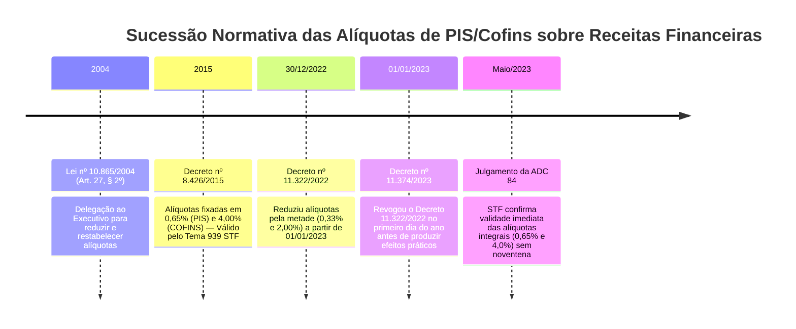

# Precedente Vinculante do STF — ADC 84, ADI 7342, RE 1.458.106 e Tema 1337 (Constitucionalidade do Decreto nº 11.374/2023 e Alíquotas de PIS/COFINS sobre Receitas Financeiras)

> **Nota Metodológica de Indexação:**  
> A controvérsia constitucional sobre a vigência do Decreto nº 11.374/2023, a revogação do Decreto nº 11.322/2022 e a submissão das alíquotas de PIS e COFINS sobre receitas financeiras à anterioridade nonagesimal foi decidida com eficácia *erga omnes* e efeito vinculante pelo Plenário do STF na **Ação Declaratória de Constitucionalidade (ADC) nº 84/DF**, associada às ADIs conexas (ADI nº 7342, ADI nº 7323) e sedimentada em repercussão geral nos Recursos Extraordinários correlatos (RE nº 1.458.106 e Tema nº 1337 do STF).

---

## 1. Identificação do Julgado Constitucional Vinculante

- **Tribunal:** Supremo Tribunal Federal (STF) — Tribunal Pleno
- **Processos Paradigmas:**
  - **Ação Declaratória de Constitucionalidade (ADC) nº 84/DF** (Processo Principal com Eficácia Vinculante e *Erga Omnes*)
  - **Ações Diretas de Inconstitucionalidade (ADIs):** ADI nº 7342/DF e ADI nº 7323/DF
  - **Recursos Extraordinários Paradigmáticos:** RE nº 1.458.106 e RE nº 1.501.643 (Tema 1337 de Repercussão Geral)
- **Relator Originário:** Ministro Ricardo Lewandowski (sucedido pelo Min. Dias Toffoli)
- **Data do Julgamento de Mérito:** Sessão Virtual de 12 a 19 de maio de 2023 (Acórdão publicado no DJe de 20 de junho de 2023)
- **Fonte Oficial:** [Portal do STF — Acompanhamento Processual ADC 84](https://portal.stf.jus.br/processos/detalhe.asp?incidente=6544976)

---

## 2. Tese Jurídica Vinculante Firmada pelo Plenário do STF

> **"É constitucional o Decreto nº 11.374, de 1º de janeiro de 2023, que revogou o Decreto nº 11.322, de 30 de dezembro de 2022, não havendo falar em afronta ao princípio da anterioridade nonagesimal (art. 195, § 6º, da CF/88), porquanto não se verificou majoração de tributo em face da situação fática e jurídica preexistente, mas apenas a manutenção das alíquotas de 0,65% e 4% de PIS e COFINS incidentes sobre receitas financeiras, já em vigor desde a edição do Decreto nº 8.426/2015."**

---

## 3. Contexto Fático-Normativo: A Sucessão Cronológica de Decretos

A dinâmica dos fatos geradores e a vigência das normas tributárias que deflagraram o litígio no STF seguiram o seguinte histórico cronológico:

1. **Art. 27, § 2º, da Lei nº 10.865/2004:**  
   O Congresso Nacional autorizou o Poder Executivo a reduzir e restabelecer as alíquotas da Contribuição para o PIS/Pasep e da Cofins incidentes sobre as receitas financeiras auferidas pelas pessoas jurídicas sujeitas à não cumulatividade. Essa delegação foi declarada constitucional pelo STF no **Tema nº 939 da Repercussão Geral (RE nº 986.296/PR)**.
2. **Decreto nº 8.426/2015:**  
   Em 1º de julho de 2015, o Poder Executivo restabeleceu as alíquotas em **0,65% para o PIS/Pasep** e **4,00% para a Cofins**, totalizando **4,65%**. Essas alíquotas vigoraram sem interrupção prática por mais de sete anos e meio.
3. **Decreto nº 11.322/2022 (Publicado na edição extra do DOU de 30/12/2022):**  
   No último dia útil do exercício fiscal de 2022, o Presidente da República em fim de mandato editou decreto reduzindo as alíquotas de PIS e Cofins sobre receitas financeiras em 50% (passando para 0,33% de PIS e 2,00% de Cofins), fixando o início de vigência para o dia 1º de janeiro de 2023.
4. **Decreto nº 11.374/2023 (Publicado na edição extra do DOU de 01/01/2023):**  
   No primeiro dia do novo mandato presidencial, o novo Chefe do Poder Executivo revogou o Decreto nº 11.322/2022 antes que este produzisse efeitos financeiros práticos, repristinando e mantendo inalteradas as alíquotas do Decreto nº 8.426/2015 (0,65% e 4,00%).

---

## 4. O Debate Hermenêutico e os Fundamentos Determinantes (*Ratio Decidendi*)

### 4.1. A Tese Sustentada pelos Contribuintes (Anterioridade Nonagesimal)
Inúmeras pessoas jurídicas de grande porte impetraram mandados de segurança em todo o território nacional, sustentando que:
- O Decreto nº 11.322/2022 entrou em vigor na data de sua publicação (30/12/2022) com efeitos a partir de 01/01/2023;
- Portanto, o Decreto nº 11.374/2023, editado em 01/01/2023 para restaurar as alíquotas maiores, consubstanciaria verdadeira **majoração de tributo**;
- Por força do art. 195, § 6º, da Constituição Federal, qualquer instituição ou modificação que resulte em aumento de contribuição social só pode ser exigida após decorridos 90 (noventa) dias da publicação da norma majoradora (princípio da noventena ou anterioridade nonagesimal), o que tornaria inexigível a diferença de alíquota entre 01/01/2023 e 01/04/2023.

### 4.2. A Decisão Prevalecente do Plenário do STF (ADC 84)
O Plenário do STF, acompanhando o voto do Ministro Relator e a jurisprudência fixada pelo Ministro Dias Toffoli, rejeitou integralmente a tese dos contribuintes pelos seguintes fundamentos basilares:

1. **Inexistência de Surpresa Fiscal ou Frustração da Confiança:**  
   O princípio da anterioridade tributária tem como teleologia tutelar o contribuinte contra a "surpresa", resguardando a previsibilidade e o planejamento econômico. Na hipótese concreta, as empresas já estavam recolhendo as alíquotas de 0,65% e 4,00% continuamente desde o ano de 2015. A publicação do Decreto nº 11.322/2022 no apagar das luzes do ano não gerou tempo material hábil para que os contribuintes criassem legítima expectativa ou alterassem suas estratégias produtivas com base em alíquotas reduzidas.
2. **Inocorrência de Eficácia Prática do Decreto Redutor:**  
   O Decreto nº 11.322/2022 teve vigência formal apenas no interregno de poucas horas entre a virada do ano e o dia 1º de janeiro de 2023 (dia de feriado nacional em que os mercados financeiros estavam fechados e sem movimentação de liquidação bancária). A revogação em 1º de janeiro de 2023 operou-se antes de consumado qualquer fato gerador de receita financeira sob o império da norma revogada.
3. **Ausência de Majoração em Sentido Material:**  
   O Decreto nº 11.374/2023 não criou tributo nem elevou alíquota acima do patamar que vinha sendo ordinariamente exigido há quase uma década. Limitou-se a manter a exação tributária no patamar histórico pré-existente.
4. **Diferença entre Vacatio Legis e Eficácia Material:**  
   A norma que é tempestivamente desfeita antes de produzir seus efeitos jurídicos concretos não confere ao contribuinte direito adquirido a benefício fiscal nunca efetivamente desfrutado.

---

## 5. Âmbito de Incidência e Exceções na Tributação das Receitas Financeiras

A disciplina mantida pelo Decreto nº 11.374/2023 e pelo Decreto nº 8.426/2015 possui contornos objetivos de incidência:

### 5.1. Sujeitos Passivos Atingidos
- **Pessoas Jurídicas no Lucro Real (Regime Não Cumulativo):**  
  Estão sujeitas ao PIS e à Cofins sobre receitas financeiras, incidindo as alíquotas de **0,65% (PIS)** e **4,00% (Cofins)**.
- **Pessoas Jurídicas no Lucro Presumido (Regime Cumulativo):**  
  **NÃO INCIDE PIS e Cofins** sobre receitas financeiras (como rendimentos de aplicações financeiras de renda fixa, CDB, fundos de investimento). No regime cumulativo (art. 1º da Lei nº 9.718/1998 com redação da Lei nº 11.941/2009), a base de cálculo é adstrita à receita bruta da venda de mercadorias e prestação de serviços.

### 5.2. Receitas Financeiras Excluídas da Incidência (Alíquota Zero Mantida)
O Decreto nº 8.426/2015 estabelece que permanecem com **alíquota 0% (zero)** de PIS/Pasep e Cofins as seguintes hipóteses específicas de receitas financeiras:
- Receitas decorrentes de variações cambiais ativas (operações de câmbio);
- Receitas decorrentes de operações de cobertura (*hedge*) realizadas em bolsa de valores, mercadorias e futuros ou em mercado de balcão organizado destinadas à neutralização de riscos de mercado;
- Receitas financeiras auferidas por instituições financeiras, cooperativas de crédito e entidades a elas equiparadas (que seguem regime setorial próprio previsto na Lei nº 9.718/98).

> **Atenção — Juros sobre o Capital Próprio (JCP):**  
> Embora os Juros sobre o Capital Próprio constituam tecnicamente provento financeiro para quem os aufere, a Solução de Consulta COSIT nº 84/2016 e a legislação federal estabelecem que o JCP **não** se submete às alíquotas de 0,65% e 4%, mas sim à **alíquota geral cheia de 1,65% e 7,6% (total de 9,25%)**, por ostentar natureza jurídica de distribuição remuneratória de capital próprio.

---

## 6. Procedimentos de Conformidade e Escrituração na EFD-Contribuições

Para pessoas jurídicas tributadas com base no Lucro Real que auferem rendimentos de aplicações financeiras, descontos obtidos e juros de mora ativos:

| Registro na EFD-Contribuições | Descrição | Regras de Preenchimento |
| :--- | :--- | :--- |
| **Registro F100** | Demais Documentos e Operações Geradoras de Contribuição | Campo `IND_OPER`: informar `1 - Operação de Receita`.; Campo `CST_PIS` e `CST_COFINS`: informar `01` (Operação Tributável com Alíquota Básica) ou `02` (Operação Tributável com Alíquota Diferenciada).; Campo `ALIQ_PIS`: informar `0,65%`.; Campo `ALIQ_COFINS`: informar `4,00%`. |
| **Registros M210 / M610** | Detalhamento da Contribuição para PIS e Cofins | Discriminação dos débitos apurados sobre o total das receitas financeiras registradas no mês. |
| **Processos Judiciais Pretéritos (Registro 1010/1020)** | Ações sobre Anterioridade Nonagesimal | Os contribuintes que haviam obtido liminares no início de 2023 suspendendo a cobrança durante a noventena (01/01 a 31/03/2023) devem efetuar o recolhimento das diferenças com os acréscimos legais pertinentes, dada a eficácia vinculante da ADC 84 que cassou tais tutelas. |
