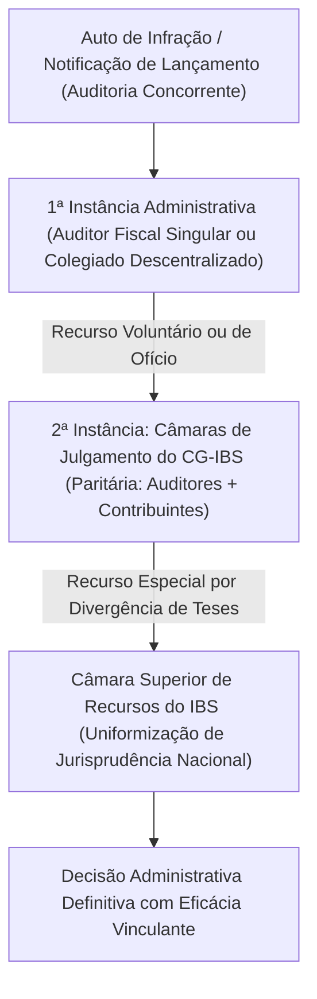

# Projeto de Lei Complementar nº 108, de 2024 (Comitê Gestor do IBS e Processo Administrativo Tributário)

## 1. Visão Geral e Contexto Federativo

O **Projeto de Lei Complementar nº 108, de 2024 (PLP 108/2024)** constitui o segundo pilar normativo da Reforma Tributária sobre o Consumo, regulamentando o art. 156-B da Constituição Federal, incluído pela Emenda Constitucional nº 132/2023.

Enquanto o PLP 68/2024 (convertido na Lei Complementar nº 214/2025) disciplina as regras de direito material e os regimes do IVA Dual (IBS, CBS e IS), o PLP 108/2024 tem como escopo a governança institucional, a gestão compartilhada e a segurança processual do **Imposto sobre Bens e Serviços (IBS)**.

O desafio federativo solucionado pelo projeto é histórico: unificar a administração e a arrecadação tributária dos **26 Estados, do Distrito Federal e de 5.570 Municípios**, superando séculos de conflitos de competência, divergências interpretativas e múltiplos contenciosos administrativos locais, preservando simultaneamente a autonomia política e financeira de cada ente federado.

### 1.1. Tramitação e Conversão Legislativa
* **Iniciativa:** Enviado pelo Poder Executivo ao Congresso Nacional em 4 de junho de 2024 (Mensagem nº 282/2024).
* **Câmara dos Deputados:** Relatoria do Deputado Mauro Benevides Filho, que conduziu ampla negociação entre as entidades representativas estaduais (Comsefaz) e municipais (CNM e FNP), sendo aprovado no Plenário em agosto de 2024.
* **Senado Federal:** Apreciação na Comissão de Constituição e Justiça e Plenário, com consolidação das instâncias do contencioso paritário e regras do ITCMD.
* **Conversão em Lei:** Convertido na **Lei Complementar nº 227, de 13 de janeiro de 2026**.

---

## 2. Natureza Jurídica, Autonomia e Estrutura de Governança do CG-IBS

O Comitê Gestor do IBS (CG-IBS) é qualificado como entidade pública sob regime especial dotada de:
* Autonomia técnica, administrativa, orçamentária e financeira;
* Personalidade jurídica própria de direito público;
* Sede e foro no Distrito Federal e representações regionais;
* Ausência de subordinação hierárquica ou tutela em relação a qualquer Ministério ou ente federado individual.

### 2.1. O Conselho Superior (Instância Máxima Deliberativa)
A governança colegiada do CG-IBS é composta por **54 conselheiros**, distribuídos em absoluta paridade federativa:
1. **27 membros representando os Estados e o Distrito Federal:** Indicados por cada um dos 26 governadores estaduais e pelo governador do DF;
2. **27 membros representando os Municípios e o Distrito Federal:**
 - 14 representantes eleitos pelo voto direto e igualitário de todos os municípios brasileiros (princípio da igualdade dos entes);
 - 13 representantes eleitos pelo voto ponderado pelo número de habitantes de cada município (princípio proporcional populacional);
 - 1 representante do Distrito Federal compondo o colegiado distrital.

### 2.2. Critérios de Deliberação e Quórum Federativo Qualificado
Para assegurar que nenhuma região ou grupo de entes imponha deliberações em detrimento dos demais, as decisões normativas de maior relevo (como o Regulamento do IBS) exigem aprovação cumulativa por:
* **No bloco dos Estados:** Maioria absoluta dos representantes dos Estados que correspondam, cumulativamente, a mais de 50% ou 60% da população brasileira;
* **No bloco dos Municípios:** Maioria absoluta dos representantes municipais.

### 2.3. Diretoria Executiva, Presidência e Mandato Fixo
* A administração executiva cotidiana do CG-IBS é exercida por uma Diretoria Executiva composta por Diretor-Presidente e Diretores Setoriais, com mandatos fixos não coincidentes com os mandatos dos Chefes dos Poderes Executivos estaduais ou municipais, vedada a exoneração ad nutum desmotivada.
* O Comitê conta com Corregedoria-Geral autônoma e Ouvidoria independente.

### 2.4. Financiamento e Custeio Operacional
* O CG-IBS não depende de repasses orçamentários voluntários ou transferências conveniadas da União, Estados ou Municípios.
* Seu orçamento é assegurado mediante **retenção percentual automática** diretamente na fonte sobre o produto bruto da arrecadação do IBS, limitada a índice fixado em lei para cobrir estritamente despesas de pessoal técnico, modernização digital, inteligência artificial fiscal e infraestrutura de servidores.

---

## 3. Competências Institucionais do Comitê Gestor

| Eixo de Atuação | Atribuições Primárias do CG-IBS |
| :--- | :--- |
| **Poder Normativo Uniforme** | Edição do Regulamento Único do IBS, com eficácia vinculante imediata em todo o território nacional, vedada a edição de normas complementares discrepantes por Estados ou Municípios. |
| **Arrecadação e Liquidação Centralizada** | Centralização dos pagamentos e operação da câmara digital de arrecadação do IBS em conjunto com a Receita Federal do Brasil (RFB) e instituições financeiras. |
| **Operação do Split Payment** | Manutenção da Plataforma Nacional de Liquidação Financeira em tempo real, calculando a segregação tributária de IBS na mensageria do Pix, cartões de crédito e pagamentos eletrônicos. |
| **Distribuição e Repartição Federativa** | Repasse diário e automatizado das receitas do IBS diretamente para a conta bancária do Estado e do Município de destino da operação comercial. |
| **Compensação e Ressarcimento de Créditos** | Homologação contínua da conta corrente fiscal dos contribuintes e liquidação de pedidos de restituição e ressarcimento de saldos credores acumulados em dinheiro. |
| **Gestão do Cashback Social** | Apuração dos valores a serem devolvidos para as famílias de baixa renda cadastradas no CadÚnico e execução dos pagamentos mensais. |
| **Coordenação da Fiscalização Integrada** | Harmonização dos planos nacionais de fiscalização, cruzamento de malhas digitais e intercâmbio de dados cadastrais entre o Fisco Federal, Fiscos Estaduais e Fiscos Municipais. |

---

## 4. O Processo Administrativo Tributário (PAT) do IBS

O PLP 108/2024 estabelece um **Regulamento Processual Administrativo Tributário Único** para o IBS, eliminando as centenas de códigos tributários municipais e leis de processo estaduais dispersas.

### 4.1. Princípios e Digitalização Integral
* **Processo 100% Eletrônico:** Tramitação exclusivamente em plataforma digital interoperável;
* **Domicílio Tributário Eletrônico do IBS (DTE-IBS):** Canal único de comunicação, intimação, notificação de lançamentos de ofício e avisos de cobrança para todas as empresas do país;
* **Julgamento Célere e Tempestivo:** Fixação de prazos processuais estritos para defesa (30 dias) e recursos, com sessões virtuais síncronas e assíncronas.

### 4.2. Estrutura das Instâncias de Julgamento

### 4.3. Composição Paritária das Câmaras de Julgamento
* Na segunda instância administrativa e na Câmara Superior de Recursos, os órgãos colegiados são constituídos em formato **paritário**:
 - 50% de Conselheiros representantes do Fisco (auditores fiscais indicados pelos Estados, DF e Municípios);
 - 50% de Conselheiros representantes dos Contribuintes (indicados por confederações empresariais nacionais da indústria, comércio, serviços e agricultura).
* **Fim do Voto de Qualidade Desfavorável:** Adotam-se critérios democráticos para desempate processual, assegurando a presunção de boa-fé e o estrito respeito à legalidade.

### 4.4. Harmonização com o CARF e a Receita Federal (CBS)
* Como o IBS e a CBS compartilham a mesma matriz de incidência (fatos geradores, bases de cálculo e regras de não-cumulatividade idênticos):
 - É criada a **Comissão de Harmonização Tributária e Contenciosa** entre o CG-IBS e a Receita Federal do Brasil / CARF;
 - Decisões unânimes ou súmulas uniformizadoras editadas em conjunto adquirem eficácia vinculante perante as duas esferas, erradicando a discrepância de interpretações entre a União e os entes subnacionais.

---

## 5. Distribuição da Arrecadação e Regras da Transição Federativa (50 Anos)

A distribuição do produto arrecadado do IBS observa o **Princípio do Destino**, assegurando que os recursos pertençam ao local onde a mercadoria é consumida ou o serviço é fruído:

1. **Repartição Diária Automática:** Os recursos segregados pelo Split Payment e arrecadados via Documento Único de Arrecadação do IBS são creditados nas contas dos Estados e Municípios de destino em regime financeiro contínuo;
2. **Retenções Constitucionais Obrigatórias:** A plataforma do CG-IBS efetua a dedução parametrizada instantânea das parcelas vinculadas por preceito constitucional:
 - Saúde pública (12% para Estados e 15% para Municípios);
 - Manutenção e desenvolvimento do ensino (MDE / FUNDEB — 25%);
3. **Mecanismo de Equalização e Compensação Federativa (2029 a 2078):**
 - Transição temporal de 50 anos para acomodar a migração de receitas da origem para o destino;
 - Uma parcela decrescente da receita do IBS é retida e redistribuída proporcionalmente à participação histórica de cada Estado e Município na arrecadação do antigo ICMS e ISS (média apurada entre 2019 e 2028), reduzindo gradualmente até atingir 100% de distribuição pelo destino puro em 2078.

---

## 6. Normas Gerais do ITCMD (Causa Mortis e Doação)

O PLP 108/2024 regulamenta também as diretrizes nacionais relativas ao ITCMD, em atendimento às inovações da EC 132/2023:

* **Progressividade Obrigatória:** Os Estados e o Distrito Federal são obrigados a instituir alíquotas progressivas com base no valor de mercado da herança ou da doação, respeitado o teto máximo fixado pelo Senado Federal (atualmente 8%).
* **Critério de Competência Territorial para Bens Móveis:** A competência passa a ser exclusivamente do Estado onde o falecido era domiciliado ou onde o doador tiver domicílio, inviabilizando manobras fiscais de abertura de inventário ou formalização de doações em unidades federativas com alíquotas mais baixas.
* **Tributação de Bens e Heranças no Exterior:** Preenche a lacuna do art. 155, § 1º, III da CF, definindo as regras gerais de tributação para doadores residentes no exterior ou inventários abertos fora do país.
* **Incidência sobre Planos de Previdência Complementar (VGBL e PGBL):**
 - Estabelece a tributação de planos com natureza assemelhada a aplicações financeiras nos casos em que os aportes tiverem ocorrido em prazos inferiores a cinco anos antes do óbito, prevenindo o planejamento tributário abusivo de blindagem sucessória.

---

## 7. Critérios Uniformes para o ITBI e a Contribuição de Iluminação Pública (COSIP)

O projeto harmoniza a legislação de tributos municipais estratégicos:
* **Fato Gerador do ITBI:** Fixado peremptoriamente no momento do registro da transmissão do bem imóvel ou direito real na matrícula imobiliária perante o Cartório de Registro de Imóveis, pacificando o entendimento do Supremo Tribunal Federal (Tema 1124 da Repercussão Geral);
* **Base de Cálculo do ITBI:** Vinculada ao valor real de mercado da transação declarado pelo contribuinte, admitindo-se arbitramento pela autoridade fiscal municipal apenas mediante procedimento administrativo contraditório fundamentado (conforme Tema 1113 do Superior Tribunal de Justiça);
* **COSIP / CIP:** Possibilidade de expansão da contribuição para o custeio, modernização e monitoramento de serviços de segurança e videomonitoramento integrados à iluminação pública urbana.
