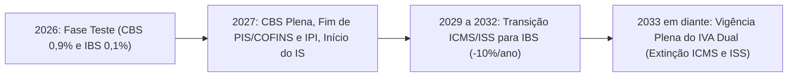

# Projeto de Lei Complementar nº 68, de 2024 (Lei Geral do IBS, CBS e Imposto Seletivo)

## 1. Visão Geral e Contexto Político-Legislativo

O **Projeto de Lei Complementar nº 68, de 2024 (PLP 68/2024)** consubstancia o principal marco regulatório infraconstitucional da Reforma Tributária sobre o Consumo no Brasil, instituída pela **Emenda Constitucional nº 132, de 20 de dezembro de 2023**.

A proposição substitui a fragmentação caótica do sistema tributário anterior — baseado em cinco tributos indiretos cumulativos ou com cumulatividade imperfeita (PIS, COFINS, IPI, ICMS e ISS) — por um modelo moderno de **Imposto sobre Valor Agregado em formato Dual (IVA Dual)**, composto por:
* **CBS (Contribuição sobre Bens e Serviços)**: De competência privativa da União Federal, unificando e extinguindo PIS e COFINS;
* **IBS (Imposto sobre Bens e Serviços)**: De competência compartilhada entre Estados, Distrito Federal e Municípios, unificando e extinguindo o ICMS estadual e o ISS municipal;
* **IS (Imposto Seletivo)**: Tributo de competência federal com função precipuamente extrafiscal, incidente sobre a produção, extração, comercialização ou importação de bens e serviços prejudiciais à saúde humana e ao meio ambiente.

### 1.1. Histórico de Tramitação
* **Apresentação:** Enviado pelo Poder Executivo ao Congresso Nacional em 24 de abril de 2024 mediante a Mensagem Presidencial nº 167/2024.
* **Câmara dos Deputados:** Criado Grupo de Trabalho (GT) multidisciplinar, com realização de audiências públicas com todos os setores econômicos, sendo aprovado no Plenário em julho de 2024.
* **Senado Federal:** Relatado pelo Senador Eduardo Braga na Comissão de Constituição e Justiça (CCJ), sofrendo aprimoramentos técnicos e inclusão de salvaguardas setoriais.
* **Aprovação Bicameral e Sanção:** Após retorno à Câmara para deliberação das emendas do Senado, o texto foi aprovado e convertido na **Lei Complementar nº 214, de 16 de janeiro de 2025**.

---

## 2. Estrutura Geral da Norma

O projeto organiza-se sistematicamente em quatro grandes livros:

1. **Livro I — Do Imposto sobre Bens e Serviços (IBS) e da Contribuição sobre Bens e Serviços (CBS)**:
 - Fato gerador, momento da ocorrência e territorialidade;
 - Sujeição passiva e imunidades constitucionais;
 - Base de cálculo ("por fora"), alíquotas de referência e fixação pelos entes;
 - Princípio da não-cumulatividade plena e sistemática de apropriação de créditos;
 - Mecanismos de arrecadação, pagamento e **Split Payment** (arts. 49 a 53).
2. **Livro II — Dos Regimes Diferenciados e Específicos**:
 - Cesta Básica Nacional de Alimentos e produtos agropecuários;
 - Reduções de alíquotas (60% e 30%) e cashback para famílias de baixa renda;
 - Regimes específicos (combustíveis, serviços financeiros, seguros, bens imóveis, cooperativas, hotelaria, etc.);
 - Tratamento da Zona Franca de Manaus (ZFM) e Áreas de Livre Comércio (ALC).
3. **Livro III — Do Imposto Seletivo (IS)**:
 - Critérios de incidência extrafiscal e rol taxativo de bens e atividades gravadas;
 - Hipóteses de imunidade na exportação e limitações à extração mineral (teto de 1%);
 - Regras de lançamento, apuração e alíquotas específicas ou ad valorem.
4. **Livro IV — Da Transição, Compensação de Saldos Credores e Disposições Finais**:
 - Cronograma escalonado de 2026 a 2033;
 - Sistemática de aproveitamento de créditos remanescentes de ICMS e PIS/COFINS;
 - Fundo de Compensação de Benefícios Fiscais (FCBF).

---

## 3. Pilares Estruturais do IVA Dual (IBS e CBS)

### 3.1. Princípio do Destino
A tributação desloca-se definitivamente da origem da produção para o **local do consumo final** do bem ou serviço. Com isso:
* Elimina-se por completo a secular "Guerra Fiscal" entre Estados e Municípios;
* Encerra-se a concessão unilateral e predatória de isenções e favores fiscais heterônomos;
* Assegura-se que a arrecadação pertença ao ente onde reside o consumidor ou onde ocorre a fruição do serviço.

### 3.2. Base de Cálculo "Por Fora" (Gross-up Proibido)
Ao contrário do ICMS e PIS/COFINS legados, que calculavam imposto incidindo sobre imposto (cálculo "por dentro"):
* O IBS e a CBS incidem estritamente sobre o valor da operação;
* O montante do próprio IBS e da própria CBS **não integra** sua base de cálculo;
* O montante do Imposto Seletivo integra a base de cálculo de IBS e CBS;
* Transparência total na nota fiscal: o consumidor sabe com precisão cirúrgica quanto está pagando de imposto aos cofres públicos.

### 3.3. Não-Cumulatividade Plena (Crédito Financeiro Universal)
* **Regra Geral:** Qualquer aquisição onerada por IBS ou CBS vinculada à atividade econômica da pessoa jurídica gera direito a crédito integral.
* **Superação do Crédito Físico:** Supera as restrições restritivas da Lei Kandir (onde insumos de uso e consumo geral não geravam crédito imediato).
* **Condição de Validação:** Em estrita observância ao art. 156-A, § 5º, VIII da CF e arts. 50 a 53 da lei, o aproveitamento do crédito pelo adquirente ocorre de modo automático quando a operação é liquidada mediante o sistema de **Split Payment**.
* **Devolução Rápida de Saldos Credores:** Fixação de prazos estritos para devolução em dinheiro ao contribuinte caso acumule saldo credor (exportadores, empresas industriais com ciclo longo e investidores): devolução tempestiva entre 60 e 180 dias, sob pena de incidência da taxa Selic.

---

## 4. Regimes Diferenciados e Favorecidos

O PLP 68/2024 desenhou critérios rigorosos para os regimes diferenciados, visando equilibrar a justiça social e a manutenção de uma alíquota-padrão sustentável:

### 4.1. Cesta Básica Nacional de Alimentos (Alíquota Zero Plena)
* Isenção total de IBS e CBS, com manutenção integral dos créditos fiscais gerados nas etapas produtivas anteriores para itens essenciais:
 - Arroz, feijão, leite fluido e em pó, farinha de trigo, farinha de mandioca, pão comum, café, frutas, legumes, carnes bovinas, suínas, ovinas, caprinas e de aves, peixes in natura e ovos.
* Criação da Cesta Básica Estendida com alíquota reduzida de 60% para alimentos industrializados saudáveis.

### 4.2. Redução de 60% da Alíquota Padrão
Setores estratégicos e de alto impacto distributivo contam com redução de 60% da alíquota de referência:
* **Serviços de Educação:** Ensinos infantil, fundamental, médio, técnico e universitário;
* **Serviços de Saúde e Dispositivos Médicos:** Consultas, internações hospitalares, exames e próteses;
* **Medicamentos:** Rol prioritário estabelecido em lista anexa da ANVISA;
* **Produtos Agropecuários, Aquícolas e Florestais in natura**;
* **Transporte Público Coletivo de Passageiros rodoviário, ferroviário e hidroviário urbano e metropolitano**;
* **Produções Artísticas, Culturais e Jornalísticas Nacionais**.

### 4.3. Redução de 30% para Profissões Intelectuais Regulamentadas
* Aplica-se à prestação de serviços por pessoas físicas ou pessoas jurídicas submetidas à fiscalização de conselho profissional (médicos, advogados, contadores, engenheiros, arquitetos, economistas, veterinários, etc.), desde que atendam a requisitos de atuação uniprofissional.

### 4.4. Cashback do Povo (Devolução para Famílias de Baixa Renda)
* Devolução personalizada de parte expressiva do IBS e da CBS para famílias inscritas no Cadastro Único (CadÚnico):
 - 100% de devolução da CBS e 20% do IBS sobre botijão de gás (GLP);
 - 50% de devolução da CBS e 20% do IBS sobre contas residenciais de energia elétrica, água/esgoto e gás canalizado;
 - 20% sobre as demais compras de bens e serviços de consumo diário.

---

## 5. Regimes Específicos de Tributação

Alguns setores, por sua natureza peculiar de precificação ou ciclo operacional, não comportam a não-cumulatividade tradicional e foram regrados por regimes específicos:

| Setor Econômico | Sistemática de Tributação Específica |
| :--- | :--- |
| **Combustíveis e Lubrificantes** | Tributação monofásica concentrada no produtor/refinaria ou importador. Alíquotas *ad rem* fixas por unidade de medida (litro ou kg), idênticas em todo o território nacional. |
| **Serviços Financeiros e Bancários** | Incidência sobre a margem de intermediação financeira (spread bancário) ou receitas de tarifas e comissões, vedada a apropriação de créditos pelas empresas tomadoras de crédito comuns. |
| **Seguros Privados e Planos de Saúde** | Base de cálculo ajustada pela dedução dos sinistros pagos e provisões técnicas regulatórias. |
| **Bens Imóveis (Construção e Locação)** | Base de cálculo calculada sobre a diferença entre o valor de alienação e o custo de aquisição do terreno/imóvel, com dedução de redutores sociais para habitação de interesse popular. |
| **Sociedades Cooperativas** | Não incidência sobre os atos cooperativos típicos entre o associado e a entidade, tributando apenas as operações comerciais com terceiros tomadores de serviços. |
| **Combustíveis de Aviação e Hotelaria** | Tratamento diferenciado para manter a competitividade turística nacional. |

---

## 6. O Imposto Seletivo (IS — "Imposto do Pecado")

O Livro III disciplina a aplicação do **Imposto Seletivo**, previsto no art. 153, VIII da Constituição:

* **Finalidade e Caráter:** Estritamente extrafiscal. Não tem objetivo primário de arrecadação orçamentária, mas de desestimular o consumo de produtos nocivos à saúde ou degradantes do meio ambiente.
* **Incidência Monofásica:** Cobrado uma única vez no ciclo, preferencialmente na saída do estabelecimento fabricante ou na importação.
* **Bens Sujeitos ao IS**:
 1. Veículos automotores (alíquota progressiva parametrizada pela emissão de carbono, eficiência energética e segurança);
 2. Embarcações de recreio ou esporte e aeronaves executivas;
 3. Cigarros e demais produtos fumígenos contendo tabaco ou derivados;
 4. Bebidas alcoólicas (com alíquotas ad valorem ou ad rem calibradas pelo teor alcoólico);
 5. Bebidas açucaradas com adição de açúcares livres (refrigerantes e néctares artificiais);
 6. Extração mineral não renovável de petróleo, gás natural e minério de ferro (com alíquota constitucional máxima fixada em 1%).
* **Imunidade:** As exportações de bens industriais manufaturados são plenamente imunes ao IS.

---

## 7. Cronograma e Transição Federativa (2026 – 2033)

A substituição tributária foi estruturada de forma gradual e segura, para que o setor produtivo e o Estado absorvam a transformação sem sobressaltos:

* **Ano de 2026 (Ano de Teste):**
 - Entrada em vigor da CBS à alíquota de 0,9% e do IBS à alíquota de 0,1%.
 - O valor recolhido é compensável integralmente com os valores devidos de PIS/COFINS pelo contribuinte.
 - Finalidade: calibrar o motor de cálculo, testar as plataformas do **Split Payment**, integrar os ERPs e validar os dados cadastrais.
* **Ano de 2027 (Entrada em Vigor Federal Plena):**
 - Extinção integral do PIS e da COFINS;
 - Cobrança da alíquota integral da CBS de referência;
 - Redução das alíquotas do IPI a zero em todo o país (com exceção dos itens concorrentes com os fabricados na Zona Franca de Manaus);
 - Início da exigibilidade do Imposto Seletivo.
* **Anos de 2029 a 2032 (Transição dos Estados e Municípios):**
 - Redução gradual das alíquotas de ICMS e ISS à razão de 1/10 (10%) a cada ano:
 - 2029: 90% ICMS/ISS e 10% IBS;
 - 2030: 80% ICMS/ISS e 20% IBS;
 - 2031: 70% ICMS/ISS e 30% IBS;
 - 2032: 60% ICMS/ISS e 40% IBS.
* **Ano de 2033 (Consolidação do Novo Sistema):**
 - Extinção definitiva e total do ICMS e do ISS;
 - Entrada em vigor plena e exclusiva do IBS e da CBS em 100% das transações nacionais.
* **Transição Federativa da Partilha de Recursos (50 Anos — 2029 a 2078):**
 - Mecanismo financeiro de compensação progressiva para impedir que qualquer Estado ou Município sofra perda abrupta de receita decorrente da migração para o princípio do destino.
