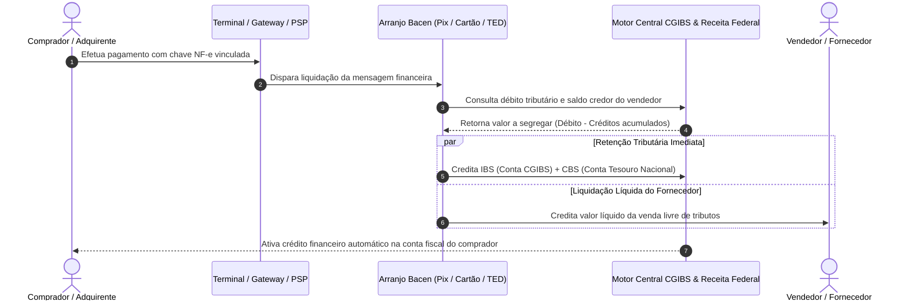

# Modelo Operacional e Arquitetura Técnica do Split Payment Inteligente (IBS e CBS)

## 1. Fundamento Legal e Constitucional

O mecanismo de **recolhimento na liquidação financeira (*Split Payment*)** foi alçado a pilar estruturante do Novo Sistema Tributário Nacional a partir do **art. 156-A, § 5º, VIII da Constituição Federal**, introduzido pela Emenda Constitucional nº 132/2023. O dispositivo constitucional condiciona expressamente o aproveitamento tempestivo de créditos de IBS e CBS pelo adquirente à comprovação do efetivo recolhimento do tributo incidente na operação antecedente.

A regulamentação legal encontra-se positivada nos **arts. 31 a 35 da Lei Complementar nº 214, de 16 de janeiro de 2025** (que converteu o PLP 68/2024).

---

## 2. Paradigma Tradicional vs. Paradigma do Split Payment

| Dimensão Operacional | Sistema Tradicional Legado (ICMS, ISS, PIS, Cofins) | Novo Sistema Split Payment (IBS e CBS - LC 214/2025) |
| :--- | :--- | :--- |
| **Momento da Arrecadação** | Declaração diferida no mês subsequente à operação comercial. | Retenção simultânea no ato da liquidação financeira eletrônica. |
| **Fluxo Financeiro** | Vendedor recebe 100% dos recursos brutos e retém o valor do imposto em caixa. | Instituição financeira credita apenas o líquido ao vendedor e repassa o tributo ao Fisco. |
| **Confiabilidade do Crédito** | Sujeito a glosas posteriores, fraudes de "empresas noteiras" e autos de infração. | Crédito 100% garantido e ativado em tempo real na conta gráfica do adquirente. |
| **Inadimplência Fiscal** | Risco estrutural e formação de bilhões em dívida ativa inadimplida. | Erradicação da inadimplência na fonte em operações eletrônicas. |

---

## 3. As Três Modalidades Positivadas na Lei Complementar nº 214/2025

A disciplina legal estabelece três modalidades escalonadas de operacionalização:

### 3.1. Procedimento Padrão / Split Payment Inteligente (Art. 32 da LC 214/2025)
* Opera mediante a **vinculação em tempo real** entre a transação financeira (Pix, TED, liquidação de cartão de crédito/débito) e o Documento Fiscal Eletrônico correspondente (NF-e, NFC-e, NFS-e nacional);
* O motor de cálculo central do CGIBS e da RFB é consultado via API pelas instituições financeiras participantes;
* **Gestão de Saldos Credores:** Caso o vendedor possua saldo credor homologado na sua conta gráfica fiscal (decorrente de aquisições de insumos ou exportações), o sistema central abate esse crédito, reduzindo ou zerando a retenção na fonte para proteger o capital de giro da empresa;
* O adquirente tem seu crédito homologado no exato instante do split.

### 3.2. Procedimento Simplificado (Art. 33 da LC 214/2025)
* Modalidade optativa para fornecedores quando a transação financeira for realizada com consumidor final pessoa física ou quando não for tecnicamente viável a conciliação individual nota a nota em milissegundos;
* A retenção ocorre com base em alíquota média ponderada setorial parametrizada pelo Comitê Gestor e RFB;
* Eventuais diferenças a maior ou a menor são compensadas no encerramento do período mensal de apuração da conta corrente fiscal.

### 3.3. Recolhimento pelo Próprio Adquirente / Split Manual (Art. 31, § 4º da LC 214/2025)
* Aplicável quando a operação não for liquidada por instituição participante do Sistema de Pagamentos Brasileiro (SPB / SPI) — por exemplo, pagamentos em dinheiro em espécie, compensação em moeda mercantil, permuta ou arranjos não cooperativos;
* O adquirente adimplente pessoa jurídica efetua o recolhimento direto da guia de IBS/CBS para assegurar a apropriação regular e irrevogável de seus créditos fiscais.

---

## 4. Diagrama de Fluxo Operacional da Liquidação Financeira

---

## 5. Obrigações das Instituições Financeiras e de Pagamento (PSPs)

Conforme os arts. 31 e 34 da LC 214/2025 e resoluções do Banco Central do Brasil:
1. **Dever de Segregação e Recolhimento:** As instituições prestadoras de serviços de pagamento participantes da liquidação são responsáveis por segregar e recolher de forma imediata o IBS e a CBS;
2. **Integração de Mensageria:** Inclusão obrigatória da Chave de Acesso do DF-e na mensageria do Pix (campos dedicados do protocolo SPI) e nos protocolos de autorização de adquirentes de cartões;
3. **Operações Parceladas:** Nas compras parceladas, o IBS e a CBS são segregados proporcionalmente em cada parcela liquidada;
4. **Cronograma de Implantação:** Funcionamento a partir dos testes de 2026, com expansão progressiva até a cobertura universal dos meios de pagamento em 2027.

