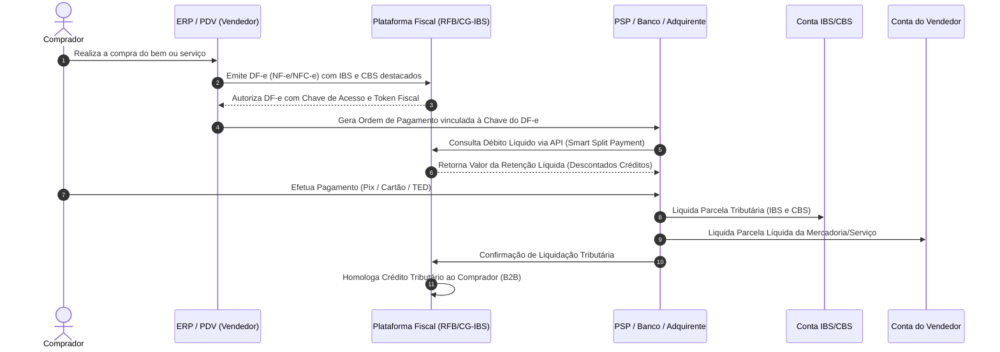

# Modelo Operacional e Arquitetura Técnica do Split Payment Inteligente (IBS e CBS)

## 1. Visão Geral e Fundamento Constitucional

O **Split Payment** (mecanismo de recolhimento na liquidação financeira) constitui a espinha dorsal tecnológica do novo sistema de tributação sobre o consumo no Brasil, concebido a partir da Emenda Constitucional nº 132/2023 e disciplinado pelo Projeto de Lei Complementar nº 68/2024 (convertido na Lei Complementar nº 214/2025).

O modelo tradicional de arrecadação do ICMS, ISS, PIS e COFINS operava sob o paradigma da declaração diferida: a empresa vendia a mercadoria ou prestava o serviço, recebia 100% dos recursos financeiros do comprador, apurava os tributos no mês seguinte e, caso tivesse recursos disponíveis, recolhia a guia bancária. Esse modelo gerava:
1. Elevados índices de inadimplência fiscal e acúmulo de dívida ativa da União, Estados e Municípios;
2. Proliferação de empresas de fachada ("noteiras"), estruturadas unicamente para emitir notas fiscais frias, gerar créditos fictícios para terceiros e desaparecer antes de qualquer cobrança;
3. Litigiosidade excessiva e travas burocráticas para liberação e validação de créditos fiscais ao adquirente legítimo.

Para mitigar esses problemas estruturais, o art. 156-A, § 5º, VIII da Constituição Federal estabeleceu que o aproveitamento de créditos pelo adquirente fica expressamente condicionado à comprovação do efetivo recolhimento do tributo incidente sobre a operação na etapa antecedente. O Split Payment é a ferramenta programática que viabiliza essa condição em milissegundos, no exato instante do pagamento eletrônico.

---

## 2. Base Normativa no PLP 68/2024 (Artigos 49 a 53)

O Capítulo de Pagamento e Liquidação Financeira do PLP 68/2024 estabelece a disciplina jurídica da segregação de recursos:

### 2.1. Art. 49 — Modalidades de Recolhimento e Débito Autorizado em Conta
* Define que o recolhimento do Imposto sobre Bens e Serviços (IBS) e da Contribuição sobre Bens e Serviços (CBS) será efetuado pelo sujeito passivo preferencialmente por meio de mecanismos automatizados de liquidação.
* O Comitê Gestor do IBS (CG-IBS) e a Secretaria Especial da Receita Federal do Brasil (RFB) disponibilizam aos contribuintes ferramentas para autorização prévia de débito direto em contas de depósito à vista ou de pagamento de titularidade do sujeito passivo.

### 2.2. Art. 50 — Vinculação Obrigatória dos Arranjos de Pagamento aos Documentos Fiscais
* Os arranjos de pagamento baseados em instrumentos eletrônicos (Pix, transferências bancárias, cartões de crédito, débito, pré-pagos e moedas eletrônicas) devem estipular contratualmente e tecnicamente a vinculação entre a transação financeira, o Documento Fiscal Eletrônico (DF-e) correspondente e os valores a liquidar.
* Aplica-se a todos os prestadores de serviços de pagamento (PSPs), integrados ou não ao Sistema de Pagamentos Brasileiro (SPB) e Sistema de Pagamentos Instantâneos (SPI / Bacen), compreendendo adquirentes, subadquirentes, emissores, credenciadores e marketplaces participantes da liquidação.

### 2.3. Art. 51 — Segregação e Recolhimento Simultâneo pelo PSP (Split Payment Obrigatório)
* Na liquidação financeira de qualquer transação de pagamento de bem ou serviço acobertada por DF-e, os prestadores de serviços de pagamento participantes da liquidação devem **segregar e recolher de forma imediata** aos cofres públicos a parcela relativa à CBS (Receita Federal) e ao IBS (Comitê Gestor do IBS).
* O fornecedor/vendedor recebe exclusivamente o montante líquido da operação, livre dos tributos incidentes.
* O fornecedor tem o dever instrumental de transmitir tempestivamente à instituição financeira ou de pagamento as informações que identifiquem a chave de acesso do respectivo documento fiscal eletrônico.

### 2.4. Art. 52 — Recolhimento pelo Próprio Adquirente
* Caso a operação ocorra por meio de instrumento de pagamento que inviabilize a retenção automática (e.g. liquidação em dinheiro em espécie, cheque, ou arranjo não cooperativo), o adquirente adimplente assume a prerrogativa de recolher diretamente a parcela do IBS e da CBS.
* Esse recolhimento direto pelo comprador é a garantia legal de que seu crédito fiscal correspondente à operação será imediatamente ativado e homologado na sua conta gráfica digital, sem risco de glosa.

### 2.5. Art. 53 — Compensação de Saldos Credores e Gestão da Não-Cumulatividade
* Disciplina a proteção ao capital de giro: o mecanismo de retenção na liquidação financeira deve respeitar os saldos credores acumulados pelo fornecedor na sua conta corrente fiscal perante o Comitê Gestor e a RFB.
* Em operações onde o contribuinte possui créditos acumulados de insumos e aquisições anteriores, a retenção na fonte via split payment é reduzida ou suspensa pelo sistema central do Fisco, evitando a sangria indevida de caixa.

---

## 3. Split Payment Padrão vs. Split Payment Inteligente

A legislação brasileira desenhou dois modelos operacionais complementares para atender a diferentes níveis de maturidade tecnológica e modelos de negócios:

| Critério | Split Payment Padrão (Bruto) | Split Payment Inteligente (Smart Split) |
| :--- | :--- | :--- |
| **Gatilho de Retenção** | Alíquota nominal sobre o valor total do DF-e ou percentual presumido fixo. | Consulta em tempo real à API da Plataforma Central Fiscal (RFB / CG-IBS). |
| **Tratamento de Créditos** | Não compensa créditos em tempo real; a devolução de sobras é feita em D+X. | Abate instantaneamente os créditos fiscais registrados na conta corrente do vendedor. |
| **Valor Retido** | Valor bruto integral de IBS + CBS destacado na nota fiscal da operação. | Valor líquido estritamente devido pelo contribuinte no período de apuração. |
| **Impacto no Fluxo de Caixa** | Alto se a cadeia for longa e houver aquisição massiva de insumos. | Nulo ou mínimo: preserva integralmente o capital de giro operacional da empresa. |
| **Integração Exigida** | Leitura estática da chave da NF-e e segregação do percentual correspondente. | Integração bidirecional do PSP com a mensageria de apuração contínua do Fisco. |
| **Aplicabilidade Preferencial** | Operações B2C no varejo rápido e adquirentes sem integração ERP avançada. | Operações B2B, grandes cadeias fabris, distribuidores e comércios integrados. |

---

## 4. Arquitetura Funcional e Fluxo de Mensageria em Tempo Real

A mecânica do **Split Payment Inteligente** opera em sincronia milimétrica entre quatro atores:
1. **Adquirente / Comprador (Pagador)**;
2. **Fornecedor / Vendedor (Recebedor)**;
3. **Instituição Financeira / Prestador de Serviços de Pagamento (PSP Pagador e PSP Recebedor / Adquirente de Cartão)**;
4. **Plataforma Nacional de Split Payment (Ambiente Integrado RFB / CG-IBS)**.

### 4.1. Passo a Passo do Ciclo Operacional

1. **Geração do Documento Fiscal Eletrônico (DF-e)**:
 - O fornecedor fatura a mercadoria ou serviço emitindo NF-e (modelo 55), NFC-e (modelo 65) ou NFS-e Nacional.
 - O documento discrimina: Base de Cálculo, Alíquota de IBS Estadual, Alíquota de IBS Municipal, Alíquota de CBS Federal e montante total dos tributos.
2. **Vinculação do Identificador Fiscal à Cobrança**:
 - No Pix: A chave de acesso de 44 dígitos é injetada no payload EMV do Pix Cobrança (QR Code dinâmico ou Pix Copia e Cola) no campo específico padronizado pelo Banco Central (`txid` / dados adicionais de cobrança).
 - No Cartão de Crédito/Débito: O PinPad ou Gateway de Pagamento recebe a chave de autorização fiscal do ERP/Frente de Caixa no momento do fechamento da transação comercial.
3. **Consulta da Retenção Líquida (Inteligência de Crédito)**:
 - Antes de liquidar o valor nos livros contábeis, o PSP consulta a API do Fisco informando a Chave de Acesso e o CNPJ do vendedor.
 - A Plataforma Fiscal verifica:
 - O valor total do IBS/CBS incidente sobre a nota fiscal (`VT`);
 - O saldo de créditos fiscais disponíveis na conta corrente do vendedor (`SC`);
 - Retorna o valor de retenção efetiva: `Retenção = max(0, VT - SC)`.
4. **Liquidação Financeira Segregada**:
 - O PSP debita 100% do valor da transação da conta do comprador.
 - Credita o valor da `Retenção` diretamente na Conta de Arrecadação Unificada do Comitê Gestor do IBS e Receita Federal.
 - Credita o valor restante `(Valor da Venda - Retenção - Tarifas do PSP)` na conta de pagamento/depósito do vendedor.
5. **Ativação Instantânea do Crédito B2B**:
 - A confirmação de recolhimento gera um evento eletrônico na base do Sistema Público de Escrituração Digital (SPED/IVA).
 - O adquirente (caso seja contribuinte do regime regular) tem seu crédito liberado imediatamente para dedução nas suas saídas subsequentes.

---

## 5. Implementação nos Diferentes Instrumentos de Liquidação

### 5.1. Pix (Sistema de Pagamentos Instantâneos - SPI)
* **Canal Nativo Ideal:** O Pix é o instrumento mais aderente ao split payment pela arquitetura de liquidação bruta em tempo real (LBTR) operada 24/7 pelo Banco Central.
* **Mensageria SPI:** As mensagens de liquidação interbancária (`pacs.008`) foram desenhadas para suportar divisões de saldo, onde a instrução do pagador acarreta a dispersão simultânea para o recebedor privado e para a conta de liquidação especial do Tesouro/CGIBS.

### 5.2. Cartões de Débito e Crédito
* **Grade de Liquidação dos Adquirentes:**
 * Nas vendas no débito (D+1 ou D+0), a retenção tributária ocorre simultaneamente ao repasse do montante do lojista.
 * Nas vendas no crédito à vista (D+30), a retenção do tributo ocorre na mesma data em que o comerciante recebe os fundos da adquirente.
 * Nas vendas no crédito parcelado: a retenção é calculada proporcionalmente ao valor de cada fatura parcelada (`pro-rata`), preservando o equilíbrio temporal entre receita líquida e obrigação tributária.
* **Antecipação de Recebíveis:** Em caso de cessão ou antecipação de recebíveis de cartão junto a FIDCs ou bancos, a parcela do tributo permanece intangível e segregada, não podendo ser objeto de desconto, penhora ou alienação fiduciária pelo comerciante.

### 5.3. Boleto Bancário e DDA
* O código de barras e QR Code Pix do boleto híbrido transportam os metadados fiscais.
* Na câmara de compensação interbancária (CIP / C3), o montante tributário é desviado diretamente para as contas fiscais governamentais, sem transitar pela conta livre do beneficiário.

---

## 6. Tratamento de Exceções, Estornos e Devoluções

| Evento Operacional | Mecânica de Ajuste no Split Payment |
| :--- | :--- |
| **Cancelamento de NF-e tempestivo (dentro de 24h)** | A Plataforma Fiscal emite comando de reversão automática. Se a liquidação financeira não tiver ocorrido, o cancelamento é pleno. Se já ocorreu, o valor retido vira crédito imediato na conta corrente fiscal do contribuinte. |
| **Devolução Total de Mercadoria** | Emissão de Nota Fiscal de Entrada por Devolução. O adquirente estorna o crédito anterior e o fornecedor recebe crédito tributário equivalente para compensar nas próximas vendas via Split Inteligente. |
| **Devolução Parcial** | Ajuste pro-rata na conta gráfica da operação pelo valor das peças ou itens devolvidos. |
| **Chargeback / Contestação de Compra no Cartão** | O adquirente notifica o Comitê Gestor. O valor do tributo retido que já estiver nos cofres públicos não é estornado do Fisco pelo PSP, mas gera crédito financeiro automático na conta fiscal do lojista para abater de futuros recolhimentos. |
| **Falha de Conectividade com a API Fiscal** | Aplica-se a regra de contingência: o PSP realiza a retenção com base na alíquota de contingência parametrizada ou tabela offline homologada, com conciliação automática no lote noturno subsequente. |

---

## 7. Benefícios Sistêmicos e Salvaguardas

1. **Garantia de Neutralidade e Não-Cumulatividade:** Resolve o dilema do crédito tributário financeiro amplo: o crédito só existe quando pago, e o pagamento ocorre de modo infalível pela tecnologia.
2. **Extinção das Empresas Noteiras:** Fraudes multimilionárias de emissão de notas frias para transferência de créditos perdem qualquer incentivo econômico, pois o crédito só é liberado mediante débito bancário efetivo.
3. **Redução Substancial da Alíquota de Referência:** O combate à evasão fiscal e à inadimplência potencializa a base arrecadatória, permitindo que a União e os Estados fixem alíquotas-padrão de equilíbrio menores para toda a sociedade.
4. **Segurança Jurídica dos Adquirentes:** Empresas não correm o risco de autuações retrospectivas de glosa de créditos por inidoneidade de fornecedores contratados de boa-fé.
