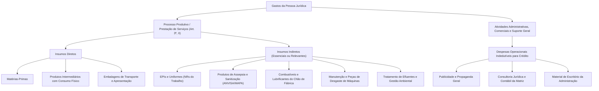

# Súmula CARF nº 178 e Jurisprudência Vinculante do CARF — Aplicação dos Critérios de Essencialidade e Relevância para Créditos de PIS/COFINS sobre Insumos

## 1. Identificação do Enunciado e Marco Normativo no CARF

- **Órgão Julgador:** Conselho Administrativo de Recursos Fiscais (CARF) — Câmara Superior de Recursos Fiscais (CSRF)
- **Ato Normativo:** Súmula CARF nº 178 (e cotejo sistemático com as Súmulas CARF nº 183, nº 189 e nº 190)
- **Data de Aprovação da Súmula nº 178:** 8 de setembro de 2021 (Portaria ME nº 12.975/2021)
- **Força Vinculante no Processo Administrativo Fiscal:** Art. 62, § 2º, do Regimento Interno do CARF (RICARF) c/c art. 19-A da Lei nº 10.522/2002, com aplicação compulsória para os Auditores-Fiscais da Receita Federal do Brasil (RFB), Delegacias da Receita Federal de Julgamento (DRJ) e todas as Turmas e Câmaras do CARF.
- **Fonte Oficial:** [Portal do CARF — Súmulas Vinculantes](https://carf.fazenda.gov.br)

---

## 2. Enunciado e Vinculação Obrigatória ao Precedente do STJ (Tema 779)

> **Enunciado Consolidado da Súmula CARF nº 178 (Insumos e Não Cumulatividade):**  
> *"O conceito de insumo para determinação de créditos da não cumulatividade da Contribuição para o PIS/Pasep e da Cofins, nos termos do art. 3º, inciso II, das Leis nº 10.637/2002 e nº 10.833/2003, deve ser aferido à luz dos critérios da essencialidade ou relevância do bem ou serviço para o processo produtivo ou para a prestação de serviços desempenhada pela pessoa jurídica, considerando-se as singularidades de seu processo operacional."*

### 2.1. O Princípio da Aderência Obrigatória aos Recursos Repetitivos
Por expressa determinação do art. 62, § 2º, do Anexo II do RICARF (Portaria MF nº 343/2015 e atualizações posteriores), os Conselheiros e Turmas do CARF estão **estritamente vinculados** às decisões definitivas de mérito proferidas pelo Supremo Tribunal Federal em sede de Repercussão Geral e pelo Superior Tribunal de Justiça sob o rito dos Recursos Repetitivos (art. 1.036 do CPC/2015).

Dessa forma, a aprovação do verbete sumular pelo Pleno do CARF materializou o encerramento do longo período de resistência fazendária na esfera administrativa, banindo de forma irrecorrível a antiga aplicação das Instruções Normativas SRF nº 247/2002 e nº 404/2004, que restringiam os insumos ao estrito conceito do IPI (contato físico ou agregação imediata ao produto final).

---

## 3. Cotejo Sistemático com Outras Súmulas Paradigmáticas do CARF

A aplicação do conceito de insumo na Câmara Superior de Recursos Fiscais é modulada de forma concatenada com outros verbetes fundamentais:

| Norma Sumular | Matéria Específica e Ementa | Relação Dogmática com o Tema dos Insumos de PIS/Cofins |
| :--- | :--- | :--- |
| **Súmula CARF nº 178** | Conceito de insumo sob os critérios da essencialidade e da relevância (Tema 779/STJ). | Fixa a tese central: supera a restrição do IPI e o elastério do IRPJ, exigindo o teste de subtração vinculado à atividade-fim do contribuinte. |
| **Súmula CARF nº 183** | *"O valor das aquisições de matérias-primas, produtos intermediários, materiais de embalagem, energia elétrica e combustíveis, empregados em atividades anteriores à fase industrial do processo produtivo, não deve ser incluído na base de cálculo do crédito presumido do IPI, de que tratam as Leis nºs 9.363/96 e 10.276/01."* | **Cotejo Diferenciador:** O verbete estabelece a fronteira estrita do crédito presumido de IPI para empresas exportadoras. Embora no IPI a fase agrícola seja expurgada da fase fabril, para fins de **PIS/Cofins** prevalece a ampla integração da cadeia produtiva verticalizada. |
| **Súmula CARF nº 189** | Gastos com frete incorridos na aquisição de insumos não sujeitos ao pagamento da contribuição (alíquota zero, isenção ou suspensão). | Assegura que o frete FOB pago a transportadora nacional sobre insumos desonerados gera direito pleno ao crédito de PIS/Cofins (9,25%), por constituir serviço essencial que atua como insumo autônomo. |
| **Súmula CARF nº 190** | Bens e serviços aplicados na fase de produção agrícola por agroindústrias ("Insumos do Insumo"). | Reconhece expressamente o direito de crédito de PIS/Cofins às agroindústrias sobre os custos e insumos consumidos na fase do cultivo agrícola de matérias-primas posteriormente industrializadas pela própria pessoa jurídica. |

---

## 4. Classificação Operativa no CARF: Insumos Diretos versus Insumos Indiretos

Na apreciação dos litígios administrativos, os conselheiros do CARF categorizam os bens e serviços em duas grandes classes:

### 4.1. Insumos Diretos
Correspondem às **matérias-primas**, **produtos intermediários** e **materiais de embalagem** que sofrem transformação física, química ou mecânica, ou que entram em contato direto com o produto em elaboração, integrando sua composição física final. Esses itens possuem direito a crédito incontroverso e pacífico no CARF desde o início da não cumulatividade.

### 4.2. Insumos Indiretos (O Campo de Aplicação do Tema 779/STJ e da Súmula 178)
São bens e serviços que, **embora não se incorporem fisicamente à massa do produto final nem entrem em contato direto com ele**, são imprescindíveis para viabilizar as condições materiais, mecânicas, jurídicas ou regulatórias do ciclo de produção ou da execução do serviço vendido:
1. **Peças de Reposição e Ferramentas de Rápido Desgaste:**  
   Facas industriais, brocas, lixas, rebolos, lubrificantes de motores de linha e graxas fabris consumidos pelo atrito e desgaste ao longo do ciclo produtivo geram crédito, desde que não sejam imobilizados nos termos das normas contábeis (CPC 27).
2. **Produtos de Assepsia, Limpeza e Sanitização (Normas Sanitárias):**  
   Em frigoríficos, laticínios, indústrias farmacêuticas, cervejarias e hospitais, a higienização de tanques de fermentação, caldeiras e pisos industriais é exigência legal cogente da ANVISA e do MAPA. O CARF reconhece reiteradamente o direito ao crédito por **relevância regulatória**.
3. **Equipamentos de Proteção Individual (EPIs):**  
   Capacetes, luvas de proteção térmica/química, protetores auriculares, botas e uniformes de uso obrigatório no parque industrial constituem insumos por imposição das Normas Regulamentadoras do Ministério do Trabalho e Emprego (especialmente a NR-6).
4. **Tratamento de Efluentes e Descarte de Resíduos Industriais:**  
   Serviços e reagentes químicos contratados para tratamento de resíduos poluentes e atendimento às exigências de órgãos de controle ambiental (IBAMA e secretarias estaduais de meio ambiente) são reconhecidos como insumos por relevância legal.

---

## 5. O Papel Probatório dos Laudos Técnicos de Engenharia de Produção

No contencioso administrativo fiscal federal (Decreto nº 70.235/1972), vigora o princípio segundo o qual **o ônus da prova incumbe ao contribuinte** quanto aos fatos constitutivos de seu direito ao crédito (art. 373, inciso I, do CPC c/c art. 16 do Decreto nº 70.235/72).

### 5.1. Insuficiência de Meros Lançamentos Contábeis
A jurisprudência do CARF é uníssona em firmar que **a juntada de meras cópias de Notas Fiscais e planilhas contábeis genéricas é insuficiente** para comprovar o enquadramento de bens e serviços como insumos. Expressões genéricas na NF-e (como "prestação de serviços técnicos", "materiais diversos" ou "manutenção em geral") acarretam invariavelmente a manutenção do auto de infração e a glosa definitiva dos créditos pela fiscalização.

### 5.2. Requisitos Técnicos de Admissibilidade do Laudo Pericial de Engenharia
Para que o CARF acolha a impugnação ou o recurso voluntário do contribuinte, o **Laudo Técnico Pericial** deve conter, obrigatoriamente:

1. **Anotação de Responsabilidade Técnica (ART):**  
   Emissão e registro formal perante o Conselho Regional de Engenharia e Agronomia (CREA) ou Conselho Regional de Química (CRQ), atestando a habilitação e a responsabilidade civil e profissional do subscritor do laudo.
2. **Memorial Descritivo do Processo Operacional:**  
   Apresentação de fluxograma minucioso contendo cada uma das fases do ciclo fabril ou da prestação de serviços (etapas pré-operacionais, operacionais e pós-operacionais imediatas).
3. **Vinculação Causal Item a Item:**  
   Demonstração do ponto exato da linha fabril em que cada item glosado foi consumido, operado ou aplicado, descrevendo a máquina, equipamento ou linha de montagem associada.
4. **Aplicação Concreta do Teste da Subtração:**  
   Demonstração científica ou prática das consequências que adviriam da eventual subtração ou omissão do insumo:
   - Parada técnica da linha de produção;
   - Degradação imediata da qualidade ou perecimento da matéria-prima;
   - Descumprimento de tolerâncias técnicas de fabricação ou normas técnicas da ABNT;
   - Risco iminente de autuação, embargo ou interdição da fábrica por descumprimento de normas sanitárias (ANVISA/MAPA) ou de segurança do trabalho (MTE).
5. **Citação Expressa dos Dispositivos Normativos:**  
   Identificação precisa do artigo, parágrafo ou item da norma regulamentadora ou técnica que torna mandatória a utilização do bem ou contratação do serviço.

### 5.3. Conversão do Julgamento em Diligência Pericial pelo CARF
Sempre que o contribuinte apresenta um Laudo Técnico de Engenharia robusto em sua defesa administrativa e a autoridade fiscal autuante não refutou especificamente seus argumentos técnicos, as Turmas do CARF proferem **Resoluções de Conversão em Diligência**:
- O processo é devolvido à unidade da Receita Federal de origem para que a fiscalização realize perícia presencial no parque fabril;
- A fiscalização deve analisar cada item glosado à luz do laudo e manifestar-se expressamente sobre os testes de essencialidade e relevância;
- Caso a fiscalização emita relatório confirmatório da essencialidade, o CARF procede ao cancelamento parcial ou total das glosas constantes do Auto de Infração.

---

## 6. Governança e Dossiê Fiscal Preventivo para a EFD-Contribuições

Para blindar a apuração não cumulativa de PIS/Cofins e evitar autuações fiscais, a pessoa jurídica industrial ou prestadora de serviços deve instituir uma política interna de **Dossiê Técnico Preventivo de Insumos**:

| Componente do Dossiê | Finalidade Operacional e Tributária | Registro Associado na EFD-Contribuições |
| :--- | :--- | :--- |
| **Laudo Técnico Anual / Bianual** | Atestar a essencialidade e relevância de todas as famílias de itens consumidos no processo fabril. | Mantido em arquivo digital para exibição imediata mediante Termo de Distribuição do Procedimento Fiscal (TDPF). |
| **Cadastro Unificado de Itens** | Atribuição correta do `TIPO_ITEM` e de descrições detalhadas que não deixem dúvida quanto ao emprego na produção. | **Registro 0200** (Tabela de Identificação do Item) da EFD-Contribuições e do SPED Fiscal. |
| **Classificação por Código de Base de Crédito** | Enquadramento preciso segundo a Tabela 4.3.7 da Receita Federal. | Campo `NAT_BC_CRED = 01` (Aquisição de bens para utilização como insumo) ou `02` (Serviços utilizados como insumo). |
| **CST de Crédito nas Entradas** | Segregação estrita das notas fiscais com crédito. | Campos `CST_PIS` e `CST_COFINS` informados como `50` (com crédito integral) nos Registros **C100/C170**, **D100/D101** e **F100**. |
| **Segregação de Despesas de Venda e Matriz** | Isolar estritamente despesas administrativas gerais e comerciais para não serem alocadas no `NAT_BC_CRED = 01/02`. | Evita autuação fiscal com multa de ofício agravada por inclusão indevida de despesas gerais. |
