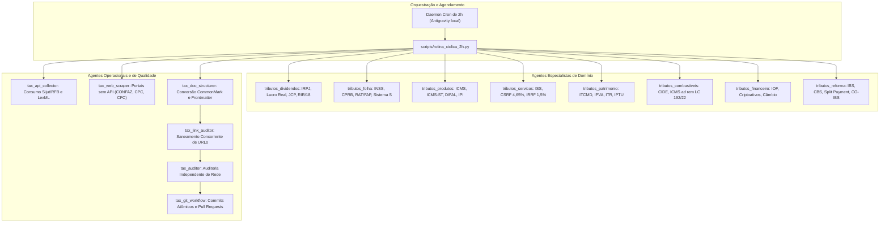

---

## 2. Mapa dos Agentes do Sistema

---

## 3. Diretrizes Inegociáveis de Qualidade e Governança

1. **Sempre Abrir PR:** Nenhuma ingestão de lote é commitada diretamente na branch `main`. Toda expansão gera uma branch temática e abre uma Pull Request via `gh pr create`.
2. **Auditoria de Rede Obrigatória (`scripts/auditar.py --rede`):** Nenhum documento é integrado se não possuir link oficial ativo com resposta HTTP válida de órgãos governamentais permitidos (`normas.leg.br`, `normasinternet2.receita.fazenda.gov.br`, `confaz.fazenda.gov.br`, `cpc.org.br`, `cfc.org.br`).
3. **Links Oficiais Diretos e Navegáveis:** É terminantemente proibido o uso de URLs legadas de busca em branco (como `sijut2consulta/consulta.action`). Todas as normas da Receita Federal apontam para o SPA visual direto `https://normasinternet2.receita.fazenda.gov.br/#/consulta/externa/{idAto}`.
4. **Documentação Viva e Sincronizada:** A cada lote, [`ACERVO.md`](file:///Users/brunoqualhato/Documents/meus/tributos/ACERVO.md), [`PROGRESSO.md`](file:///Users/brunoqualhato/Documents/meus/tributos/PROGRESSO.md) e [`WORKLOG.md`](file:///Users/brunoqualhato/Documents/meus/tributos/WORKLOG.md) são automaticamente recalculados e atualizados.
