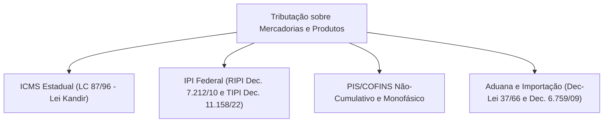

---

## 2. Mapa Normativo de Produtos

---

## 3. Substituição Tributária (ICMS-ST) e MVA
O [Convênio ICMS 142/2018](file:///Users/brunoqualhato/Documents/meus/tributos/reguladores/confaz/convenios-icms/convenio-icms-142-2018.md) disciplina o regime nacional de substituição tributária para frente:
- **Responsável Tributário (Substituto):** Em regra, o fabricante ou importador retém antecipadamente o imposto devido por toda a cadeia de distribuição até o consumidor final.
- **Fórmula da Base de Cálculo:**
 $$\text{Base ICMS-ST} = (\text{Valor da Operação Própria} + \text{Frete} + \text{Seguro} + \text{Outras Despesas} + \text{IPI}) \times (1 + \text{MVA})$$
- **MVA Ajustada:** Ajustada nas operações interestaduais para equalizar a alíquota interestadual (4%, 7% ou 12%) com a alíquota interna do estado de destino.

---

## 4. DIFAL do ICMS (Lei Complementar nº 190/2022)
Aplica-se nas operações e prestações interestaduais destinadas a consumidor final não contribuinte do ICMS:
- O Diferencial de Alíquotas pertence integralmente ao Estado de destino da mercadoria.
- Procedimentos formalizados pelo [Convênio ICMS 236/2021](file:///Users/brunoqualhato/Documents/meus/tributos/reguladores/confaz/convenios-icms/convenio-icms-236-2021.md).

---

## 5. Regimes Monofásicos de PIS e COFINS
A tributação monofásica concentra a cobrança de PIS e COFINS com alíquotas majoradas no primeiro elo da cadeia (produtor/importador), desonerando com alíquota zero os distribuidores e varejistas:
- **Fármacos e Perfumaria:** [Lei nº 10.147/2000](file:///Users/brunoqualhato/Documents/meus/tributos/federal/leis-ordinarias/pis-cofins-monofasico/lei-10147-2000.md).
- **Veículos e Autopeças:** [Lei nº 10.485/2002](file:///Users/brunoqualhato/Documents/meus/tributos/federal/leis-ordinarias/pis-cofins-monofasico/lei-10485-2002.md).
- **Combustíveis e Gás:** [Lei nº 10.560/2002](file:///Users/brunoqualhato/Documents/meus/tributos/federal/leis-ordinarias/pis-cofins-monofasico/lei-10560-2002.md).
- **Bebidas Frias:** [Lei nº 13.097/2015](file:///Users/brunoqualhato/Documents/meus/tributos/federal/leis-ordinarias/pis-cofins-monofasico/lei-13097-2015.md).
- **Consolidação Geral:** [IN RFB nº 2.121/2022](file:///Users/brunoqualhato/Documents/meus/tributos/reguladores/rfb/pis-cofins-monofasico/ato-127905-2121-2022.md) (8.832 linhas).
