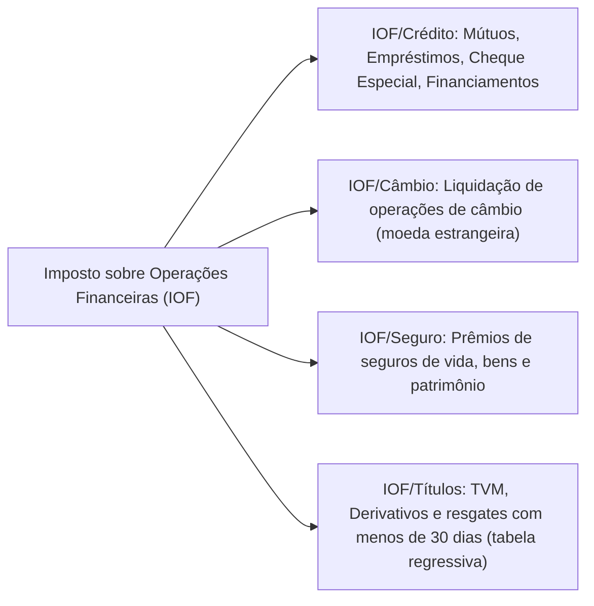

---

## 2. As Quatro Modalidades do IOF (Decreto nº 6.306/2007 - RIOF)

### Principais Alíquotas do RIOF:
- **IOF Crédito Pessoa Jurídica:** Alíquota diária de 0,0041% (limitada a 1,5% ao ano) + alíquota adicional de 0,38% na contratação.
- **IOF Crédito Pessoa Física:** Alíquota diária de 0,0082% (limitada a 3,0% ao ano) + alíquota adicional de 0,38%.
- **IOF Câmbio:** Alíquota padrão de 0,38% a 1,1% (compra de moeda estrangeira em espécie ou cartão), com cronograma de redução a zero até 2028 (adesão do Brasil à OCDE / Decreto nº 10.997/2022).
- **IOF Títulos e Valores Mobiliários:** Tabela regressiva de 96% a 0% para resgates ocorridos entre o 1º e o 29º dia da aplicação.

---

## 3. Tributação de Criptoativos (IN RFB nº 1.888/2019)
- **Obrigatoriedade de Prestação de Informações:** Pessoas físicas e jurídicas residentes no Brasil devem declarar mensalmente à Receita Federal todas as operações com criptoativos (compra, venda, permuta, doação e custódia) que ultrapassem R$ 30.000,00 por mês quando realizadas fora de *exchanges* domiciliadas no País.
- **Tributação de Ganho de Capital:** As alienações com lucro sujeitam-se à tabela progressiva de ganho de capital do IRPF (15% a 22,5%), com isenção para alienações totais no mês até R$ 35.000,00 (art. 35 da Lei 8.981/95).
