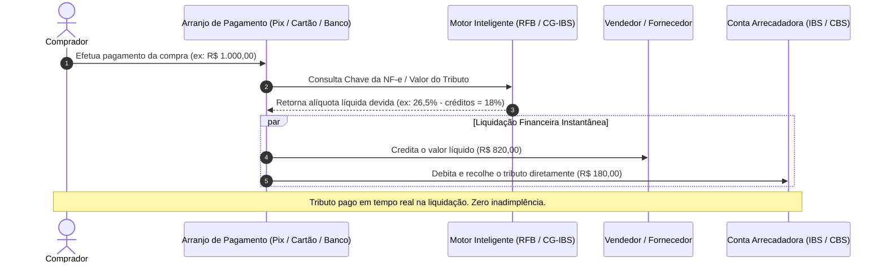

---

## 2. A Estrutura do IVA Dual Brasileiro

| Tributo | Esfera de Competência | Gestão / Arrecadação | Substitui |
| :--- | :--- | :--- | :--- |
| **CBS (Contribuição sobre Bens e Serviços)** | Federal | Secretaria Especial da Receita Federal do Brasil (RFB) | PIS/Pasep e Cofins |
| **IBS (Imposto sobre Bens e Serviços)** | Subnacional (Estados, DF e Municípios) | Comitê Gestor do IBS (CG-IBS) | ICMS (estadual) e ISS (municipal) |
| **Imposto Seletivo (IS)** | Federal | Receita Federal do Brasil | IPI (parcialmente, exceto Zona Franca) |

---

## 3. A Tecnologia do Split Payment Inteligente (PLP 68/2024, Arts. 49 a 53)

O **Split Payment** é o mecanismo tecnológico mais inovador da Reforma Tributária brasileira:

### Modalidades de Split Payment:
1. **Split Payment Padrão (Eletrônico Inteligente):** Integrado a arranjos de pagamento (Pix, cartões de crédito/débito e boleto bancário). A liquidação física dos recursos já separa a parcela do tributo e repassa diretamente para a conta única do IBS e da CBS.
2. **Split Payment Simplificado:** Para transações sem identificação imediata da nota fiscal no ato do pagamento, com retenção de alíquota presumida e compensação na apuração mensal.

---

## 4. O Comitê Gestor do IBS (PLP 108/2024)
- Órgão público independente com representação paritária entre Estados (27 membros) e Municípios (27 membros).
- Responsável por:
 - Arrecadar o IBS e distribuir as receitas aos entes federados conforme o princípio do destino.
 - Uniformizar a interpretação da legislação e julgar o contencioso administrativo tributário de forma única.
